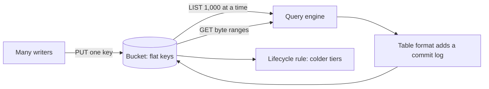

# Object storage and the data lake

Every warehouse and lakehouse in this pillar ends up reading objects from a bucket, and a bucket isn't a disk. It has no directories, no rename and no transaction across two keys, and it charges per request. Those facts explain why small files hurt, why a half-finished overwrite shows readers wrong answers, and why table formats exist. Confidence is medium because the behaviour comes from AWS's documentation and from a local emulator, moto, which issues real S3 API requests but has none of S3's latency, durability or scaling; nothing here ran on AWS.

> An object store gives you durable, immutable, strongly consistent keys and very little else. The data lake is what you build out of them, and the layout decides what it costs.



The code is in [`practice/01b_object_storage.py`](../practice/01b_object_storage.py). It starts a moto server behind a small counter, so every number of requests below is a count of real HTTP requests made by boto3 or DuckDB. S3 is the worked example. Other object stores differ in detail, and [the cost chapter](05-cost.md) uses Cloud Storage's prices, so check your provider's docs.

## Flat keys, not folders

S3's own words are plain: "[The Amazon S3 data model is a flat structure](https://docs.aws.amazon.com/AmazonS3/latest/userguide/object-keys.html)... There is no hierarchy of subbuckets or subfolders". The console's folders are a display of key prefixes split on a delimiter. This block starts the server, then shows it.

```python
import boto3, duckdb, numpy as np, pyarrow as pa, pyarrow.compute as pc, pyarrow.parquet as pq
from botocore.exceptions import ClientError
from moto.server import DomainDispatcherApplication, create_backend_app
from werkzeug.serving import make_server

log = []                                                        # one (kind, bytes) per HTTP request

def counting(app):
    """WSGI wrapper: record the kind of every request and the bytes in every response."""
    def wrapped(environ, start_response):
        method, query = environ["REQUEST_METHOD"], environ.get("QUERY_STRING", "")
        kind = "LIST" if method == "GET" and "list-type" in query else method
        body = b"".join(app(environ, start_response))
        log.append((kind, len(body)))
        return [body]
    return wrapped

server = make_server("127.0.0.1", 0, counting(DomainDispatcherApplication(create_backend_app)))
threading.Thread(target=server.serve_forever, daemon=True).start()   # one request at a time
ENDPOINT = f"127.0.0.1:{server.server_port}"
s3 = boto3.client("s3", endpoint_url=f"http://{ENDPOINT}", region_name="us-east-1",
                  aws_access_key_id="test", aws_secret_access_key="test")
s3.create_bucket(Bucket="lake")

def requests_since_reset():
    """Summarise and clear the request log."""
    kinds = {}
    for kind, _ in log:
        kinds[kind] = kinds.get(kind, 0) + 1
    size = sum(b for _, b in log)
    log.clear()
    return kinds, size
```

```python
for key in ["trips/2024/06/a.parquet", "trips/2024/07/b.parquet", "zones.csv"]:
    s3.put_object(Bucket="lake", Key=key, Body=b"x")
print("every key   :", [o["Key"] for o in s3.list_objects_v2(Bucket="lake")["Contents"]])
top = s3.list_objects_v2(Bucket="lake", Delimiter="/")
print("delimiter / :", [p["Prefix"] for p in top["CommonPrefixes"]], [o["Key"] for o in top["Contents"]])
s3.put_object(Bucket="lake", Key="odd//name/./x", Body=b"x")     # a legal key, and not a path
print("odd key kept:", s3.head_object(Bucket="lake", Key="odd//name/./x")["ContentLength"], "byte")
print("no 'trips/' object:", "Contents" not in s3.list_objects_v2(Bucket="lake", Prefix="trips/", MaxKeys=0))
```

```text
every key   : ['trips/2024/06/a.parquet', 'trips/2024/07/b.parquet', 'zones.csv']
delimiter / : ['trips/'] ['zones.csv']
odd key kept: 1 byte
no 'trips/' object: True
```

`trips/` isn't an object, and asking for it returns nothing. It exists only because some keys begin with it. A key like `odd//name/./x` is legal, which is one reason tools that treat keys as paths sometimes break.

Two consequences follow. There's no directory to list, only keys to page through, and [`ListObjectsV2` returns up to 1,000 per request](https://docs.aws.amazon.com/AmazonS3/latest/API/API_ListObjectsV2.html). And there's no rename, so moving a "directory" means copying and deleting every object:

```python
for i in range(2_500):
    s3.put_object(Bucket="lake", Key=f"old/part-{i:05d}", Body=b"x")
log.clear()
pages = s3.get_paginator("list_objects_v2").paginate(Bucket="lake", Prefix="old/")
keys = [o["Key"] for page in pages for o in page["Contents"]]
print(f"listed {len(keys):,} keys:", requests_since_reset()[0])
for key in keys:                                                 # there is no rename: copy, then delete
    s3.copy_object(Bucket="lake", Key=key.replace("old/", "new/"), CopySource={"Bucket": "lake", "Key": key})
    s3.delete_object(Bucket="lake", Key=key)
print("renamed the 'directory':", requests_since_reset()[0])
```

```text
listed 2,500 keys: {'LIST': 3}
renamed the 'directory': {'PUT': 2500, 'DELETE': 2500}
```

So 2,500 objects cost 3 list calls and 5,000 writes, and a reader during the move sees some keys in each place. On a local disk, one `rename` call moves the whole directory atomically, as [persistence](../../01-storage-and-compute-foundations/notes/09-persistence.md) relies on. Writing to a temporary directory and renaming it, the habit local files teach, doesn't carry over here. [Next](#next) points to what replaces it.

## What is guaranteed

S3 promises more than most people assume and less than a database. From the [consistency model](https://docs.aws.amazon.com/AmazonS3/latest/userguide/Welcome.html):

| Guarantee | Words from the docs |
|---|---|
| Read after write | "strong read-after-write consistency for PUT and DELETE requests of objects", in all Regions, including list after write |
| One key is atomic | A concurrent `GET` gets "either the old data or the new data, but never partial or corrupt data" |
| Concurrent writers | No locking. Of two simultaneous `PUT`s, "the request with the latest timestamp wins" |
| Several keys | "There is no way to make atomic updates across keys" |
| Bucket settings | Eventually consistent. Wait 15 minutes after enabling versioning before writing |

An object is also replaced whole. There's no append to a Parquet file and no update inside it, so changing one row means writing a new object. Durability, the eleven nines figure, and what it does and doesn't cover are in [persistence](../../01-storage-and-compute-foundations/notes/09-persistence.md).

The "last writer wins" row has a tool against it. [Conditional writes](https://docs.aws.amazon.com/AmazonS3/latest/userguide/conditional-writes.html) add a precondition to a `PUT`: `If-None-Match: *` fails if the key exists, and `If-Match: <etag>` fails if the object changed since you read it. Both return `412 Precondition Failed`, and "the first write operation to finish succeeds".

```python
def racers(n, work):
    threads = [threading.Thread(target=work, args=(i,)) for i in range(n)]
    [t.start() for t in threads]; [t.join() for t in threads]

outcomes = {}
def claim(i):
    try:
        s3.put_object(Bucket="lake", Key="_log/00000042.json", Body=f"writer {i}".encode(), IfNoneMatch="*")
        outcomes[i] = "won"
    except ClientError as e:
        outcomes[i] = e.response["ResponseMetadata"]["HTTPStatusCode"]
racers(8, claim)
print("eight writers claim one key:", sorted(outcomes.values(), key=str))
print("the object holds            :", s3.get_object(Bucket="lake", Key="_log/00000042.json")["Body"].read().decode())

def run_counter(key, safe):
    s3.put_object(Bucket="lake", Key=key, Body=b"0")
    retries = [0]
    def add(_):
        for _ in range(25):
            while True:
                got = s3.get_object(Bucket="lake", Key=key)
                value = int(got["Body"].read()) + 1
                extra = {"IfMatch": got["ETag"]} if safe else {}
                try:
                    s3.put_object(Bucket="lake", Key=key, Body=str(value).encode(), **extra)
                    break
                except ClientError:
                    retries[0] += 1
    racers(8, add)
    return int(s3.get_object(Bucket="lake", Key=key)["Body"].read()), retries[0]
print("8 writers, 25 increments each, 200 expected")
print("  blind read-modify-write: count %d, %d retries" % run_counter("count-blind", False))
print("  If-Match on the ETag   : count %d, %d retries" % run_counter("count-safe", True))
```

```text
eight writers claim one key: [412, 412, 412, 412, 412, 412, 412, 'won']
the object holds            : writer 0
8 writers, 25 increments each, 200 expected
  blind read-modify-write: count 25, 0 retries
  If-Match on the ETag   : count 200, 700 retries
```

Without a condition, 175 of 200 increments vanished with no error at all. Writers read the same value and overwrite each other. With `If-Match`, losers retry and the count is exact, at the cost of 700 retries, so this suits low-contention commits and is a poor fit for a hot counter. The first block is more important than it looks. Eight writers tried to create log entry 42 and exactly one won: that's enough to build an ordered commit log, which is what [a table format](02-table-formats.md) is. The server here handles one request at a time, so it can't test S3's own race handling; that guarantee is AWS's stated behaviour.

## A partial write is a wrong answer

Atomicity stops at one key, so anything spanning several keys can be seen half done. This is the failure that matters most in a bare data lake. Here a job rewrites a four-file table, and it dies midway. Nothing about it is unusual: readers find files by listing, and the job writes files one at a time.

```python
def parquet_bytes(table):
    buf = io.BytesIO(); pq.write_table(table, buf); return buf.getvalue()

duck = duckdb.connect()
duck.execute("INSTALL httpfs; LOAD httpfs")
duck.execute(f"""SET s3_endpoint='{ENDPOINT}'; SET s3_use_ssl=false; SET s3_url_style='path';
                 SET s3_access_key_id='test'; SET s3_secret_access_key='test'; SET s3_region='us-east-1';
                 SET enable_external_file_cache=false""")     # so each query shows its own requests

for part in range(4):                                            # the live table: 4 files, 1,000 rows each
    s3.put_object(Bucket="lake", Key=f"sales/part-{part}.parquet",
                  Body=parquet_bytes(pa.table({"amount": [1] * 1_000})))
total = lambda: duck.execute("SELECT sum(amount) FROM 's3://lake/sales/*.parquet'").fetchall()[0][0]
print("before the overwrite:", total())
new = [f"sales/new-{part}.parquet" for part in range(4)]
for key in new[:2]:                                              # a job rewrites the table, and dies halfway
    s3.put_object(Bucket="lake", Key=key, Body=parquet_bytes(pa.table({"amount": [1] * 1_000})))
print("job dies after 2 of 4 new files, reader sees:", total())
s3.delete_object(Bucket="lake", Key="sales/part-0.parquet")
s3.delete_object(Bucket="lake", Key="sales/part-1.parquet")
print("cleanup removes 2 old files, reader sees    :", total())
```

```text
before the overwrite: 4000
job dies after 2 of 4 new files, reader sees: 6000
cleanup removes 2 old files, reader sees    : 4000
```

The table has 4,000 rows, and a reader saw 6,000 with no error, because the query reads all the keys present. Tidying up by hand doesn't help. The last line matches the true total only because every row is the same: the table is now half old files and half new, and if the job had changed values, that would be a mix of two versions no query could detect. [Idempotent backfills](../../03-transform-and-orchestrate/notes/04-idempotency-and-backfills.md) limit the damage by overwriting a whole partition, but they can't make a multi-file overwrite atomic to a concurrent reader.

Uploads have a similar hidden state. Large objects use [multipart upload](https://docs.aws.amazon.com/AmazonS3/latest/userguide/mpuoverview.html), which AWS suggests for objects of 100 MB or more, with up to 10,000 parts. Until it's completed, the object doesn't exist, but its parts do, and you pay for them:

```python
upload = s3.create_multipart_upload(Bucket="lake", Key="big/huge.parquet")
s3.upload_part(Bucket="lake", Key="big/huge.parquet", UploadId=upload["UploadId"], PartNumber=1, Body=b"x" * 5_242_880)
print("objects under big/    :", s3.list_objects_v2(Bucket="lake", Prefix="big/")["KeyCount"])
pending = s3.list_multipart_uploads(Bucket="lake")["Uploads"]
print("incomplete uploads    :", [u["Key"] for u in pending], "still billed, invisible to the list above")
s3.abort_multipart_upload(Bucket="lake", Key="big/huge.parquet", UploadId=upload["UploadId"])
print("after abort           :", len(s3.list_multipart_uploads(Bucket="lake").get("Uploads", [])))
```

```text
objects under big/    : 0
incomplete uploads    : ['big/huge.parquet'] still billed, invisible to the list above
after abort           : 0
```

Listing the bucket shows nothing, while "you are billed for all storage, bandwidth, and requests for this multipart upload" until it's completed or stopped. AWS recommends a lifecycle rule with `AbortIncompleteMultipartUpload`, and it's worth adding to every bucket on day one.

## Small files, measured

Now the cost of layout. One million rows, the same data and the same answer, stored as 1, 10, 100 and 1,000 Parquet files. The query only needs one column, and DuckDB's `httpfs` extension reads through the counting server.

```python
rng = np.random.default_rng(7)
n = 1_000_000
day = rng.integers(0, 366, n)
trips = pa.table({"day": pa.array(day.astype("int32")),
                  "zone": pa.array(rng.integers(1, 266, n).astype("int32")),
                  "total": pa.array(np.round(4 + rng.exponential(19.0, n), 2)),
                  "note": pa.array(rng.integers(0, 2**62, n).astype(str))})

def load(prefix, files):
    """Split the table into equal files and upload them. Returns total bytes stored."""
    step, stored = n // files, 0
    for i in range(files):
        body = parquet_bytes(trips.slice(i * step, step))
        s3.put_object(Bucket="lake", Key=f"{prefix}/part-{i:05d}.parquet", Body=body)
        stored += len(body)
    return stored

def measure(sql):
    log.clear()
    t = time.perf_counter()
    answer = duck.execute(sql).fetchall()[0][0]
    took = time.perf_counter() - t
    kinds, size = requests_since_reset()
    return answer, kinds, size, took

GET = 0.0004 / 1000                                               # S3 Standard, GET and other reads, per request
print(f"{'files':>6} {'stored MB':>9} {'LIST':>5} {'HEAD':>5} {'GET':>6} {'MB read':>8} {'query s':>8} {'answer':>12}")
for files in [1, 10, 100, 1_000]:
    stored = load(f"t{files}", files)
    answer, kinds, size, took = measure(f"SELECT sum(total) FROM 's3://lake/t{files}/*.parquet'")
    print(f"{files:>6,} {stored / 1e6:>9.1f} {kinds.get('LIST', 0):>5} {kinds.get('HEAD', 0):>5} {kinds.get('GET', 0):>6,} "
          f"{size / 1e6:>8.1f} {took:>8.2f} {answer:>12,.0f}")
```

```text
 files stored MB  LIST  HEAD    GET  MB read  query s       answer
     1      20.8     1     0      2      1.8     0.01   22,975,476
    10      21.9     1     0     20      2.2     0.03   22,975,476
   100      24.7     1     0    200      5.2     0.20   22,975,476
 1,000      30.3     1     0  2,000     22.1     2.01   22,975,476
```

The request count is the expected part: two GETs per file, so 1,000 times as many at 1,000 files as at one. The bytes are the surprise. With one large file, DuckDB fetches the end of the file for the footer, then just the column it needs, 1.8 MB in all. At 1,000 files it read 22.1 MB, about 12 times more, for the same one column. Logging the `Range` headers shows why: each footer read fetches a fixed 16 KB tail, and those files are only 30 KB each, so that read alone brings in more than half of each file, `note` column included. Column pruning stops working when the file is about the size of the read.

The block turns DuckDB's external file cache off so each query shows its own requests. With it on, as it is by default, DuckDB 2.0 fetched these small files whole in a single GET: 100 GETs and 24.7 MB at 100 files, and 1,000 GETs and 30.6 MB at 1,000. That's fewer requests and more bytes, and the same direction. Other engines differ in the details.

Each file also has its own footer and compresses less well, so stored size grew by about half. Query time went from about 0.01 s to 2 s with no network involved. Real S3 adds latency per request: AWS quotes [roughly 100 to 200 ms for small objects](https://docs.aws.amazon.com/AmazonS3/latest/userguide/optimizing-performance.html), though engines read in parallel, so that doesn't simply add up. [The cost chapter](05-cost.md) has the same effect measured on local disk.

Small files aren't a beginner's mistake. They come from streaming sinks writing every minute, from partitioning by too many columns, and from Spark's `partitionBy` writing per task. The fix is compaction: a job that rewrites many small files into fewer big ones. On a bare lake that rewrite is itself the unsafe multi-key overwrite from the last section, which is one more reason table formats exist. They commit compaction like any other write, as [table formats](02-table-formats.md) shows.

## Layout: what a key costs

Hive-style keys put the partition in the key, as `hive/month=05/data.parquet`. Engines parse those names and skip prefixes, which is the same [partition pruning](01-warehouse-and-store.md#layout-partitions) that warehouses do, except that here it costs fewer requests as well as fewer bytes.

```python
for month in range(12):                                           # one prefix per month, hive style
    rows = trips.filter(pc.equal(pa.array((day // 31).astype("int32")), month))
    s3.put_object(Bucket="lake", Key=f"hive/month={month:02d}/data.parquet", Body=parquet_bytes(rows))
for label, sql in [
    ("every month, all columns", "SELECT count(note) + sum(total) + sum(zone) FROM 's3://lake/hive/*/*.parquet'"),
    ("every month, one column ", "SELECT sum(total) FROM 's3://lake/hive/*/*.parquet'"),
    ("one month,   one column ", "SELECT sum(total) FROM read_parquet('s3://lake/hive/*/*.parquet', hive_partitioning=true) WHERE month = 5"),
]:
    _, kinds, size, took = measure(sql)
    print(f"{label}: {kinds.get('LIST', 0)} LIST, {kinds.get('GET', 0):>3} GET, {size / 1e6:6.1f} MB read")
```

```text
every month, all columns: 1 LIST,  24 GET,   21.8 MB read
every month, one column : 1 LIST,  24 GET,    2.3 MB read
one month,   one column : 1 LIST,   3 GET,    0.2 MB read
```

Columns and partitions multiply. Selecting one column and one month read 0.2 MB of the 21.8 MB and one twelfth of the objects. All of this depends on the partition column being in the `WHERE` clause, as in [warehouse layout](01-warehouse-and-store.md).

Requests have prices. These are S3 Standard list prices for us-east-1, from the [AWS Price List file](https://pricing.us-east-1.amazonaws.com/offers/v1.0/aws/AmazonS3/current/us-east-1/index.json) published 2026-10-15, because the [pricing page's](https://aws.amazon.com/s3/pricing/) tables don't appear in its raw HTML: $0.0004 per 1,000 GETs, $0.005 per 1,000 PUT, COPY, POST or LIST requests, and DELETE is free.

```python
PUT_LIST = 0.005 / 1000                                           # S3 Standard, PUT, COPY, POST and LIST, per request
def monthly_ops(files, gets_per_file, runs_per_day):
    """Request cost of one recurring scan, for 30 days of runs."""
    runs = runs_per_day * 30
    return runs * (files * gets_per_file * GET + (files // 1000 + 1) * PUT_LIST)
for files in [10, 1_000, 100_000]:
    print(f"{files:>8,} files, 2 GETs each, 96 runs a day: ${monthly_ops(files, 2, 96):>8,.2f} a month in requests")
print(f"rewrite 100,000 small files as 100 big ones  : ${100_000 * 2 * GET + 100 * PUT_LIST:>8,.2f} once (deletes are free)")
print(f"scan 100,000 files at 5,500 GET/s, 2 GETs each: {100_000 * 2 / 5_500:.0f} s on one prefix")
```

```text
      10 files, 2 GETs each, 96 runs a day: $    0.04 a month in requests
   1,000 files, 2 GETs each, 96 runs a day: $    2.33 a month in requests
 100,000 files, 2 GETs each, 96 runs a day: $  231.85 a month in requests
rewrite 100,000 small files as 100 big ones  : $    0.08 once (deletes are free)
scan 100,000 files at 5,500 GET/s, 2 GETs each: 36 s on one prefix
```

Two GETs per file, as measured above, on a scan that runs every 15 minutes. Few files cost cents; 100,000 cost a few hundred dollars a month for a single query, and compaction pays that back with its first run. That's small next to compute for most teams, but it scales with file count and query count, and it's usually the sign of a layout that's slow too.

Request rate is the other limit. AWS says an application can reach "[at least 3,500 PUT/COPY/POST/DELETE or 5,500 GET/HEAD requests per second per partitioned Amazon S3 prefix](https://docs.aws.amazon.com/AmazonS3/latest/userguide/optimizing-performance.html)", with no limit on prefixes. Scaling "happens gradually", and you may see `503 Slow Down` errors while it does, so a job that suddenly hits a new prefix hard needs backoff and retries. Scanning 100,000 files at that rate takes 36 s on one prefix, before reading any data.

A few rules follow, roughly in order of how much they save:

| Rule | Why |
|---|---|
| Partition on what queries filter by, usually a date | Skips whole prefixes |
| Don't partition on a high-cardinality column | One file per combination creates the small-file problem |
| Aim for files much larger than a footer read | Column pruning works and requests per GB fall. Files in the hundreds of MB are a common target; check your engine's advice |
| Sort within a partition | Row-group min and max start to work, as in [clustering](01-warehouse-and-store.md#layout-sort-order-and-clustering) |
| Write to a stable prefix structure | Rate limits are per prefix and scale gradually |
| Keep raw, curated and mart data under separate prefixes or buckets | Different lifecycle rules and access policies |

## Storage tiers

Colder tiers charge less to keep and more to read. From the [storage classes page](https://docs.aws.amazon.com/AmazonS3/latest/userguide/storage-class-intro.html) and the price list above:

| Class | Designed for | Min. duration | Min. billable size | USD per GB-month | USD per GB read |
|---|---|---|---|---|---|
| Standard | Frequently accessed, more than once a month | None | None | 0.023 (first 50 TB) | None |
| Standard-IA | About once a month, millisecond access | 30 days | 128 KB | 0.0125 | 0.01 |
| Intelligent-Tiering | Unknown patterns; moves objects for you | None | Under 128 KB not monitored | Varies | None, with a per-object monitoring fee |
| Glacier Instant Retrieval | Rarely read, millisecond access | 90 days | 128 KB | 0.004 | 0.03 |
| Glacier Flexible Retrieval | Archive, minutes to hours | 90 days | 40 KB overhead per object | 0.0036 | By speed |

The arithmetic decides, and access frequency is the variable that matters:

```python
PRICE = {"Standard": .023, "Standard-IA": .0125, "Glacier IR": .004}     # USD per GB-month, first tier, us-east-1
RETRIEVAL = {"Standard": 0, "Standard-IA": .01, "Glacier IR": .03}       # USD per GB read
TRANSITION = {"Standard-IA": .01 / 1000, "Glacier IR": .02 / 1000}       # USD per object moved by lifecycle rule
print("1,000 GB for a year, by reads a month (full scans), in USD")
print(f"{'':12s} " + " ".join(f"{r:>7d}x" for r in [0, 1, 2, 5]))
for tier in PRICE:
    costs = [12 * 1000 * (PRICE[tier] + r * RETRIEVAL[tier]) for r in [0, 1, 2, 5]]
    print(f"{tier:12s} " + " ".join(f"{c:>8,.0f}" for c in costs))
print("Moving 1,000 GB from Standard to Glacier IR: what the one-off transition costs")
for size_kb in [1_000_000, 10_000, 256]:
    objects = 1000 * 1e6 / size_kb
    fee = objects * TRANSITION["Glacier IR"]
    saved = 1000 * (PRICE["Standard"] - PRICE["Glacier IR"])
    print(f"  {size_kb:>9,} KB objects: {objects:>10,.0f} objects, ${fee:>8,.2f} fee, paid back in {fee / saved:5.1f} months")
print("A 10 KB object in Standard-IA is billed as 128 KB:", f"{128 / 10:.1f}x its size,",
      f"so it costs {128 / 10 * PRICE['Standard-IA'] / PRICE['Standard']:.1f}x what Standard charges for it")
duck.close()
server.shutdown()
```

```text
1,000 GB for a year, by reads a month (full scans), in USD
                   0x       1x       2x       5x
Standard          276      276      276      276
Standard-IA       150      270      390      750
Glacier IR         48      408      768    1,848
Moving 1,000 GB from Standard to Glacier IR: what the one-off transition costs
  1,000,000 KB objects:      1,000 objects, $    0.02 fee, paid back in   0.0 months
     10,000 KB objects:    100,000 objects, $    2.00 fee, paid back in   0.1 months
        256 KB objects:  3,906,250 objects, $   78.12 fee, paid back in   4.1 months
A 10 KB object in Standard-IA is billed as 128 KB: 12.8x its size, so it costs 7.0x what Standard charges for it
```

Three things stand out. Standard-IA beats Standard only when you read the data less than about once a month, which matches AWS's description of it and means a table scanned monthly gains nothing. Glacier Instant Retrieval's saving disappears with less than one full scan a month. And a transition charges per object, so 1 TB of 256 KB files costs about 4 months of savings to move, which is why [lifecycle rules skip objects under 128 KB by default](https://docs.aws.amazon.com/AmazonS3/latest/userguide/lifecycle-transition-general-considerations.html). Small files make this worse as well. Compact before you tier. Moving out of a class early also costs: you pay out the rest of its minimum duration.

## Toward table formats

Add up what the bucket doesn't give you: no way to change several keys at once, no fast listing, and a directory that only appears to exist. The Delta paper's complaints, covered in [table formats](02-table-formats.md#the-problem-object-stores-leave-you-with), come from the same list. The fix uses exactly what the bucket does guarantee: immutable data files, atomic single-key writes, and a conditional `PUT` to decide who wins a commit. The table becomes a list of files in a log, so that a reader never lists a directory or sees half a commit.

AWS now also sells this as a product: [S3 Tables](https://docs.aws.amazon.com/AmazonS3/latest/userguide/s3-tables.html) are table buckets storing Apache Iceberg tables. That doesn't change the reasoning, only who runs the compaction.

## Pitfalls

- **Thinking a prefix is a directory.** There's no atomic rename and no per-prefix delete. Moving or dropping one is a request per object, and a concurrent reader sees it in progress.
- **Overwriting a lake table in place.** Readers listing at that moment see old and new files together, and get a wrong answer with no error. Use a table format, or write to a new prefix and switch a pointer.
- **No lifecycle rule for incomplete uploads.** Failed multipart uploads don't appear in listings and are still billed.
- **Tiering a table people scan.** Retrieval fees exceed the storage saving past roughly one scan a month. Check access logs first.
- **Tiering small objects.** Per-object transition fees and the 128 KB minimum can cost more than they save. Compact first.
- **One folder per user or per hour.** Each extra partition column multiplies file count. Query engines and bills both notice.
- **Treating moto as S3.** It's excellent for testing API behaviour and useless for timing, rate limits and durability.

## Try it

1. In `many_keys`, remove `SET enable_external_file_cache=false` and rerun `small_files`. What happens to GETs and bytes at 100 files, and which would you rather pay for?
2. Add a third layout in `pruning`, partitioned by `month` and `zone`, and count the objects. What happens to bytes read for a query filtering only on `month`?
3. Rewrite `many_keys` so that the job writes to `sales_v2/`, then atomically updates one `CURRENT` key naming the live prefix, and the reader follows that key. Kill it at the same point. What does the reader see? What did you just invent?
4. A 500 GB table is scanned twice a month and kept for 3 years. Which class wins at these prices?

<details><summary>Answers</summary>

1. GETs halve to 100 and bytes rise from 5.2 MB to 24.7 MB, because each small file is fetched whole. On S3, requests are cheap and transfer inside a region is usually about time, so this is a reasonable engine choice. It's also an internal detail that can change between versions, which is why the rule is "files in the hundreds of MB", well clear of the behaviour.
2. There are 265 zones, so up to 3,180 objects, one GET or more each. Bytes rise because each file has its own footer and compresses less well, and the query got no benefit from the extra partition column.
3. The reader sees the old complete table until the pointer changes, then the new one, because that single `PUT` is atomic. Add a conditional write on the pointer so two jobs can't both win and you have the core of a table format.
4. Standard, at about $414 over 3 years. Standard-IA is $225 for storage plus 500 GB x 2 x 36 x $0.01 = $360 for reads, so $585. Glacier Instant Retrieval is $72 plus $1,080 for reads. Two scans a month is too many for a colder class.

</details>

## Interview checklist

| Question | Answer |
|---|---|
| Is S3 eventually consistent? | Not for objects, since strong read-after-write arrived. Bucket configuration still is. Atomicity stops at one key. |
| Why can't you rename a folder on S3? | Folders are key prefixes. A rename is a copy and delete per object, so it isn't atomic and costs a request per object. |
| What do conditional writes add? | `If-None-Match` and `If-Match` make a `PUT` fail with 412 if the object exists or has changed, which is enough to commit to a log. |
| Why are small files bad? | More requests per GB, per-file footers, worse compression, and column pruning stops working once a file is about the size of a footer read. Compaction fixes them. |
| When do cold tiers lose money? | When reads are frequent enough for retrieval fees to exceed the saving, or objects are small enough for transition fees and minimums to dominate. |
| What is a data lake missing compared with a warehouse? | Multi-key atomicity, schema enforcement and fast metadata. Table formats add these on top of object storage. |
| What is the S3 request-rate limit? | At least 3,500 writes and 5,500 reads per second per partitioned prefix, scaling gradually, with 503s while it scales. |

## Next

The bucket gives you atomic single-key writes and nothing across keys, and that's enough to build transactions: [Table formats](02-table-formats.md) writes the commit log in sixty lines.
