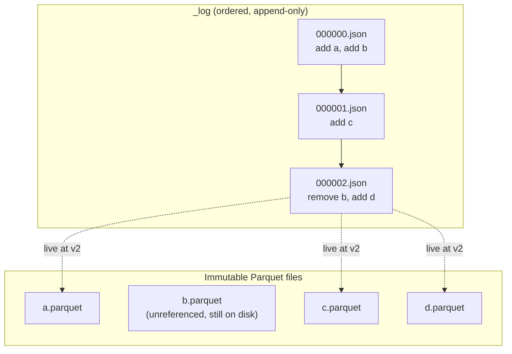

# Table formats: a log over Parquet

A nightly job rewrites June's taxi data in the lake. Halfway through, the spot instance dies. Half of June is new, half is gone, and every dashboard reading the directory now reports a wrong number without an error. Nothing in a bucket of Parquet files says which files belong together. Table formats add the missing piece, an ordered log that names the live files, and with that one idea a bucket gains atomic commits, time travel and safe concurrent writers. This chapter builds the idea in sixty lines, then shows it working in Delta Lake and Apache Iceberg, and compares both with Apache Hudi.

## The problem object stores leave you with

An object store is a key-value store with very high availability and low cost. It is not a file system. Armbrust et al. describe the consequences for analytics in the Delta Lake paper ([Armbrust et al., PVLDB 2020](https://www.vldb.org/pvldb/vol13/p3411-armbrust.pdf)). There is no cross-key consistency, so a job writing many objects cannot make them appear together. There is no cheap rename to fake it with. Listing is slow, about 1,000 keys per call at tens to hundreds of milliseconds, so a table with millions of objects takes minutes to enumerate. The paper reports that between 2014 and 2016 about half of Databricks' support escalations came from data corruption, consistency or performance problems in these cloud storage strategies. That figure is the vendor's own and it is anecdotal, but the mechanism is easy to reproduce.

The fix is to stop treating the directory as the table. The table becomes a *list of files*, and the list is itself stored in the object store as an ordered series of records. A reader consults the list, never the directory. Writing many files is then safe, because files that are not named in the list do not exist as far as any reader knows. The whole commit reduces to one atomic operation: adding one new record to the list.



## A table format in sixty lines

Nothing about this needs a framework. The next block is a working, simplified format using only pyarrow. Run all the blocks in this chapter in one session with `uv run --with 'pyiceberg[sql-sqlite,pyarrow,pyiceberg-core]' --with deltalake --with numpy python`; versions used were deltalake 1.6.6, pyiceberg 0.12.0 and pyarrow 26.

```python
import json, os, uuid, glob, shutil, time
import numpy as np, pyarrow as pa, pyarrow.parquet as pq, pyarrow.compute as pc

class TinyTable:
    """A table is a set of immutable Parquet files plus an ordered log of which files are live."""
    def __init__(self, root):
        self.root, self.log = root, f"{root}/_log"
        os.makedirs(self.log, exist_ok=True)

    def version(self):
        return max((int(os.path.basename(p)[:-5]) for p in glob.glob(f"{self.log}/*.json")), default=-1)

    def _commit(self, read_version, actions):
        path = f"{self.log}/{read_version + 1:06d}.json"
        fd = os.open(path, os.O_CREAT | os.O_EXCL | os.O_WRONLY)  # atomic: exactly one writer can win this name
        with os.fdopen(fd, "w") as f:
            json.dump(actions, f)
        return read_version + 1

    def live_files(self, version=None):
        version = self.version() if version is None else version
        live = {}
        for v in range(version + 1):
            for a in json.load(open(f"{self.log}/{v:06d}.json")):
                if "add" in a: live[a["add"]["path"]] = a["add"]
                else: live.pop(a["remove"], None)
        return live

    def write_file(self, table):
        name = f"{uuid.uuid4().hex}.parquet"
        pq.write_table(table, f"{self.root}/{name}")
        col = table["fare"]
        return {"add": {"path": name, "rows": table.num_rows,
                        "min_fare": pc.min(col).as_py(), "max_fare": pc.max(col).as_py()}}

    def append(self, table):
        return self._commit(self.version(), [self.write_file(table)])

    def read(self, version=None):
        files = self.live_files(version)
        return pa.concat_tables(pq.read_table(f"{self.root}/{p}") for p in files)

    def delete_where(self, trip_id):
        """Copy-on-write: rewrite only the files holding the row, swap them in one commit."""
        base, actions = self.version(), []
        for path in self.live_files(base):
            t = pq.read_table(f"{self.root}/{path}")
            keep = t.filter(pc.field("trip_id") != trip_id)
            if keep.num_rows != t.num_rows:
                actions += [{"remove": path}, self.write_file(keep)]
        return self._commit(base, actions)

batch = lambda ids, fare: pa.table({"trip_id": ids, "fare": [fare + i for i, _ in enumerate(ids)]})
shutil.rmtree("tiny", ignore_errors=True)
t = TinyTable("tiny")
t.append(batch([1, 2, 3], 10.0))
t.append(batch([4, 5, 6], 20.0))
t.delete_where(5)
print("log:", sorted(os.listdir("tiny/_log")))
print("data files on disk:", len(glob.glob("tiny/*.parquet")), " live now:", len(t.live_files()))
print("v2 now :", sorted(t.read()["trip_id"].to_pylist()))
print("v1 then:", sorted(t.read(version=1)["trip_id"].to_pylist()))
```

Output:

```text
log: ['000000.json', '000001.json', '000002.json']
data files on disk: 3  live now: 2
v2 now : [1, 2, 3, 4, 6]
v1 then: [1, 2, 3, 4, 5, 6]
```

Three properties have appeared for free. The directory holds three data files and the table has two live ones, because the delete wrote a replacement and swapped it in. Version 1 is still readable, because nothing was destroyed: that is time travel, and it costs nothing but storage. And the delete touched only one file, the copy-on-write pattern.

The commit is the line with `O_CREAT | O_EXCL`. It asks the operating system to create the next version's file and to fail if the file already exists. Only one writer can win. This is optimistic concurrency control: do the work first, claim the slot last.

```python
read_version = t.version()
first  = [t.write_file(batch([7], 30.0))]      # writer A prepares against version 2
second = [t.write_file(batch([8], 40.0))]      # writer B prepares against version 2 too
print("A commits version", t._commit(read_version, first))
try:
    t._commit(read_version, second)
except FileExistsError:
    print("B lost the race on version", read_version + 1, "- re-read, check for conflict, retry")
    print("B commits version", t._commit(t.version(), second))
print("rows:", sorted(t.read()["trip_id"].to_pylist()))
```

Output:

```text
A commits version 3
B lost the race on version 3 - re-read, check for conflict, retry
B commits version 4
rows: [1, 2, 3, 4, 6, 7, 8]
```

A real format does more at the retry step. It reads what the winner changed and decides whether the two transactions actually conflict. Two appends never do; a delete of a file the other writer also rewrote does, and that writer must redo its work. Delta defines this per isolation level, and Iceberg writers re-apply their changes against the new metadata ([Iceberg table spec](https://iceberg.apache.org/spec/)). Not every store has a put-if-absent primitive; the Delta paper notes S3 at the time needed a lightweight coordinator to allot log record IDs, while Azure and HDFS could use atomic operations directly.

A crash is now harmless to readers.

```python
orphan = t.write_file(batch([99], 50.0))       # the Parquet file is written, then the job dies before commit
print("orphan on disk:", os.path.exists("tiny/" + orphan["add"]["path"]))
print("trip 99 visible to readers:", 99 in t.read()["trip_id"].to_pylist())
```

Output:

```text
orphan on disk: True
trip 99 visible to readers: False
```

The orphan wastes storage until a cleanup job finds it, and that is the only damage. June's half-finished rewrite is invisible until the commit, and the commit is one atomic create.

The log also becomes the place to keep statistics. Each `add` record stored the min and max fare, so a reader can skip files without opening them, and without listing the directory.

```python
stats = t.live_files()
hit = [p[:6] for p, a in stats.items() if a["min_fare"] <= 31 <= a["max_fare"]]
print(f"fare = 31: {len(hit)} of {len(stats)} files need opening, decided from the log alone")
```

Output:

```text
fare = 31: 0 of 4 files need opening, decided from the log alone
```

Armbrust et al. measured what this does at scale. On a synthetic table of 33 million rows split into 1,000 to 1,000,000 partitions on S3, on 16 `i3.2xlarge` nodes, Hive took over an hour at 10,000 partitions and Presto over an hour at 100,000, while Delta took 108 seconds at one million partitions and 17 with the log cached on SSD. It is a vendor benchmark, but the cause is structural: reading a log with statistics replaces listing a directory and opening footers.

Scaling needs one more trick. Replaying thousands of JSON files on every read is slow, so formats periodically write a checkpoint that summarises the state so far. Delta writes one in Parquet every 10 transactions by default, and a reader starts at the latest checkpoint and replays only what follows.

## Delta Lake on disk

Delta is the same design with a richer action vocabulary. The `deltalake` package is a Rust implementation with no JVM or Spark dependency, so the log can be examined on a laptop ([delta-rs docs](https://delta-io.github.io/delta-rs/)).

```python
from deltalake import DeltaTable, write_deltalake, __version__ as dl_version
import pyarrow as pa, json, glob, os
print("deltalake", dl_version)
rides = lambda ids, fares, day: pa.table({"trip_id": pa.array(ids, pa.int64()), "fare": pa.array(fares, pa.float64()),
                                          "pickup_date": pa.array([day] * len(ids), pa.string())})
path = "trips_delta"
write_deltalake(path, rides([1, 2, 3], [10.0, 11.0, 12.0], "2024-06-01"), partition_by=["pickup_date"])
write_deltalake(path, rides([4, 5], [20.0, 21.0], "2024-06-02"), mode="append", partition_by=["pickup_date"])
dt = DeltaTable(path)
dt.delete("trip_id = 2")
source = rides([3, 6], [99.0, 30.0], "2024-06-02")
(DeltaTable(path).merge(source, "t.trip_id = s.trip_id", source_alias="s", target_alias="t")
   .when_matched_update(updates={"fare": "s.fare"})
   .when_not_matched_insert_all()
   .execute())
dt = DeltaTable(path)
print("version:", dt.version())
for f in sorted(glob.glob(path + "/_delta_log/*.json")):
    acts = [next(iter(json.loads(l))) for l in open(f)]
    print(os.path.basename(f), acts)
for h in dt.history()[::-1]:
    print(h["version"], h["operation"])
```

Output:

```text
deltalake 1.6.6
version: 3
00000000000000000000.json ['commitInfo', 'protocol', 'metaData', 'add']
00000000000000000001.json ['commitInfo', 'add']
00000000000000000002.json ['commitInfo', 'add', 'remove']
00000000000000000003.json ['commitInfo', 'add', 'add', 'remove']
0 WRITE
1 WRITE
2 DELETE
3 MERGE
```

Each commit is a file of newline-delimited actions. The DELETE commit has `add` and `remove` together because copy-on-write replaced a file. The MERGE has two `add`s because it rewrote one file and added another. The `commitInfo` action is an audit trail, and a `txn` action, which the paper describes but this code did not need, stores an application ID and version in the same commit as the data. That is what makes an exactly-once stream sink possible: see [the Kafka chapter](04-kafka-and-stream-semantics.md).

```python
print(sorted(dt.to_pyarrow_table().to_pylist(), key=lambda r: r["trip_id"]))
old = DeltaTable(path, version=1)
print("version 1 trip_ids:", sorted(old.to_pyarrow_table()["trip_id"].to_pylist()))
first = json.loads(open(sorted(glob.glob(path + "/_delta_log/*.json"))[1]).readlines()[0])
acts = [json.loads(l) for l in open(sorted(glob.glob(path + "/_delta_log/*.json"))[1])]
add = next(a["add"] for a in acts if "add" in a)
print(json.dumps({k: add[k] for k in ("path", "partitionValues", "stats")}, indent=1))
```

Output:

```text
[{'trip_id': 1, 'fare': 10.0, 'pickup_date': '2024-06-01'}, {'trip_id': 3, 'fare': 99.0, 'pickup_date': '2024-06-01'}, {'trip_id': 4, 'fare': 20.0, 'pickup_date': '2024-06-02'}, {'trip_id': 5, 'fare': 21.0, 'pickup_date': '2024-06-02'}, {'trip_id': 6, 'fare': 30.0, 'pickup_date': '2024-06-02'}]
version 1 trip_ids: [1, 2, 3, 4, 5]
{
 "path": "pickup_date=2024-06-02/part-00000-a046c8f2-ba0f-437b-9df2-14f0174c33b0-c000.snappy.parquet",
 "partitionValues": {
  "pickup_date": "2024-06-02"
 },
 "stats": "{\"numRecords\":2,\"minValues\":{\"trip_id\":4,\"fare\":20.0},\"maxValues\":{\"trip_id\":5,\"fare\":21.0},\"nullCount\":{\"fare\":0,\"trip_id\":0}}"
}
```

The `stats` field is the same idea as `min_fare` in the toy. Now the part teams get wrong: time travel lasts only until the old files are removed.

```python
all_files = glob.glob(path + "/**/*.parquet", recursive=True)
live = dt.file_uris()
print(f"{len(all_files)} Parquet files on disk, {len(live)} live")
would = dt.vacuum(retention_hours=0, enforce_retention_duration=False, dry_run=True)
print("vacuum would remove", len(would))
dt.vacuum(retention_hours=0, enforce_retention_duration=False, dry_run=False)
try:
    DeltaTable(path, version=1).to_pyarrow_table()
    print("version 1 still readable")
except Exception as e:
    print("version 1 after vacuum:", type(e).__name__)
```

Output:

```text
5 Parquet files on disk, 3 live
vacuum would remove 2
version 1 after vacuum: FileNotFoundError
```

`vacuum` deletes unreferenced files older than a retention window, and this code forced the window to zero for the demonstration. The log still lists version 1, but its files are gone, so the read fails. This is the trade-off behind every format's cleanup job, and it matters for erasure as well: a deleted person's row remains in old files until vacuum runs, which the [privacy chapter](../../07-architecture-and-governance/notes/02-access-control-pii-gdpr.md) picks up.

## Iceberg: a tree instead of a list

Iceberg came out of Netflix and solves the same problem with a different structure. Instead of an ordered log, it stores a tree: table metadata points to a current snapshot, a snapshot points to a manifest list, a manifest list points to manifests, and each manifest names data files with their partition values and metrics. A commit writes new metadata and atomically swaps the pointer ([Iceberg table spec](https://iceberg.apache.org/spec/)). The atomic operation lives in a *catalog*, here a local SQLite database.

```text
catalog (nyc.trips -> current metadata file)        atomic swap happens here
   v
vN.metadata.json   schema, partition specs, list of snapshots
   v
snap-*.avro        manifest list: one row per manifest, with partition ranges
   v
*.avro             manifest: one row per data file, with partition value and column metrics
   v
data/pickup_day=2024-06-01/*.parquet
```

```python
import os, glob, json, datetime as dt_
import pyarrow as pa, pyiceberg
from pyiceberg.catalog.sql import SqlCatalog
from pyiceberg.partitioning import PartitionSpec, PartitionField
from pyiceberg.transforms import DayTransform
from pyiceberg.schema import Schema
from pyiceberg.types import LongType, DoubleType, TimestampType, NestedField
print("pyiceberg", pyiceberg.__version__)
os.makedirs("wh", exist_ok=True)
cat = SqlCatalog("local", uri=f"sqlite:///{os.getcwd()}/wh/catalog.db", warehouse=f"file://{os.getcwd()}/wh")
cat.create_namespace("nyc")
schema = Schema(NestedField(1, "trip_id", LongType(), required=False),
                NestedField(2, "fare", DoubleType(), required=False),
                NestedField(3, "pickup", TimestampType(), required=False))
spec = PartitionSpec(PartitionField(source_id=3, field_id=1000, transform=DayTransform(), name="pickup_day"))
tbl = cat.create_table("nyc.trips", schema=schema, partition_spec=spec)
arrow_schema = schema.as_arrow()
rows = lambda ids, fares, day: pa.table({"trip_id": ids, "fare": fares, "pickup": [dt_.datetime(2024, 6, day, 9)] * len(ids)}, schema=arrow_schema)
tbl.append(rows([1, 2], [10.0, 11.0], 1))
tbl.append(rows([3], [20.0], 2))
tbl.delete("trip_id = 2")
tbl = cat.load_table("nyc.trips")
for s in tbl.history():
    snap = tbl.snapshot_by_id(s.snapshot_id)
    print(snap.summary.operation.value, "manifest list:", os.path.basename(snap.manifest_list)[:24] + "...")
print(sorted(os.listdir("wh/nyc/trips") if os.path.exists("wh/nyc/trips") else os.listdir("wh/nyc.db/trips")))
base = "wh/nyc/trips" if os.path.exists("wh/nyc/trips") else "wh/nyc.db/trips"
for d in sorted(os.listdir(base + "/data")): print(" data/", d)
print(len(glob.glob(base + "/metadata/*.metadata.json")), "metadata.json,", len(glob.glob(base + "/metadata/snap-*.avro")), "manifest lists,",
      len([f for f in glob.glob(base + "/metadata/*.avro") if "snap-" not in f]), "manifests")
```

Output:

```text
pyiceberg 0.12.0
append manifest list: snap-6976903908284739091...
append manifest list: snap-7545171503530702710...
overwrite manifest list: snap-7399412938163103974...
['data', 'metadata']
 data/ pickup_day=2024-06-01
 data/ pickup_day=2024-06-02
4 metadata.json, 3 manifest lists, 4 manifests
```

Two appends and a delete made three snapshots, and each snapshot has its own manifest list. The "overwrite" is the delete: the data file holding trip 2 was rewritten. The tree's advantage is planning. A query prunes first at the manifest list using its partition ranges, so it can avoid even reading most manifests, which matters on tables with very many files.

```python
scan = tbl.scan(row_filter="pickup >= '2024-06-02T00:00:00'")
print("files planned:", [os.path.dirname(t.file.file_path).split('/')[-1] for t in scan.plan_files()])
print(scan.to_arrow().to_pylist())
snap0 = tbl.history()[0].snapshot_id
print("first snapshot ids:", sorted(tbl.scan(snapshot_id=snap0).to_arrow()["trip_id"].to_pylist()))
from pyiceberg.transforms import MonthTransform
with tbl.update_spec() as u:
    u.add_field("pickup", MonthTransform(), "pickup_month")
tbl = cat.load_table("nyc.trips")
print("specs:", [str(s) .replace("\n"," ") for s in tbl.specs().values()])
```

Output:

```text
files planned: ['pickup_day=2024-06-02']
[{'trip_id': 3, 'fare': 20.0, 'pickup': datetime.datetime(2024, 6, 2, 9, 0)}]
first snapshot ids: [1, 2]
specs: ['[   1000: pickup_day: day(3) ]', '[   1000: pickup_day: day(3)   1001: pickup_month: month(3) ]']
```

Three things in that output are worth the extra machinery.

**Hidden partitioning.** The table is partitioned by `day(pickup)`, but the query filtered on `pickup` itself and the planner found the right directory. In a Hive-style layout a user must know to filter on a separate `pickup_date` column, and a filter on the timestamp alone scans everything. Iceberg records the transform in metadata, so producers and consumers never see a derived column ([Iceberg partitioning docs](https://iceberg.apache.org/docs/latest/partitioning/)).

**Partition evolution.** The final line added a month partition field with no rewrite: the table now has two specs, and old files keep the old spec while new files use the new one. In a directory-layout lake, changing the partition scheme means rewriting the table and updating every query.

**Schema by ID.** Iceberg tracks columns by field ID, the `1, 2, 3` in the schema above, not by name or position. A rename cannot silently attach an old file's column to a new meaning.

## Hudi, and the write path decision

Apache Hudi began at Uber to absorb a stream of upserts into a lake. Its primary abstraction is a timeline of actions on file groups, and it asks you to pick one of two table types up front ([Hudi table types](https://hudi.apache.org/docs/table_types)).

- **Copy on Write (CoW).** An update rewrites the base file into a new slice. Reads are simple and fast; writes pay. The Hudi docs recommend it for batch ETL and warehouse-like tables.
- **Merge on Read (MoR).** An update appends to a delta log beside the base file, and a compaction process merges them later. Writes are light, commits can come every minute or so, and readers either merge at query time for fresh results or use a read-optimized query that sees only the compacted base files.

The trade is general. Delta and Iceberg have both grown merge-on-read styles: Iceberg's spec defines position deletes, equality deletes and, in newer format versions, deletion vectors; Delta has deletion vectors too. So the question is which side of a write-amplification trade your workload is on. Some arithmetic with a uniformly random update pattern shows how sharp it can be:

```python
# Update 1% of rows per commit across a 1 TB table made of 1 GB files. Rows touched fall in many files.
files, rows_per_file, updates = 1000, 10_000_000, 100_000_000
touched = files * (1 - (1 - 1 / files) ** updates)         # updates land uniformly at random
row_size = 1e9 / rows_per_file
print(f"files touched: {touched:.0f} of {files}")
print(f"copy-on-write rewrites : {touched * 1e9 / 1e12:7.2f} TB per commit")
print(f"merge-on-read appends  : {updates * row_size / 1e12:7.2f} TB per commit")
for clustered in (0.02, 0.10):
    print(f"if updates cluster in {clustered:.0%} of files, COW rewrites {files * clustered * 1e9 / 1e12:.2f} TB")
```

Output:

```text
files touched: 1000 of 1000
copy-on-write rewrites :    1.00 TB per commit
merge-on-read appends  :    0.01 TB per commit
if updates cluster in 2% of files, COW rewrites 0.02 TB
if updates cluster in 10% of files, COW rewrites 0.10 TB
```

Random updates across a 1 TB table touch every file, so copy-on-write rewrites the terabyte to change a hundredth of it. Clustered updates, such as most changes hitting recent days, bring the cost close to merge-on-read. Know your update distribution before you pick. The merge-on-read savings are not free either: every reader pays until compaction runs, so a neglected compaction job turns a fast write path into slow reads.

| | Delta Lake | Apache Iceberg | Apache Hudi |
|---|---|---|---|
| Origin | Databricks | Netflix | Uber |
| Metadata structure | Ordered JSON log with Parquet checkpoints | Tree: metadata, manifest list, manifests | Timeline of actions on file groups |
| Atomic commit via | Put-if-absent or coordinator on the store | Catalog pointer swap | Timeline plus concurrency control |
| Hidden partitioning | Not the default; partition columns are visible | Yes, a core feature | Partition paths, configurable |
| Default write style | Copy-on-write, deletion vectors optional | Copy-on-write or merge-on-read per operation | Chosen as CoW or MoR at table creation |
| Typical strength | Tight Spark and Databricks integration | Multi-engine neutrality, very large tables | Upsert-heavy ingestion, incremental pulls |

Treat the comparison as a snapshot. These projects copy each other's good ideas every release, and engine support moves quickly. The 2020 and 2021 papers' statements that Hudi lacks concurrent writers, for instance, describe that period's releases and should not be repeated as current fact without checking the docs. Choose by which engines you must support and what your catalog does, then confirm the feature against the current documentation.

## Pitfalls

- **Reading the directory instead of the table.** A glob over a Delta directory returns unreferenced files, so deleted rows come back. The [next chapter](03-lakehouse-vs-warehouse.md) measures this. Use a reader that understands the log.
- **Vacuuming below your time travel promise.** Retention decides how far back you can read, and it can break long-running readers still using old files.
- **Never compacting.** A streaming writer makes many small files per commit, and merge-on-read accumulates delete files. Schedule compaction as a first-class job.
- **Assuming multi-table transactions.** Log-per-table designs commit one table at a time.
- **Treating the catalog as an afterthought.** In Iceberg the catalog holds the atomic pointer. Two jobs using two different catalogs for one table can corrupt it.
- **Hand-editing or copying a log.** Copying a table's directory without care can break absolute paths or lose the commit order.

## Try it

1. Extend `TinyTable` with a `compact()` method that rewrites all live files into one and commits with a remove per old file. Check that time travel to earlier versions still works.
2. Two writers both delete from the same file against the same read version. Change `_commit`'s retry so the loser detects that its removed file is gone and re-reads rather than committing a stale replacement.
3. In the Delta block, write a 12th commit and find the checkpoint. Which file did the reader start from?

<details><summary>Answers</summary>

1. The commit has one `add` and many `remove` records. Earlier versions still resolve because the old Parquet files are untouched.
2. Before committing, replay the log from `read_version + 1` and compare the winners' `remove` paths with yours. On overlap, abort and redo the delete from the new version; without this check the loser would resurrect rows.
3. A `*.checkpoint.parquet` appears in `_delta_log` around version 10 in Delta's default configuration, with `_last_checkpoint` pointing at it. The reader starts there and replays only later JSON records. The delta-rs writer may need `create_checkpoint()` called explicitly, depending on version.

</details>

## Interview checklist

| Question | Answer |
|---|---|
| What is a table format? | Metadata over immutable data files that names which files are the table, committed atomically. |
| How does a commit become atomic on an object store? | One atomic step: put-if-absent of the next log record, or a catalog pointer swap. |
| What is optimistic concurrency here? | Write files first, claim the next version last; on a lost race, check for conflict and retry. |
| Copy-on-write or merge-on-read? | CoW pays at write and reads fast; MoR writes fast and pays at read until compaction. Pick by update distribution. |
| What does Iceberg's hidden partitioning fix? | Queries on the source column get pruning, and partition specs can change without a rewrite. |
| What limits time travel? | Retention: vacuum or snapshot expiry deletes old files. |
| What don't table formats give you? | Multi-table transactions in the usual log-per-table design, a query engine, or data quality on their own. |

## Next

A table format gives a lake the core feature of a warehouse. Does that make the warehouse obsolete? [Lakehouse against warehouse](03-lakehouse-vs-warehouse.md) tests the claim.
