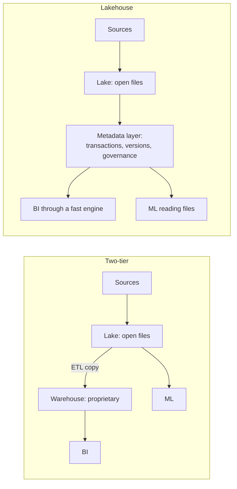

# Lakehouse against warehouse

In 2021 four authors from Databricks predicted that the data warehouse as we know it would wane. Five years on, warehouses are still in wide use, and BigQuery and others now read open table formats as well. The useful question for an engineer is narrower than the industry argument: for this workload, what do you gain and what do you give up when the lake is the system of record? This chapter separates the idea from the marketing, tests the claims that can be run on a laptop, and ends in a decision table. Confidence is marked medium because the central benchmark is vendor-run and the rest is architectural judgement.

## How we got two copies of everything

Armbrust et al. tell the history in three generations ([Armbrust et al., CIDR 2021](https://www.cidrdb.org/cidr2021/papers/cidr2021_paper17.pdf)). First-generation warehouses coupled compute and storage in one appliance and enforced a schema on write. Then came data too large or too unstructured for that, and the second generation split the job in two. A cheap data lake held everything with schema-on-read, and a subset was copied to a warehouse for BI. From about 2015, cloud object stores replaced HDFS as the lake.

That two-tier design works, and it is also what the paper attacks. The authors list four problems.

- **Reliability.** Two systems must be kept consistent through ETL, and every step is a chance to diverge.
- **Staleness.** A warehouse is at least one ETL step behind the lake. The paper cites a Dimensional Research and Fivetran survey in which 86% of analysts used out-of-date data and 62% waited on engineering numerous times a month. Note the source: a survey sponsored by a vendor of ETL tooling, quoted by a vendor of lakehouse tooling.
- **Advanced analytics.** ML libraries want to read files directly. Pulling large training sets through ODBC or JDBC is inefficient, and the warehouse's internal format is not available to them.
- **Total cost of ownership.** Data is stored twice, and a proprietary format makes leaving expensive.



## What a lakehouse is

The paper's definition is precise and worth keeping: a data management system on low-cost, directly accessible storage that also provides traditional DBMS management and performance features, such as ACID transactions, data versioning, auditing, indexing, caching and query optimisation. It rests on three ideas. A transactional metadata layer over open files, which is [the previous chapter](02-table-formats.md). SQL performance through work independent of the file format, namely caching, auxiliary data such as min-max statistics, and data layout. And declarative DataFrame APIs, so ML reads can be optimised too.

The authors state the price themselves: this gives up some data independence, since clients read the storage format directly. A warehouse can change its internal layout at will because nobody else sees it. An open format is a public interface that you cannot change quietly. Everything else in this chapter follows from that one trade.

## The claim you can test: one copy, many engines

The running example is a silver table of two million trips in Delta, read through three engines with no export step. `uv run --with deltalake --with duckdb --with pyarrow --with numpy python` runs all the blocks in this chapter.

```python
import pyarrow as pa, pyarrow.parquet as pq, duckdb, numpy as np, time, os, glob
from deltalake import DeltaTable, write_deltalake
rng = np.random.default_rng(3)
n = 2_000_000
trips = pa.table({
    "trip_id": pa.array(np.arange(n)),
    "pu_zone": pa.array(rng.integers(1, 266, n).astype("int32")),
    "fare": pa.array(np.round(3 + rng.exponential(14.0, n), 2)),
})
write_deltalake("silver_trips", trips.slice(0, 1_000_000))
write_deltalake("silver_trips", trips.slice(1_000_000), mode="append")

dt = DeltaTable("silver_trips")
live = dt.file_uris()
# Engine 1: the Delta reader, which replays the log.
print("delta-rs :", dt.to_pyarrow_table().num_rows)
# Engine 2: plain pyarrow, told which files are live.
print("pyarrow  :", sum(pq.read_metadata(f).num_rows for f in live))
# Engine 3: DuckDB over the same bytes, with no copy and no load step.
files = [f.replace("file://", "") for f in live]
print("duckdb   :", duckdb.sql(f"SELECT count(*) FROM read_parquet({files})").fetchall()[0][0])
```

Output:

```text
delta-rs : 2000000
pyarrow  : 2000000
duckdb   : 2000000
```

This is the real benefit, and it is more than a cost saving. A data scientist's pyarrow job and an analyst's SQL read the same bytes, so "the training data and the dashboard disagree" stops being a question of which ETL copy is behind. It comes with a trap that a warehouse could never have, since a warehouse does not let you see its files.

```python
dt.delete("trip_id < 500000")
stale = duckdb.sql("SELECT count(*) FROM read_parquet('silver_trips/*.parquet')").fetchall()[0][0]
right = DeltaTable("silver_trips").to_pyarrow_table().num_rows
print(f"glob over the directory : {stale:,}  (ignores the log, resurrects deleted rows)")
print(f"through the log         : {right:,}")
```

Output:

```text
glob over the directory : 2,500,000  (ignores the log, resurrects deleted rows)
through the log         : 1,500,000
```

A delete was committed, and the glob returned 2.5 million rows, a million above the truth, without any error. The open format's strength is that anyone can read the files. Its weakness is the same: anyone can read them wrongly. An organisation running a lakehouse needs a rule about this, enforced where it can be, that readers go through the log or catalog. The delete also shows that an open format is not an access boundary. Reading the files directly bypasses any row or column policy applied in an engine, which comes back in [access control](../../07-architecture-and-governance/notes/02-access-control-pii-gdpr.md).

## What the metadata layer enforces

A bare lake accepts anything. A table format at least refuses a commit that does not match the schema, and a file dropped in by hand stays invisible.

```python
bad = pa.table({"trip_id": [1], "pu_zone": pa.array([1], pa.int32()), "fare": ["twelve dollars"]})
try:
    write_deltalake("silver_trips", bad, mode="append")
except Exception as e:
    print("table format rejected it:", type(e).__name__)
pq.write_table(bad, "silver_trips/sneaked_in.parquet")   # a bare lake has no gatekeeper
print("file written directly:", os.path.exists("silver_trips/sneaked_in.parquet"))
print("still invisible to the table:", DeltaTable("silver_trips").to_pyarrow_table().num_rows)
os.remove("silver_trips/sneaked_in.parquet")
```

Output:

```text
table format rejected it: Exception
file written directly: True
still invisible to the table: 1500000
```

Rejection here came from the writer library, which compared schemas before committing. It is a real guard, but a narrow one. It stops a type mismatch and cannot stop a fare of a million dollars. The paper calls the metadata layer the natural place for quality enforcement and governance, and the fuller answer lies in [the quality pillar](../../05-quality-and-observability/README.md).

## What a warehouse still does better

Here the test goes against the lakehouse. A warehouse's transactions span tables. Log-per-table formats commit one table at a time, as the paper acknowledges: it lists single-table transactions as a limit of metadata layers, along with transactions per second bounded by writing a log to the object store.

```python
con = duckdb.connect("warehouse.duckdb")
con.execute("CREATE TABLE fact_trips (trip_id BIGINT, fare DOUBLE)")
con.execute("CREATE TABLE daily_revenue (d DATE, revenue DOUBLE)")
try:
    con.execute("BEGIN")
    con.execute("INSERT INTO fact_trips VALUES (1, 10.0)")
    raise RuntimeError("job killed between the two statements")
    con.execute("INSERT INTO daily_revenue VALUES ('2024-06-01', 10.0)")
except RuntimeError:
    con.execute("ROLLBACK")
print("warehouse after crash: fact rows", con.execute("SELECT count(*) FROM fact_trips").fetchone()[0],
      "| summary rows", con.execute("SELECT count(*) FROM daily_revenue").fetchone()[0])

row = pa.table({"trip_id": [1], "fare": [10.0]})
write_deltalake("lh_fact", row)
try:
    raise RuntimeError("job killed between the two table commits")
    write_deltalake("lh_summary", pa.table({"d": ["2024-06-01"], "revenue": [10.0]}))
except RuntimeError:
    pass
print("lakehouse after crash: fact rows", DeltaTable("lh_fact").to_pyarrow_table().num_rows,
      "| summary table exists", os.path.exists("lh_summary/_delta_log"))
```

Output:

```text
warehouse after crash: fact rows 0 | summary rows 0
lakehouse after crash: fact rows 1 | summary table exists False
```

The warehouse rolled back both. The lakehouse left the fact table committed with no summary, a state nobody designed. In practice you handle this by making the derived table rebuildable and idempotent and treating a brief mismatch as acceptable, which works for most pipelines. It does not work for a ledger where two tables must agree at every instant. Catalog-level multi-table commits exist in some systems and are moving quickly, so check the current state of yours, and do not assume it from a format's name.

A native engine also has full control over its own storage format, and that shows up in the numbers:

```python
big = pa.table({"pu_zone": trips["pu_zone"], "fare": trips["fare"]})
pq.write_table(big, "lake_scan.parquet")
con.execute("CREATE TABLE native_scan AS SELECT * FROM 'lake_scan.parquet'")
def timed(sql, repeats=5):
    best = float("inf")
    for _ in range(repeats):
        t0 = time.perf_counter(); con.execute(sql).fetchall(); best = min(best, time.perf_counter() - t0)
    return best * 1000
q = "SELECT pu_zone, sum(fare) FROM {} GROUP BY 1"
print(f"open Parquet : {timed(q.format("'lake_scan.parquet'")):6.1f} ms (best of 5)")
print(f"native table : {timed(q.format('native_scan')):6.1f} ms (best of 5)")
```

Output:

```text
open Parquet :    6.2 ms (best of 5)
native table :    1.7 ms (best of 5)
```

Both are fast for a toy query, and these timings depend on the machine, so read only the ratio. That the native table wins by several times on the same engine, same data, comes from its own column format, pre-loaded zone maps and cache, with no file footers to parse. The lakehouse's answer is that caching and auxiliary data can narrow the gap, and the paper's own figure argues this. On TPC-DS at scale factor 30,000, Delta Engine took 3,302 seconds on demand against 2,996, 7,143, 5,793 and 37,283 seconds for four anonymised cloud warehouses, at a cost of $104 against $153 to $570 per run. Treat that with the caution vendor benchmarks deserve. The warehouses are unnamed, the authors tuned their own system and a benchmark does not reflect concurrency or your workload. What it does establish is narrower and enough to matter: open formats are not inherently too slow for BI.

## Medallion is a convention, not a guarantee

Lakehouse teams usually organise tables in layers: bronze holds raw data as received, silver holds cleaned and conformed data, gold holds business-level aggregates. The naming comes from [Databricks' own glossary](https://www.databricks.com/glossary/medallion-architecture), and the idea is older than the name: keep raw data so you can reprocess, and let each layer depend only on the previous one.

```python
bronze = pa.table({"trip_id": [1, 2, 2, 3, 4], "fare": [12.5, 8.0, 8.0, -3.0, None],
                   "pickup": ["2024-06-01"] * 5})
write_deltalake("bronze", bronze)                 # raw, as received, append-only
con = duckdb.connect()
con.register("bronze_v", DeltaTable("bronze").to_pyarrow_dataset())
silver = con.sql("""
    SELECT DISTINCT trip_id, fare, CAST(pickup AS DATE) AS pickup
    FROM bronze_v WHERE fare > 0
""").arrow()
silver = silver.read_all()
write_deltalake("silver", silver)                 # deduplicated, typed, valid
con.register("silver_v", DeltaTable("silver").to_pyarrow_dataset())
gold = con.sql("SELECT pickup, count(*) AS trips, sum(fare) AS revenue FROM silver_v GROUP BY 1").arrow()
gold = gold.read_all()
write_deltalake("gold", gold)                     # one business question
for name in ["bronze", "silver", "gold"]:
    print(name, DeltaTable(name).to_pyarrow_table().to_pylist()[:2], "rows:", DeltaTable(name).to_pyarrow_table().num_rows)
```

Output:

```text
bronze [{'trip_id': 1, 'fare': 12.5, 'pickup': '2024-06-01'}, {'trip_id': 2, 'fare': 8.0, 'pickup': '2024-06-01'}] rows: 5
silver [{'trip_id': 2, 'fare': 8.0, 'pickup': datetime.date(2024, 6, 1)}, {'trip_id': 1, 'fare': 12.5, 'pickup': datetime.date(2024, 6, 1)}] rows: 2
gold [{'pickup': datetime.date(2024, 6, 1), 'trips': 2, 'revenue': 20.5}] rows: 1
```

Bronze kept all five rows including the duplicate, the negative fare and the missing fare. Silver has two. Note what this tiny pipeline did silently: `WHERE fare > 0` dropped trip 3 and trip 4, and no one will ever be told unless a test counts them. Layers organise where problems get fixed, but they do not detect anything. "A stage silently trusts the one before it" is the failure this subject keeps returning to, and [quality tests](../../05-quality-and-observability/notes/01-quality-dimensions-and-tests.md) are how you stop it.

## What is the actual decision?

The paper's prediction was a replacement. What has happened since looks more like convergence. Warehouses read and write open table formats, and lakehouse engines add BI features. The choice is less "which camp" than where the system of record lives and who owns the format. The practical questions are these.

| Your situation | Lean | Why |
|---|---|---|
| SQL and BI only, one team, moderate scale | Warehouse | Less to operate, strong concurrency, no catalog or compaction jobs to run |
| Heavy ML or Python alongside SQL on the same data | Lakehouse | Direct file reads, one copy for training and dashboards |
| Several engines must share data, or you must avoid lock-in | Lakehouse | Open formats as the public interface |
| Multi-table transactions must hold at all times | Warehouse or OLTP | Log-per-table formats commit tables separately |
| Very many small concurrent updates | Warehouse or OLTP | Log writes to an object store limit transactions per second |
| Already have a warehouse and a working lake | Keep both; federate | Migration is rarely the first problem. Put open tables behind the warehouse where it helps |
| Fits on one machine | DuckDB and Parquet or a local table format | Neither a warehouse nor a platform yet ([Raasveldt and Mühleisen, SIGMOD 2019](https://mytherin.github.io/papers/2019-duckdbdemo.pdf)) |

[Serra's taxonomy](../../07-architecture-and-governance/notes/01-data-architectures-mesh-fabric-mdw.md) puts this choice in the wider map of architectures. The paper also discusses the alternative of a massively parallel serving layer in front of a warehouse, which the authors expect to be costlier and harder to manage. That is their judgement rather than a measurement.

## Pitfalls

- **Quoting the vendor benchmark as settled fact.** Say who ran it, on what, and what it does not cover.
- **Calling a data lake with Parquet a lakehouse.** Without a metadata layer there are no transactions.
- **Trusting engine policies when files are readable.** Whoever can read the bucket can read past any view.
- **Assuming lower total cost.** You swap warehouse fees for engineering time on compaction, vacuum, catalog and engine operations. Count both.
- **Migrating to fix a people problem.** If nobody owns the data, moving it does not change that.
- **Forgetting that medallion layers need tests.** Silver can be wrong with perfect naming.

## Try it

1. In `trap`, count deleted rows that come back if you glob after running `vacuum` with a zero retention window. Why does the answer change?
2. Make the `multi` lakehouse case safe without multi-table commits: how could a reader always see consistent fact and summary tables?
3. For your own team's last ten queries, fill in the decision table above. Which row dominates?

<details><summary>Answers</summary>

1. None come back, because vacuum removed the unreferenced files. The glob becomes correct by accident, and only until the next delete.
2. Store a watermark. Write the fact commit first and record its version in the summary table's commit. Readers read the summary and then the fact at the recorded version through time travel. Equivalent: make the summary a view computed from the fact.
3. There is no universal answer. A team whose queries are all SQL dashboards should be suspicious of any plan requiring a catalog and compaction jobs.

</details>

## Interview checklist

| Question | Answer |
|---|---|
| Define a lakehouse. | Low-cost, directly accessible open storage with DBMS features: ACID, versioning, indexing, caching, governance. |
| What problem does it attack? | The two-tier lake-plus-warehouse: duplicated data, staleness, reliability gaps, poor ML access, lock-in. |
| What do you give up? | Some data independence, multi-table transactions in log-per-table designs, and native-format performance without extra caching work. |
| How do you read the CIDR 2021 benchmark? | As a vendor-run result showing open formats can be fast enough, and not as proof they are faster for you. |
| When would you still pick a warehouse? | SQL-centred teams, high-concurrency BI, multi-table consistency, and a small platform team. |
| What is the medallion architecture? | Bronze raw, silver conformed, gold aggregates. A convention with no enforcement unless tests are added. |

## Next

Every table so far has been refreshed in batches. [Kafka and stream semantics](04-kafka-and-stream-semantics.md) takes up data that never stops arriving, and what "exactly once" honestly means.
