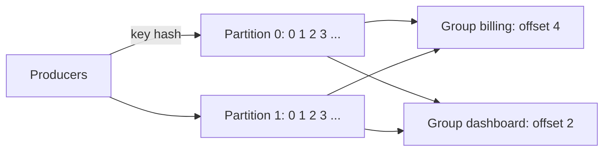

# Kafka and stream semantics

A rider finishes a trip in a tunnel. The phone sends the event ninety seconds later, the broker acknowledges it, the acknowledgement is lost, the phone resends it, and the consumer crashes after writing to its database but before saving its position. Depending on choices made months ago, that fare is counted zero, one or three times, in a window that may already have been published as final. Streaming is the discipline of making these choices on purpose. This chapter builds the log, the three delivery guarantees and watermarks in plain Python, so you can see each failure happen, then maps them to Kafka and to the engines that run on it.

## A log, not a queue

A queue hands out a message and forgets it. A log keeps everything and lets each reader remember its own position. That one difference produces most of Kafka's properties. The Kafka design documentation describes a design "more akin to a database log than a traditional messaging system" ([Apache Kafka design docs](https://kafka.apache.org/42/design/design)). The simulation below needs only `uv run --with duckdb python`; the blocks in this chapter share a session.

```python
import random, zlib
from collections import defaultdict

class Log:
    """A topic: partitions of append-only records. Reading never removes anything."""
    def __init__(self, partitions=3):
        self.parts = [[] for _ in range(partitions)]
    def produce(self, key, value):
        p = zlib.crc32(str(key).encode()) % len(self.parts)   # same key, same partition
        self.parts[p].append((key, value))
        return p, len(self.parts[p]) - 1                      # (partition, offset)

topic = Log()
rides = [(f"zone-{z}", {"ride": i, "fare": 10.0 + i}) for i, z in enumerate([7, 7, 13, 42, 7, 13, 42, 7])]
for k, v in rides:
    print(k, "->", "partition %d offset %d" % topic.produce(k, v))
# Two independent readers keep two independent positions; neither disturbs the other.
position = {"billing": 0, "dashboard": 2}
print("partition sizes:", [len(p) for p in topic.parts])
print("billing reads partition 0 from offset", position["billing"], ":", [v["ride"] for _, v in topic.parts[0][position["billing"]:]])
print("dashboard reads partition 0 from offset", position["dashboard"], ":", [v["ride"] for _, v in topic.parts[0][position["dashboard"]:]])
```

Output:

```text
zone-7 -> partition 0 offset 0
zone-7 -> partition 0 offset 1
zone-13 -> partition 1 offset 0
zone-42 -> partition 1 offset 1
zone-7 -> partition 0 offset 2
zone-13 -> partition 1 offset 2
zone-42 -> partition 1 offset 3
zone-7 -> partition 0 offset 3
partition sizes: [4, 4, 0]
billing reads partition 0 from offset 0 : [0, 1, 4, 7]
dashboard reads partition 0 from offset 2 : [4, 7]
```

Equal keys go to one partition, so all of zone 7's events stay in order. Order holds *within* a partition and not across them, and a third of the partitions may sit empty when keys are few. Billing and the dashboard read the same records from different offsets, and reading removes nothing. That is why a new consumer can replay history, and why a broken consumer can be fixed and rewound.



Partitions are the unit of scaling. Within a consumer group each partition has one consumer at a time, so a partition count caps a group's parallelism, and changing it later moves keys to different partitions and breaks per-key ordering across the change. Retention is by time or size. A compacted topic instead keeps at least the last value per key, which suits a changelog ([Kafka log compaction](https://kafka.apache.org/42/design/design)).

The practice folder has a working version with a real broker. `practice/datatalks-de/06-streaming/python/json_example` produces taxi rides as JSON and consumes them with `enable_auto_commit=True`, a detail that will matter in a moment.

## Three guarantees, seen failing

The Kafka docs state the options plainly: at most once, at least once, exactly once. They add a warning that vendors' exactly-once claims need the fine print read. A consumer's guarantee comes down to one ordering question: when you process a batch, do you save your position first or save the output first? Here is one consumer over nine rides of $10, crashing once.

```python
def run(mode, records, crash_after=None, batch=3):
    """One consumer over one partition, crashing once, then restarting from its committed offset.
    mode: 'at_most'  commits the offset, then writes the output
          'at_least' writes the output, then commits the offset
          'atomic'   writes output and offset in one transaction (or an idempotent sink)"""
    committed, sink, crashed, offset_table = 0, [], False, 0
    while committed < len(records):
        start = committed
        chunk = records[start:start + batch]
        if mode == "at_most":
            committed = start + len(chunk)                      # position saved first
            if crash_after == start and not crashed:
                crashed = True; continue                        # dies before the output is written
            sink += chunk
        elif mode == "at_least":
            sink += chunk                                       # output saved first
            if crash_after == start and not crashed:
                crashed = True; continue                        # dies before the position is saved
            committed = start + len(chunk)
        else:
            if crash_after == start and not crashed:
                crashed = True; continue                        # nothing visible: the transaction never committed
            sink += chunk; committed = start + len(chunk)       # both land together
    return sink

records = [{"ride": i, "fare": 10.0} for i in range(9)]
truth = sum(r["fare"] for r in records)
for mode in ["at_most", "at_least", "atomic"]:
    out = run(mode, records, crash_after=3)
    ids = [r["ride"] for r in out]
    print(f"{mode:9s} rows={len(out):2d} revenue={sum(r['fare'] for r in out):6.1f} (truth {truth}) rides={ids}")
```

Output:

```text
at_most   rows= 6 revenue=  60.0 (truth 90.0) rides=[0, 1, 2, 6, 7, 8]
at_least  rows=12 revenue= 120.0 (truth 90.0) rides=[0, 1, 2, 3, 4, 5, 3, 4, 5, 6, 7, 8]
atomic    rows= 9 revenue=  90.0 (truth 90.0) rides=[0, 1, 2, 3, 4, 5, 6, 7, 8]
```

Saving the position first loses three rides and $30 without any error. Saving the output first counts three rides twice, $30 too many, also silently. Note also what `enable_auto_commit=True` in the practice consumer means: offsets are committed on a timer, independent of whether your processing finished, so depending on timing you can get either failure. It is a reasonable setting for a demo, and a poor one for a billing system.

There is a cheap route out for a great many pipelines. If the output is keyed, at-least-once delivery plus an upsert gives a correct final state, as the Kafka docs note about messages with a primary key.

```python
sink = {}
for r in run("at_least", records, crash_after=3):      # at-least-once delivery, duplicates and all
    sink[r["ride"]] = r                                 # upsert keyed on the business id
print(f"at-least-once + keyed upsert: rows={len(sink)} revenue={sum(r['fare'] for r in sink.values())}")
```

Output:

```text
at-least-once + keyed upsert: rows=9 revenue=90.0
```

This is the first pattern to reach for. It works when records have a stable business key and the sink can overwrite. It does not work on a sum computed by adding to a running total, since repeats add again.

For a running total you need the output and the position to commit together. Kleppmann describes storing the offset with the value so a replay can detect it has already been applied ([Kleppmann, *DDIA*, O'Reilly 2017, ch. 11](https://dataintensive.net/)). DuckDB can show the pattern in full, since one transaction covers the totals and the offset:

```python
# A duckdb sink that stores the offset with the data: the DDIA pattern, runnable.
import duckdb
con = duckdb.connect()
con.execute("CREATE TABLE zone_totals (zone VARCHAR PRIMARY KEY, revenue DOUBLE)")
con.execute("CREATE TABLE consumer_offset (part INT PRIMARY KEY, next_offset BIGINT)")
con.execute("INSERT INTO consumer_offset VALUES (0, 0)")
part0 = [("zone-7", 10.0), ("zone-13", 5.0), ("zone-7", 2.5), ("zone-42", 7.0), ("zone-13", 1.0), ("zone-7", 4.0)]

def consume_once(batch_size=2, crash=False):
    start = con.execute("SELECT next_offset FROM consumer_offset WHERE part = 0").fetchone()[0]
    batch = part0[start:start + batch_size]
    con.execute("BEGIN")
    for zone, fare in batch:
        con.execute("""INSERT INTO zone_totals VALUES (?, ?)
                       ON CONFLICT (zone) DO UPDATE SET revenue = revenue + excluded.revenue""", [zone, fare])
    if crash:
        con.execute("ROLLBACK")                     # the process died: totals and offset both unchanged
        return "crashed"
    con.execute("UPDATE consumer_offset SET next_offset = ? WHERE part = 0", [start + len(batch)])
    con.execute("COMMIT")
    return len(batch)

print(consume_once(), consume_once(crash=True), consume_once(), consume_once(), consume_once())
print(con.sql("SELECT * FROM zone_totals ORDER BY zone").fetchall())
print("expected:", {z: sum(f for k, f in part0 if k == z) for z in {k for k, _ in part0}})
```

Output:

```text
2 crashed 2 2 0
[('zone-13', 6.0), ('zone-42', 7.0), ('zone-7', 16.5)]
expected: {'zone-7': 16.5, 'zone-13': 6.0, 'zone-42': 7.0}
```

The crash rolled back both, and the retry reprocessed the same batch from the same offset. The final totals match even though the sum is not idempotent. The `txn` action in Delta from [the table format chapter](02-table-formats.md) serves the same purpose for a stream writing to a lake: the application's ID and version land atomically with the data files.

## What exactly-once means in Kafka

Kleppmann's framing is the right one to hold on to: exactly-once means the final effect is the same as if no fault had occurred, and "effectively-once" would be the better name, since records can certainly be processed more than once along the way (*DDIA*, chs. 11 and 12).

Kafka gives two building blocks from KIP-98 and the 0.11 release ([KIP-98](https://cwiki.apache.org/confluence/display/KAFKA/KIP-98+-+Exactly+Once+Delivery+and+Transactional+Messaging)). The first handles the producer's half, the lost acknowledgement. Every producer gets an ID and every message gets a per-partition sequence number, so the broker can reject a resend.

```python
class Broker:
    """The KIP-98 idea: reject a (producer id, partition) sequence number already seen."""
    def __init__(self, dedupe):
        self.log, self.last_seq, self.dedupe = [], {}, dedupe
    def append(self, pid, seq, value):
        if self.dedupe and seq <= self.last_seq.get(pid, -1):
            return "duplicate"
        self.log.append(value); self.last_seq[pid] = seq
        return "ok"

for dedupe in [False, True]:
    b = Broker(dedupe)
    b.append("p1", 0, "ride-0")
    b.append("p1", 1, "ride-1")      # ack lost on the network, so the producer retries it
    b.append("p1", 1, "ride-1")
    b.append("p1", 2, "ride-2")
    print(f"dedupe={dedupe!s:5}: log = {b.log}")
```

Output:

```text
dedupe=False: log = ['ride-0', 'ride-1', 'ride-1', 'ride-2']
dedupe=True : log = ['ride-0', 'ride-1', 'ride-2']
```

The second is transactions. A producer can write to several partitions atomically, and because consumer offsets are themselves stored in an internal topic, it can include its offsets in the same transaction. A consumer with `isolation.level=read_committed` sees only committed transactional messages, buffering in order to do so. The default, `read_uncommitted`, sees everything ([KIP-98](https://cwiki.apache.org/confluence/display/KAFKA/KIP-98+-+Exactly+Once+Delivery+and+Transactional+Messaging)). Kafka Streams wires these together for read-process-write inside Kafka. A minimal configuration:

```python
# illustrative: needs a running Kafka broker, for instance the compose file in
# practice/datatalks-de/06-streaming, and a client such as confluent-kafka
from confluent_kafka import Producer, Consumer

producer = Producer({"bootstrap.servers": "localhost:9092",
                     "enable.idempotence": True,
                     "transactional.id": "zone-totals-1"})
consumer = Consumer({"bootstrap.servers": "localhost:9092",
                     "group.id": "zone-totals",
                     "enable.auto.commit": False,
                     "isolation.level": "read_committed"})
consumer.subscribe(["rides"])
producer.init_transactions()
while True:
    msg = consumer.poll(1.0)
    if msg is None:
        continue
    producer.begin_transaction()
    producer.produce("zone_totals", key=msg.key(), value=msg.value())
    producer.send_offsets_to_transaction(consumer.position(consumer.assignment()),
                                         consumer.consumer_group_metadata())
    producer.commit_transaction()
```

The limit is the boundary. These guarantees hold inside Kafka. As soon as the consumer calls a payment API, or writes to a store that does not join the transaction, the effect outside can still happen twice. DDIA makes the same point about microbatching and Flink's checkpoint barriers: they give exactly-once within the framework, and output that leaves it needs idempotence or a distributed transaction. When someone says "we have exactly-once," ask: from where to where?

## Event time and processing time

Now to a different problem. Delivery guarantees say whether a record arrives. They say nothing about when. Most stream questions are about when something happened, and that differs from when you heard about it. Rides here happen once a second, most report within seconds, and 2% go through a tunnel.

```python
from datetime import datetime, timedelta
random.seed(11)
base = datetime(2024, 6, 1, 12, 0, 0)
events = []
for i in range(600):
    event_time = base + timedelta(seconds=i)              # one ride per second for ten minutes
    delay = random.expovariate(1 / 5)                     # most phones report within seconds
    if random.random() < 0.02:
        delay += random.uniform(120, 400)                 # a few drive through a tunnel
    events.append({"ride": i, "event": event_time, "arrival": event_time + timedelta(seconds=delay), "fare": 1.0})
arrival_order = sorted(events, key=lambda e: e["arrival"])
out_of_order = sum(a["event"] > b["event"] for a, b in zip(arrival_order, arrival_order[1:]))
print(f"{out_of_order} adjacent pairs are out of event-time order")

minute = lambda t: t.replace(second=0, microsecond=0)
by_event, by_arrival = defaultdict(float), defaultdict(float)
for e in arrival_order:
    by_event[minute(e["event"])] += e["fare"]
    by_arrival[minute(e["arrival"])] += e["fare"]
print("minute  by_event  by_processing")
for m in sorted(by_event)[:5]:
    print(m.strftime("%H:%M"), f"{by_event[m]:8.0f} {by_arrival[m]:13.0f}")
```

Output:

```text
255 adjacent pairs are out of event-time order
minute  by_event  by_processing
12:00       60            53
12:01       60            58
12:02       60            60
12:03       60            60
12:04       60            60
```

The first minute looks like a quiet period by processing time, with 53 against a true 60. A consumer restart makes it worse: Kleppmann's example shows a redeploy creating a spike in a rate metric that never happened in the world. So windows are defined on event time. That creates the core question of streaming, which Akidau et al. put at the centre of the Dataflow model: a stream never tells you that a window is complete ([Akidau et al., PVLDB 2015](https://www.vldb.org/pvldb/vol8/p1792-Akidau.pdf)). They frame the matter as a tradeoff between correctness, latency and cost, chosen per pipeline rather than imposed by the system.

## Watermarks

A watermark is a running assertion that the stream has probably delivered everything up to event time T. Flink tracks it as a special progress signal ([Flink time docs](https://nightlies.apache.org/flink/flink-docs-stable/docs/concepts/time/)). A window fires when the watermark passes its end. The simplest policy, which Spark Structured Streaming also uses, sets the watermark to the highest event time seen minus an allowed lateness ([Spark watermarking guide](https://spark.apache.org/docs/latest/streaming/apis-on-dataframes-and-datasets.html)).

```python
def windowed(events, allowed_lateness_s, late_policy="drop"):
    """Tumbling one-minute windows on event time. A window fires when the watermark passes its end."""
    open_w, fired, late, watermark = defaultdict(float), {}, [], datetime.min
    corrections = 0
    for e in events:
        watermark = max(watermark, e["event"] - timedelta(seconds=allowed_lateness_s))
        w = minute(e["event"])
        if w in fired:
            late.append(e)
            if late_policy == "update":
                fired[w] += e["fare"]; corrections += 1
        else:
            open_w[w] += e["fare"]
        for k in [k for k in open_w if k + timedelta(minutes=1) <= watermark]:
            fired[k] = open_w.pop(k)
    fired.update(open_w)                                   # end of stream flushes the rest
    return fired, late, corrections

truth = len(events)
print("allowed lateness  dropped  lost")
for lateness in [0, 5, 30, 120, 300, 600]:
    fired, late, _ = windowed(arrival_order, lateness)
    print(f"{lateness:15d}s {len(late):8d} {len(late) / truth:5.1%}")
fired, late, corrections = windowed(arrival_order, 30, late_policy="update")
print(f"with retractions at 30s: total {sum(fired.values()):.0f} of {truth}, {corrections} corrections sent downstream")
```

Output:

```text
allowed lateness  dropped  lost
              0s       46  7.7%
              5s       22  3.7%
             30s       11  1.8%
            120s        7  1.2%
            300s        1  0.2%
            600s        0  0.0%
with retractions at 30s: total 600 of 600, 11 corrections sent downstream
```

Here is the trade in one table. A window with 30 seconds of allowed lateness closes 30 seconds after its end and loses 1.8% of rides. A 5-minute wait still loses 0.2%, and a 10-minute wait catches everything but makes every number 10 minutes old. No value is correct without knowing the business: a live dashboard tolerates loss for freshness, and an invoice does not. And the last line shows the alternative to loss: emit a result early and correct it. Kleppmann describes both ways of handling stragglers: drop them while counting the drops and alerting, or publish a correction. Corrections are only useful if downstream can apply them, so an append-only sink must become an upsert sink keyed on window.

```text
event time  ------------------------------------------------>
                 |12:00 window|12:01 window|
arrivals     ..x..x.x..x..x...x.x..x.x....x..x
                                         ^ max event time seen
                                ^ watermark = max seen - allowed lateness
             a window fires when the watermark passes its end;
             events for a fired window are late: drop, count, or correct
```

Windows themselves come in the usual kinds: tumbling, fixed and non-overlapping, used above; hopping, fixed but overlapping; session, closed by a gap in activity. All of them inherit this completeness problem, and sessions make it harder, as a late event can merge two sessions.

Timestamps need care too. Kleppmann recommends logging three: when the event happened on the device clock, when the device sent it, and when the server received it. The difference between the last two estimates clock skew, which you can subtract from the first.

## Operating a stream: lag

The one number that says whether a consumer is healthy is lag, the distance between the latest offset and the group's committed one. Lag tells you how far behind you are, and how it recovers depends on headroom, which simple arithmetic shows.

```python
def lag_after(incident_minutes, produce_rate, consume_rate, horizon=60):
    """Consumer lag in messages, minute by minute, with a consumer outage at the start."""
    lag, trace = 0, []
    for m in range(horizon):
        lag += produce_rate
        if m >= incident_minutes:
            lag = max(0, lag - consume_rate)
        trace.append(lag)
    return trace
t = lag_after(10, 60_000, 72_000)
print("peak lag:", max(t), "| minutes to drain after restart:", next(i for i, x in enumerate(t) if i > 10 and x == 0) - 10)
t2 = lag_after(10, 60_000, 61_000)
print("with 1.7% headroom, lag after 60 min:", t2[-1])
```

Output:

```text
peak lag: 600000 | minutes to drain after restart: 49
with 1.7% headroom, lag after 60 min: 550000
```

A ten-minute outage at a 20% headroom drains in 49 minutes. At 1.7% headroom it is still far behind an hour later. Size consumers for catch-up rate, and alert on lag growing, since a merely high lag may be draining. The [monitoring chapter](../../05-quality-and-observability/notes/02-monitors-and-lineage.md) returns to freshness monitors, and stream lag is one.

Do you need a stream at all? Streaming costs always-on compute and on-call attention, and a micro-batch every few minutes satisfies most dashboards. The honest test is what decision changes if the number is one second old rather than five minutes old.

| Tool | What it is | Pick when |
|---|---|---|
| Kafka or Redpanda | The durable log | Several consumers, replay, decoupling |
| Kafka Streams, ksqlDB | Processing as a library or SQL inside Kafka | Kafka-to-Kafka transformations |
| Flink | Stateful stream processor with event-time windows and checkpoints | Large state, low latency, complex joins |
| Spark Structured Streaming | Micro-batch on Spark | A Spark shop, seconds of latency acceptable |

The zoomcamp's `python/streams-example/pyspark` and `ksqldb/commands.md` in the practice folder try two of these. For a guided start with a broker, the free [Confluent Kafka 101 course](https://developer.confluent.io/courses/apache-kafka/events/) covers the same log concepts hands-on.

## Pitfalls

- **Auto-commit in a pipeline that matters.** Committed offsets drift from finished work, so you lose or repeat data on a crash.
- **"Exactly once" claimed end to end.** Ask where the boundary is. External side effects need idempotence.
- **Windows on arrival time.** A restart produces spikes that never happened.
- **Silently dropping late data.** Count it, and alert on it. Without a metric you cannot tell loss from a quiet day.
- **Too few partitions, or changing them later.** The count caps parallelism and a change breaks key ordering.
- **One idle partition holding a watermark back.** With per-partition watermarks, the minimum wins, so one stalled source freezes all windows. Most engines let you mark sources idle.
- **A stateful aggregate with no state limit.** Without a watermark, state for old windows grows forever.

## Try it

1. Make `run` crash at offset 6 in each mode. Are the same rides lost or duplicated? Why does `at_least` still produce a correct sum if you add a keyed upsert?
2. Change the tunnel probability to 10% in `streams`. What allowed lateness now gives under 1% loss?
3. In `microbatch`, crash after the offset update but before the commit. Is the result still correct? Remove the transaction and repeat.

<details><summary>Answers</summary>

1. Rides 6 to 8 are affected instead of 3 to 5. Keyed upsert overwrites a repeat with itself, so the state is the same however many deliveries occur.
2. With that seed, 300 s still loses 1.2% and 600 s loses nothing, so the answer lies between them. Tunnel delays run from 120 to 400 s, so once they are common only a wait near 400 s gets under 1%.
3. Correct with the transaction, since rollback covers both updates. Without it, the totals are applied but the offset can lag, so the retry double-counts.

</details>

## Interview checklist

| Question | Answer |
|---|---|
| Queue or log? | A log retains records and each consumer group keeps an offset, so replay and multiple readers come free. |
| What is ordered in Kafka? | Records within a partition; nothing across partitions. |
| At-most-once against at-least-once? | Commit before processing loses on crash; commit after processing duplicates on crash. |
| What does the idempotent producer solve? | Duplicates from retries, through a producer ID and a per-partition sequence number. |
| What does exactly-once mean? | The final effect is as if no fault happened. It holds inside the transactional system. Outside, use idempotent sinks. |
| Event or processing time? | Event time for correct windows; processing time for operational rates. |
| What is a watermark? | A heuristic claim that event time up to T has probably arrived, triggering windows and bounding state. |
| What happens to late data? | Dropped and counted, or emitted as a correction downstream if the sink can apply it. |

## Next

Everything built so far has a price on it. [Cost](05-cost.md) turns bytes scanned, slots and egress into arithmetic you can run before the bill arrives.
