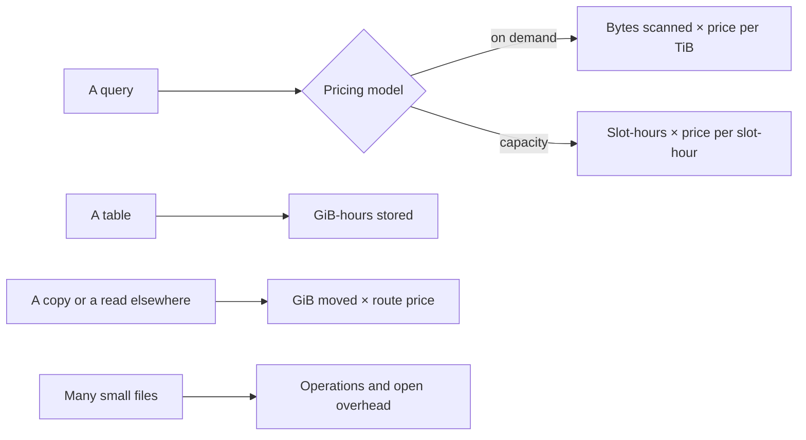

# Cost: bytes, slots and egress

Our taxi dashboard refreshes every 15 minutes and costs about $36,000 a month. Nobody chose that number. Someone wrote `SELECT *` on a table that was small at the time, a scheduler ran it 96 times a day, and the table grew. Data platform bills are unusually sensitive to small decisions because the same query runs thousands of times. This chapter turns the three main meters, bytes scanned, compute slots and data leaving a region, into arithmetic you can run before the invoice arrives. It uses BigQuery's and Google Cloud's list prices as read on 2026-11-01; the numbers change, the shape of the reasoning does not. Confidence is medium because list prices are regional and go out of date.

## Where the money goes



Most surprises come from the arrow at the top. Storage is cheap and stable. Compute grows with how often people ask.

## Bytes scanned

BigQuery's on-demand model charges for bytes processed: $6.25 per TiB in US regions, with the first TiB each month free ([BigQuery pricing](https://cloud.google.com/bigquery/pricing)). Since columnar storage reads only named columns and partition filters remove whole partitions, the bill is a direct function of layout, as [the warehouse chapter](01-warehouse-and-store.md) showed. To make that concrete we measure compressed bytes for three versions of the same query on a Parquet year of trips. Run with `uv run --with duckdb --with pyarrow --with numpy python`; the blocks share a session.

```python
import duckdb, pyarrow as pa, pyarrow.parquet as pq, numpy as np, glob, os
rng = np.random.default_rng(7)
n = 3_000_000
secs = rng.integers(0, 366 * 86400, n)
trips = pa.table({
    "pickup": pa.array(np.datetime64("2024-01-01") + secs.astype("timedelta64[s]")),
    "pu_zone": pa.array(rng.integers(1, 266, n).astype("int32")),
    "total": pa.array(np.round(4 + rng.exponential(19.0, n), 2)),
    "note": pa.array(rng.integers(0, 2**62, n).astype(str)),
})
con = duckdb.connect()
con.register("trips", trips)
con.execute("""COPY (SELECT *, CAST(pickup AS DATE) AS pickup_date FROM trips)
               TO 'by_day' (FORMAT parquet, PARTITION_BY (pickup_date))""")
files = {d: glob.glob(f"{d}/*.parquet") for d in glob.glob("by_day/pickup_date=*")}

def scanned(columns=None, month=None):
    """Compressed bytes a columnar engine must read: the columns asked for, in the partitions kept."""
    total = 0
    for d, fs in files.items():
        if month and f"={month}" not in d:
            continue
        for f in fs:
            md = pq.read_metadata(f)
            for rg in range(md.num_row_groups):
                for c in range(md.num_columns):
                    col = md.row_group(rg).column(c)
                    if columns is None or col.path_in_schema in columns:
                        total += col.total_compressed_size
    return total
all_b = scanned()
two_b = scanned(["pu_zone", "total"])
june_b = scanned(["pu_zone", "total"], month="2024-06")
for label, b in [("SELECT * (full table)", all_b), ("two columns", two_b), ("two columns, June", june_b)]:
    print(f"{label:24s} {b / 1e6:7.1f} MB   {all_b / b:5.1f}x cheaper than SELECT *")
```

Output:

```text
SELECT * (full table)       86.8 MB     1.0x cheaper than SELECT *
two columns                 17.0 MB     5.1x cheaper than SELECT *
two columns, June            1.4 MB    62.3x cheaper than SELECT *
```

The ratios depend on the schema. Half of `SELECT *` here is one badly compressing `note` column. Apply them to a 2 TiB table refreshed 96 times a day:

```python
PER_TIB = 6.25                    # BigQuery on-demand, US, list price read 2026-11-01
FREE_TIB = 1.0                    # first TiB each month
TIB = 2 ** 40
def bill(tib_per_run, runs_per_day, days=30):
    scanned_tib = tib_per_run * runs_per_day * days
    return scanned_tib, max(0, scanned_tib - FREE_TIB) * PER_TIB
ratios = {"SELECT *": 1.0, "two columns": two_b / all_b, "two columns, one month": june_b / all_b}
print("A dashboard refreshing a 2 TiB table every 15 minutes (96 runs a day)")
for label, r in ratios.items():
    t, c = bill(2 * r, 96)
    print(f"  {label:24s} {t:9.0f} TiB/month  ${c:10,.2f}")
```

Output:

```text
A dashboard refreshing a 2 TiB table every 15 minutes (96 runs a day)
  SELECT *                      5760 TiB/month  $ 35,993.75
  two columns                   1130 TiB/month  $  7,053.28
  two columns, one month          92 TiB/month  $    571.35
```

Sixty-fold from a column list and a date filter. Be careful in one respect: this applies ratios measured on compressed Parquet to BigQuery's bill, which counts logical bytes per data type. The direction and the rough scale carry over, but the exact factor needs a dry run on the real table. `bq query --dry_run` reports bytes before execution, and it is free. Remember from the warehouse chapter that clustering savings do not show in the estimate.

## Slots

The other model pays for compute capacity rather than data read. A slot is BigQuery's virtual compute unit ([BigQuery slots docs](https://cloud.google.com/bigquery/docs/slots)). Under editions, autoscaled capacity is billed per slot-hour, per second with a one-minute minimum: $0.04 for Standard, $0.06 for Enterprise and $0.10 for Enterprise Plus, at the US pay-as-you-go list prices, with discounts for one- and three-year commitments.

```python
SLOT_HOUR = {"Standard": 0.04, "Enterprise": 0.06, "Enterprise Plus": 0.10}
def editions_cost(slots, hours_per_day, edition, days=30):
    return slots * hours_per_day * days * SLOT_HOUR[edition]
print("slots  hours/day   Standard  Enterprise  Enterprise Plus")
for slots, h in [(100, 8), (500, 8), (500, 24), (2000, 24)]:
    print(f"{slots:5d} {h:6d}    " + "  ".join(f"${editions_cost(slots, h, e):>10,.0f}" for e in SLOT_HOUR))
def breakeven_tib_per_month(slots, hours_per_day, edition):
    return editions_cost(slots, hours_per_day, edition) / PER_TIB + FREE_TIB
print(f"100 Enterprise slots, 8 h/day cost the same as {breakeven_tib_per_month(100, 8, 'Enterprise'):,.0f} TiB on demand")
```

Output:

```text
slots  hours/day   Standard  Enterprise  Enterprise Plus
  100      8    $       960  $     1,440  $     2,400
  500      8    $     4,800  $     7,200  $    12,000
  500     24    $    14,400  $    21,600  $    36,000
 2000     24    $    57,600  $    86,400  $   144,000
100 Enterprise slots, 8 h/day cost the same as 231 TiB on demand
```

The break-even line is the useful output. A hundred Enterprise slots for an eight-hour working day cost $1,440 a month, the same as scanning 231 TiB on demand. Below that, on demand wins. Above it, and especially with steady load, capacity wins. Capacity also changes what a bad query does. On demand, a careless scan costs money. On capacity, the same scan costs time, since it competes with everyone else for slots and slows them, with no line on the invoice. This is why the same bad query can have different owners under the two models: finance in one, the on-call engineer in the other.

| | On demand | Capacity (editions) |
|---|---|---|
| Meter | TiB scanned | Slot-hours |
| Best for | Spiky, small, or unpredictable use | Steady heavy load |
| Bad query costs | Money, immediately | Queueing, for everyone |
| Control | Per-query byte limits | Reservations and autoscale caps |
| Layout savings | Lower the bill directly | Free up slots, a lower bill only if the cap drops |

The other engines have the same structure under different names. Snowflake meters warehouse credits per second and Databricks meters DBUs. Both are capacity models, and a local DuckDB run pays only for the laptop. Check current rates on each vendor's page; none are quoted here because none were verified.

## Storage: usually the small number

Active logical storage costs $0.000031507 per GiB-hour in the listing used, with 90 days unmodified moving a table to a lower long-term rate.

```python
ACTIVE, LONG_TERM = 0.000031507, 0.000021918   # logical storage, $ per GiB-hour, us-central1 listing
HOURS = 730                                    # the page's month
def storage_month(gib, rate, free=10): return max(0, gib - free) * rate * HOURS
print(f"1 TiB active    : ${storage_month(1024, ACTIVE):7.2f}/month")
print(f"1 TiB long-term : ${storage_month(1024, LONG_TERM):7.2f}/month")
t, c = bill(2, 96)
print(f"2 TiB active, stored: ${storage_month(2048, ACTIVE):.2f}/month; scanned 96x/day: ${c:,.2f}/month")
```

Output:

```text
1 TiB active    : $  23.32/month
1 TiB long-term : $  16.22/month
2 TiB active, stored: $46.87/month; scanned 96x/day: $35,993.75/month
```

At this scale the difference between storage and scanning is nearly three orders of magnitude. So saving storage by aggressive deletion is rarely the first move, whereas storing an aggregate to avoid scans often pays for itself many times over. How often depends on usage:

```python
def view_vs_table(table_gib, runs_per_day, build_ratio=1.0, read_ratio=0.02, days=30):
    """Aggregate table rebuilt once a day vs every reader scanning the base table."""
    base_tib, agg_tib = table_gib / 1024, table_gib * read_ratio / 1024
    no_table = base_tib * runs_per_day * days * PER_TIB
    build = base_tib * build_ratio * days * PER_TIB
    reads = agg_tib * runs_per_day * days * PER_TIB
    storage = storage_month(table_gib * read_ratio, ACTIVE, free=0)
    return no_table, build + reads + storage
print("runs/day  query the base   build a daily aggregate")
for r in [0.2, 1, 5, 96]:
    a, b = view_vs_table(2048, r)
    print(f"{r:8} ${a:13,.2f} ${b:13,.2f}")
```

Output:

```text
runs/day  query the base   build a daily aggregate
     0.2 $        75.00 $       377.44
       1 $       375.00 $       383.44
       5 $     1,875.00 $       413.44
      96 $    36,000.00 $     1,095.94
```

With fewer than one read a day, the daily rebuild costs more than the queries it replaces. With five, it wins. The usual advice to "materialise your marts" is right for dashboards and wrong for a table queried weekly. Run this arithmetic per model. In [dbt](../../03-transform-and-orchestrate/README.md), that decision is a one-word config.

## Egress

Moving data out of a region costs per GiB, and it depends on the route. Google lists $0.01 per GiB across zones in a region, $0.02 between North American regions, $0.05 from North America to Europe, $0.08 to Asia, and $0.12 per GiB for the first internet tier to North America after the first free GiB, on the Premium Tier ([Google VPC network pricing](https://cloud.google.com/vpc/network-pricing)).

```python
def internet_egress_us(gib):
    """Premium Tier internet egress to North America, tiered per month, read 2026-11-01."""
    tiers = [(1, 0.0), (1024, 0.12), (10240, 0.11), (float("inf"), 0.08)]
    cost, low = 0.0, 0
    for high, price in tiers:
        cost += max(0, min(gib, high) - low) * price
        low = high
    return cost
INTER_REGION = {"same region, other zone": 0.01, "US to US region": 0.02, "US to Europe": 0.05, "US to Asia": 0.08}
daily_gib = 500
print(f"Copy {daily_gib} GiB a day for 30 days ({daily_gib * 30 / 1024:.1f} TiB/month)")
for route, p in INTER_REGION.items():
    print(f"  {route:26s} ${daily_gib * 30 * p:9,.2f}")
print(f"  {'to the internet (US)':26s} ${internet_egress_us(daily_gib * 30):9,.2f}")
```

Output:

```text
Copy 500 GiB a day for 30 days (14.6 TiB/month)
  same region, other zone    $   150.00
  US to US region            $   300.00
  US to Europe               $   750.00
  US to Asia                 $ 1,200.00
  to the internet (US)       $ 1,517.32
```

A daily copy of 500 GiB is a quiet $1,500 a month if it leaves the cloud. Other clouds' rates differ, and multi-cloud architectures pay this on every replication. Two consequences follow. Keep compute beside its data, since Cloud Storage's own pricing page notes reads across locations incur charges, while BigQuery US reading a bucket in `us-central1` does not ([Cloud Storage pricing](https://cloud.google.com/storage/pricing)). And count cross-region replication and a remote BI tool's extracts in the design, since each is a recurring transfer and not a one-off.

## Files and operations

Object stores charge per operation, and readers pay overhead per file: the footer must be fetched and parsed. Take the same two columns as 3,000 files and as one.

```python
# Every file costs at least one footer read and one or more object-store reads.
con.execute("COPY (SELECT * FROM trips) TO 'one.parquet' (FORMAT parquet)")
import time
os.makedirs("many", exist_ok=True)
tbl = pq.read_table("one.parquet", columns=["pu_zone", "total"])
step = tbl.num_rows // 3000
for i in range(3000):
    pq.write_table(tbl.slice(i * step, step), f"many/{i:05d}.parquet")
compact = "compact.parquet"; pq.write_table(tbl, compact)
def best(sql, k=3):
    return min((lambda t0: (con.execute(sql).fetchall(), time.perf_counter() - t0)[1])(time.perf_counter()) for _ in range(k))
s_many = sum(os.path.getsize(f) for f in glob.glob("many/*.parquet")); s_one = os.path.getsize(compact)
print(f"3000 files: {s_many / 1e6:6.1f} MB, query {best("SELECT sum(total) FROM 'many/*.parquet'") * 1000:6.0f} ms")
print(f"1 file    : {s_one / 1e6:6.1f} MB, query {best("SELECT sum(total) FROM 'compact.parquet'") * 1000:6.0f} ms")
CLASS_B = 0.0004 / 1000                         # Cloud Storage Standard reads, single region, read 2026-11-01
print(f"2 reads per file, 96 runs a day, 30 days: ${3000 * 2 * 96 * 30 * CLASS_B:,.2f}/month in operations alone")
```

Output:

```text
3000 files:   24.9 MB, query    136 ms
1 file    :    8.8 MB, query      4 ms
2 reads per file, 96 runs a day, 30 days: $6.91/month in operations alone
```

On local disk the same query is more than 20 times slower, and the file set is nearly three times the size since each file carries its own metadata and compresses less well. On an object store each read also has network latency, so the gap grows. The dollar amount for operations is minor here, at the $0.0004 per 1,000 Class B operations listed for single-region Standard storage. The real cost is compute time. A streaming writer makes this shape by default, so [compaction](02-table-formats.md) is a cost control.

## Make cost a test

Cost problems are found on the invoice because nothing fails until then. Put a guard in the pipeline instead. In BigQuery this is a dry run or `maximum_bytes_billed`, which fails the query if it would read more. In a pre-merge check the logic is short:

```python
def dry_run(columns, month=None, price=PER_TIB, limit_usd=1.00, scale_to_tib=2):
    """What a pre-merge check would do: estimate, compare against a budget, fail loudly."""
    ratio = scanned(columns, month) / all_b
    usd = ratio * scale_to_tib * price
    return usd, usd <= limit_usd
for cols, m in [(None, None), (["pu_zone", "total"], None), (["pu_zone", "total"], "2024-06")]:
    usd, ok = dry_run(cols, m)
    print(f"cols={str(cols):26s} month={m}: ${usd:6.2f}  {'pass' if ok else 'FAIL budget $1.00'}")
```

Output:

```text
cols=None                       month=None: $ 12.50  FAIL budget $1.00
cols=['pu_zone', 'total']       month=None: $  2.45  FAIL budget $1.00
cols=['pu_zone', 'total']       month=2024-06: $  0.20  pass
```

The first query would have been stopped at review, with the fix on the screen. This is the same principle as the [data tests](../../05-quality-and-observability/notes/01-quality-dimensions-and-tests.md) in the next pillar: state an expectation in code, and fail loudly and early.

Then attribute. A bill by team, job or dashboard is what turns cost from a platform problem into something a team can act on. `INFORMATION_SCHEMA.JOBS` in BigQuery records bytes and slot time per job, and labels on jobs carry the owner:

```sql
-- illustrative: needs a BigQuery project with job history
SELECT user_email, query, COUNT(*) AS runs,
       SUM(total_bytes_billed) / POW(1024, 4) AS tib_billed,
       SUM(total_slot_ms) / 3600000 AS slot_hours
FROM `region-us`.INFORMATION_SCHEMA.JOBS
WHERE creation_time > TIMESTAMP_SUB(CURRENT_TIMESTAMP(), INTERVAL 30 DAY)
  AND job_type = 'QUERY'
GROUP BY 1, 2
ORDER BY tib_billed DESC
LIMIT 20;
```

The top twenty usually hold most of the spend. Fix those first, in this order: the query (columns, filters), then the layout (partition, cluster), then an aggregate, then the pricing model, because each step changes what the next one should be.

## Pitfalls

- **Comparing list prices and ignoring the workload.** The price per TiB says nothing until you know bytes scanned, and that depends on layout and query habit.
- **`LIMIT` as a cost control.** BigQuery's documentation is explicit that on a non-clustered table a `LIMIT` does not change the data read or the bill ([BigQuery cost best practices](https://cloud.google.com/bigquery/docs/best-practices-costs)). Use a preview or a filter.
- **Tuning storage first.** It is usually the smallest number on the bill.
- **Materialising everything.** A table that nobody reads costs a daily rebuild for nothing.
- **Autoscale without a cap.** Capacity pricing with no maximum is unbounded spend with a different label.
- **Cross-region defaults.** A bucket in one region and a warehouse in another pay on each read.
- **Quoting a price without a date.** Every figure in this chapter carries the date it was read for that reason.

## Try it

1. Compute the break-even for a team scanning 40 TiB per month against 100 Standard slots, 8 hours a day. Which model wins?
2. Rerun `materialize` with `read_ratio=0.2`, an aggregate only five times smaller. What changes at 5 runs a day?
3. Add a sort by `pu_zone` to `small`'s compacted file and query one zone. How many row groups are read?

<details><summary>Answers</summary>

1. 39 billable TiB at $6.25 is about $244. 100 Standard slots for 8 hours for 30 days is $960. On demand wins by a factor of four.
2. Reads cost ten times more per run. At five a day the aggregate costs about $760 against $1,875 for the base table, a saving of about 2.5 times rather than 4.5. An aggregate must be much smaller than its base to justify itself.
3. Nearly all groups can be skipped through min and max, as in the warehouse chapter's `cluster` block, so bytes read fall to roughly one group plus the footer.

</details>

## Interview checklist

| Question | Answer |
|---|---|
| Main drivers of a warehouse bill? | Compute: bytes scanned or slot-hours. Storage is usually small. Egress depends on topology. |
| On-demand or capacity? | On-demand for spiky or small; capacity for steady heavy load. Compute the break-even. |
| Fastest ways to cut a scan bill? | Select named columns, filter on the partition, cluster the next filter, materialise repeated aggregates. |
| Does `LIMIT` reduce bytes scanned? | Not on a non-clustered BigQuery table; the same columns are read and billed. |
| How do you stop cost regressions? | Dry runs or byte limits in CI, job labels and regular review of `INFORMATION_SCHEMA.JOBS`. |
| Why are small files a cost problem? | Per-file footer and open overhead, more operations, worse compression; compaction fixes it. |

## Next

This closes the store. Everything here assumed the data was right. The next pillar, [quality and observability](../../05-quality-and-observability/README.md), stops assuming.
