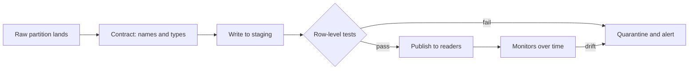

# Quality dimensions and tests

The monthly revenue report is wrong by 18%, and every job in the pipeline finished green. Nothing crashed, because a pipeline only fails when code fails, and nothing in this pipeline's code looks at what the data says. Sculley and colleagues named this the difference between code and data dependencies: compilers find broken code dependencies, and nothing equivalent finds broken data ones ([Sculley et al., NeurIPS 2015](https://papers.nips.cc/paper_files/paper/2015/hash/86df7dcfd896fcaf2674f757a2463eba-Abstract.html)). This chapter writes the missing checks. It starts with what "good data" can mean, turns each meaning into a query that returns bad rows, runs the same rules through Great Expectations and dbt, and ends with a scoreboard showing what tests cannot see.

## The running example: a feed with five faults

Every chapter in this pillar uses one feed: a quarter of synthetic taxi trips, one Parquet partition per day, with five faults planted in March. Synthetic data is the point here, because we know what really happened and can score each check against the truth.

| Date | Fault | What a real cause looks like |
|---|---|---|
| 5 March | 20% of `fare` is null | A payment system deploy stops sending one field |
| 10 March | The day never lands | An export job fails quietly upstream |
| 15 March | The partition arrives 50 hours late | A source system backlog |
| 18 March | Every row appears twice | The producer retried a whole batch |
| From 24 March | `distance` becomes kilometres | A vendor changes its app's locale |

The code needs only DuckDB, pyarrow and pandas until the tool sections. To run everything in this chapter, paste the blocks in order into one file and run it in an empty folder:

```bash
uv run --python 3.11 --with duckdb --with pyarrow --with numpy --with pandas \
       --with great_expectations --with dbt-duckdb python chapter.py
```

```python
import datetime as dt, os, shutil
import duckdb, numpy as np, pyarrow as pa, pyarrow.parquet as pq

DAYS = [dt.date(2024, 1, 1) + dt.timedelta(d) for d in range(91)]   # Q1 2024
FAULTS = {dt.date(2024, 3, 5):  'null spike',
          dt.date(2024, 3, 10): 'dropped day',
          dt.date(2024, 3, 15): 'late partition',
          dt.date(2024, 3, 18): 'duplicate keys'}
UNIT_CHANGE_FROM = dt.date(2024, 3, 24)                  # miles become kilometres

def make_day(day, rng):
    n = int(rng.normal(3000 if day.weekday() < 5 else 2100, 90))
    base = int(day.strftime('%Y%m%d')) * 100_000
    miles = np.round(rng.exponential(3.0, n) + 0.3, 2)
    fare = np.round(3 + 2.5 * miles + rng.normal(0, 1, n).clip(-2, 8), 2)
    fare_null = rng.random(n) < (0.20 if FAULTS.get(day) == 'null spike' else 0.002)
    secs = rng.integers(0, 86400, n)
    t = {'trip_id': base + np.arange(n),
         'pickup': [dt.datetime.combine(day, dt.time()) + dt.timedelta(seconds=int(s)) for s in secs],
         'pu_zone': rng.integers(1, 266, n),
         'distance': np.round(miles * (1.609 if day >= UNIT_CHANGE_FROM else 1), 2)}
    table = pa.table(t).append_column('fare', pa.array(fare, mask=fare_null))
    if FAULTS.get(day) == 'duplicate keys':
        table = pa.concat_tables([table, table])         # producer retried the whole batch
    return table

def make_feed(root='raw'):
    """Write one Parquet partition per day and a log of what arrived when."""
    rng = np.random.default_rng(11)
    shutil.rmtree(root, ignore_errors=True)
    loads = []
    for day in DAYS:
        table = make_day(day, rng)
        if FAULTS.get(day) == 'dropped day':
            continue                                     # the partition never lands
        lag = 50 if FAULTS.get(day) == 'late partition' else 2 # hours past midnight
        os.makedirs(f'{root}/dt={day}', exist_ok=True)
        pq.write_table(table, f'{root}/dt={day}/part.parquet')
        loads.append((day, dt.datetime.combine(day + dt.timedelta(1), dt.time()) + dt.timedelta(hours=lag), table.num_rows))
    return loads

loads = make_feed()
con = duckdb.connect()
con.execute("CREATE VIEW trips AS SELECT * FROM read_parquet('raw/*/part.parquet', hive_partitioning=true)")
con.execute("CREATE TABLE zones AS SELECT range AS zone_id FROM range(1, 266)")
print(con.sql("SELECT count(*) AS rows, count(DISTINCT dt) AS days, min(dt) AS first_day, max(dt) AS last_day FROM trips"))
print(con.sql("SELECT trip_id, pickup, pu_zone, distance, fare FROM trips ORDER BY trip_id LIMIT 3"))
```

Output:

```text
┌────────┬───────┬────────────┬────────────┐
│  rows  │ days  │ first_day  │  last_day  │
│ int64  │ int64 │    date    │    date    │
├────────┼───────┼────────────┼────────────┤
│ 250461 │    90 │ 2024-01-01 │ 2024-03-31 │
└────────┴───────┴────────────┴────────────┘

┌───────────────┬─────────────────────┬─────────┬──────────┬────────┐
│    trip_id    │       pickup        │ pu_zone │ distance │  fare  │
│     int64     │      timestamp      │  int64  │  double  │ double │
├───────────────┼─────────────────────┼─────────┼──────────┼────────┤
│ 2024010100000 │ 2024-01-01 22:50:02 │      50 │     1.91 │   8.43 │
│ 2024010100001 │ 2024-01-01 07:59:06 │     256 │     3.67 │  12.03 │
│ 2024010100002 │ 2024-01-01 11:45:37 │      79 │     0.44 │   4.55 │
└───────────────┴─────────────────────┴─────────┴──────────┴────────┘
```

One row is a trip. `dt` is not in the files. DuckDB reads it from the folder name, which matters later, because a partition's folder and its contents can disagree.

## What "good" means: six dimensions

Quality is not one property. A table can be perfectly complete and completely wrong. The research literature treats it as a set of dimensions, and [Schelter et al. (VLDB 2018)](https://www.vldb.org/pvldb/vol11/p1781-schelter.pdf), describing Amazon's Deequ, name the three most commonly used: completeness, consistency and accuracy. Their definitions are worth keeping exact:

- **Completeness** is whether the data needed to describe the real thing is there. Nulls are the usual measure, but only where the attribute applies. Their example: a missing shoe size is no defect on a notebook.
- **Consistency** is how far the data violates semantic rules. These can sit inside a table (a range, a type, an allowed set, or a rule across columns) or between tables (every `customerId` must exist in the customer table).
- **Accuracy** is whether a value is correct. It comes in two forms. A colour of `blue` is syntactically accurate even if the product is red. It takes a check against the real world to show it is semantically wrong.

Practitioners split these further, because each split needs a different check. The table below is the working vocabulary this pillar uses. The first column is common usage rather than a standard: frameworks disagree on the names, so what matters is the question each one asks.

| Dimension | Question | Check on our feed | Needs |
|---|---|---|---|
| Completeness | Is the value there? | Share of null `fare` | The table alone |
| Uniqueness | Is each thing recorded once? | Duplicate `trip_id` | The table alone |
| Validity | Is the value allowed? | `fare` between 0 and 500 | A rule |
| Consistency | Do facts agree with each other? | `pickup` falls inside `dt`; `pu_zone` exists in zones | Another column or table |
| Timeliness | Did it arrive when promised? | Load time against the promise | The time of arrival (next chapter) |
| Accuracy | Is it true? | Row counts against the producer's own count | An outside source |

The order is not arbitrary. Going down the table, each check needs more context than the last. The top rows run on the table alone and are cheap. Accuracy needs something the table does not contain, which is why it is the most valuable and the least tested.

Here is a profile of five days, one column per dimension we can measure so far:

```python
def profile(day):
    return con.execute("""
      SELECT count(*)                                              AS n_rows,
             round(100 * avg((fare IS NULL)::INT), 1)              AS pct_null_fare,     -- completeness
             count(*) - count(DISTINCT trip_id)                    AS dup_keys,          -- uniqueness
             count(*) FILTER (fare < 0 OR distance NOT BETWEEN 0 AND 200) AS out_of_range,  -- validity
             count(*) FILTER (pickup::DATE <> dt)                  AS wrong_partition,   -- consistency
             round(median(fare / distance), 2)                     AS fare_per_unit      -- plausibility
      FROM trips WHERE dt = ?""", [str(day)]).df().assign(day=str(day)).set_index('day')

import pandas as pd
sample = ['2024-02-14', '2024-03-05', '2024-03-10', '2024-03-18', '2024-03-25']
print(pd.concat([profile(d) for d in sample]).to_string())
```

Output:

```text
            n_rows  pct_null_fare  dup_keys  out_of_range  wrong_partition  fare_per_unit
day
2024-02-14    2967            0.3         0             0                0           3.65
2024-03-05    2948           19.9         0             0                0           3.69
2024-03-10       0            NaN         0             0                0            NaN
2024-03-18    5894            0.3      2947             0                0           3.70
2024-03-25    3060            0.1         0             0                0           2.30
```

Read across. 14 February is a normal day, and 0.3% null fares is normal for it. 5 March shows the null spike, and 18 March shows every key doubled. 10 March is the interesting one: zero rows, and so all the other measures are empty or zero. A profile of an absent partition looks clean except for its size. On 25 March the only thing that moved is `fare_per_unit`, which fell from about 3.7 to 2.3, because distance grew by 1.6 while fares did not. No rule was broken.

## A test is a query that returns bad rows

Each dimension above becomes a test in one form: **a query that should return nothing**. If it returns rows, those rows are the evidence. This form is worth more than a true or false, because the failure comes with its own debugging data, and it is how dbt defines its tests: a data test is a `SELECT` that looks for failing records, and it passes when it returns none ([dbt, Add data tests to your DAG](https://docs.getdbt.com/docs/build/data-tests)). Deequ makes the matching design choice from the scale side: constraints are compiled into aggregation queries run on a dataflow engine, so the check costs a scan and no more (Schelter et al.).

Now score five tests against what we know happened:

```python
TESTS = {
  'trip_id unique':       "SELECT trip_id FROM trips WHERE dt=$d GROUP BY 1 HAVING count(*) > 1",
  'fare mostly present':  "SELECT 1 FROM trips WHERE dt=$d HAVING avg((fare IS NULL)::INT) > 0.01",
  'fare in range':        "SELECT trip_id FROM trips WHERE dt=$d AND fare NOT BETWEEN 0 AND 500",
  'pu_zone in zones':     "SELECT trip_id FROM trips t WHERE dt=$d AND NOT EXISTS (SELECT 1 FROM zones z WHERE z.zone_id = t.pu_zone)",
  'pickup in partition':  "SELECT trip_id FROM trips WHERE dt=$d AND pickup::DATE <> dt",
}
def run_tests(day):
    return {name: con.execute(sql, {'d': str(day)}).fetchall() != [] for name, sql in TESTS.items()}

rows = []
for d in ['2024-02-14', '2024-03-05', '2024-03-10', '2024-03-15', '2024-03-18', '2024-03-25']:
    failed = [k for k, v in run_tests(d).items() if v]
    label = FAULTS.get(dt.date.fromisoformat(d)) or ('unit change' if d >= '2024-03-24' else 'clean')
    rows.append((d, label, ', '.join(failed) or 'all pass'))
print(pd.DataFrame(rows, columns=['day', 'what really happened', 'tests that failed']).to_string(index=False))
clean_fail = sum(any(run_tests(d).values()) for d in DAYS if d not in FAULTS)
print('days with any failure, excluding the four fault days:', clean_fail)
strict = sum(con.execute("SELECT count(*) FROM trips WHERE dt=? AND fare IS NULL", [str(d)]).fetchone()[0] > 0 for d in DAYS if d not in FAULTS)
print('days a hard not_null(fare) would fail, excluding fault days:', strict, 'of', len(DAYS) - len(FAULTS))
```

Output:

```text
       day what really happened   tests that failed
2024-02-14                clean            all pass
2024-03-05           null spike fare mostly present
2024-03-10          dropped day            all pass
2024-03-15       late partition            all pass
2024-03-18       duplicate keys      trip_id unique
2024-03-25          unit change            all pass
days with any failure, excluding the four fault days: 0
days a hard not_null(fare) would fail, excluding fault days: 86 of 87
```

Two findings. The tests caught two faults out of five, and they raised no false alarms on the other 87 days. That is what well-chosen rule tests look like: quiet, and blind beyond what they were told to look for.

The last line explains the `mostly present` test. A hard `not_null(fare)` would have failed on 86 of 87 normal days, because a small share of nulls is simply how this feed behaves. A test that fails every day gets muted, and then it cannot catch the day that matters. The fix is to state the tolerance you actually mean. Here the threshold is 1%, against a normal rate near 0.2%.

### Where the thresholds come from

[Breck et al. (IEEE Big Data 2017)](https://research.google/pubs/the-ml-test-score-a-rubric-for-ml-production-readiness-and-technical-debt-reduction/), in the ML Test Score rubric, make "feature expectations are captured in a schema" their first data test. They offer two routes: compute statistics from real data and adjust them with domain knowledge, or write down expectations first and compare them with the data, which avoids anchoring on whatever the data currently happens to do. Both matter. Profile first and you may encode an existing bug as the rule. Write rules first and you will fire on harmless facts about the feed, as `not_null(fare)` just did.

Their adult height example is the right bar for a range test: between one and ten feet is obviously loose, and it still catches a column of centimetres. Tight limits go stale. Loose limits that encode physical truth last.

The schema also has to evolve with the data. Google's data validation paper reports production results from TFX ([Breck et al., MLSys 2019](https://mlsys.org/Conferences/2019/doc/2019/167.pdf)): over 30 days of evaluation pipelines, schemas of 100% of pipelines could fire the "data completely missing" alert, 3% actually did fire it on a given day, and in 65% of those cases the team fixed something afterwards. Most checks fire rarely, but when they do they are often real. That is the profile to aim for. Their test for "new feature column" fired most often, at 10%, with 65% followed by a fix, which is how a schema check also documents what has been added to the data.

## Reconciliation: the only test for accuracy

Nothing inside a table can tell you whether it is true. For that you need a second, independent account of the same events, and the cheapest one is a control total. A producer writes a manifest with its row count for each day, and you compare:

```python
manifest = {str(d): r for d, _, r in loads}
manifest['2024-03-10'] = 2_980                         # the producer's own count: it thinks it sent this day
manifest['2024-03-18'] = manifest['2024-03-18'] // 2   # and it counted the batch once
got = dict(con.execute("SELECT dt::VARCHAR, count(*) FROM trips GROUP BY 1").fetchall())
print([(d, manifest[d], got.get(d, 0)) for d in sorted(manifest) if manifest[d] != got.get(d, 0)])
```

Output:

```text
[('2024-03-10', 2980, 0), ('2024-03-18', 2947, 5894)]
```

This single check catches two faults that needed different tests above. It has one blind spot worth knowing: the producer's count has to be calculated independently of the send. A count taken after a retry would have said 5,894, and agreed with the bug. When money is involved, reconcile sums as well as counts, because a null spike leaves the row count unchanged.

## The same rules in Great Expectations

Hand-written SQL gets you far, but a tool adds shared vocabulary, stored results and a report for people who do not read SQL. Great Expectations (GX) expresses checks as declarative *expectations*, grouped into a suite and validated against a batch. Note `mostly=0.99`: this is the tolerance we argued for above, built into the API ([GX, Create an Expectation](https://docs.greatexpectations.io/docs/core/define_expectations/create_an_expectation)). The API below is the 1.x API. Pre-1.0 tutorials with `get_validator` and `DataContext` YAML do not apply.

```python
import great_expectations as gx
import importlib.metadata as md, warnings, logging
print('great_expectations', md.version('great_expectations'))
ctx = gx.get_context(mode='ephemeral')
batch_def = (ctx.data_sources.add_pandas('feed').add_dataframe_asset('trips')
             .add_batch_definition_whole_dataframe('day'))
suite = ctx.suites.add(gx.ExpectationSuite(name='trips_daily', expectations=[
    gx.expectations.ExpectColumnValuesToBeUnique(column='trip_id'),
    gx.expectations.ExpectColumnValuesToNotBeNull(column='fare', mostly=0.99),
    gx.expectations.ExpectColumnValuesToBeBetween(column='fare', min_value=0, max_value=500),
    gx.expectations.ExpectColumnValuesToBeBetween(column='pu_zone', min_value=1, max_value=265),
    gx.expectations.ExpectColumnMedianToBeBetween(column='distance', min_value=1.5, max_value=4.0),
]))
def validate(day):
    df = con.execute("SELECT trip_id, pu_zone, distance, fare FROM trips WHERE dt = ?", [day]).df()
    res = batch_def.get_batch(batch_parameters={'dataframe': df}).validate(suite, result_format='SUMMARY')
    return res
for day in ['2024-02-14', '2024-03-05', '2024-03-18', '2024-03-25']:
    res = validate(day)
    bad = [(r.expectation_config.type.replace('expect_column_', ''), r.expectation_config.kwargs['column'],
            round(r.result.get('unexpected_percent') or 0, 1) if 'unexpected_percent' in r.result else r.result.get('observed_value'))
           for r in res.results if not r.success]
    print(day, 'PASS' if res.success else 'FAIL', bad)
```

Output:

```text
great_expectations 1.24.1
2024-02-14 PASS []
2024-03-05 FAIL [('values_to_not_be_null', 'fare', 19.9)]
2024-03-18 FAIL [('values_to_be_unique', 'trip_id', 100.0)]
2024-03-25 PASS []
```

GX catches the same two, and then adds a useful failure. We wrote a distribution expectation, median `distance` between 1.5 and 4.0 units, to catch the unit change. It passed. A median near 2.4 miles becomes roughly 3.9 kilometres, just inside a limit that looked generous. The lesson is about the nature of range tests, not this range: a static limit wide enough not to fire on normal variation is often wide enough for a real shift to fit inside. That is the gap the next chapter's monitors close.

## The same rules in dbt

Where the transformation already lives in dbt, tests belong next to the model. The built-in generic tests are `unique`, `not_null`, `accepted_values` and `relationships`, declared in YAML. Anything else is a *singular* test: a SQL file in `tests/` that returns failing rows. The block below writes a complete small project and builds it with `dbt build`, which runs models and tests in dependency order. A failing test skips everything downstream ([dbt, Add data tests to your DAG](https://docs.getdbt.com/docs/build/data-tests)).

```python
import subprocess, textwrap, pathlib
def write(path, body):
    p = pathlib.Path(path); p.parent.mkdir(parents=True, exist_ok=True)
    p.write_text(textwrap.dedent(body))
write('taxi/dbt_project.yml', """
    name: taxi
    profile: taxi
    model-paths: [models]
    test-paths: [tests]
""")
write('taxi/profiles.yml', """
    taxi:
      target: dev
      outputs:
        dev: {type: duckdb, path: taxi.duckdb}
""")
write('taxi/models/stg_trips.sql', """
    select trip_id, pickup, pu_zone, distance, fare, dt
    from read_parquet('raw/*/part.parquet', hive_partitioning = true)
    where dt in ('2024-03-05', '2024-03-18', '2024-03-25')
""")
write('taxi/models/dim_zones.sql', "select range as zone_id from range(1, 266)")
write('taxi/models/schema.yml', """
    version: 2
    models:
      - name: stg_trips
        columns:
          - name: trip_id
            data_tests: [unique, not_null]
          - name: fare
            data_tests:
              - not_null:
                  config: {severity: warn, warn_if: "> 5"}
          - name: pu_zone
            data_tests:
              - relationships: {arguments: {to: ref('dim_zones'), field: zone_id}}
""")
write('taxi/tests/fare_never_negative.sql', "select trip_id, fare from {{ ref('stg_trips') }} where fare < 0")
run = subprocess.run(['dbt', 'build', '--project-dir', 'taxi', '--profiles-dir', 'taxi', '--no-use-colors'],
                     capture_output=True, text=True)
keep = [l[9:] for l in run.stdout.splitlines() if ' of 7 ' in l and 'START' not in l or 'Done.' in l]
print('\n'.join(keep))
```

Output:

```text
 1 of 7 OK created sql view model main.dim_zones ................................ [OK in 0.03s]
 2 of 7 OK created sql view model main.stg_trips ................................ [OK in 0.01s]
 3 of 7 PASS fare_never_negative ................................................ [PASS in 0.01s]
 4 of 7 WARN 604 not_null_stg_trips_fare ........................................ [WARN 604 in 0.01s]
 5 of 7 PASS not_null_stg_trips_trip_id ......................................... [PASS in 0.01s]
 6 of 7 PASS relationships_stg_trips_pu_zone__zone_id__ref_dim_zones_ ........... [PASS in 0.01s]
 7 of 7 FAIL 2947 unique_stg_trips_trip_id ...................................... [FAIL 2947 in 0.01s]
 Done. PASS=5 WARN=1 ERROR=1 SKIP=0 NO-OP=0 REUSED=0 TOTAL=7
```

Three things in the output deserve attention. The `unique` test failed with a count of 2,947, which is the size of the blast. The `not_null` on fare is only a warning, using the `warn_if` and `severity` configuration ([dbt, severity](https://docs.getdbt.com/reference/resource-configs/severity)), so a known level of nulls does not stop the build. In dbt the threshold counts rows, not a share, so `warn_if: "> 5"` fires on any real day here. To express a share you write a singular test. And the relationships test passing tells us the feed's zones are all valid, which the earlier chapters of this course took on trust.

To keep the failing rows for debugging, add `store_failures: true`, which saves them to a table ([dbt, store_failures](https://docs.getdbt.com/reference/resource-configs/store_failures)). To enforce column names and types at build time rather than checking them afterwards, use a model contract ([dbt, contract](https://docs.getdbt.com/reference/resource-configs/contract)). Contracts catch a renamed column before it is published. They do not look at values.

### Which tool when

| Situation | Reach for | Why |
|---|---|---|
| Data is modelled in dbt | dbt tests | Same repo and DAG; a failure stops downstream models automatically |
| Files or frames before the warehouse | GX or plain SQL in DuckDB | No dbt project needed; `mostly` and distribution checks are built in |
| One odd business rule | A singular test or a SQL query | Clear to read; no framework overhead |
| Very large Spark tables, with history | Deequ-style metric repositories | Stored metrics allow incremental checks and anomaly detection over time |

These tools overlap by design. The expensive mistake is writing the same rule in three places and letting them drift, so pick one home per rule.

## Where tests go in the pipeline

A test run after the data is published tells you how bad the damage is. A test run before it prevents the damage. The pattern for the second is **write-audit-publish**: write to a place readers cannot see, audit it there, and only then expose it.



Each stage covers what the previous one cannot. A contract cannot see a null spike. A row test cannot see a missing day, because a missing day has no rows to test. Monitors catch those, though only after publication, and only by comparison with history. Iceberg's audit branches build the staging step into the table format, as covered with table formats in the [previous pillar](../../04-warehouse-lakehouse-streaming/notes/02-table-formats.md), and the [playbooks chapter](03-incident-playbooks.md) implements the gate with a DuckDB view.

Not every failure should block. Blocking is right when wrong data does more harm than late data: finance numbers, or a model's training set. For a dashboard people glance at, warning and publishing is often better, since a stale chart is a failure too. Decide per table, and write it down.

## The scoreboard

Here is every fault against the checks in this chapter:

| Fault | Rule tests | GX suite | dbt | Reconciliation |
|---|---|---|---|---|
| Null spike | Caught | Caught | Warned | Missed: counts agree |
| Dropped day | Missed: no rows | Not run: no batch | Missed: no rows | Caught |
| Late partition | Missed | Missed | Missed | Missed, once it landed |
| Duplicate keys | Caught | Caught | Failed | Caught |
| Unit change | Missed | Missed | Missed | Missed |

Tests answer "is this batch acceptable by the rules I knew to write". The three misses share a cause. They are questions about the batch against time, and no rule within a single batch can answer them.

## Pitfalls

- **Testing what is easy rather than what matters.** A hundred `not_null` tests on columns nobody uses give false comfort. Start from the numbers people act on and work backwards.
- **Hard tests on soft facts.** A `not_null` on a feed that is normally 0.2% null gets muted within a week. State the tolerance.
- **Testing only the last table.** A failure at the end of ten models says little about where it began. Test sources and staging too, and at each join that can change row counts.
- **Mistaking green for correct.** All the tests passed on 25 March, and every distance after that is wrong. Passing means only that no written rule failed.
- **Rules that encode a bug.** Thresholds derived from a profile will happily accept whatever the data already does wrong. Review generated expectations with someone who knows the domain.
- **Silent test skip on an empty table.** A check on zero rows usually passes. Add an explicit row-count test for each table a job writes.
- **Tests with no owner.** A test that fails with nobody assigned is an expensive log line. The [playbooks chapter](03-incident-playbooks.md) covers what must happen next.

## Try it

1. Add a test for the cross-column rule "fare per mile stays between 2 and 6" as a day-level median. Does it catch the unit change? What is its weakness compared with a monitor?
2. Change `mostly=0.99` to `mostly=0.75` in the GX suite and rerun 5 March. What does that tell you about how a threshold should be set?
3. Write a singular dbt test that fails when a day's `fare` null share exceeds 1%, since `warn_if` only counts rows.
4. Add a row-count test to `run_tests` that makes 10 March fail. What does it need besides the partition itself?

<details><summary>Answers</summary>

1. Yes. The median falls from about 3.7 to about 2.3 and the check fires from 24 March. It only works because you already knew this failure could happen. A monitor on the distribution needs no prior idea of how the column might fail, and it finds failures you did not predict.
2. A 20% null rate passes at 0.75, because 79.9% of values are present. A threshold should be set from the normal range of the metric (here 0.2% or so), with a margin, not from a round number that feels forgiving.
3. `select dt, avg(case when fare is null then 1 else 0 end) as null_share from {{ ref('stg_trips') }} group by dt having avg(case when fare is null then 1 else 0 end) > 0.01`. It returns one row per bad day, so the failing day is the evidence.
4. It needs a list of expected dates from outside the data: a date spine or calendar table. `SELECT count(*) FROM trips WHERE dt = ?` returns 0 and you can test for it, but a test that loops over the partitions present would never visit the missing one.

</details>

## Interview checklist

| Question | Answer |
|---|---|
| Name the main data quality dimensions. | Completeness, uniqueness, validity, consistency, timeliness, accuracy. Each needs different context, from the table alone up to an outside source. |
| What is a data test in dbt? | A `SELECT` that returns failing rows. Zero rows means it passes. Generic tests are declared in YAML; singular tests are SQL files. |
| Why not make every column `not_null`? | A test that fails daily gets muted. Use a tolerance such as GX `mostly`, or warning severity. |
| How do you test accuracy? | Against an independent source: control totals, reconciliation with the producer, or sampling against the real world. |
| What can row-level tests not catch? | Missing partitions, late data and shifts that stay within valid ranges. These need a comparison against time or history. |
| What is write-audit-publish? | Write to a hidden location, run tests there, and expose the data only if they pass. It prevents bad data reaching readers rather than reporting it after. |
| Contract versus test? | A contract enforces shape (names, types) at build. A test checks values after they exist. You usually want both. |
| Great Expectations or dbt tests? | dbt tests when the model lives in dbt. GX for files and frames outside dbt, or where you want distribution expectations and data docs. Keep one home per rule. |
| How do you pick thresholds? | Profile real data, adjust with domain knowledge, and prefer limits that encode physical truth over tight ones that go stale. |

## Next

The scoreboard left three faults uncaught, and they share a property: each one is visible only when today is compared with history. [Monitors and lineage](02-monitors-and-lineage.md) builds that comparison and uses lineage to find what a bad table touched.
