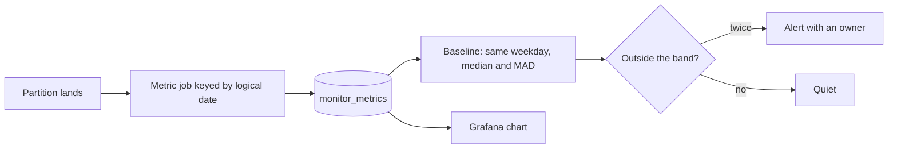

# Monitors and lineage

Know, before a stakeholder does, that a pipeline or a model has gone wrong: compare each new batch to a reference, store the comparison as a time series, chart it, and alert on it. The previous chapter's tests judged each batch against rules someone wrote down, and three of our five faults got past them. A monitor judges a batch against its own history, so it finds failures nobody thought to write a rule for. Lineage then answers the question that comes next: now that this table is wrong, what else is?

## Where it sits

Everything upstream (ingest, transform, orchestrate, store) can fail silently: a schema changes, a source stops sending, a feature's distribution shifts. Monitoring turns those into numbers with thresholds. Two kinds of material meet in this chapter. The freshness, volume and lineage sections continue the taxi feed from [quality dimensions and tests](01-quality-dimensions-and-tests.md), with its five planted faults. The model monitoring material is MLOps zoomcamp module 05 (Evidently + Postgres + Grafana, with Prefect for the batch loop). Pipeline-side checks come from earlier notes: dbt tests and source freshness ([transform](../../03-transform-and-orchestrate/notes/01-transform.md)), Mage `@test` blocks ([orchestrate](../../03-transform-and-orchestrate/notes/02-orchestrate.md)).

The CURRICULUM.md snapshot listed "Prometheus" for MLOps 05. The 2024 module doesn't use it: metrics go into Postgres and Grafana reads them from there.

To run the feed sections, paste the blocks in order into one file and run it in an empty folder. Evidently's old API needs an older pandas, hence the pin:

```bash
uv run --python 3.11 --with duckdb --with pyarrow --with numpy --with 'pandas<2.3' --with scipy \
       --with 'evidently<0.7' --with openlineage-python --with dbt-duckdb python chapter.py
```

## What to monitor

MLOps 5.1 sorts monitoring into layers. Each needs a different signal and a different owner:

| Layer | Question | Signal | Course tool |
|---|---|---|---|
| Service health | Is it up and fast? | Latency, error rate, throughput | Out of scope (Grafana/Prometheus in general) |
| Data quality | Is the input well-formed? | Share of missing values, schema, value ranges | `DatasetMissingValuesMetric`, dbt tests |
| Data drift | Does input look like training data? | Per-column distribution distance; number of drifted columns | `DatasetDriftMetric` |
| Prediction drift | Has model output shifted? | Drift score on the prediction column | `ColumnDriftMetric(column_name='prediction')` |
| Model quality | Is it still right? | MAE/RMSE against ground truth | Needs labels; ride duration arrives once the trip ends |
| Pipeline freshness | Did data arrive? | Max `loaded_at` vs now | `dbt source freshness` |

Prediction drift is the first alarm to wire up when labels arrive late. It needs no ground truth, and when the output distribution moves, something upstream moved.

### Three kinds of drift

Drift metrics are proxies: they flag trouble without labels by comparing a **reference window** (data the model is known to handle) with a **test window** (recent production data) (*LLM Engineer's Handbook*, appendix):

| Drift | What moved | Typical response |
|---|---|---|
| Data (covariate) drift | P(inputs): new segment, pipeline bug, schema change | Fix upstream if it's a bug; otherwise consider retraining before quality drops |
| Target drift | P(outputs): shape changes, classes appear or vanish | Often a schema change for the model head (add a class, an "unknown" bucket) rather than a retrain |
| Concept drift | P(output \| input): the same inputs now mean something else | Retrain on recent data; arrives gradually, suddenly (an external event) or periodically (seasonality) |

The test depends on the column: Kolmogorov–Smirnov for one numeric feature, chi-squared for a categorical one, one test per feature. Text and other embedded inputs are multivariate. The usual approach there is to reduce the embeddings of both windows and compare them with maximum mean discrepancy (MMD), a kernel distance between the two distributions. `alibi-detect` ships `KSDrift` and `MMDDrift`, and Evidently has embedding-drift methods too. Several kinds of drift can happen at once, which is why the per-column test suite below matters for finding the source.

The data-observability vendors group the pipeline half of this table into five pillars: freshness, quality, volume, schema and lineage ([Monte Carlo, What is data observability](https://www.montecarlodata.com/blog-what-is-data-observability/), a vendor's framing, though a widely used one). We already tested quality and schema. The rest of this chapter builds freshness, volume, distribution and lineage on the running feed, and then the model layers.

The same feed as before, plus a log of when each partition arrived:

```python
import datetime as dt, os, shutil
import duckdb, numpy as np, pyarrow as pa, pyarrow.parquet as pq

DAYS = [dt.date(2024, 1, 1) + dt.timedelta(d) for d in range(91)]   # Q1 2024
FAULTS = {dt.date(2024, 3, 5):  'null spike',
          dt.date(2024, 3, 10): 'dropped day',
          dt.date(2024, 3, 15): 'late partition',
          dt.date(2024, 3, 18): 'duplicate keys'}
UNIT_CHANGE_FROM = dt.date(2024, 3, 24)                  # miles become kilometres

def make_day(day, rng):
    n = int(rng.normal(3000 if day.weekday() < 5 else 2100, 90))
    base = int(day.strftime('%Y%m%d')) * 100_000
    miles = np.round(rng.exponential(3.0, n) + 0.3, 2)
    fare = np.round(3 + 2.5 * miles + rng.normal(0, 1, n).clip(-2, 8), 2)
    fare_null = rng.random(n) < (0.20 if FAULTS.get(day) == 'null spike' else 0.002)
    secs = rng.integers(0, 86400, n)
    t = {'trip_id': base + np.arange(n),
         'pickup': [dt.datetime.combine(day, dt.time()) + dt.timedelta(seconds=int(s)) for s in secs],
         'pu_zone': rng.integers(1, 266, n),
         'distance': np.round(miles * (1.609 if day >= UNIT_CHANGE_FROM else 1), 2)}
    table = pa.table(t).append_column('fare', pa.array(fare, mask=fare_null))
    if FAULTS.get(day) == 'duplicate keys':
        table = pa.concat_tables([table, table])         # producer retried the whole batch
    return table

def make_feed(root='raw'):
    """Write one Parquet partition per day and a log of what arrived when."""
    rng = np.random.default_rng(11)
    shutil.rmtree(root, ignore_errors=True)
    loads = []
    for day in DAYS:
        table = make_day(day, rng)
        if FAULTS.get(day) == 'dropped day':
            continue                                     # the partition never lands
        lag = 50 if FAULTS.get(day) == 'late partition' else 2 # hours past midnight
        os.makedirs(f'{root}/dt={day}', exist_ok=True)
        pq.write_table(table, f'{root}/dt={day}/part.parquet')
        loads.append((day, dt.datetime.combine(day + dt.timedelta(1), dt.time()) + dt.timedelta(hours=lag), table.num_rows))
    return loads

loads = make_feed()
con = duckdb.connect()
con.execute("CREATE VIEW trips AS SELECT * FROM read_parquet('raw/*/part.parquet', hive_partitioning=true)")
con.execute("CREATE TABLE zones AS SELECT range AS zone_id FROM range(1, 266)")
import pandas as pd
con.execute("CREATE TABLE loads AS SELECT d::DATE AS dt, l AS loaded_at, r AS n_rows FROM (SELECT unnest(?) AS d, unnest(?) AS l, unnest(?) AS r)",
            [[str(d) for d, _, _ in loads], [x for _, x, _ in loads], [r for _, _, r in loads]])
print(con.sql("SELECT * FROM loads WHERE dt BETWEEN '2024-03-14' AND '2024-03-16' ORDER BY dt"))
```

Output:

```text
┌────────────┬─────────────────────┬────────┐
│     dt     │      loaded_at      │ n_rows │
│    date    │      timestamp      │ int32  │
├────────────┼─────────────────────┼────────┤
│ 2024-03-14 │ 2024-03-15 02:00:00 │   2930 │
│ 2024-03-15 │ 2024-03-18 02:00:00 │   2940 │
│ 2024-03-16 │ 2024-03-17 02:00:00 │   2152 │
└────────────┴─────────────────────┴────────┘
```

## Freshness: did it arrive, and is anything missing?

The usual freshness check compares the newest load time with the clock. If the feed promises data by 02:00, with a margin, then anything older than 26 hours is stale. We run it each morning at 06:00, and alongside it a second check: which expected dates have never arrived?

```python
def freshness(as_of, promise_h=26):
    newest = con.execute("SELECT max(loaded_at) FROM loads WHERE loaded_at <= ?", [as_of]).fetchone()[0]
    age = (as_of - newest).total_seconds() / 3600
    expected = [as_of.date() - dt.timedelta(k) for k in range(2, 40)]
    have = {r[0] for r in con.execute("SELECT dt FROM loads WHERE loaded_at <= ?", [as_of]).fetchall()}
    return age, age > promise_h, [str(d) for d in expected if d not in have and d >= dt.date(2024, 3, 1)]

print(f"{'monitor runs at':17} {'age h':>6} {'stale':>6}  holes older than yesterday")
for day in ['03-10', '03-11', '03-12', '03-13', '03-16', '03-17', '03-18', '03-19']:
    as_of = dt.datetime.fromisoformat(f'2024-{day}T06:00')
    age, stale, holes = freshness(as_of)
    print(f"{as_of:%b %d %H:%M}      {age:6.0f} {str(stale):>6}  {holes}")
```

Output:

```text
monitor runs at    age h  stale  holes older than yesterday
Mar 10 06:00           4  False  []
Mar 11 06:00          28   True  []
Mar 12 06:00           4  False  ['2024-03-10']
Mar 13 06:00           4  False  ['2024-03-10']
Mar 16 06:00          28   True  ['2024-03-10']
Mar 17 06:00           4  False  ['2024-03-15', '2024-03-10']
Mar 18 06:00           4  False  ['2024-03-10']
Mar 19 06:00           4  False  ['2024-03-10']
```

Read the two columns together. On 11 March the feed misses its 10 March partition and the age check fires, correctly. On 12 March the 11 March partition lands, the age drops back to 4 hours, and **the alert clears even though the data is still missing**. The newest record was never the problem; there is a hole behind it. The same thing happens with the late partition: the alert fires on 16 March, and clears on 17 March, a full day before the data appears.

So one number is not enough. `max(loaded_at)` measures whether the feed is alive. A date spine, a list of the dates that should exist, measures whether it is complete. The first catches a stopped feed in hours. The second keeps firing until someone repairs the hole.

The dbt version of the first check is `dbt source freshness`, configured on the source with `warn_after` and `error_after` thresholds against a `loaded_at_field` ([dbt, freshness](https://docs.getdbt.com/reference/resource-properties/freshness)). The next block runs it against three load times:

```python
import pathlib, subprocess, textwrap
def write(path, body):
    p = pathlib.Path(path); p.parent.mkdir(parents=True, exist_ok=True)
    p.write_text(textwrap.dedent(body))
write('taxi/dbt_project.yml', "name: taxi\nprofile: taxi\n")
write('taxi/profiles.yml', "taxi:\n  target: dev\n  outputs:\n    dev: {type: duckdb, path: taxi.duckdb}\n")
write('taxi/models/sources.yml', """
    version: 2
    sources:
      - name: feed
        schema: main
        tables:
          - name: loads
            loaded_at_field: loaded_at
            config:
              freshness:
                warn_after: {count: 26, period: hour}
                error_after: {count: 50, period: hour}
""")
def load_was(hours_ago):
    with duckdb.connect('taxi.duckdb') as db:
        db.execute("CREATE OR REPLACE TABLE loads AS SELECT now() - INTERVAL (?) HOUR AS loaded_at", [hours_ago])
    r = subprocess.run(['dbt', 'source', 'freshness', '--project-dir', 'taxi', '--profiles-dir', 'taxi', '--no-use-colors'],
                       capture_output=True, text=True)
    return [l[9:] for l in r.stdout.splitlines() if ' of 1 ' in l and 'START' not in l]
for h in [2, 30, 60]:
    print(f'{h:>2} hours old:', *load_was(h))
```

Output:

```text
 2 hours old:  1 of 1 PASS freshness of feed.loads ............................................ [PASS in 0.03s]
30 hours old:  1 of 1 WARN freshness of feed.loads ............................................ [WARN in 0.03s]
60 hours old:  1 of 1 ERROR STALE freshness of feed.loads ..................................... [ERROR STALE in 0.03s]
```

It reports the warning and error tiers separately, which gives you a clean way to route them: a warning opens a ticket and an error pages someone. It compares `max(loaded_at)` with the clock, so it shares the blind spot above, and you still want the date spine.

## Volume: a baseline that survives bad days

A row-count monitor asks whether today's count is unusual. The obvious version is the mean and standard deviation of the last 28 days, and alert at three standard deviations. Compare it with a sturdier one: the median and median absolute deviation (MAD) of the last six values for the same weekday. MAD is the middle distance from the median, and multiplying it by 1.4826 makes it comparable with a standard deviation on normal data. A median barely moves when one value is extreme, so a duplicated day does not ruin the baseline the way it ruins a mean.

```python
counts = con.execute("""
    WITH spine AS (SELECT unnest(generate_series(DATE '2024-01-01', DATE '2024-03-31', INTERVAL 1 DAY))::DATE AS dt)
    SELECT s.dt, coalesce(count(t.trip_id), 0) AS n FROM spine s LEFT JOIN trips t ON s.dt = t.dt
    GROUP BY 1 ORDER BY 1""").df()
counts['dt'] = pd.to_datetime(counts['dt'])

def naive(series, i, k=3):
    """Mean and standard deviation of the last 28 days."""
    w = series[i - 28:i]
    return abs(series[i] - w.mean()) > k * w.std()

def robust(series, i, weekdays, k=5):
    """Median and MAD of the last 6 values for the same weekday."""
    w = series[:i][weekdays[:i] == weekdays[i]][-6:]
    med = np.median(w)
    mad = 1.4826 * np.median(np.abs(w - med))
    return abs(series[i] - med) > k * max(mad, 0.02 * med)   # floor stops a flat history firing on noise

n, wd = counts['n'].to_numpy(float), counts['dt'].dt.weekday.to_numpy()
days = range(42, len(n))                                     # six weeks of warm-up
for name, fn in [('naive 3 sigma', lambda s, i: naive(s, i)), ('robust by weekday', lambda s, i: robust(s, i, wd))]:
    fired = [f"{counts['dt'][i]:%b %d}" for i in days if fn(n, i)]
    print(f'{name:18} fired on: {fired}')
```

Output:

```text
naive 3 sigma      fired on: ['Mar 10', 'Mar 18']
robust by weekday  fired on: ['Mar 10', 'Mar 18']
```

Both catch the two blunt faults: a day with zero rows and a day with double. That result makes the naive version look fine, so test how sensitive each one is. Take each normal day, remove a share of its rows, and see which monitor notices:

```python
clean = np.array([c for c in n])
fault_days = {i for i in days if counts['dt'][i].date() in FAULTS}
clean_days = [i for i in days if i not in fault_days]
def score(fn, drop):
    hit = 0
    for i in clean_days:
        s = clean.copy(); s[i] = s[i] * (1 - drop)
        hit += bool(fn(s, i))
    return hit / len(clean_days)
print('share of normal days flagged as anomalous when the day loses X% of its rows')
print(f"{'lost':>6} {'naive':>7} {'robust':>7}")
for drop in [0, .05, .10, .15, .25, .50]:
    print(f"{drop:>6.0%} {score(lambda s, i: naive(s, i), drop):>7.0%} {score(lambda s, i: robust(s, i, wd), drop):>7.0%}")
```

Output:

```text
share of normal days flagged as anomalous when the day loses X% of its rows
  lost   naive  robust
    0%      0%      0%
    5%      0%      9%
   10%      0%     29%
   15%      0%     67%
   25%      2%     98%
   50%     36%    100%
```

This is the table to remember. Neither monitor fires on any normal day in this short sample, so they tie on false alarms at the thresholds used. But the naive monitor misses a quarter of the data almost every time, and it only starts to notice at half. Weekday and weekend counts differ by 30% in this feed, so a mixed window has a huge standard deviation that any modest loss fits inside. Comparing like with like shrinks the noise. The real gain comes from the seasonal comparison and the robust estimate together, not from anything clever about the threshold. These percentages describe this synthetic feed, with its 46 scored days. Run the same test on your own history, by injecting losses, before you trust a threshold.

## Distribution: the only monitor that sees the unit change

Row counts did not move on 24 March. The nulls did not move. Only the values did. A distribution monitor compares a column with a reference window, here February, using the two-sample Kolmogorov–Smirnov (KS) test. Its statistic *D* is the largest gap between the two cumulative distributions.

```python
from scipy import stats
ref = con.execute("SELECT distance FROM trips WHERE dt BETWEEN '2024-02-01' AND '2024-02-29'").df()['distance'].to_numpy()
rows = []
for d in pd.date_range('2024-03-01', '2024-03-31').date:
    x = con.execute("SELECT distance FROM trips WHERE dt = ?", [str(d)]).df()['distance'].to_numpy()
    if len(x) == 0:
        continue
    r = stats.ks_2samp(ref, x)
    rows.append({'dt': d, 'median': np.median(x), 'ks_stat': r.statistic, 'p': r.pvalue})
ks = pd.DataFrame(rows).set_index('dt')
before, after = ks[ks.index < UNIT_CHANGE_FROM], ks[ks.index >= UNIT_CHANGE_FROM]
print(f"before the change: max D {before.ks_stat.max():.3f}, days with p<0.05: {(before.p < .05).sum()} of {len(before)}")
print(f"after the change:  min D {after.ks_stat.min():.3f}, days with p<0.05: {(after.p < .05).sum()} of {len(after)}")
print(ks.loc[[dt.date(2024, 3, 23), dt.date(2024, 3, 24)]].round(4).to_string())
```

Output:

```text
before the change: max D 0.029, days with p<0.05: 0 of 22
after the change:  min D 0.182, days with p<0.05: 8 of 8
            median  ks_stat       p
dt
2024-03-23    2.44   0.0178  0.5578
2024-03-24    3.96   0.2100  0.0000
```

The separation is clean: at most 0.029 before, at least 0.182 after, and the change is detected on the first day. So why does the `D` matter when the p-value also gets it right? Because p-values get worse as the data grows. [Breck et al. (MLSys 2019)](https://mlsys.org/Conferences/2019/doc/2019/167.pdf) make the case from Google's TFX: they take 100 million points from a standard normal, replace 10 thousand with draws from a wider normal, and run a chi-squared test. A change of 0.01% that nobody would care about triggers an alert at the 1% level in 7 of 10 trials. Their remedy is a measure of distance with a threshold a team can reason about. Their choice is the L-infinity distance on categorical values, the largest change in probability for any value, which has the bonus of naming a culprit. KS `D` is the numeric counterpart of the idea. With 3,000 rows a day the p-value still behaves here. At far larger sizes it would flag differences too small to matter, so threshold on the effect size.

Do not rely on a rolling reference for permanent changes. A baseline of the last 28 days will take a unit change as normal once more than half its window is after the change. Keep a fixed reference that someone has approved, roll it forward deliberately, and treat a step that never reverts as an event to investigate.

## Monitoring is a pipeline

All these metrics need to live somewhere, with one row per day and metric. The key must be the **logical date** of the data, not the time the job ran, so a backfill replaces earlier values rather than adding new ones. This is the same idempotence rule as any other job in the [orchestration chapter](../../03-transform-and-orchestrate/notes/02-orchestrate.md).

```python
con.execute("""CREATE TABLE monitor_metrics(
    dt DATE, metric VARCHAR, value DOUBLE, PRIMARY KEY (dt, metric))""")   # keyed by the logical date, not now()
def compute(day):
    con.execute("""
      INSERT OR REPLACE INTO monitor_metrics
      SELECT dt, m.metric, m.value FROM (
        SELECT ?::DATE AS dt,
               count(*)::DOUBLE AS n_rows,
               avg((fare IS NULL)::INT)::DOUBLE AS null_fare,
               (count(*) - count(DISTINCT trip_id))::DOUBLE AS dup_keys,
               coalesce(median(distance), 0)::DOUBLE AS median_distance
        FROM trips WHERE dt = ?) s,
      LATERAL (VALUES ('n_rows', n_rows), ('null_fare', null_fare), ('dup_keys', dup_keys), ('median_distance', median_distance)) m(metric, value)
    """, [str(day), str(day)])
for day in DAYS: compute(day)
first = con.execute("SELECT count(*), round(sum(value)) FROM monitor_metrics").fetchone()
for day in DAYS: compute(day)                                  # a backfill reruns every day
print('after first run:', first, ' after backfill:', con.execute("SELECT count(*), round(sum(value)) FROM monitor_metrics").fetchone())

def alerts(metric, floor):
    s = con.execute("SELECT dt, value FROM monitor_metrics WHERE metric = ? ORDER BY dt", [metric]).df()
    v, wk = s['value'].to_numpy(), pd.to_datetime(s['dt']).dt.weekday.to_numpy()
    out = []
    for i in range(42, len(v)):
        w = v[:i][wk[:i] == wk[i]][-6:]
        med = np.median(w)
        if abs(v[i] - med) > 5 * max(1.4826 * np.median(np.abs(w - med)), floor):
            out.append(f"{s['dt'][i]:%b %d}")
    return out
print('n_rows         ', alerts('n_rows', 60))
print('null_fare      ', alerts('null_fare', 0.005))
print('dup_keys       ', alerts('dup_keys', 1))
print('median_distance', alerts('median_distance', 0.1))
```

Output:

```text
after first run: (364, 253634.0)  after backfill: (364, 253634.0)
n_rows          ['Mar 10', 'Mar 18']
null_fare       ['Mar 05']
dup_keys        ['Mar 18']
median_distance ['Mar 10', 'Mar 24', 'Mar 25', 'Mar 26', 'Mar 27', 'Mar 28', 'Mar 29', 'Mar 30', 'Mar 31']
```

The row count and sum do not change after a full rerun: a backfill is safe. Each fault now has its detector, and each detector stays quiet on the other days. `median_distance` also fires on 10 March, because an empty day has a median of zero, which is noise you would suppress by alerting on `n_rows` first. Note what this table cannot do. `n_rows` on 15 March looks normal here because the metrics were computed after the late partition landed; only the freshness and date-spine checks saw it in time. Recomputing history erases what was visible when, so if you want to study detection delay, also keep the original value and the time it was recorded.

| Fault | Test (last chapter) | Monitor that caught it |
|---|---|---|
| Null spike, 5 March | `mostly` null check | `null_fare` |
| Dropped day, 10 March | None | Age check, then date spine; `n_rows` |
| Late partition, 15 March | None | Age check, then date spine |
| Duplicates, 18 March | `unique` | `dup_keys`; `n_rows` |
| Unit change, 24 March | None | `median_distance`, KS `D` |



## Batch vs online monitoring

| | Batch (the course) | Online |
|---|---|---|
| When | A scheduled job over the last window (a day here) | Per request or per micro-window |
| Mechanism | Orchestrated job computes metrics, writes to a DB | Service emits metrics; collector aggregates |
| Fits | Batch scoring ([orchestrate](../../03-transform-and-orchestrate/notes/02-orchestrate.md)), daily pipelines | Web/stream serving ([serving](../../06-ml-platform/notes/03-batch-and-online-serving.md)) |
| Drift tests | Full distribution tests on the window | Approximate or windowed |

The course simulates online monitoring with batch: one day of February 2022 every 10 seconds.

## The stack

The course stores its metrics in Postgres and charts them in Grafana. Our `monitor_metrics` table is the same design in DuckDB. This stack needs Docker to run.

```yaml
services:
  db:
    image: postgres
    environment:
      POSTGRES_PASSWORD: example
    ports: ["5432:5432"]
  adminer:
    image: adminer
    ports: ["8080:8080"]
  grafana:
    image: grafana/grafana-enterprise
    user: "472"
    ports: ["3000:3000"]
    volumes:
      - ./config/grafana_datasources.yaml:/etc/grafana/provisioning/datasources/datasource.yaml:ro
      - ./config/grafana_dashboards.yaml:/etc/grafana/provisioning/dashboards/dashboards.yaml:ro
      - ./dashboards:/opt/grafana/dashboards
```

| Service | Role |
|---|---|
| `db` | Postgres; stores one row of metrics per batch |
| `adminer` | Web DB browser on 8080, for checking the rows landed |
| `grafana` | Dashboards on 3000 (login `admin`/`admin`), **provisioned from files** |

Provisioning is the part to copy. The datasource file points Grafana at `db:5432`, database `test`. The dashboards provider loads `dashboards/data_drift.json` from disk. A `docker-compose up` on a fresh machine therefore comes up with the dashboard already there, so dashboards live in version control rather than only in Grafana's internal DB (5.8 "Save Grafana dashboard" exports the JSON for this).

```yaml
datasources:
  - name: PostgreSQL
    type: postgres
    access: proxy
    url: db:5432
    database: test
    user: postgres
    secureJsonData: {password: 'example'}
    jsonData: {sslmode: 'disable'}
```

## Reference data

`baseline_model_nyc_taxi_data.ipynb` downloads green taxi January and February 2022 and filters trips to 0–60 minutes. It trains a linear regression on `passenger_count, trip_distance, fare_amount, total_amount, PULocationID, DOLocationID` and writes:

- `models/lin_reg.bin`, the model
- `data/reference.parquet`, **the validation set with predictions**

The reference set is the most consequential choice in monitoring. It should be data the model is known to perform acceptably on, from the same pipeline, with predictions attached. Comparing against raw training data flags differences your model already handles.

## Computing metrics with Evidently

The course's three metrics apply directly to our feed. A one-line fare model stands in for its regression, and February is the reference. The course's own mapping lists `passenger_count`, `trip_distance`, `fare_amount` and `total_amount` as numeric and `PULocationID` and `DOLocationID` as categorical. `ColumnMapping` declares types. Without it Evidently guesses, and treats location IDs as numeric.

```python
import warnings; warnings.filterwarnings('ignore')
from evidently.report import Report
from evidently import ColumnMapping
from evidently.metrics import ColumnDriftMetric, DatasetDriftMetric, DatasetMissingValuesMetric
import importlib.metadata as md
print('evidently', md.version('evidently'))
def frame(where):
    return con.execute(f"SELECT distance, pu_zone, fare FROM trips WHERE {where} AND fare IS NOT NULL").df()
train = frame("dt BETWEEN '2024-01-01' AND '2024-01-31'")
slope, intercept = np.polyfit(train.distance, train.fare, 1)        # a tiny stand-in for a fare model
def scored(where):
    f = frame(where); f['prediction'] = intercept + slope * f.distance; return f
reference = scored("dt BETWEEN '2024-02-01' AND '2024-02-29'")      # validation data, with predictions
mapping = ColumnMapping(prediction='prediction', numerical_features=['distance', 'fare'],
                        categorical_features=['pu_zone'], target=None)
def report(day):
    r = Report(metrics=[ColumnDriftMetric(column_name='prediction'), DatasetDriftMetric(), DatasetMissingValuesMetric()])
    r.run(reference_data=reference, current_data=scored(f"dt = '{day}'"), column_mapping=mapping)
    res = r.as_dict()['metrics']
    return dict(prediction_drift=round(float(res[0]['result']['drift_score']), 3),
                drift_detected=res[0]['result']['drift_detected'],
                num_drifted_columns=res[1]['result']['number_of_drifted_columns'],
                share_missing=round(res[2]['result']['current']['share_of_missing_values'], 4))
for day in ['2024-03-20', '2024-03-25']:
    print(day, report(day))
```

Output:

```text
evidently 0.4.36
2024-03-20 {'prediction_drift': 0.022, 'drift_detected': False, 'num_drifted_columns': 1, 'share_missing': 0.0}
2024-03-25 {'prediction_drift': 0.679, 'drift_detected': True, 'num_drifted_columns': 3, 'share_missing': 0.0}
```

Prediction drift jumps from 0.022 to 0.679, and the model itself is the alarm: it is unchanged, but its inputs are now in kilometres, so every prediction is inflated. Note that one column drifted on the clean day too. Per-column flags are noisy, which is why the alert rule below asks for two consecutive breaches and more than one column.

| Metric | Output used | Meaning |
|---|---|---|
| `ColumnDriftMetric('prediction')` | `drift_score` | Distance between reference and current prediction distributions (Evidently picks the test by type and size: K-S, chi-squared, Wasserstein, Jensen-Shannon) |
| `DatasetDriftMetric()` | `number_of_drifted_columns` | How many features crossed their drift threshold; dataset drift = share above a cutoff |
| `DatasetMissingValuesMetric()` | `current.share_of_missing_values` | Data quality on the current batch |

`ColumnMapping` declares types. Without it Evidently guesses, and treats location IDs as numeric.

## The batch loop

```python
# illustrative: needs the Postgres service above and the course's month of taxi data
create_table_statement = """
drop table if exists dummy_metrics;
create table dummy_metrics(
    timestamp timestamp,
    prediction_drift float,
    num_drifted_columns integer,
    share_missing_values float)
"""

@task
def calculate_metrics_postgresql(curr, i):
    current_data = raw_data[(raw_data.lpep_pickup_datetime >= (begin + datetime.timedelta(i))) &
                            (raw_data.lpep_pickup_datetime <  (begin + datetime.timedelta(i + 1)))]
    current_data['prediction'] = model.predict(current_data[num_features + cat_features].fillna(0))
    report.run(reference_data=reference_data, current_data=current_data, column_mapping=column_mapping)
    result = report.as_dict()
    curr.execute(
        "insert into dummy_metrics(timestamp, prediction_drift, num_drifted_columns, share_missing_values) "
        "values (%s, %s, %s, %s)",
        (begin + datetime.timedelta(i), prediction_drift, num_drifted_columns, share_missing_values))

@flow
def batch_monitoring_backfill():
    prep_db()
    with psycopg.connect("host=localhost port=5432 dbname=test user=postgres password=example",
                         autocommit=True) as conn:
        for i in range(0, 27):                  # 27 days of Feb 2022
            with conn.cursor() as curr:
                calculate_metrics_postgresql(curr, i)
            # sleep so one "day" lands every SEND_TIMEOUT = 10 seconds
```

The design in one sentence: **monitoring is a pipeline**, with a scheduled job, an idempotent write keyed by the batch's logical timestamp (not `now()`), and a backfill. Everything in [orchestrate](../../03-transform-and-orchestrate/notes/02-orchestrate.md) applies to it.

Two things to change before production. Metrics are keyed by `begin + timedelta(i)`, which is right, but the table is dropped on every run, so history is lost. And `fillna(0)` before predict hides the missing values the third metric is meant to catch: impute in the model's preprocessing, not in the monitor.

## Dashboard and alerts

`dashboards/data_drift.json` charts the three columns over `timestamp`: **Prediction drift**, **Number of drifted columns**, **Share of missing values**. Grafana alert rules on the same queries (for example `num_drifted_columns > 2` for two consecutive batches) close the loop. The MLOps project rubric gives full monitoring marks only when a threshold triggers an alert or a retraining run ([maturity](../../06-ml-platform/notes/05-mlops-maturity-and-best-practices.md)); the Mage sensor in MLOps 3.4 is the retraining half.

Give every alert an owner and an action (page, open a ticket, trigger retraining). An alert nobody acts on trains the team to ignore the channel, and requiring two consecutive breaches is the cheapest guard against one noisy batch. For statistical drift tests the p-value is the threshold, and the same trade-off applies: set it too loose and false positives drown the real ones.

Before a drift alert triggers retraining, rule out the cheap explanations: is the data valid, did a schema change, is it one outlier? Retraining is the expensive response and fixes none of those (*LLM Engineer's Handbook*, appendix).

Google's SRE book states the same discipline for paging: every page should be actionable and should call for intelligence rather than a robotic response ([Beyer et al., Site Reliability Engineering, ch. 6](https://sre.google/sre-book/monitoring-distributed-systems/)). It also separates the symptom (what is broken) from the cause (why). Data monitors should alert on symptoms that users would notice, and lineage helps with the cause. [Breck et al. (2017)](https://research.google/pubs/the-ml-test-score-a-rubric-for-ml-production-readiness-and-technical-debt-reduction/), in the ML Test Score's second monitoring test, say the same about data invariants: thresholds need careful tuning, so that alerts stay useful and actionable.

## Debugging with test suites (5.9)

When the dashboard shows drift, `debugging_nyc_taxi_data.ipynb` drills in with a `TestSuite`. It is the same comparison as a report, with a pass or fail per condition:

```python
from evidently.test_suite import TestSuite
from evidently.test_preset import DataDriftTestPreset
for day in ['2024-03-20', '2024-03-25']:
    suite = TestSuite(tests=[DataDriftTestPreset()])
    suite.run(reference_data=reference, current_data=scored(f"dt = '{day}'"), column_mapping=mapping)
    out = suite.as_dict()
    failed = [t['name'] for t in out['tests'] if t['status'] == 'FAIL']
    print(day, 'passed' if out['summary']['all_passed'] else 'failed', failed)
```

Output:

```text
2024-03-20 failed ['Drift per Column']
2024-03-25 failed ['Share of Drifted Columns', 'Drift per Column', 'Drift per Column', 'Drift per Column']
```

The clean day fails on a single column and the unit change fails on all three plus the overall share. The preset is strict at small daily sample sizes, so gate on the overall result only after you have seen how often a normal day fails. In a notebook, `suite.show(mode='inline')` shows pass or fail per column, and a `Report(metrics=[DataDriftPreset()])` run on the same day shows the distributions side by side.

A **Report** describes (distributions, scores). A **TestSuite** asserts (pass/fail against conditions), so it's the object to gate a pipeline on. The notebooks also build an Evidently `Workspace` project with `DashboardPanelCounter` and `DashboardPanelPlot`, Evidently's own UI as an alternative to Grafana.

## Lineage: what did this touch?

We know the unit change began on 24 March in `raw.trips`. What is wrong now, and what has to be rebuilt? Sculley et al. name the reason this is hard: code dependencies are found by compilers and linkers, and there is no equivalent for data dependencies, so long chains build up unseen ([NeurIPS 2015](https://papers.nips.cc/paper_files/paper/2015/hash/86df7dcfd896fcaf2674f757a2463eba-Abstract.html)). Lineage is that missing tool: a graph of which job read and wrote which dataset.

You can parse it out of SQL, and dbt's `ref()` gives it to you inside one project. It stops at the edge of that tool. [OpenLineage](https://openlineage.io/docs/spec/object-model) is an open standard for collecting it across tools. Its model has three things: a **Dataset**, a **Job**, and a **Run**, one execution of a job. Jobs send `RunEvent`s as they change state: `START`, then a terminal `COMPLETE`, `FAIL` or `ABORT` ([OpenLineage, the run cycle](https://openlineage.io/docs/spec/run-cycle)). The backend learns about datasets mainly by receiving these events, then weaves many jobs into one graph. Extra information travels as *facets* on any of the three. [Integrations](https://openlineage.io/docs/integrations/about) exist for tools such as [Airflow](https://openlineage.io/docs/integrations/airflow/), [Spark](https://openlineage.io/docs/integrations/spark/) and [dbt](https://openlineage.io/docs/integrations/dbt), and [Marquez](https://marquezproject.ai/) is the reference backend.

Here the pipeline emits events with the Python client and a file transport, so no server is needed. In production, you would point the transport at a backend over HTTP.

```python
from openlineage.client import OpenLineageClient
from openlineage.client.event_v2 import RunEvent, RunState, Run, Job, InputDataset, OutputDataset
from openlineage.client.transport.file import FileConfig, FileTransport
from openlineage.client.facet_v2 import nominal_time_run, schema_dataset
import uuid, json
print('openlineage-python', md.version('openlineage-python'))
PIPELINE = {                 # job: (inputs, outputs)
    'load_raw':       (['ext.vendor_export'], ['raw.trips']),
    'stg_trips':      (['raw.trips', 'ref.zones'], ['staging.trips']),
    'daily_revenue':  (['staging.trips'], ['marts.daily_revenue']),
    'trip_features':  (['staging.trips'], ['features.trip']),
    'score_fares':    (['features.trip'], ['ml.fare_predictions']),
    'zone_dashboard': (['marts.daily_revenue', 'ref.zones'], ['bi.zone_dashboard']),
}
client = OpenLineageClient(transport=FileTransport(FileConfig(log_file_path='lineage.jsonl', append=True)))
PRODUCER = 'https://example.com/taxi-pipeline'
def emit(job, day, state, run_id):
    ins, outs = PIPELINE[job]
    client.emit(RunEvent(
        eventType=state, eventTime=f'{day}T03:00:00+00:00', producer=PRODUCER,
        run=Run(runId=run_id, facets={'nominalTime': nominal_time_run.NominalTimeRunFacet(nominalStartTime=f'{day}T00:00:00+00:00')}),
        job=Job(namespace='taxi', name=job),
        inputs=[InputDataset(namespace='lake', name=i) for i in ins],
        outputs=[OutputDataset(namespace='lake', name=o) for o in outs]))
for d in pd.date_range('2024-03-20', '2024-03-27').strftime('%Y-%m-%d'):
    for job in PIPELINE:
        rid = str(uuid.uuid4())
        emit(job, d, RunState.START, rid); emit(job, d, RunState.COMPLETE, rid)
events = [json.loads(l) for l in open('lineage.jsonl')]
print(len(events), 'events; one looks like:')
e = {k: events[1][k] for k in ('eventType', 'eventTime')} | {'job': events[1]['job']['name'],
     'inputs': [i['name'] for i in events[1]['inputs']], 'outputs': [o['name'] for o in events[1]['outputs']]}
print(json.dumps(e))
```

Output:

```text
openlineage-python 1.55.0
96 events; one looks like:
{"eventType": "COMPLETE", "eventTime": "2024-03-20T03:00:00+00:00", "job": "load_raw", "inputs": ["ext.vendor_export"], "outputs": ["raw.trips"]}
```

Each job's run is one `START` and one `COMPLETE` with a shared `runId`. The `nominalTime` facet records which day of data the run was for, separately from when it ran, which is the same logical-date idea again. Lineage is now plain data, so the incident questions are short graph walks:

```python
from collections import defaultdict, deque
down, up = defaultdict(set), defaultdict(set)
for e in events:
    for i in e['inputs']:
        for o in e['outputs']:
            down[i['name']].add(o['name']); up[o['name']].add(i['name'])
def walk(graph, start):
    seen, q = [], deque([start])
    while q:
        for nxt in sorted(graph[q.popleft()]):
            if nxt not in seen:
                seen.append(nxt); q.append(nxt)
    return seen
print('downstream of raw.trips:    ', walk(down, 'raw.trips'))
print('upstream of bi.zone_dashboard:', walk(up, 'bi.zone_dashboard'))
bad_since, reach = '2024-03-24', set(walk(down, 'raw.trips'))
hit = sorted({(e['job']['name'], e['run']['facets']['nominalTime']['nominalStartTime'][:10]) for e in events
              if e['eventType'] == 'COMPLETE' and e['eventTime'][:10] >= bad_since
              and {o['name'] for o in e['outputs']} & reach})
print(f'{len(hit)} completed runs to redo; first three:', hit[:3])
```

Output:

```text
downstream of raw.trips:     ['staging.trips', 'features.trip', 'marts.daily_revenue', 'ml.fare_predictions', 'bi.zone_dashboard']
upstream of bi.zone_dashboard: ['marts.daily_revenue', 'ref.zones', 'staging.trips', 'raw.trips', 'ext.vendor_export']
20 completed runs to redo; first three: [('daily_revenue', '2024-03-24'), ('daily_revenue', '2024-03-25'), ('daily_revenue', '2024-03-26')]
```

Three answers. **Blast radius**: five datasets sit downstream of `raw.trips`, including a model's predictions the dashboard owner may not know exist. **Root-cause candidates**: walking up from a broken dashboard gives a short, finite list of suspects, and `ref.zones` on the list shows what you can rule out. **Rebuild list**: joining the graph with the run history produces the exact runs to redo. That is what the [playbooks](03-incident-playbooks.md) feed into a backfill.

Table-level lineage says `daily_revenue` read `staging.trips`, but not whether it used `distance`, and revenue here does not. Column lineage, available as an [OpenLineage dataset facet](https://openlineage.io/docs/spec/facets/dataset-facets/column_lineage_facet), would remove that from the rebuild list. It is more work to collect, and most teams start with tables.

## Pipeline-side monitoring, from earlier notes

| Check | Where | Note |
|---|---|---|
| `unique`, `not_null`, `relationships`, `accepted_values` | dbt `schema.yml` | [transform](../../03-transform-and-orchestrate/notes/01-transform.md) |
| Source freshness `error_after: {count: 6, period: hour}` | dbt `sources:` | [transform](../../03-transform-and-orchestrate/notes/01-transform.md) |
| Assertion on block output | Mage `@test` | [orchestrate](../../03-transform-and-orchestrate/notes/02-orchestrate.md) |
| Schema compatibility on produce | Kafka Schema Registry | [ingest](../../02-ingest-and-modelling/notes/01-ingest.md) |
| Bytes scanned per query | BigQuery job metadata | [warehouse](../../04-warehouse-lakehouse-streaming/notes/01-warehouse-and-store.md) |

Data observability as a discipline is covered in the awesome-list podcast with Barr Moses ([references](../../references.md)).

## Legacy label

The code uses Evidently's pre-0.7 API (`evidently.report.Report`, `evidently.metrics.*`, `ColumnMapping`, `TestSuite`). `requirements.txt` leaves `evidently` unpinned, so a fresh install gets 0.7+, where these imports moved under `evidently.legacy` and the new API uses `Report` + `DataDefinition`. Pin `evidently<0.7` to run the module as written. Prefect here is optional; the README says it's "not officially supported in the 2024 edition", and the loop runs as plain Python if you remove the decorators. Running this chapter's blocks with `evidently<0.7` and `pandas<2.3` resolved to Evidently 0.4.36. A newer pandas fails on import.

## Run labels

| Material | Needs |
|---|---|
| `baseline_model_nyc_taxi_data.ipynb` | Python + `evidently<0.7`; downloads two Parquet files, then runs offline |
| `docker-compose.yml` + `evidently_metrics_calculation.py` | Docker (Postgres, Adminer, Grafana) + `evidently<0.7` + `psycopg`; Prefect optional |
| `debugging_nyc_taxi_data.ipynb` | Python + `evidently<0.7` |


## Pitfalls

- **Freshness on `max(loaded_at)` alone.** The alert clears as soon as a newer partition lands, with the hole still there. Pair it with a date spine.
- **Mean and standard deviation on seasonal, spiky counts.** A single bad day and a weekly cycle inflate the band until a 25% loss fits inside. Compare like with like, with a robust estimate.
- **A p-value threshold at scale.** Big samples make trivial differences significant. Threshold on an effect size such as KS `D`.
- **A rolling reference for a permanent shift.** The monitor learns the bug as the new normal. Keep an approved reference.
- **Metrics keyed by `now()`.** A backfill then adds rows or loses the link to the data's date. Key by logical date.
- **Monitoring every column equally.** Alert on what consumers act on. Everything else can be charted with no page attached.
- **Dropping the metrics table each run.** The course's loop does, which is fine for a demo and loses history in production.
- **Lineage only inside one tool.** dbt's graph stops at dbt, and the model consuming its output is exactly what you need to find in an incident.

## Try it

1. Change `robust` to use the last six days of any weekday rather than the same weekday. Rerun the sensitivity table. What happens to the 0% row?
2. Change the reference in the KS block to a rolling last 14 days, and compute *D* for 7 April assuming the feed continued. What happens to the alert?
3. Add a `FAIL` run for `trip_features` on 25 March. How would you exclude it from the rebuild list, and should you?
4. The dashboard owner asks whether `fare` nulls on 5 March affected them. Use `walk` and the run history to answer, and say what column lineage would add.

<details><summary>Answers</summary>

1. The 0% row jumps from 0% to 27% of normal days, because a Monday is now compared with a window that includes a weekend. The 15% row rises to 36%, but most of that is the same noise. This is the seasonal half of the gain: without it the monitor is unusable.
2. With 14 days of history, by 7 April every value in the window is from after the change, so *D* is small and the alert has gone although every distance is still wrong. That is why an approved fixed reference matters.
3. The code filters on `COMPLETE`, so it would drop the failed run. You probably should include it, or at least check it. A failed run may have written partial output, and its day needs a rerun anyway.
4. `walk(up, 'bi.zone_dashboard')` includes `raw.trips`, and `daily_revenue` ran for 5 March, so table lineage says yes, possibly. Column lineage would show whether `fare` feeds that dashboard, and so turn "possibly" into yes or no.

</details>

## Interview checklist

| Question | Answer |
|---|---|
| Test or monitor: what's the difference? | A test checks a batch against a written rule. A monitor compares a batch with its history, so it finds unanticipated change. |
| Why isn't `max(loaded_at)` enough for freshness? | A newer partition clears the alert while an older one is still missing. Add a date spine to find holes. |
| How do you build a volume monitor? | Same-weekday window, median and MAD, a floor on the band. Validate by injecting losses into real history. |
| Why are p-values poor drift alarms at scale? | With enough rows, trivial differences are significant. Threshold on effect size (KS `D`, L-infinity distance). |
| Data, target and concept drift? | P(inputs), P(outputs), and P(output given input). Only the last needs labels to confirm. |
| First model alarm when labels arrive late? | Prediction drift, since it needs no ground truth. |
| What should the reference window be? | Data the model handles acceptably, from the same pipeline, with predictions attached. |
| Why key metrics by logical date? | So backfills replace, rather than add. A monitor is itself an idempotent pipeline. |
| What does OpenLineage define? | A standard event model of Jobs, Runs and Datasets with facets, sent as run state events and woven into a graph by a backend. |
| What is lineage for in an incident? | Blast radius downstream, suspects upstream, and with run history, the list of runs to redo. |
| Report versus TestSuite in Evidently? | A report describes; a suite asserts and can gate a pipeline. |

## Next

A monitor has fired on 24 March, and lineage says five datasets are affected. [Incident playbooks](03-incident-playbooks.md) covers what happens next: who is in charge, how to stop the damage and how to repair it with a backfill that is safe to run twice.
