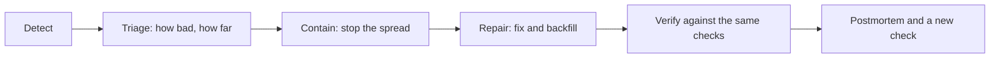

# Incident playbooks

At 09:10 on a Monday, a monitor says distance is up 60% and an analyst says the fare model looks strange. What happens in the next hour decides whether this costs a morning or a quarter's trust. Teams that improvise tend to do the same wrong things: three people change the same table, someone reruns a job that appends, and the fix is shipped before anyone knows how far the damage goes. A playbook is the decision made in advance, when nobody is stressed. This chapter adapts Google's incident practice to data, then repairs all five faults in the taxi feed with code you can run twice safely.

Data incidents differ from service incidents in one way that shapes the whole chapter: **the damage persists**. A service outage ends when the service comes back. Wrong data stays wrong, keeps being read, and spreads to each table built from it, long after the cause has been fixed. So detection only starts the job, and the repair has a second half that services do not have: a backfill.

The confidence on this chapter is medium, because its sources describe service incidents. The adaptation to data is engineering judgment, marked as such where it matters, and the code is tested on synthetic data only.

## The shape of every incident

Every playbook in this chapter uses the same five steps, and the order is the point:



The [SRE book's incident chapter](https://sre.google/sre-book/managing-incidents/) puts the priority in one line: stop the bleeding, restore service, and preserve the evidence for finding the root cause. Containment comes before diagnosis. You do not need to know why distance jumped to stop a dashboard showing it. In data, preserving the evidence has a specific meaning: **do not overwrite the raw partition**. If you fix raw files in place, you have lost the only record of what the source actually sent.

## Who does what

The most common failure in an incident is not technical. It is several capable people working without coordination. The SRE book's answer is a clear separation of roles, so that nobody has to second-guess anyone:

| Role | Job | In a data incident |
|---|---|---|
| Incident commander | Holds the overall state and assigns work; holds any role not delegated | Decides to pause publishing or not |
| Operations | The only people changing the system | Runs the containment and the backfill |
| Communications | Sends periodic updates to stakeholders | Tells dashboard and model owners what is wrong and until when |
| Planning | Handles longer-term issues, tracks how the system has diverged | Records hand-applied changes so they can be reverted |

On a small team one person may hold several of these, and the commander holds whatever nobody else has. What still matters is that the roles are explicit, and that only one group is changing tables. The commander also keeps a **living incident document** with the current state, the actions and who owns them, so a handoff at the end of a shift is a matter of reading one page.

### When to declare one

The same chapter offers a useful test: treat it as an incident if a second team is needed, if the problem is visible to customers, or if it is unsolved after an hour's concentrated work. It also argues for declaring early, because closing a small incident is cheap and starting the process hours too late is not.

Severity tells people how much to drop. The table below is an example to adapt, not a standard. The levels are my judgment rather than anything from a source, and the useful thing is to write yours down before you need them.

| Severity | Example | Response |
|---|---|---|
| SEV1 | Wrong data reached customers, regulators or billing; personal data exposed | Page now, commander assigned, updates every 30 minutes |
| SEV2 | Wrong numbers in an executive report or a production model's inputs | Page in working hours, pause publishing to affected tables |
| SEV3 | Internal dashboard stale, with a known workaround | Ticket, fix within a day, tell the owners |
| SEV4 | A monitor fired and the data is correct | Tune the monitor; count it as a false alarm |

## Triage: how bad, and how far?

The running feed is the same as in the [first chapter](01-quality-dimensions-and-tests.md), with its five faults, and needs only DuckDB, pyarrow and pandas. Paste the blocks in order into one file and run it with `uv run --python 3.11 --with duckdb --with pyarrow --with numpy --with pandas python chapter.py`.

```python
import datetime as dt, os, shutil
import duckdb, numpy as np, pyarrow as pa, pyarrow.parquet as pq

DAYS = [dt.date(2024, 1, 1) + dt.timedelta(d) for d in range(91)]   # Q1 2024
FAULTS = {dt.date(2024, 3, 5):  'null spike',
          dt.date(2024, 3, 10): 'dropped day',
          dt.date(2024, 3, 15): 'late partition',
          dt.date(2024, 3, 18): 'duplicate keys'}
UNIT_CHANGE_FROM = dt.date(2024, 3, 24)                  # miles become kilometres

def make_day(day, rng):
    n = int(rng.normal(3000 if day.weekday() < 5 else 2100, 90))
    base = int(day.strftime('%Y%m%d')) * 100_000
    miles = np.round(rng.exponential(3.0, n) + 0.3, 2)
    fare = np.round(3 + 2.5 * miles + rng.normal(0, 1, n).clip(-2, 8), 2)
    fare_null = rng.random(n) < (0.20 if FAULTS.get(day) == 'null spike' else 0.002)
    secs = rng.integers(0, 86400, n)
    t = {'trip_id': base + np.arange(n),
         'pickup': [dt.datetime.combine(day, dt.time()) + dt.timedelta(seconds=int(s)) for s in secs],
         'pu_zone': rng.integers(1, 266, n),
         'distance': np.round(miles * (1.609 if day >= UNIT_CHANGE_FROM else 1), 2)}
    table = pa.table(t).append_column('fare', pa.array(fare, mask=fare_null))
    if FAULTS.get(day) == 'duplicate keys':
        table = pa.concat_tables([table, table])         # producer retried the whole batch
    return table

def make_feed(root='raw'):
    """Write one Parquet partition per day and a log of what arrived when."""
    rng = np.random.default_rng(11)
    shutil.rmtree(root, ignore_errors=True)
    loads = []
    for day in DAYS:
        table = make_day(day, rng)
        if FAULTS.get(day) == 'dropped day':
            continue                                     # the partition never lands
        lag = 50 if FAULTS.get(day) == 'late partition' else 2 # hours past midnight
        os.makedirs(f'{root}/dt={day}', exist_ok=True)
        pq.write_table(table, f'{root}/dt={day}/part.parquet')
        loads.append((day, dt.datetime.combine(day + dt.timedelta(1), dt.time()) + dt.timedelta(hours=lag), table.num_rows))
    return loads

loads = make_feed()
con = duckdb.connect()
con.execute("CREATE VIEW raw_trips AS SELECT * FROM read_parquet('raw/*/part.parquet', hive_partitioning=true)")
import pandas as pd
print(con.sql("SELECT count(*) AS rows, count(DISTINCT dt) AS days FROM raw_trips"))
```

Output:

```text
┌────────┬───────┐
│  rows  │ days  │
│ int64  │ int64 │
├────────┼───────┤
│ 250461 │    90 │
└────────┴───────┘
```

Triage asks the cheap questions first. The order is deliberate: most incidents are boring, and the boring explanations take seconds to check. Before anyone suspects behaviour change, check that the data arrived, that it arrived once, and that fields are present. This echoes the [monitoring chapter](02-monitors-and-lineage.md)'s rule for drift alerts: rule out the cheap explanations before reaching for an expensive response.

```python
REF = "dt BETWEEN '2024-02-01' AND '2024-02-29'"
def day_facts(where):
    return con.execute(f"""
      SELECT count(*) AS n_rows, count(*) - count(DISTINCT trip_id) AS dup_keys,
             avg((fare IS NULL)::INT) AS null_fare, median(fare) AS med_fare,
             median(distance) AS med_distance, count(DISTINCT dt) AS n_days
      FROM raw_trips WHERE {where}""").fetchone()

def triage(day):
    """Ask the cheap questions in order and stop at the first clear answer."""
    n, dups, nulls, fare, dist, _ = day_facts(f"dt = '{day}'")
    ref_n, _, ref_nulls, ref_fare, ref_dist, days = day_facts(REF)
    ref_n /= days
    if n == 0:                       return 'nothing arrived: check the source export and the load job'
    if dups > 0:                     return f'{dups} duplicate keys: look for a retried batch'
    if nulls > 5 * max(ref_nulls, .001): return f'fare null share {nulls:.1%} against {ref_nulls:.1%}: one field stopped'
    if abs(dist / ref_dist - 1) > .25 and abs(fare / ref_fare - 1) < .1:
        return f'distance x{dist / ref_dist:.2f} while fare is unchanged: suspect units, not behaviour'
    if abs(n / ref_n - 1) > .4:      return f'{n} rows against about {ref_n:.0f}: partial or doubled load'
    return 'no fault found by the cheap checks'
for d in ['2024-02-14', '2024-03-05', '2024-03-10', '2024-03-18', '2024-03-25']:
    print(d, '->', triage(d))
```

Output:

```text
2024-02-14 -> no fault found by the cheap checks
2024-03-05 -> fare null share 19.9% against 0.2%: one field stopped
2024-03-10 -> nothing arrived: check the source export and the load job
2024-03-18 -> 2947 duplicate keys: look for a retried batch
2024-03-25 -> distance x1.59 while fare is unchanged: suspect units, not behaviour
```

The distance rule is worth reading closely. Distance up 59% with fares flat cannot be people taking longer trips, since fares would rise with them. Comparing two columns that should move together separates a measurement fault from a real change in the world. That single judgment is the difference between a repair and a retrain.

Next comes the extent. Where did the fault begin and where does it end? Find the first and last bad day from the metric rather than from anyone's memory of when things looked odd:

```python
meds = con.execute("SELECT dt, median(distance) m, median(fare) f FROM raw_trips GROUP BY 1 ORDER BY 1").df()
_, _, _, ref_fare, ref_dist, _ = day_facts(REF)
bad = meds[(meds.m / ref_dist - 1).abs() > .25]
print('first bad day:', bad.dt.iloc[0].date(), ' last bad day:', bad.dt.iloc[-1].date(), ' days:', len(bad))
print('good days after it:', (meds.dt > bad.dt.iloc[-1]).sum(), ' bad-day gaps:', len(pd.date_range(bad.dt.iloc[0], bad.dt.iloc[-1])) - len(bad))
```

Output:

```text
first bad day: 2024-03-24  last bad day: 2024-03-31  days: 8
good days after it: 0  bad-day gaps: 0
```

The fault starts on 24 March and continues to the end of the data, so it has not stopped by itself. It also tells you the backfill window. In practice the lineage graph from the [last chapter](02-monitors-and-lineage.md) supplies the other half: the datasets and runs downstream of `raw.trips` from that date on.

## Contain: write-audit-publish

Containment means readers stop receiving bad data, even before anyone has a fix. The cleanest way is to have built the gate before the incident, using write-audit-publish. Partitions land where readers cannot see them, the audit runs, and only a day that passes joins the published view. Here that gate is two small tables and a view. On Iceberg you could do the same with an audit branch ([Iceberg, Branching and Tagging](https://iceberg.apache.org/docs/latest/branching/)), and in dbt with tests upstream of the published model.

```python
con.execute("CREATE TABLE published_days(dt DATE PRIMARY KEY, published_at TIMESTAMP)")
con.execute("CREATE TABLE quarantine(dt DATE PRIMARY KEY, reason VARCHAR)")
con.execute("""CREATE VIEW trips_published AS
    SELECT t.* FROM raw_trips t JOIN published_days USING (dt)""")      # readers only ever see this

def audit(day):
    """The rules from the first chapter, run before readers can see the partition."""
    n, dups, nulls, _, dist, _ = day_facts(f"dt = '{day}'")
    problems = []
    if n == 0:                 problems.append('no rows')
    if dups:                   problems.append(f'{dups} duplicate keys')
    if n and nulls > .01:      problems.append(f'{nulls:.1%} null fare')
    if n and not 2.0 <= dist <= 2.8: problems.append(f'median distance {dist:.2f}')
    return problems

def write_audit_publish(day):
    problems = audit(day)
    if problems:
        con.execute("INSERT OR REPLACE INTO quarantine VALUES (?, ?)", [day, '; '.join(problems)])
        con.execute("DELETE FROM published_days WHERE dt = ?", [day])
    else:
        con.execute("INSERT OR REPLACE INTO published_days VALUES (?, now())", [day])
        con.execute("DELETE FROM quarantine WHERE dt = ?", [day])

for day in DAYS:
    write_audit_publish(day)
print(con.sql("SELECT count(*) AS published_days FROM published_days"))
print(con.sql("SELECT * FROM quarantine ORDER BY dt LIMIT 5"))
print('quarantined days:', con.execute("SELECT count(*) FROM quarantine").fetchone()[0])
```

Output:

```text
┌────────────────┐
│ published_days │
│     int64      │
├────────────────┤
│             80 │
└────────────────┘

┌────────────┬──────────────────────┐
│     dt     │        reason        │
│    date    │       varchar        │
├────────────┼──────────────────────┤
│ 2024-03-05 │ 19.9% null fare      │
│ 2024-03-10 │ no rows              │
│ 2024-03-18 │ 2947 duplicate keys  │
│ 2024-03-24 │ median distance 3.96 │
│ 2024-03-25 │ median distance 3.80 │
└────────────┴──────────────────────┘

quarantined days: 11
```

The gate held back 11 days: the three daily faults with something to reject and all eight unit-change days. Readers of `trips_published` never saw them. They saw a gap, which has a real cost, but a gap is visible and honest. A wrong number gets used.

Containment without the gate is cruder. You can pause the downstream DAG, restore the previous version of a table if the format supports it ([time travel in the table formats chapter](../../04-warehouse-lakehouse-streaming/notes/02-table-formats.md)), or put a warning on the dashboard. For a model, the ML Test Score points out an option unique to ML: roll back the learned model, not the code ([Breck et al., IEEE Big Data 2017](https://research.google/pubs/the-ml-test-score-a-rubric-for-ml-production-readiness-and-technical-debt-reduction/)). Here that would not help, since the inputs are wrong rather than the model, which is why triage comes first.

## Repair: backfills that are safe to run twice

In a stressful incident, jobs get run twice. A timeout leads to a rerun, or someone unaware of the first attempt starts another. So the first property of any repair job is **idempotence**: running it again leaves the same result. Here is the failure, in the most common form of load job:

```python
con.execute("CREATE TABLE rev_append(dt DATE, revenue DOUBLE, n BIGINT)")
def naive_load(day):
    con.execute("""INSERT INTO rev_append SELECT dt, sum(fare), count(*) FROM raw_trips WHERE dt = ? GROUP BY 1""", [day])
naive_load('2024-02-14'); first = con.execute("SELECT sum(revenue) FROM rev_append").fetchone()[0]
naive_load('2024-02-14'); again = con.execute("SELECT sum(revenue) FROM rev_append").fetchone()[0]
print(f'append once: {first:,.0f}   append twice: {again:,.0f}')

con.execute("CREATE TABLE daily_revenue(dt DATE PRIMARY KEY, revenue DOUBLE, n BIGINT, built_at TIMESTAMP)")
def build_day(day, source='trips_clean', built_at=None):
    """Delete and insert one logical day in one transaction: safe to run again."""
    con.execute("BEGIN")
    con.execute("DELETE FROM daily_revenue WHERE dt = ?", [day])
    con.execute(f"""INSERT INTO daily_revenue
        SELECT dt, sum(fare), count(*), ? FROM {source} WHERE dt = ? GROUP BY 1""", [built_at, day])
    con.execute("COMMIT")
```

Output:

```text
append once: 34,244   append twice: 68,489
```

An appending job doubles the mart on a rerun, creating a second incident while repairing the first. The fix is to replace one logical day at a time, inside a transaction, so a reader sees either the old day or the new one. `build_day` above does that with delete and insert. In a warehouse you would use `MERGE`, partition overwrite or `INSERT OVERWRITE`.

### Fix forward, in a layer you can read

Raw stays as it arrived. Corrections go into a view or staging model on top, with a recorded reason. That keeps the evidence, makes the correction reviewable and reversible, and is the same in the next incident:

```python
con.execute("CREATE TABLE corrections(valid_from DATE, col VARCHAR, factor DOUBLE, ticket VARCHAR)")
con.execute("INSERT INTO corrections VALUES ('2024-03-24', 'distance', 0.6215, 'INC-41: vendor app switched to km')")
con.execute("""
  CREATE OR REPLACE VIEW trips_clean AS
  SELECT trip_id, pickup, pu_zone, fare, dt,
         round(distance * coalesce((SELECT factor FROM corrections c
                                    WHERE c.col = 'distance' AND t.dt >= c.valid_from), 1), 2) AS distance
  FROM (SELECT * FROM raw_trips QUALIFY row_number() OVER (PARTITION BY trip_id ORDER BY pickup) = 1) t
""")
for d in ['2024-03-18', '2024-03-25']:
    print(d, 'raw', con.execute("SELECT count(*), round(median(distance), 2) FROM raw_trips WHERE dt = ?", [d]).fetchone(),
             'clean', con.execute("SELECT count(*), round(median(distance), 2) FROM trips_clean WHERE dt = ?", [d]).fetchone())
print('raw files untouched:', con.execute("SELECT count(*) FROM raw_trips").fetchone()[0], 'rows still there')
```

Output:

```text
2024-03-18 raw (5894, 2.41) clean (2947, 2.41)
2024-03-25 raw (3060, 3.8) clean (3060, 2.36)
raw files untouched: 250461 rows still there
```

The duplicates are removed by key, and the unit change is corrected from its effective date through a table anyone can read, with a ticket number next to the factor. The medians line up again at about 2.4 miles. The raw row count is unchanged.

Now the backfill. Lineage gave the rebuild list. Here it is one mart, and we run it twice to prove that we can:

```python
t0 = dt.datetime(2024, 4, 1, 9)
for day in DAYS:
    if day not in (dt.date(2024, 3, 10),):
        build_day(str(day), built_at=t0)
before = con.execute("SELECT count(*), round(sum(revenue)) FROM daily_revenue").fetchone()
for day in DAYS:
    if day not in (dt.date(2024, 3, 10),):
        build_day(str(day), built_at=t0)                      # run the whole backfill again
after = con.execute("SELECT count(*), round(sum(revenue)) FROM daily_revenue").fetchone()
print('first backfill', before, ' second backfill', after)
raw_dup = con.execute("SELECT round(sum(fare)) FROM raw_trips WHERE dt = '2024-03-18'").fetchone()[0]
print('18 March revenue: raw', raw_dup, ' repaired', con.execute("SELECT round(revenue) FROM daily_revenue WHERE dt = '2024-03-18'").fetchone()[0])
```

Output:

```text
first backfill (90, 2776463.0)  second backfill (90, 2776463.0)
18 March revenue: raw 67116.0  repaired 33558.0
```

Two identical results, with 18 March back to half of what the raw data suggested. This mart reports 90 days out of 91, because 10 March has not been re-exported. An honest gap is the correct state until it is.

### Late data needs its own trigger

The late partition shows a subtle failure. The mart's row for 15 March was built before the data existed, so the job ran green over nothing, and the partition arriving two days later changes nothing downstream. A rerun of that day has to be triggered by something. The generic rule: **rebuild any mart row older than the newest load of its input**.

```python
loads_df = pd.DataFrame(loads, columns=['dt', 'loaded_at', 'n_rows'])
con.execute("CREATE TABLE loads AS SELECT * FROM loads_df")
con.execute("DELETE FROM daily_revenue WHERE dt = '2024-03-15'")     # the 16 March build had nothing to read
con.execute("""INSERT INTO daily_revenue SELECT dt, 0, 0, TIMESTAMP '2024-03-16 03:00' FROM (SELECT DATE '2024-03-15' AS dt)""")
con.execute("UPDATE daily_revenue SET built_at = dt + INTERVAL 1 DAY + INTERVAL 3 HOUR WHERE dt <> '2024-03-15'")
stale = con.execute("""
    SELECT l.dt, l.loaded_at, r.built_at FROM loads l JOIN daily_revenue r USING (dt)
    WHERE l.loaded_at > r.built_at ORDER BY 1""").fetchall()
print('partitions newer than their mart row:', [(str(a), str(b), str(c)) for a, b, c in stale])
for a, b, _ in stale:
    build_day(str(a), built_at=dt.datetime(2024, 3, 18, 3))
print(con.sql("SELECT dt, round(revenue) AS revenue, n FROM daily_revenue WHERE dt = '2024-03-15'"))
```

Output:

```text
partitions newer than their mart row: [('2024-03-15', '2024-03-18 02:00:00', '2024-03-16 03:00:00')]
┌────────────┬─────────┬───────┐
│     dt     │ revenue │   n   │
│    date    │ double  │ int64 │
├────────────┼─────────┼───────┤
│ 2024-03-15 │ 33503.0 │  2940 │
└────────────┴─────────┴───────┘
```

Compare the load log with the mart's own build time and you find exactly the partitions that need work, and no others. This is the same watermark thinking as the [stream semantics chapter](../../04-warehouse-lakehouse-streaming/notes/04-kafka-and-stream-semantics.md), applied to batch.

## Verify with the checks that should have caught it

A repair is done when the same checks that fired are quiet, not when the job finishes green. Green is how we got here.

```python
checks = {
  'no duplicate keys':     "SELECT count(*) - count(DISTINCT trip_id) FROM trips_clean",
  'median distance by day outside 2.0 to 2.8':
       "SELECT count(*) FROM (SELECT dt, median(distance) m FROM trips_clean GROUP BY 1) WHERE m NOT BETWEEN 2.0 AND 2.8",
  'mart rows disagree with clean counts':
       "SELECT count(*) FROM daily_revenue r JOIN (SELECT dt, count(*) n FROM trips_clean GROUP BY 1) c USING (dt) WHERE r.n <> c.n",
  'days missing from the mart':
       "SELECT count(*) FROM (SELECT unnest(generate_series(DATE '2024-01-01', DATE '2024-03-31', INTERVAL 1 DAY))::DATE AS dt) s ANTI JOIN daily_revenue USING (dt)",
}
for name, sql in checks.items():
    print(f'{name:45}', con.execute(sql).fetchone()[0])
print('null share on 5 March, still:', round(con.execute("SELECT avg((fare IS NULL)::INT) FROM trips_clean WHERE dt = '2024-03-05'").fetchone()[0], 3))
```

Output:

```text
no duplicate keys                             0
median distance by day outside 2.0 to 2.8     0
mart rows disagree with clean counts          0
days missing from the mart                    1
null share on 5 March, still: 0.199
```

Three checks are clean, and two honest open items remain. 10 March is still missing, and 5 March still has 19.9% null fares, which means its revenue is understated. Neither can be repaired from this side: the data was never sent. You re-request it from the source. Never fill it in with an average and call it repaired. If stakeholders need a number now, publish an estimate with a label. Tell them which days are open and when the next update will come.

## The five playbooks

Here is what each fault looks like as a page in the runbook. A playbook is short on purpose, so it can be used under stress.

| Fault | Detect | Triage | Contain | Repair | Prevent |
|---|---|---|---|---|---|
| Null spike | `mostly` test; `null_fare` monitor | Which field, since when; which deploy changed it | Quarantine the day | Re-request from the source, rebuild the day | Tell the source team about the dependency; add a contract |
| Dropped day | Age alert, then date spine | Did the export run; did it arrive somewhere else | Mark the day as missing, do not interpolate | Re-export, audit, publish, rebuild downstream | Keep the date-spine check on until repaired; add a producer manifest |
| Late partition | Age alert and spine | Backlog or fault at the source | Nothing wrong yet: tell consumers | Trigger on arrival; rebuild marts older than their input | Load-based triggers rather than clock-based ones |
| Duplicates | `unique` test; `n_rows` doubled | Retry or genuine; which batch id | Quarantine the day | Deduplicate on key in staging, rebuild | Idempotent producer, or dedupe on load; a key in every feed |
| Unit change | KS `D`, `median_distance`, prediction drift | Do correlated columns move together? When did it begin? | Quarantine from the onset; check models downstream | A dated correction in staging, full backfill of the window, retrain only if the model trained on it | Contract with units, a subscribed announcement list, a distribution monitor |

The ML Test Score's first monitoring test belongs in that last row: source system changes can radically change a feature's meaning without producing values strange enough to trigger other monitoring. Its practical advice is plain, and easily neglected: subscribe to announcement lists for your dependencies, and make sure the owners know you use their data.

## The postmortem

After the data is right, write it down. The [SRE book's postmortem chapter](https://sre.google/sre-book/postmortem-culture/) lists common triggers: user-visible degradation past a threshold, data loss of any kind, on-call intervention, a long resolution time, and a monitoring failure. The last one matters for us. If a stakeholder found it before a monitor did, the monitor is one of the things that failed. Set the criteria before an incident, so that writing one is routine rather than an accusation.

The chapter is firm that postmortems are **blameless**: they look for contributing causes and assume everyone acted well with the information they had. The reasoning is practical. If people are punished for errors, they stop surfacing them, and the next incident stays hidden for longer. Data incidents are especially exposed here, because a silent wrong number can sit for weeks if the person who noticed it is afraid to say so.

```text
INC-41: distances in kilometres from 24 March
Severity: SEV2. Owner: <commander>. Status: repaired 1 April, 10 March still open.

Impact     What was wrong, for whom, for how long.
           zone dashboard unaffected; fare predictions inflated 24-31 March.
Timeline   Facts with times, including when each monitor could have fired.
Detection  Who noticed first, a person or a monitor? How long after onset?
Causes     Contributing causes, never a person. Vendor changed the locale;
           no announcement reached us; no contract on units.
What went  Well: gate held back 8 days. Badly: no unit in the schema.
Actions    Each with an owner and a date. Add unit to the contract; subscribe
           to vendor notes; keep the KS monitor on all numeric columns.
```

The most important line is the last. An incident is paid for once it has happened, and the only return on it is a check that catches the next one sooner. Every postmortem should add at least one test or monitor to the feed, and the scoreboard in the first chapter is how you tell which.

## Pitfalls

- **Fixing raw in place.** You lose the evidence and cannot show what the source sent. Correct in a layer above.
- **Non-idempotent repair jobs.** A rerun under pressure doubles the mart. Prove that the backfill can run twice, before the incident.
- **Diagnosing before containing.** Readers keep consuming wrong numbers during your investigation. Pause first.
- **Backfilling without the blast radius.** The mart looks right and the feature table downstream of it does not. Walk the lineage graph to the end.
- **Filling gaps silently.** An interpolated day looks real to everyone downstream. Mark it missing, or label it as an estimate.
- **Retraining as the reflex.** A retrain on bad data bakes the fault into the model. Fix the inputs, then decide.
- **Closing at the first green.** The job's success says nothing about the data. Close when the checks that fired are quiet and open items are written down.
- **No communication.** People who find a wrong number on their own stop trusting all the numbers. Say what is wrong before they ask.

## Try it

1. Add a `corrections` row with a `valid_to` date for a fault that ended, and change the view to respect it. What goes wrong if two corrections overlap?
2. Make `build_day` non-transactional by removing `BEGIN` and `COMMIT`, then raise an error between delete and insert. What do readers see?
3. Run `write_audit_publish` a second time for 18 March after the deduplication. What must change, given that `audit` reads `raw_trips`?
4. Write the severity and first three actions for this page: "Trip counts down 15% in one zone since yesterday's deploy; the finance report goes out at 17:00."

<details><summary>Answers</summary>

1. Overlapping rows make the scalar subquery return more than one row, which is an error in DuckDB, or the factors would stack if you multiply them. Add a check that correction windows do not overlap, as you would test any other table.
2. Between the two statements a reader sees no row for that day at all, and if the job dies there it stays missing. A transaction makes the replacement atomic.
3. It still fails, since the raw partition still holds duplicates. Audit the layer that will be published, `trips_clean`, or the gate will never release a repaired day. That is a design decision worth making before the incident.
4. A reasonable call is SEV2, since a wrong number may reach finance and the deadline is hours away. Assign a commander; pause or warn on the finance report; check whether the deploy changed the zone's mapping before assuming that demand changed. A full roll-back is an option only once you have confirmed the deploy is the cause.

</details>

## Interview checklist

| Question | Answer |
|---|---|
| How do data incidents differ from service incidents? | Damage persists after the cause is fixed and spreads downstream, so repair needs a backfill. |
| The priority order in an incident? | Stop the bleeding, restore service, preserve the evidence. Contain before you diagnose. |
| What roles does an incident need? | Commander, operations, communications, planning. One group changes the system. One person may hold several. |
| How do you make a backfill safe? | Replace one logical partition per transaction, so that a rerun gives the same result. Test by running it twice. |
| Why not fix raw data in place? | It is the only record of what the source sent. Apply dated corrections in a layer above. |
| What's the point of write-audit-publish here? | Readers see a gap instead of wrong numbers, with no action needed during the incident. |
| How do you handle late data downstream? | Trigger on arrival: rebuild any output older than its newest input. |
| How do you tell a real shift from a measurement fault? | Compare columns that should move together. Distance up with fares flat is measurement. |
| What makes a postmortem useful? | Blameless, with facts, contributing causes, and actions with owners and dates, including at least one new check. |
| Can you repair data the source never sent? | No. Re-request it, or publish a labelled estimate. Never present an imputed value as repaired. |

## Next

The feed is clean again, and the model downstream of it is next. The [ML platform pillar](../../06-ml-platform/README.md) takes up what that model needs from the data platform: features that match at training and serving time, a registry, serving, drift and the maturity to run it all.
