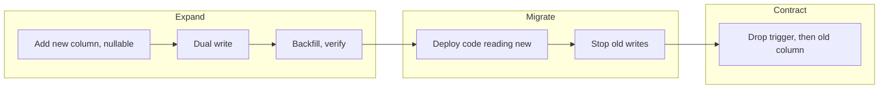

# Schema and data migrations

A migration is a change to a live system while it runs: the table has new code and old code reading it, and neither stops while you work. The statement that renames a column takes a millisecond and can still take the site down, either because old code asks for the old name or because the statement queued for a lock with every other query queued behind it. This chapter measures those failures on a real Postgres under load, then builds the pattern that avoids them: **expand, migrate, contract**. The same three moves carry over to moving a warehouse and to re-embedding a vector store, so those close the chapter.

The confidence is medium. Everything labelled Postgres ran here on 16.2 against a 2,000,000-row table on a laptop, so the shape of each result holds and the absolute times will grow with your tables. The docs cited are for the current Postgres release. The warehouse and vector sections are small simulations of the procedure, not runs on those products. The contract for a schema between teams is in [data contracts](../../02-ingest-and-modelling/notes/04-data-contracts.md); this chapter is about how to carry out the change.

## The test bench

Every experiment below runs one statement while a small application reads or writes by primary key about every 2 ms. The application is the instrument: a migration is safe if the probe does not notice it. The table is only 208 MB, and the stalls that come from scans and rewrites grow with the table.

```python
import shutil, subprocess, threading, time
import pgserver, psycopg

BIN = os.path.dirname(pgserver.__file__) + "/pginstall/bin"
ROOT = tempfile.mkdtemp(dir="/tmp", prefix="mig")
PORT = 5611

def tool(name, *args):
    return subprocess.run([f"{BIN}/{name}", *args], check=True, capture_output=True, text=True).stdout

tool("initdb", "-D", f"{ROOT}/d", "-U", "postgres", "--auth=trust", "-E", "UTF8")
with open(f"{ROOT}/d/postgresql.conf", "a") as f:
    f.write(f"listen_addresses=''\nunix_socket_directories='{ROOT}'\nport={PORT}\nmax_wal_size=4GB\n")
tool("pg_ctl", "-w", "-D", f"{ROOT}/d", "-l", f"{ROOT}/log", "start")

def connect():
    return psycopg.connect(f"host={ROOT} port={PORT} user=postgres dbname=postgres", autocommit=True)

db = connect()
print(db.execute("SELECT version()").fetchone()[0].split(" on ")[0])
db.execute("""CREATE TABLE orders (id bigint PRIMARY KEY, customer int NOT NULL, amount int NOT NULL, note text);
              INSERT INTO orders SELECT i, i % 50000, i % 1000, repeat('x', 60) FROM generate_series(1, 2000000) i""")
print("rows:", db.execute("SELECT count(*) FROM orders").fetchone()[0],
      "| table size:", db.execute("SELECT pg_size_pretty(pg_table_size('orders'))").fetchone()[0])

class Probe:
    """An application in miniature: reads and writes by primary key in a loop, timing each."""
    def __init__(self, sql="UPDATE orders SET amount = amount + 1 WHERE id = %s", rows=2_000_000):
        self.sql, self.rows, self.latencies, self.errors = sql, rows, [], []
        self.halt = threading.Event()
        self.thread = threading.Thread(target=self.run)
    def run(self):
        c, i = connect(), 0
        while not self.halt.is_set():
            i += 1
            t = time.perf_counter()
            try:
                c.execute(self.sql, (i % self.rows + 1,))
            except psycopg.Error as e:
                self.errors.append(type(e).__name__)
            self.latencies.append(time.perf_counter() - t)
            time.sleep(0.001)
        c.close()
    def __enter__(self):
        self.thread.start(); time.sleep(0.1); return self
    def __exit__(self, *a):
        time.sleep(0.05); self.halt.set(); self.thread.join()
    def report(self):
        return f"{len(self.latencies):5,d} queries, worst stall {max(self.latencies) * 1000:7.0f} ms, {len(self.errors)} errors"

def timed(sql, conn=None, sql_probe=None):
    """Run one statement while the probe runs, and print both timings."""
    kw = {"sql": sql_probe} if sql_probe else {}
    with Probe(**kw) as p:
        t = time.perf_counter()
        (conn or db).execute(sql)
        took = time.perf_counter() - t
    print(f"{took:6.2f} s  {sql.splitlines()[0][:58]:58s} | {p.report()}")
    return took
```

```text
PostgreSQL 16.2
rows: 2000000 | table size: 208 MB
```

## Lock levels: what each statement takes

Postgres has eight table lock modes, and which ones conflict is [a table in the docs](https://www.postgresql.org/docs/current/explicit-locking.html). You rarely need all eight. Read what a statement actually takes from `pg_locks` instead of guessing:

```python
def lock_taken(sql):
    """Run a statement in a transaction, read the lock it holds on orders, roll back."""
    with connect() as c:
        c.autocommit = False
        c.execute(sql)
        modes = c.execute("""SELECT mode FROM pg_locks WHERE relation = 'orders'::regclass
                             AND pid = pg_backend_pid()""").fetchall()
        c.rollback()
    return ", ".join(sorted(m[0] for m in modes))

db.execute("ALTER TABLE orders ADD CONSTRAINT amt_ok CHECK (amount >= 0) NOT VALID")
db.execute("CREATE TABLE parent (id int PRIMARY KEY)")
for sql in ["SELECT * FROM orders WHERE id = 1",
            "UPDATE orders SET amount = 1 WHERE id = 1",
            "ALTER TABLE orders VALIDATE CONSTRAINT amt_ok",
            "CREATE INDEX i_lock ON orders (customer)",
            "ALTER TABLE orders ADD CONSTRAINT o_fk FOREIGN KEY (customer) REFERENCES parent (id) NOT VALID",
            "ALTER TABLE orders ADD COLUMN c1 int",
            "ALTER TABLE orders RENAME COLUMN note TO note2",
            "ALTER TABLE orders DROP COLUMN note"]:
    print(f"{sql:50s} {lock_taken(sql)}")
db.execute("ALTER TABLE orders DROP CONSTRAINT amt_ok")
```

```text
SELECT * FROM orders WHERE id = 1                  AccessShareLock
UPDATE orders SET amount = 1 WHERE id = 1          RowExclusiveLock
ALTER TABLE orders VALIDATE CONSTRAINT amt_ok      ShareUpdateExclusiveLock
CREATE INDEX i_lock ON orders (customer)           ShareLock
ALTER TABLE orders ADD CONSTRAINT o_fk FOREIGN KEY (customer) REFERENCES parent (id) NOT VALID AccessShareLock, ShareRowExclusiveLock
ALTER TABLE orders ADD COLUMN c1 int               AccessExclusiveLock
ALTER TABLE orders RENAME COLUMN note TO note2     AccessExclusiveLock
ALTER TABLE orders DROP COLUMN note                AccessExclusiveLock
```

There are four locks worth remembering:

| Lock | Blocks | Taken by |
|---|---|---|
| `AccessExclusiveLock` | Everything, reads included | Most `ALTER TABLE`: add, drop, rename, change type |
| `ShareLock` | Writes, not reads | Plain `CREATE INDEX` |
| `ShareRowExclusiveLock` | Writes, not reads | `ADD FOREIGN KEY`, on both tables |
| `ShareUpdateExclusiveLock` | Other schema changes and `VACUUM`, not reads or writes | `VALIDATE CONSTRAINT`, `CREATE INDEX CONCURRENTLY` |

The docs put the important fact in one line: only an `ACCESS EXCLUSIVE` lock blocks a plain `SELECT`. The rest of the chapter is a set of ways to spend very little time holding that lock, and to hold weaker ones for the slow part of the work.

## The lock queue: why a fast statement can stop the site

`ALTER TABLE ... ADD COLUMN` with no default changes only the catalog, so it takes a millisecond once it has its lock. Getting the lock is where it goes wrong. Suppose a report has been running for a while. It holds a weak lock, which conflicts with `ACCESS EXCLUSIVE`, so the `ALTER` waits. Now every new query on the table has to wait behind the `ALTER`, even plain reads that do not conflict with the report. A slow reader and a fast schema change combine into an outage that neither would cause alone.

```python
def blocked_alter(lock_timeout):
    """A long report holds a weak lock. A one-millisecond ALTER arrives. What do other queries see?"""
    report = connect()
    report.autocommit = False
    report.execute("SELECT count(*) FROM orders WHERE id = 1")                  # holds ACCESS SHARE until it ends
    ddl = connect()
    if lock_timeout:
        ddl.execute(f"SET lock_timeout = '{lock_timeout}'")
    outcome = []
    def alter():
        t = time.perf_counter()
        try:
            ddl.execute("ALTER TABLE orders ADD COLUMN IF NOT EXISTS flag1 int")
            outcome.append(f"ALTER finished after {time.perf_counter() - t:.2f} s")
        except psycopg.errors.LockNotAvailable:
            outcome.append(f"ALTER gave up after {time.perf_counter() - t:.2f} s")
    with Probe("SELECT amount FROM orders WHERE id = %s") as p:
        th = threading.Thread(target=alter)
        th.start()
        time.sleep(2)                                                           # the report runs on for 2 s
        report.rollback()
        th.join()
    report.close(); ddl.close()
    print(f"lock_timeout {lock_timeout or 'off':6s}: {outcome[0]:30s} | reads: {p.report()}")
    db.execute("ALTER TABLE orders DROP COLUMN IF EXISTS flag1")

blocked_alter(None)
blocked_alter("100ms")
```

```text
lock_timeout off   : ALTER finished after 2.00 s    | reads:   114 queries, worst stall    2003 ms, 0 errors
lock_timeout 100ms : ALTER gave up after 0.10 s     | reads: 1,596 queries, worst stall     101 ms, 0 errors
```

With no timeout, the probe's reads stalled for the two seconds the report ran on, and the run completed about a fourteenth as many reads. With [`lock_timeout`](https://www.postgresql.org/docs/current/runtime-config-client.html) the statement gives up after 100 ms, and the reads see only that much delay. The docs advise against setting it in `postgresql.conf`, because it would apply to every session; set it in the migration's session. The price is that the `ALTER` did not happen, so the migration has to retry, which is the first exercise. [GitLab's `with_lock_retries`](https://docs.gitlab.com/development/migration_style_guide/) is this loop as a framework feature, trying again with different `lock_timeout` settings.

## Adding a column, and the default that rewrites the table

```python
def file_of():
    return db.execute("SELECT pg_relation_filenode('orders')").fetchone()[0]
before = file_of()
timed("ALTER TABLE orders ADD COLUMN region text DEFAULT 'eu'")
print("   rewrote the table:", file_of() != before)
before = file_of()
timed("ALTER TABLE orders ADD COLUMN stamped timestamptz DEFAULT clock_timestamp()")
print("   rewrote the table:", file_of() != before)
db.execute("ALTER TABLE orders DROP COLUMN region, DROP COLUMN stamped")
```

```text
  0.00 s  ALTER TABLE orders ADD COLUMN region text DEFAULT 'eu'     |   115 queries, worst stall       1 ms, 0 errors
   rewrote the table: False
  1.47 s  ALTER TABLE orders ADD COLUMN stamped timestamptz DEFAULT  |   120 queries, worst stall    1461 ms, 0 errors
   rewrote the table: True
```

Both statements look alike. [The docs](https://www.postgresql.org/docs/current/sql-altertable.html) explain why they are not: a non-volatile default is stored in the catalog and returned for old rows, so it is very fast at any size, while a volatile default must be computed per row, so the whole table and its indexes are rewritten under `ACCESS EXCLUSIVE`. The filenode check proves it: the table moved to a new file. The same rewrite happens for a stored generated column, an identity column and most type changes unless the types are binary coercible. It can need twice the table's disk space while it runs, which is the sort of thing that makes a migration fail on a nearly full disk ([operating data stores](05-operating-data-stores.md) covers capacity).

## NOT NULL in three steps

`SET NOT NULL` scans the table under `ACCESS EXCLUSIVE` to prove there are no NULLs. Split the proof from the lock: add a `CHECK` that is `NOT VALID`, which applies to new writes and skips the scan; run `VALIDATE`, which does the scan under a lock that leaves reads and writes alone; then `SET NOT NULL`, which the docs say skips the scan when a valid constraint already proves the point.

```python
db.execute("ALTER TABLE orders ADD COLUMN source text DEFAULT 'web'")
print("naive")
timed("ALTER TABLE orders ALTER COLUMN source SET NOT NULL")
db.execute("ALTER TABLE orders ALTER COLUMN source DROP NOT NULL")
print("safe, three steps")
timed("ALTER TABLE orders ADD CONSTRAINT source_nn CHECK (source IS NOT NULL) NOT VALID")
timed("ALTER TABLE orders VALIDATE CONSTRAINT source_nn")
timed("ALTER TABLE orders ALTER COLUMN source SET NOT NULL")
db.execute("ALTER TABLE orders DROP CONSTRAINT source_nn, DROP COLUMN source")
```

```text
naive
  0.16 s  ALTER TABLE orders ALTER COLUMN source SET NOT NULL        |   120 queries, worst stall     157 ms, 0 errors
safe, three steps
  0.00 s  ALTER TABLE orders ADD CONSTRAINT source_nn CHECK (source  |   118 queries, worst stall       1 ms, 0 errors
  0.09 s  ALTER TABLE orders VALIDATE CONSTRAINT source_nn           |   186 queries, worst stall       1 ms, 0 errors
  0.00 s  ALTER TABLE orders ALTER COLUMN source SET NOT NULL        |   120 queries, worst stall       1 ms, 0 errors
```

The naive version stalled the application for the 0.16 s of its scan. In the safe version the same scan took 0.09 s and the application's worst stall was 1 ms. Postgres 18 added `NOT VALID` for `NOT NULL` constraints directly, per the current docs; the three-step form is what runs on 16 and it still works. The same split handles foreign keys: `ADD ... NOT VALID`, then `VALIDATE` later.

## Indexes: CONCURRENTLY, and the mess it can leave

```python
timed("CREATE INDEX i_plain ON orders (customer)")
db.execute("DROP INDEX i_plain")
timed("CREATE INDEX CONCURRENTLY i_conc ON orders (customer)")
db.execute("DROP INDEX i_conc")
db.execute("CREATE TABLE dup (k int); INSERT INTO dup VALUES (1), (1)")
try:
    db.execute("CREATE UNIQUE INDEX CONCURRENTLY dup_k ON dup (k)")
except psycopg.errors.UniqueViolation as e:
    print("unique build failed:", str(e).splitlines()[0])
print("left behind:", db.execute("""SELECT indexrelid::regclass::text, indisvalid FROM pg_index
                                    WHERE indrelid = 'dup'::regclass""").fetchall())
```

```text
  0.32 s  CREATE INDEX i_plain ON orders (customer)                  |   117 queries, worst stall     314 ms, 0 errors
  0.52 s  CREATE INDEX CONCURRENTLY i_conc ON orders (customer)      |   496 queries, worst stall       3 ms, 0 errors
unique build failed: could not create unique index "dup_k"
left behind: [('dup_k', False)]
```

[A plain `CREATE INDEX`](https://www.postgresql.org/docs/current/sql-createindex.html) blocks writes for the whole build. `CONCURRENTLY` does two table scans and waits for existing transactions to finish, so it took longer here (0.52 s against 0.32 s) and cost the writers 3 ms instead of 314 ms. It has conditions. It cannot run in a transaction. A failure leaves an index behind marked `INVALID`, as above: it serves no queries and is still maintained on every write, so drop it and retry or run `REINDEX INDEX CONCURRENTLY`. Only one concurrent build runs per table, and partitioned tables need it done per partition.

## Backfills: small transactions that can be rerun

Filling a new column for old rows is a data change, so no DDL lock is involved. It can still stop the site, through row locks:

```python
db.execute("ALTER TABLE orders ADD COLUMN amount_cents bigint")
print("one statement")
timed("UPDATE orders SET amount_cents = amount * 100")
db.execute("UPDATE orders SET amount_cents = NULL")
db.execute("VACUUM orders")

def backfill(batch=10_000, pause=0.0, stop_after=None):
    """Keyed batches, one transaction each. Safe to rerun: it only touches rows still NULL."""
    done, last = 0, 0
    while True:
        rows = db.execute("""UPDATE orders SET amount_cents = amount * 100
                             WHERE id > %s AND id <= %s AND amount_cents IS NULL""", (last, last + batch))
        done += rows.rowcount
        last += batch
        if stop_after and last >= stop_after:
            return done
        if last >= 2_000_000:
            return done
        time.sleep(pause)

print("batches of 10,000")
with Probe() as p:
    t = time.perf_counter()
    first = backfill(stop_after=800_000)                                         # the job dies here
    print(f"  job dies after {first:,d} rows; missing: "
          f"{db.execute('SELECT count(*) FROM orders WHERE amount_cents IS NULL').fetchone()[0]:,d}")
    second = backfill()                                                          # rerun from the start
    took = time.perf_counter() - t
print(f"  rerun updated {second:,d} more | {took:.2f} s | {p.report()}")
WRONG = "SELECT count(*) FROM orders WHERE amount_cents IS DISTINCT FROM amount * 100"
print("  wrong after the backfill:", db.execute(WRONG).fetchone()[0])           # the application kept writing

print("with a trigger for new writes, then a repair pass")
db.execute("""CREATE FUNCTION cents() RETURNS trigger LANGUAGE plpgsql AS $$
              BEGIN NEW.amount_cents := NEW.amount * 100; RETURN NEW; END $$;
              CREATE TRIGGER cents BEFORE INSERT OR UPDATE ON orders
              FOR EACH ROW EXECUTE FUNCTION cents()""")
with Probe() as p:
    fixed = db.execute("UPDATE orders SET amount_cents = amount * 100 "
                       "WHERE amount_cents IS DISTINCT FROM amount * 100").rowcount
    time.sleep(1)
print(f"  repaired {fixed:,d} rows | {p.report()}")
print("  wrong now:", db.execute(WRONG).fetchone()[0])
```

```text
one statement
  5.24 s  UPDATE orders SET amount_cents = amount * 100              |   113 queries, worst stall    5237 ms, 0 errors
batches of 10,000
  job dies after 800,000 rows; missing: 1,200,000
  rerun updated 1,200,000 more | 3.48 s | 1,995 queries, worst stall      20 ms, 0 errors
  wrong after the backfill: 1932
with a trigger for new writes, then a repair pass
  repaired 1,928 rows |   789 queries, worst stall     160 ms, 0 errors
  wrong now: 0
```

Read the result in three parts.

- The single `UPDATE` locked every row until it committed, and the probe, writing a row by key, waited 5.2 s behind it. Short keyed transactions took the worst stall to 20 ms for the same work.
- The batches are restartable because the predicate selects only rows still `NULL`. The job died at 800,000 rows, ran again from the start and did the remaining 1,200,000. This is the [idempotency](../../03-transform-and-orchestrate/notes/04-idempotency-and-backfills.md) you want from any backfill.
- **A backfill alone is wrong on a live table.** About 1,900 rows came out wrong, because the application went on changing `amount` after the batch had passed each row. New writes need to reach the new column before the backfill starts, by a trigger or by the application. Here a trigger plus a repair pass got the count to zero.

Real backfills also need a brake. [GitLab's batched background migrations](https://docs.gitlab.com/development/database/batched_background_migrations/) tune batch size from recent jobs and pause on signals from database health, including autovacuum activity and WAL rate. Replica lag is the other brake to watch: a fast backfill is a large stream of WAL for the standbys to apply ([operating data stores](05-operating-data-stores.md)).

## Expand, migrate, contract

So far each change was a single statement. A rename, split or type change cannot be, because during a rollout old and new code run at once. A rename means one of them is always wrong:



Martin Fowler calls this [parallel change](https://martinfowler.com/bliki/ParallelChange.html) and says database refactorings follow it, the migrate phase being the transition period. [Stripe's write-up](https://stripe.com/blog/online-migrations) of moving subscriptions between tables runs the same steps at scale: dual write, change reads, change writes, remove old data, with Scientist comparing old and new reads on real traffic before the switch.

```python
db.execute("""CREATE TABLE customers AS SELECT i AS id, 'u' || i || '@x.io' AS mail FROM generate_series(1, 200000) i;
              ALTER TABLE customers ADD PRIMARY KEY (id)""")
OLD_READ = "SELECT mail FROM customers WHERE id = %s"
NEW_READ = "SELECT email FROM customers WHERE id = %s"
OLD_WRITE = "UPDATE customers SET mail = 'old' || id || '@x.io' WHERE id = %s"

print("naive: rename under a running old app")
with Probe(OLD_READ, rows=200_000) as p:
    db.execute("ALTER TABLE customers RENAME COLUMN mail TO email")
    time.sleep(0.5)
print("  old app:", p.report(), set(p.errors))
db.execute("ALTER TABLE customers RENAME COLUMN email TO mail")

print("expand, migrate, contract")
app = Probe(OLD_WRITE, rows=200_000)
app.__enter__()
db.execute("ALTER TABLE customers ADD COLUMN email text")                        # 1 expand: new column, nullable
db.execute("""CREATE FUNCTION sync_email() RETURNS trigger LANGUAGE plpgsql AS $$
              BEGIN
                IF TG_OP = 'INSERT' OR NEW.mail IS DISTINCT FROM OLD.mail THEN NEW.email := NEW.mail;
                ELSIF NEW.email IS DISTINCT FROM OLD.email THEN NEW.mail := NEW.email; END IF;
                RETURN NEW;
              END $$;
              CREATE TRIGGER sync_email BEFORE INSERT OR UPDATE ON customers
              FOR EACH ROW EXECUTE FUNCTION sync_email()""")                     # 2 dual-write in the database
print("  dual write on; old app still only knows `mail`")
for low in range(0, 200000, 5000):                                               # 3 backfill in batches
    db.execute("UPDATE customers SET email = mail WHERE id > %s AND id <= %s AND email IS NULL", (low, low + 5000))
wrong = db.execute("SELECT count(*) FROM customers WHERE email IS DISTINCT FROM mail").fetchone()[0]
print("  backfilled; rows where the columns differ:", wrong)                    # 4 verify before moving reads
app.__exit__()
print("  old app during expand:", app.report())
new = Probe(NEW_READ, rows=200_000)                       # 5 deploy new code: reads `email`
new.__enter__()
time.sleep(0.3)
db.execute("SET lock_timeout = '2s'")
db.execute("""DROP TRIGGER sync_email ON customers;
              DROP FUNCTION sync_email();
              ALTER TABLE customers DROP COLUMN mail""")                         # 6 contract, only when old code is gone
time.sleep(0.3)
new.__exit__()
print("  new app through contract:", new.report())
```

```text
naive: rename under a running old app
  old app:   473 queries, worst stall       6 ms, 403 errors {'UndefinedColumn'}
expand, migrate, contract
  dual write on; old app still only knows `mail`
  backfilled; rows where the columns differ: 0
  old app during expand:   395 queries, worst stall       9 ms, 0 errors
  new app through contract:   534 queries, worst stall       7 ms, 0 errors
```

The naive rename gave the old app about 400 `UndefinedColumn` errors in half a second. The long way gave zero through every step, old code first and new code after. The trigger is one way to dual write. Writing both columns in application code is another, and it keeps the logic visible, at the price of a deploy before you can start.

Each phase changes what rollback means, and this is the most useful thing to know about the pattern:

| After | To roll back | Data at risk |
|---|---|---|
| Expand | Drop the new column | None; nothing reads it |
| Backfill and verify | Same | None |
| Code reads new | Redeploy old code; the trigger keeps both sides current | None |
| Code stops writing old | Turn old writes back on and re-sync | Only what you fail to re-sync |
| Contract | **No rollback.** Restore from backup | Everything in the dropped column |

So wait as long as you can afford before contract. It is a deploy with its own review, days later if that is what it takes to be sure that no job, dashboard or forgotten service reads the old column. [Lineage](02-monitors-and-lineage.md) tells you who to ask.

For MySQL, where changing a large table in place is harder, [gh-ost](https://github.com/github/gh-ost) copies rows to a ghost table, follows the binlog for changes made meanwhile, lets you pause the copy and postpone the cut-over. Its documentation was read for this chapter; it was not run, as it needs MySQL.

## Migration tools: Alembic and Flyway

Hand-run DDL is how environments drift apart. [Evolutionary database design](https://martinfowler.com/articles/evodb.html) treats every change as a versioned, automated refactoring. A migration tool keeps a version in a table inside the database, finds the gap between that and the scripts on disk, and runs what is missing. Here is Alembic against the same server. The `env.py` and template are boilerplate, in the practice file.

```python
open("mig/versions/a1_add_channel.py", "w").write('''
from alembic import op
import sqlalchemy as sa
revision, down_revision = "a1", None
def upgrade():
    op.execute("SET lock_timeout = \'2s\'")
    op.add_column("customers", sa.Column("channel", sa.Text()))
def downgrade():
    op.drop_column("customers", "channel")
''')
open("mig/versions/a2_index_channel.py", "w").write('''
from alembic import op
revision, down_revision = "a2", "a1"
def upgrade():
    with op.get_context().autocommit_block():      # CONCURRENTLY cannot run inside a transaction
        op.execute("CREATE INDEX CONCURRENTLY IF NOT EXISTS customers_channel ON customers (channel)")
def downgrade():
    with op.get_context().autocommit_block():
        op.execute("DROP INDEX CONCURRENTLY IF EXISTS customers_channel")
''')
cfg = Config()
cfg.set_main_option("script_location", "mig")
cfg.set_main_option("sqlalchemy.url", URL.replace("%", "%%"))
version = lambda: db.execute("SELECT version_num FROM alembic_version").fetchall()
command.upgrade(cfg, "head")
print("after upgrade   :", version(), db.execute(
    "SELECT count(*) FROM pg_indexes WHERE indexname = 'customers_channel'").fetchone()[0], "index")
command.upgrade(cfg, "head")
print("upgrade again   :", version(), "(does nothing)")
command.downgrade(cfg, "a1")
print("after downgrade :", version())
command.upgrade(cfg, "head")

meta = sa.MetaData()
sa.Table("customers", meta, sa.Column("id", sa.Integer, primary_key=True), sa.Column("email_address", sa.Text),
         sa.Column("channel", sa.Text))
cfg.attributes["target_metadata"] = meta
import contextlib, io
with contextlib.redirect_stdout(io.StringIO()):
    script = command.revision(cfg, message="rename email", autogenerate=True, rev_id="a3")
print("autogenerate, told the column is now email_address, wrote this upgrade:")
body = open(script.path).read().split("def downgrade")[0]
print("\n".join("   " + l.strip() for l in body.splitlines() if "_column('customers'" in l))
os.remove(script.path)

buf = io.StringIO()
with contextlib.redirect_stdout(buf):
    command.upgrade(cfg, "a2", sql=True)
print("offline SQL for a DBA to review:")
print("\n".join("   " + l for l in buf.getvalue().splitlines()
                if l.startswith(("SET lock", "ALTER TABLE", "CREATE INDEX"))))
```

```text
after upgrade   : [('a2',)] 1 index
upgrade again   : [('a2',)] (does nothing)
after downgrade : [('a1',)]
autogenerate, told the column is now email_address, wrote this upgrade:
   op.add_column('customers', sa.Column('email_address', sa.Text(), nullable=True))
   op.drop_column('customers', 'email')
offline SQL for a DBA to review:
   SET lock_timeout = '2s';
   ALTER TABLE customers ADD COLUMN channel TEXT;
   CREATE INDEX CONCURRENTLY IF NOT EXISTS customers_channel ON customers (channel);
```

Four things to notice:

- **`autocommit_block`** is required, as `CONCURRENTLY` cannot run in a transaction. [The docs warn](https://alembic.sqlalchemy.org/en/latest/api/runtime.html) that the transaction before the block is committed unconditionally, and recommend `transaction_per_migration` so each file stands alone. That setting is in this `env.py`. A migration that fails midway through several statements still leaves work behind, so `IF NOT EXISTS` matters here.
- **Autogenerate does not understand a rename**, and [its docs say so](https://alembic.sqlalchemy.org/en/latest/autogenerate.html). Told the column is now `email_address`, it wrote an add and a drop, which empties the column if you run it unread. Read every generated script.
- **A downgrade is a promise only about the schema.** After a dropped column the downgrade can add it back but not its data; the third exercise shows this.
- **[Offline mode](https://alembic.sqlalchemy.org/en/latest/offline.html)** writes the SQL for a DBA or a separate deploy step to review and run.

[Flyway](https://documentation.red-gate.com/fd/migrations-271585107.html) does the same job from SQL files, with versioned migrations, repeatable ones and a schema history table. Its concepts page was read for this chapter; it was not run, as it needs a JVM. Choose by what your application already uses. Neither tool knows anything about locks or rollouts: a migration tool decides *when* a statement runs, and the rest of this chapter decides *which* statements are safe. GitLab's [style guide](https://docs.gitlab.com/development/migration_style_guide/) is a good picture of a team writing that policy down: regular migrations under a time budget, post-deployment ones for contract, background ones for backfills.

## Moving a warehouse: parallel run and reconcile

The same pattern at a larger grain: build the new system next to the old one, feed both, compare, switch readers, keep the old one for a while, then drop it. Moving between warehouses ([the warehouse chapter](../../04-warehouse-lakehouse-streaming/notes/01-warehouse-and-store.md) compares them) adds one thing: SQL that runs on both can still mean different things. Compare the outputs, and at the grain people read:

```python
import duckdb
wh = duckdb.connect()
wh.execute("""CREATE TABLE trips AS SELECT i AS id, TIMESTAMP '2024-01-01' + INTERVAL (i % (366 * 24)) HOUR AS ts,
              (i * 7 % 2000) / 100.0 AS fare FROM range(1000000) t(i)""")
wh.execute("CREATE TABLE old_mart AS SELECT CAST(ts AS DATE) AS day, count(*) AS trips, round(sum(fare), 2) AS revenue FROM trips GROUP BY 1")
# The port to the new warehouse: same SQL, except the engine's session runs one hour behind UTC.
wh.execute("""CREATE TABLE new_mart AS SELECT CAST(ts - INTERVAL 1 HOUR AS DATE) AS day, count(*) AS trips,
              round(sum(fare), 2) AS revenue FROM trips GROUP BY 1""")
print("totals :", wh.execute("SELECT (SELECT sum(trips) FROM old_mart), (SELECT sum(trips) FROM new_mart), "
                             "(SELECT round(sum(revenue), 2) FROM old_mart), (SELECT round(sum(revenue), 2) FROM new_mart)").fetchall()[0])
print("by day :", wh.execute("""
  SELECT count(*) FILTER (WHERE o.trips = n.trips AND abs(o.revenue - n.revenue) < 0.01) AS matching,
         count(*) AS days,
         max(abs(o.revenue - n.revenue)) AS worst_gap
  FROM old_mart o FULL JOIN new_mart n USING (day)""").fetchall()[0])
rows = wh.execute("""
  SELECT coalesce(o.day, n.day) AS day, o.trips, n.trips FROM old_mart o FULL JOIN new_mart n USING (day)
  WHERE o.trips IS DISTINCT FROM n.trips ORDER BY 1 LIMIT 3""").fetchall()
print("first differing days:", [(str(d), a, b) for d, a, b in rows])
```

```text
totals : (1000000, 1000000, 9995000.0, 9995000.0)
by day : (0, 367, 1112.239999999998)
first differing days: [('2023-12-31', None, 114), ('2024-11-04', 2728, 2727), ('2024-12-31', 2712, 2599)]
```

This is a simulation on DuckDB, with a one-hour session difference planted to stand in for the real kind of porting difference. Totals agree to the cent, and **no day matches**. A check of row counts and sums would have passed this migration. The grain of the comparison decides what you can catch, so compare per partition and per key. [`dbt-audit-helper`](https://github.com/dbt-labs/dbt-audit-helper) packages this as macros such as `compare_row_counts`, `compare_all_columns` and `compare_and_classify`. On Snowflake, [zero-copy clones](https://docs.snowflake.com/en/user-guide/object-clone) give a cheap copy to test a change against, since a clone shares storage with its source until either changes.

Cutover for a warehouse usually means repointing consumers one by one through views or a semantic layer ([DataOps](06-dataops.md)), and keeping both sides loaded during the rollback window. Rollback gets more expensive with every day of writes that only the new side received.

## Re-embedding a vector store

A new embedding model is a schema change that the database cannot see. The vectors have the same dimension, the queries still run, and the results are garbage. [Vector databases and ANN](../../../generative-ai/02-rag-retrieval/notes/04-vector-databases-and-ann.md) covers the index, and [the comparison](../../../generative-ai/02-rag-retrieval/notes/09-vector-database-comparison.md) covers the products; this section covers the migration. Two random projections stand in for two models:

```python
import numpy as np
rng = np.random.default_rng(11)
TRUE_DIM, N, QUERIES = 256, 20_000, 200
centres = rng.normal(size=(200, TRUE_DIM))
meaning = centres[rng.integers(0, 200, N)] + rng.normal(scale=0.6, size=(N, TRUE_DIM))
ask = meaning[rng.integers(0, N, QUERIES)] + rng.normal(scale=0.3, size=(QUERIES, TRUE_DIM))

def model(seed, dim):
    """A stand-in embedding model: a fixed random projection, then unit length."""
    proj = np.random.default_rng(seed).normal(size=(TRUE_DIM, dim))
    def embed(x):
        v = x @ proj
        return v / np.linalg.norm(v, axis=1, keepdims=True)
    return embed
model_a, model_b = model(1, 128), model(2, 128)

def top10(index, query_vecs):
    return np.argsort(-(query_vecs @ index.T), axis=1)[:, :10]
truth = top10(meaning / np.linalg.norm(meaning, axis=1, keepdims=True), ask / np.linalg.norm(ask, axis=1, keepdims=True))
recall = lambda found: np.mean([len(set(f) & set(t)) / 10 for f, t in zip(found, truth)])

store = {"docs_v1": model_a(meaning)}                                            # a store with named collections
alias = {"docs": "docs_v1"}                                                      # what the application queries
print(f"model A, index A  recall@10 = {recall(top10(store[alias['docs']], model_a(ask))):.3f}")
print(f"model B, index A  recall@10 = {recall(top10(store[alias['docs']], model_b(ask))):.3f}  same shape, no error")
print(f"chance would be   recall@10 = {10 / N:.4f}")

store["docs_v2"] = np.zeros((N, 128))                                            # build a new collection on the side
updated_during_build = rng.choice(N, 500, replace=False)
store["docs_v2"][:] = model_b(meaning)                                           # the batch job, from a snapshot
changed = meaning.copy()
changed[updated_during_build] = centres[rng.integers(0, 200, 500)]               # docs edited during the build
store["docs_v1"] = model_a(changed)                                              # live writes reach the old index
stale = np.mean(np.abs(store["docs_v2"][updated_during_build] - model_b(changed)[updated_during_build]).sum(axis=1) > 1e-6)
print(f"built without dual writes: {stale:.0%} of the 500 docs edited during the build are stale in v2")
store["docs_v2"][updated_during_build] = model_b(changed)[updated_during_build]  # dual write, or replay the changes
meaning = changed
truth = top10(meaning / np.linalg.norm(meaning, axis=1, keepdims=True), ask / np.linalg.norm(ask, axis=1, keepdims=True))
gate = recall(top10(store["docs_v2"], model_b(ask)))
print(f"shadow test on v2 before cutover: recall@10 = {gate:.3f}")
alias["docs"] = "docs_v2"                                                        # one atomic pointer change
print("cutover: alias ->", alias["docs"], "| v1 kept for rollback:", "docs_v1" in store)
```

```text
model A, index A  recall@10 = 0.426
model B, index A  recall@10 = 0.000  same shape, no error
chance would be   recall@10 = 0.0005
built without dual writes: 100% of the 500 docs edited during the build are stale in v2
shadow test on v2 before cutover: recall@10 = 0.551
cutover: alias -> docs_v2 | v1 kept for rollback: True
```

Querying the old index with the new model raised no error, and recall fell to zero. Vectors from two models are not comparable, even at the same dimension. So you cannot migrate in place, and the expand phase is a whole second index:

1. **Expand.** Build a new collection from a snapshot. It is usually the slow and costly step, since it means re-embedding everything.
2. **Dual write.** Documents edited during the build go to both, or get replayed from a change log. Without this, every document edited during the build was stale in the new index.
3. **Verify.** Run your retrieval evaluation set against the new collection before the switch. Query vectors come from the new model, and the application needs to embed with the model matching the index it hits.
4. **Cut over.** Swap an alias. [Qdrant's aliases](https://qdrant.tech/documentation/concepts/collections/) are built for this and its docs state that alias changes happen atomically. [Elasticsearch's alias API](https://www.elastic.co/docs/manage-data/data-store/aliases) does the same swap with several actions in one call.
5. **Contract, later.** Rollback is a second alias change, as long as v1 still exists and still gets writes.

The recall figures themselves mean little, as a random projection is not a model: only the collapse to nothing, and the staleness, carry over. Recording the model name and version with the collection makes the mismatch a checkable error.

## Pitfalls

- **Forgetting the rollout.** A migration that is correct at the moment it finishes is still wrong for old code running through the deploy. Test old code against the new schema.
- **Backfill predicate that assumes one column.** The first draft of this chapter's lab selected `WHERE amount_cents IS NULL`. The trigger had already filled `amount_cents` on rows the application touched, without filling `email`, so those rows were skipped and `email` stayed NULL. The verify step caught it with an assertion. Keep a verify step that compares the data, not just one that checks the job finished.
- **No `lock_timeout`.** One long report plus one fast `ALTER` can stall all reads. Set it per migration, with retries.
- **Long transactions during `CONCURRENTLY`.** The build waits for them. An idle-in-transaction session holds a build open for as long as it stays open; `idle_in_transaction_session_timeout` limits this.
- **Invalid indexes left behind.** They cost write time and serve nothing. Query `indisvalid` after any failure.
- **Dropping too soon.** Contract is the one step you can't undo. A nightly job or a monthly report may be the last reader.
- **Comparing totals only.** Compare at the grain people query.
- **Trusting `downgrade` for data.** It restores shape, not content. The real rollback for destructive steps is a tested restore.

## Try it

The practice folder has [`postgres_migration_lab.py`](../practice/postgres_migration_lab.py): a small application runs while a migration changes `cust_email` to `email` and `amount` to `amount_cents`, then the lab scores it. Both migrations reach the same goal state. On this machine, the last run printed:

```text
naive                2.3 s |  2,163 queries |   750 errors | worst stall   1257 ms |     0 wrong rows | FAIL
                     401 read: UndefinedColumn
                     349 write: UndefinedColumn
expand-contract      3.3 s |  5,612 queries |     0 errors | worst stall      6 ms |     0 wrong rows | PASS
checks passed: naive reached the goal and broke the application; expand-contract did neither
```

1. Write the retry loop that `lock_timeout` needs. Keep a report open for one second, then add a column with a 100 ms timeout and a 200 ms pause. How many attempts, and what does the read probe see?
2. Run the lab with `--no-trigger`, then `--one-batch`. What goes wrong in each, and what tells you?
3. Drop a column, add one back with the same name and count the values. What does this mean for writing `downgrade`?
4. Write `your_migration()` in the lab and run `--exercise`. Do not copy `safe_migration`; start from the goal state and the rollback table.

<details>
<summary>Answers</summary>

1. The run took 4 attempts, and the worst read stall was 101 ms against 2,003 ms with no timeout. The loop is the one in `ddl_with_retry` in the lab. Each failed attempt costs the application up to one timeout, so the pause between attempts should be longer than the timeout.
2. `--no-trigger` printed `0 errors` and `1,327 wrong rows`: nothing complains, because every statement succeeded. Only a comparison against an independent truth finds it, here a count of writes the application saw succeed. `--one-batch` printed `0 wrong rows` and a worst stall of 1,374 ms, compared with 6 ms, from row locks alone on a table with no DDL running.
3. There were 1,000 rows and 0 values. The downgrade restored the column and not the data. Write the downgrade for the expand phase, and treat the contract as forward-only, with a backup as the real rollback.
4. The lab's `safe_migration` is one answer. Yours should pass the scorecard with zero errors, zero wrong rows and all goals met. A quick way to check your order of steps: at each step ask whether both old and new code can run. If not, that step is too early.

</details>

## Interview checklist

| Question | Answer |
|---|---|
| Why can a one-millisecond `ALTER` take a site down? | It needs `ACCESS EXCLUSIVE`. If a long transaction holds any lock, the `ALTER` queues, and every new query queues behind it. Use `lock_timeout` and retry. |
| Which lock does `CREATE INDEX` take, and how do you avoid it? | `SHARE`, which blocks writes. `CREATE INDEX CONCURRENTLY` takes a weaker lock, does two scans and runs outside a transaction; on failure it leaves an `INVALID` index to drop. |
| How do you add `NOT NULL` to a big table safely? | `ADD CHECK ... NOT VALID`, then `VALIDATE`, then `SET NOT NULL`, which skips the scan. Then drop the check. |
| When does adding a column rewrite the table? | With a volatile default, a stored generated column or an identity column. A constant default is stored in the catalog. |
| Walk through renaming a column in production. | Add new column. Dual write. Backfill in batches. Verify. Deploy reads from new. Stop writes to old. Drop old later. |
| Why can't a backfill alone be correct? | The application keeps changing rows after the batch passes them. Start dual writes first and verify afterwards. |
| What makes a backfill safe to run? | Small keyed transactions, a predicate that makes it rerunnable, a pause or brake on database health and replica lag. |
| What does autogenerate do with a rename? | Writes an add and a drop, because it cannot detect renames. Read each script. |
| When can you no longer roll back? | After contract. Until then old code still works against the schema. After, restore from backup. |
| How do you know a warehouse move is correct? | Parallel run, then compare per partition and key, not just totals. Totals can match while every day differs. |
| How do you change embedding models? | Build a second index, dual write or replay changes, evaluate, swap an alias atomically, keep the old one for rollback. Vectors from different models are not comparable. |

## Next

Backups are the rollback for what can't be rolled back, so [operating data stores](05-operating-data-stores.md) runs a real restore, along with vacuum, pooling and replica lag. [DataOps](06-dataops.md) then puts migrations into environments and CI.
