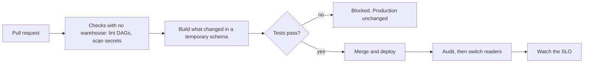

# DataOps

A data team can write correct models and still ship wrong numbers: a change goes straight to production, a password sits in a repository, someone resizes a warehouse in the console and nobody knows, and the first alert is a message from finance. DataOps is the set of habits that stop those. [The DataOps Manifesto](https://dataopsmanifesto.org/en/) states it as values such as "analytics is code" and "disposable environments". It is stewarded by a vendor, DataKitchen, so read it as a statement of intent. This chapter is the working version: environments, CI for models and DAGs, secrets, infrastructure as code, deploys and rollback, service levels, on-call, one definition per metric, a catalog and pushing data back out to other tools.

The confidence is medium. dbt 1.12 and DuckDB ran for real in the code below, and the numbers in the service-level sections come from a simulation whose rates I chose. Airflow, Terraform, dbt's hosted CI and Semantic Layer, the catalog products and any CRM were read about and not run. Each is marked where it appears, and the stand-ins are small enough to read.

Before the tools, one correction. "Should we use Snowflake or Airflow?" isn't a real question. Snowflake stores data and runs queries. Airflow and Dagster decide when work runs and what happens when it fails, and they are often used together, with an orchestrator telling a warehouse to run a model. Compare within a layer: warehouses against warehouses in [warehouse and store](../../04-warehouse-lakehouse-streaming/notes/01-warehouse-and-store.md), orchestrators against orchestrators in [Dagster and Airflow](../../03-transform-and-orchestrate/notes/05-dagster-and-airflow.md). DataOps sits across the layers, and it changes how each one gets changed.

## The path of a change



Each step below is one box of that picture.

## Environments

An environment here is a place where the same code runs against different data. dbt's [environments page](https://docs.getdbt.com/docs/environments-in-dbt) separates development from deployment and notes that warehouses can use separate schemas or databases instead of separate machines. The project below is a small shop with one warehouse file and one schema per environment. The models don't name a schema, so they can run anywhere.

```python
import contextlib, io, json, pathlib, shutil, duckdb
from dbt.cli.main import dbtRunner

def write(path, text):
    p = pathlib.Path(path)
    p.parent.mkdir(parents=True, exist_ok=True)
    p.write_text(text)

write("dbt_project.yml", """
name: shop
version: "1.0"
profile: shop
models:
  shop:
    +materialized: table
    stg_orders: {+materialized: view}
""")
# One warehouse file, one schema per environment. Nothing in the models names a schema.
write("profiles.yml", """
shop:
  target: dev
  outputs:
    prod: {type: duckdb, path: wh.duckdb, schema: prod, threads: 2}
    ci:   {type: duckdb, path: wh.duckdb, schema: "{{ env_var('CI_SCHEMA') }}", threads: 2}
""")
write("seeds/raw_orders.csv", "order_id,customer_id,status,amount,ordered_on\n" + "".join(
    f"{i},{i % 40},{'refunded' if i % 10 == 0 else 'paid'},{10 + i % 90},2026-10-{1 + i % 28:02d}\n"
    for i in range(1, 2001)))
write("seeds/raw_products.csv", "product_id,name\n1,Kettle\n2,Toaster\n")
write("models/stg_orders.sql", "select order_id, customer_id, status, amount, ordered_on from {{ ref('raw_orders') }}")
write("models/daily_revenue.sql", """
select ordered_on, sum(amount) as revenue
from {{ ref('stg_orders') }}
group by ordered_on
""")
write("models/customer_value.sql", """
select customer_id, sum(amount) as lifetime_value
from {{ ref('stg_orders') }}
group by customer_id
""")
write("models/revenue_by_month.sql", """
select date_trunc('month', ordered_on) as month, sum(revenue) as revenue
from {{ ref('daily_revenue') }}
group by 1
""")
write("models/dim_products.sql", "select product_id, name from {{ ref('raw_products') }}")
write("models/schema.yml", """
models:
  - name: daily_revenue
    description: Revenue per day
    meta: {owner: finance-data}
    columns:
      - name: ordered_on
        data_tests: [unique, not_null]
  - name: customer_value
    description: Lifetime spend per customer
    meta: {owner: growth-data}
    columns:
      - name: customer_id
        data_tests: [unique, not_null]
  - name: revenue_by_month
    meta: {owner: finance-data}
  - name: dim_products
exposures:
  - name: weekly_revenue_dashboard
    type: dashboard
    url: https://bi.example.com/dashboards/1
    depends_on: [ref('revenue_by_month')]
    owner: {name: Finance data, email: finance-data@example.com}
""")

QUIET = ["--project-dir", ".", "--profiles-dir", ".", "--log-level", "none", "--no-use-colors"]

def dbt(*args, target="prod"):
    """Run dbt in this process. Return whether it succeeded, printing one line per node."""
    res = dbtRunner().invoke([*args, "--target", target, *QUIET])
    if res.exception:
        raise res.exception
    for r in res.result.results:
        print(f"  {r.status!s:9}{r.node.resource_type!s:10}{r.node.name}")
    return res

def ls(*args):
    """Names of the nodes dbt selects, in order."""
    with contextlib.redirect_stdout(io.StringIO()):
        res = dbtRunner().invoke(["ls", *args, "--output", "name", "--target", "prod", *QUIET])
    if res.exception:
        raise res.exception
    return sorted(str(n).split(".")[-1] for n in res.result)

def sql(query):
    with duckdb.connect("wh.duckdb") as con:
        return con.execute(query).fetchall()

def tables_in(schema):
    return sorted(r[0] for r in sql(f"select table_name from information_schema.tables where table_schema = '{schema}'"))

print("project written; models:", sorted(p.stem for p in pathlib.Path("models").glob("*.sql")))
```

```text
project written; models: ['customer_value', 'daily_revenue', 'dim_products', 'revenue_by_month', 'stg_orders']
```

The rule that makes this work is the [config rule from the Twelve-Factor App](https://12factor.net/config): anything that varies between deploys lives outside the code. `CI_SCHEMA` comes from the environment, so each pull request can have its own schema with no edit to a file.

Production gets built by a deploy from main. The artefact worth keeping from that run is `manifest.json`, the description of what production now is.

```python
os.environ["CI_SCHEMA"] = "pr_42"
dbt("build")                               # a deploy from main
shutil.copytree("target", "prod-artifacts")  # the manifest of what prod is now
print("prod has:", tables_in("prod"))
```

```text
  success  seed      raw_products
  success  seed      raw_orders
  success  model     dim_products
  success  model     stg_orders
  success  model     daily_revenue
  success  model     customer_value
  pass     test      not_null_daily_revenue_ordered_on
  pass     test      not_null_customer_value_customer_id
  pass     test      unique_customer_value_customer_id
  pass     test      unique_daily_revenue_ordered_on
  success  model     revenue_by_month
  no-op    exposure  weekly_revenue_dashboard
prod has: ['customer_value', 'daily_revenue', 'dim_products', 'raw_orders', 'raw_products', 'revenue_by_month', 'stg_orders']
```

## CI for models: build only what changed

Rebuilding everything on each pull request is slow on a real warehouse, and it isn't needed. dbt can compare the current project with the saved manifest. [`state:modified`](https://docs.getdbt.com/reference/node-selection/methods) selects new and changed nodes, and a trailing `+` adds everything downstream.

```python
# The pull request: daily revenue should not count refunded orders.
write("models/daily_revenue.sql", """
select ordered_on, sum(amount) as revenue
from {{ ref('stg_orders') }}
where status <> 'refunded'
group by ordered_on
""")
print("all resources:", len(ls()))
print("state:modified:", ls("--select", "state:modified", "--state", "prod-artifacts"))
print("state:modified+:", ls("--select", "state:modified+", "--state", "prod-artifacts"))
```

```text
all resources: 12
state:modified: ['daily_revenue', 'not_null_daily_revenue_ordered_on', 'unique_daily_revenue_ordered_on']
state:modified+: ['daily_revenue', 'not_null_daily_revenue_ordered_on', 'revenue_by_month', 'unique_daily_revenue_ordered_on', 'weekly_revenue_dashboard']
```

One changed model out of twelve resources became five selected: the model, its two tests, the monthly model that reads it, and the dashboard that reads that. `customer_value` and `dim_products` aren't there, since this change can't affect them.

Selecting only those creates a problem, because `daily_revenue` reads `stg_orders`, which won't be built in the pull request's schema. [`--defer`](https://docs.getdbt.com/reference/node-selection/defer) solves it: dbt resolves a `ref` using the saved manifest when the node isn't selected and doesn't exist in the current environment. The pull request reads real production data for what it didn't change, and writes only to its own schema.

```python
ok = dbt("build", "--select", "state:modified+", "--defer", "--state", "prod-artifacts", target="ci")
print("green:", ok.success)
print("pr_42 has:", tables_in("pr_42"))
compiled = pathlib.Path("target/run/shop/models/daily_revenue.sql").read_text()
print("reads from:", [l.strip() for l in compiled.splitlines() if "stg_orders" in l])
print("prod total:", sql("select sum(revenue) from prod.daily_revenue")[0][0],
      " pr total:", sql("select sum(revenue) from pr_42.daily_revenue")[0][0])
sql("drop schema pr_42 cascade")           # the PR closed
print("after close:", tables_in("pr_42"))
```

```text
  success  model     daily_revenue
  pass     test      not_null_daily_revenue_ordered_on
  pass     test      unique_daily_revenue_ordered_on
  success  model     revenue_by_month
  no-op    exposure  weekly_revenue_dashboard
green: True
pr_42 has: ['daily_revenue', 'revenue_by_month']
reads from: ['from "wh"."prod"."stg_orders"']
prod total: 108320  pr total: 98370
after close: []
```

The compiled SQL reads from `prod`, the outputs land in `pr_42`, and the two totals differ by exactly the refunds the change was meant to remove. That difference is what a reviewer should look at, and a [data diff](04-schema-and-data-migrations.md) makes it routine. Closing the pull request drops the schema, which is the manifesto's disposable environment in one line. dbt's hosted [CI jobs](https://docs.getdbt.com/docs/deploy/continuous-integration) do these steps for you: they build in a temporary schema unique to the pull request, report the status on it, cancel runs for stale commits and delete the schema on close or merge. I ran the same steps with dbt Core and did not run the hosted product.

Now a bad change. A test that fails has to stop the merge.

```python
# A second PR groups by one column too many, so a day now has two rows. The test should stop it.
write("models/daily_revenue.sql", """
select ordered_on, status, sum(amount) as revenue
from {{ ref('stg_orders') }}
group by ordered_on, status
""")
ok = dbt("build", "--select", "state:modified+", "--defer", "--state", "prod-artifacts", target="ci")
print("green:", ok.success, " exit code a CI runner would see:", 0 if ok.success else 1)
print("prod untouched:", sql("select count(*) from prod.daily_revenue")[0][0], "rows")
sql("drop schema pr_42 cascade")
write("models/daily_revenue.sql", """
select ordered_on, sum(amount) as revenue
from {{ ref('stg_orders') }}
where status <> 'refunded'
group by ordered_on
""")
```

```text
  success  model     daily_revenue
  fail     test      unique_daily_revenue_ordered_on
  pass     test      not_null_daily_revenue_ordered_on
  skipped  model     revenue_by_month
  skipped  exposure  weekly_revenue_dashboard
green: False  exit code a CI runner would see: 1
prod untouched: 28 rows
```

The model built, the `unique` test failed, and dbt skipped everything downstream of it. Production still has 28 rows. Tests are the subject of [quality dimensions and tests](01-quality-dimensions-and-tests.md); what CI adds is that the test runs before the change is live. Make this check required in the repository's branch rules, or a failing build is only advice.

## CI for DAGs

An orchestrator file is code, and code that fails to load takes its schedule with it. [Airflow's best practices](https://airflow.apache.org/docs/apache-airflow/stable/best-practices.html) ask for two things that matter here. Avoid top-level code that isn't needed to create operators and their relations, because the scheduler re-parses the file at a set interval. And run a loader test, which can be as simple as `python your-dag-file.py` in an environment that matches production, to catch syntax errors and missing dependencies.

The sketch below catches two mistakes from the source text alone, with no Airflow installed. It is a lint and not that loader test, and I did not run Airflow for this chapter. Your CI image should contain Airflow and run the real test as well. It also only inspects statements at the top of the file, so a call inside the `with` block passes.

```python
import ast, graphlib

GOOD_DAG = """
from airflow.sdk import DAG
from airflow.providers.standard.operators.bash import BashOperator
with DAG("nightly", schedule="@daily") as dag:
    extract = BashOperator(task_id="extract", bash_command="extract.sh")
    build = BashOperator(task_id="build", bash_command="dbt build")
    extract >> build
"""
BAD_DAG = """
import requests
from airflow.sdk import DAG
from airflow.providers.standard.operators.bash import BashOperator
tables = requests.get("https://internal/tables").json()
with DAG("nightly", schedule="@daily") as dag:
    a = BashOperator(task_id="a", bash_command="a.sh")
    b = BashOperator(task_id="b", bash_command="b.sh")
    a >> b >> a
"""

def edges(node):
    """Pairs from `a >> b >> c`, read from the syntax tree."""
    found = []
    for n in ast.walk(node):
        if isinstance(n, ast.BinOp) and isinstance(n.op, ast.RShift) and isinstance(n.right, ast.Name):
            left = n.left.right if isinstance(n.left, ast.BinOp) else n.left
            found.append((left.id, n.right.id))
    return found

def check_dag(source):
    """Problems a pull request can find without Airflow installed or a scheduler running."""
    tree, problems = ast.parse(source), []
    for stmt in tree.body:
        if isinstance(stmt, (ast.Import, ast.ImportFrom, ast.With, ast.FunctionDef)):
            continue
        calls = [c for c in ast.walk(stmt) if isinstance(c, ast.Call)]
        if calls:
            problems.append(f"line {stmt.lineno}: work at the top level runs on every parse")
    graph = {}
    for a, b in edges(tree):
        graph.setdefault(b, set()).add(a)
    try:
        list(graphlib.TopologicalSorter(graph).static_order())
    except graphlib.CycleError as e:
        problems.append(f"cycle: {' -> '.join(e.args[1])}")
    return problems

print("good dag:", check_dag(GOOD_DAG))
for p in check_dag(BAD_DAG):
    print("bad dag: ", p)
```

```text
good dag: []
bad dag:  line 5: work at the top level runs on every parse
bad dag:  cycle: a -> b -> a
```

[Orchestrate](../../03-transform-and-orchestrate/notes/02-orchestrate.md) and [Dagster and Airflow](../../03-transform-and-orchestrate/notes/05-dagster-and-airflow.md) cover how DAGs run. A CI check is cheap, so add one each time a mistake gets through.

## Secrets and config

The Twelve-Factor page has a good test: could the code be made public right now without giving away a credential? Keep secrets in the CI system or a secret manager, pass them as environment variables, and refer to them by name, as `{{ env_var('DBT_PASSWORD') }}` does in a dbt profile. A scan in CI catches the slip that's already been made.

```python
import re

PATTERNS = {
    "aws access key": re.compile(r"\bAKIA[0-9A-Z]{16}\b"),
    "password value": re.compile(r"""(?i)\b(password|passwd|token|secret)\b\s*[:=]\s*["']?(?!\{\{)[^\s"'{]{4,}"""),
}

def scan(files):
    return [(path, n, name) for path, text in files.items()
            for n, line in enumerate(text.splitlines(), 1)
            for name, rx in PATTERNS.items() if rx.search(line)]

fake_key = "AKIA" + "IOSFODNN7EXAMPLE"     # AWS's documented example key, split so scanners ignore this file
repo = {
    "profiles.yml": "password: {{ env_var('DBT_PASSWORD') }}\nuser: {{ env_var('DBT_USER') }}\n",
    "old_profiles.yml": "user: analytics\npassword: hunter2hunter2\n",
    "scripts/load.py": f'client = boto3.client("s3", aws_access_key_id="{fake_key}")\n',
    "dags/nightly.py": 'schedule = "@daily"\n',
}
for hit in scan(repo):
    print("found:", hit)
print("clean files:", sorted(set(repo) - {h[0] for h in scan(repo)}))
```

```text
found: ('old_profiles.yml', 2, 'password value')
found: ('scripts/load.py', 1, 'aws access key')
clean files: ['dags/nightly.py', 'profiles.yml']
```

These two patterns show the shape of a scanner and nothing more. In production use a maintained scanner with many more rules. A hit needs a rotation as well as a deleted line, because the value stays in git history.

Secrets also leak through logs. [GitHub Actions](https://docs.github.com/en/actions/security-for-github-actions/security-guides/using-secrets-in-github-actions) redacts registered secrets from logs and lets you mask other values with `::add-mask::`, but its docs warn of a workaround where printed secrets are not redacted, so don't rely on the mask and don't print them. Access control for the data itself is in [access control, PII and GDPR](../../07-architecture-and-governance/notes/02-access-control-pii-gdpr.md).

## Infrastructure as code

Warehouses, buckets, roles and schedules are configuration too. If they were created by clicking, nobody can review them, rebuild them or say what changed. [Terraform](https://developer.hashicorp.com/terraform/intro) is the usual tool, and its loop is to write a config, plan, then apply after approval. [`terraform plan`](https://developer.hashicorp.com/terraform/cli/commands/plan) reads the current state of existing objects, compares the config with the prior state, and proposes the changes needed.

Terraform isn't installed here, so this is a small model of that loop and not the tool. The model is enough to see the three behaviours that catch people out.

```python
def plan(desired, state, cloud):
    """A model of `terraform plan`: refresh what exists, then diff it against the config."""
    refreshed = {k: dict(cloud[k]) for k in state if k in cloud}
    drifted = sorted(k for k in refreshed if refreshed[k] != state[k])
    changes = []
    for k in sorted(desired.keys() | refreshed.keys()):
        if k not in refreshed:
            changes.append(("create", k, desired[k]))
        elif k not in desired:
            changes.append(("destroy", k, refreshed[k]))
        elif desired[k] != refreshed[k]:
            immutable = desired[k].get("region") != refreshed[k].get("region")
            changes.append(("REPLACE" if immutable else "update", k, desired[k]))
    return drifted, changes

def apply(changes, state, cloud):
    for action, k, spec in changes:
        if action == "destroy":
            cloud.pop(k), state.pop(k)
        else:
            cloud[k] = dict(spec)
            state[k] = dict(spec)

def show(title, result):
    drifted, changes = result
    print(f"{title}: drift={drifted}", [f"{a} {k}" for a, k, _ in changes] or "no changes")

desired = {"bucket.raw": {"region": "eu-west-1", "versioning": True},
           "warehouse.etl": {"size": "S", "auto_suspend": 60}}
state, cloud = {}, {}
show("first plan", plan(desired, state, cloud))
apply(plan(desired, state, cloud)[1], state, cloud)
show("second plan", plan(desired, state, cloud))

cloud["warehouse.etl"]["size"] = "XL"      # someone resized it in the console during an incident
show("after console edit", plan(desired, state, cloud))
apply(plan(desired, state, cloud)[1], state, cloud)
print("size after apply:", cloud["warehouse.etl"]["size"])

desired["bucket.raw"]["region"] = "us-east-1"  # looks like a one-word edit
show("after region edit", plan(desired, state, cloud))
desired["bucket.raw"]["region"] = "eu-west-1"
```

```text
first plan: drift=[] ['create bucket.raw', 'create warehouse.etl']
second plan: drift=[] no changes
after console edit: drift=['warehouse.etl'] ['update warehouse.etl']
size after apply: S
after region edit: drift=[] ['REPLACE bucket.raw']
```

**Drift.** The console edit shows up in the next plan. Applying it put the warehouse back to size S, which may be a nasty surprise if someone resized it during an incident. Copy the fix into the config or lose it on the next apply.

**Replacement.** Some edits can't be made in place. Terraform's [lifecycle page](https://developer.hashicorp.com/terraform/language/meta-arguments/lifecycle) says it destroys and re-creates resources whose changed arguments it can't update in place because of remote API limitations, and it offers `prevent_destroy` as a guard. In my model the region is such an argument. For a stateless service that's an annoyance. For a bucket or a database, it's the end of the data. Read every plan for destroys, and put the guard on anything holding data.

**State.** The [state file](https://developer.hashicorp.com/terraform/language/state) maps config to real objects, so losing it is serious (see Try it). The docs advise against keeping it in version control or any store without locking and secure access, because that risks data loss or exposing secrets it contains. Store it remotely, with locking.

## Deploys and rollback

Good releases are [reproducible and automated](https://sre.google/sre-book/release-engineering/): the same commit gives the same result on any machine, with no one's laptop involved. Data adds a problem that services don't have. Rolling back code doesn't roll back rows it already wrote or the decisions already made from them.

One deploy pattern gives data a real rollback. Build the new version beside the old, audit it, then switch readers with one small statement. It's the same idea as [write-audit-publish](03-incident-playbooks.md) and the alias swap for [vector collections](04-schema-and-data-migrations.md).

```python
import time

with duckdb.connect("wh.duckdb") as con:
    con.execute("create schema serving")
    con.execute("create schema build_1")
    con.execute("create table build_1.daily_revenue as select * from prod.daily_revenue")
    con.execute("create view serving.daily_revenue as select * from build_1.daily_revenue")
    read = lambda: con.execute("select round(sum(revenue)) from serving.daily_revenue").fetchone()[0]
    print("live, build_1:", read())

    con.execute("create schema build_2")   # blue stays live while green builds
    con.execute("""create table build_2.daily_revenue as
                   select ordered_on, revenue * 0.9 as revenue from build_1.daily_revenue""")
    audit = con.execute("""select count(*), count(*) filter (where revenue < 0)
                           from build_2.daily_revenue""").fetchone()
    print("audit build_2 (rows, negative):", audit)

    t = time.perf_counter()
    con.execute("create or replace view serving.daily_revenue as select * from build_2.daily_revenue")
    print(f"live, build_2: {read()}  (swap took {(time.perf_counter() - t) * 1000:.1f} ms)")

    t = time.perf_counter()
    con.execute("create or replace view serving.daily_revenue as select * from build_1.daily_revenue")
    print(f"rolled back: {read()}  (took {(time.perf_counter() - t) * 1000:.1f} ms)")
```

```text
live, build_1: 108320
audit build_2 (rows, negative): (28, 0)
live, build_2: 97488  (swap took 1.0 ms)
rolled back: 108320  (took 0.6 ms)
```

The switch took about a millisecond in this run, on a local file with no concurrent readers. The size of the table doesn't matter, since only a view definition changes. The cost is storage for two copies and the need to retain the old build until you're sure. Rollback is only this easy while nothing has been written on top of the new version, and a change in a table's shape needs [expand and contract](04-schema-and-data-migrations.md) too.

## Service levels for data

"Is the data OK?" has no answer until someone says what OK means. [The SRE book](https://sre.google/sre-book/service-level-objectives/) has the three terms. An SLI is a measure, an SLO is a target for it, and an SLA is a contract with consequences if missed. [The workbook's data pipeline chapter](https://sre.google/workbook/data-processing/) gives the usual forms of a freshness SLO, such as "X% of data processed in Y minutes" or "the job completed within Y minutes". It adds correctness SLOs, for instance no more than 0.1% of invoices wrong per quarter, and warns that checking correctness per stage can miss a bug that spans stages.

An [error budget](https://sre.google/sre-book/embracing-risk/) is one minus the target. It's the amount of failure you've agreed to accept, and it turns "are we reliable enough?" into arithmetic. [The workbook](https://sre.google/workbook/implementing-slos/) finds a four-week rolling window a good general default, and expects teams to agree in advance to reduce risk once the budget runs out.

The simulation has an hourly batch for four weeks, with an SLO of 99% of batches arriving within 30 minutes. Delays, retries and a five-hour outage on day 17 are numbers I chose, so read this for the method and not the values.

```python
import random

def simulate(seed=7, days=28, slo_minutes=30):
    """An hourly batch for four weeks: delays, task failures that retries absorb, one real outage."""
    rng = random.Random(seed)
    runs = []
    for hour in range(days * 24):
        delay = rng.lognormvariate(2.5, 0.35)        # typically about 12 minutes
        task_failures = 0
        while rng.random() < 0.04:                   # a transient failure, then a retry
            task_failures += 1
            delay += 5
        if 17 * 24 + 3 <= hour < 17 * 24 + 8:        # day 17: an upstream outage for five hours
            delay += 300
        runs.append({"hour": hour, "delay": delay, "failures": task_failures, "good": delay <= slo_minutes})
    return runs

runs = simulate()
target = 0.99
bad = [r for r in runs if not r["good"]]
budget = (1 - target) * len(runs)
print(f"batches: {len(runs)}  SLI: {1 - len(bad) / len(runs):.2%}  target: {target:.0%}")
print(f"budget: {budget:.2f} late batches  spent: {len(bad)}  ({len(bad) / budget:.0%})")
outage = [r for r in bad if 17 * 24 + 3 <= r["hour"] < 17 * 24 + 8]
print(f"of which the outage: {len(outage)}  scattered: {len(bad) - len(outage)}")
```

```text
batches: 672  SLI: 98.51%  target: 99%
budget: 6.72 late batches  spent: 10  (149%)
of which the outage: 5  scattered: 5
```

The budget is 6.72 late batches and the month spent 10. Half of that was the outage everyone remembers. The other half was scattered slow batches that nobody would have noticed, which is what a budget is good at showing. Over budget, the agreed policy applies: stop risky changes and work on the cause until the window recovers. The target has to come from what users need, and the chapter's numbers don't tell you what yours should be.

## On-call: page on the symptom

[The SRE on-call chapter](https://sre.google/sre-book/being-on-call/) has limits worth borrowing. Paging alerts should line up with symptoms that threaten an SLO, and every page should be actionable. An incident takes about 6 hours on average to handle, follow-up included, which gives an upper bound of 2 per 12-hour shift. At Google, no more than 25% of an SRE's time goes to on-call. Compare two alert rules on the same simulated month.

```python
def cause_pages(runs):
    """Page on every task failure: the cause-based alert."""
    return [r["hour"] for r in runs if r["failures"]]

def symptom_pages(runs, window=6, late=2):
    """Page when 2 of the last 6 batches were late, and at most once per incident."""
    pages, in_incident = [], False
    for i in range(len(runs)):
        recent = runs[max(0, i - window + 1):i + 1]
        firing = sum(not r["good"] for r in recent) >= late
        if firing and not in_incident:
            pages.append(runs[i]["hour"])
        in_incident = firing
    return pages

a, b = cause_pages(runs), symptom_pages(runs)
hit = lambda pages: any(17 * 24 + 3 <= h < 17 * 24 + 8 for h in pages)
print(f"page on any task failure: {len(a)} pages, {len(a) / 28:.1f} a day")
print(f"page on the symptom:      {len(b)} pages, {len(b) / 28:.2f} a day")
print("symptom page at hour:", b, " outage began at hour:", 17 * 24 + 3)
print("each batch is", f"{1 / budget:.0%}", "of the budget")
```

```text
page on any task failure: 33 pages, 1.2 a day
page on the symptom:      1 pages, 0.04 a day
symptom page at hour: [412]  outage began at hour: 411
each batch is 15% of the budget
```

Paging on each task failure gives 33 pages when retries had already absorbed every one of them, and that's how people learn to ignore alerts. Paging on the symptom gives one page, an hour into the only real incident. It doesn't see the scattered slow batches, and it shouldn't wake anyone for them. Those belong in a ticket and the weekly budget review.

Don't copy the [workbook's burn-rate alert thresholds](https://sre.google/workbook/alerting-on-slos/) blindly here. Paging at 2% of budget in an hour suits a service with many requests an hour. With one batch an hour, each batch is 15% of the budget, so one late batch overshoots the threshold and there's nothing in between. I used "2 of the last 6 late" as a rule that fits this cadence. A batch system with few events needs thresholds that fit its count, and the same is true of any low-traffic service.

Keep what the on-caller reads next to the alert: who owns this, what depends on it, and the [incident playbook](03-incident-playbooks.md). The workbook also advises alerting on the same metric across jobs, so a generic freshness alert covers each new pipeline without new work. Data stores need their own alerts too, listed in [operating data stores](05-operating-data-stores.md).

## One definition per metric

Two dashboards can disagree while both are correct about their own SQL.

```python
sql("""create or replace table prod.orders_fact as
       select order_id, customer_id, status, amount, ordered_on from prod.raw_orders""")
print("finance dashboard:", sql("select sum(amount) from prod.orders_fact where status = 'paid'")[0][0])
print("growth dashboard: ", sql("select sum(amount) from prod.orders_fact")[0][0])

METRICS = {"revenue": {"expr": "sum(amount)", "from": "prod.orders_fact",
                       "filter": "status = 'paid'", "owner": "finance-data"}}

def metric_sql(name, by=None):
    """Compile a metric to SQL: the idea underneath a semantic layer, in a few lines."""
    m = METRICS[name]
    dims = f"{by}, " if by else ""
    group = f" group by {by} order by {by}" if by else ""
    return f"select {dims}{m['expr']} as {name} from {m['from']} where {m['filter']}{group}"

print("both dashboards now:", sql(metric_sql("revenue"))[0][0])
print(metric_sql("revenue", by="customer_id"))
print("impact of revenue_by_month:", ls("--select", "revenue_by_month+"))
print("upstream of the dashboard:", ls("--select", "+exposure:weekly_revenue_dashboard"))
```

```text
finance dashboard: 98370
growth dashboard:  108320
both dashboards now: 98370
select customer_id, sum(amount) as revenue from prod.orders_fact where status = 'paid' group by customer_id order by customer_id
impact of revenue_by_month: ['revenue_by_month', 'weekly_revenue_dashboard']
upstream of the dashboard: ['daily_revenue', 'not_null_daily_revenue_ordered_on', 'raw_orders', 'revenue_by_month', 'stg_orders', 'unique_daily_revenue_ordered_on', 'weekly_revenue_dashboard']
```

Finance excludes refunds and growth doesn't, so "revenue" is two numbers, and the meeting goes to arguing about which. The fix is to define the metric once, near the models, and have every tool ask for it. [The dbt Semantic Layer](https://docs.getdbt.com/docs/use-dbt-semantic-layer/dbt-sl), built on MetricFlow, does this by moving metric definitions out of the BI layer and into the modelling layer, and handling joins for you. The `metric_sql` function above is only the idea in a few lines. The hosted layer needs a dbt Starter or Enterprise account, and I did not run it. A governed set of marts with one column per metric gets you much of the benefit with no new tool, provided people use them.

The last two lines use an [exposure](https://docs.getdbt.com/docs/build/exposures), declared in `schema.yml` with an owner and `depends_on`. dbt now knows a dashboard exists, so `+exposure:weekly_revenue_dashboard` lists what feeds it, and the `state:modified+` output earlier listed the dashboard as affected by the change. That's lineage for the last hop, which [monitors and lineage](02-monitors-and-lineage.md) covers for the rest of the pipeline.

## A catalog

A catalog answers: what is this table, who owns it, can I trust it, and what breaks if it changes? Products such as [OpenMetadata](https://docs.open-metadata.org/latest) and [DataHub](https://docs.datahub.com/docs/features) gather that across many tools through connectors, adding search, lineage and governance. I read their overview pages and ran neither. Your first catalog is smaller: dbt's manifest holds most of the facts for the models it builds.

```python
manifest = json.loads(pathlib.Path("prod-artifacts/manifest.json").read_text())
models = [n for n in manifest["nodes"].values() if n["resource_type"] == "model"]
print(f"{'model':18}{'owner':14}{'documented':12}columns tested")
tests = [n for n in manifest["nodes"].values() if n["resource_type"] == "test"]
for m in sorted(models, key=lambda m: m["name"]):
    tested = sorted({t["column_name"] for t in tests if m["unique_id"] in t["depends_on"]["nodes"]})
    print(f"{m['name']:18}{m['config']['meta'].get('owner', '-'):14}{'yes' if m['description'] else 'NO':12}{tested}")
unowned = sorted(m["name"] for m in models if not m["config"]["meta"].get("owner"))
print("CI gate, models with no owner:", unowned)
```

```text
model             owner         documented  columns tested
customer_value    growth-data   yes         ['customer_id']
daily_revenue     finance-data  yes         ['ordered_on']
dim_products      -             NO          []
revenue_by_month  finance-data  NO          []
stg_orders        -             NO          []
CI gate, models with no owner: ['dim_products', 'stg_orders']
```

The last line is the useful part. A catalog people have to remember to fill goes stale, so make the facts required: fail CI when a model in a marts layer has no owner or description. Buy a product when you have many tools to span and enough people searching. A tool bought to solve a documentation habit won't.

## Reverse ETL

Reverse ETL copies modelled data from the warehouse into the tools where people work, such as a CRM or an ad platform. [Hightouch's guide](https://hightouch.com/blog/reverse-etl) is a good description, though it comes from a vendor selling this product. It lists the pieces as source, model, sync and destination, and makes the point that matters: you don't own the destination's schema or API, and you need to compare current values with what you previously sent.

That comparison makes the sync cheap and restartable. The CRM below is a Python class standing in for a real API, and it fails on demand.

```python
import hashlib

class FakeCRM:
    """The destination: upserts by external id, counted, and it can fail partway."""
    def __init__(self):
        self.contacts, self.calls, self.fail_after = {}, 0, None
    def upsert(self, external_id, fields):
        if self.fail_after is not None and self.calls >= self.fail_after:
            raise ConnectionError("503 from CRM")
        self.calls += 1
        self.contacts[external_id] = fields

def fingerprint(fields):
    return hashlib.sha256(json.dumps(fields, sort_keys=True).encode()).hexdigest()

def sync(con, crm):
    """Send only what changed since the last successful send of each record."""
    rows = con.execute("select customer_id, tier, lifetime_value from audience").fetchall()
    done = dict(con.execute("select customer_id, fp from synced").fetchall())
    sent = 0
    for customer_id, tier, value in rows:
        fields = {"tier": tier, "ltv": float(value)}
        fp = fingerprint(fields)
        if done.get(customer_id) == fp:
            continue
        crm.upsert(customer_id, fields)    # the send first, the record of it second
        con.execute("insert or replace into synced values (?, ?)", [customer_id, fp])
        sent += 1
    return sent

con = duckdb.connect()
con.execute("""create table audience as
               select i as customer_id, case when i % 10 = 0 then 'gold' else 'std' end as tier,
                      (i % 500)::double as lifetime_value
               from range(1000) t(i)""")
con.execute("create table synced (customer_id bigint primary key, fp varchar)")
crm = FakeCRM()
print("first sync sent:", sync(con, crm))
print("no changes, sent:", sync(con, crm))

con.execute("update audience set tier = 'gold' where customer_id between 100 and 136 and tier <> 'gold'")
changed = con.execute("select count(*) from audience where tier = 'gold'").fetchone()[0] - 100
print("tier changes in the warehouse:", changed)
crm.fail_after = crm.calls + 10
try:
    sync(con, crm)
except ConnectionError as e:
    print("crash partway:", e, "after", crm.calls - 1000, "sends")
crm.fail_after = None
print("rerun sent:", sync(con, crm), " total calls:", crm.calls)
truth = dict(con.execute("select customer_id, tier from audience").fetchall())
print("CRM matches warehouse:", all(crm.contacts[k]["tier"] == v for k, v in truth.items()))
```

```text
first sync sent: 1000
no changes, sent: 0
tier changes in the warehouse: 33
crash partway: 503 from CRM after 10 sends
rerun sent: 23  total calls: 1033
CRM matches warehouse: True
```

The first run sends 1,000 records, the second sends none, and a change of 33 sends 33. A crash after 10 costs nothing, because the rerun sends the other 23 and the CRM ends up matching. Three things make that true. Upserts by a stable ID make a repeated send harmless, the fingerprint makes an unchanged record skippable, and the send happens before the record of it. A real API adds rate limits, batch endpoints and fields the sales team edits by hand, and you need a rule for those: decide which side wins each field. It's also an operational dependency now, because people act on what's in the CRM, so give the sync an owner, an SLO and an alert.

## Pitfalls

- **A CI schema that defers to stale production.** You may be reading production, development or a mix. [dbt's docs warn](https://docs.getdbt.com/reference/node-selection/defer) that limits applied only in development can select more data than expected, and that tests with several parents may run across environments. Refresh the manifest on each deploy, or `state:modified` compares against an old picture.
- **Green CI on a small sample.** Building on a day of data passes a test that a year would fail. Know what your CI build doesn't cover.
- **Optional checks.** A failing check that can still be merged gets merged. Require it.
- **Testing the wrong level.** Each stage can pass while the whole is wrong, as the workbook warns. Keep at least one check from raw inputs to final output, like [a reconciliation](01-quality-dimensions-and-tests.md).
- **Skimming a plan.** A destroy hidden in a long list is how data gets deleted. Fail the pipeline on destroys for stateful resources unless someone approves them.
- **A secret in history.** Deleting the line doesn't help. Rotate the secret.
- **Hand-fixing production during an incident, and leaving it.** It's sometimes the right call. Put it in the config afterwards, or the next apply undoes it.
- **An SLO nobody uses.** If missing it changes nothing, it's a dashboard. Agree the policy before the budget runs out.
- **Alerts on causes.** They grow with the system and teach people to ignore them. Page on symptoms, and send causes to dashboards.
- **Two sources of truth for a metric.** A semantic layer alongside the old dashboards gives you three numbers. Migrate the dashboards and retire the old definitions.

## Try it

Run `06_dataops.py` first. Its final section runs the checks behind these answers.

1. Change `stg_orders` instead of `daily_revenue`. What does `state:modified+` select now, and is that the right cost?
2. Raise the target to 99.9% on the same hourly batch over four weeks. How big is the budget, and what does that tell you?
3. Change the sync to record the send before making it, crash it partway and rerun. How many records end up wrong?
4. In the infrastructure model, plan with an empty state against a cloud where everything exists. What does it propose, and why?

<details>
<summary>Answers</summary>

1. It selects 9 resources: `stg_orders`, the two models that read it, the monthly model, the four tests and the dashboard. Only `dim_products` and the seeds stay out. That's right: a change at the root has a wide blast radius, and CI should show it.
2. 0.67 late batches. A single late batch breaks the SLO for four weeks. The target is finer than the batch cadence can express, so either run more often or choose a target you can meet with whole batches. Pick targets by counting events.
3. One record stays wrong for good: the one being sent when it crashed. Its fingerprint was already recorded, so the rerun skips it and sends the other 14. The rerun looks perfectly healthy. This is why the send comes first, since a repeated upsert is harmless and a lost one is silent.
4. It proposes creating everything, because without state it doesn't know those objects are its own. The real Terraform relies on state in the same way to map config to real objects, which is why the docs want it stored safely. To recover, restore the state or import the objects, and don't apply this plan.

</details>

## Interview checklist

| Question | Answer |
|---|---|
| What is DataOps in one line? | Applying software delivery habits to data: version control, automated tests, isolated environments, automated deploys and service levels. |
| Is Snowflake vs Airflow a sensible comparison? | No. Snowflake stores and computes, and Airflow schedules. They sit in different layers and often run together. |
| What does `state:modified+` do? | Compares the project with a saved manifest and selects changed nodes and everything downstream. |
| What does `--defer` do? | Resolves refs to unselected nodes missing from the current environment using the saved manifest, so CI can read production for what it didn't build. |
| How do you stop a bad model from reaching production? | Build and test it in a temporary schema on the pull request, as a required check. |
| Why avoid top-level code in an Airflow DAG file? | The scheduler parses the file repeatedly, so that code runs each time and slows it down. |
| Where do secrets go? | In a secret manager or the CI system, passed as environment variables. Rotate anything that reaches git. |
| What is drift, and what catches it? | Real infrastructure no longer matching config. A plan shows it, because it refreshes before comparing. |
| What's the danger in applying a Terraform plan? | Replacement: some changes destroy and re-create the resource. Read plans for destroys and guard stateful ones. |
| How do you deploy data with a real rollback? | Build beside the old version, audit, swap a view, and keep the old build for a while. |
| Give an example of a freshness SLO. | 99% of hourly batches arrive within 30 minutes, over a four-week rolling window. |
| What's an error budget for? | It's the failure you've agreed to accept. Spending it triggers an agreed policy, such as pausing risky changes. |
| What should page someone? | Actionable symptoms that threaten an SLO, not every task failure. |
| What does a semantic layer solve? | One definition per metric, used by every tool, in place of SQL copied into each dashboard. |
| How do you keep a reverse ETL sync safe to rerun? | Upsert by stable ID, send only records whose fingerprint changed, and record a send only after it succeeds. |

## Next

The [ML platform pillar](../../06-ml-platform/README.md) applies these same habits to models, where a registry and rollout play the part of CI and deploys. If you came here from a live incident, go back to [the playbooks](03-incident-playbooks.md).
