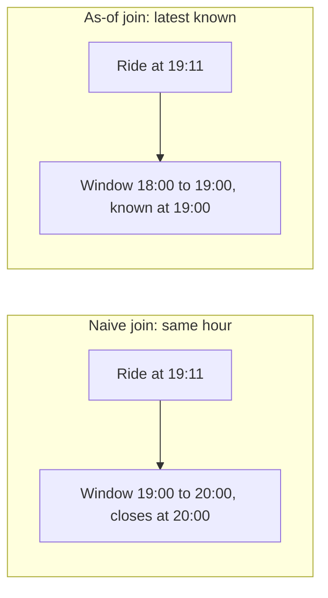
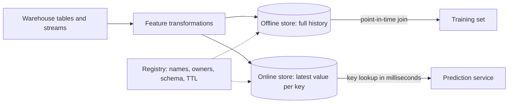

# Feature stores

A taxi-duration model scores an RMSE of 2.79 minutes offline and 5.48 in production, and nothing in the code is broken. The training query joined each ride to the average duration in its zone for the same hour, which is the obvious join, and that average includes the ride itself and every ride after it. At serving time the hour has not finished, so the number the model leaned on does not exist. This chapter is about the two failures of this kind, leakage across time and skew between code paths, and about the tool built to prevent both. It builds the fix in plain SQL first, because a feature store is that join with a catalogue and a low-latency copy around it, and you should know which of those parts you need before you adopt one.

The running example for this pillar is the course's taxi model: predict ride duration from the pickup and dropoff zones and the distance. The data here is synthetic, so that the leak is known to exist and its size can be measured. The stack in this pillar follows the data: the tables from [the warehouse chapter](../../04-warehouse-lakehouse-streaming/notes/01-warehouse-and-store.md) become training sets, the runs become registered models, the models become services, and [the monitors](../../05-quality-and-observability/notes/02-monitors-and-lineage.md) from the last pillar now have a model to protect.

## A feature has two times

Every row in a feature table describes some period and became knowable at some moment. Those are different. The average duration for 19:00 to 20:00 describes that hour, and it can be computed only after 20:00. The confusion between them is the root of nearly every temporal leak.

We start with three months of synthetic rides. The hidden traffic for each zone drifts from hour to hour, so the current hour carries more signal than the previous one, as it does on real roads.

```python
import numpy as np, pandas as pd, duckdb

rng = np.random.default_rng(42)
n = 40_000
start = pd.Timestamp("2024-01-01")
rides = pd.DataFrame({
    "ride_id": np.arange(n),
    "pickup_ts": start + pd.to_timedelta(
        np.sort(rng.uniform(0, 91 * 24 * 3600, n)), unit="s"),
    "zone": rng.integers(1, 21, n),
    "trip_distance": rng.gamma(2.0, 1.6, n).round(2),
})
# Each zone and hour has hidden traffic. It moves slowly from hour to hour,
# with a shock of its own, so the current hour knows more than the last one.
hours = pd.date_range(start, periods=91 * 24 + 1, freq="h")
traffic = {}
for z in range(1, 21):
    x = np.zeros(len(hours))
    for t in range(1, len(hours)):
        x[t] = 0.7 * x[t - 1] + rng.normal(0, 1.0)
    traffic[z] = pd.Series(x, index=hours)
rides["traffic"] = [traffic[z][h] for z, h in
                    zip(rides.zone, rides.pickup_ts.dt.floor("h"))]
rides["duration"] = (3 + 3.2 * rides.trip_distance + 2.5 * rides.traffic
                     + rng.normal(0, 2.0, n)).clip(1, 90).round(2)
rides["dropoff_ts"] = rides.pickup_ts + pd.to_timedelta(rides.duration, unit="m")
rides = rides.drop(columns="traffic")
print(rides[["pickup_ts", "zone", "trip_distance", "duration"]].head(3).to_string())
print(len(rides), "rides,", rides.pickup_ts.min().date(), "to", rides.pickup_ts.max().date())
```

Output:

```text
                      pickup_ts  zone  trip_distance  duration
0 2024-01-01 00:01:43.536456326     8           4.66     14.96
1 2024-01-01 00:02:31.268775149     6           5.35     22.33
2 2024-01-01 00:03:35.939508166     1           0.75      7.50
40000 rides, 2024-01-01 to 2024-03-31
```

The feature table keeps both times. `window_start` says what the row describes, `feature_ts` says when the row could first have been read:

```python
con = duckdb.connect()
con.execute("CREATE TABLE rides AS SELECT * FROM rides")
# One row per zone and hour. The value is only known when the hour has closed,
# so feature_ts, the time it became available, is the end of the window.
con.execute("""
CREATE TABLE zone_hourly AS
SELECT zone,
       date_trunc('hour', pickup_ts) AS window_start,
       date_trunc('hour', pickup_ts) + INTERVAL 1 HOUR AS feature_ts,
       avg(duration) AS avg_duration_1h,
       count(*) AS rides_1h
FROM rides GROUP BY 1, 2, 3
""")
print(con.sql("SELECT * FROM zone_hourly ORDER BY zone, feature_ts LIMIT 3").df()
      .round(2).to_string())
```

Output:

```text
   zone        window_start          feature_ts  avg_duration_1h  rides_1h
0     1 2024-01-01 00:00:00 2024-01-01 01:00:00            13.00         3
1     1 2024-01-01 04:00:00 2024-01-01 05:00:00            30.00         1
2     1 2024-01-01 06:00:00 2024-01-01 07:00:00            13.21         2
```

## The naive join and the as-of join

The tempting join matches on the window the ride falls in. The correct one takes, for each ride, the latest feature row whose `feature_ts` is at or before the pickup. That operation is called an as-of or point-in-time join. [DuckDB has it as `ASOF JOIN`](https://duckdb.org/docs/stable/guides/sql_features/asof_join), and every feature store's training path is some version of it.



```python
naive = con.sql("""
SELECT r.ride_id, r.pickup_ts, r.trip_distance, r.duration, f.avg_duration_1h
FROM rides r JOIN zone_hourly f
  ON r.zone = f.zone AND date_trunc('hour', r.pickup_ts) = f.window_start
""").df()
asof = con.sql("""
SELECT r.ride_id, r.pickup_ts, r.trip_distance, r.duration, f.avg_duration_1h,
       f.feature_ts
FROM rides r ASOF JOIN zone_hourly f
  ON r.zone = f.zone AND r.pickup_ts >= f.feature_ts
WHERE r.pickup_ts - f.feature_ts <= INTERVAL 3 HOUR
""").df()
print("naive rows", len(naive), "| as-of rows", len(asof))
ride = 20_000
print(naive.query("ride_id == @ride")[["pickup_ts", "avg_duration_1h"]].round(2).to_string())
print(asof.query("ride_id == @ride")[["pickup_ts", "feature_ts", "avg_duration_1h"]]
      .round(2).to_string())
```

Output:

```text
naive rows 40000 | as-of rows 37457
                          pickup_ts  avg_duration_1h
20000 2024-02-15 19:11:04.778934569             5.76
                          pickup_ts          feature_ts  avg_duration_1h
34651 2024-02-15 19:11:04.778934569 2024-02-15 19:00:00            10.84
```

The same ride at 19:11 gets 5.76 from the naive join and 10.84 from the as-of join. Part of that 5.76 comes from rides that had not started when this one was picked up, and it includes this ride's own duration. The as-of query also returns fewer rows, because of its three-hour limit: a ride in a zone with no recent data gets no feature at all, which is what would happen in production. A staleness limit like this is what Feast calls a time to live.

Now train on each and compare what each model reports offline with what it does when it only has as-of values, as a real service would:

```python
from sklearn.linear_model import LinearRegression
from sklearn.metrics import root_mean_squared_error as rmse

COLS = ["trip_distance", "avg_duration_1h"]
CUT = pd.Timestamp("2024-03-01")

def evaluate(df, name, serve):
    train, test = df[df.pickup_ts < CUT], df[df.pickup_ts >= CUT]
    m = LinearRegression().fit(train[COLS], train.duration)
    offline = rmse(test.duration, m.predict(test[COLS]))
    # In production the only value that exists at pickup time is the as-of one.
    s = serve[serve.pickup_ts >= CUT]
    prod = rmse(s.duration, m.predict(s[COLS]))
    print(f"{name:<14} coef={m.coef_[1]:5.2f} offline RMSE={offline:5.2f}"
          f"  production RMSE={prod:5.2f}")

evaluate(naive, "naive join", asof)
evaluate(asof, "point-in-time", asof)
```

Output:

```text
naive join     coef= 0.54 offline RMSE= 2.79  production RMSE= 5.48
point-in-time  coef= 0.12 offline RMSE= 3.81  production RMSE= 3.81
```

Read the two columns together. The naive model reports the better offline number by a wide margin, and it is the worse model in production by nearly as wide a margin. Its coefficient on the feature is about four times larger, because in training that column partly contained the label. The point-in-time model reports exactly what it delivers. A gap of this shape between offline and production is what [Shankar and colleagues' 2022 interview study of 18 ML engineers](https://arxiv.org/abs/2209.09125) describes when engineers list data leakage among their pain points, including training on data that is not available at serving time.

This is the argument for point-in-time correctness: it does not improve the model. It makes the offline number honest, and in this run it makes the offline metric worse. A team that picks models by offline RMSE and has no as-of join will reliably pick the leak.

## Train/serve skew: one function

Leakage is about time. Skew is about code. It occurs when the same ride produces different features in two code paths. The course's baseline trains on the NYC green-taxi data with a pickup and dropoff pair as a categorical feature, and here it is on synthetic rows:

```python
df = pd.DataFrame({
    "lpep_pickup_datetime": rides.pickup_ts,
    "lpep_dropoff_datetime": rides.dropoff_ts,
    "PULocationID": rng.integers(1, 266, n), "DOLocationID": rng.integers(1, 266, n),
    "trip_distance": rides.trip_distance})
import pickle
from sklearn.feature_extraction import DictVectorizer

df['duration'] = (df.lpep_dropoff_datetime - df.lpep_pickup_datetime).dt.total_seconds() / 60
df = df[(df.duration >= 1) & (df.duration <= 60)].copy()      # drop outliers
df[['PULocationID', 'DOLocationID']] = df[['PULocationID', 'DOLocationID']].astype(str)
df['PU_DO'] = df['PULocationID'] + '_' + df['DOLocationID']   # pickup and dropoff pair

dv = DictVectorizer()
X_train = dv.fit_transform(df[['PU_DO', 'trip_distance']].to_dict(orient='records'))
lr = LinearRegression().fit(X_train, df.duration.values)

with open('lin_reg.bin', 'wb') as f_out:
    pickle.dump((dv, lr), f_out)                              # vectoriser and model together
print(X_train.shape[1], "columns,", len(dv.feature_names_) - 1, "PU_DO pairs in the vocabulary")
```

Output:

```text
30425 columns, 30424 PU_DO pairs in the vocabulary
```

The fitted vocabulary of `PU_DO` values is part of the model, so the two are pickled together. Every serving path in the course then computes features with one function. Watch what a small type difference does to it:

```python
def prepare_features(ride):
    features = {}
    features['PU_DO'] = '%s_%s' % (ride['PULocationID'], ride['DOLocationID'])
    features['trip_distance'] = ride['trip_distance']
    return features

train_rows = [{"PULocationID": 130, "DOLocationID": 205, "trip_distance": 3.66},
              {"PULocationID": 43, "DOLocationID": 151, "trip_distance": 1.10}]
dv = DictVectorizer().fit([prepare_features(r) for r in train_rows])
print("vocabulary:", dv.feature_names_)

# The same ride, after a JSON path that turned the IDs into floats.
served = {"PULocationID": 130.0, "DOLocationID": 205.0, "trip_distance": 3.66}
print("train path:", dv.transform([prepare_features(train_rows[0])]).toarray()[0])
print("serve path:", dv.transform([prepare_features(served)]).toarray()[0])
```

Output:

```text
vocabulary: ['PU_DO=130_205', 'PU_DO=43_151', 'trip_distance']
train path: [1.   0.   3.66]
serve path: [0.   0.   3.66]
```

The served ride went through a JSON path that turned integer IDs into floats, so its key became `130.0_205.0`, which is not in the vocabulary. `DictVectorizer` treats an unknown category as all zeros and raises nothing. The service keeps answering, with the pair's effect silently gone. The fix is to normalise types inside the shared function and to pin it with a test that sends both shapes:

```python
def prepare_features_v2(ride):
    pu, do = int(ride["PULocationID"]), int(ride["DOLocationID"])
    return {"PU_DO": f"{pu}_{do}", "trip_distance": float(ride["trip_distance"])}

def test_same_ride_same_features():
    assert prepare_features_v2(train_rows[0]) == prepare_features_v2(served)

test_same_ride_same_features()
print("contract test passed")
```

Output:

```text
contract test passed
```

| Practice | Why |
|---|---|
| Pickle `(dv, lr)` together, or log an sklearn `Pipeline` | The fitted vocabulary of `PU_DO` values is part of the model; ship it with the model |
| One `prepare_features` used by training, batch, web and stream | Otherwise the same ride produces different features in two code paths |
| Test `prepare_features` directly | The course's first unit test does exactly this; see [the maturity chapter](05-mlops-maturity-and-best-practices.md) |
| Log feature values at serving and compare them with training | The direct check for skew in [the ML Test Score (Breck et al., IEEE Big Data 2017)](https://research.google/pubs/the-ml-test-score-a-rubric-for-ml-production-readiness-and-technical-debt-reduction/): the same example should produce identical values on both paths |

One shared function is enough when one team, one language and one model are involved. It stops being enough when the training path is a Spark job, the serving path is a Go service, and four teams have written four versions of "rides in the last hour". That is the moment a feature store begins to earn its keep.

## What a feature store is

A feature store has four parts. It is worth separating them, since most of the argument about whether you need one is really about which part you need.



- **A registry** holds definitions: name, entity, type, owner, time to live. This is what makes a feature findable and reusable.
- **An offline store** holds full history, usually in the warehouse or the lake, and answers point-in-time joins for training.
- **An online store** holds only the latest value per key, in something like Redis, DynamoDB or SQLite, and answers in milliseconds.
- **Materialisation** is the job that copies from offline to online. It is a pipeline like any other, with lateness and failure modes like any other.

[Google's MLOps architecture guide](https://cloud.google.com/architecture/mlops-continuous-delivery-and-automation-pipelines-in-machine-learning) describes the same pairing: an optional component at its level 1, with a batch API for training and a low-latency API for serving, whose job includes avoiding training-serving skew. Note that it says optional.

[Wilson's *Machine Learning Engineering in Action* (Manning, 2022)](https://www.manning.com/books/machine-learning-engineering-in-action) gives the case in terms of consistency, reusability and testability. His cautionary tale is about silos: a data scientist working alone, without shared features, leaked the label through a production table of earlier predictions. The interview study adds a virtue that is easy to miss. Several of the engineers valued feature stores less for serving than for debugging, because they could retrieve the historical versions of a feature when a prediction went wrong ([Shankar et al., 2022](https://arxiv.org/abs/2209.09125)). In that study's terms, it is a versioning tool as much as a serving tool.

## Feast from end to end

[Feast](https://docs.feast.dev/) is the open source option, and it runs locally on a Parquet file and SQLite, so nothing here needs a cluster. The local setup is two files. The YAML says where things live and the Python declares the feature view.

```python
import pathlib, textwrap, subprocess, feast
print("feast", feast.__version__)
repo = pathlib.Path("taxi_features"); repo.mkdir(exist_ok=True)
zone_df = con.sql("""SELECT zone, feature_ts AS event_timestamp,
       now()::TIMESTAMP AS created, avg_duration_1h, rides_1h FROM zone_hourly""").df()
zone_df["rides_1h"] = zone_df.rides_1h.astype("int64")
zone_df.to_parquet(repo / "zone_hourly.parquet")
(repo / "feature_store.yaml").write_text(textwrap.dedent("""\
    project: taxi
    registry: registry.db
    provider: local
    online_store: {type: sqlite, path: online.db}
    offline_store: {type: file}
    entity_key_serialization_version: 3
"""))
(repo / "features.py").write_text(textwrap.dedent("""\
    from datetime import timedelta
    from feast import Entity, FeatureView, Field, FileSource
    from feast.types import Float64, Int64

    zone = Entity(name="zone", join_keys=["zone"])
    source = FileSource(path="zone_hourly.parquet",
                        timestamp_field="event_timestamp",
                        created_timestamp_column="created")
    zone_hourly = FeatureView(
        name="zone_hourly", entities=[zone], ttl=timedelta(hours=3),
        schema=[Field(name="avg_duration_1h", dtype=Float64),
                Field(name="rides_1h", dtype=Int64)],
        source=source, tags={"owner": "taxi-data", "pii": "none"})
"""))
print(subprocess.run(["feast", "apply"], cwd=repo, capture_output=True, text=True).stdout[-300:])
```

Output:

```text
feast 0.67.0
No project found in the repository. Using project name taxi defined in feature_store.yaml
Applying changes for project taxi
Created project taxi
Created entity zone
Created feature view zone_hourly

Created sqlite table taxi_zone_hourly
```

`feast apply` reads the definitions, records them in the registry, and creates the online table. Note the `ttl`: three hours, the same limit as the SQL above. Now ask for history, and compare with the DuckDB as-of join on the same four timestamps:

```python
import os
from feast import FeatureStore
os.chdir(repo)
store = FeatureStore(repo_path=".")
entity_df = pd.DataFrame({
    "zone": [5, 5, 5, 5],
    "event_timestamp": pd.to_datetime(["2023-12-31 23:00", "2024-02-10 08:30",
                                       "2024-02-10 09:30", "2024-02-11 04:00"]),
})
hist = store.get_historical_features(
    entity_df=entity_df,
    features=["zone_hourly:avg_duration_1h", "zone_hourly:rides_1h"]).to_df()
print(hist.sort_values("event_timestamp").round(2).to_string(index=False))
sql = con.sql("""
SELECT e.event_timestamp, f.feature_ts, round(f.avg_duration_1h, 2) AS duckdb_value
FROM entity_df e ASOF LEFT JOIN zone_hourly f
  ON e.zone = f.zone AND e.event_timestamp >= f.feature_ts
ORDER BY 1""").df()
print(sql.to_string(index=False))
```

Output:

```text
 zone           event_timestamp  avg_duration_1h  rides_1h
    5 2024-02-10 08:30:00+00:00            14.99         1
    5 2024-02-10 09:30:00+00:00            14.99         1
    5 2024-02-11 04:00:00+00:00            14.57         1
    event_timestamp          feature_ts  duckdb_value
2023-12-31 23:00:00                 NaT           NaN
2024-02-10 08:30:00 2024-02-10 07:00:00         14.99
2024-02-10 09:30:00 2024-02-10 07:00:00         14.99
2024-02-11 04:00:00 2024-02-11 03:00:00         14.57
```

The two agree on every timestamp they both return, which is the point of doing it by hand first. They differ on the first row. The ride on New Year's Eve predates all of the data, so DuckDB's `ASOF LEFT JOIN` keeps it with nulls, and Feast 0.67's file store left the row out. [Feast documents](https://docs.feast.dev/getting-started/concepts/point-in-time-joins) the rule that lies behind this: it scans backward from each entity timestamp up to the TTL, and rows with nothing in that window do not join. Your training set can therefore shrink without any warning, so count rows before and after.

Then copy the latest values to the online store, and read them the way a service would:

```python
store.materialize(start_date=pd.Timestamp("2024-02-10 00:00").to_pydatetime(),
                  end_date=pd.Timestamp("2024-02-10 09:00").to_pydatetime())
online = store.get_online_features(
    features=["zone_hourly:avg_duration_1h", "zone_hourly:rides_1h"],
    entity_rows=[{"zone": 5}, {"zone": 6}]).to_dict()
print({k: [round(x, 2) if isinstance(x, float) else x for x in v] for k, v in online.items()})
os.chdir("..")
```

Output:

```text
Materializing 1 feature views from 2024-02-10 00:00:00+00:00 to 2024-02-10 09:00:00+00:00 into the sqlite online store.

zone_hourly:
{'zone': [5, 6], 'avg_duration_1h': [14.99, 14.14], 'rides_1h': [1, 1]}
```

The model now gets the same definition by two routes, which is all a feature store promises. Look closely at the result, though. The clock on this run read 2026, the values came from February 2024, and the view has a three-hour TTL, yet the online read returned them. In this setup, then, the TTL shaped history and did not stop stale online reads. Treat online freshness as a thing you monitor, using the [freshness checks from the last pillar](../../05-quality-and-observability/notes/02-monitors-and-lineage.md), rather than a thing the store guarantees.

## Do you need one?

Wilson's answer is the honest one: strictly no, though he recommends one. His alternatives are shared pipelines, a shared feature package, and warehouse ETL, each of which can work, and each of which loses something. A useful way to decide is by what is actually hurting:

| Situation | What to use | Why |
|---|---|---|
| One model, batch scoring | A dbt model and an as-of join | No online store needed; the warehouse already has history |
| One model, online, features from the request itself | A shared `prepare_features` | Nothing to look up; the request holds it all |
| One model, online, needs features computed elsewhere | A key-value cache filled by a pipeline | Solves the lookup; you own the sync and the skew checks |
| Several models or teams sharing definitions | A feature store | Registry and reuse are now the point |
| Features from streams, used online and in training | A feature store with stream ingestion | Backfilling and online consistency are hard to build yourself |

When evaluating one, Wilson's criteria are a good list: sync to the online store, accessibility to the people who need it, batch and streaming ingestion, access control, merging just-in-time data with stored features, and lineage. Access control is not a detail, because features often derive from personal data; see [the governance chapter](../../07-architecture-and-governance/notes/02-access-control-pii-gdpr.md).

The course material has no feature store. The "who owns feature engineering code?" scenario in [the architecture chapter](../../07-architecture-and-governance/notes/01-data-architectures-mesh-fabric-mdw.md) is where the same question turns from technical to organisational.

## Pitfalls

- **Aggregating over a window that includes the label.** Any feature computed from rows that overlap the target is suspect. Test by shifting: a feature that is strongly predictive only without a lag is usually leaking.
- **Using `updated_at` as the feature time when the source backfills.** A corrected row looks as if it had been known all along. Keep the time it became available, separate from the time it describes.
- **Silent row loss in training.** As shown above, an entity with no feature in the TTL window can vanish. Count rows, and treat missing features as a value the model must handle.
- **Trusting a TTL to protect serving.** Check the behaviour of your own store and version. Here an online read returned two-year-old values.
- **Unknown categories turning into zeros.** The vectoriser raises no error. Monitor the share of unknown categories at serving, since it is a skew alarm that costs almost nothing.
- **Letting materialisation run without monitoring.** It is a pipeline; when it dies, the service keeps serving yesterday's numbers.
- **Adopting a store for one model.** You then run a registry, an online database and a sync job to solve a problem that one SQL query solves.

## Try it

1. Change the naive join to the previous hour's window with an equality join rather than `ASOF`. Does it leak? What does it do to rides in zones with sparse data?
2. Set the Feast `ttl` to one hour and rerun `feast_history`. Which rows change, and how does the row count move?
3. Add a `rides_prev_24h` feature using a window function in DuckDB and join it as-of. Why must its `feature_ts` be the end of the window?

<details><summary>Answers</summary>

1. It does not leak, because the previous hour has closed before any ride in the current hour starts. But an equality join returns nothing when the previous hour had no rides, while the as-of join walks further back, up to its limit. Sparse zones lose rows or get nulls; you need to decide which you want.
2. Tested on Feast 0.67: the rows at 08:30 and 09:30 look back to a 07:00 row, more than an hour old, so they disappear from the result. The 04:00 row keeps its 03:00 feature, exactly one hour old, so the boundary is inclusive. The row count falls, and nothing warns you.
3. Because a window ending at 19:00 cannot be read before 19:00. If you label the row with the window's start, an as-of join will read it up to 24 hours too early, which is the same leak in a longer window.

</details>

## Interview checklist

| Question | Answer |
|---|---|
| What is point-in-time correctness? | For each training row, use the feature value as it was knowable at that row's event time, by an as-of join on the time the value became available |
| Why does a leak make the offline metric better? | The feature partly contains the label or the future. The model relies on it, and that information does not exist at serving |
| What is the difference between leakage and skew? | Leakage is wrong information across time. Skew is the same input producing different features in two code paths |
| What are the parts of a feature store? | Registry, offline store for history and point-in-time joins, online store for latest value by key, materialisation between them |
| When do you not need one? | One model, batch scoring or features in the request. An as-of join and a shared function cover it |
| What does TTL do in a point-in-time join? | Limits how far back the join looks for a feature. A row with nothing in that window gets no value, and may be dropped |
| How do you detect skew in production? | Log features at serving, join them to what training would compute for those rows, and compare values and distributions |

## Next

[Experiment tracking and the model registry](02-experiment-tracking-and-model-registry.md): the training set is now honest, so record what was trained on it, and decide which run is the model.
