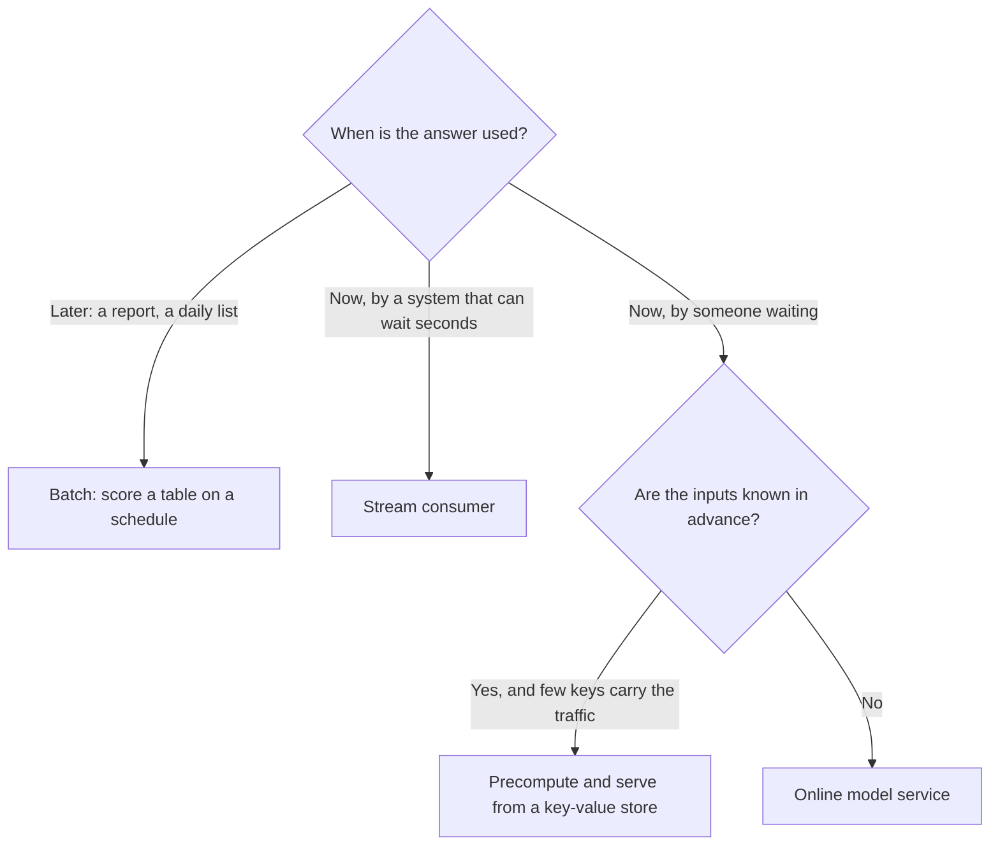
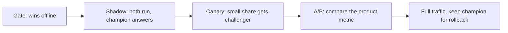

# Batch and online serving

Wilson tells a story in [*Machine Learning Engineering in Action* (Manning, 2022)](https://www.manning.com/books/machine-learning-engineering-in-action) about a hotel-deals model whose predictions were precomputed in batches. An A/B test showed nothing. The reason lay in the serving decision, not in the model: the precomputed lists covered under 5% of user sessions, so almost no user ever saw a prediction, and precomputing for everyone else would have blown up the storage bill. A model is only as good as the moment and the place its answer arrives. So the first question in serving is not which framework to use. It is when the consumer needs the answer, and everything else follows from that.

The chapter keeps the taxi model and walks through its three deployment shapes, batch, online and streaming, then measures the costs that separate them, and ends with how to roll out a new version without betting everyone on it.

## Three shapes

| Shape | Latency | Trigger | Course code | Output |
|---|---|---|---|---|
| **Web service** | Milliseconds, synchronous | HTTP request | `web-service/`, `web-service-mlflow/` | JSON response |
| **Streaming** | Seconds, asynchronous | Event on a stream | `streaming/` (Kinesis to Lambda to Kinesis) | Event on an output stream |
| **Batch** | Minutes to hours | Schedule | `batch/` (Prefect) | Parquet partition in S3 |

Pick by when the consumer needs the answer. The ride-duration estimate a rider sees is synchronous. A backend that reacts to predictions, such as dispatch or pricing, can be a stream consumer. Monthly analytics on predicted against actual is batch. Wilson's framing adds two axes to the choice, how soon a prediction must be used and how many are needed, and warns that a one-size-fits-all serving platform will suit nearly nobody. His general advice is that the simplest thing that meets the need wins, and that often means serving from a warehouse table.



Both models below are the course's, fitted on synthetic rides, with the shared `prepare_features` from the [feature store chapter](01-feature-stores.md) already normalising its types:

```python
import numpy as np, pandas as pd, duckdb, pickle, time, pathlib
from sklearn.feature_extraction import DictVectorizer
from sklearn.linear_model import LinearRegression
from sklearn.pipeline import make_pipeline

def prepare_features(ride):
    pu, do = int(ride["PULocationID"]), int(ride["DOLocationID"])
    return {"PU_DO": f"{pu}_{do}", "trip_distance": float(ride["trip_distance"])}

def month_of_rides(month, n=6_000, seed=0):
    rng = np.random.default_rng(seed + month)
    d = rng.gamma(2.0, 1.6, n)
    pu, do = rng.integers(1, 21, n), rng.integers(1, 21, n)
    return pd.DataFrame({
        "ride_id": [f"{month:02d}-{i:06d}" for i in range(n)],
        "PULocationID": pu, "DOLocationID": do, "trip_distance": d.round(2),
        "duration": (3 + 3.2 * d + 0.25 * pu + rng.normal(0, 3, n)).clip(1, 90).round(2)})

train = month_of_rides(1)
model = make_pipeline(DictVectorizer(), LinearRegression())
model.fit([prepare_features(r) for r in train.to_dict("records")], train.duration)
pickle.dump(model, open("model.pkl", "wb"))
MODEL_VERSION = "3"
print("model size", pathlib.Path("model.pkl").stat().st_size // 1024, "KB")
```

Output:

```text
model size 11 KB
```

## Batch: score a table

Batch scoring is the cheapest and the most reliable, and it should be the default. There is no service to keep up: if a job fails at 03:00 you rerun it at 04:00, and consumers read yesterday's table in the meantime. The design question is what a rerun does, and the answer comes from [the orchestration chapter](../../03-transform-and-orchestrate/notes/02-orchestrate.md): write to a deterministic location and replace it whole, so that rerunning never doubles rows.

```python
import pyarrow as pa, pyarrow.parquet as pq

def score_month(month, model, version, out="predictions"):
    df = month_of_rides(month, n=200_000)
    start = time.perf_counter()
    X = [prepare_features(r) for r in
         df[["PULocationID", "DOLocationID", "trip_distance"]].to_dict("records")]
    preds = model.predict(X)
    secs = time.perf_counter() - start
    result = pd.DataFrame({"ride_id": df.ride_id, "predicted_duration": preds.round(2),
                           "model_version": version, "scored_month": f"2024-{month:02d}"})
    # One directory per month, replaced whole, so a rerun cannot double the rows.
    pq.write_to_dataset(pa.Table.from_pandas(result, preserve_index=False), out,
                        partition_cols=["scored_month"],
                        existing_data_behavior="delete_matching")
    return secs, len(result)

secs, n = score_month(3, model, MODEL_VERSION)
print(f"scored {n:,} rides in {secs:.2f}s, {n / secs:,.0f} rides per second")
score_month(3, model, MODEL_VERSION)     # a rerun
score_month(4, model, MODEL_VERSION)
print(duckdb.sql("""
  SELECT scored_month, model_version, count(*) AS rows, round(avg(predicted_duration), 2) AS avg_pred
  FROM read_parquet('predictions/**/*.parquet', hive_partitioning = true)
  GROUP BY 1, 2 ORDER BY 1""").df().to_string(index=False))
```

Output:

```text
scored 200,000 rides in 0.20s, 983,838 rides per second
scored_month model_version   rows  avg_pred
     2024-03             3 200000     15.89
     2024-04             3 200000     15.86
```

March was scored twice and still has 200,000 rows, because `delete_matching` replaced the partition. Each row carries `model_version`, which costs a few bytes and makes the output a monitoring table for free: once durations arrive, you join on `ride_id` and can compute error per model version. The course's Prefect flow reads a month of trips from S3, loads the model by `RUN_ID`, and writes `taxi_type=/year=/month=/{run_id}.parquet`, with `actual_duration`, `predicted_duration`, `diff` and `model_version` on every row. It is worked through in the orchestration chapter because its lessons (logical dates, deterministic output paths, backfills) are orchestration lessons. The Spark version of the same job is `mapPartitions` in [the warehouse chapter](../../04-warehouse-lakehouse-streaming/notes/01-warehouse-and-store.md).

At about a million rows per second on one laptop, a sklearn linear model is not the bottleneck in this job. Reading, feature joins and writing are. The numbers vary by machine, so measure yours.

## Precompute or compute on request

The middle ground between batch and online is to precompute answers and serve them from a key-value store. It works when traffic concentrates on few keys, and fails when it does not, which is the hotel-deals story. You can estimate this before building anything:

```python
rng = np.random.default_rng(7)
n_requests = 500_000
skewed = pd.Series(rng.zipf(1.4, n_requests)).value_counts()
# Pickup zone, dropoff zone, hour and a rider segment: 265 * 265 * 24 * 10 keys.
even = pd.Series(rng.integers(0, 265 * 265 * 24 * 10, n_requests)).value_counts()
print("keys precomputed   skewed traffic   even traffic")
for k in (1_000, 10_000, 100_000):
    print(f"{k:>16,}   {skewed.iloc[:k].sum() / n_requests:>14.1%}"
          f"   {even.iloc[:k].sum() / n_requests:>12.1%}")
```

Output:

```text
keys precomputed   skewed traffic   even traffic
           1,000            95.1%           0.4%
          10,000            98.7%           3.5%
         100,000           100.0%          21.5%
```

The skewed column assumes a Zipf distribution, the even column a uniform one over zone pairs, hour and segment, so these are illustrations of the two extremes and not measurements of any taxi service. Your own request logs give the real curve. With skewed traffic, a thousand keys cover 95% of requests, and precomputing is a good plan. With even traffic, a hundred thousand keys cover about a fifth, and the rest of your users get no answer, or a fallback. Any time the input includes the current session, such as recent clicks, precomputing is not an option at all.

## Online: a web service

The course's service is Flask and gunicorn in Docker:

```python
from flask import Flask, request, jsonify

flask_app = Flask('duration-prediction')

@flask_app.route('/predict', methods=['POST'])
def predict_endpoint():
    ride = request.get_json()
    features = prepare_features(ride)
    pred = float(model.predict([features])[0])
    return jsonify({'duration': round(pred, 2), 'model_version': MODEL_VERSION})

reply = flask_app.test_client().post('/predict', json=ride)
print(reply.status_code, reply.get_json())
crash = flask_app.test_client().post('/predict', json={"PULocationID": "x"})
print(crash.status_code)
```

Output:

```text
200 {'duration': 17.33, 'model_version': '3'}
500
```

```dockerfile
# illustrative: course image, not built here because it needs the course's Pipfile
FROM python:3.11-slim
RUN pip install -U pip && pip install pipenv
WORKDIR /app
COPY [ "Pipfile", "Pipfile.lock", "./" ]
RUN pipenv install --system --deploy
COPY [ "predict.py", "lin_reg.bin", "./" ]
EXPOSE 9696
ENTRYPOINT [ "gunicorn", "--bind=0.0.0.0:9696", "predict:app" ]
```

`pipenv install --system --deploy` fails the build if `Pipfile.lock` is out of date, so the image has exactly the locked versions. `app.run(debug=True)` is for local use only; gunicorn serves in the container.

The bad request above returned a 500, which is a server fault, for what was really a client's mistake. Each of those would page the on-call. A schema at the boundary turns it into the right error and rejects bad values before they reach the model. FastAPI with pydantic does this, and its [test client](https://fastapi.tiangolo.com/tutorial/testing/) runs the app in-process, which is what is used here:

```python
from fastapi import FastAPI
from fastapi.testclient import TestClient
from pydantic import BaseModel, Field

class Ride(BaseModel):
    PULocationID: int = Field(ge=1, le=265)
    DOLocationID: int = Field(ge=1, le=265)
    trip_distance: float = Field(ge=0, le=500)

app = FastAPI()

@app.post("/predict")
def predict(ride: Ride):
    pred = model.predict([prepare_features(ride.model_dump())])
    return {"duration": round(float(pred[0]), 2), "model_version": MODEL_VERSION}

client = TestClient(app)
ok = client.post("/predict", json={"PULocationID": 130, "DOLocationID": 205, "trip_distance": 3.66})
bad = client.post("/predict", json={"PULocationID": "unknown", "DOLocationID": 205, "trip_distance": -1})
print(ok.status_code, ok.json())
print(bad.status_code, [e["loc"][-1] for e in bad.json()["detail"]])
```

Output:

```text
200 {'duration': 17.33, 'model_version': '3'}
422 ['PULocationID', 'trip_distance']
```

The ranges are not decoration. A distance of minus one or a zone of 9,000 would otherwise produce a confident number. And the response carries `model_version`, for the reason given in the [registry chapter](02-experiment-tracking-and-model-registry.md): monitoring must be able to tie each prediction to the model that made it.

The course's MLflow variant does this by loading from the tracking server's artifact store:

```python
# illustrative: needs an S3 bucket with MLflow artifacts and AWS credentials
RUN_ID = os.getenv('RUN_ID')
logged_model = f's3://mlflow-models-alexey/1/{RUN_ID}/artifacts/model'   # or f'runs:/{RUN_ID}/model'
model = mlflow.pyfunc.load_model(logged_model)
...
return jsonify({'duration': pred, 'model_version': RUN_ID})
```

Loading straight from S3 removes the runtime dependency on the tracking server: if MLflow is down, the service still starts.

### Where the milliseconds go

Measure before you optimise:

```python
ride = {"PULocationID": 130, "DOLocationID": 205, "trip_distance": 3.66}
direct, http = [], []
for _ in range(2000):
    t = time.perf_counter(); model.predict([prepare_features(ride)]); direct.append(time.perf_counter() - t)
for _ in range(500):
    t = time.perf_counter(); client.post("/predict", json=ride); http.append(time.perf_counter() - t)

def pct(x):
    return " ".join(f"p{q}={np.percentile(x, q) * 1000:6.2f}ms" for q in (50, 95, 99))
print("model.predict, one row:", pct(direct))
print("in-process HTTP stack: ", pct(http))
t = time.perf_counter()
model.predict([prepare_features(ride)] * 1000)
print(f"one call, 1000 rows:    {(time.perf_counter() - t) * 1000:6.2f}ms")
```

Output:

```text
model.predict, one row: p50=  0.07ms p95=  0.08ms p99=  0.09ms
in-process HTTP stack:  p50=  1.04ms p95=  1.30ms p99=  1.53ms
one call, 1000 rows:      0.50ms
```

These timings are from one laptop, in-process, with no network and no real concurrency, so read only their ratios. The model itself takes a tiny part of the request. A single prediction costs about 0.08 ms, and the web framework in front of it costs well over ten times that. In addition, one call with 1,000 rows takes less time than seven single-row calls, because the model works in vectors and most of a one-row call is overhead. This is why batching requests inside a service helps, and why swapping the model for a faster one often changes nothing.

The real cost is usually one step out: fetching features. The chapter on feature stores said an online store answers by key. Here is why you cannot use the offline store instead:

```python
import sqlite3
features = pd.DataFrame({"zone": np.arange(100_000),
                         "avg_duration_1h": np.random.default_rng(1).uniform(5, 40, 100_000)})
features.to_parquet("features.parquet")
db = sqlite3.connect("online.db")
features.to_sql("zone_features", db, index=False)
db.execute("CREATE UNIQUE INDEX pk ON zone_features(zone)")

def timed(fn, reps):
    t = []
    for i in range(reps):
        s = time.perf_counter(); fn(i * 7); t.append(time.perf_counter() - s)
    return np.percentile(t, 50) * 1000

kv = timed(lambda z: db.execute(
    "SELECT avg_duration_1h FROM zone_features WHERE zone = ?", (z,)).fetchone(), 2000)
scan = timed(lambda z: duckdb.sql(
    f"SELECT avg_duration_1h FROM 'features.parquet' WHERE zone = {z}").fetchall(), 100)
print(f"indexed key lookup, p50 {kv:.3f} ms")
print(f"file scan,          p50 {scan:.3f} ms, {scan / kv:,.0f} times slower")
```

Output:

```text
indexed key lookup, p50 0.003 ms
file scan,          p50 0.978 ms, 286 times slower
```

So a service with four feature lookups spends more on them than on the model, unless the lookups are indexed and close by. If you set a latency budget, say 50 ms at p99 for a rider-facing estimate, spend it on paper first: network, then features, then the model.

## Streaming: Kinesis to Lambda to Kinesis

When the consumer is another system, it does not need to hold a connection open. The course's stream service reads ride events, predicts, and writes to an output stream. This handler runs as written, because `TEST_RUN` skips the write to AWS:

```python
import base64, json

TEST_RUN = True

def lambda_handler(event, context):
    predictions_events = []
    for record in event['Records']:
        decoded_data = base64.b64decode(record['kinesis']['data']).decode('utf-8')
        ride_event = json.loads(decoded_data)
        ride, ride_id = ride_event['ride'], ride_event['ride_id']
        prediction = float(model.predict([prepare_features(ride)])[0])
        prediction_event = {'model': 'ride_duration_prediction_model',
                            'version': MODEL_VERSION,
                            'prediction': {'ride_duration': round(prediction, 2),
                                           'ride_id': ride_id}}
        if not TEST_RUN:
            kinesis_client.put_record(StreamName=PREDICTIONS_STREAM_NAME,
                                      Data=json.dumps(prediction_event),
                                      PartitionKey=str(ride_id))
        predictions_events.append(prediction_event)
    return {'predictions': predictions_events}

event = {"Records": [{"kinesis": {"data": base64.b64encode(json.dumps(
    {"ride_id": 156, "ride": ride}).encode()).decode()}}]}
print(lambda_handler(event, None))
```

Output:

```text
{'predictions': [{'model': 'ride_duration_prediction_model', 'version': '3', 'prediction': {'ride_duration': 17.33, 'ride_id': 156}}]}
```

| Detail | Why |
|---|---|
| `event['Records']` loop | [Lambda receives Kinesis records in batches](https://docs.aws.amazon.com/lambda/latest/dg/with-kinesis.html) |
| `base64.b64decode` | Kinesis delivers payloads base64-encoded |
| `PartitionKey=str(ride_id)` | Same role as a Kafka key: ordering per ride; see [the ingest chapter](../../02-ingest-and-modelling/notes/01-ingest.md) |
| `TEST_RUN` flag | Run the handler locally without writing to AWS; the course's best-practices module replaces this with an injectable callback |
| Container image `public.ecr.aws/lambda/python:3.11` | Lambda's 250 MB zip limit is too small for mlflow and sklearn |

```bash
# illustrative: the docker lines need the course's Dockerfile; the aws lines need an AWS account
docker build -t stream-model-duration:v1 .
docker run -it --rm -p 8080:8080 -e PREDICTIONS_STREAM_NAME="ride_predictions" \
  -e RUN_ID="..." -e TEST_RUN="True" -e AWS_DEFAULT_REGION="eu-west-1" stream-model-duration:v1
# local invoke
curl -X POST localhost:8080/2015-03-31/functions/function/invocations -d @event.json

aws kinesis put-record --stream-name ride_events --partition-key 1 --cli-binary-format raw-in-base64-out \
  --data '{"ride": {"PULocationID": 130, "DOLocationID": 205, "trip_distance": 3.66}, "ride_id": 156}'
SHARD_ITERATOR=$(aws kinesis get-shard-iterator --stream-name ride_predictions \
  --shard-id shardId-000000000000 --shard-iterator-type TRIM_HORIZON --query 'ShardIterator' --output text)
aws kinesis get-records --shard-iterator $SHARD_ITERATOR
```

Then push the image to ECR and point a Lambda at it with a Kinesis trigger. The best-practices module turns this setup into Terraform, in [the maturity chapter](05-mlops-maturity-and-best-practices.md). Stream delivery here is at least once, so a retried batch can repeat a prediction; the [semantics chapter](../../04-warehouse-lakehouse-streaming/notes/04-kafka-and-stream-semantics.md) explains why, and consumers should treat `ride_id` as an idempotency key.

## Rolling out a new model

A model that won the [gate](02-experiment-tracking-and-model-registry.md#the-gate-passive-retraining) has won on old data. Rollout is how it meets current traffic without risking all of it. [Shankar and colleagues' interviewees](https://arxiv.org/abs/2209.09125) used between one and four stages, in the order of test, canary, shadow and A/B, tied wherever possible to a product metric.



Here the challenger is deliberately weak, trained on only 200 rides, and the point is what you can see at each moment:

```python
# Shadow: both models see every request, only the champion's answer is returned.
challenger = make_pipeline(DictVectorizer(), LinearRegression())
small = train.sample(200, random_state=1)
challenger.fit([prepare_features(r) for r in small.to_dict("records")], small.duration)
live = month_of_rides(3, n=3000)
X = [prepare_features(r) for r in live.to_dict("records")]
champ, chall = model.predict(X), challenger.predict(X)
diff = np.abs(champ - chall)
print(f"shadow, no labels yet: mean |difference| {diff.mean():.2f} min, "
      f"p99 {np.percentile(diff, 99):.2f} min")
print(f"shadow, labels in:     champion RMSE {np.sqrt(((champ - live.duration) ** 2).mean()):.2f}, "
      f"challenger {np.sqrt(((chall - live.duration) ** 2).mean()):.2f}")

# Canary: route by a stable hash, so a user stays on one side across requests.
import hashlib
def bucket(key):
    return int(hashlib.sha256(key.encode()).hexdigest(), 16) % 100

share = np.mean([bucket(r) < 5 for r in live.ride_id])
print(f"canary at 5%: {share:.1%} of rides", "| stable:", bucket("03-000042") == bucket("03-000042"))
```

Output:

```text
shadow, no labels yet: mean |difference| 1.74 min, p99 5.81 min
shadow, labels in:     champion RMSE 3.08, challenger 3.68
canary at 5%: 4.7% of rides | stable: True
```

Shadow mode gives you a difference between models at once, before any label exists, and it is often the first alarm for a broken deployment. Accuracy comes only when labels arrive. Here they show the challenger worse, 3.68 against 3.08, and nobody was affected.

Canary routing hashes a stable key, not a random draw per request, so the same user stays on one side of the comparison. Shadow has a limit worth knowing: if a model's output changes what happens next, as it does in a recommender, a shadow model never sees the results of its own choices. The interviewees called it impossible in such feedback loops. Then only a real A/B test will do.

The study adds two things to plan for. Keep a **fallback**: a previous model or a rule that answers when the model fails. And expect the gap: engineers reported production performance falling short of what offline evaluation promised. [Paleyes and colleagues' survey (ACM Computing Surveys, 2022)](https://arxiv.org/abs/2011.09926) makes the same point about continuous delivery for ML, whose changes can come from three axes, code, model and data, while conventional CD considers only the first.

## Run labels

| Material | Needs |
|---|---|
| Course `04-deployment/web-service/` | Docker; runs offline with the bundled `lin_reg.bin` |
| Course `04-deployment/web-service-mlflow/` | MLflow artifacts in S3 and AWS credentials |
| Course `04-deployment/streaming/` | Docker for the local Lambda emulator; AWS Kinesis, ECR and Lambda for the real thing |
| Course `04-deployment/batch/` | Legacy: Prefect 2 and S3 |
| The Python in this chapter | `uv run --with duckdb --with pandas --with scikit-learn --with pyarrow --with fastapi --with httpx --with flask python file.py`, no cloud |

## Pitfalls

- **Going online by default.** A service needs on-call, a latency budget and a fallback. If the consumer can read a table, let it.
- **No model version in the response.** Then a bad prediction cannot be traced, and nothing can be compared per version.
- **Appending batch output.** A rerun doubles rows and every downstream sum. Replace the partition.
- **Precomputing without measuring key coverage.** You will find out in the A/B test, as the hotel-deals team did.
- **Random canary per request.** One user sees two models, and the comparison is polluted. Hash a stable key.
- **Measuring the model and calling it latency.** Features, network and serialisation are usually larger.
- **No input validation.** A model always returns a number. A schema at the boundary is the cheapest guard you can write.
- **Assuming exactly-once from a stream.** Retries repeat predictions. Make the consumer idempotent.

## Try it

1. Extend `score_month` so that a partition stores the model's alias as well as its version. Why is the version the one to join on?
2. Using `coverage`, find the Zipf exponent at which 10,000 precomputed keys cover 80% of requests. What would you check in your logs to find your own?
3. Add a batching layer to `predict`: collect requests for 5 ms and call the model once. Using the latency figures above, estimate the saving per request at 200 concurrent requests. Is it worth it for this model?

<details><summary>Answers</summary>

1. The alias moves, so last month's rows would say `champion` and mean something else today. The version is immutable, which is what a join needs. Storing both is harmless, as the alias records intent.
2. Search by rerunning the cell. For your own traffic, sort keys by request count and plot cumulative share against number of keys, which is exactly this table from real logs.
3. A call with 1,000 rows took about 0.5 ms, so the model share falls from about 0.08 ms per request to a few microseconds, but the framework costs over 1 ms per request and the added wait is 5 ms. Latency gets worse. Batching pays off when the model is expensive per call and cheap per row, as with a neural network on a GPU, and not for a linear model on a CPU.

</details>

## Interview checklist

| Question | Answer |
|---|---|
| How do you choose batch, stream or online? | By when the consumer needs the answer. Batch unless someone is waiting, stream if a system can wait seconds, online if a person or synchronous call waits |
| Why is batch the default? | No service to keep up, failures are reruns, consumers read the last good table |
| What makes batch scoring safe to rerun? | A deterministic output location replaced whole, with the version on each row |
| When does precomputing fail? | When traffic is spread across many keys, or the inputs include session data not known in advance |
| Where does online latency go? | Usually feature fetches, network and framework; rarely the model. Measure |
| What is shadow deployment, and when can't you use it? | Both models see requests, only the champion answers. It breaks down when predictions affect future data, since the shadow never sees the results of its own decisions |
| Why hash for a canary? | So a user stays on one side and the comparison stays clean |
| Why return the model version? | To join predictions to the model that made them, for monitoring and for incidents |

## Next

[Drift](04-drift.md): the model is live and answering. Next, how you would know that the world has moved under it.
