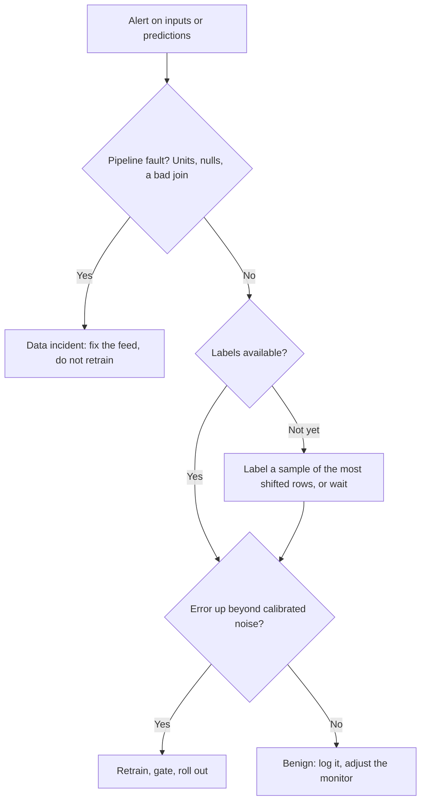

# Drift

Models fail differently from services. A crashed service throws errors. A stale model keeps returning numbers in the same format at the same speed, and its dashboards stay green while its answers get worse. Rabanser, Günnemann and Lipton open their paper on the subject, [*Failing Loudly* (NeurIPS 2019)](https://arxiv.org/abs/1810.11953), with exactly this observation: machine learning systems fail silently. The obvious response is a drift monitor, and teams that add one often meet the opposite problem, an alarm on every feature every day until someone mutes it. This chapter builds the tests by hand, shows why they fire when nothing has happened and stay quiet when something has, and ends where the literature does: drift matters only when it costs you something, so most of the work is measuring that cost.

[The monitoring chapter](../../05-quality-and-observability/notes/02-monitors-and-lineage.md) in the previous pillar covers data monitors in general, including a run of Evidently against this kind of data. Here the question is narrower: is this model still right?

## What is drifting

The vocabulary varies across sources, and the distinction matters more than the names. [Gama and colleagues' survey (ACM Computing Surveys, 2014)](http://eprints.bournemouth.ac.uk/22491/) defines drift as a change in the joint distribution $p(X, y)$ and separates two cases. **Real concept drift** changes $p(y \mid X)$: the same inputs now mean something else, whether or not the inputs have moved. **Virtual drift** changes $p(X)$ and leaves $p(y \mid X)$ alone. Only changes that affect the decision need any adaptation. [Imbalance, errors and drift](../../../data-science/01-classical-ml/notes/10-imbalance-errors-and-drift.md#drift-when-the-world-moves) in data science simulates these shifts on a credit model and measures what each one does to it.

[Wilson's *Machine Learning Engineering in Action* (Manning, 2022)](https://www.manning.com/books/machine-learning-engineering-in-action) gives a practitioner's table, which maps well onto what you can actually monitor:

| Drift | What moved | Taxi example | Seen without labels? |
|---|---|---|---|
| Feature | An input's distribution | Trips get longer | Yes |
| Label | The target's distribution | Durations rise overall | No |
| Concept | The relationship from inputs to target | A mile takes longer in new traffic | No |
| Prediction | The model's output distribution | Predicted durations rise | Yes |
| Reality | The world changes suddenly | A lockdown | Partly |
| Feedback | The model's output changes its own future data | A route suggestion moves the traffic | Partly |

Two more cases need naming, since drift is often blamed for them. **A broken feed** is not drift at all. Wilson's example is a temperature feed that switched from Fahrenheit to Celsius, and the same thing happens in our taxi data when miles become kilometres. And [the patterns Gama lists](http://eprints.bournemouth.ac.uk/22491/) are worth knowing, as they lead to different responses: sudden, incremental, gradual and reoccurring, with a single outlier not counting as drift at all.

The interview study ranks these by how often they actually bite, and its order surprises people. In [Shankar and colleagues' interviews (2022)](https://arxiv.org/abs/2209.09125), feedback delays came first, then "unnatural" drift, meaning missing or corrupt data, then natural drift, about which those engineers were relatively relaxed since they retrain often. So fix your pipeline before you buy a drift detector.

## The tests, by hand

We use a reference window from training and a current window, on the taxi data's distance and pickup zone. A linear model is fitted on the reference.

```python
import numpy as np, pandas as pd
from scipy import stats
from sklearn.linear_model import LinearRegression

def rides(n, seed, dist_scale=1.6, slope=3.2, unit=1.0, zone_probs=None):
    rng = np.random.default_rng(seed)
    d = rng.gamma(2.0, dist_scale, n)
    zone = rng.choice(["airport", "centre", "suburb"], n,
                      p=zone_probs or [0.1, 0.6, 0.3])
    duration = 3 + slope * d + rng.normal(0, 3, n)
    return pd.DataFrame({"trip_distance": d * unit, "zone": zone,
                         "duration": duration.clip(1, 90)})

reference = rides(5_000, seed=1)
model = LinearRegression().fit(reference[["trip_distance"]], reference.duration)
print(reference.describe().loc[["mean", "std"]].round(2).to_string())
```

Output:

```text
      trip_distance  duration
mean           3.16     13.12
std            2.23      7.66
```

Three standard tests cover most needs. The [Kolmogorov-Smirnov test](https://scipy.github.io/devdocs/reference/generated/scipy.stats.ks_2samp.html) compares two numeric samples and needs no binning. A chi-squared test does the same for categories. The population stability index compares binned shares and returns a magnitude, not a p-value:

$$\mathrm{PSI} = \sum_i (c_i - r_i) \ln\frac{c_i}{r_i}$$

where $r_i$ and $c_i$ are the reference and current shares in bin $i$. [Credit scoring](../../../data-analytics/06-applied-analyses/notes/02-credit-scoring.md#keep-watching-it) in data analytics computes the same statistic on a model's scores. Run all of them on four scenarios:

```python
def psi(ref, cur, bins=10, eps=1e-6):
    """Population stability index, with bin edges from the reference window."""
    edges = np.unique(np.quantile(ref, np.linspace(0, 1, bins + 1)))
    edges[0], edges[-1] = -np.inf, np.inf
    r = np.histogram(ref, edges)[0] / len(ref) + eps
    c = np.histogram(cur, edges)[0] / len(cur) + eps
    return float(((c - r) * np.log(c / r)).sum())

def chi2_p(ref, cur):
    table = pd.concat([ref.value_counts(), cur.value_counts()], axis=1).fillna(0)
    return stats.chi2_contingency(table.values)[1]

SCENARIOS = {
    "no change":         dict(),
    "miles to km":       dict(unit=1.609),
    "longer trips, +5%": dict(dist_scale=1.68),
    "airport share up":  dict(zone_probs=[0.14, 0.56, 0.30]),
}
rows = []
for name, kw in SCENARIOS.items():
    cur = rides(5_000, seed=2, **kw)
    rows.append({"scenario": name,
                 "KS p": stats.ks_2samp(reference.trip_distance, cur.trip_distance).pvalue,
                 "PSI": psi(reference.trip_distance, cur.trip_distance),
                 "zone chi2 p": chi2_p(reference.zone, cur.zone)})
print(pd.DataFrame(rows).to_string(index=False, float_format=lambda x: f"{x:.4f}"))
```

Output:

```text
         scenario   KS p    PSI  zone chi2 p
        no change 0.3154 0.0063       0.9288
      miles to km 0.0000 0.4300       0.9288
longer trips, +5% 0.0003 0.0152       0.9288
 airport share up 0.3154 0.0063       0.0000
```

These behave as they should. With no change nothing fires, the unit change is enormous on every measure, and a chi-squared test catches the category shift that the numeric tests cannot see. The interesting row is the 5% increase: KS says p = 0.0003 and PSI says 0.015. One says it is highly significant and the other says it is barely there, and both are correct.

## Significant is not the same as large

A p-value answers "could this be chance?", and with enough data the answer to that is nearly always no:

```python
print("PSI and KS on the same 5% shift, by window size")
for n in (200, 1_000, 5_000, 50_000, 500_000):
    a, b = rides(n, seed=10), rides(n, seed=11, dist_scale=1.68)
    print(f"n={n:>7,}  KS p={stats.ks_2samp(a.trip_distance, b.trip_distance).pvalue:.2e}"
          f"  PSI={psi(a.trip_distance, b.trip_distance):.4f}")
```

Output:

```text
PSI and KS on the same 5% shift, by window size
n=    200  KS p=4.30e-03  PSI=0.1846
n=  1,000  KS p=1.12e-02  PSI=0.0286
n=  5,000  KS p=8.75e-05  PSI=0.0125
n= 50,000  KS p=3.69e-15  PSI=0.0041
n=500,000  KS p=8.07e-164  PSI=0.0047
```

The shift is the same in each row, a 5% increase in mean distance, and the p-value falls by over 160 orders of magnitude as the window grows. On a busy model, every feature will be "significantly" different from its reference every day. PSI estimates a magnitude, so it stabilises around 0.004 at large windows. But look at the small windows: PSI at n=200 is 0.18, because at that size it mostly measures noise. To see how much, here is PSI when nothing has changed at all:

```python
print("PSI with no shift at all: 200 pairs of windows at each size")
for n in (200, 1_000, 5_000):
    null = [psi(rides(n, seed=1000 + 2 * i).trip_distance,
                rides(n, seed=1001 + 2 * i).trip_distance) for i in range(200)]
    print(f"n={n:>6,}  median={np.median(null):.3f}  95th percentile={np.percentile(null, 95):.3f}")
```

Output:

```text
PSI with no shift at all: 200 pairs of windows at each size
n=   200  median=0.082  95th percentile=0.175
n= 1,000  median=0.017  95th percentile=0.035
n= 5,000  median=0.003  95th percentile=0.006
```

The common industry thresholds for PSI, 0.1 for "watch" and 0.25 for "act", are conventions, and I could not trace them to any study. This table shows why you should not use them blindly: at 200 rows, a null window often reaches a level that would mean something at 5,000. Calibrate on your own windows. Run the metric on pairs of historical windows where you know nothing went wrong, and set the alarm above that distribution.

## Many features, many false alarms

Now the failure that causes teams to mute their monitors. With 100 features tested daily at α = 0.05 and no drift whatsoever:

```python
# 100 features with no drift at all, 200 daily runs.
rng = np.random.default_rng(3)
K, DAYS, ALPHA = 100, 200, 0.05
alarm_days = alarm_bonf = 0
for _ in range(DAYS):
    ps = np.array([stats.ks_2samp(rng.normal(size=500), rng.normal(size=500)).pvalue
                   for _ in range(K)])
    alarm_days += (ps < ALPHA).any()
    alarm_bonf += (ps < ALPHA / K).any()
print(f"per-feature test at alpha 0.05: alarm on {alarm_days} of {DAYS} days")
print(f"Bonferroni, alpha / {K}:        alarm on {alarm_bonf} of {DAYS} days")
print(f"theory for independent tests: {1 - 0.95 ** K:.3f} and {1 - (1 - 0.05 / K) ** K:.3f}")
```

Output:

```text
per-feature test at alpha 0.05: alarm on 200 of 200 days
Bonferroni, alpha / 100:        alarm on 10 of 200 days
theory for independent tests: 0.994 and 0.049
```

An alarm on every single day, from data with nothing wrong. The interview study reports exactly this as a pain point: with many columns, the chance that one violates a threshold is high, and false positives lead to alert fatigue. The simplest defence is the one Rabanser evaluates: test each dimension, then apply a Bonferroni correction, rejecting only if the smallest p-value falls below $\alpha / K$. Here it brings the false alarm rate to 10 days in 200, matching the theory. A correction costs you power, since small shifts on one feature get harder to catch. Practical teams also limit monitors to the features that carry the model.

## When per-feature tests are not enough

Per-feature tests cannot see a change in how features relate. Here both marginals stay normal but the correlation between distance and fare collapses. This is the classic sign of a corrupted join: each column looks fine, and the rows no longer belong together.

```python
from sklearn.ensemble import HistGradientBoostingClassifier as HGB
from sklearn.model_selection import train_test_split

def correlated(n, seed, rho):
    rng = np.random.default_rng(seed)
    x = rng.multivariate_normal([0, 0], [[1, rho], [rho, 1]], n)
    return pd.DataFrame(x, columns=["trip_distance_z", "fare_z"])

def domain_classifier(a, b, seed=0):
    X = pd.concat([a, b]); y = np.r_[np.zeros(len(a)), np.ones(len(b))]
    Xtr, Xte, ytr, yte = train_test_split(X, y, test_size=.5, random_state=seed, stratify=y)
    acc = (HGB(max_depth=3, random_state=seed).fit(Xtr, ytr).predict(Xte) == yte)
    p = stats.binomtest(int(acc.sum()), len(acc), 0.5, alternative="greater").pvalue
    return acc.mean(), p

a, b = correlated(4_000, 1, 0.8), correlated(4_000, 2, 0.0)
bonf = 0.05 / 2
for col in a:
    print(f"{col:<16} KS p={stats.ks_2samp(a[col], b[col]).pvalue:.3f}  (Bonferroni line {bonf})")
acc, p = domain_classifier(a, b)
print(f"domain classifier accuracy {acc:.3f}, binomial p={p:.1e}")
acc, p = domain_classifier(a, correlated(4_000, 3, 0.8))
print(f"same again, no shift:      {acc:.3f}, binomial p={p:.2f}")
```

Output:

```text
trip_distance_z  KS p=0.888  (Bonferroni line 0.025)
fare_z           KS p=0.610  (Bonferroni line 0.025)
domain classifier accuracy 0.680, binomial p=4.0e-117
same again, no shift:      0.492, binomial p=0.84
```

Each KS test sees nothing. A **domain classifier** sees it at once: label reference rows 0 and current rows 1, train a classifier on half, and test its accuracy on the other half with a binomial test against chance. If it can tell the windows apart, they differ. It also tells you how: its most confident rows show what changed. The same classifier on two windows from the same distribution scores 0.492, which is chance, so its alarm can be trusted.

What should you use by default? *Failing Loudly* compares these systematically on image data (MNIST and CIFAR-10) at α = 0.05 over five random splits. Its findings run against intuition. Aggregated univariate tests did about as well as multivariate ones. The best detector was **BBSDs**, which reduces the inputs to the softmax outputs of the classifier you already have, then runs a KS test on each with a Bonferroni correction. Averaged across all the simulated shifts, it reached 0.19 accuracy at detecting shift with 10 samples, 0.47 with 100, 0.70 with 1,000 and 0.79 with 10,000, against 0.03, 0.36, 0.54 and 0.72 for the same tests on raw features. The domain classifier was weak with few samples, bad below about 100, though useful for describing the shift once detected. Small shifts, and shifts touching only 10% of samples, stayed hard even for the best detectors. BBSDs detected a small-intensity shift only 14% of the time at 100 samples and 54% at 10,000. Keep the limits in mind: these results are for images. The authors name NLP and graphs as open, and tabular data is untested too. They also leave online detection open, so the study does not cover testing every day. They call the BBSDs result good news for practitioners, because a classifier with soft predictions can double as a shift detector, even retrospectively. Our reading is a practical default: test your predictions first, since that needs no new infrastructure. Use soft outputs where you have them, because the same study's chi-squared test on hard predictions reached only 0.46 at 1,000 samples.

## Drift that doesn't matter, and damage with no drift

Two experiments show why the input tests alone cannot be the monitor. In the first, the inputs do not move at all; only a mile takes longer:

```python
# The inputs do not move at all. A mile simply takes longer.
cur = rides(5_000, seed=2, slope=4.5)
print(f"KS on distance, p={stats.ks_2samp(reference.trip_distance, cur.trip_distance).pvalue:.3f}")
print(f"KS on predictions, p="
      f"{stats.ks_2samp(model.predict(reference[['trip_distance']]), model.predict(cur[['trip_distance']])).pvalue:.3f}")
mae = lambda df: np.abs(df.duration - model.predict(df[["trip_distance"]])).mean()
print(f"MAE on labels: reference {mae(reference):.2f} -> current {mae(cur):.2f} minutes")
```

Output:

```text
KS on distance, p=0.315
KS on predictions, p=0.315
MAE on labels: reference 2.35 -> current 4.71 minutes
```

Inputs show no drift. Predictions show none either, with an identical p-value, because for this model they are a monotonic function of the one input. And the error has doubled. This is Gama's real concept drift, invisible without performance feedback, which means a metric on fresh labels ([model evaluation](../../../data-science/01-classical-ml/notes/04-model-evaluation.md) in data science). The second experiment reverses it:

```python
# Now the inputs move, but the relationship holds and the model is linear.
cur = rides(5_000, seed=2, dist_scale=2.4)
print(f"KS on distance, p={stats.ks_2samp(reference.trip_distance, cur.trip_distance).pvalue:.1e}")
print(f"MAE on labels: reference {mae(reference):.2f} -> current {mae(cur):.2f} minutes")
```

Output:

```text
KS on distance, p=2.7e-113
MAE on labels: reference 2.35 -> current 2.36 minutes
```

The KS test screams at p = 2.7e-113, and the error has not moved, because the relationship holds and the model is linear. This is what *Failing Loudly* found in practice. Its tests flagged the original MNIST train and test split. Many of the domain classifier's most anomalous samples were sixes, and a follow-up KS test on the sixes alone gave p = 2.7e-10 against a Bonferroni threshold of 6.3e-5, yet its malignancy check declared that shift harmless. Rotation in COIL-100 was detected and harmless too. Its authors split the job into three: detect the shift, characterise it, and judge whether it is malignant. They approximate the last, as a preliminary heuristic that assumes a labelling function, by labelling a few of the samples the domain classifier most confidently assigns to the target, needing two to three orders of magnitude fewer labels than the whole.

A tree-based model would give a different result in the second experiment, which is worth remembering. Wilson notes that trees bucket out-of-range values while linear models extrapolate, so how a model behaves off its training range depends on its type. Benign drift for one model is not benign for all.



The first branch matters most. Retraining on a broken feed teaches the model the bug, and [the incident playbook](../../05-quality-and-observability/notes/03-incident-playbooks.md) applies.

## Monitoring error when labels arrive

If labels do arrive, the error stream is the best signal there is, and it can be tested online. Gama's survey covers the detectors. Sequential analysis keeps a running statistic that needs no stored window; CUSUM's form is $g_t = \max(0, g_{t-1} + x_t - \delta)$ with an alarm when $g_t > \lambda$, and Page-Hinkley is a close variant. Statistical process control methods such as DDM warn at two standard deviations above the best error seen, and act at three. Sequential and SPC methods take constant memory, while two-window tests need memory that grows with the window. Here is Page-Hinkley on the absolute error, with labels arriving ride by ride:

```python
class PageHinkley:
    """Page-Hinkley: alarm when the running sum rises lambda above its minimum."""
    def __init__(self, delta=0.1, threshold=100.0):
        self.delta, self.threshold = delta, threshold
        self.n = self.mean = self.cum = self.low = 0.0
    def update(self, x):
        self.n += 1
        self.mean += (x - self.mean) / self.n
        self.cum += x - self.mean - self.delta
        self.low = min(self.low, self.cum)
        return self.cum - self.low > self.threshold

def error_stream(seed, change_at=3000, n=6000, new_slope=4.5):
    rng = np.random.default_rng(seed)
    d = rng.gamma(2.0, 1.6, n)
    slope = np.where(np.arange(n) < change_at, 3.2, new_slope)
    y = 3 + slope * d + rng.normal(0, 3, n)
    return np.abs(y - model.predict(pd.DataFrame({"trip_distance": d})))

def first_alarm(errors, **kw):
    ph = PageHinkley(**kw)
    for i, e in enumerate(errors):
        if ph.update(e):
            return i
    return None

print("alarm at ride", first_alarm(error_stream(5)), "(change at ride 3000)")
print("false alarm on a stable stream:", first_alarm(error_stream(6, change_at=10**9)))
```

Output:

```text
alarm at ride 3032 (change at ride 3000)
false alarm on a stable stream: None
```

The tolerance `delta` and threshold `lambda` set the trade-off. Gama's list of what to evaluate is: delay of detection, and false alarm rate measured on data without drift. Measure both across many streams:

```python
print("threshold  fired before the change  mean delay after it  false alarms, stable")
for lam in (15, 50, 100, 200, 400):
    fired = [first_alarm(error_stream(s), threshold=lam) for s in range(20)]
    early = sum(f is not None and f < 3000 for f in fired)
    late = [f - 3000 for f in fired if f is not None and f >= 3000]
    false = sum(first_alarm(error_stream(100 + s, change_at=10**9), threshold=lam) is not None
                for s in range(20))
    delay = f"{np.mean(late):.0f}" if late else "-"
    print(f"{lam:>9}  {early:>16} of 20  {delay:>19}  {false:>11} of 20")
```

Output:

```text
threshold  fired before the change  mean delay after it  false alarms, stable
       15                20 of 20                    -           20 of 20
       50                14 of 20                   21           20 of 20
      100                 1 of 20                   43            1 of 20
      200                 0 of 20                   86            0 of 20
      400                 0 of 20                  179            0 of 20
```

There is no free setting. Each doubling of the threshold roughly doubles the delay, from 43 rides at 100 to 179 at 400, while a threshold of 50 fires before the change on most streams. On a stream of known stable error you can choose the lowest threshold with no false alarms, and you can read the cost directly.

All of that assumes labels arrive. Often they do not, and Gama gives the standard example of credit scoring, with labels known a year later. That delay decides what is possible:

```python
hours_delay = {"taxi duration, label at dropoff": 0.5, "fraud, chargeback": 24 * 45,
               "loan default": 24 * 365}
rides_per_hour = 450
print(f"predictions served before the first label, at {rides_per_hour} an hour")
for k, h in hours_delay.items():
    print(f"{k:<34} {h:>8.1f} h  {int(h * rides_per_hour):>10,} predictions")
```

Output:

```text
predictions served before the first label, at 450 an hour
taxi duration, label at dropoff         0.5 h         225 predictions
fraud, chargeback                    1080.0 h     486,000 predictions
loan default                         8760.0 h   3,942,000 predictions
```

The rate of 450 an hour is invented for scale, but the shape is real. For a taxi model, performance monitoring works. For a loan model it is a retrospective, and you must rely on input and prediction monitors, which we have just seen can mislead in both directions, plus proxies. The interviews say delays often go unaccounted for: one engineer's labels took at least two weeks, and this was the most frequent failure mode the group described.

## What to do about it: retraining policy

Gama separates blind adaptation, which retrains on a schedule, from informed adaptation, which waits for a trigger. Blind forgets at a constant speed whether or not anything has changed; informed reacts only after a signal. Compare them on both shapes of change, with a simple rule: retrain when the month's error is 20% worse than the first quarter's.

```python
def simulate(policy, slopes, seed=0, n=2_000):
    """Monthly MAE of one retraining policy, with labels a month late."""
    rng = np.random.default_rng(seed)
    errors, retrains, current = [], 1, None
    for m, slope in enumerate(slopes):
        d = rng.gamma(2.0, 1.6, n)
        df = pd.DataFrame({"trip_distance": d,
                           "duration": 3 + slope * d + rng.normal(0, 3, n)})
        if current is None:            # month 0 trains the first model
            current = LinearRegression().fit(df[["trip_distance"]], df.duration)
            continue
        errors.append(np.abs(df.duration - current.predict(df[["trip_distance"]])).mean())
        if policy(errors):
            current = LinearRegression().fit(df[["trip_distance"]], df.duration)
            retrains += 1
    return errors, retrains

never = lambda e: False
monthly = lambda e: True
triggered = lambda e: e[-1] > 1.2 * np.mean(e[:3])     # 20% worse than the first quarter

sudden = [3.2] * 6 + [4.5] * 7
gradual = list(np.linspace(3.2, 4.5, 13))
for label, slopes in [("sudden change in month 6", sudden), ("gradual change", gradual)]:
    print(label)
    print("  policy      retrains  mean MAE  worst month")
    for name, policy in [("never", never), ("monthly", monthly), ("triggered", triggered)]:
        errors, r = simulate(policy, slopes)
        print(f"  {name:<11} {r:>8}  {np.mean(errors):>8.2f}  {max(errors):>11.2f}")
```

Output:

```text
sudden change in month 6
  policy      retrains  mean MAE  worst month
  never              1      3.72         4.72
  monthly           13      2.58         4.67
  triggered          2      2.58         4.64
gradual change
  policy      retrains  mean MAE  worst month
  never              1      3.34         4.67
  monthly           13      2.42         2.48
  triggered          3      2.71         3.11
```

On a sudden change, the trigger matches monthly retraining on mean error with 2 trainings instead of 13 (the counts include the first fit). On a gradual change, it lags, since drift has to accumulate to 20% before anything happens, and monthly wins by 2.42 to 2.71. Note also the worst month under the sudden change: 4.67 for monthly, 4.64 for triggered. No policy avoids the first month after a sudden change, because each one only learns about it from that month's labels. This is why fallback and rollback belong in the plan.

So which? The evidence in this chapter's sources favours starting blind. Wilson advises passive retraining, and active only when passive fails, as active systems are more complex. The interviews report cadence running from every few hours to every few months, set without any scientific procedure; one team's daily schedule simply reflected practice, and another's matched its 3 to 4 hour training time. This argues for a schedule you can defend by experiment, not for a clever trigger. Whichever you choose, a retrain goes through the [gate](02-experiment-tracking-and-model-registry.md#the-gate-passive-retraining), because a triggered retrain on bad data is a machine for shipping incidents.

Also remember that anything fitted is a model too. An interviewee's phrase was that any function summarising the data needs refitting, including histogram buckets and vocabularies. Our reference window for PSI ages in the same way.

## Pitfalls

- **Testing every feature at α = 0.05.** You have built an alarm that rings daily. Correct for multiple tests and restrict to features that matter.
- **Reading a small p-value as a large shift.** On big windows everything is significant. Report a magnitude too.
- **Copying PSI thresholds.** Calibrate on historical windows; small windows are noisy.
- **Monitoring only inputs.** Concept drift leaves inputs alone. Get labels or proxies.
- **Retraining on every alert.** If the feed is broken, you teach the model the bug. Check the pipeline first.
- **A frozen reference window.** After a successful retrain, the reference must move with the training set.
- **Ignoring seasonality.** Monday differs from Saturday. Compare with a matching window, or weekly patterns will look like drift. A reoccurring concept is not a new one.
- **Assuming you have labels on time.** Write down the delay per model. If it is long, plan around proxies and sampled labelling.
- **A single test window for a replayed evaluation under feedback.** Gama notes that when the system influences its own data, replaying history cannot compare adaptation methods properly.

## Try it

1. Run `false_alarms` with windows of 50 rows rather than 500. Does Bonferroni still hold its 5%? Why?
2. Add a tree model to `benign`, using `DecisionTreeRegressor(max_depth=5)`. Does the error stay flat when distances move beyond the training range?
3. Replace `triggered` with one based on Page-Hinkley over monthly errors, and compare on both change shapes. What goes wrong with only 12 data points?

<details><summary>Answers</summary>

1. It holds, and errs on the safe side: 3 alarm days of 200 when tested. KS p-values stay valid under the null at any sample size, and at small sizes they are discrete and so somewhat conservative. What falls is power: a real shift becomes much harder to catch.
2. Tested here, its error rises from 2.32 to 2.44, against a linear model that stays flat. About 7% of current rides lie beyond the reference's 99th percentile, and past its last split a tree predicts a constant, so the long trips get underestimated. The same drift is fully benign for the linear model because its form happens to match the data.
3. Twelve points give the detector almost no evidence: a threshold low enough to fire on time also fires on noise. Sequential detectors need a dense stream, and monthly aggregates throw that away. Feed it ride-level errors instead.

</details>

## Interview checklist

| Question | Answer |
|---|---|
| What is the difference between concept and data drift? | Data drift moves $p(X)$. Concept drift moves $p(y \mid X)$. Only the second needs labels to see, and only changes affecting the decision need action |
| Why does a drift monitor fire on healthy data? | Many tests at a fixed α guarantee false alarms, and large samples make trivial shifts significant |
| How do you reduce false alarms? | Bonferroni or similar, restrict to important features, report magnitude, and calibrate thresholds on historical windows |
| What can univariate tests not see? | A change in how features relate. A domain classifier can |
| What did *Failing Loudly* find? | On images, aggregated univariate tests did as well as multivariate, testing the existing classifier's softmax outputs was best, and half the simulated shift types were identified as harmless |
| Can you detect concept drift without labels? | Generally not when inputs stay put. It needs performance feedback, or labels on a sample |
| What do you do on a drift alert? | Check for a pipeline fault, then measure cost with labels if possible, then retrain, gate and roll out |
| Scheduled or triggered retraining? | Start scheduled, since it is simple. Triggers save retrains on sudden change, lag on gradual change, and need good monitoring |

## Next

[The MLOps maturity model](05-mlops-maturity-and-best-practices.md): each chapter so far added a piece. The last one asks how much of this a given team should automate, and how to test it.
