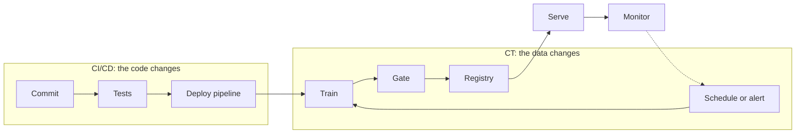
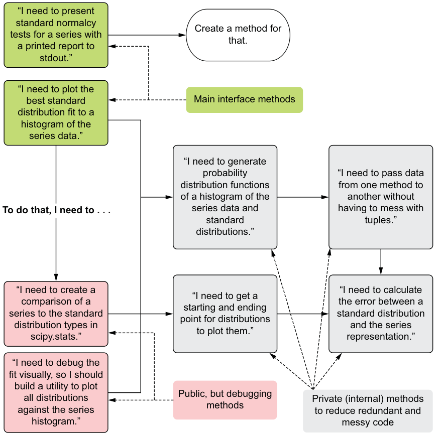
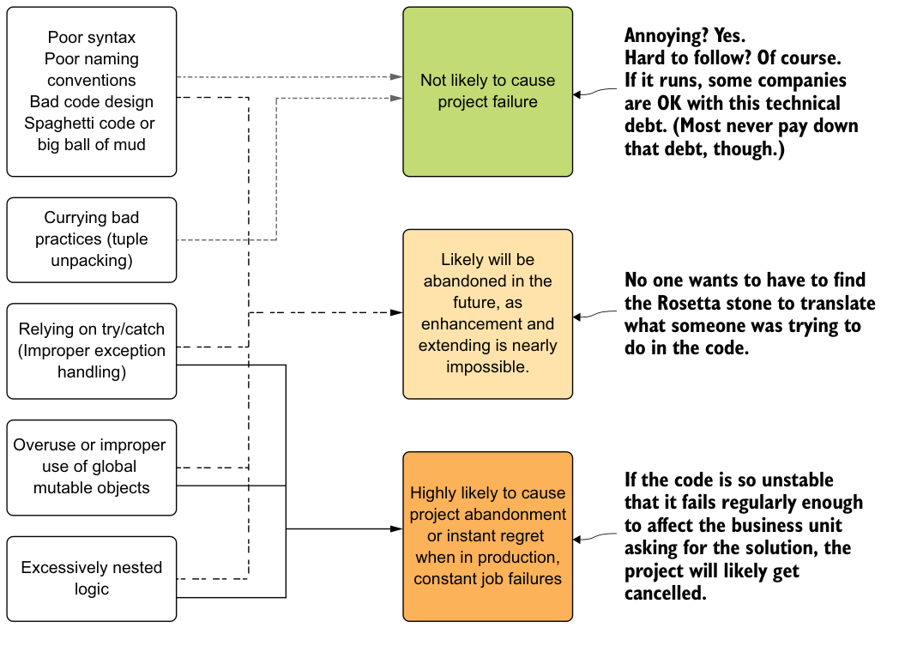
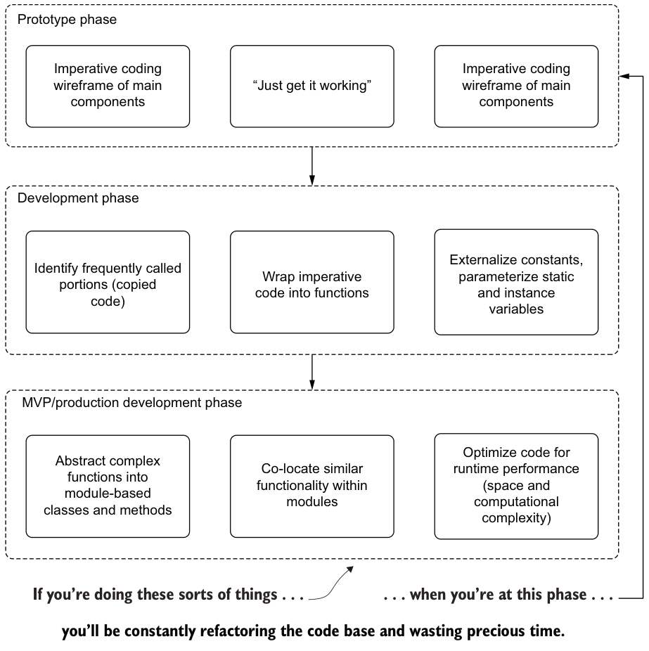
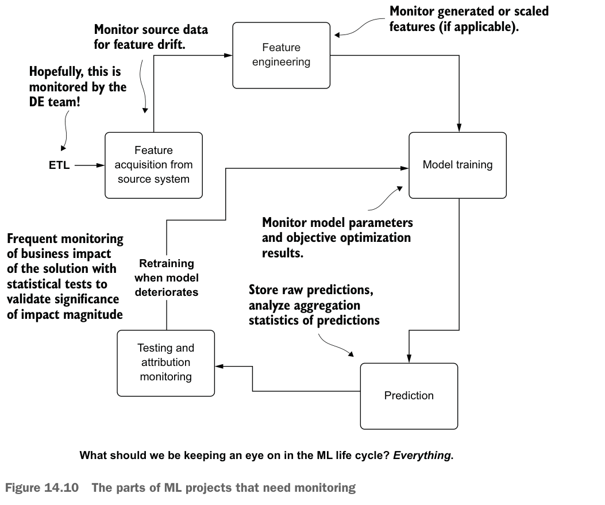

# The MLOps maturity model and engineering best practices

The previous four chapters each added a tool, and nobody should adopt all of them at once. A maturity model is a way of asking how much of the ML lifecycle runs without a human, and what the next step would buy you. Tests, a Makefile, pre-commit hooks, Terraform and CI/CD are what move a team up the levels. In the course they are all applied to the streaming service from [the serving chapter](03-batch-and-online-serving.md#streaming-kinesis-to-lambda-to-kinesis), and the Python here runs as written, without AWS.

This chapter is cross-cutting: it is the engineering wrapped around everything else in the path. The reason for that engineering is the old one from [Sculley and colleagues (NeurIPS 2015)](https://papers.nips.cc/paper_files/paper/2015/hash/86df7dcfd896fcaf2674f757a2463eba-Abstract.html): the model code is a small part of an ML system, and the debt builds up around it, in data dependencies, feedback loops and entangled inputs where changing anything changes everything. The material here is the course's module 1, section 1.5 (the maturity model), module 6 (best practices) and module 7 (the capstone rubric).

## The Microsoft MLOps maturity model

[Microsoft's model](https://learn.microsoft.com/en-us/azure/architecture/ai-ml/guide/mlops-maturity-model) has five levels, and it asks that they be treated as a continuum, since real practice overlaps:

| Level | Name | What's automated | Typical smell |
|---|---|---|---|
| 0 | No MLOps | Nothing. Notebooks, manual deploys | "Which notebook made the production model?" |
| 1 | DevOps but no MLOps | App build, test and deploy. Not training | Releases are automated but models are thrown over the wall |
| 2 | Automated training | Training pipelines, experiment tracking, model registry | Training is reproducible; deploying a new model is still manual |
| 3 | Automated model deployment | CI/CD for models, A/B or shadow tests, model-to-service traceability | Releases are safe, but someone still decides when to retrain |
| 4 | Full MLOps automated operations | Monitoring triggers retraining and redeployment; a closed loop | Few humans in the loop. Needs strong monitoring to be safe |

The course's advice: not every project needs level 4. A proof of concept can stay at 0. A model that matters to the business should reach 2 to 3. Level 4 pays off when there are many models or data drifts quickly. The [drift chapter](04-drift.md#what-to-do-about-it-retraining-policy) shows why it should not come first: a triggered retrain on bad data is an automated incident.

[Google's guide](https://cloud.google.com/architecture/mlops-continuous-delivery-and-automation-pipelines-in-machine-learning) cuts the same ladder into three: level 0 is manual, with releases perhaps a couple of times a year; level 1 automates the ML pipeline; level 2 automates CI/CD of the pipeline itself. Another coarse cut has three tiers: manual (notebooks), **continuous training** (an orchestrator retrains on a schedule, on new data or on a monitoring alert) and **CI/CD** (code changes are built, tested and deployed automatically). CT automates the pipelines. CI/CD ships new versions of the pipeline code (*LLM Engineer's Handbook*, appendix). The two loops are separate triggers, and Microsoft's level 4 is the point where both are closed.



### Treat the maturity label with care

A level is a description, not a measure. Amershi and colleagues built the most careful version I know of, in their [ICSE-SEIP 2019 study at Microsoft](https://doi.org/10.1109/ICSE-SEIP.2019.00042): they asked 551 respondents to rate each workflow stage on six dimensions, from having defined goals to continuous improvement. The resulting index correlated with self-assessed effectiveness, with Spearman coefficients from 0.4982 to 0.7627, but all of it is self-reported, descriptive, and without an objective baseline. Read that as evidence that the habits travel together, not that climbing a level causes success.

The setup is narrower than the 551 suggests: 14 interviews first, then a questionnaire sent to 4,195 members of Microsoft's internal AI and ML mailing lists, a 13.6% response rate, and the authors call their maturity model a first attempt with no defined levels. Paleyes, Urma and Lawrence's [survey of deployment case studies (ACM Computing Surveys, 2022)](https://arxiv.org/abs/2011.09926) points the same way from the other side: it finds challenges at every stage of a four-stage workflow (data management, model learning, model verification, model deployment), says it does not rank them, and offers no levels or measured effect of any practice. Both are literature or self-report, so use them as checklists of where to look, not as scores.

The same study names three ways ML differs from other software: data is harder to version than code, customising a model needs ML skills, and modularity is hard because models entangle and errors do not compose monotonically. [Shankar and colleagues' interviews](https://arxiv.org/abs/2209.09125) add a warning about where effort goes: most changes happen at the top of the stack, such as configuration and runs, and changes deeper down are rarer and costlier. Anti-patterns they saw include tribal knowledge held by one person, and a "pipeline jungle" that nobody dares change. So look at what your team actually changes every week, and automate that first.

### Where the course takes you

| Level | Course material | Chapter |
|---|---|---|
| 0 to 1 | Module 1 notebook; module 4 Dockerised service | [Feature stores](01-feature-stores.md), [Serving](03-batch-and-online-serving.md) |
| 2 | MLflow tracking and registry (module 2); orchestrated training (module 3) | [Registry](02-experiment-tracking-and-model-registry.md), [Orchestration](../../03-transform-and-orchestrate/notes/02-orchestrate.md) |
| 3 | Tests, IaC and CI/CD that deploy the Lambda (module 6) | This chapter |
| 4 | Evidently monitoring and alerts (module 5); conditional retraining is only a capstone criterion | [Monitors](../../05-quality-and-observability/notes/02-monitors-and-lineage.md), [Drift](04-drift.md) |

The course gets you to a solid level 3 with monitoring attached. The closed loop of level 4 is left for the project.

### A score you can compute: the ML Test Score

[Breck and colleagues' ML Test Score (IEEE Big Data 2017)](https://research.google/pubs/the-ml-test-score-a-rubric-for-ml-production-readiness-and-technical-debt-reduction/) is a sharper instrument than a level. It has 28 tests in four sections, seven each: data, model, infrastructure and monitoring. A test earns half a point if run manually with the results documented and a full point if automated. The final score is the **minimum** across sections, since all four matter and strength in one does not excuse a gap in another.

```python
def ml_test_score(sections):
    """Half a point per manual test, one per automated test, then the minimum."""
    points = {"manual": 0.5, "automated": 1.0, "none": 0.0}
    totals = {name: sum(points[t] for t in tests) for name, tests in sections.items()}
    return totals, min(totals.values())

team = {
    "data":           ["automated"] * 3 + ["manual"] * 2 + ["none"] * 2,
    "model":          ["automated"] * 4 + ["manual"] * 2 + ["none"],
    "infrastructure": ["automated"] * 5 + ["none"] * 2,
    "monitoring":     ["manual"] * 2 + ["none"] * 5,
}
totals, score = ml_test_score(team)
print(totals, "-> score", score)
team["model"] = ["automated"] * 7
print("three more model tests ->", ml_test_score(team)[1])
team["monitoring"] = ["automated"] * 2 + ["none"] * 5
print("automate two monitors ->", ml_test_score(team)[1])
```

Output:

```text
{'data': 4.0, 'model': 5.0, 'infrastructure': 5.0, 'monitoring': 1.0} -> score 1.0
three more model tests -> 1.0
automate two monitors -> 2.0
```

The arithmetic carries the lesson. Three more model tests changed nothing, and two automated monitors doubled the score. The paper's bands read 0 as a research project, up to 1 as possibly having serious holes, up to 2 as a first pass at productionising, up to 3 as reasonably tested, up to 5 as strong automation fit for mission-critical systems, and above that as exceptional. It is the most useful quarterly exercise in this chapter.

## Testing and code quality

### Refactor so it can be tested

The course's first Lambda mixed model loading, feature logic, prediction and the Kinesis write in one module-level script. Module 6 splits it into `model.py`, shown here in full apart from the client factory:

```python
import base64, json, os

def get_model_location(run_id):
    model_location = os.getenv('MODEL_LOCATION')        # override for tests
    if model_location is not None:
        return model_location
    model_bucket = os.getenv('MODEL_BUCKET', 'mlflow-models-alexey')
    experiment_id = os.getenv('MLFLOW_EXPERIMENT_ID', '1')
    return f's3://{model_bucket}/{experiment_id}/{run_id}/artifacts/model'

def base64_decode(encoded):
    return json.loads(base64.b64decode(encoded).decode('utf-8'))

class ModelService:
    def __init__(self, model, model_version=None, callbacks=None):
        self.model = model
        self.model_version = model_version
        self.callbacks = callbacks or []                # side effects are injected

    def prepare_features(self, ride):
        return {'PU_DO': f"{ride['PULocationID']}_{ride['DOLocationID']}",
                'trip_distance': ride['trip_distance']}

    def predict(self, features):
        return float(self.model.predict([features])[0])

    def lambda_handler(self, event):
        predictions_events = []
        for record in event['Records']:
            ride_event = base64_decode(record['kinesis']['data'])
            features = self.prepare_features(ride_event['ride'])
            prediction_event = {
                'model': 'ride_duration_prediction_model',
                'version': self.model_version,
                'prediction': {'ride_duration': self.predict(features),
                               'ride_id': ride_event['ride_id']}}
            for callback in self.callbacks:
                callback(prediction_event)
            predictions_events.append(prediction_event)
        return {'predictions': predictions_events}

print(get_model_location("abc123"))
```

Output:

```text
s3://mlflow-models-alexey/1/abc123/artifacts/model
```

```python
# illustrative: needs boto3 and AWS credentials or a LocalStack endpoint
def create_kinesis_client():
    endpoint_url = os.getenv('KINESIS_ENDPOINT_URL')    # point at LocalStack in tests
    if endpoint_url is None:
        return boto3.client('kinesis')
    return boto3.client('kinesis', endpoint_url=endpoint_url)
```

`lambda_function.py` shrinks to reading environment variables, calling `model.init(...)` once at cold start, and delegating. The three seams (model location, callbacks, endpoint URL) are what make each kind of test possible.

### Where to cut, what to fix, how much to build

Wilson's ch. 9 to 14 are about code, and every claim in them is experience with no measurements. They are worth a place here for three rules.

**Cut where you can test.** He splits a monolithic script (his hypothetical is about 1,500 lines) by asking "how can I test this block?" and not "what looks nice?" (*ML Engineering in Action*, ch. 9). Wrapping code in functions does not reduce its complexity, only how complicated it is to read, debug and test, and his script and class versions give the same results at the same runtime. His private-method test uses the standard normal's quantiles at 0.01 and 0.99, ±2.3263478740408408, so the expected values can be derived without running the model. Choose test oracles you can derive.



*Image Source: Ben Wilson, *Machine Learning Engineering in Action* (Manning, 2022), Fig. 9.6*

**Fix what fails in production first.** In ch. 10 he ranks smells by what they do to a project (his Fig. 10.1): naming, syntax and spaghetti structure are annoying but rarely kill it, while blind `try/except`, overused global mutable state and deep nesting cause the production failures that get a project cancelled.



*Image Source: Ben Wilson, *Machine Learning Engineering in Action* (Manning, 2022), Fig. 10.1*

His examples are small enough to check. A blind `except: pass` around a division over 100 numbers, with a string passed in place of the divisor, returns an empty list and no error. Catching only the specific exception (a division by zero in his data) drops just the failing element and returns 99 results. The final version logs the exception and its inputs, substitutes a value, and compares input and output lengths, raising a custom error on a mismatch. He estimates proper handling costs "about 30 extra minutes" against days of searching, which is his estimate. A mutable default argument leaks state between calls:

```python
def add_feature(name, feature_collection=None):
    collection = feature_collection if feature_collection else list()  # not `=[]` in the signature
    collection.append(name)
    return collection
```

With `feature_collection=[]` in the signature, a second call returns both calls' elements, which in his story built two models with identical six-column inputs. He also flags feature-engineering code "defined in three separate places" for training, test and inference, which is the skew source in [the feature stores chapter](01-feature-stores.md). Nested conditionals for combining model scores grow with his formula `5**levels * 2 + factorial(levels)`, which gives 821,570 lines for 8 models at 5 buckets. The fix is a computed mapping: bucket each score and sum (*ML Engineering in Action*, ch. 10).

**Build the least that works, and only then optimise.** Ch. 13 phases the work: an imperative prototype, then wrapping repeats in functions and externalising constants, then modules and runtime tuning, and warns against abstracting early.



*Image Source: Ben Wilson, *Machine Learning Engineering in Action* (Manning, 2022), Fig. 13.2*

He matches tooling to scale: pandas rather than Spark ML for thousands of rows, a Flask app in Docker rather than Kubernetes at a few requests per minute. Before a custom framework or wrapper, he asks for at least 16 human hours a week to maintain it and a speed-up of at least twice the time spent building it, both his rules of thumb. His premature-optimisation story is a Scala/Spark test-data generator tuned part by part: it took 2 h 54 min for 50 million rows because a sequence type with linear-time access was used where an indexed one was needed, and a simpler rewrite did it in about 15 minutes (hardware not stated). His own success rate repairing tightly coupled script-style Spark jobs after an upstream change, before predictions lapsed, was "just under 40%", an anecdote (*ML Engineering in Action*, ch. 13).

### Monitor the whole life cycle

Ch. 14 asks what a team should watch and answers "everything", seven things (author's list): generated features, model metrics per run, prediction distributions, attribution, response-time SLA, feature usefulness, and the source features. The source feed is best watched by the data engineers who own it.



*Image Source: Ben Wilson, *Machine Learning Engineering in Action* (Manning, 2022), Fig. 14.10*

His minimal feature check stores training-time mean, median, standard deviation, min and max in a versioned table per training run, then compares recent serving values daily. His Listing 14.1 alerts when the recent mean falls below the training minimum or above the training maximum, or the standard deviation leaves 0.5x to 2x of training; in his toy series the recent mean of 31.8 sat below a training minimum of 121.9. He admits he does not tune these thresholds. Without monitoring, he estimates a team of 14 would lose two to three investigations a week, each a full workday plus another to retrain (*ML Engineering in Action*, ch. 14). The same chapter's simplicity ladder (heuristics, then a linear model or tree, then ensembles, then deep or custom models) repeats the rung rule in [the framing note](06-ml-system-framing-to-monitoring.md).

### Unit tests with pytest

```python
class ModelMock:
    def __init__(self, value):
        self.value = value
    def predict(self, X):
        return [self.value] * len(X)

RIDE = {"PULocationID": 130, "DOLocationID": 205, "trip_distance": 3.66}

def test_prepare_features():
    model_service = ModelService(None)                  # no model needed
    assert model_service.prepare_features(RIDE) == {"PU_DO": "130_205", "trip_distance": 3.66}

def test_predict():
    model_service = ModelService(ModelMock(10.0))
    assert model_service.predict({"PU_DO": "130_205", "trip_distance": 3.66}) == 10.0

def test_lambda_handler():
    written = []
    service = ModelService(ModelMock(10.0), "Test123", callbacks=[written.append])
    data = base64.b64encode(json.dumps({"ride": RIDE, "ride_id": 256}).encode()).decode()
    out = service.lambda_handler({"Records": [{"kinesis": {"data": data}}]})
    assert out["predictions"][0]["prediction"] == {"ride_duration": 10.0, "ride_id": 256}
    assert written == out["predictions"]                # the callback saw the same event

def test_model_location_override():
    os.environ["MODEL_LOCATION"] = "/app/model"
    try:
        assert get_model_location("ignored") == "/app/model"
    finally:
        del os.environ["MODEL_LOCATION"]

for test in (test_prepare_features, test_predict, test_lambda_handler,
             test_model_location_override):
    test()
    print("passed", test.__name__)
```

Output:

```text
passed test_prepare_features
passed test_predict
passed test_lambda_handler
passed test_model_location_override
```

The course's `test_base64_decode` also reads a fixture (`tests/data.b64`) and checks the decoded ride. None of these touch AWS or the real model. The course runs these with `pytest`; they are called directly here so that the block prints.

### What the course doesn't test: data, model, behaviour

The course's tests cover code. An ML system changes when any of code, data or model changes, so it needs tests on all three (*LLM Engineer's Handbook*, appendix; the ML Test Score's sections say the same):

- **Data validity**, run in the feature pipeline. For tabular data: no nulls where none are allowed, categoricals only take expected values, floats stay in range. For text: length, encoding, language, special characters. These belong next to the dbt and Great Expectations checks in [the tests chapter](../../05-quality-and-observability/notes/01-quality-dimensions-and-tests.md).

```python
import numpy as np, pandas as pd
from sklearn.feature_extraction import DictVectorizer
from sklearn.linear_model import LinearRegression
from sklearn.pipeline import make_pipeline

rng = np.random.default_rng(0)
n = 5_000
rides = pd.DataFrame({"PULocationID": rng.integers(1, 21, n),
                      "DOLocationID": rng.integers(1, 21, n),
                      "trip_distance": rng.gamma(2.0, 1.6, n).round(2)})
rides["duration"] = (3 + 3.2 * rides.trip_distance + 0.25 * rides.PULocationID
                     + rng.normal(0, 3, n)).clip(1, 90)

def check_batch(df):
    problems = []
    if df[["PULocationID", "DOLocationID"]].isna().any().any():
        problems.append("null location")
    if not df.trip_distance.between(0, 100).all():
        problems.append("trip_distance out of range")
    if not df.PULocationID.between(1, 265).all():
        problems.append("unknown pickup zone")
    return problems

print("clean batch:", check_batch(rides))
broken = rides.assign(trip_distance=rides.trip_distance * 1000)
print("broken batch:", check_batch(broken))
```

Output:

```text
clean batch: []
broken batch: ['trip_distance out of range']
```

- **Behaviour**, treating the model as a black box ([CheckList, Ribeiro et al., ACL 2020](https://arxiv.org/abs/2005.04118)). *Minimum functionality*: simple cases it must always get right. *Invariance*: a perturbation that shouldn't change the output doesn't. *Directional*: a perturbation that should change the output does, and in the right direction.

```python
service = ModelService(None)
model = make_pipeline(DictVectorizer(), LinearRegression()).fit(
    [service.prepare_features(r) for r in rides.to_dict("records")], rides.duration)
service = ModelService(model)

def predict(**kw):
    return service.predict(service.prepare_features({**RIDE, **kw}))

def test_minimum_functionality():
    assert 1 <= predict(PULocationID=10, DOLocationID=12, trip_distance=1.0) <= 30

def test_invariance():
    # The driver's name is not a feature, so an extra key must change nothing.
    a = service.prepare_features({**RIDE, "driver_name": "Ana"})
    assert a == service.prepare_features(RIDE)

def test_directional():
    assert predict(PULocationID=10, DOLocationID=12, trip_distance=8.0) > \
           predict(PULocationID=10, DOLocationID=12, trip_distance=2.0)

for test in (test_minimum_functionality, test_invariance, test_directional):
    test()
    print("passed", test.__name__)
print(f"2 miles: {predict(PULocationID=10, DOLocationID=12, trip_distance=2.0):.1f} min, "
      f"8 miles: {predict(PULocationID=10, DOLocationID=12, trip_distance=8.0):.1f} min")
```

Output:

```text
passed test_minimum_functionality
passed test_invariance
passed test_directional
2 miles: 11.3 min, 8 miles: 30.5 min
```

- **Model sanity**, the cheap catches for a training run that finishes without error and is still wrong. Check input and output tensor shapes. Check that loss falls after one batch. Check that the model can overfit a tiny batch to near-zero loss. Run the pipeline on every supported device (CPU and GPU) and check that early-stopping and checkpoint logic fires. These are slow, so gate them in CI on changes to model code.

```python
import torch
torch.manual_seed(0)
x = torch.randn(32, 4)
y = x.sum(dim=1, keepdim=True) + 0.1 * torch.randn(32, 1)

def make_model():
    return torch.nn.Sequential(torch.nn.Linear(4, 32), torch.nn.ReLU(), torch.nn.Linear(32, 1))

def overfit_one_batch(model, params, steps=500):
    opt = torch.optim.AdamW(params, lr=1e-2, weight_decay=0.0)
    for _ in range(steps):
        loss = torch.nn.functional.mse_loss(model(x), y)
        opt.zero_grad(); loss.backward(); opt.step()
    return loss.item()

model_a = make_model()
print(f"healthy: {overfit_one_batch(model_a, model_a.parameters()):.4f}")
# The classic wiring bug: the optimiser holds the parameters of a different object.
model_b = make_model()
print(f"optimiser on another model: {overfit_one_batch(model_b, make_model().parameters()):.4f}")
assert overfit_one_batch(model_a, model_a.parameters()) < 0.05   # cannot memorise 32 rows: a bug
```

Output:

```text
healthy: 0.0002
optimiser on another model: 4.4106
```

If a model cannot memorise 32 rows, you have a wiring bug and not a tuning problem. Here the bug is an optimiser given the parameters of another object, and the loss stays above 4 with no error raised.

### Integration test with docker-compose and LocalStack

```yaml
# illustrative: needs Docker and the course's image; LocalStack needs no AWS account
services:
  backend:
    image: ${LOCAL_IMAGE_NAME}
    ports: ["8080:8080"]
    environment:
      - PREDICTIONS_STREAM_NAME=${PREDICTIONS_STREAM_NAME}
      - RUN_ID=Test123
      - MODEL_LOCATION=/app/model                   # model from a local folder, not S3
      - KINESIS_ENDPOINT_URL=http://kinesis:4566/   # fake Kinesis
      - AWS_ACCESS_KEY_ID=abc
      - AWS_SECRET_ACCESS_KEY=xyz
    volumes: ["./model:/app/model"]
  kinesis:
    image: localstack/localstack
    ports: ["4566:4566"]
    environment: [SERVICES=kinesis]
```

[`integraton-test/run.sh`](https://github.com/DataTalksClub/mlops-zoomcamp/blob/e34bf8f540b75dfd712ffcc97d3c000ae1c2e3e7/06-best-practices/code/integraton-test/run.sh) (misspelt at this commit; later upstream commits rename the folder `integration-test`) builds the image if needed, runs `docker-compose up -d`, creates the stream with `aws --endpoint-url=http://localhost:4566 kinesis create-stream`, then runs two checks:

| Script | Checks |
|---|---|
| `test_docker.py` | POSTs `event.json` to the Lambda emulator and compares the response with `DeepDiff` |
| `test_kinesis.py` | Reads the output stream from LocalStack and asserts one record with `version: Test123`, `ride_duration: 21.3` |

[`test_docker.py`](https://github.com/DataTalksClub/mlops-zoomcamp/blob/e34bf8f540b75dfd712ffcc97d3c000ae1c2e3e7/06-best-practices/code/integraton-test/test_docker.py) calls `DeepDiff(actual, expected, significant_digits=1)` and asserts only that the diff has no `type_changes` and no `values_changed`. The tolerance is there because a model's output is a float, and an exact match would fail on a change too small to matter. Know what it lets through. Against an expected `21.3` with deepdiff 9.1.0, `21.34` passes and `21.36` fails, and a key the response gains or loses lands under `dictionary_item_removed` or `dictionary_item_added`, which those two asserts never read.

On failure it prints `docker-compose logs`, tears down, and exits with the error code, so CI fails. Testing the real container against [fake cloud services](https://docs.localstack.cloud/) catches packaging, env-var and wiring bugs that unit tests miss.

### Linting, formatting and pre-commit

| Tool | Job | Config |
|---|---|---|
| `isort` | Sort imports | `pyproject.toml` |
| `black` | Format | `pyproject.toml` (line length, skip string normalisation) |
| `pylint --recursive=y` | Lint | `pyproject.toml` `[tool.pylint]`, disabling noisy checks |
| `pre-commit` | Run all of the above, plus `pytest tests/`, on every commit | `.pre-commit-config.yaml` |

```yaml
# illustrative: the course's configuration, with 2022 pins
repos:
- repo: https://github.com/pre-commit/pre-commit-hooks
  rev: v3.2.0
  hooks: [{id: trailing-whitespace}, {id: end-of-file-fixer}, {id: check-yaml}, {id: check-added-large-files}]
- repo: https://github.com/pycqa/isort
  rev: 5.10.1
  hooks: [{id: isort}]
- repo: https://github.com/psf/black
  rev: 22.6.0
  hooks: [{id: black, language_version: python3.11}]
- repo: local
  hooks:
    - {id: pylint, entry: pylint, language: system, types: [python], args: ["-rn", "-sn", "--recursive=y"]}
    - {id: pytest-check, entry: pytest, language: system, pass_filenames: false, always_run: true, args: ["tests/"]}
```

The pinned hook versions are from 2022. Run `pre-commit autoupdate` before reusing this, or replace isort, black and pylint with `ruff` (`ruff check` and `ruff format`), which does all three jobs faster.

### The Makefile chains it all

```makefile
# illustrative: needs Docker and the course's scripts
LOCAL_TAG:=$(shell date +"%Y-%m-%d-%H-%M")
LOCAL_IMAGE_NAME:=stream-model-duration:${LOCAL_TAG}

test:
	pytest tests/
quality_checks:
	isort .
	black .
	pylint --recursive=y .
build: quality_checks test
	docker build -t ${LOCAL_IMAGE_NAME} .
integration_test: build
	LOCAL_IMAGE_NAME=${LOCAL_IMAGE_NAME} bash integraton-test/run.sh
publish: build integration_test
	LOCAL_IMAGE_NAME=${LOCAL_IMAGE_NAME} bash scripts/publish.sh
setup:
	pipenv install --dev
	pre-commit install
```

The dependency chain is the point: `make publish` can't push an image that failed linting, unit tests or the integration test. The timestamp tag means each build gets a unique image.

## Infrastructure as code and CI/CD

### Terraform for the stream pipeline

```hcl
# illustrative: needs an AWS account and an existing state bucket; not applied here
terraform {
  required_version = ">= 1.0"
  backend "s3" {                                  # remote state; create the bucket first
    bucket  = "tf-state-mlops-zoomcamp"
    key     = "mlops-zoomcamp-stg.tfstate"
    region  = "eu-west-1"
    encrypt = true
  }
}

module "source_kinesis_stream" {                  # ride_events
  source           = "./modules/kinesis"
  retention_period = 48
  shard_count      = 2
  stream_name      = "${var.source_stream_name}-${var.project_id}"
}
module "output_kinesis_stream" { ... }            # ride_predictions
module "s3_bucket"             { ... }            # model artifacts
module "ecr_image"             { ... }            # builds and pushes the image
module "lambda_function" {
  source            = "./modules/lambda"
  image_uri         = module.ecr_image.image_uri  # wiring through module outputs
  source_stream_arn = module.source_kinesis_stream.stream_arn
  output_stream_arn = module.output_kinesis_stream.stream_arn
  ...
}
output "lambda_function" { value = "${var.lambda_function_name}_${var.project_id}" }   # read by CI/CD
```

| Idea | Where it shows |
|---|---|
| Remote state in S3 | `backend "s3"`; the whole team and CI share one state |
| Modules | `modules/{kinesis,s3,ecr,lambda}`; one Kinesis module used twice |
| Environments via var files | `vars/stg.tfvars`, `vars/prod.tfvars`: `terraform apply -var-file=vars/stg.tfvars` |
| Outputs as an interface | CD reads `lambda_function`, `model_bucket`, `ecr_repo` to know what to update |

The course's [`ecr` module](https://github.com/DataTalksClub/mlops-zoomcamp/blob/e34bf8f540b75dfd712ffcc97d3c000ae1c2e3e7/06-best-practices/code/infrastructure/modules/ecr/main.tf) handles an ordering problem you will hit. The Lambda can't be configured without an image that already exists in ECR, yet the same apply creates the repository. So the module builds and pushes an image from a `null_resource` with a `local-exec` provisioner, re-triggered by the md5 of the handler and the Dockerfile, and an `aws_ecr_image` data source with `depends_on` makes the Lambda wait for the push. Its own comment says that in practice CI/CD does the build, and that any base image would serve for the bootstrap. That is the split to aim for: Terraform owns that the function exists, and CI/CD owns what it runs.

Compare the GCP Terraform in [the ingest chapter](../../02-ingest-and-modelling/notes/01-ingest.md): same tool, different provider. The concepts carry over.

`scripts/deploy_manual.sh` then sets the Lambda's `RUN_ID` with `aws lambda update-function-configuration --environment "Variables={...}"`. It picks the latest run by S3 `LastModified` and is marked "NOT FOR PRODUCTION!". In practice the run comes from the [registry alias](02-experiment-tracking-and-model-registry.md#rollback-and-why-the-registry-labels-but-does-not-deploy).

### CI/CD with GitHub Actions

| Workflow | Trigger | Steps |
|---|---|---|
| `ci-tests.yml` | `pull_request` to `develop` | Set up Python and pipenv; unit tests; integration test; `terraform plan` |
| `cd-deploy.yml` | `push` to `develop` | `terraform plan` and `apply`; Docker build and ECR push; update the Lambda config |

The workflow files live in the upstream repo's [`.github/workflows/`](https://github.com/DataTalksClub/mlops-zoomcamp/tree/e34bf8f540b75dfd712ffcc97d3c000ae1c2e3e7/.github/workflows). Caveats if you copy them:

| Caveat | Fix |
|---|---|
| Older Actions examples write outputs with `echo "::set-output name=x::y"`, which GitHub deprecated | `echo "x=y" >> "$GITHUB_OUTPUT"` |
| Long-lived AWS keys in repository secrets | OIDC federation (`aws-actions/configure-aws-credentials` with `role-to-assume`) |
| `develop` deploys straight to the one environment | Stage on `develop`, promote to `prod` with `vars/prod.tfvars` on `main` behind an approval |
| CD sets `RUN_ID` from "latest" | Resolve a registry alias, so promotion is a deliberate registry action |

## The capstone rubric as a checklist

The project rubric in module 7 is a good definition of "production-shaped" for a portfolio ML system:

| Criterion | Max points | Full marks means |
|---|---|---|
| Problem description | 2 | Clear problem and why ML helps |
| Cloud | 4 | Developed on the cloud and IaC used to provision it |
| Experiment tracking and model registry | 4 | Both used |
| Workflow orchestration | 4 | Fully deployed workflow |
| Model deployment | 4 | Containerised and deployable to the cloud |
| Model monitoring | 4 | Metrics calculated, with alerts or conditional retraining |
| Reproducibility | 4 | Clear instructions, pinned dependency versions, data available |
| Best practices | 7 | Unit tests 1, integration test 1, linter/formatter 1, Makefile 1, pre-commit 1, CI/CD 2 |

The "best practices" row is module 6, one for one. The monitoring row is the only place the course asks for level 4 behaviour.

## Mapping the pillar onto SageMaker

If your team runs on AWS, the question is which piece of [Amazon SageMaker AI](https://docs.aws.amazon.com/sagemaker/latest/dg/whatis.html) stands where each idea in this pillar stood. This is a map, and it doesn't aim to be a tutorial. It comes from AWS's documentation as read on 2026-11-02, nothing here was run on AWS, and it leaves out prices. Services change, so check the linked page before you rely on a row. Warehouses have their own map, in [mapping the ideas onto Redshift](../../04-warehouse-lakehouse-streaming/notes/01-warehouse-and-store.md#mapping-the-ideas-onto-redshift).

| What this pillar teaches | SageMaker AI component | What stays your job |
|---|---|---|
| [Point-in-time features and online lookups](01-feature-stores.md#what-a-feature-store-is) | [Feature Store](https://docs.aws.amazon.com/sagemaker/latest/dg/feature-store.html): feature groups, an online store that keeps the latest records, and an append-only offline store in your S3 bucket, in Parquet, that Athena can query | Testing your as-of join on your own rows. A store doesn't choose the event time for you |
| [Tracking runs](02-experiment-tracking-and-model-registry.md#tracking-with-mlflow) | [Managed MLflow](https://docs.aws.amazon.com/sagemaker/latest/dg/mlflow.html). The older [Experiments SDK](https://docs.aws.amazon.com/sagemaker/latest/dg/experiments.html) tracks only in Studio Classic, and AWS recommends MLflow in the new Studio | Logging what you need to rerun the model |
| [The registry and rollback](02-experiment-tracking-and-model-registry.md#rollback-and-why-the-registry-labels-but-does-not-deploy) | [Model Registry](https://docs.aws.amazon.com/sagemaker/latest/dg/model-registry.html): model groups, versions, lineage and an approval status. MLflow can register into it automatically | The gate. An approval status records a decision and doesn't make one |
| [Batch scoring](03-batch-and-online-serving.md#batch-score-a-table) | [Batch transform](https://docs.aws.amazon.com/sagemaker/latest/dg/batch-transform.html): large datasets, with no persistent endpoint | Choosing batch at all, by when the answer is needed |
| [Online serving](03-batch-and-online-serving.md#online-a-web-service) | [Inference options](https://docs.aws.amazon.com/sagemaker/latest/dg/model-deploy-feature-matrix.html): real-time endpoints, asynchronous for large inputs, serverless for idle periods between spurts | Returning the model version with each prediction |
| [Shadow](03-batch-and-online-serving.md#rolling-out-a-new-model) | [Shadow tests](https://docs.aws.amazon.com/sagemaker/latest/dg/shadow-tests.html): a copy of a share of requests you set goes to the shadow variant in the same endpoint, and only the production variant's response returns. Real-time only: not serverless or asynchronous | The limit in feedback loops still applies, since a shadow never sees the results of its choices |
| [Canary and rollback](03-batch-and-online-serving.md#rolling-out-a-new-model) | [Deployment guardrails](https://docs.aws.amazon.com/sagemaker/latest/dg/deployment-guardrails.html): [blue/green with a canary step](https://docs.aws.amazon.com/sagemaker/latest/dg/deployment-guardrails-blue-green-canary.html), a baking period, and CloudWatch alarms that return all traffic to the old fleet | The docs describe a share of traffic. If an entity has to stay on one side, check that, or use the [stable hash](03-batch-and-online-serving.md#rolling-out-a-new-model) yourself |
| [Drift and label delay](04-drift.md#monitoring-error-when-labels-arrive) | [Model Monitor](https://docs.aws.amazon.com/sagemaker/latest/dg/model-monitor.html) covers data quality, model quality, bias drift and feature attribution drift. **AWS has [closed it to new customers](https://docs.aws.amazon.com/sagemaker/latest/dg/model-monitor-availability-change.html)**: existing customers keep it, with no new features planned. AWS points to open-source monitoring solutions, including MLflow Apps with Evidently, plus QuickSight and CloudWatch | Deciding what an alert costs. A new AWS account plans around the alternatives, and [the drift chapter's](04-drift.md#drift-that-doesnt-matter-and-damage-with-no-drift) argument doesn't depend on the tool |
| [The retraining pipeline](04-drift.md#what-to-do-about-it-retraining-policy) | [Pipelines](https://docs.aws.amazon.com/sagemaker/latest/dg/pipelines.html): workflow orchestration for ML, with versioning and lineage | When to retrain and what the gate checks |

The useful habit is the third column. Each of these services moves work off your plate, and none of them makes a decision this pillar taught you to make. [An ML system from framing to monitoring](06-ml-system-framing-to-monitoring.md) walks through those decisions on one problem.

## Run labels

Course paths are as they stood at [upstream commit `e34bf8f`](https://github.com/DataTalksClub/mlops-zoomcamp/tree/e34bf8f540b75dfd712ffcc97d3c000ae1c2e3e7), the version these chapters read.

| Material | Needs |
|---|---|
| Module 1 environment setup | GitHub Codespaces or an AWS EC2 VM (Anaconda, Docker); the notebook then runs offline after the data download |
| Module 6 unit tests | Runs offline: `pipenv install --dev && pytest tests/` |
| Module 6 integration test | Docker and docker-compose; LocalStack image; no AWS account |
| Module 6 Terraform, `deploy_manual.sh`, `test_cloud_e2e.sh` | AWS account; S3 state bucket created beforehand |
| Module 6 CI/CD | GitHub repo and AWS secrets; workflows upstream only |
| Module 7 project | Your choice of cloud; peer-reviewed against the rubric |
| The SageMaker mapping | Read from AWS's docs on 2026-11-02. Nothing was run on AWS |
| The Python in this chapter | `uv run --with pandas --with scikit-learn --with torch python file.py` |

## Rules of thumb

| Rule | Why |
|---|---|
| Inject side effects (callbacks, endpoint URLs, model location) | It's the only way to unit-test a service that writes to the cloud |
| Integration-test the real container against fake services | Catches packaging and wiring bugs; LocalStack makes it free |
| Make the Makefile the single entry point, and have CI call it | Local and CI runs can't drift |
| Pin hook and tool versions, and update them on purpose | 2022 pins rot; `pre-commit autoupdate` |
| Aim for level 2 to 3 before level 4 | A closed retraining loop without good monitoring automates mistakes |
| Score by the minimum, not the average | A strong model section does not excuse absent monitoring |

## Pitfalls

- **Climbing levels for their own sake.** A proof of concept at level 0 is correct. Ask what the next level would buy this model.
- **Automating retraining before monitoring.** Then a bad feed ships itself.
- **Only testing code.** A correct function on broken data gives a wrong model and passing tests.
- **Mocking everything.** Unit tests with mocks miss packaging, env-var and wiring bugs. That is what the integration test is for.
- **Tests that hit real AWS.** They are slow and expensive and can touch production. Use seams and LocalStack.
- **Copying 2022 configuration.** Pins, `::set-output` and long-lived keys have all aged. Update them on purpose.
- **Swallowing exceptions.** A blind `except: pass` turns a failure into an empty result. Catch the specific exception, log it, and check that output length equals input length.
- **Building a framework before the second project.** Custom wrappers and abstractions at project start become the maintenance burden (*ML Engineering in Action*, ch. 13).
- **Deploying "latest".** The most recent run is not the approved one. Promotion should be a deliberate action.
- **Treating a self-assessed level as evidence.** Use it for planning, and do not quote it as a measure of quality.

## Try it

1. Score your own project, or the course's capstone, on the ML Test Score. Which section is the minimum, and what is the cheapest test that would raise it?
2. Add `test_lambda_handler_writes_nothing_on_bad_record`: pass a record with invalid base64. What should the service do, retry or skip? How does that interact with Kinesis retries?
3. Replace the ranges in `check_batch` with values derived from training statistics, such as the 0.1st and 99.9th percentiles. What goes wrong when the training set was small?

<details><summary>Answers</summary>

1. Most student projects find monitoring is the minimum, and the cheapest step is an automated check that training and serving features match, using logged requests. That is the ML Test Score's Monitor 3.
2. Lambda's Kinesis integration retries a failing batch, so raising on a poison record blocks that shard until the record expires or a retry limit configured on the event source is reached. Usually you catch it, send it to a dead-letter destination, and carry on.
3. A small sample gives tight bounds, so healthy new data trips them. Add margin, and refit the bounds on each training run, since they are themselves a fitted thing.

</details>

## Interview checklist

| Question | Answer |
|---|---|
| What are the Microsoft MLOps levels? | 0 no MLOps, 1 DevOps without MLOps, 2 automated training, 3 automated deployment, 4 full automated operations |
| What level should a model aim for? | Depends on the stakes. Business-critical usually 2 to 3. Level 4 needs strong monitoring and many models or fast drift |
| What is the difference between CT and CI/CD? | CT retrains when data or a schedule says so. CI/CD ships new pipeline code when code changes. Different triggers |
| What is the ML Test Score? | 28 tests in four sections, half a point manual, one automated, and the final score is the minimum across sections |
| Why the minimum? | So a weak section cannot hide behind a strong one |
| What should you test beyond code? | Data validity, model sanity such as overfitting a batch, and behaviour such as invariance and direction |
| Why inject callbacks? | So tests can run the handler with no cloud, and see what it would have written |
| Why does the overfit test matter? | A model that cannot memorise a tiny batch has a wiring bug, and tuning won't help |

## Next

[An ML system from framing to monitoring](06-ml-system-framing-to-monitoring.md): the tools are all on the table. The last chapter takes one invoice problem through every stage, from the question to the correction loop, and ends with a timed case.
