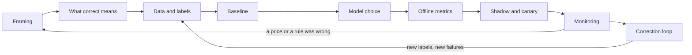

# An ML system from framing to monitoring

Tallybook's finance lead sends one line: "Can we use AI to read supplier invoices, so nobody has to type them?" Nothing in that line says what must be right, what a mistake costs, who will know when one happens, or whether a model is needed at all. Answer the line as written and you get an extractor with a good score, and still no answer to whether the money should leave. Each of those questions has its own chapter in this course. This chapter walks one invoice problem through all of them in the order you meet them on a real project, and shows what each stage must hand to the one after it. Most of those chapters sit in data science, AI engineering and generative AI, which this subject doesn't require, so the terms you need are explained where they appear and the links hold the method. It ends with a timed case, because the skill being tested is keeping the whole system in your head at once.

Tallybook is the course's fictional invoicing company. Everything below about its finance lead is a story to hang the stages on.

## What the evidence is, and what it isn't

The course has no invoice system. It has separate experiments that were never run together, on generated data, with prices somebody chose. Read every number below with this table in mind. Chapters are cited as subject, pillar and chapter, so AIE 08/02 is AI engineering, pillar 08, chapter 02. DS is data science, GA is generative AI and DE is this subject.

| Chapter | What it built | Data | Assumed, not measured |
|---|---|---|---|
| [AIE 08/02](../../../ai-engineering/08-multimodal-engineering/notes/02-document-understanding.md#a-pipeline-you-can-run) | Reads fields from pages with short written rules and a real OCR engine. **No vision model and no LLM.** No model is trained here, and the OCR engine's own models are used as they ship | 180 generated invoices, 3 layouts, 3 kinds of page | Review takes 3 minutes at 30.00 an hour |
| [DS 05/04](../../../data-science/05-time-series-and-recommenders/notes/04-entity-matching-and-learning-to-rank.md#the-results) | Matches bank lines to invoices | 5 generated ledgers | Nothing priced |
| [DS 01/13](../../../data-science/01-classical-ml/notes/13-automate-review-or-reject.md#price-each-route-and-the-thresholds-follow) | Routes an invoice to pay, review or reject by the risk of a problem. It doesn't read invoices | Generated invoices, about 6% problems | Paying a problem 150, rejecting a good one 30, a review 3, clerks catch 90% and wrongly flag 2% of good invoices |
| [DS 01/14](../../../data-science/01-classical-ml/notes/14-learning-from-corrections.md#the-loop-over-eight-months) | Feeds that router's corrections back in | The same generator, over eight months | The same prices |
| [DE 06/03](03-batch-and-online-serving.md#rolling-out-a-new-model) | Shadow and canary | The **taxi** model, not invoices | |

Three things follow. The two price lists differ, so you can't add AIE 08/02's costs to DS 01/13's. No chapter measures an LLM or a vision model reading invoices, so this chapter gives a break-even price for one, not a verdict. And nothing here has served live traffic, so every "online" number is a simulation or a design. The value of the walk-through is the order of decisions and the shape of the failures, and you should expect different numbers on your own data.

## The stages, and what each one hands on



| Stage | Question | What it hands on | Taught in |
|---|---|---|---|
| Framing | Which decision changes, and what's it worth? | Written criteria and a price per mistake | [GA 08/02](../../../generative-ai/08-eval/notes/02-defining-correct.md#success-criteria-before-code), [DS 01/13](../../../data-science/01-classical-ml/notes/13-automate-review-or-reject.md#price-each-route-and-the-thresholds-follow) |
| Correct | What counts as right, at which level? | A scoring rule two people apply alike | [GA 08/02](../../../generative-ai/08-eval/notes/02-defining-correct.md#the-two-expert-test), [DS 01/14](../../../data-science/01-classical-ml/notes/14-learning-from-corrections.md#agreement-is-not-correctness) |
| Data and labels | Who labels, by what rule, and when do labels arrive? | A versioned test set and a logged decision | [DS 01/14](../../../data-science/01-classical-ml/notes/14-learning-from-corrections.md#who-labels-and-by-what-rule), [DE 06/01](01-feature-stores.md#a-feature-has-two-times) |
| Baseline | What does doing the plain thing cost? | A number to beat and a fallback | [AIE 08/02](../../../ai-engineering/08-multimodal-engineering/notes/02-document-understanding.md#a-pipeline-you-can-run), [DS 01/13](../../../data-science/01-classical-ml/notes/13-automate-review-or-reject.md#does-the-review-route-pay-for-itself) |
| Model choice | Rules, classical, deep or LLM, per sub-task? | A route per sub-task, with a reason | [AIE 08/02](../../../ai-engineering/08-multimodal-engineering/notes/02-document-understanding.md#choosing-a-route), [DS 05/04](../../../data-science/05-time-series-and-recommenders/notes/04-entity-matching-and-learning-to-rank.md) |
| Offline metrics | Does the change win, and on every slice? | A release gate | [DS 01/11](../../../data-science/01-classical-ml/notes/11-choosing-a-metric.md#the-map), [DS 01/12](../../../data-science/01-classical-ml/notes/12-reading-the-errors.md#the-procedure), [DE 06/02](02-experiment-tracking-and-model-registry.md#the-gate-passive-retraining), [GA 08/10](../../../generative-ai/08-eval/notes/10-evals-in-ci.md#the-regression-gate) |
| Rollout | How does it meet real traffic safely? | Limits, a rollback, a comparison | [DE 06/03](03-batch-and-online-serving.md#rolling-out-a-new-model) |
| Monitoring | How would you know it had broken? | Alarms that lead to a cost | [DE 06/04](04-drift.md#monitoring-error-when-labels-arrive) |
| Correction loop | What do corrections teach, and what do they hide? | The next training set and a measured error rate | [DS 01/14](../../../data-science/01-classical-ml/notes/14-learning-from-corrections.md#audit-a-random-sample) |

[Sculley and colleagues (NeurIPS 2015)](https://papers.nips.cc/paper_files/paper/2015/hash/86df7dcfd896fcaf2674f757a2463eba-Abstract.html) explain why the table is long and the model is one row in it. Building and deploying an ML system is relatively fast and cheap, and "maintaining them over time is difficult and expensive". They guess that a mature system "might end up being (at most) 5% machine learning code and (at least) 95% glue code". That figure is an estimate from their experience, not a measurement, and the invoice problem has the same shape.

## Framing: find the decision

"Read invoices" names a task. The decision behind it is sharper: **may this money leave without a person looking?** Typing is a cost, and paying the wrong amount to the wrong account is the risk. A team that hears only the first builds an extractor and reports its [F1](../../../ai-engineering/08-multimodal-engineering/notes/02-document-understanding.md#scoring-extraction), a score that combines precision and recall per field. A team that hears the second also asks about the other two jobs hiding in the sentence, matching an invoice to a purchase order or a bank line, and deciding the route.

[GA 08/02](../../../generative-ai/08-eval/notes/02-defining-correct.md#success-criteria-before-code) asks four questions before any code. Here they are for this problem, with answers you would check with the finance lead:

| Question | Answer |
|---|---|
| What does the user need? | Invoices entered and paid on time, with fewer hours of typing |
| What must never happen? | Money sent to a changed bank account with nobody looking, or an invoice paid twice |
| What's the unit of success? | One invoice with the right decision, not one field |
| What does being wrong cost? | Ask for a number per route. If nobody will give one, you need [an error target instead of a price](../../../data-science/01-classical-ml/notes/13-automate-review-or-reject.md#when-the-target-is-a-number-and-not-a-price) |

Then find out what the prize is before anyone trains anything. DS 01/13's generated invoices, at its invented prices, give this:

| Policy | Cost per invoice |
|---|---|
| Pay everything | 9.076 |
| Review everything (today, near enough) | 4.471 |
| One threshold, pay or review | 5.802 |
| [Two priced thresholds](../../../data-science/01-classical-ml/notes/13-automate-review-or-reject.md#does-the-review-route-pay-for-itself) | 3.312 |
| Same policy with a perfect probability | 3.242 |

Two thresholds split the score, the model's probability of a problem, into three routes: pay below the low one, reject above the high one, and review between them, which is the review band. Each cut sits where two routes' expected costs meet. With a perfect clerk, paying beats review while the probability × 150 is under 3, so below 3 / 150 = 0.020. This clerk's misses and false alarms move that cut to 0.027.

So the prize against today is 4.471 − 3.312 = 1.159 euros per invoice, at those prices, and moving from the fitted model to a perfect one would add at most 0.07. That second number is the one to show a team that wants to spend the quarter on model architecture. And a project can fail here, honestly and cheaply: at [a review price of 20 and a 60% catch rate](../../../data-science/01-classical-ml/notes/13-automate-review-or-reject.md#when-review-stops-paying) there's no review band at all. **Framing hands on** the written criteria, a price per mistake, and the size of the prize.

Wilson's practitioner advice (experience-based, with no measurements behind it) fits this stage. His own rough estimate puts planning first among the reasons ML projects fail, at 30%, with no sample or method given, so read it as a prior, not a statistic (*ML Engineering in Action*, ch. 1). His fix is to keep the first meeting on what will be built and why, and leave how and when for later, and to call a meeting at each deliverable instead of on a weekly cadence (*ML Engineering in Action*, ch. 1, 4).

## What "correct" means, at three levels

"Correct" is three different things here, and each can pass while the next fails.

**A field.** Is `total` right? Only under a rule you wrote down. In AIE 08/02 the vendor name scored F1 1.000 on scans because scoring ignored spaces and case, and [only 54.2% were right character for character](../../../ai-engineering/08-multimodal-engineering/notes/02-document-understanding.md#a-pipeline-you-can-run). The normalisation rule is part of the metric. See [scoring extraction](../../../ai-engineering/08-multimodal-engineering/notes/02-document-understanding.md#scoring-extraction).

**A document or a match.** A bank line is matched or it isn't. In DS 05/04, [pair accuracy reached 0.9949 while only 630 of 866 bank lines, 0.727, were exactly right](../../../data-science/05-time-series-and-recommenders/notes/04-entity-matching-and-learning-to-rank.md#match-errors-are-not-classification-errors). Most candidate pairs are non-matches, so counting pairs rewards saying no.

**A decision.** Was paying this invoice right, given what it cost? Only this level connects to money, and it needs outcomes the first two don't.

Who decides what's right? [The two-expert test](../../../generative-ai/08-eval/notes/02-defining-correct.md#the-two-expert-test) gives two people the rule separately and looks at where they differ. Agreement alone isn't enough, though. [DS 01/14 built a pair of annotators with the same blind spot](../../../data-science/01-classical-ml/notes/14-learning-from-corrections.md#agreement-is-not-correctness): their kappa, which is agreement corrected for chance, was 0.797, and their recall was 0.000 on 13% of the problems. They agree on what they both can't see. Seed known errors into the set, and you'll measure that as well. **This stage hands on** a scoring rule per level, with its normalisation, tested on two people.

## Data and labels

Ask three questions of every label: who set it, by what rule, and when did it arrive?

- **Who and which rule.** A field label from a clerk typing into the old system isn't the same as a label from a clerk checking the printed page. Write [the rule and its version](../../../data-science/01-classical-ml/notes/14-learning-from-corrections.md#who-labels-and-by-what-rule) into each row, as rules change. Breck and colleagues' [ML Test Score (IEEE Big Data 2017)](https://research.google/pubs/the-ml-test-score-a-rubric-for-ml-production-readiness-and-technical-debt-reduction/) asks for a similar discipline about features in its Data 1 test: capture the expectations in a schema.
- **When.** A field label exists the day a clerk types it. A decision label may not exist for months: a duplicate payment or a fraud surfaces late. [DE 06/04's label delay table](04-drift.md#monitoring-error-when-labels-arrive) uses an invented 450 predictions an hour to show what waiting means: a taxi ride's half hour is 225 predictions served before the first label, and a chargeback's 1,080 hours is 486,000. The same delay means features must be joined [as of the moment of the decision](01-feature-stores.md#the-naive-join-and-the-as-of-join), or the supplier's "problems so far" leaks the answer.
- **What's missing.** You have outcomes only for what the old process let through. So the log has to record the decision and [the route, per page](../../../ai-engineering/08-multimodal-engineering/notes/02-document-understanding.md#choosing-a-route), from day one, because no later analysis can recover them.

Keep labels honest, as their faults aren't all equally harmful. In DS 01/14, [symmetric 5% label noise left AUC at 0.851](../../../data-science/01-classical-ml/notes/14-learning-from-corrections.md#noise-what-it-breaks-depends-on-its-shape). [AUC](../../../data-science/01-classical-ml/notes/04-model-evaluation.md#roc-curve-and-auc) reads only how well the model ranks invoices, so that looks fine, while the router paid 0.1% of invoices and cost 4.414 per invoice, hardly better than reviewing everything. Refitting the [calibration](../../../data-science/01-classical-ml/notes/13-automate-review-or-reject.md#calibration-is-the-precondition), the step that makes a score of 0.2 mean a 20% chance, on 5,000 true labels brought it back to 3.386. Noise here attacked the probability and left the ranking alone, so a metric that reads only the ranking missed it.

Be straight with yourself about what you can test on. All the course's numbers come from generators someone wrote, and the AIE 08/02 rules were written for its own three layouts. Real supplier documents have a long tail. **This stage hands on** a versioned test set kept away from training, split by time, and a log design that records the decision, the route and the versions.

## Baseline: the plain thing, measured

Breck's Model 5 test is titled "A simpler model is not better": check the model against a simple baseline, since you may not need the complex one. The invoice problem has one baseline per job, and each one was measured.

| Job | Baseline | Result | Best in the course |
|---|---|---|---|
| Read fields | [Text only, no checks](../../../ai-engineering/08-multimodal-engineering/notes/02-document-understanding.md#a-pipeline-you-can-run) | F1 0.885 | F1 0.9986 with layout, retry and review |
| Match bank lines | [Closest amount](../../../data-science/05-time-series-and-recommenders/notes/04-entity-matching-and-learning-to-rank.md#the-results) | [NDCG@5](../../../data-science/01-classical-ml/notes/11-choosing-a-metric.md#ranking-the-table-swept-along-the-list) 0.5397, a 0-to-1 score for how near the top of a five-item list the right invoices rank | 0.9469 with LambdaMART |
| Decide | Review everything | 4.471 per invoice | 3.312 with two thresholds |

The third row carries a warning. "Add a model" isn't automatically an improvement on it: one threshold, pay or review, costs 5.802, which is worse than having people check everything. The baseline isn't just a number to beat, either. Review everything is also your **fallback**, the state you return to when the model is rolled back, so it has to keep working: at the two-threshold policy's review share of 0.381 in DS 01/13, going back to reviewing everything multiplies the queue by about 2.6 (1 / 0.381, my arithmetic), and [a full queue changes the policy](../../../data-science/01-classical-ml/notes/13-automate-review-or-reject.md#when-the-queue-is-full). Plan for that before launch.

## Rules, classical ML, deep learning or an LLM

Ask this per sub-task, since one answer for "the invoice system" hides the choice. Here is what the course can and can't tell you.

| Sub-task | Rules | Classical ML | Deep learning | LLM or vision model |
|---|---|---|---|---|
| Read fields | F1 0.9986 with checks and review, on three layouts the rules were written for, so flattered | Not measured | [LayoutLM's published FUNSD result](../../../ai-engineering/08-multimodal-engineering/notes/02-document-understanding.md#a-pipeline-you-can-run): F1 0.6026 to 0.7866 with layout on 149 forms. Forms, not invoices | **Never run in this course.** Break-even of about 1.43 per retried document, at assumed prices |
| Match lines | Closest amount, NDCG@5 0.5397 | [Fellegi-Sunter](../../../data-science/05-time-series-and-recommenders/notes/04-entity-matching-and-learning-to-rank.md#scoring-a-pair-fellegi-and-sunter) 0.8703, [LambdaMART](../../../data-science/05-time-series-and-recommenders/notes/04-entity-matching-and-learning-to-rank.md#why-ndcg-cant-be-optimised-directly-and-lambdamart) 0.9469, NDCG@5 on generated ledgers | Not measured | Not measured |
| Decide the route | Hard limits first: new bank account, or over an amount | A calibrated model at AUC 0.858, against 0.861 for the generator's own probability | Not measured | Not measured |
| Check the result | Arithmetic [caught 46 of 48 bad documents with 0 false alarms](../../../ai-engineering/08-multimodal-engineering/notes/02-document-understanding.md#a-pipeline-you-can-run), and missed vendor and IBAN | | | |

Four decisions come out of this, and each is an argument from the table, not a measurement of a whole system.

1. **Start reading with a parser and rules when layouts are few and regular, and consider a schema-constrained vision model for a long tail at modest volume.** That's [AIE 08/02's route table](../../../ai-engineering/08-multimodal-engineering/notes/02-document-understanding.md#choosing-a-route), and it's a judgement, because the chapter's pipeline stops at OCR.
2. **Price a vision model against the person it replaces.** Scanning a failed page again at twice the resolution before review took review from 25.6% of documents to 1.1%, and the cost from 0.383 to 0.0167 per document. A vision model that does as well as this retry beats review alone below about 1.43 per retried document. That can't exceed the review price itself, 3 minutes at 30.00 an hour or 1.50 (my arithmetic). And the course's retry does the job for almost nothing, on clean documents. So the case for vision rests on real documents where a retry fails, and that's the measurement to make.
3. **Keep the checks whichever reader you choose.** They don't trust the model, so you can swap the model. They also miss what arithmetic can't see, so vendor and IBAN need [their own checks](../../../ai-engineering/08-multimodal-engineering/notes/02-document-understanding.md#a-pipeline-you-can-run), such as check digits or a supplier list.
4. **Use a model that produces a calibrated probability for the route.** The thresholds only mean something if [the probability does](../../../data-science/01-classical-ml/notes/13-automate-review-or-reject.md#calibration-is-the-precondition). An LLM's stated confidence would have to pass the same calibration test before you could use it there.

Wilson adds three experience-based rules. Prefer the simplest rung that solves the problem and climb only when value stops arriving: quick wins, then heuristics, then classical ML, then deep learning (*ML Engineering in Action*, ch. 2). Size the platform to the problem: weekly inference means a batch job, megabyte-scale data means a database and one VM instead of a 25-node Spark cluster, and training that takes minutes stays on CPUs (*ML Engineering in Action*, ch. 1). And when candidates tie, score them on a weighted matrix of accuracy, tuning sensitivity, difficulty, training and inference cost and team familiarity, rather than on the metric alone. (*ML Engineering in Action*, ch. 3).

The join between these pieces is the part nobody measured, and it's where Sculley's warning applies. The router takes the extractor's output as input, so the extractor is an **unstable data dependency**: "even 'improvements' to input signals may have arbitrary detrimental effects", because a downstream consumer was calibrated on the old signal. A better extractor could shift the router's probabilities with no bug anywhere. Version the extractor's output, feed the router a named version, and recalibrate before changing it. The fixed thresholds carry the same debt: Sculley's "Fixed Thresholds in Dynamic Systems" are what the pay and reject cuts become after a model update, so derive them from held-out data on each release. **This stage hands on** a route for each sub-task, the versions they read, and the price at which you'd change your mind.

One more caution on metrics comes from the same book. An ALS recommender reached an RMSE of 0.2334, yet the demo failed: the top 300 recommendations held only 4 products in 80 shades, and a per-category count of unique products would have caught it (*ML Engineering in Action*, ch. 3).

## Offline and online metrics

Each metric tells you about one layer, and most of them can't speak for the layer above.

| When you know | Metric | Reads | Can't tell you |
|---|---|---|---|
| Offline, now | Field F1 after normalising | Reading | Whether the invoice should be paid |
| Offline, now | Exact bank lines, not pairs | Matching | The cost of a wrong match |
| Offline, now | Cost per invoice at your prices, on a time-split set | The policy | Whether the prices are right |
| Online, today | Straight-through rate (the share of invoices no person touches), queue length, retry share | Load and flow | Accuracy of anything |
| Online, today | Correction rate (of the cases people see, how often they change the model's suggestion) | That something changed | What changed |
| Online, weeks later | Error on paid (the share of paid invoices that have a problem), from a random audit | The truth, noisily | Why |
| Online, months later | Problems that surface | Real money | Anything recent |

A gate for a new version has to look at slices as well as the overall number. Breck's Model 6 test gives the example of global accuracy improving by 1% while one country drops by 50%, and it asks for both absolute and incremental thresholds. Here the slices are supplier, layout, kind of page and amount. [DS 01/12's procedure](../../../data-science/01-classical-ml/notes/12-reading-the-errors.md#the-procedure) is how you read them without [fitting to the errors you read](../../../data-science/01-classical-ml/notes/12-reading-the-errors.md#learning-from-errors-without-fitting-to-them).

The most misread number in the second half of the table is the correction rate. In [DS 01/14's experiment](../../../data-science/01-classical-ml/notes/14-learning-from-corrections.md#a-correction-rate-reads-two-things-at-once), the clerk's catch rate fell from 0.9 to 0.3 and the correction rate barely moved, from 0.210 to 0.217, while the final error doubled from 0.023 to 0.049. Then a weaker model brought the rate down to 0.182, which reads as an improvement. Keep it as an alarm, and never as a score.

The link between offline and online also needs measuring. Breck's Model 2 tests the relationship between the offline proxy metric and the online impact, using a small A/B test with "an intentionally degraded model". So you might deliberately run a slightly worse reader on a small share of invoices, to learn how much field F1 is worth in review minutes. The course has not run this. Without it, a claim such as "one point of F1 saves this much" is a guess. **This stage hands on** a release gate of written thresholds, per slice.

## Shadow and canary

The extractor and the router behave differently here, and that's the point of this section. DE 06/03 teaches [the mechanics](03-batch-and-online-serving.md#rolling-out-a-new-model), and its numbers are all from the taxi model: a shadow disagreed by a mean of 1.74 minutes before any label existed, and when labels came, the challenger had RMSE 3.68 against the champion's 3.08, with nobody affected.

**The extractor can shadow.** A new reader takes a copy of each page, and only the champion's fields go downstream. Differences appear at once, and they need no labels. Treat a difference as an alarm and not a score, then send the disagreeing documents to a person, which gives you labels where they're most useful.

**The router can only partly shadow.** The challenger can say what it would have done on every invoice, and you get outcomes only where the champion produced them:

| Champion | Challenger | Outcome available? |
|---|---|---|
| Review | Pay | Yes, the clerk's decision, which is what you most want |
| Pay | Review | Only if the invoice is audited or a problem surfaces later |
| Pay | Pay | Only through the audit |

This is DE 06/03's limit in a mild form: a shadow model never sees the results of its own choices. It also can't see how clerks would behave given different suggestions. That's reasoning from the design, not something the course measured, and it's why the router needs a real canary.

**The canary needs a unit, limits and a clock.**

- **Unit.** DE 06/03 hashes a stable key so that one user stays on one side. Here, hash the supplier: one supplier's invoices go through one policy, and clerks don't see contradictory behaviour. A few big suppliers then make the actual share lumpier than the taxi's 4.7% at a nominal 5%, so count the invoices you actually got.
- **Limits.** Sculley suggests that when a system takes actions in the real world, you "set and enforce action limits as a sanity check". Here that's a cap on the money paid without review per day and per supplier. Hard rules stay above the model during the canary and after it.
- **Clock.** The canary can't end before its labels can arrive. Use the audit to bring them forward, and size it first. At DS 01/14's 50,000 invoices a month, a 5% canary gets 2,500 invoices and pays about 1,525 of them (2,500 × DS 01/14's paid share of 0.61, my arithmetic). [Auditing 100 of those gives a 0.421 chance of catching a jump in error from 1.3% to 3.3%, at a 5% false-alarm rate, and auditing 300 gives 0.775](../../../data-science/01-classical-ml/notes/14-learning-from-corrections.md#how-large-an-audit). Three hundred of 1,525 is about 20% (my arithmetic), against the 2% to 5% audits in [the loop below](#the-correction-loop), so a real canary audits a far larger share than the general population does.

Breck's Infra 6 asks for a canary because a model artifact and the serving system can mismatch, and points out that catching this earlier is better. Infra 7 asks for a rollback you practise, as normal operation. Here that means going back to the previous version or to review everything, and checking the queue can take it. **This stage hands on** a canary report and a rollback someone has rehearsed.

## Monitoring

Work out what each layer can see before choosing alarms.

| Layer | Watch | It catches | It can't catch |
|---|---|---|---|
| Operations | Errors, OCR failures, retry share and seconds, per route per page | A broken step, a new scan quality | A confident wrong answer |
| Inputs | Field missing rates, new layouts, drift in features | A changed upstream feed | A new kind of fraud on normal-looking invoices |
| Predictions | Paid share, and [prediction bias](https://papers.nips.cc/paper_files/paper/2015/hash/86df7dcfd896fcaf2674f757a2463eba-Abstract.html): predicted rate against the rate seen | A calibration slip, once labels arrive | Anything before labels arrive |
| Outcomes | Error on paid from the audit, catch rate from seeded problems, surfaced problems | What it cost | Anything quickly |

The input layer is where intuition goes wrong, and [DS 01/13 measured how](../../../data-science/01-classical-ml/notes/13-automate-review-or-reject.md#when-calibration-drifts):

| Change, frozen model | PSI on the score | Error on paid |
|---|---|---|
| No change | 0.001 | 1.4% |
| New fraud type on round-amount invoices | 0.001 | 3.3% |
| Inputs shift (covariate) | 0.251 | 1.4% |
| Base rate of problems doubles | 0.009 | 2.7% |

The drift score fires loudly on the harmless change, and on the expensive one it reads exactly what it reads when nothing has happened. The paid share didn't move either. [DE 06/04](04-drift.md#drift-that-doesnt-matter-and-damage-with-no-drift) makes the same argument on the taxi model. Recalibrating doesn't rescue the fraud case, which still leaves 2.9%, because the model can't rank what it has never seen. So use input monitors to find broken pipelines, and let them trigger a look. The audit tells you what it cost. Breck's Monitor 7 lists human raters annotating logged serving inputs as a way to monitor prediction quality when labels are slow, and that's the same idea.

Two more items belong on the list. Breck's Monitor 3 tests for training and serving skew, and calls it "Perhaps the most important and least implemented test"; [one function for both sides](01-feature-stores.md#trainserve-skew-one-function) prevents a common kind, and logging a sample of serving traffic detects the rest. And Sculley names up-stream producers: your OCR engine's version and your supplier list are inputs that change for reasons of their own. Log their versions, so that when accuracy moves you can see which route and family moved. **This stage hands on** alarms with an owner, and a measured error rate.

## The correction loop

Clerks' corrections look like a free source of labels. They are biased in a specific way, because the model chooses what the clerks see. [Sculley's "direct feedback loops"](https://papers.nips.cc/paper_files/paper/2015/hash/86df7dcfd896fcaf2674f757a2463eba-Abstract.html) describe this: a model influences its own training data, and one mitigation they name is "some amount of randomization". Here that means [a random audit, chosen before anyone looks and independently of the score](../../../data-science/01-classical-ml/notes/14-learning-from-corrections.md#audit-a-random-sample).

[DS 01/14 ran the loop for eight months](../../../data-science/01-classical-ml/notes/14-learning-from-corrections.md#the-loop-over-eight-months), retrained monthly, with a new fraud type from month 3. All numbers are generated, at the invented prices.

| Policy for labels | Mean cost per invoice, months 3 to 8 | What happened |
|---|---|---|
| True labels (a ceiling you can't buy) | 3.941 | |
| Audit 5% | 4.224 | Recovers by month 5 |
| Audit 2% | 4.229 | The same, within noise |
| Reviewed invoices only | 4.515 | By month 5 pays 3.6% and sends 95.6% to review |
| Silence counts as correct | 4.534 | Recovers more slowly |
| Never retrained | 5.370 | Stays blind |

Two results here are worth a second look.

Training on reviewed invoices only destroys the automation you built, and it looks excellent while doing so. The model never sees the clean invoices, so it comes to believe that almost everything is risky, and its error on paid falls to 0.7%. A dashboard that tracks error on paid and nothing else would report a success.

The authors of that chapter expected silence to stay blind to the new fraud for good, and it didn't. By month 8 its cost nearly matched the audit's (3.905 against 3.890). The case against silence is slower recovery, worth 0.311 euros per invoice more than the audit over months 3 to 8, and above all a wrong measurement: [it reports error on paid of 0.14% when the truth is 1.37%](../../../data-science/01-classical-ml/notes/14-learning-from-corrections.md#audit-a-random-sample). The audit rate made no measurable difference to retraining, so size it for the measurement you need.

Confirmed failures should go into a test suite, and that suite is [a gate and not a ranking](../../../data-science/01-classical-ml/notes/14-learning-from-corrections.md#turning-failures-into-test-cases): with 30 failures, three candidates all scored 1.000 on the suite while their overall cost ran from 3.864 to 4.146. Only fresh data ranks them. Then fix classes of errors and not rows, as [DS 01/12 shows](../../../data-science/01-classical-ml/notes/12-reading-the-errors.md#the-demonstration-a-fix-from-noise-and-a-fix-from-a-mechanism). The loop's output goes back to data and labels, and sometimes all the way back to framing, when the catch rate or a price turns out wrong.

## Score what you have

[The ML Test Score](05-mlops-maturity-and-best-practices.md#a-score-you-can-compute-the-ml-test-score) has 28 tests in four sections, and your score is the minimum across the sections. Try it on this course's invoice pieces, taken as one system. Offline work scores well in places: there are baselines, slices and cost-based gates. Monitoring scores zero, because nothing is serving. The minimum is therefore 0, which Breck's table describes as "More of a research project than a productionized system." That's fair. Infra 3, the test of the full pipeline, is the one the authors found "much lower adoption than most", and here it has never run: no invoice has gone from page to payment decision through these pieces.

On AWS, the [SageMaker mapping](05-mlops-maturity-and-best-practices.md#mapping-the-pillar-onto-sagemaker) places each of these stages on a service, including the monitoring gap you'd have to fill now that Model Monitor is closed to new customers.

## Pitfalls

- **Answering "read invoices" with an extractor.** F1 is not the decision. You'll see a strong F1 report, and nobody can say whether the money should leave. Find what the money depends on, then ask what reading is worth.
- **Adding costs across chapters.** AIE 08/02 and DS 01/13 have different prices and data. You'll see one total built from a 1.50 review and a 3.00 review. Your own system needs one price list.
- **Quoting a rule's score on its own layouts.** A rule written for three layouts will do well on those three. You'll see a high F1 on your test set, and failures on the first new supplier. Test it on suppliers it has never seen.
- **Choosing an LLM from a demo.** The decision record cites a demo and no number. Measure it through the same gate. Without a measurement you have a break-even price, not a decision.
- **Improving an upstream model without telling downstream.** The router's probabilities shift after an extractor release, with no bug anywhere, because it was calibrated on the old extractor. Version the output and recalibrate.
- **A fallback nobody has sized.** Rolling back to review everything multiplies the queue. Rehearse it.
- **Reading the correction rate as quality.** It moves for a better model, a worse model and a tired clerk alike.
- **Trusting silence.** An unaudited paid invoice isn't a correct one, and your dashboard will be wrong by a factor you can't see.
- **Stopping a canary when the dashboard looks fine.** Labels haven't arrived yet. Size an audit for it, and keep it running until they do.

## Try it

1. After a release, the correction rate falls from 0.21 to 0.18, and the team calls it a win. What do you check, and what would convince you?
2. A vendor quotes 2.00 per document for a vision model to read the documents that fail their checks. Using AIE 08/02's numbers, should you buy? What would change your answer?

<details><summary>Answers</summary>

1. In DS 01/14 a fall to 0.182 came from a **weaker** model, so the rate alone proves nothing. Read error on paid from the random audit, and catch rate from seeded problems. A real win shows error on paid no worse and a catch rate that held, with the review share unchanged or lower.
2. Not on these numbers. The break-even is about 1.43 per retried document, and at 3 minutes' review a person costs 1.50, so 2.00 is dearer than the clerk it would replace. The answer changes if a review really costs more than that, or if the model catches what clerks miss. You also need evidence that the free retry fails on your real documents: it did well here on one clean font and three layouts. Measure both before you negotiate.

</details>

### The 75-minute case

Set a timer, close the course, and write. Use your own words and tables. All the numbers below are invented for this case.

**The brief.** Tallybook's customer support receives 6,000 email tickets a week. An agent takes six minutes per ticket, at 30.00 an hour. The head of support wants an LLM to answer 60% of tickets automatically by the end of the quarter.

**What exists.**

- Eighteen months of tickets, with the agent's reply, a tag set by the agent when closing, and any help-centre article the agent pasted in.
- The tag list changed seven months ago.
- A reopen flag: did the customer reopen within 14 days?
- Nobody has ever audited a closed ticket.
- A wrong automatic answer costs an estimated 9.00 all in, including the agent who fixes it and the customer's lost goodwill.
- Three things must never be answered automatically: account closure, personal data requests, and complaints about a tax deadline.
- A pilot produced two candidates. **A** answers 60% of tickets and is wrong on 25% of those. **B** answers 35% and is wrong on 8% of those.

**Your job.** Write a one-page plan for this system. Keep to the timings.

| Minutes | Write |
|---|---|
| 10 | Framing: the decision, what must never happen, the cost of each route, whether 60% is the right goal |
| 10 | What correct means, who labels, and what's wrong with the data you have |
| 10 | Baseline and model choice, per sub-task |
| 10 | Offline and online metrics, and the release gate |
| 10 | Shadow and canary: what each can show you here, and the rollback |
| 10 | Monitoring and the correction loop |
| 15 | The plan's first page, with your recommendation between A and B, in numbers |

<details><summary>Marking guide</summary>

Score each area 0, 1 or 2. As with the ML Test Score, the minimum matters: a 0 in any area means the plan isn't ready, whatever the total. A strong plan has 11 or more of 14 and no 0.

```python
# Arithmetic for the Tallybook support case. All inputs are invented for the case.
from math import sqrt

agent = 6 / 60 * 30.0        # six minutes of an agent at 30.00 an hour
wrong = 9.0                  # all-in cost of a wrong automatic answer
tickets = 6000               # a week
print(f"agent per ticket       {agent:.2f}")
print(f"send below P(wrong) of {agent / wrong:.3f}")

def cost(auto_share, wrong_rate):
    return auto_share * wrong_rate * wrong + (1 - auto_share) * agent

a, b = cost(0.60, 0.25), cost(0.35, 0.08)
print(f"agents on everything   {cost(0.0, 0.0):.3f}")
print(f"A: 60% sent, 25% wrong {a:.3f}")
print(f"B: 35% sent, 8% wrong  {b:.3f}")
print(f"A's extra 25% of tickets are wrong {(0.60 * 0.25 - 0.35 * 0.08) / 0.25:.3f}")
print(f"A costs {(a - b) * tickets:.0f} a week more than B")

for n in (100, 300):
    half = 1.645 * sqrt(0.08 * 0.92 / n)
    print(f"audit {n}: 8% +/- {half * 100:.1f} points, "
          f"{n * agent:.0f} a week, {n * agent / tickets:.3f} a ticket")
print(f"B with the audit of 300 {b + 300 * agent / tickets:.3f}")
```

```text
agent per ticket       3.00
send below P(wrong) of 0.333
agents on everything   3.000
A: 60% sent, 25% wrong 2.550
B: 35% sent, 8% wrong  2.202
A's extra 25% of tickets are wrong 0.488
A costs 2088 a week more than B
audit 100: 8% +/- 4.5 points, 300 a week, 0.050 a ticket
audit 300: 8% +/- 2.6 points, 900 a week, 0.150 a ticket
B with the audit of 300 2.352
```

| Area | 2 looks like | Marks a 0 |
|---|---|---|
| Framing | The decision is "may this reply go out with no agent looking". Prices give a cut of P(wrong) below 3.00 / 9.00 = 0.333. Questions the 60% as [a number and not a price](../../../data-science/01-classical-ml/notes/13-automate-review-or-reject.md#when-the-target-is-a-number-and-not-a-price), and notes 9.00 is an estimate to test | Accepts 60% as the goal, with no cost per route |
| Correct | Separates right answer, right article and right decision. Gives a rule two agents can apply, and tests it. Treats the three must-nevers as hard rules before any model | "Correct means the customer didn't reopen" |
| Data and labels | Tags set at close would leak into features, and the list changed, so split by time and map or relabel. The agent's reply is not proof it was right. Reopen is [silence-biased](../../../data-science/01-classical-ml/notes/14-learning-from-corrections.md#audit-a-random-sample), as many wrong answers just leave. Asks for a random audit of old tickets | Trains on all 18 months with a random split |
| Baseline and model | Baseline is agents on everything at 3.000, then search over articles or rules on the top intents, before any LLM. An LLM is judged by the same gate and needs calibrated scores or another measured cut | Starts from an LLM, with no baseline number |
| Metrics | Offline: cost per ticket on a time-split set, by slice (intent, language, customer tier). Online: automation share, reopen, agent edit rate, audited error. Says which of these is only an alarm | Reports one accuracy figure, or automation share as success |
| Rollout | Shadow compares drafts with agents' replies but can't show the customer's reaction, so it can't settle whether the answer worked. Canary by customer on a stable hash, action limits, a holdout, and a rehearsed rollback that checks agents can absorb the volume | Goes straight to full traffic, or calls shadow sufficient |
| Monitoring and loop | Audit sized for the measurement: at 8% wrong, 300 a week gives a 90% interval of ±2.6 points for 900, and 100 gives ±4.5 for 300. Input monitors find broken pipelines and no more. Warns against training only on tickets agents saw, and turns failures into a gate | No audit, or training on reviewed tickets alone |

**The recommendation.** B. Agents cost 3.000 per ticket, A costs 2.550 and B 2.202, so the lower automation is the cheaper system by 2,088 a week. Even with a 300-a-week audit, B costs 2.352. The reason is in the margin: the 25% of tickets A adds over B are wrong 48.8% of the time, which is above the 0.333 cut. A strong answer shows this, offers the head of support a route to more automation (raise B's coverage while staying under the cut), and says the result depends on the 9.00.

**Red flags at any score.** Inventing a measurement you didn't have. Saying an LLM "understands" tickets as a reason to skip evaluation. Promising 60% to keep the sponsor happy. Sending any must-never category through the model.

</details>

## Interview checklist

| Question | Answer |
|---|---|
| Walk me through designing an ML system | Decision and prices, then what's correct, then data and labels, baseline, per-sub-task model choice, offline gate, shadow and canary, monitoring, correction loop. Say what each hands to the next |
| How do you choose between rules, ML and an LLM? | Per sub-task. Start from a measured baseline, ask what the better route must beat and at what price, and keep checks that don't trust the model |
| What does "correct" mean for extraction? | Field, document or match, and decision. Each can pass while the next fails. The normalisation rule is part of the metric |
| A model improves offline. Why might the system get worse? | Downstream models were calibrated on the old signal, thresholds were fixed for the old scores, and slices can fall while the average rises |
| Why can't you just shadow a router? | It sees outcomes only where the champion produced them. It never sees what happens after its own choices, so it needs a canary with limits and an audit |
| How do you monitor when labels take months? | Operations and inputs for breakage, predictions for calibration when labels come, and a random audit that brings labels forward |
| Is a falling correction rate good? | Unknown. It can be a better model, a worse one or a tired clerk. Read an audit and seeded problems |
| Why not train on what reviewers corrected? | The model chose what they saw. In a simulation it stopped paying almost anything, and error on paid looked excellent |
| What's your fallback? | The baseline, kept working and sized for the load, with a rollback someone has rehearsed |
| What's a straight answer when asked about an LLM you haven't tested? | Say it's untested, give the break-even price, and state the measurement that would decide it |

## Next

This chapter closes the ML platform pillar. [The architecture chapter](../../07-architecture-and-governance/notes/01-data-architectures-mesh-fabric-mdw.md) asks how an organisation arranges many such pipelines, and who owns each part. The path also continues in [data science](../../../data-science/README.md), where the models these pipelines serve are built and evaluated, including the router and matcher borrowed here, and in [AI engineering](../../../ai-engineering/README.md), where the same tracking, serving and monitoring patterns apply to LLM systems; evaluation and its maturity ladder live in [the Eval pillar of generative AI](../../../generative-ai/08-eval/README.md).
