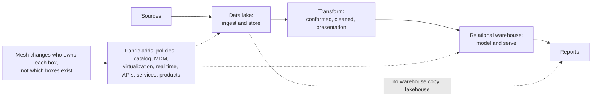

# Data architectures: modern data warehouse, data fabric, data mesh

> Part one of two. This note covers where the data lives: the modern data warehouse, the data fabric, the lakehouse and derived data. [01b — Data mesh: topologies and scenarios](01b-data-mesh-topologies-and-scenarios.md) covers who owns it: the four principles, Serra's skepticism and mesh types, Strengholt's six topologies, the scenario prompts, and the closing rules, pitfalls and checklist.

A finance team joins trips to tax rates, gets a clean result and files it. The tax figure is about half what it should be, and no system raised an error, because one team writes `CA` and another writes `California` and an inner join treats that as no match. The earlier pillars build one pipeline and ask what each stage trusts about the stage before. This chapter is about arranging many pipelines: where the data physically sits (modern data warehouse, data fabric, lakehouse) and who owns each part (data mesh). Most "the pipeline is a monster" problems turn out to be ownership problems, and the tax bug above is one: both tables were correct by their owners' lights, and no one owned the rule between them.

## Where it sits

This chapter sits above the storage, ingest, transform and warehouse pillars rather than after them. The material is five PDFs in [sources/](../../sources): three chapter excerpts (10, 11 and 13), which from their content are James Serra's *Deciphering Data Architectures* (O'Reilly, 2024); Piethein Strengholt's data-mesh topologies article; and a scenario-prompts handout for discussion. The excerpts have no title page, so the attribution is inferred (see [the references](../references.md)). Confidence is `medium` because these are opinionated secondary sources rather than measurements; Serra says plainly when he is giving his own view, and so does this chapter. To run the code: `uv run --with duckdb --with pyarrow --with numpy python chapter.py`. Blocks build on each other, in order, on synthetic data.

| Question | Architecture | Section |
|---|---|---|
| Where does the data live, and how is it served? | Modern data warehouse, data fabric, lakehouse | [Modern data warehouse](#modern-data-warehouse), [Data fabric](#data-fabric), [Choosing](#choosing-the-physical-architecture) |
| Who owns each dataset and pipeline? | Centralised against data mesh | [Four principles](01b-data-mesh-topologies-and-scenarios.md#data-mesh-the-four-principles), [Skepticism](01b-data-mesh-topologies-and-scenarios.md#serras-skepticism-and-his-mesh-types), [Is a mesh right for you?](01b-data-mesh-topologies-and-scenarios.md#is-a-mesh-right-for-you) |
| What does it look like in practice? | Strengholt's topologies; scenario prompts | [Topologies](01b-data-mesh-topologies-and-scenarios.md#strengholts-six-topologies), [Prompts](01b-data-mesh-topologies-and-scenarios.md#scenario-prompts-mapped-to-mechanisms) |



## Modern data warehouse

Serra places the MDW after a failure: in the mid-2010s many teams tried to skip the RDW and use the lake for everything, the approach failed, and the MDW became the most popular architecture (p. 137). He gives no reason; his later remark that lakes lack the performance for dashboards (p. 143) is our guess at one. A **modern data warehouse (MDW)** is a relational data warehouse (RDW) plus a data lake. At least some data is copied from the lake into the RDW. If none is, and everything is queried in the lake, you have a lakehouse instead.

| Stage | What happens | Zoomcamp equivalent |
|---|---|---|
| Ingestion | Pull from sources into the lake | [Ingest](../../02-ingest-and-modelling/notes/01-ingest.md): dlt, Kafka, `wget` into GCS |
| Storage | Raw files in the lake | GCS bucket from Terraform ([Ingest](../../02-ingest-and-modelling/notes/01-ingest.md)) |
| Transformation | Clean, join, conform, through the lake's conformed, cleaned, enriched and presentation layers | dbt ([Transform](../../03-transform-and-orchestrate/notes/01-transform.md)), Spark ([Warehouse](../../04-warehouse-lakehouse-streaming/notes/01-warehouse-and-store.md)) |
| Data modeling | Star schema in the RDW | dbt `core` facts and dims ([Transform](../../03-transform-and-orchestrate/notes/01-transform.md)) |
| Visualization | Reports, dashboards | Looker Studio / Metabase ([Transform](../../03-transform-and-orchestrate/notes/01-transform.md)) |

The data-engineering zoomcamp *is* an MDW: GCS lake, then BigQuery warehouse, then dbt models, then Looker Studio.

**Lake against RDW roles.** The split follows the kind of question. The RDW is built top-down with schema on write and answers descriptive and diagnostic questions; the lake is built bottom-up with schema on read and suits predictive and prescriptive work.

| | Data lake | Relational data warehouse |
|---|---|---|
| Schema | On read | On write |
| Users | Data scientists, power users | Business users, BI |
| Job | Staging, preparation, exploration, cheap storage of everything | Serving: fast queries, a stable model |
| Security | Set over a complex folder-and-file structure | Adds row- and column-level |
| Strength | Flexibility, any format | Compliance, performance, familiarity |

Serra allows two exceptions to the flow (p. 140). Not all presentation-layer data in the lake has to be copied into the RDW. And not all source data has to pass through the lake: reference tables that are full extracts needing no cleaning, and on-prem migrations that reuse existing ETL packages are his examples. That second exception gives up the lake's role as backup and single source of truth, and puts the cleansing load on the RDW, so our advice is to keep it an exception.

| Pros | Cons |
|---|---|
| Integrates many sources | Complexity: two systems to run |
| Scales storage and compute separately | Cost: data is stored twice |
| Can add real-time | Needs both lake and SQL skills |
| Performance where it matters (RDW) | Lake and RDW can drift into silos |
| Flexible: raw data is kept | Compliance across two stores |
| Fine-grained security in the RDW | Vendor lock-in on a cloud stack |

Serra says that as streaming, large and semi-structured data became more common, large enterprises started to use the fabric and lakehouse architectures, but for customers with not much data, "say, under 10 terabytes", the MDW is still popular and likely to stay so, "at least until data lakes can operate as well as RDWs can" (ch. 10, p. 137). Ch. 11 gives the other side of the line: the fabric is "the most widely used architecture for new solutions being built in the cloud, especially for large amounts of data (over 10 terabytes)" (p. 152). Neither claim cites data; the 10 TB figure is his judgement from practice and not a measurement.

**Stepping stones** for a team with an on-prem enterprise data warehouse (EDW), which Serra presents as interim states on the way to an MDW:

| Path | What you do |
|---|---|
| EDW augmentation | Keep the EDW for the primary data; add a lake for big data that users can query and report on. It offloads none of the EDW's existing work |
| Temporary lake + EDW | Use the lake only as a staging and refining area that offloads transformations and shortens the EDW's maintenance window; nobody queries it. A few changes turn it into a full MDW |
| All-in-one | Lake only, query it directly. Close to a lakehouse |

**Case study (Wilson & Gunkerk, a fictitious firm Serra uses for illustration):** under 1 TB, projected to stay within 10 TB, so the firm chose a cloud MDW on a symmetric multiprocessing (SMP) database rather than a massively parallel processing (MPP) warehouse, and the move took "a few months" (pp. 147-148). SMP and MPP are defined in his chapter 7, which we don't hold. Lesson: don't buy MPP for data that fits on one machine. That is the same point as the "don't partition tables under 1 GB" rule in [the warehouse chapter](../../04-warehouse-lakehouse-streaming/notes/01-warehouse-and-store.md), at a larger scale.

Measure what fits on one machine before buying. The query below scans 50 million synthetic rows on a laptop, and writes a file of about 0.4 GB to the working directory to do it.

```python
import duckdb, os, time
con2 = duckdb.connect()
big = 50_000_000
con2.sql(f"""
    COPY (SELECT i AS trip_id,
                 (ARRAY['US-CA','US-NY','US-WA'])[1 + (i % 3)::INT] AS state,
                 round(random() * 100, 2) AS fare,
                 DATE '2024-01-01' + (random() * 365)::INT AS day
          FROM range({big}) t(i))
    TO 'big.parquet' (FORMAT parquet)
""")
size_gb = os.path.getsize("big.parquet") / 1e9
t = time.perf_counter()
rows = con2.sql("""
    SELECT state, date_trunc('month', day) AS month, sum(fare), count(*)
    FROM 'big.parquet' GROUP BY 1, 2
""").fetchall()
print(f"{big:,} rows, {size_gb:.2f} GB on disk, {len(rows)} groups, "
      f"{time.perf_counter() - t:.2f} s on one laptop, {os.cpu_count()} cores")
```

Output:

```text
50,000,000 rows, 0.37 GB on disk, 36 groups, 0.14 s on one laptop, 12 cores
```

This is one aggregate with no concurrency, so it says nothing about a hundred analysts at once, and concurrency and governance are what an RDW also sells. It does say that volume alone rarely justifies a cluster at this size. [The cost chapter](../../04-warehouse-lakehouse-streaming/notes/05-cost.md) carries on from here.

### The lakehouse

A lakehouse ([CIDR 2021](https://www.cidrdb.org/cidr2021/papers/cidr2021_paper17.pdf)) drops the RDW copy and adds warehouse features (ACID transactions, schema enforcement, time travel) to the lake through an open table format: Delta Lake, Apache Iceberg or Hudi. [Table formats](../../04-warehouse-lakehouse-streaming/notes/02-table-formats.md) shows how, and [lakehouse against warehouse](../../04-warehouse-lakehouse-streaming/notes/03-lakehouse-vs-warehouse.md) runs the comparison.

## Data fabric

Serra calls a **data fabric** an evolution of the MDW, an added layer that improves accessibility, security, discoverability and availability, and whose defining philosophy is that it can consume any and all data in the organisation. He counts eight features:

| Feature | What it adds |
|---|---|
| Data access policies | Rules for who sees what, how it may be used and when, enforced on requests through mechanisms such as APIs, drivers or virtualization. He calls them the key to governance |
| Metadata catalog | Search across all datasets, with **lineage** (where a value came from and how it was transformed). [Built out in chapter 03](03-catalog-semantic-layer-and-contracts.md) |
| Master data management (MDM) | A single authoritative source for master data: customers, products, suppliers, employees |
| Data virtualization | Query data where it sits, without copying. Optional in his definition, and used in a small number of situations, with most data still centralised |
| Real-time processing | Results as soon as the data arrives ([Ingest](../../02-ingest-and-modelling/notes/01-ingest.md)) |
| APIs | Standard access that hides where data lives, so moving the data doesn't break callers; can also filter by user |
| Services | Reusable blocks, such as cleaning or ingestion code, offered to teams that don't need the whole fabric |
| Products | The whole fabric bundled and sold, for example one built for an industry such as healthcare |

Serra's rule of thumb: an MDW with three or more of these is a data fabric. The line is fuzzy, he says so, and he adds that plenty of people use none of them and still say "data fabric" for the philosophy. He calls it an evolution of the MDW (p. 151), and says many companies are "upgrading" their MDW into one (p. 152), so read it as an MDW with more added rather than a replacement. The costs he lists are a resource-intensive transition with hiccups in cost, training and integration, and troubleshooting that the added complexity makes harder; for a small business with few sources he says an MDW might suffice. His reasons to move anyway are scalability, a unified view of varied sources, real-time processing, security and governance, compliance across countries, and volatile industries such as stock trading and ecommerce (pp. 156-157).

Definitions differ, so ask which one a speaker means. Gartner's version treats virtualization as a major piece and imagines an "intelligent" fabric using knowledge graphs and machine learning to automate discovery and integration. Serra says much of that technology does not yet exist and recommends working with fabrics as they are.

## Choosing the physical architecture

The table below is our synthesis of Serra's guidance and the single-machine measurement above; Serra gives no such table. Treat the thresholds as starting points for a conversation.

| You have | Consider |
|---|---|
| Under about 1 TB, one team | A single SMP database. Or DuckDB ([Warehouse](../../04-warehouse-lakehouse-streaming/notes/01-warehouse-and-store.md)) |
| Up to about 10 TB, BI-heavy | MDW |
| Many sources, governance pain, lineage questions | Data fabric (MDW plus catalog, MDM, policies) |
| Large data, data science heavy, cost-sensitive | Lakehouse |
| Many autonomous business units | Data mesh on top of any of the above |

The last row matters: a data mesh is *not* a fourth storage option. It's an organisational model, and each domain still picks an MDW, a fabric or a lakehouse for its own data. Serra's phrase is that mesh is a concept and not a technology.

## Derived data: the frame under all of these

These architectures, and the mesh in the next section, are usually compared on features. Chapter 12 of [*Designing Data-Intensive Applications*](https://dataintensive.net/) offers a more durable comparison, written before most of this vocabulary settled, so mapping it onto fabric and mesh is my reading and not the book's.

Start from the observation that no single tool does everything, so organisations always end up with several representations of the same facts. The question that sorts out any such arrangement is where each fact is written first, and which representations derive from which (pp. 490-491). The lake's raw zone, or the operational source behind it, is the **system of record**. Warehouse tables, marts, search indexes, feature stores and ML models are **derived** (p. 505), which means they can be rebuilt, and that a bug in them is cheap. "No single source of truth" in the scenario prompts below is this question left unanswered.

How the derived copies are kept in step has two answers. A distributed transaction uses locks and atomic commit. A log gives an order, and retries with idempotent writes get to the same place. Kleppmann argues for the log across different technologies and across teams, since a distributed transaction spreads a fault to every participant, where an asynchronous log contains it (pp. 492, 495, 502). The second benefit he names is at the level of people, because teams can work independently as long as the interface between them is well defined (p. 502). That is the argument for the data mesh of the next section, made from the bottom up. A data product with a contract is what makes it safe, and a [dual write](../../02-ingest-and-modelling/notes/01-ingest.md) across domains is what breaks it.

He then asks how a whole organisation's data can behave as one database, and gives two approaches (p. 501). **Federation** unifies reads: one query interface over many stores, as with PostgreSQL's foreign data wrappers. That is what a fabric's data virtualization offers. **Unbundling** unifies writes: a log and derived views keep the stores in step. It treats `CREATE INDEX` as the model, since a snapshot followed by a backlog followed by keeping up is the same work as adding a [follower](../../01-storage-and-compute-foundations/notes/05-partitioning-and-replication.md) or [starting CDC](../../02-ingest-and-modelling/notes/01-ingest.md) (p. 500). That is what ELT pipelines between domains do, and it is why he describes such a pipeline as index maintenance at organisation scale (pp. 500-501).

There are limits. A total order needs everything to pass through one leader, and it stops being available across partitioned logs, data centres and independently owned services (p. 493). So when one domain records that a user unfriended someone and another sends that person a message, the dependency between the two can be lost, and it has to be recovered by logging what state each decision saw (p. 494). Expect some cross-domain questions to have no single right order.

Finally, a distinction that decides which incidents matter most. A late dashboard is a violation of **timeliness**, and waiting fixes it. The tax bug that opens this chapter is a violation of **integrity**, and waiting will not fix it. Kleppmann's words for the two are "eventual consistency" and "perpetual inconsistency", and he asserts that in most applications integrity matters far more (pp. 524-525). Integrity is why he closes with a case for auditing. Do not assume the storage, the transforms or the pipelines are correct. Read the data back, try restoring backups, and run end-to-end checks across the whole derived pipeline, since one such check implicitly covers every disk, network and service on the way (pp. 530-532). The `check_global` test in the mesh section below is a small example, and [reconciliation](../../05-quality-and-observability/notes/01-quality-dimensions-and-tests.md) is the usual form.

The ownership half of the chapter, from the four mesh principles to the scenario prompts and the interview checklist, continues in [01b — Data mesh: topologies and scenarios](01b-data-mesh-topologies-and-scenarios.md).

## Pitfalls

- **Buying the architecture for the data you imagine.** MPP and a fabric each cost money and skills every month. Serra's fictional firm, under 1 TB and projected within 10 TB, is the reference case, and the 50-million-row query above is the check to run first.

## Try it

1. Your warehouse runs one reporting query a minute and holds 400 GB. A vendor proposes an MPP engine. What do you measure before agreeing, and which result would change your answer?
2. One team wants a single query over Postgres and the lake without copying either. Is that federation or unbundling, and what does it still leave unsolved?

<details><summary>Answers</summary>

1. A representative query on one machine, as in the 50-million-row check above, and the concurrency at the busiest hour. If one node answers in an acceptable time at that concurrency, MPP buys cost and skills and no speed; if concurrency is the limit, that can justify it even at small volume.
2. Federation, since it unifies reads. It does not unify writes, so the two stores can still disagree, and the log-and-derived-views approach (unbundling) is the one that keeps them in step.

</details>

## Interview checklist

| Question | Answer |
|---|---|
| What separates an MDW from a lakehouse? | An MDW copies at least some data from the lake into a relational warehouse. A lakehouse copies none and serves from the lake through a table format. |
| Federation or unbundling? | Federation unifies reads, with one interface over many stores (virtualization). Unbundling unifies writes, with a log and derived views keeping stores in step (ELT, CDC). |
| What makes an MDW a data fabric? | Added features: access policies, catalog, MDM, virtualization, real time, APIs, services, products. Serra's personal line is three or more, and he admits it is fuzzy. |
| When is one node enough? | Serra's example is under 1 TB; measure a representative query first. Volume alone rarely justifies MPP at that size, though concurrency can. |

## Next

[01b — Data mesh: topologies and scenarios](01b-data-mesh-topologies-and-scenarios.md): the architectures say where the data sits. Now who owns each part of it, how far a mesh should go, and which mechanism answers each scenario prompt.
