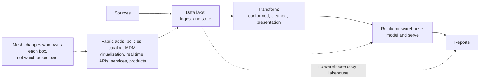

# Data architectures: modern data warehouse, data fabric, data mesh

A finance team joins trips to tax rates, gets a clean result and files it. The tax figure is about half what it should be, and no system raised an error, because one team writes `CA` and another writes `California` and an inner join treats that as no match. The earlier pillars build one pipeline and ask what each stage trusts about the stage before. This chapter is about arranging many pipelines: where the data physically sits (modern data warehouse, data fabric, lakehouse) and who owns each part (data mesh). Most "the pipeline is a monster" problems turn out to be ownership problems, and the tax bug above is one: both tables were correct by their owners' lights, and no one owned the rule between them.

## Where it sits

This chapter sits above the storage, ingest, transform and warehouse pillars rather than after them. The material is five PDFs in [sources/](../../sources): three chapter excerpts (10, 11 and 13), which from their content are James Serra's *Deciphering Data Architectures* (O'Reilly, 2024); Piethein Strengholt's data-mesh topologies article; and a scenario-prompts handout for discussion. The excerpts have no title page, so the attribution is inferred (see [the references](../references.md)). Confidence is `medium` because these are opinionated secondary sources rather than measurements; Serra says plainly when he is giving his own view, and so does this chapter. To run the code: `uv run --with duckdb --with pyarrow --with numpy python chapter.py`. Blocks build on each other, in order, on synthetic data.

| Question | Architecture | Section |
|---|---|---|
| Where does the data live, and how is it served? | Modern data warehouse, data fabric, lakehouse | [Modern data warehouse](#modern-data-warehouse), [Data fabric](#data-fabric), [Choosing](#choosing-the-physical-architecture) |
| Who owns each dataset and pipeline? | Centralised against data mesh | [Four principles](#data-mesh-the-four-principles), [Skepticism](#serras-skepticism-and-his-mesh-types), [Is a mesh right for you?](#is-a-mesh-right-for-you) |
| What does it look like in practice? | Strengholt's topologies; scenario prompts | [Topologies](#strengholts-six-topologies), [Prompts](#scenario-prompts-mapped-to-mechanisms) |



## Modern data warehouse

Serra places the MDW after a failure: in the mid-2010s many teams tried to skip the RDW and use the lake for everything, the approach failed, and the MDW became the most popular architecture (p. 137). He gives no reason; his later remark that lakes lack the performance for dashboards (p. 143) is our guess at one. A **modern data warehouse (MDW)** is a relational data warehouse (RDW) plus a data lake. At least some data is copied from the lake into the RDW. If none is, and everything is queried in the lake, you have a lakehouse instead.

| Stage | What happens | Zoomcamp equivalent |
|---|---|---|
| Ingestion | Pull from sources into the lake | [Ingest](../../02-ingest-and-modelling/notes/01-ingest.md): dlt, Kafka, `wget` into GCS |
| Storage | Raw files in the lake | GCS bucket from Terraform ([Ingest](../../02-ingest-and-modelling/notes/01-ingest.md)) |
| Transformation | Clean, join, conform, through the lake's conformed, cleaned, enriched and presentation layers | dbt ([Transform](../../03-transform-and-orchestrate/notes/01-transform.md)), Spark ([Warehouse](../../04-warehouse-lakehouse-streaming/notes/01-warehouse-and-store.md)) |
| Data modeling | Star schema in the RDW | dbt `core` facts and dims ([Transform](../../03-transform-and-orchestrate/notes/01-transform.md)) |
| Visualization | Reports, dashboards | Looker Studio / Metabase ([Transform](../../03-transform-and-orchestrate/notes/01-transform.md)) |

The data-engineering zoomcamp *is* an MDW: GCS lake, then BigQuery warehouse, then dbt models, then Looker Studio.

**Lake against RDW roles.** The split follows the kind of question. The RDW is built top-down with schema on write and answers descriptive and diagnostic questions; the lake is built bottom-up with schema on read and suits predictive and prescriptive work.

| | Data lake | Relational data warehouse |
|---|---|---|
| Schema | On read | On write |
| Users | Data scientists, power users | Business users, BI |
| Job | Staging, preparation, exploration, cheap storage of everything | Serving: fast queries, a stable model |
| Security | Set over a complex folder-and-file structure | Adds row- and column-level |
| Strength | Flexibility, any format | Compliance, performance, familiarity |

Serra allows two exceptions to the flow (p. 140). Not all presentation-layer data in the lake has to be copied into the RDW. And not all source data has to pass through the lake: reference tables that are full extracts needing no cleaning, and on-prem migrations that reuse existing ETL packages are his examples. That second exception gives up the lake's role as backup and single source of truth, and puts the cleansing load on the RDW, so our advice is to keep it an exception.

| Pros | Cons |
|---|---|
| Integrates many sources | Complexity: two systems to run |
| Scales storage and compute separately | Cost: data is stored twice |
| Can add real-time | Needs both lake and SQL skills |
| Performance where it matters (RDW) | Lake and RDW can drift into silos |
| Flexible: raw data is kept | Compliance across two stores |
| Fine-grained security in the RDW | Vendor lock-in on a cloud stack |

Serra says that as streaming, large and semi-structured data became more common, large enterprises started to use the fabric and lakehouse architectures, but for customers with not much data, "say, under 10 terabytes", the MDW is still popular and likely to stay so, "at least until data lakes can operate as well as RDWs can" (ch. 10, p. 137). Ch. 11 gives the other side of the line: the fabric is "the most widely used architecture for new solutions being built in the cloud, especially for large amounts of data (over 10 terabytes)" (p. 152). Neither claim cites data; the 10 TB figure is his judgement from practice and not a measurement.

**Stepping stones** for a team with an on-prem enterprise data warehouse (EDW), which Serra presents as interim states on the way to an MDW:

| Path | What you do |
|---|---|
| EDW augmentation | Keep the EDW for the primary data; add a lake for big data that users can query and report on. It offloads none of the EDW's existing work |
| Temporary lake + EDW | Use the lake only as a staging and refining area that offloads transformations and shortens the EDW's maintenance window; nobody queries it. A few changes turn it into a full MDW |
| All-in-one | Lake only, query it directly. Close to a lakehouse |

**Case study (Wilson & Gunkerk, a fictitious firm Serra uses for illustration):** under 1 TB, projected to stay within 10 TB, so the firm chose a cloud MDW on a symmetric multiprocessing (SMP) database rather than a massively parallel processing (MPP) warehouse, and the move took "a few months" (pp. 147-148). SMP and MPP are defined in his chapter 7, which we don't hold. Lesson: don't buy MPP for data that fits on one machine. That is the same point as the "don't partition tables under 1 GB" rule in [the warehouse chapter](../../04-warehouse-lakehouse-streaming/notes/01-warehouse-and-store.md), at a larger scale.

Measure what fits on one machine before buying. The query below scans 50 million synthetic rows on a laptop, and writes a file of about 0.4 GB to the working directory to do it.

```python
import duckdb, os, time
con2 = duckdb.connect()
big = 50_000_000
con2.sql(f"""
    COPY (SELECT i AS trip_id,
                 (ARRAY['US-CA','US-NY','US-WA'])[1 + (i % 3)::INT] AS state,
                 round(random() * 100, 2) AS fare,
                 DATE '2024-01-01' + (random() * 365)::INT AS day
          FROM range({big}) t(i))
    TO 'big.parquet' (FORMAT parquet)
""")
size_gb = os.path.getsize("big.parquet") / 1e9
t = time.perf_counter()
rows = con2.sql("""
    SELECT state, date_trunc('month', day) AS month, sum(fare), count(*)
    FROM 'big.parquet' GROUP BY 1, 2
""").fetchall()
print(f"{big:,} rows, {size_gb:.2f} GB on disk, {len(rows)} groups, "
      f"{time.perf_counter() - t:.2f} s on one laptop, {os.cpu_count()} cores")
```

Output:

```text
50,000,000 rows, 0.37 GB on disk, 36 groups, 0.14 s on one laptop, 12 cores
```

This is one aggregate with no concurrency, so it says nothing about a hundred analysts at once, and concurrency and governance are what an RDW also sells. It does say that volume alone rarely justifies a cluster at this size. [The cost chapter](../../04-warehouse-lakehouse-streaming/notes/05-cost.md) carries on from here.

### The lakehouse

A lakehouse ([CIDR 2021](https://www.cidrdb.org/cidr2021/papers/cidr2021_paper17.pdf)) drops the RDW copy and adds warehouse features (ACID transactions, schema enforcement, time travel) to the lake through an open table format: Delta Lake, Apache Iceberg or Hudi. [Table formats](../../04-warehouse-lakehouse-streaming/notes/02-table-formats.md) shows how, and [lakehouse against warehouse](../../04-warehouse-lakehouse-streaming/notes/03-lakehouse-vs-warehouse.md) runs the comparison.

## Data fabric

Serra calls a **data fabric** an evolution of the MDW, an added layer that improves accessibility, security, discoverability and availability, and whose defining philosophy is that it can consume any and all data in the organisation. He counts eight features:

| Feature | What it adds |
|---|---|
| Data access policies | Rules for who sees what, how it may be used and when, enforced on requests through mechanisms such as APIs, drivers or virtualization. He calls them the key to governance |
| Metadata catalog | Search across all datasets, with **lineage** (where a value came from and how it was transformed). [Built out in chapter 03](03-catalog-semantic-layer-and-contracts.md) |
| Master data management (MDM) | A single authoritative source for master data: customers, products, suppliers, employees |
| Data virtualization | Query data where it sits, without copying. Optional in his definition, and used in a small number of situations, with most data still centralised |
| Real-time processing | Results as soon as the data arrives ([Ingest](../../02-ingest-and-modelling/notes/01-ingest.md)) |
| APIs | Standard access that hides where data lives, so moving the data doesn't break callers; can also filter by user |
| Services | Reusable blocks, such as cleaning or ingestion code, offered to teams that don't need the whole fabric |
| Products | The whole fabric bundled and sold, for example one built for an industry such as healthcare |

Serra's rule of thumb: an MDW with three or more of these is a data fabric. The line is fuzzy, he says so, and he adds that plenty of people use none of them and still say "data fabric" for the philosophy. He calls it an evolution of the MDW (p. 151), and says many companies are "upgrading" their MDW into one (p. 152), so read it as an MDW with more added rather than a replacement. The costs he lists are a resource-intensive transition with hiccups in cost, training and integration, and troubleshooting that the added complexity makes harder; for a small business with few sources he says an MDW might suffice. His reasons to move anyway are scalability, a unified view of varied sources, real-time processing, security and governance, compliance across countries, and volatile industries such as stock trading and ecommerce (pp. 156-157).

Definitions differ, so ask which one a speaker means. Gartner's version treats virtualization as a major piece and imagines an "intelligent" fabric using knowledge graphs and machine learning to automate discovery and integration. Serra says much of that technology does not yet exist and recommends working with fabrics as they are.

## Choosing the physical architecture

The table below is our synthesis of Serra's guidance and the single-machine measurement above; Serra gives no such table. Treat the thresholds as starting points for a conversation.

| You have | Consider |
|---|---|
| Under about 1 TB, one team | A single SMP database. Or DuckDB ([Warehouse](../../04-warehouse-lakehouse-streaming/notes/01-warehouse-and-store.md)) |
| Up to about 10 TB, BI-heavy | MDW |
| Many sources, governance pain, lineage questions | Data fabric (MDW plus catalog, MDM, policies) |
| Large data, data science heavy, cost-sensitive | Lakehouse |
| Many autonomous business units | Data mesh on top of any of the above |

The last row matters: a data mesh is *not* a fourth storage option. It's an organisational model, and each domain still picks an MDW, a fabric or a lakehouse for its own data. Serra's phrase is that mesh is a concept and not a technology.

## Derived data: the frame under all of these

These architectures, and the mesh in the next section, are usually compared on features. Chapter 12 of [*Designing Data-Intensive Applications*](https://dataintensive.net/) offers a more durable comparison, written before most of this vocabulary settled, so mapping it onto fabric and mesh is my reading and not the book's.

Start from the observation that no single tool does everything, so organisations always end up with several representations of the same facts. The question that sorts out any such arrangement is where each fact is written first, and which representations derive from which (pp. 490-491). The lake's raw zone, or the operational source behind it, is the **system of record**. Warehouse tables, marts, search indexes, feature stores and ML models are **derived** (p. 505), which means they can be rebuilt, and that a bug in them is cheap. "No single source of truth" in the scenario prompts below is this question left unanswered.

How the derived copies are kept in step has two answers. A distributed transaction uses locks and atomic commit. A log gives an order, and retries with idempotent writes get to the same place. Kleppmann argues for the log across different technologies and across teams, since a distributed transaction spreads a fault to every participant, where an asynchronous log contains it (pp. 492, 495, 502). The second benefit he names is at the level of people, because teams can work independently as long as the interface between them is well defined (p. 502). That is the argument for the data mesh of the next section, made from the bottom up. A data product with a contract is what makes it safe, and a [dual write](../../02-ingest-and-modelling/notes/01-ingest.md) across domains is what breaks it.

He then asks how a whole organisation's data can behave as one database, and gives two approaches (p. 501). **Federation** unifies reads: one query interface over many stores, as with PostgreSQL's foreign data wrappers. That is what a fabric's data virtualization offers. **Unbundling** unifies writes: a log and derived views keep the stores in step. It treats `CREATE INDEX` as the model, since a snapshot followed by a backlog followed by keeping up is the same work as adding a [follower](../../01-storage-and-compute-foundations/notes/05-partitioning-and-replication.md) or [starting CDC](../../02-ingest-and-modelling/notes/01-ingest.md) (p. 500). That is what ELT pipelines between domains do, and it is why he describes such a pipeline as index maintenance at organisation scale (pp. 500-501).

There are limits. A total order needs everything to pass through one leader, and it stops being available across partitioned logs, data centres and independently owned services (p. 493). So when one domain records that a user unfriended someone and another sends that person a message, the dependency between the two can be lost, and it has to be recovered by logging what state each decision saw (p. 494). Expect some cross-domain questions to have no single right order.

Finally, a distinction that decides which incidents matter most. A late dashboard is a violation of **timeliness**, and waiting fixes it. The tax bug that opens this chapter is a violation of **integrity**, and waiting will not fix it. Kleppmann's words for the two are "eventual consistency" and "perpetual inconsistency", and he asserts that in most applications integrity matters far more (pp. 524-525). Integrity is why he closes with a case for auditing. Do not assume the storage, the transforms or the pipelines are correct. Read the data back, try restoring backups, and run end-to-end checks across the whole derived pipeline, since one such check implicitly covers every disk, network and service on the way (pp. 530-532). The `check_global` test in the mesh section below is a small example, and [reconciliation](../../05-quality-and-observability/notes/01-quality-dimensions-and-tests.md) is the usual form.

## Data mesh: the four principles

In the architectures so far a central data team owns ingestion, modelling and serving for the whole company. That team usually doesn't know what the source fields mean, and as the company grows it becomes the queue everyone waits in. Zhamak Dehghani's [data mesh](https://martinfowler.com/articles/data-mesh-principles.html) decentralises that, using four principles. Serra lists four challenges the principles address (p. 172); pairing each with one principle, and the cell wording, is ours:

| Challenge with central ownership | Principle | What it means |
|---|---|---|
| Lack of ownership: the central team doesn't understand the source data | **1. Domain ownership** | The team closest to the data owns its operational and analytical data |
| Low quality: nobody downstream can fix upstream issues | **2. Data as a product** | Domains publish data that is discoverable, trustworthy, accessible, secure and understandable, and treat consumers as customers |
| Technical scaling: every domain rebuilds infrastructure | **3. Self-serve data platform** | A central platform team builds the tooling (storage, compute, pipelines, access control) that domains request through APIs or scripts |
| Organisational scaling: chaos without standards | **4. Federated computational governance** | Global rules (interoperability, quality, security, regulation, modelling) set jointly by domains and a central team, implemented and monitored in domains, automated where possible |

Two of the four are centralised. A mesh is not the absence of central teams: a platform team and a governance group still exist, as Serra's architecture diagram makes clear.

**Data product against data as a product:** Serra separates these. *Data as a product* is the idea: the owner treats the data as a complete product and not as a byproduct. A *data product* is the implementation: "a self-contained, independently deployable unit of data that delivers business value", built by one product team (pp. 173-174). Some exclude code, metadata and infrastructure from it, he notes. A **data contract** is the agreement a consumer reads from: format, schema, metadata, transformation information and access rules. [The contracts chapter](../../02-ingest-and-modelling/notes/04-data-contracts.md) treats producer and consumer in depth; here we care about what happens across many of them.

**Federated governance, run.** Serra's example of an inconsistency is one domain using full state names and another the two-letter abbreviation. This is that bug, built so you can watch it pass quietly.

```python
import duckdb, numpy as np, pyarrow as pa, pyarrow.parquet as pq, os

rng = np.random.default_rng(7)
n = 200_000
states = np.array(["CA", "NY", "WA"])
trip_state = rng.choice(states, n, p=[0.40, 0.45, 0.15])

# The trips domain publishes two-letter codes.
pq.write_table(pa.table({
    "trip_id": np.arange(n),
    "state": trip_state,
    "fare": rng.gamma(3.0, 6.0, n).round(2),
}), "trips.parquet")

# The finance domain keeps tax rates. Its CA row came from a
# different system, which spells the state out.
pq.write_table(pa.table({
    "state": ["California", "NY", "WA"],
    "tax_rate": [0.0725, 0.04, 0.065],
}), "tax_rates.parquet")

con = duckdb.connect()
print(con.sql("""
    SELECT round(sum(fare)) AS revenue, count(*) AS trips
    FROM 'trips.parquet'
""").fetchall()[0])
```

Output:

```text
(3605056.0, 200000)
```

```python
print(con.sql("""
    SELECT count(*) AS trips, round(sum(fare)) AS taxable_revenue,
           round(sum(fare * tax_rate)) AS tax_owed
    FROM 'trips.parquet' JOIN 'tax_rates.parquet' USING (state)
""").fetchall()[0])
print(con.sql("""
    SELECT state, count(*) AS trips
    FROM 'trips.parquet' t
    WHERE NOT EXISTS (SELECT 1 FROM 'tax_rates.parquet' r WHERE r.state = t.state)
    GROUP BY state
""").fetchall())
```

Output:

```text
(120003, 2163607.0, 99957.0)
[('CA', 79997)]
```

The join returned 120,003 rows out of 200,000 and a tax figure of 99,957 where the truth, shown below, is 204,462. There was no exception and no null. Each domain can also pass its own check, because each kept its own promise:

```python
from dataclasses import dataclass, field

@dataclass
class Contract:
    product: str
    domain: str
    owner: str                       # a team that answers, not a person
    path: str
    columns: dict                    # name -> DuckDB type
    freshness_hours: int
    description: str = ""
    reads: list = field(default_factory=list)   # upstream products

trips = Contract("trips", "mobility", "mobility-data@", "trips.parquet",
                 {"trip_id": "BIGINT", "state": "VARCHAR", "fare": "DOUBLE"},
                 freshness_hours=24, description="One row per completed trip.")
tax = Contract("tax_rates", "finance", "finance-data@", "tax_rates.parquet",
               {"state": "VARCHAR", "tax_rate": "DOUBLE"},
               freshness_hours=720, description="Sales tax rate per state.")

def check_schema(c):
    """The domain's own promise: the columns it said it would publish."""
    got = {r[0]: r[1] for r in con.sql(f"DESCRIBE SELECT * FROM '{c.path}'").fetchall()}
    return [f"{k}: want {v}, got {got.get(k)}"
            for k, v in c.columns.items() if got.get(k) != v]

print("trips schema:", check_schema(trips) or "ok")
print("tax schema:  ", check_schema(tax) or "ok")
```

Output:

```text
trips schema: ok
tax schema:   ok
```

A domain test can't catch this, as the fault lies between two products. The rule has to be global, and it has to run where no domain can skip it. Serra's wording is that the central group sets the standard and domains implement it, and that this should be automated whenever possible. Here the federated group has chosen [ISO 3166-2](https://en.wikipedia.org/wiki/ISO_3166-2:US) subdivision codes, in which California is `US-CA`, so both tables are non-conforming. That choice is ours, for this example; Serra names no particular standard.

```python
# Global rules: agreed by the federated group, run by the platform on every product.
GLOBAL_RULES = {
    "state": r"^US-[A-Z]{2}$",        # ISO 3166-2 subdivision code
}

def check_global(c):
    problems = []
    for col in c.columns:
        if col in GLOBAL_RULES:
            bad = con.sql(f"""
                SELECT DISTINCT {col} FROM '{c.path}'
                WHERE NOT regexp_full_match({col}, '{GLOBAL_RULES[col]}')
                ORDER BY 1""").fetchall()
            if bad:
                problems.append(f"{c.product}.{col} breaks ISO 3166-2: "
                                f"{[b[0] for b in bad]} -> {c.owner}")
    return problems

for c in (trips, tax):
    print(check_global(c) or f"{c.product}: ok")
```

Output:

```text
["trips.state breaks ISO 3166-2: ['CA', 'NY', 'WA'] -> mobility-data@"]
["tax_rates.state breaks ISO 3166-2: ['California', 'NY', 'WA'] -> finance-data@"]
```

```python
con.sql("""
    CREATE TABLE ref_state AS SELECT * FROM (VALUES
        ('CA', 'US-CA'), ('California', 'US-CA'),
        ('NY', 'US-NY'), ('New York', 'US-NY'),
        ('WA', 'US-WA'), ('Washington', 'US-WA')) t(raw, iso)
""")
for c in (trips, tax):
    new_path = c.path.replace(".parquet", "_v2.parquet")
    other = [k for k in c.columns if k != "state"]
    con.sql(f"""COPY (SELECT {', '.join(other)}, r.iso AS state
                      FROM '{c.path}' JOIN ref_state r ON state = r.raw)
                TO '{new_path}' (FORMAT parquet)""")
    c.path = new_path
    print(c.product, check_global(c) or "ok")

print(con.sql(f"""
    SELECT count(*) AS trips, round(sum(fare)) AS taxable_revenue,
           round(sum(fare * tax_rate)) AS tax_owed
    FROM '{trips.path}' JOIN '{tax.path}' USING (state)
""").fetchall()[0])
```

Output:

```text
trips ok
tax_rates ok
(200000, 3605056.0, 204462.0)
```

The conformed join covers every trip and the tax figure more than doubles. The fix is small, and a dbt test ([Transform](../../03-transform-and-orchestrate/notes/01-transform.md)) would do the same job within one project. What changes is where it lives: promoted from one project to an organisational rule, with the failure routed to the owner by name.

**The platform makes the right thing the easy thing.** Principles 1 and 2 add work for domain engineers, and Serra's point is that principle 3 exists to pay it back. A single publish call that runs the checks is the smallest version of that:

```python
catalog = {}

def publish(c):
    """Self-serve platform: one call, and the mandatory checks come with it."""
    errors = []
    if not c.owner:
        errors.append("no owner")
    if not c.description:
        errors.append("no description")
    errors += check_schema(c) + check_global(c)
    missing = [u for u in c.reads if u not in catalog]
    if missing:
        errors.append(f"reads unpublished products: {missing}")
    if errors:
        print(f"REJECTED {c.product}: {errors}")
        return False
    catalog[c.product] = c
    print(f"published {c.product} (owner {c.owner})")
    return True

publish(trips)
publish(tax)

# A consumer-aligned product built with no owner and no description.
con.sql(f"""COPY (SELECT state, sum(fare) AS revenue, sum(fare*tax_rate) AS tax_owed
                  FROM '{trips.path}' JOIN '{tax.path}' USING (state) GROUP BY state)
            TO 'pnl.parquet' (FORMAT parquet)""")
pnl = Contract("pnl", "finance", "", "pnl.parquet",
               {"state": "VARCHAR", "revenue": "DOUBLE", "tax_owed": "DOUBLE"},
               freshness_hours=24, reads=["trips", "tax_rates"])
publish(pnl)
pnl.owner, pnl.description = "finance-data@", "Profit and loss by state."
publish(pnl)
```

Output:

```text
published trips (owner mobility-data@)
published tax_rates (owner finance-data@)
REJECTED pnl: ['no owner', 'no description']
published pnl (owner finance-data@)
```

A catalog built from contracts also answers the question that opens most incidents, which is who gets hurt if this changes.

```python
board = Contract("exec_board", "strategy", "strategy-data@", "pnl.parquet",
                 {"state": "VARCHAR", "revenue": "DOUBLE"}, freshness_hours=24,
                 description="Board pack figures.", reads=["pnl"])
publish(board)

def downstream(product):
    """Who has to hear about a change to this product, breadth first."""
    seen, frontier = [], [product]
    while frontier:
        cur = frontier.pop(0)
        for c in catalog.values():
            if cur in c.reads and c.product not in seen:
                seen.append(c.product)
                frontier.append(c.product)
    return [(p, catalog[p].owner) for p in seen]

print(downstream("trips"))
print(downstream("exec_board"))
```

Output:

```text
published exec_board (owner strategy-data@)
[('pnl', 'finance-data@'), ('exec_board', 'strategy-data@')]
[]
```

Notice that `exec_board` was published without its author ever telling the mobility team, and a change to `trips` now knows to reach them. That is the fabric's catalog doing principle 4's work. [Monitors and lineage](../../05-quality-and-observability/notes/02-monitors-and-lineage.md) shows the runtime version with OpenLineage.

**Domain types** (Dehghani's three, with Serra's examples):

| Type | Owns | Example |
|---|---|---|
| Source-aligned | Data close to an operational system, not fitted to a consumer | Manufacturing, sales, supplier |
| Aggregated | Combines several domains, often for query performance | Profit and loss, from manufacturing and sales |
| Consumer-aligned | Shaped for specific users or uses | A simplified supplier model for people outside supplier |

Serra also draws a customer 360 domain that cleans and masters customer data so that other domains pull from it rather than each mastering their own. Designing the domains is the hard part. He calls domain-driven design very difficult and time-consuming, and warns against having to redesign months in.

## Serra's skepticism and his mesh types

Serra (over 35 years in databases) is a mesh skeptic, and the chapter says so:

- **Gartner's 2023 hype cycle** put data mesh near the peak with a "moderate" benefit rating and 5% to 20% market penetration, and predicted it "will be obsolete before the plateau", evolving toward data fabric. This is Gartner as quoted by Serra; the report itself isn't in our sources.
- **His informal poll.** At talks, usually at least 75% of a room have heard of data mesh, one or two in a hundred are building one, and he has yet to see a hand for one in production. He labels this anecdotal.
- **"Pure" data mesh** (all four principles followed completely) he expects no company to build, and a *minimum viable mesh* is undefined. He also rejects the claim that warehouses fail because they can't scale: failures are almost always people, process or the wrong technology choice.

He still says the mesh's ideas can improve any of the other architectures, which is the useful reading.

His three implementation types run from control to agility:

| Type | Technology | Storage | Serra's view |
|---|---|---|---|
| Type 1 | Same tech for all domains | One physical lake, a folder or container per domain | What he sees most, since it avoids cross-lake performance problems and simplifies security, monitoring and backup |
| Type 2 | Same tech | A lake per domain | Truly decentralised, at the cost of linking the lakes and getting acceptable cross-domain performance |
| Type 3 | Any tech, any cloud, per domain | Anything | The pure vision; he thinks it will never be adopted |

**Mesh against fabric:** they aren't rivals. A fabric is a technical architecture. A mesh is an ownership model, so broad that Serra hesitates to call it an architecture. A fabric can be the architecture used *within* the domains of a mesh, and one mesh can hold several fabrics (pp. 182-183). Our addition: a fabric's catalog and policies are often what makes principle 4 enforceable.

**Use cases on a scale:** responsibility runs from fully central IT to fully domain-owned. Data federation (domains own their data, even if IT builds the analytical data) satisfies only principle 1 (p. 183). Serra argues you need principle 2, data as a product, before it's fair to call it a mesh, because that is where the organisational and technical scaling comes from. If most responsibilities sit with IT, he says, what you have is better called an enterprise data fabric or lakehouse (p. 185).

## Is a mesh right for you?

This table is our synthesis of the two sources, not a test either of them gives.

| Signal | Leans central | Leans mesh |
|---|---|---|
| Company size | One or a few teams | Many autonomous business units |
| Bottleneck | Compute, cost | The central data team's backlog |
| Domain data skills | Few | Engineers in each domain |
| Governance maturity | Low | Can agree global standards |
| Culture | Top-down | Teams already own services end to end |

Our advice (Serra defers fit to his chapter 14, not held): start with ownership (principle 1) and contracts (principle 2) on the datasets that hurt most, on a shared platform (Serra's Type 1). Decentralise the technology last, if ever.

## Strengholt's six topologies

Strengholt (Microsoft), in "Data Mesh: Topologies and domain granularity" on Towards Data Science, wrote up the shapes he saw in customer design sessions. He orders them "from full decentralization and fine-grained decoupling to more managed data distribution". The two axes below (domain granularity; peer to peer or a central distribution layer) are our framing, and topologies 3 and 4 don't sit cleanly on them. The article gives no counts.

```text
                    peer to peer              central distribution layer
  fine-grained      1 fully federated         2 fully governed
  by value chain    4 value-chain: autonomy inside a chain, central standards when crossing one
  mixed             3 hybrid federated: central on the source side, mesh on the consumer side
  coarse-grained    5 aligned                 6 governed
```

| # | Topology | Shape | Trade-off | Who picks it |
|---|---|---|---|---|
| 1 | Fine-grained, fully federated | Dehghani's pure form. Many small domains, each data product its own "architectural quantum"; data shared peer to peer; governance metadata logically central | Most flexible, but needs every domain to conform on interoperability and security, duplicates infrastructure, and makes cross-domain lookups problematic ("data gravity and decentralization don't go hand in hand") | Cloud-born, multi-cloud, young firms with many strong engineers |
| 2 | Fine-grained, fully governed | Domains own products in their own workspaces, but distribute them through a central storage layer ("multiple workspaces, shared lake") | Easier conformance, and history processed on shared compute is cheaper; slower time to market and more coupling, and he expects it to be harder on multi-cloud. In his words it "doesn't implement a full data mesh architecture", though it adheres to many mesh principles | Banks, governments, anyone who values compliance over agility |
| 3 | Hybrid federated | A central platform where source-aligned products are built, sometimes by a platform team; consumer side is more autonomous | Works with few engineers and legacy sources; heavier central onboarding and mixed operating models | Firms with legacy systems or limited skills: "some" data mesh |
| 4 | Value-chain-aligned | Domains grouped into value chains (supply chain, product development) with autonomy inside; central standards only across chain boundaries | Fits operational, back-and-forth data flows; boundaries need strong architect guidance | Supply chain, transport, product companies |
| 5 | Coarse-grained, aligned | Large organisational or regional domains, each holding "tens or hundreds of applications" and likely its own platform | Political fights over ownership; duplicated data quality and MDM on every platform; risks bigger silos. His advice: decompose domains first, then settle ownership, then guide product creation | Firms grown by mergers and acquisitions |
| 6 | Coarse-grained, governed | Large domains publish and consume through a central distribution platform or marketplace | Needs a highly mature self-service platform team and a strong governance mandate, or it fails | Large complex organisations taming peer-to-peer sprawl |

Strengholt concludes "there's no right or wrong": data mesh is a framework to pick from, which matches Serra's caution. The article never mentions Serra, so this mapping is ours: topology 2 is close to Serra's Type 1, topology 1 to his Type 3. Serra's warning fits topology 2: with most responsibilities in IT, call it a fabric or lakehouse.

## Scenario prompts, mapped to mechanisms

The handout groups discussion prompts into three themes. For each, here is the mechanism in this course that addresses it. The mapping is ours; the handout only poses the questions.

### Theme 1: misaligned ownership

| Prompt (paraphrased) | Root cause | Mechanism | Chapter |
|---|---|---|---|
| A Looker KPI is wrong; who fixes it? | No owner for the metric definition | Metric defined once in a dbt mart with an owner in `schema.yml` | [Transform](../../03-transform-and-orchestrate/notes/01-transform.md) |
| Snowplow event schema changed upstream and broke models | No contract between producer and consumer | Data contract; schema registry | [Contracts](../../02-ingest-and-modelling/notes/04-data-contracts.md), [Ingest](../../02-ingest-and-modelling/notes/01-ingest.md), principle 2 |
| Who approves a dbt PR that changes a shared model? | Unclear ownership of shared models | CODEOWNERS per model folder; CI runs `dbt build` on the PR | [Transform](../../03-transform-and-orchestrate/notes/01-transform.md), [ML engineering practices](../../06-ml-platform/notes/05-mlops-maturity-and-best-practices.md) |
| A failed test alerts; who is tagged? | Alert routes to a channel, not an owner | `owner` in the contract; the check names it, as `check_global` does above | [Incident playbooks](../../05-quality-and-observability/notes/03-incident-playbooks.md) |
| Who owns feature engineering code? | Features built in notebooks per model | One `prepare_features`, then a feature store | [Feature stores](../../06-ml-platform/notes/01-feature-stores.md) |
| Drift detected; who retrains? | Monitoring with no action owner | Alert to a conditional retraining flow with an owner | [Drift](../../06-ml-platform/notes/04-drift.md), [Orchestrate](../../03-transform-and-orchestrate/notes/02-orchestrate.md) |

### Theme 2: limited governance and QA

| Prompt | Root cause | Mechanism | Chapter |
|---|---|---|---|
| Where does this column come from? | No lineage | dbt docs DAG; fabric metadata catalog | [Transform](../../03-transform-and-orchestrate/notes/01-transform.md), [Data fabric](#data-fabric), [Catalog](03-catalog-semantic-layer-and-contracts.md) |
| A dataset used by models is modified; who is hit? | Dependencies not recorded | `downstream()` over declared `reads`; lineage events | [Monitors and lineage](../../05-quality-and-observability/notes/02-monitors-and-lineage.md) |
| Backend data arrives with no QA | No check at the boundary | Tests at `error` severity at staging; quality dimensions | [Quality dimensions](../../05-quality-and-observability/notes/01-quality-dimensions-and-tests.md) |
| Two dashboards show different numbers | Two definitions of one metric | One definition per metric, in a mart or a semantic layer | [Transform](../../03-transform-and-orchestrate/notes/01-transform.md), [Semantic layer](03-catalog-semantic-layer-and-contracts.md#a-semantic-layer-compiles-the-question-at-its-grain) |
| Can't reproduce last quarter's experiment | Untracked data, params and code | MLflow runs with data path and git SHA tags | [Tracking and registry](../../06-ml-platform/notes/02-experiment-tracking-and-model-registry.md) |
| Is the model fair across groups? | No segment-level evaluation | Reports per segment; fairness checks in CI | [Drift](../../06-ml-platform/notes/04-drift.md) |

### Theme 3: "The pipeline is a monster"

| Prompt | Root cause | Mechanism | Chapter |
|---|---|---|---|
| A new analyst takes weeks to onboard | Undocumented, tangled models | Layers (staging/core/marts), dbt docs, a README per domain | [Transform](../../03-transform-and-orchestrate/notes/01-transform.md) |
| Adding a KPI to Looker takes a sprint | Every change passes through one central team | Domain ownership; self-serve platform | Principles 1 and 3 |
| An upstream change breaks things downstream | No contracts, no tests at boundaries | Contracts plus dbt tests at `error` severity at the staging boundary | [Contracts](../../02-ingest-and-modelling/notes/04-data-contracts.md), [Transform](../../03-transform-and-orchestrate/notes/01-transform.md) |
| No single source of truth | Copies in several stores | MDW with one serving layer; MDM | [Modern data warehouse](#modern-data-warehouse), [Data fabric](#data-fabric) |
| Events dropped silently | At-most-once delivery; no reconciliation | Commit offsets after processing; row-count checks | [Kafka](../../04-warehouse-lakehouse-streaming/notes/04-kafka-and-stream-semantics.md), [Monitors](../../05-quality-and-observability/notes/02-monitors-and-lineage.md) |
| Need real-time inference | Batch-only architecture | Online serving, on a stream or an endpoint | [Serving](../../06-ml-platform/notes/03-batch-and-online-serving.md), [Kafka](../../04-warehouse-lakehouse-streaming/notes/04-kafka-and-stream-semantics.md) |
| Each model rebuilds the same feature pipeline | No feature reuse | Feature store; features as a data product | [Feature stores](../../06-ml-platform/notes/01-feature-stores.md) |

Use these as interview practice: name the root cause first (usually ownership or a missing contract), then the mechanism, then the trade-off.

## Rules of thumb

| Rule | Why |
|---|---|
| Name the system of record for each fact | Everything else is derived, and can be rebuilt if you know from what |
| Size the architecture to the data | Our synthesis: SMP for modest data (Serra's case study is under 1 TB, projected within 10 TB), MDW up to about 10 TB, fabric or lakehouse beyond |
| A mesh is an ownership model, not a storage choice | Each domain still runs an MDW, fabric or lakehouse |
| Contracts before decentralisation | Ownership without contracts just moves the breakage |
| Start with Serra Type 1 (close to Strengholt's topology 2) | Shared platform, domain ownership of data; decentralise tech last. Our advice: Strengholt makes no starting recommendation |
| Lineage and a catalog pay for themselves first | Most governance prompts start with "where does this come from?" |

## Pitfalls

- **Buying the architecture for the data you imagine.** MPP and a fabric each cost money and skills every month. Serra's fictional firm, under 1 TB and projected within 10 TB, is the reference case, and the 50-million-row query above is the check to run first.
- **Calling a reorganised folder tree a mesh.** Grouping a lake's data by department applies principle 1 and none of the others; connecting lakes with virtualization software uses none of the four (p. 178).
- **Decentralising without a platform.** Principles 1 and 2 hand domains work; without principle 3 each one rebuilds the same pipelines, and costs and incompatibilities climb.
- **Governance as a document.** A standard nobody can fail is a suggestion. In the run above, the standard only took effect when `publish` called it.
- **Picking a standard and leaving the mapping out.** A regex tells you the code is malformed. It takes a shared reference table, owned by someone, to turn `California` into `US-CA`.
- **Domains drawn around applications.** Serra separates application domains from business domains, and says the challenge in creating domains is ownership: a business domain may own several applications. Strengholt adds that coarse regional boundaries invite political fights over who controls the data.
- **Inner joins across domains with no reconciliation.** Always compare row counts or totals before and after. The 40% loss here was one `count(*)` away from being seen.

## Try it

1. Drop the `WA` row from the conformed tax table and rerun the join. Does `check_global` catch it? What check would?
2. Add a required `freshness_hours` rule to `publish` that rejects any product whose parquet file is older than its promise. Use `os.path.getmtime`.
3. Your company has 3 TB, two data engineers, four business units that all queue on them, and two sources with PII. Write down an architecture and a mesh type from this chapter, and say what would change your mind.
4. A vendor says "buy our virtualization layer and you have a data mesh". Which principles does the product address?

<details><summary>Answers</summary>

1. `check_global` passes, because every value that exists is well formed. The conformed join loses every WA trip silently. You need a referential check (every `state` in `trips` has a row in `tax_rates`) or a reconciliation of row counts before and after the join; this is a contract between two products, and it belongs to the consumer-facing side.
2. `import os, time`, then `age_h = (time.time() - os.path.getmtime(c.path)) / 3600`, and append to `errors` when `age_h > c.freshness_hours`. On a real platform the signal comes from load metadata and not the file's modification time, which a copy can reset.
3. One defensible answer: an MDW or lakehouse on a shared platform, Serra's Type 1 at most, with contracts and owners on the two PII sources first. Two engineers cannot carry a domain team per unit. More engineers in the units, or a backlog that stays long after the platform improves, would move it toward domain ownership.
4. None of them on its own. Serra singles out this claim: connecting stores with virtualization software uses none of the four principles. It can support principle 3 as a tool, but ownership, products and governance are organisational.

</details>

## Interview checklist

| Question | Answer |
|---|---|
| What separates an MDW from a lakehouse? | An MDW copies at least some data from the lake into a relational warehouse. A lakehouse copies none and serves from the lake through a table format. |
| Federation or unbundling? | Federation unifies reads, with one interface over many stores (virtualization). Unbundling unifies writes, with a log and derived views keeping stores in step (ELT, CDC). |
| What makes an MDW a data fabric? | Added features: access policies, catalog, MDM, virtualization, real time, APIs, services, products. Serra's personal line is three or more, and he admits it is fuzzy. |
| Is a data mesh an architecture? | Mainly an ownership and organisational model. Each domain still runs an MDW, fabric or lakehouse. |
| Name the four principles. | Domain ownership, data as a product, self-serve platform, federated computational governance. |
| Why can't domain tests catch `CA` against `California`? | Each table is valid by its own rules. The failure is between products, so it takes a global rule run by the platform, plus a shared mapping. |
| What's the minimum to call something a mesh? | There is no agreed minimum. Serra argues principle 2 must hold in addition to 1, since federation alone satisfies only 1. |
| Which mesh shape would you start with? | Shared platform, domains owning data: Serra's Type 1, which is close to Strengholt's topology 2 (our mapping; Strengholt says there's no right or wrong). Decentralise technology last. |
| A strong case against mesh? | Serra's: warehouses fail from people and process, not scale, and few meshes reach production. Gartner, as he quotes it, expected it to fold into fabric, though he doesn't. |
| Fabric or mesh? | Not a choice between rivals. A mesh can use a fabric inside each domain, and a fabric's catalog and policies help enforce principle 4. |
| When is one node enough? | Serra's example is under 1 TB; measure a representative query first. Volume alone rarely justifies MPP at that size, though concurrency can. |

## Next

Federated governance named security and regulation as global rules without saying how they work. [Access control, PII and GDPR](02-access-control-pii-gdpr.md) takes the riders behind these trips and asks who may see them, what counts as anonymous, and how to delete one person from an immutable lake. For how automated the ML half of the organisation should be, see [the maturity model](../../06-ml-platform/notes/05-mlops-maturity-and-best-practices.md).
