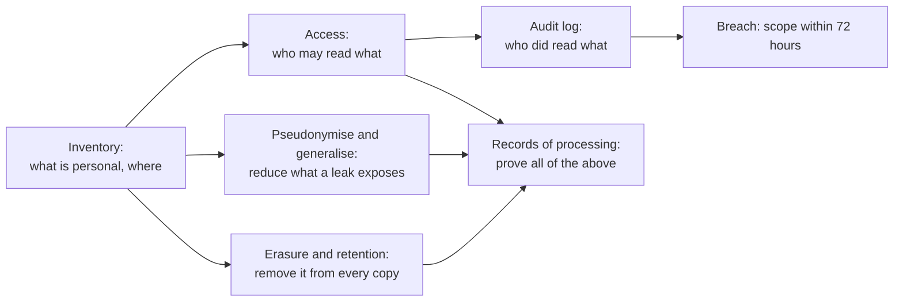

# Access control, PII and GDPR for engineers

A rider writes in and asks to be deleted. Finance has to keep her trips for tax reporting, the lake is made of immutable Parquet files, last month's backup is on tape, and the fare model was trained on a feature table nobody remembers building. The same week, a contractor's query that should have returned one row returned 5,000, and someone has to say by when, and to whom, that gets reported. None of this is a rare legal corner. Each part is an engineering question about where data is, who can read it and whether it can truly be removed, and the answers have to exist before the request arrives.

This chapter continues the riders behind the [previous chapter's](01b-data-mesh-topologies-and-scenarios.md) trips, as a federated governance group would have to handle them. **This is engineering guidance, not legal advice.** Regulation text is quoted from the [General Data Protection Regulation](https://eur-lex.europa.eu/eli/reg/2016/679/oj) (GDPR), linked per article through the unofficial mirror gdpr-info.eu; decide real cases with your data protection officer (DPO). Confidence is `medium` for that reason, since law depends on facts and on rulings this chapter hasn't read. To run the code: `uv run --with duckdb --with pyarrow --with numpy --with deltalake --with cryptography python chapter.py`. Blocks build on each other, in order, on synthetic riders, and the hash cells take a few seconds each.



## Start with an inventory

You cannot protect a column you do not know is personal. The GDPR's [Article 4(1)](https://gdpr-info.eu/art-4-gdpr/) defines personal data as any information relating to an identified or identifiable person, and its examples include a name, an identification number, location data and an online identifier. NIST's [SP 800-122](https://csrc.nist.gov/pubs/sp/800/122/final) uses a US term with a similar shape: **PII** is information that can distinguish or trace an individual, or that is linked or linkable to one. Linkable is the word that matters in both.

Three classes are enough to start. **Direct identifiers** name a person (name, email, phone). **Quasi-identifiers** do so only in combination (postcode, birth date, sex). **Pseudonyms** stand in for a person (`rider_id`). [Article 9](https://gdpr-info.eu/art-9-gdpr/) sets a harder rule for special categories, among them health data, and prohibits processing them unless one of its listed conditions applies, so give those a label too.

```python
import duckdb, numpy as np, pyarrow as pa, pyarrow.parquet as pq, os, glob, shutil

rng = np.random.default_rng(11)
n_riders, n_trips = 5_000, 60_000
first = ["ana","ben","cho","dee","eli","fay","gus","hal","ida","jon"]
last = ["reyes","smith","tran","okafor","novak","silva","khan","berg","rossi","ito"]
names = [f"{rng.choice(first)} {rng.choice(last)}" for _ in range(n_riders)]
riders = pa.table({
    "rider_id": np.arange(n_riders),
    "name": names,
    "email": [f"{nm.replace(' ', '.')}{i}@example.com" for i, nm in enumerate(names)],
    "phone": [f"555{p:07d}" for p in rng.choice(10_000_000, n_riders, replace=False)],
    "postcode": rng.integers(94100, 94160, n_riders).astype(str),
    "birth_date": (np.datetime64("1950-01-01") +
                   rng.integers(0, 20_000, n_riders).astype("timedelta64[D]")),
    "sex": rng.choice(["F", "M"], n_riders),
})
rid = rng.integers(0, n_riders, n_trips)
months = rng.integers(1, 7, n_trips)
notes = np.array(["", "", "", "", "left umbrella", "call me back"], dtype=object)[rng.integers(0, 6, n_trips)]
notes[17] = "lost phone, reach me at ana.reyes@example.com"
trips = pa.table({
    "trip_id": np.arange(n_trips), "rider_id": rid, "month": months,
    "region": rng.choice(["EU", "US"], n_trips, p=[0.3, 0.7]),
    "fare": rng.gamma(3.0, 6.0, n_trips).round(2),
    "notes": notes,
})
pq.write_table(riders, "riders.parquet")
pq.write_table(trips, "trips.parquet")
print(riders.num_rows, "riders", trips.num_rows, "trips")
```

Output:

```text
5000 riders 60000 trips
```

Column names get you most of the way, and the free-text field is why they aren't enough. Scan the values too:

```python
import re
PATTERNS = {"email": r"[\w.+-]+@[\w-]+\.[\w.]+", "phone": r"^\+?\d{10,13}$"}
NAME_HINTS = {"name": "direct", "email": "direct", "phone": "direct",
              "postcode": "quasi", "birth_date": "quasi", "sex": "quasi",
              "rider_id": "pseudonym"}

def scan(path, sample=100_000):
    """Classify by column name, then look inside the values too."""
    con = duckdb.connect()
    rows = con.sql(f"SELECT * FROM '{path}' LIMIT {sample}").fetchall()
    cols = [d[0] for d in con.sql(f"DESCRIBE SELECT * FROM '{path}'").fetchall()]
    out = {}
    for i, c in enumerate(cols):
        hits = {k: sum(1 for r in rows if isinstance(r[i], str) and re.search(p, r[i]))
                for k, p in PATTERNS.items()}
        out[c] = (NAME_HINTS.get(c, "none"), {k: v for k, v in hits.items() if v})
    return out

for path in ("riders.parquet", "trips.parquet"):
    print(path)
    for col, (label, found) in scan(path).items():
        print(f"  {col:11} {label:10} {found or ''}")
```

Output:

```text
riders.parquet
  rider_id    pseudonym
  name        direct
  email       direct     {'email': 5000}
  phone       direct     {'phone': 5000}
  postcode    quasi
  birth_date  quasi
  sex         quasi
trips.parquet
  trip_id     none
  rider_id    pseudonym
  month       none
  region      none
  fare        none
  notes       none       {'email': 1}
```

The `notes` column has the label `none` and holds an email. A rider typed it to a support agent, and it has now been copied everywhere `trips` goes. A sampled regex scan like this finds the easy cases and misses names in prose, so treat a clean result as "found nothing", not as "nothing there". Keep the result in the catalog from [the previous chapter](01-data-architectures-mesh-fabric-mdw.md), because every later section reads it.

## Who may see what: RBAC and ABAC

**Role-based access control (RBAC)** grants permissions to a role and puts people in roles. It is easy to audit: you read the grants. **Attribute-based access control (ABAC)**, in [NIST SP 800-162](https://csrc.nist.gov/pubs/sp/800/162/upd2/final)'s framing, decides each request from attributes of the subject and the object, environment conditions, and policies. It scales past the point where you would need a role per region per purpose.

```python
ROLE_GRANTS = {"analyst": {"trips_masked"}, "support": {"trips_masked", "riders"},
               "dpo": {"trips_masked", "riders", "audit_log"}}

def rbac(role, table):
    return table in ROLE_GRANTS.get(role, set())

def abac(user, table, row_region, purpose, classification):
    """NIST SP 800-162: subject attributes, object attributes, environment, policy."""
    if classification == "direct" and purpose != "support_ticket":
        return False, "direct identifiers need a support ticket"
    if row_region not in user["regions"]:
        return False, "row outside the user's region"
    if purpose not in user["purposes"]:
        return False, "purpose not approved for this user"
    return True, "allow"

eva = {"name": "eva", "regions": {"EU"}, "purposes": {"analytics"}}
print("rbac analyst riders:", rbac("analyst", "riders"))
print(abac(eva, "trips", "EU", "analytics", "none"))
print(abac(eva, "trips", "US", "analytics", "none"))
print(abac(eva, "riders", "EU", "analytics", "direct"))
print(abac(eva, "trips", "EU", "marketing", "none"))
```

Output:

```text
rbac analyst riders: False
(True, 'allow')
(False, "row outside the user's region")
(False, 'direct identifiers need a support ticket')
(False, 'purpose not approved for this user')
```

Use RBAC for coarse grants (which tables at all) and attributes for row and purpose rules. Purpose is the attribute most systems forget. [Article 5(1)(b)](https://gdpr-info.eu/art-5-gdpr/) limits data to specified purposes, so a table an analyst may read for tax reporting is not automatically one they may read for marketing.

The warehouses give you the enforcement point as a product feature, and each has a rule that catches people out:

| System | Mechanism | The rule to know |
|---|---|---|
| [Postgres](https://www.postgresql.org/docs/current/ddl-rowsecurity.html) | `CREATE POLICY` row security | Enabled with no policy means default deny. The table owner typically bypasses it unless you set `FORCE ROW LEVEL SECURITY`, and superusers and `BYPASSRLS` roles always do |
| [BigQuery rows](https://cloud.google.com/bigquery/docs/row-level-security-intro) | Row access policy: grantees and a filter | Once any policy exists, a user not listed sees no rows, so people with prior full access need a `TRUE` filter |
| [BigQuery columns](https://cloud.google.com/bigquery/docs/column-level-security-intro) | Policy tags | Needs both dataset permission and permission on the tag |
| [Snowflake](https://docs.snowflake.com/en/user-guide/security-column-ddm-intro) | Masking policy, applied at query time | The security officer decides who sees values, not the object owner, and it can stop even `ACCOUNTADMIN` |

A Postgres policy looks like this. It needs a server, so it is illustrative and was not run. The filter reads a table the analyst can't write to, which matters for the reason the next section shows.

```sql
-- illustrative: needs a Postgres server, not run in this chapter
ALTER TABLE trips ENABLE ROW LEVEL SECURITY;
CREATE POLICY by_region ON trips FOR SELECT
    USING (region IN (SELECT region FROM user_regions WHERE username = current_user));
GRANT SELECT ON trips TO analyst;
```

## Enforcement has to sit below the user

A view is the obvious way to mask a column in DuckDB, and it does mask:

```python
con = duckdb.connect()
con.sql("CREATE TABLE trips AS SELECT * FROM 'trips.parquet'")
con.sql("CREATE TABLE riders AS SELECT * FROM 'riders.parquet'")
con.sql("""
    CREATE VIEW riders_masked AS
    SELECT rider_id,
           regexp_replace(email, '^[^@]+', '***') AS email,
           left(postcode, 3) || '**' AS postcode,
           year(birth_date) // 10 * 10 AS birth_decade
    FROM riders
""")
con.sql("SET VARIABLE region = 'EU'")
con.sql("""
    CREATE VIEW trips_for_me AS
    SELECT trip_id, rider_id, month, region, fare
    FROM trips WHERE region = getvariable('region')
""")
print(con.sql("SELECT * FROM riders_masked LIMIT 2").fetchall())
print("EU analyst sees:", con.sql("SELECT DISTINCT region, count(*) OVER () FROM trips_for_me").fetchall())
```

Output:

```text
[(0, '***@example.com', '941**', 1980), (1, '***@example.com', '941**', 1960)]
EU analyst sees: [('EU', 18041)]
```

Now try what the analyst can do with the same connection:

```python
print("the same connection can read the base table:",
      con.sql("SELECT email FROM riders LIMIT 1").fetchall())
con.sql("SET VARIABLE region = 'US'")
print("and can change its own 'attribute':",
      con.sql("SELECT DISTINCT region FROM trips_for_me").fetchall())
for stmt in ("CREATE ROLE analyst", "GRANT SELECT ON riders_masked TO analyst"):
    try:
        con.sql(stmt)
        print("ok:", stmt)
    except duckdb.Error as e:
        print(f"{stmt!r} -> {type(e).__name__}: {str(e).splitlines()[0][:70]}")
```

Output:

```text
the same connection can read the base table: [('ben.smith0@example.com',)]
and can change its own 'attribute': [('US',)]
'CREATE ROLE analyst' -> ParserException: Parser Error: syntax error at or near "ROLE"
'GRANT SELECT ON riders_masked TO analyst' -> ParserException: Parser Error: syntax error at or near "GRANT"
```

So this "row policy" was a convenience. The analyst read the base table, then changed their own region. DuckDB has no users, roles or `GRANT`. [Its security guide](https://duckdb.org/docs/stable/operations_manual/securing_duckdb/overview) says it executes SQL with the full privileges of the user running it, much as a shell would, and that you should treat SQL input like code. The general lesson holds everywhere: a control the subject can alter is not a control. Row filters on a session variable in a real warehouse have this same bug if users may set the variable.

With an embedded engine, the boundary has to be what the process can touch. Publish a masked copy, and give the analyst a connection that can reach only that:

```python
os.makedirs("published", exist_ok=True); os.makedirs("restricted", exist_ok=True)
shutil.move("riders.parquet", "restricted/riders.parquet")
con.sql("""COPY (SELECT * FROM riders_masked)
           TO 'published/riders_masked.parquet' (FORMAT parquet)""")

analyst = duckdb.connect()
analyst.sql("SET allowed_directories = ['published']")
analyst.sql("SET enable_external_access = false")
analyst.sql("SET lock_configuration = true")
print(analyst.sql("SELECT count(*) FROM 'published/riders_masked.parquet'").fetchall())
for stmt in ("SELECT * FROM 'restricted/riders.parquet'",
             "SET enable_external_access = true",
             "SET lock_configuration = false"):
    try:
        analyst.sql(stmt).fetchall(); print("ALLOWED:", stmt)
    except duckdb.Error as e:
        print(f"refused: {stmt}\n   {type(e).__name__}: {str(e).splitlines()[0][:72]}")
```

Output:

```text
[(5000,)]
refused: SELECT * FROM 'restricted/riders.parquet'
   PermissionException: Permission Error: Cannot access file "restricted/riders.parquet" - file
refused: SET enable_external_access = true
   InvalidInputException: Invalid Input Error: Cannot change configuration option ""enable_externa
refused: SET lock_configuration = false
   InvalidInputException: Invalid Input Error: Cannot change configuration option ""lock_configura
```

The lock matters as much as the path list, since without it the analyst could turn access back on. DuckDB's guide calls these settings defence in depth and not a substitute for operating-system sandboxing, and that's how to read this: a real boundary here is separate files and separate file permissions, with the sandbox as a second layer.

## An audit log answers the breach question

Access control says who *may* read. Only a log says who *did*, and that is what [Article 33](https://gdpr-info.eu/art-33-gdpr/) asks about after a breach. The controller must notify the supervisory authority without undue delay and, where feasible, within 72 hours of becoming aware, unless the breach is unlikely to result in a risk to people. The notification describes the categories and approximate number of people and records affected, and [Article 33(5)](https://gdpr-info.eu/art-33-gdpr/) requires all breaches to be documented, reported or not.

```python
import datetime as dt
audit = []

class AuditedConnection:
    """The analyst never gets the raw connection, only this wrapper."""
    def __init__(self, con, user, purpose):
        self.con, self.user, self.purpose = con, user, purpose
    def query(self, sql, tables):
        rows = self.con.sql(sql).fetchall()
        audit.append({"at": dt.datetime(2026, 3, 2, 9, len(audit)), "user": self.user,
                      "purpose": self.purpose, "tables": tables, "sql": sql, "rows": len(rows)})
        return rows

fin = AuditedConnection(con, "eva", "monthly_tax_report")
fin.query("SELECT region, sum(fare) FROM trips GROUP BY 1", ["trips"])
sup = AuditedConnection(con, "sam", "support_ticket_4411")
sup.query("SELECT email, phone FROM riders WHERE rider_id = 17", ["riders"])
ext = AuditedConnection(con, "contractor_7", "unknown")
ext.query("SELECT rider_id, email, phone, postcode FROM riders WHERE postcode LIKE '941%'", ["riders"])

for a in audit:
    if "riders" in a["tables"]:
        print(a["at"].time(), a["user"], a["purpose"], "rows", a["rows"])

# Article 33(3)(a): categories and approximate number of subjects and records.
worst = audit[-1]
print("breach scope:", {"subjects_approx": worst["rows"],
                        "categories": ["contact (email, phone)", "location (postcode)"]})
```

Output:

```text
09:01:00 sam support_ticket_4411 rows 1
09:02:00 contractor_7 unknown rows 5000
breach scope: {'subjects_approx': 5000, 'categories': ['contact (email, phone)', 'location (postcode)']}
```

The contractor query is the case from the opening. Because the log holds user, purpose, SQL and row count, the scope comes from a lookup, where otherwise it would take a week of guessing. Note `purpose: unknown`, which is worth an alert in itself.

Two terms from the EDPB's [Guidelines 9/2022](https://www.edpb.europa.eu/our-work-tools/our-documents/guidelines/guidelines-92022-personal-data-breach-notification-under_en) change how engineers should act. A controller is "aware" when it has a reasonable degree of certainty that a security incident compromised personal data; a short investigation is allowed first, and should start promptly. So the clock isn't started by the first alert, but sitting on an alert doesn't stop it either. And a breach includes loss as well as disclosure. The guidelines' example is data encrypted with a key the controller no longer has. Keep that in mind for [crypto-shredding](#crypto-shredding-and-the-erasure-ledger), where the same event is deliberate. The steps from alert to resolution are in [incident playbooks](../../05-quality-and-observability/notes/03-incident-playbooks.md).

## Pseudonymised is not anonymised

This is the distinction that causes the most damage, and it has legal force. Under [Article 4(5)](https://gdpr-info.eu/art-4-gdpr/), pseudonymisation means data can no longer be attributed to a person without additional information kept separately. [Recital 26](https://gdpr-info.eu/recitals/no-26/) says pseudonymised data that could be attributed using that additional information is still information about an identifiable person. Identifiability is judged by the means reasonably likely to be used, including singling out, taking account of cost, time and technology. Only truly anonymous information falls outside the regulation.

So `rider_id` is personal data for as long as anyone holds the mapping. The Article 29 Working Party's [Opinion 05/2014](https://ec.europa.eu/justice/article-29/documentation/opinion-recommendation/files/2014/wp216_en.pdf) (written under the earlier directive, and still the standard reference) lists believing that pseudonymised data is anonymised as a common mistake, and gives three tests of anonymisation: can you still **single out** a person, **link** records about them, or **infer** something about them?

Hashing is where teams most often make this mistake. It feels one-way, but a phone number has few possible values, so an attacker hashes them all. The opinion warns about replay when the input range is known. Here is the attack on 2,000 leaked hashes:

```python
import hashlib, hmac, time, secrets

def sha(phone):
    return hashlib.sha256(phone.encode()).hexdigest()

leaked = [sha(p) for p in riders["phone"].to_pylist()[:2000]]
targets = set(leaked)
t = time.perf_counter()
found = {}
for i in range(10_000_000):
    h = hashlib.sha256(b"555%07d" % i).hexdigest()
    if h in targets:
        found[h] = "555%07d" % i
print(f"unsalted: {len(found)} of {len(targets)} reversed in {time.perf_counter() - t:.1f} s")
```

Output:

```text
unsalted: 2000 of 2000 reversed in 3.6 s
```

A hash of a low-entropy value is a lookup table that hasn't been computed yet. Salting helps less than people think. One salt shared by a column sits beside the data and costs the attacker nothing extra:

```python
salt = secrets.token_hex(16)                    # stored beside the data, as salts are
salted = {hashlib.sha256((salt + p).encode()).hexdigest() for p in riders["phone"].to_pylist()[:2000]}
t = time.perf_counter()
hits = 0
pre = hashlib.sha256(salt.encode())
for i in range(10_000_000):
    h = pre.copy(); h.update(b"555%07d" % i)
    hits += h.hexdigest() in salted
print(f"one shared salt: {hits} of {len(salted)} reversed in {time.perf_counter() - t:.1f} s")

key = secrets.token_bytes(32)                   # kept in a KMS, never in the lake
keyed = {hmac.new(key, p.encode(), "sha256").hexdigest() for p in riders["phone"].to_pylist()[:2000]}
wrong_key = secrets.token_bytes(32)
guess = sum(hmac.new(wrong_key, b"555%07d" % i, "sha256").hexdigest() in keyed for i in range(200_000))
print(f"HMAC, attacker has no key: {guess} hits in 200,000 guesses")
```

Output:

```text
one shared salt: 2000 of 2000 reversed in 3.5 s
HMAC, attacker has no key: 0 hits in 200,000 guesses
```

A separate salt per record forces a fresh search per target, which by simple multiplication of the timing above would be about two hours for these 2,000 on this laptop. That estimate was not measured, and two hours is not a defence. The third line of the output is the one to copy: a **keyed hash (HMAC)**, with the key held in a key management service (KMS) and never in the lake, can't be brute-forced without the key.

Scope the key too. The opinion names one key across different databases as a common mistake, since it makes those databases joinable:

```python
def pseudonym(key, value):
    return hmac.new(key, str(value).encode(), "sha256").hexdigest()[:16]

key_a, key_b = secrets.token_bytes(32), secrets.token_bytes(32)
sample = riders["email"].to_pylist()[:1000]
domain_a = {pseudonym(key_a, e) for e in sample}
domain_b_same_key = {pseudonym(key_a, e) for e in sample}
domain_b_own_key = {pseudonym(key_b, e) for e in sample}
print("one key across domains: ", len(domain_a & domain_b_same_key), "of 1000 records link")
print("one key per domain:     ", len(domain_a & domain_b_own_key), "of 1000 records link")

# A vault token has no mathematical link to the value at all.
vault = {}
def tokenise(value):
    return vault.setdefault(value, "tok_" + secrets.token_hex(8))
t1 = tokenise("ana.reyes0@example.com")
print(t1, tokenise("ana.reyes0@example.com") == t1, "vault size", len(vault))
```

Output:

```text
one key across domains:  1000 of 1000 records link
one key per domain:      0 of 1000 records link
tok_9d8c8d7144f3e059 True vault size 1
```

Sharing a key across domains is a decision to let them join on this person, and it should be made on purpose. A vault token goes further, as it has no mathematical link to the value, and the cost is a lookup service that everything depends on.

| Technique | Reversible by | Join across datasets | Status |
|---|---|---|---|
| Plain hash of phone or email | Anyone, by enumeration | Yes | Pseudonymised at best; treat as exposed |
| Salted hash | Anyone with the salt and some time | Only with the same salt | Pseudonymised |
| HMAC with a key in a KMS | Key holder, by enumeration | Only with the same key | Pseudonymised |
| Vault token | Vault operator | Only through the vault | Pseudonymised |
| Generalised and aggregated, tested | Should be nobody | No | Possibly anonymous, if it passes all three tests |

[Article 25](https://gdpr-info.eu/art-25-gdpr/) (data protection by design and by default) and [Article 32](https://gdpr-info.eu/art-32-gdpr/) (security of processing) both name pseudonymisation as a measure. It is worth doing because it reduces what a leak exposes, and it doesn't take the data out of scope.

## Quasi-identifiers: k-anonymity and linkage

Remove names and emails and the people are often still there. [Samarati and Sweeney (1998)](https://dataprivacylab.org/dataprivacy/projects/kanonymity/paper3.pdf) named the columns that do this **quasi-identifiers** and defined **k-anonymity**: every combination of those values must be shared by at least k records. In the synthetic riders:

```python
c3 = duckdb.connect()
c3.sql("CREATE TABLE r AS SELECT * FROM 'restricted/riders.parquet'")

def k_report(cols):
    rows = c3.sql(f"""
        WITH g AS (SELECT {cols}, count(*) AS size FROM r2 GROUP BY ALL)
        SELECT min(size), round(100.0 * sum(size) FILTER (size = 1) / sum(size), 1), count(*)
        FROM g""").fetchall()[0]
    return {"k": rows[0], "pct_unique": rows[1] or 0.0, "groups": rows[2]}

c3.sql("""CREATE TABLE r2 AS SELECT postcode, birth_date, sex,
          left(postcode, 3) AS zip3, year(birth_date) AS birth_year,
          year(birth_date) // 10 * 10 AS decade FROM r""")
print("raw (postcode, birth date, sex):", k_report("postcode, birth_date, sex"))
print("postcode, birth year, sex:      ", k_report("postcode, birth_year, sex"))
print("zip3, birth decade, sex:        ", k_report("zip3, decade, sex"))
print("zip3, birth decade:             ", k_report("zip3, decade"))
```

Output:

```text
raw (postcode, birth date, sex): {'k': 1, 'pct_unique': 99.8, 'groups': 4995}
postcode, birth year, sex:       {'k': 1, 'pct_unique': 48.1, 'groups': 3546}
zip3, birth decade, sex:         {'k': 211, 'pct_unique': 0.0, 'groups': 12}
zip3, birth decade:              {'k': 427, 'pct_unique': 0.0, 'groups': 6}
```

With full postcode, birth date and sex, almost everyone is unique. Generalising trades detail for group size. These synthetic postcodes all start with 941, so the later rows are flattering, since that column has stopped distinguishing anyone; real data has more spread and lower k.

Uniqueness matters because it can be joined against something public:

```python
# Public list: names with the same demographics, e.g. a voter roll or a social profile.
c3.sql("""CREATE TABLE public_list AS SELECT name, postcode, birth_date, sex FROM r
          USING SAMPLE 500 ROWS (reservoir, 3)""")
# 'Anonymised' release: names, emails and phones removed, one flag kept.
c3.sql("""CREATE TABLE released AS SELECT postcode, birth_date, sex,
          (rider_id % 50 = 0) AS visited_clinic FROM r""")
print(c3.sql("""
    WITH g AS (SELECT postcode, birth_date, sex, count(*) AS size,
                      any_value(visited_clinic) AS flag
               FROM released GROUP BY ALL)
    SELECT count(*) AS people_on_list,
           count(*) FILTER (size = 1) AS uniquely_matched,
           count(*) FILTER (size = 1 AND flag) AS sensitive_flag_learned
    FROM public_list JOIN g USING (postcode, birth_date, sex)
""").fetchall()[0])
```

Output:

```text
(500, 500, 6)
```

The list here was sampled from the same riders, so every person is on it by construction, and the flag is invented. The mechanism is the real part. Narayanan and Shmatikov ([IEEE S&P 2008](https://www.cs.cornell.edu/~shmat/shmat_oak08netflix.pdf)) showed it on the Netflix Prize data of 500,000 subscribers: eight movie ratings, of which two may be wrong, with dates accurate to within 14 days, identify 99% of records; two ratings with dates within three days are enough for 68%. Ratings were not thought of as identifiers at all. Any sufficiently detailed behaviour is a quasi-identifier, and trip histories certainly are.

k-anonymity alone fails the third test. If everyone in a group shares a sensitive value, you learn it without singling anyone out. The opinion recommends combining it with **l-diversity**, which requires several distinct sensitive values per group:

```python
c3.sql("""CREATE TABLE ward AS SELECT * FROM (VALUES
    ('941', 1980, 'clinic'), ('941', 1980, 'clinic'), ('941', 1980, 'clinic'),
    ('942', 1980, 'airport'), ('942', 1980, 'office'), ('942', 1980, 'clinic')
) t(zip3, decade, destination)""")
print(c3.sql("""SELECT zip3, decade, count(*) AS k, count(DISTINCT destination) AS l
                FROM ward GROUP BY ALL ORDER BY 1""").fetchall())
```

Output:

```text
[('941', 1980, 3, 1), ('942', 1980, 3, 3)]
```

The first group has k=3 and l=1, so anyone known to be in it visited the clinic. The opinion lists the usual k-anonymity mistakes: missing a quasi-identifier, using a small k, and giving attributes equal weight when they aren't equally revealing. Default to "this is still personal data" and let the DPO argue it down.

## GDPR in one table, for engineers

Each [Article 5](https://gdpr-info.eu/art-5-gdpr/) principle has a mechanism behind it. The right column is our mapping, not the regulation's wording.

| Principle | Means | Engineering mechanism |
|---|---|---|
| Lawfulness, fairness, transparency | A legal basis, and people told about it | Basis recorded per purpose in the records of processing |
| Purpose limitation | Used only for specified purposes | Purpose attribute in access decisions; audit log carries purpose |
| Data minimisation | Adequate, relevant, limited to what's needed | Drop columns at ingest, publish masked views, no `SELECT *` into features |
| Accuracy | Correct and kept up to date | [Quality tests](../../05-quality-and-observability/notes/01-quality-dimensions-and-tests.md), correction flows |
| Storage limitation | Kept no longer than needed | Retention jobs, on every copy |
| Integrity and confidentiality | Appropriate security | Encryption, access control, tested restore |
| Accountability (5(2)) | You can demonstrate all of this | Records, logs, test results |

[Article 6(1)](https://gdpr-info.eu/art-6-gdpr/) lists six lawful bases: consent, contract, legal obligation, vital interests, public task and legitimate interests. Which one applies is a legal call, but it is an engineering input, since it decides what you can do later. Consent can be withdrawn, and then data with that basis has a different life from tax records held under legal obligation.

The roles decide who answers. Under [Article 4](https://gdpr-info.eu/art-4-gdpr/) the **controller** determines purposes and means, and the **processor** acts on its behalf. [Article 28](https://gdpr-info.eu/art-28-gdpr/) requires a contract under which the processor acts on documented instructions and deletes or returns data at the end. Your cloud warehouse is usually a processor, and you stay responsible. Under Article 33(2) a processor tells the controller about a breach without undue delay.

**Transfers.** [Article 44](https://gdpr-info.eu/art-44-gdpr/) restricts sending personal data outside the EU, onward transfers included. The routes are an [adequacy decision](https://gdpr-info.eu/art-45-gdpr/) or [appropriate safeguards](https://gdpr-info.eu/art-46-gdpr/), such as standard contractual clauses or binding corporate rules. For an engineer this surfaces as storage region, replication targets, and where support staff and subprocessors sit. Which route is currently valid changes with rulings, so ask.

## Erasure on immutable storage

[Article 17](https://gdpr-info.eu/art-17-gdpr/) gives a person the right to erasure without undue delay when a listed ground applies, for example when the data is no longer needed or consent is withdrawn. It isn't absolute. Article 17(3) excludes processing needed for a legal obligation, for certain archiving and research purposes, and for legal claims, so finance's tax records can legitimately stay while her marketing profile goes. [Article 12(3)](https://gdpr-info.eu/art-12-gdpr/) sets the response time: within one month of the request, extendable by two further months for complex or numerous requests. That window has to contain your compaction and retention schedule.

Engineers should approach this knowing that the architecture they have been taught pulls the other way. Immutable logs, append-only tables and reprocessing are what make pipelines safe to run, and [*Designing Data-Intensive Applications*](https://dataintensive.net/) says so directly: on systems built that way, deletion is more a matter of making data harder to retrieve than making it impossible, since copies linger in storage engines, file systems and backups (ch. 11, pp. 463-464). His closing chapter puts the tension plainly. Data should be purged once it is no longer needed, which runs against immutability, and cryptographic access control may be one way through (ch. 12, p. 543), which is the crypto-shredding below. The same passage gives the reason to minimise in the first place. Critics call data a toxic asset or a hazardous material, because holding it creates a risk that outlives the system and the company's good intentions, and that purpose-limited collection conflicts with the collect-everything habit of a lake (pp. 541-543). A retention rule is a design decision and deserves to be made like one.

Parquet files can't be edited, so a delete means finding every file holding the person and rewriting it:

```python
c4 = duckdb.connect()
os.makedirs("lake", exist_ok=True)
c4.sql("""COPY (SELECT * FROM 'trips.parquet')
          TO 'lake/trips' (FORMAT parquet, PARTITION_BY (month))""")
# A downstream team built features from the lake last week.
c4.sql("""COPY (SELECT rider_id, count(*) AS trips_6m, avg(fare) AS avg_fare
                FROM 'trips.parquet' GROUP BY 1) TO 'rider_features.parquet' (FORMAT parquet)""")
SUBJECT = 42

def files_with(subject):
    rows = c4.sql(f"""SELECT DISTINCT filename FROM read_parquet('lake/trips/*/*.parquet', filename=true, hive_partitioning=false)
                      WHERE rider_id = {subject}""").fetchall()
    return sorted(r[0] for r in rows)

hit = files_with(SUBJECT)
total_files = glob.glob("lake/trips/*/*.parquet")
print(f"{len(total_files)} files in the lake, subject {SUBJECT} is in {len(hit)}")
rewritten = 0
for f in hit:
    rewritten += os.path.getsize(f)
    c4.sql(f"COPY (SELECT * FROM '{f}' WHERE rider_id <> {SUBJECT}) TO '{f}.tmp' (FORMAT parquet)")
    os.replace(f + ".tmp", f)
remaining = c4.sql(f"SELECT count(*) FROM read_parquet('lake/trips/*/*.parquet') WHERE rider_id = {SUBJECT}").fetchall()[0][0]
print(f"rewrote {rewritten/1e6:.2f} MB to delete one rider; rows left for subject: {remaining}")
```

Output:

```text
6 files in the lake, subject 42 is in 3
rewrote 0.37 MB to delete one rider; rows left for subject: 0
```

One rider in half the files, because trips are partitioned by month and not by rider. Over a real lake this is the expensive part, and it's a reason to keep identifying data in a small dimension table that facts reference by key. Table formats make it look easier, and they contain a trap:

```python
from deltalake import DeltaTable, write_deltalake
write_deltalake("delta_trips", pq.read_table("trips.parquet"), partition_by=["month"])
dt_ = DeltaTable("delta_trips")
dt_.delete(f"rider_id = {SUBJECT}")
print("version", dt_.version(), "| rows now:",
      dt_.to_pyarrow_table(filters=[("rider_id", "=", SUBJECT)]).num_rows)
old = DeltaTable("delta_trips", version=0)
print("time travel to version 0 still returns:",
      old.to_pyarrow_table(filters=[("rider_id", "=", SUBJECT)]).num_rows, "rows")
parquet_before = len(glob.glob("delta_trips/*/*.parquet"))
removed = dt_.vacuum(retention_hours=0, enforce_retention_duration=False, dry_run=False)
print(f"vacuum removed {len(removed)} files of {parquet_before}")
try:
    print(DeltaTable("delta_trips", version=0).to_pyarrow_table(
        filters=[("rider_id", "=", SUBJECT)]).num_rows)
except Exception as e:
    print("time travel after vacuum:", type(e).__name__)
```

Output:

```text
version 1 | rows now: 0
time travel to version 0 still returns: 7 rows
vacuum removed 3 files of 9
time travel after vacuum: FileNotFoundError
```

After `delete` the current table has no rows for the subject, and time travel still returns all seven. The data is gone only after `VACUUM`. The [Delta documentation](https://docs.delta.io/latest/delta-utility.html) says vacuum isn't automatic, has a default seven-day retention, removes data files only, and ends time travel beyond that horizon. The run above sets retention to zero to show the effect; in production that is dangerous for concurrent readers, as the docs warn. [Iceberg](https://iceberg.apache.org/docs/latest/maintenance/) has the same shape: expiring snapshots removes them from metadata, and data files are deleted once nothing references them. Mechanics are in [table formats](../../04-warehouse-lakehouse-streaming/notes/02-table-formats.md). Schedule these so the whole path finishes inside the Article 12 window.

### Crypto-shredding and the erasure ledger

Backups and tapes can't be rewritten on demand. **Crypto-shredding** gets around this by encrypting each person's direct identifiers with a per-person key, then destroying the key.

```python
from cryptography.hazmat.primitives.ciphers.aead import AESGCM
kms = {}   # one key per subject; in production a KMS, not a dict

def encrypt_for(subject, plaintext):
    key = kms.setdefault(subject, AESGCM.generate_key(256))
    nonce = secrets.token_bytes(12)
    return nonce + AESGCM(key).encrypt(nonce, plaintext.encode(), None)

def decrypt_for(subject, blob):
    if subject not in kms:
        return None
    return AESGCM(kms[subject]).decrypt(blob[:12], blob[12:], None).decode()

blob = encrypt_for(42, "ana.reyes42@example.com")
backup_copy = bytes(blob)                 # the copy we cannot reach and rewrite
print(decrypt_for(42, blob))
del kms[42]                               # the erasure request
print(decrypt_for(42, backup_copy))
print("still in the backup:", len(backup_copy), "bytes; plaintext present:",
      b"ana.reyes" in backup_copy)
```

Output:

```text
ana.reyes42@example.com
None
still in the backup: 51 bytes; plaintext present: False
```

Be careful about what this does and doesn't prove. Destroying the key makes the ciphertext unreadable by you, assuming the key has no copies. It does nothing for quasi-identifiers or trip history stored in the clear, which can still identify her by the argument above. The sources behind this chapter contain no regulator statement that key destruction satisfies Article 17, so treat its legal standing as unsettled and take the design to your DPO. It also has an operating cost: a KMS holding millions of keys that is now a dependency of every read. And remember the EDPB example: losing a key by accident is a breach, so key destruction must be deliberate, authorised and logged.

The other standard answer is an **erasure ledger**: keep the IDs of erased people, and replay deletes on any restore. Restores bring data back, so the replay has to be part of the restore procedure.

```python
os.makedirs("backup", exist_ok=True)
shutil.copy("trips.parquet", "backup/trips_2026_01.parquet")     # taken before the request
erased = {42, 77}
c5 = duckdb.connect()
c5.sql("CREATE TABLE erasure_ledger (subject BIGINT)")
c5.sql(f"INSERT INTO erasure_ledger VALUES {','.join(f'({s})' for s in sorted(erased))}")

c5.sql("CREATE TABLE restored AS SELECT * FROM 'backup/trips_2026_01.parquet'")
print("after restore:", c5.sql("SELECT count(*) FROM restored WHERE rider_id IN (SELECT subject FROM erasure_ledger)").fetchall()[0][0])
c5.sql("DELETE FROM restored WHERE rider_id IN (SELECT subject FROM erasure_ledger)")
print("after replay: ", c5.sql("SELECT count(*) FROM restored WHERE rider_id IN (SELECT subject FROM erasure_ledger)").fetchall()[0][0])
```

Output:

```text
after restore: 17
after replay:  0
```

The ledger itself stores an identifier of an erased person, retained in order to honour the request, so keep it minimal, keep the reason recorded and ask your DPO. It should hold the pseudonymous key and nothing more.

The check to automate is whether every store is actually clean. Run after the deletes above:

```python
c7 = duckdb.connect()
stores = {"lake/trips": "read_parquet('lake/trips/*/*.parquet', hive_partitioning=false)",
          "delta_trips": "read_parquet('delta_trips/*/*.parquet', hive_partitioning=false)",
          "rider_features": "'rider_features.parquet'",
          "backup/2026_01": "'backup/trips_2026_01.parquet'"}
for name, source in stores.items():
    left = c7.sql(f"SELECT count(*) FROM {source} WHERE rider_id = 42").fetchall()[0][0]
    print(f"{'clean' if left == 0 else 'OPEN '}  {name:16} {left} rows")
```

Output:

```text
clean  lake/trips       0 rows
clean  delta_trips      0 rows
OPEN   rider_features   1 rows
OPEN   backup/2026_01   7 rows
```

The two `clean` rows are what the ticket says. The two `OPEN` rows are the real state. `rider_features` is the table in the opening that nobody remembered, and this is why [lineage](../../05-quality-and-observability/notes/02-monitors-and-lineage.md) belongs to the erasure process: `downstream("trips")` is the list of places to check. A backup stays open until it expires or is covered by the ledger, and you should be able to say which. For trained models, Paleyes et al.'s [survey of deployment challenges](https://arxiv.org/abs/2011.09926) (ACM Computing Surveys, 2022) discusses attacks such as membership inference and model inversion that can extract information about training data, so whether a model counts as holding personal data is a real question. Don't assume either answer. Decide with your DPO whether retraining is on the erasure path, and record the training data version as in [the model registry](../../06-ml-platform/notes/02-experiment-tracking-and-model-registry.md).

## Retention, and records you can show

Storage limitation is easiest to meet as a scheduled job, column by column. Free text is the first to go, because that's where the unlabelled email was.

```python
c6 = duckdb.connect()
c6.sql("""CREATE TABLE policy AS SELECT * FROM (VALUES
    ('trips.notes', 90), ('trips', 730), ('audit_log', 365)) t(item, keep_days)""")
c6.sql("""CREATE TABLE t AS SELECT i AS trip_id, DATE '2026-11-02' - (i % 1000)::INT AS day,
          'note' AS notes FROM range(10000) r(i)""")
today = "DATE '2026-11-02'"
c6.sql(f"UPDATE t SET notes = NULL WHERE day < {today} - 90")
c6.sql(f"DELETE FROM t WHERE day < {today} - 730")
print(c6.sql("SELECT count(*), count(notes), min(day) FROM t").fetchall()[0])
```

Output:

```text
(7310, 910, datetime.date(2024, 11, 2))
```

The periods here are invented for the example: real ones come from your legal team. Two things go with them. The job has to run on every store in the coverage check, and deleting by date in a table format has the same vacuum step as above.

[Article 30](https://gdpr-info.eu/art-30-gdpr/) requires a **record of processing activities (RoPA)**: purposes, categories of people and data, recipients, third-country transfers, and, where possible, time limits for erasure and a description of security measures. There is a narrow exemption for organisations under 250 employees, with conditions, so check it before relying on it. Article 30 doesn't list the lawful basis, but recording it here is an obvious way of meeting the accountability duty in Article 5(2), which is why this check adds it. Treat the record as data, with a required-fields test, rather than a spreadsheet that goes stale:

```python
activities = [
    {"purpose": "tax reporting", "basis": "legal obligation, Art. 6(1)(c)", "subjects": "riders",
     "categories": "trip, fare, region", "recipients": "tax authority", "transfers": "none",
     "erase_after_days": 3650, "security": "row policy, audit log"},
    {"purpose": "fare model training", "basis": "", "subjects": "riders",
     "categories": "trip, fare, postcode", "recipients": "ml-team", "transfers": "US cloud region",
     "erase_after_days": None, "security": "masked view"},
]
REQUIRED = ["purpose", "subjects", "categories", "recipients", "transfers", "erase_after_days", "security", "basis"]
for a in activities:
    gaps = [k for k in REQUIRED if a.get(k) in ("", None)]
    print(f"{a['purpose']:22} {'complete' if not gaps else 'GAPS: ' + ', '.join(gaps)}")
```

Output:

```text
tax reporting          complete
fare model training    GAPS: erase_after_days, basis
```

The fare model has no retention limit and no lawful basis, and it also trains on `postcode` in a US region, which raises the transfers question. Failing this check is much cheaper than finding out from a regulator, and the catalog from the previous chapter is the natural place for it to run, inside `publish`.

## Pitfalls

- **"We hashed it, so it's anonymous."** Two thousand of two thousand phone hashes came back in seconds. Hashing is at best pseudonymisation, and the data stays in scope.
- **Treating `DELETE` as erasure.** After a table-format delete, the rows are still there through time travel. The path isn't finished until vacuum runs and the copies are handled.
- **Masking in a view on a connection that can read the table.** A view limits what a query shows and not what the connection may do. Test by attacking it as the user.
- **A filter on a variable the user can set.** A control the subject can alter isn't one.
- **Free text left out of the inventory.** Notes and comments collect emails and health details. Scan values, keep them out of analytics by default, and give them the shortest retention.
- **Non-production copies.** Dev datasets, notebooks, exports and feature tables hold the same people. They belong in the coverage check.
- **Reading "72 hours" as a deadline to start work.** Awareness needs reasonable certainty, and investigation should start promptly. You also need the log before the incident, not after.
- **One pseudonymisation key across all domains.** It quietly makes every dataset joinable on a person.

## Try it

1. Add `home_lat` and `home_lng` columns to the riders, rounded to three decimals. How would you classify them, and what would you do to them before publishing?
2. Compute k for `postcode, birth_year` on the riders. Then find the coarsest step that reaches k of at least 20 while keeping the full postcode. What did you give up?
3. Extend `erasure_coverage` so it reads its list of stores from `downstream("trips")`-style lineage, with a store left out of lineage reported as a gap. Where does the check still fail?
4. A product manager says "we only keep user IDs, no PII, so GDPR doesn't apply". Answer in three sentences using the articles above.

<details><summary>Answers</summary>

1. They are quasi-identifiers, and strong ones: three decimals is around a hundred metres, and a home location often identifies one household. Article 4(1) names location data explicitly. Publish a coarse area, or remove them, and test k on the result.
2. For example, group with `postcode, birth_year // 10 * 10` and compare `min(size)` to 20, and if it falls short, widen the birth band further. You keep location precision and lose age precision, which suits a geographic analysis and hurts an age one. The right trade depends on the purpose.
3. It still fails for anything lineage doesn't see: an analyst's export, a notebook copy, a third-party processor. Lineage shows declared flows, so pair it with a scan of storage for `rider_id` columns and with Article 28 confirmations from processors.
4. An ID is pseudonymous, and Recital 26 says data attributable with additional information is still about an identifiable person. Article 4(1) lists identification numbers and online identifiers in the definition. If the company holds the mapping or could reasonably link it, the data is in scope, so the useful question is what controls and retention it has.

</details>

## Interview checklist

| Question | Answer |
|---|---|
| RBAC or ABAC? | RBAC for coarse, auditable grants. ABAC adds subject, object, environment attributes and purpose, for row and purpose rules without a role explosion. Most systems use both. |
| Why isn't a DuckDB view a security control? | The connection can read the base table, and DuckDB has no roles or `GRANT`. Restrict the process instead: separate files, allowed directories, locked configuration, OS permissions. |
| Pseudonymised or anonymised: what's the difference? | Pseudonymised data can be re-attributed with separately held information and remains personal data (Recital 26). Anonymous data can't reasonably be and falls out of scope. |
| Why is a hashed phone number weak? | The input space is small, so an attacker enumerates it. A shared salt doesn't change that. Use an HMAC with a key held in a KMS, or a vault token. |
| Name the three anonymisation tests. | Singling out, linkability and inference (WP29 Opinion 05/2014). |
| What does k-anonymity miss? | A group sharing one sensitive value reveals it. That is the inference test, and l-diversity addresses it. It also depends on having found every quasi-identifier. |
| How do you delete one person from a Parquet lake? | Find the files with that person, rewrite them, then handle every downstream copy. In a table format: delete, then vacuum after the retention window. |
| How do you handle backups for erasure? | An erasure ledger replayed on every restore, a retention limit on backups, or crypto-shredding. Agree the design with the DPO, since none of the sources behind this chapter settles the legal standing of key destruction. |
| When does the 72-hour clock start? | When the controller has reasonable certainty that personal data was compromised (EDPB Guidelines 9/2022). A short investigation may come first and should start promptly. |
| Is erasure absolute? | No. Article 17(3) excludes legal obligation, some archiving and research, and legal claims. Tax records can stay while a marketing profile goes. |
| What do you need ready for a breach? | Access logs with user, purpose, query and row count, an inventory, and a playbook. Article 33(3) asks for categories and approximate numbers. |

## Next

Read [the previous chapter](01b-data-mesh-topologies-and-scenarios.md) again with this one in mind, since federated governance only means something once these rules are the ones it enforces. An inventory like the one at the start of this chapter is one job of a catalog. [Catalog, semantic layer and data contracts](03-catalog-semantic-layer-and-contracts.md) builds that catalog out, and follows one column change through to the people it breaks.
