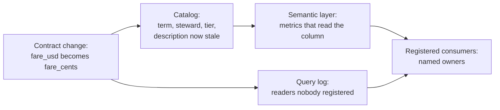

# Catalog, semantic layer and data contracts

The mobility team wants to store fares in cents, and asks who that will hurt. The contract's diff says the change is breaking, but not to whom. The dashboard everyone trusts doesn't read the column; it reads a metric called `revenue`, defined somewhere else, and an analyst's notebook reads the column directly and is written down nowhere. Answering the question means following one chain: from the contract to what the column means, from there to the metrics built on it, and from those to named people. This chapter builds that chain from three systems, and shows the change that travels through it without an error.

Each system has a neighbour with the same name, so here are the meanings used below. A **data catalog** is a searchable store of what data exists, what it means and who answers for it. It isn't the [Iceberg catalog](../../04-warehouse-lakehouse-streaming/notes/02-table-formats.md), which tracks a table's current metadata file, and it is more than the [`dbt docs` site](../../03-transform-and-orchestrate/notes/01-transform.md), which covers one project. A **semantic layer** holds metric and join definitions as data, and compiles each request into SQL. A **data contract** is the producer's promise [taught in the ingest pillar](../../02-ingest-and-modelling/notes/04-data-contracts.md), across teams and including meaning. A **dbt model contract** is [a build-time check of one model's columns and types](../../05-quality-and-observability/notes/01-quality-dimensions-and-tests.md). A model contract can enforce part of a data contract, and it can't state a unit or name a consumer.



This chapter assumes the [contracts](../../02-ingest-and-modelling/notes/04-data-contracts.md), [dimensional modelling](../../02-ingest-and-modelling/notes/02-dimensional-modelling.md), [dbt](../../03-transform-and-orchestrate/notes/01-transform.md) and [DataOps](../../05-quality-and-observability/notes/06-dataops.md) chapters. The DataOps chapter already has a [five-line metric compiler and a manifest catalog](../../05-quality-and-observability/notes/06-dataops.md#one-definition-per-metric), which are this chapter's starting point. All code runs top to bottom on synthetic trips, with no server or account, using dbt-core 1.12.6, MetricFlow 0.213.0 and DuckDB 2.0.0 on 2026-11-03:

```bash
uv run --python 3.12 --with numpy --with 'dbt-metricflow[dbt-duckdb]==0.15.0' python chapter.py
```

```python
import datetime as dt, json, os, pathlib, re, shutil, subprocess, duckdb, numpy as np

ROOT = pathlib.Path("rides_demo"); shutil.rmtree(ROOT, ignore_errors=True); (ROOT / "models").mkdir(parents=True)
DB = ROOT / "rides.duckdb"
rng = np.random.default_rng(7)

def q(sql):
    with duckdb.connect(str(DB)) as con:
        return con.sql(sql).fetchall()

days = [dt.date(2026, 1, 1) + dt.timedelta(d) for d in range(90)]
trips = []
for day in days:
    weekend = day.weekday() >= 5
    for _ in range(4 if weekend else 40):       # weekends are quiet and cancel far more often
        cancelled = rng.random() < (0.40 if weekend else 0.05)
        trips.append((len(trips) + 1, int(rng.integers(1, 201)), day,
                      str(rng.choice(["SF", "LA"])), 0.0 if cancelled else round(float(rng.uniform(6, 60)), 2),
                      int(cancelled)))
with duckdb.connect(str(DB)) as con:
    con.execute("create table raw_trips(trip_id bigint, rider_id bigint, trip_date date, city varchar, fare_usd double, is_cancelled int)")
    con.executemany("insert into raw_trips values (?,?,?,?,?,?)", trips)
    con.execute("create table raw_riders as select i as rider_id, case when i % 4 = 0 then 'pass' else 'payg' end as segment from range(1, 201) t(i)")
    con.execute("""create table raw_redemptions as           -- one row per promo a rider used, often several
                   select row_number() over () as redemption_id, i as rider_id, 'P' || j as promo_code
                   from range(1, 201) t(i), range(1, 5) u(j) where (i * 7 + j * 3) % 5 < 2""")
    con.execute("""create table raw_wallet as                 -- one balance per rider per day: a snapshot, not an event
                   select i * 1000 + datediff('day', date '2026-01-01', d::date) as wallet_row_id, i as rider_id, d::date as balance_date, (i % 20) * 5.0 + datediff('day', date '2026-01-01', d::date) * 0.1 as balance_usd
                   from range(1, 201) t(i), range(date '2026-01-01', date '2026-04-01', interval 1 day) u(d)""")
    print("rows:", {t: con.sql(f"select count(*) from {t}").fetchall()[0][0] for t in ["raw_trips", "raw_riders", "raw_redemptions", "raw_wallet"]})
```

```text
rows: {'raw_trips': 2664, 'raw_riders': 200, 'raw_redemptions': 320, 'raw_wallet': 18000}
```

## A catalog holds two kinds of metadata, arriving two ways

**Technical metadata** can be read from the system: tables, columns, types, row counts, run times, lineage. **Business metadata** can only come from a person: what "net fare" means, who answers for it, and whether anyone should rely on it. I found no primary source that defines this split, so treat the wording as this chapter's own. The closest is the metadata table in Google's Goods paper, which puts basic, content-based and provenance groups beside user-supplied descriptions and annotations ([Goods](https://doi.org/10.1145/2882903.2903730), Halevy et al., SIGMOD 2016; [copy read](https://static.aminer.org/pdf/20170130/pdfs/sigmod/zawvzadb9lb8xexcqvnr41prh5tmk7jc.pdf)).

Technical metadata arrives in one of two ways. **Pull** means a crawler reads each system on a schedule. **Push** means the system emits an event when something changes.

```python
catalog = {}   # (table, column) -> what the catalog believes

def observe(table, column, ctype, at, how):
    e = catalog.get((table, column))
    if e is None or e["type"] != ctype:
        catalog[(table, column)] = {"type": ctype, "seen": at, "how": how, "changed": at}

def pull_scan(at):
    """Pull: a crawler reads the warehouse's own schema tables on a schedule."""
    live = q("select table_name, column_name, data_type from information_schema.columns")
    for t, c, ctype in live:
        observe(t, c, ctype, at, "pull")
    for gone in set(catalog) - {(t, c) for t, c, _ in live}:   # only a crawl can see a column that vanished
        del catalog[gone]

pull_scan(dt.datetime(2026, 1, 5, 2, 0))             # the nightly crawl
print("catalogued columns after the crawl:", len(catalog))

with duckdb.connect(str(DB)) as con:
    con.execute("alter table raw_trips add column tip_usd double default 0")     # 10:00, the pipeline's own deploy
    observe("raw_trips", "tip_usd", "DOUBLE", dt.datetime(2026, 1, 5, 10, 0), "push")   # ...which emits an event
    con.execute("alter table raw_trips add column ops_flag varchar")             # 15:00, someone at a SQL prompt

known = lambda t, c: (t, c) in catalog
print("after the push, before tonight's crawl:", {"tip_usd": known("raw_trips", "tip_usd"), "ops_flag": known("raw_trips", "ops_flag")})
pull_scan(dt.datetime(2026, 1, 6, 2, 0))
for c in ["tip_usd", "ops_flag"]:
    e = catalog[("raw_trips", c)]
    print(f"{c:9} found by {e['how']:5} at {e['seen']:%d %b %H:%M}")
with duckdb.connect(str(DB)) as con:
    con.execute("alter table raw_trips drop column tip_usd"); con.execute("alter table raw_trips drop column ops_flag")
pull_scan(dt.datetime(2026, 1, 7, 2, 0))
print("catalogued columns after both were dropped:", len(catalog))
```

```text
catalogued columns after the crawl: 15
after the push, before tonight's crawl: {'tip_usd': True, 'ops_flag': False}
tip_usd   found by push  at 05 Jan 10:00
ops_flag  found by pull  at 06 Jan 02:00
catalogued columns after both were dropped: 15
```

Each method misses something. Push saw `tip_usd` at once, because the deploy announced it, and never saw `ops_flag`, because nobody at a SQL prompt emits anything. Pull found `ops_flag` eleven hours later, and it's the one that can notice a column has gone, since no event fires for a deletion that nobody planned. So the two aren't really rival products. [DataHub's ingestion design](https://raw.githubusercontent.com/datahub-project/datahub/master/docs/architecture/metadata-ingestion.md) has connectors pull from sources and then push to its store over Kafka or HTTP, so that a crawl ends in the same change event as an emitter. This is a vendor's description of its own product.

Goods shows the pull end at scale. It collects metadata "without interfering with dataset owners or users", across 26 billion datasets, counting only those readable by all Google engineers. The authors report that more than 5% of the catalog's datasets are deleted each day. They also work out that a thousand machines at one second per dataset would take about 300 days to pass over the catalog, so they prioritise: datasets with user annotations or high lineage centrality get a dedicated job. Lineage has a known failure in search ranking, which they report: counting downstream readers over-ranks datasets consumed indirectly by many pipelines, such as Google's Web crawl, "even if they may not be useful to most users". The price of pull is uncertainty, and they name the fix they didn't take: having storage systems register datasets at creation would improve freshness, but it is "contrary to the non-invasive post-hoc approach". Their engineers also used the catalog differently from the discovery tool it was built as, to audit, re-find and understand legacy code. Goods reports no adoption or staleness figure.

## What a catalog has to measure

Business metadata attaches through a **glossary**: one definition per term, mapped to the columns it describes. [DataHub](https://raw.githubusercontent.com/datahub-project/datahub/master/docs/glossary/business-glossary.md) and [OpenMetadata](https://docs.open-metadata.org/v2.0.x/how-to-guides/data-governance/glossary/assets.md) both let terms reach columns. Then come three signals people confuse:

| Signal | What it claims | Who sets it | Example |
|---|---|---|---|
| Tier | How much the data matters | Owner or producer | [OpenMetadata's five tiers](https://docs.open-metadata.org/v2.0.x/how-to-guides/data-governance/classification/tiers.md), from revenue and regulatory data down to unused data |
| Certification | A named reviewer vouches for its quality | Authorised reviewer | [Microsoft Fabric's Certified badge](https://learn.microsoft.com/en-us/fabric/governance/endorsement-overview), which only people a Fabric administrator names can grant |
| Inferred trust | Signals suggest it is good | The system | [Meta's Nemo](https://engineering.fb.com/data-infrastructure/nemo/) extracts quality, recency, usage and lineage signals |

A **steward** is the person who keeps a term's definition right. The sources name the role without saying much about it: [DataHub lists Data Steward](https://raw.githubusercontent.com/datahub-project/datahub/master/docs/ownership/ownership-types.md) as a built-in ownership type and defines no duties for it, and the closest described duty I read is reviewing terms. There, watch a default: in OpenMetadata, a glossary with no reviewers assigned [approves its terms automatically](https://docs.open-metadata.org/v2.0.x/how-to-guides/data-governance/glossary/approval.md).

```python
day = lambda d: dt.date(2026, 1, d)
curated = {  # business metadata: nothing in the warehouse can tell you any of this
    ("raw_trips", "fare_usd"):     {"term": "Net fare", "written": day(10), "steward": "finance-data@"},
    ("raw_trips", "is_cancelled"): {"term": "Cancelled trip", "written": day(10), "steward": "mobility-data@"},
    ("raw_trips", "rider_id"):     {"term": "Rider", "written": day(10), "steward": "mobility-data@"},
    ("raw_wallet", "balance_usd"): {"term": "Wallet balance", "written": day(10), "steward": "finance-data@"},
}
glossary = {"Net fare": "Fare in US dollars after promotions, before tip. Zero when cancelled."}
catalog[("raw_trips", "fare_usd")]["changed"] = dt.datetime(2026, 2, 3)   # contract v1.1, pushed: fare is now before promotions
tables = {  # tier is importance; certified is a reviewer's dated, named claim
    "raw_trips":       {"tier": 1, "certified_by": "finance-data@", "certified_on": day(10)},
    "raw_wallet":      {"tier": 1, "certified_by": None, "certified_on": None},
    "raw_redemptions": {"tier": 3, "certified_by": None, "certified_on": None},
    "raw_riders":      {"tier": 2, "certified_by": None, "certified_on": None},
}
query_log = ([("raw_trips", "finance")] * 40 + [("raw_trips", "ops")] * 15 + [("raw_redemptions", "growth")] * 120
             + [("raw_riders", "growth")] * 25)

cols = list(catalog)
described = [k for k in cols if k in curated]
stale = [k for k in described if catalog[k]["changed"].date() > curated[k]["written"]]
print(f"coverage, columns with a business term: {len(described)}/{len(cols)} = {len(described)/len(cols):.0%}")
print("described, but the column changed after the text was written:", [c for _, c in stale])
hits = len(query_log)
on_certified = sum(1 for t, _ in query_log if tables[t]["certified_by"])
print(f"queries that land on a certified table: {on_certified}/{hits} = {on_certified/hits:.0%}")
used = {t: sum(1 for x, _ in query_log if x == t) for t in tables}
print("tier 1 with no reads:", [t for t in tables if tables[t]["tier"] == 1 and not used[t]])
print("most read and uncertified:", max((t for t in tables if not tables[t]["certified_by"]), key=used.get))
```

```text
coverage, columns with a business term: 4/15 = 27%
described, but the column changed after the text was written: ['fare_usd']
queries that land on a certified table: 55/200 = 28%
tier 1 with no reads: ['raw_wallet']
most read and uncertified: raw_redemptions
```

Coverage is what tools report by default, and it measures presence. [OpenMetadata's KPI](https://docs.open-metadata.org/v2.0.x/how-to-guides/data-insights/kpi.md) tracks entities described and owned, with 60% as its documentation's example target rather than a benchmark. A coverage score counts `fare_usd` as done even though its text, which says "after promotions", predates the February change that made it wrong. The second line is the measure that catches this: a description older than the last change to its column. It needs the change to reach the catalog, and a type-preserving change of meaning is invisible to a crawl, so it has to arrive as a pushed contract version.

The last three lines measure adoption from the query log rather than from page views. Here most reads land on an uncertified table, and a tier 1 table has none. Those are two work items: certify `raw_redemptions` or move people off it, and find out why nobody reads `raw_wallet`. Page views and daily active users, [which OpenMetadata also reports](https://docs.open-metadata.org/v2.0.x/how-to-guides/data-insights/report.md), tell you the tool is open, and not whether people query what it recommends.

There are no good external benchmarks for any of this. I found no peer-reviewed measurement of catalog adoption or metadata staleness in production, and the one systematic review I read in full, on data mesh, has none, though others may hold some. The numbers I did read are self-reported or thin. Nemo's post reports data search success up by more than 50 percent, and I didn't capture a metric definition or baseline. A [preliminary Eckerson survey](https://datalere.com/articles/preliminary-survey-results-on-data-catalog-adoption) (2021, sample size not stated, survey still open) has 39% naming lack of user adoption as a barrier. Set your targets from your own baseline.

## Three numbers that plain SQL gets wrong

A catalog tells you which column to use. It doesn't stop a correct column from producing a wrong number. These three queries all run, and all return something plausible.

```python
print("true revenue:", q("select round(sum(fare_usd), 2) from raw_trips")[0][0])
print("joined to promos:", q("""select round(sum(fare_usd), 2) from raw_trips t
                                left join raw_redemptions r using (rider_id)""")[0][0])
daily = "select trip_date, sum(is_cancelled) * 1.0 / count(*) as rate from raw_trips group by 1"
print("cancel rate, ratio of totals:", q("select round(sum(is_cancelled) * 1.0 / count(*), 4) from raw_trips")[0][0])
print("cancel rate, mean of daily rates:", q(f"select round(avg(rate), 4) from ({daily})")[0][0])
print("wallet in March, summed:", q("""select sum(balance_usd)::bigint from raw_wallet
                                       where balance_date between '2026-03-01' and '2026-03-31'""")[0][0])
print("wallet at end of March:", q("select sum(balance_usd)::bigint from raw_wallet where balance_date = '2026-03-31'")[0][0])
```

```text
true revenue: 82209.54
joined to promos: 132994.27
cancel rate, ratio of totals: 0.0668
cancel rate, mean of daily rates: 0.1619
wallet in March, summed: 340380
wallet at end of March: 11280
```

Each fails for a different reason, and the first was [already demonstrated for two facts](../../02-ingest-and-modelling/notes/02-dimensional-modelling.md). The **fan-out**: a rider with several promos repeats each of their trips, so revenue is overstated by 62% (own arithmetic). The **ratio**: a rate must be recomputed from its parts at the grain asked for. The mean of daily rates gives a quiet weekend the same vote as a busy Tuesday, and here reports 16.2% against a true 6.7%. The **semi-additive** quantity: a balance is a snapshot, so adding daily snapshots across a month counts the same money about thirty times. Ratios and distinct counts are non-additive across every dimension. A balance is additive across riders and not across time.

The [metric trees chapter](../../../data-analytics/06-applied-analyses/notes/11-metric-trees.md) covers what a metric definition must state: who counts (population), over what period (window), which date places an event in that period (clock), and when the number stops changing (finality). This section takes those as settled and asks how a definition gets executed the same way everywhere.

## A semantic layer compiles the question at its grain

[MetricFlow](https://docs.getdbt.com/docs/build/about-metricflow), the engine under the dbt Semantic Layer, describes tables as **semantic models**. Each has [**entities**](https://docs.getdbt.com/docs/build/entities) (join keys, typed primary, unique, foreign or natural), **dimensions** (categorical or time) and metrics. The important choice: "Rather than capturing arbitrary join logic, MetricFlow captures the types of each identifier and then helps users navigate to appropriate joins." The syntax below is the current spec, in which simple metrics replace the older [`measures:` block](https://docs.getdbt.com/docs/build/measures). `mf` is MetricFlow's command line, and `mf tutorial` still generated the older form when I ran it. MetricFlow needs a **time spine**, a table with one row per date, which is the `mf_time` model below ([the same idea as a date spine](../../../data-analytics/06-applied-analyses/notes/06-sql-for-analytics.md#filling-gaps-with-a-date-spine)). `metric_time` is its shared time dimension, resolving to each metric's `agg_time_dimension`, and `__month` sets the grain. `rider__segment` reads as entity, then dimension.

```python
(ROOT / "dbt_project.yml").write_text('name: rides\nversion: "1.0"\nprofile: rides\nmodel-paths: ["models"]\n')
(ROOT / "profiles.yml").write_text(f"rides:\n  target: dev\n  outputs:\n    dev:\n      type: duckdb\n      path: rides.duckdb\n")
m = ROOT / "models"
(m / "fct_trips.sql").write_text("select trip_id, rider_id, trip_date, city, fare_usd, is_cancelled from raw_trips")
(m / "dim_riders.sql").write_text("select * from raw_riders")
(m / "fct_redemptions.sql").write_text("select * from raw_redemptions")
(m / "fct_wallet_daily.sql").write_text("select * from raw_wallet")
(m / "mf_time.sql").write_text("select d::date as date_day from range(date '2026-01-01', date '2027-01-01', interval 1 day) t(d)")
SEMANTIC = """
models:
  - name: mf_time
    time_spine: {standard_granularity_column: date_day}
    columns: [{name: date_day, granularity: day}]
  - name: fct_trips
    semantic_model: {enabled: true, name: trips}
    agg_time_dimension: trip_date
    columns:
      - {name: trip_id, entity: {name: trip, type: primary}}
      - {name: rider_id, entity: {name: rider, type: foreign}}
      - {name: trip_date, granularity: day, dimension: {type: time}}
      - {name: city, dimension: {type: categorical}}
    metrics:
      - {name: revenue, label: Revenue, type: simple, agg: sum, expr: fare_usd}
      - {name: trips, label: Trips, type: simple, agg: count, expr: trip_id}
      - {name: cancelled_trips, label: Cancelled trips, type: simple, agg: sum, expr: is_cancelled}
  - name: dim_riders
    semantic_model: {enabled: true, name: riders}
    columns:
      - {name: rider_id, entity: {name: rider, type: primary}}
      - {name: segment, dimension: {type: categorical}}
  - name: fct_redemptions
    semantic_model: {enabled: true, name: redemptions}
    columns:
      - {name: redemption_id, entity: {name: redemption, type: primary}}
      - {name: rider_id, entity: {name: rider, type: foreign}}
      - {name: promo_code, dimension: {type: categorical}}
  - name: fct_wallet_daily
    semantic_model: {enabled: true, name: wallet}
    agg_time_dimension: balance_date
    columns:
      - {name: wallet_row_id, entity: {name: wallet_row, type: primary}}
      - {name: rider_id, entity: {name: rider, type: foreign}}
      - {name: balance_date, granularity: day, dimension: {type: time}}
    metrics:
      - name: wallet_balance
        label: Wallet balance
        type: simple
        agg: sum
        expr: balance_usd
        non_additive_dimension: {name: balance_date, window_agg: max, group_by: [rider]}
metrics:
  - {name: cancel_rate, label: Cancel rate, type: ratio, numerator: cancelled_trips, denominator: trips}
  - {name: revenue_per_trip, label: Revenue per trip, type: ratio, numerator: revenue, denominator: trips}
"""
(m / "semantic.yml").write_text(SEMANTIC)

def sh(*cmd):
    """Run dbt or mf in the project. Keep stdout, without the progress spinner."""
    env = {**os.environ, "DBT_PROFILES_DIR": str(ROOT.resolve())}
    r = subprocess.run(cmd, cwd=ROOT, env=env, text=True, capture_output=True)
    keep = [l for l in (r.stdout + r.stderr).splitlines() if l.strip() and not re.search("[⠋⠙⠹⠸✔🔎]|Looking for|Running with|Registered|Performance info", l)]
    return r.returncode, "\n".join(keep)

for cmd in (("dbt", "run", "-q"), ("dbt", "parse", "-q"), ("mf", "validate-configs")):
    code, out = sh(*cmd)
    print(" ".join(cmd), "exit", code)
    if code: print(out[-1500:])
print(sh("mf", "query", "--metrics", "cancel_rate,revenue_per_trip", "--group-by", "rider__segment", "--order", "rider__segment")[1])
print(sh("mf", "query", "--metrics", "cancel_rate", "--group-by", "rider__segment", "--explain")[1])
```

```text
dbt run -q exit 0
dbt parse -q exit 0
mf validate-configs exit 0
rider__segment      cancel_rate    revenue_per_trip
----------------  -------------  ------------------
pass                  0.0722222             30.0758
payg                  0.0648148             31.1497
SELECT
  rider__segment
  , CAST(cancelled_trips AS DOUBLE) / CAST(NULLIF(trips, 0) AS DOUBLE) AS cancel_rate
FROM (
  SELECT
    riders_src_10000.segment AS rider__segment
    , SUM(subq_1.__cancelled_trips) AS cancelled_trips
    , SUM(subq_1.__trips) AS trips
  FROM (
    SELECT
      rider_id AS rider
      , CASE WHEN trip_id IS NOT NULL THEN 1 ELSE 0 END AS __trips
      , is_cancelled AS __cancelled_trips
    FROM "rides"."main"."fct_trips" trips_src_10000
  ) subq_1
  LEFT OUTER JOIN
    "rides"."main"."dim_riders" riders_src_10000
  ON
    subq_1.rider = riders_src_10000.rider_id
  GROUP BY
    riders_src_10000.segment
) subq_8
```

The query names metrics and a dimension, and no join. MetricFlow found `rider` as a foreign key on trips and a primary key on riders, which makes a safe left join with no row repeated, as the `LEFT OUTER JOIN` in the plan shows. It aggregated the two parts of the ratio [before dividing](https://docs.getdbt.com/docs/build/ratio), at the requested grain. The two definitions from the last section can't drift apart, because no one writes the division. Now the other two failures.

```python
code, out = sh("mf", "query", "--metrics", "revenue", "--group-by", "redemption__promo_code")
print("exit", code); print(out[out.index("The given"):out.index("Suggestions")])
print(sh("mf", "list", "dimensions", "--metrics", "revenue")[1])
print(sh("mf", "query", "--metrics", "wallet_balance", "--group-by", "metric_time__month", "--order", "metric_time__month")[1])
print(sh("mf", "query", "--metrics", "wallet_balance", "--group-by", "metric_time__month", "--order", "metric_time__month", "--explain")[1])
```

```text
exit 1
The given input does not match any of the available group-by-items for
    SimpleMetric('revenue'). Common issues are:
      * Incorrect names.
      * No valid join paths exist from the measure to the group-by-item.
        (fan-out join support is pending).
      * There are multiple matching join paths.
        (disambiguation support is pending).

• metric_time
• rider__segment
• trip__city
• trip__trip_date
metric_time__month      wallet_balance
--------------------  ----------------
2026-01-01T00:00:00              10100
2026-02-01T00:00:00              10660
2026-03-01T00:00:00              11280
SELECT
  subq_2.metric_time__month AS metric_time__month
  , SUM(subq_2.__wallet_balance) AS wallet_balance
FROM (
  SELECT
    DATE_TRUNC('day', balance_date) AS balance_date__day
    , DATE_TRUNC('month', balance_date) AS metric_time__month
    , rider_id AS rider
    , balance_usd AS __wallet_balance
  FROM "rides"."main"."fct_wallet_daily" wallet_src_10000
) subq_2
INNER JOIN (
  SELECT
    rider_id AS rider
    , DATE_TRUNC('month', balance_date) AS metric_time__month
    , MAX(DATE_TRUNC('day', balance_date)) AS balance_date__day__complete
  FROM "rides"."main"."fct_wallet_daily" wallet_src_10000
  GROUP BY
    rider_id
    , DATE_TRUNC('month', balance_date)
) subq_4
ON
  (
    subq_2.balance_date__day = subq_4.balance_date__day__complete
  ) AND (
    subq_2.rider = subq_4.rider
  )
GROUP BY
  subq_2.metric_time__month
ORDER BY metric_time__month
```

The fan-out request fails, and the error says why. Redemptions and trips both hold `rider` as a foreign key, and [the table of join types in dbt's docs](https://docs.getdbt.com/docs/build/join-logic) marks foreign-to-foreign as fan-out, not allowed. `mf list dimensions` doesn't offer the promo code for `revenue` at all. Refusal is a real cost, because someone did want that cut, and they now have to say what it means: credit the whole trip to each promo, or split it. MetricFlow also stops at two hops, so a dimension three tables away needs a modelled table first. The wallet metric declares [`non_additive_dimension`](https://docs.getdbt.com/docs/build/latest-metrics-spec), and the generated SQL keeps each rider's last row in each month before summing. March comes out at 11,280, the same as the hand-written end-of-month query, against 340,380 for the naive sum.

[Cube](https://docs.cube.dev/docs/data-modeling/joins.md), another semantic layer, makes a different trade. You declare directed joins with a relationship type, and a view pins one path where several exist. Rather than refusing, [a multi-fact view](https://docs.cube.dev/docs/data-modeling/multi-fact-views.md) gives each fact "its own aggregating subquery" and joins the results on shared dimensions. That is from its documentation; I didn't run Cube in this chapter. It runs under Docker with [no hosted account](https://docs.cube.dev/cube-core/index.md).

For MetricFlow, keep two things apart. [`mf`](https://docs.getdbt.com/docs/build/metricflow-commands) runs locally, as above. The hosted dbt Semantic Layer, which is what BI tools connect to, [needs a dbt Starter or Enterprise-tier account](https://docs.getdbt.com/docs/use-dbt-semantic-layer/dbt-sl). Without those, you have a compiler and a definition store, and each tool still has to be connected some other way.

This adds to the [advice to keep metric logic in a mart](../../03-transform-and-orchestrate/notes/01-transform.md) rather than replacing it. A mart fixes a grain when it is built, so a ratio stored per day can't honestly be rolled up to a month, which is why a mart per metric multiplies. A layer keeps numerator and denominator apart and computes at request. It still reads a well-modelled table, so marts stay. In my judgement, a handful of metrics in one BI tool doesn't justify a layer; a metric that several tools disagree on, or that gets re-cut in many ways, does.

### Does it help text-to-SQL?

**Text-to-SQL** means a language model writes the SQL from a question in plain English ([one production system](../../../generative-ai/02-rag-retrieval/notes/08-agentic-rag-prince.md)). The claim most often made for these layers is that they make it more accurate, and the evidence is thin and interested. Every measured comparison I read comes from a company selling a layer or a knowledge graph product of this kind, and I found no independent replication.

| Source | Compared | Setup | Result (% correct, as each source scores it) |
|---|---|---|---|
| [arXiv:2311.07509](https://arxiv.org/abs/2311.07509) (Sequeda et al., data.world; GRADES-NDA 2024, arXiv v1 read) | SQL over DDL vs SPARQL over a [knowledge graph](../../../ai-engineering/05-graph-engineering/notes/09-kg-fundamentals-and-cypher.md) | GPT-4, zero-shot; 43 questions on a 13-table subset of a 199-table insurance model, with a couple of rows of data per table; share of repeated runs correct | 16.7 vs 54.2 |
| [arXiv:2405.11706](https://arxiv.org/abs/2405.11706) (Allemang and Sequeda, data.world, preprint; a chapter with a different title is at ISWC 2024, not read) | SPARQL over the knowledge graph, first try (counted only if it also passes the ontology check) vs with LLM repair after that check | Same benchmark, GPT-4 zero-shot; up to 3 repair cycles; a further 8 came back as unknown | 42.88 vs 72.55 |
| [dbt Labs blog, 2026](https://docs.getdbt.com/blog/semantic-layer-vs-text-to-sql-2026) | Text-to-SQL vs Semantic Layer | 11 questions run 20 times each; Sonnet 4.6, full schema as context | Original normalised schema: 62.5 vs 100 on questions the layer can reach, 70.0 vs 0 on those it can't, 64.5 vs 72.7 overall. After 3 extra models: 90.0 vs 98.2 |
| [arXiv:2604.25149](https://arxiv.org/abs/2604.25149) (Rumiantsau and Fokeev, Cube, preprint) | Schema vs schema plus a hand-written context document | 99 questions, 25-table retail schema, Sonnet 4.6, single shot, scored by an LLM judge | 46.5 [37.0, 56.2] vs 68.7 [59.0, 77.0] |

Brackets are the paper's 95% Wilson intervals. Zero-shot means no worked examples in the prompt. The first two rows share a benchmark. The others use different questions and scoring, so don't compare them with those or with each other.

Read these with care. The first changes query language and context together, so it doesn't isolate the graph. The second paper's first-try figure (42.88) comes from the same zero-shot prompt the first paper scored at 54.2, though it counts a query only if it also passes the new check, and the paper doesn't discuss the difference. The check can't explain all of it, since one question type rose from 66.9 to 69.76. So a gap of that size can appear with little change of method, for reasons nobody reports. The dbt row is the most useful, because it shows the real trade: strong inside what was modelled, nothing outside it, and modelling closes the gap. Three extra models let the layer answer every question, and text-to-SQL also rose to 90.0 on that project. The blog also says a layer's query "is guaranteed to be correct" if the model picks the right metric and dimensions. That "if" matters, because its own table has Opus 4.6 at 87.2 to 87.5 on the layer, on questions the layer can reach. The compile is what's guaranteed, and the choice isn't. The Cube paper tests a document and not a runtime layer, and says outright that it leaves that comparison unanswered. So: declared definitions help, the size of the effect isn't settled, and nothing I read separates a compiler's value from simply writing definitions down.

This is why two chapters elsewhere need this one. The [data-analysis agent's required metric definitions](../../../generative-ai/07-agentic-applications/notes/05-data-analysis-agent.md) are a small semantic layer, and this is the production version. The ["semantic layer" in PRINCE's text-to-SQL tool](../../../generative-ai/02-rag-retrieval/notes/08-agentic-rag-prince.md) is a different thing with the same name: a store of few-shot question and SQL pairs. Its schema subsetting needs the column meaning a catalog holds.

## Who a contract answers to

[The contracts chapter](../../02-ingest-and-modelling/notes/04-data-contracts.md) teaches how to write and enforce one. Its organisational job is different: it fixes who may change what, and who has to be told. Sources agree on the first half and divide on who writes it. [DataHub's contracts](https://raw.githubusercontent.com/datahub-project/datahub/master/docs/managed-datahub/observe/data-contract.md) are "owned by the producer", one per asset, and exclude documentation, ownership and tags as things a contract verifies, which is a clean line between contract and catalog. [Sanderson](https://dataproducts.substack.com/p/the-rise-of-data-contracts) has producers own each contract while "data consumers define the schema and properties they NEED". These can coexist: consumers request and producers own. In [Dehghani's mesh](https://martinfowler.com/articles/data-mesh-principles.html), the domain data product owner "must have a deep understanding of who the data users are".

So how does the owner know? Not from the standard. I searched [ODCS](https://raw.githubusercontent.com/bitol-io/open-data-contract-standard/main/schema/odcs-json-schema-latest.json) v3.2.0's schema and docs for consumer, subscribe and downstream, and found no field that records who consumes a dataset. [Its support section](https://raw.githubusercontent.com/bitol-io/open-data-contract-standard/main/docs/support-communication-channels.md) lists channels consumers can use, and the closest thing is an optional invitation URL. That is my reading of a search, not a statement in the standard. Three other sources fill the gap, each with a hole:

| Source | How you learn the consumer | What it misses |
|---|---|---|
| Registration | They declare it, as a [dbt exposure](../../05-quality-and-observability/notes/06-dataops.md#one-definition-per-metric) or [a follow](https://docs.open-metadata.org/v2.0.x/how-to-guides/guide-for-data-users/follow-data-asset.md) | Everyone who didn't bother |
| Lineage | Derived from pipelines, as in [OpenLineage](../../05-quality-and-observability/notes/02-monitors-and-lineage.md) or [OpenMetadata's downstream alerts](https://docs.open-metadata.org/v2.0.x/how-to-guides/data-quality-observability/alerts-notifications/notify-downstream.md) | Notebooks and exports outside any pipeline |
| Query log | Observed in the warehouse | Anyone who hasn't read within the log's retention, and a shared service account tells you nothing about who |

Goods notes the lineage route, where provenance lets a producer "quickly notify those affected by the problem". The grey-literature review by [Goedegebuure et al.](https://arxiv.org/abs/2304.01062) (ACM Computing Surveys, 2024; author's version read) reports a central catalog as the common proposal in its sources, and Dehghani as not recommending one run by a separate team, since each data product decides what to publish about itself. I read that as the federated version of [the catalog in the mesh chapter](01-data-architectures-mesh-fabric-mdw.md), a term the review doesn't use, and it still needs one index to search: the review's own runtime architecture keeps a registry and discovery service. Here is the chain, using all three sources.

```python
(m / "exposures.yml").write_text("""
exposures:
  - name: finance_weekly_close
    type: dashboard
    owner: {name: Finance data, email: finance-data@example.com}
    depends_on: ["metric('revenue')"]
  - name: ops_cancellations
    type: dashboard
    owner: {name: Ops analytics, email: ops@example.com}
    depends_on: ["metric('cancel_rate')"]
  - name: pricing_features
    type: ml
    owner: {name: Pricing ML, email: pricing@example.com}
    depends_on: ["ref('fct_trips')"]
""")
assert sh("dbt", "parse", "-q")[0] == 0

v1 = {"fare_usd": {"type": "DOUBLE", "unit": "USD"}, "is_cancelled": {"type": "INT", "unit": None}}
v2 = {"fare_cents": {"type": "BIGINT", "unit": "US cents"}, "is_cancelled": {"type": "INT", "unit": None}}

def breaking(old, new):
    """The structural diff from the contracts chapter, plus the unit."""
    return [c for c, spec in old.items() if new.get(c) != spec]

def manifests():
    return (json.loads((ROOT / "target/semantic_manifest.json").read_text()),
            json.loads((ROOT / "target/manifest.json").read_text()))

def metrics_on(column, sem):
    """Every metric that reads a column, following ratios and derived metrics up."""
    hit = {x["name"] for x in sem["metrics"] if re.search(rf"\b{column}\b", x["type_params"].get("expr") or "")}
    grew = True
    while grew:
        grew = False
        for x in sem["metrics"]:
            tp = x["type_params"]
            inputs = [i["name"] for i in [tp.get("numerator"), tp.get("denominator"), *(tp.get("metrics") or [])] if i]
            if x["name"] not in hit and hit & set(inputs):
                hit.add(x["name"]); grew = True
    return sorted(hit)

def impact(table, column, query_log):
    sem, man = manifests()
    metrics = metrics_on(column, sem)
    named, broad = [], []
    for e in man["exposures"].values():
        deps = e["depends_on"]["nodes"]
        via = [d.split(".")[-1] for d in deps if d.startswith("metric.") and d.split(".")[-1] in metrics]
        if via:
            named.append((e["name"], e["owner"]["email"], "metric " + via[0]))
        elif f"model.rides.{table}" in deps:
            broad.append((e["name"], e["owner"]["email"], "whole table: ask which columns"))
    seen = {e["name"] for e in man["exposures"].values()}
    shadow = sorted({who for who, sql in query_log if re.search(rf"\b{column}\b", sql) and who not in seen})
    return metrics, named, broad, shadow

warehouse_log = [("finance_weekly_close", "select revenue from semantic_layer"),
                 ("nb_fare_audit", "select city, avg(fare_usd) from fct_trips group by 1"),
                 ("nb_fare_audit", "select fare_usd from fct_trips where fare_usd > 50"),
                 ("growth_extract", "select rider_id, trip_date from fct_trips")]

for col in breaking(v1, v2):
    metrics, named, broad, shadow = impact("fct_trips", col, warehouse_log)
    print("breaking column:", col)
    print("  catalog: term", curated[("raw_trips", col)]["term"], "| steward", curated[("raw_trips", col)]["steward"], "| tier", tables["raw_trips"]["tier"])
    print("  metrics:", metrics)
    for row in named + broad:
        print("  must hear:", *row, sep="  ")
    print("  in the query log, registered nowhere:", shadow)
```

```text
breaking column: fare_usd
  catalog: term Net fare | steward finance-data@ | tier 1
  metrics: ['revenue', 'revenue_per_trip']
  must hear:  finance_weekly_close  finance-data@example.com  metric revenue
  must hear:  pricing_features  pricing@example.com  whole table: ask which columns
  in the query log, registered nowhere: ['nb_fare_audit']
```

The chain gives a decision and not just a list. `ops_cancellations` isn't on it, even though it reads the same table, because `cancel_rate` doesn't touch the fare. That precision comes from registering through a metric. `pricing_features` registered against the whole table, so all we know is to ask them. `nb_fare_audit` appears only because we looked at the log, and the code's plain name match would be fooled by a second table with a `fare_usd` column.

It also separates two owners. The **contract owner** (mobility) decides when a column may change. The **metric owner** (finance) decides what `revenue` means, and owns the one line that has to move. A consumer registered with a metric hears from the metric owner, who can absorb the change, so it never hits them at all.

I found no controlled or before-and-after measurement showing that contracts reduce incidents, in the posts, docs and papers I read. The Sanderson and Freeman and the Jones books weren't read, so they may hold case evidence. Figures of that kind that surfaced in search snippets had no named source or method, and they aren't repeated here. The case for contracts in this chapter is mechanical, which the next section shows.

## Sending the change through

Now make the change, two ways, and see what each layer notices.

```python
def rebuild(label, select):
    (m / "fct_trips.sql").write_text(select)
    sh("dbt", "run", "-q", "--select", "fct_trips")
    valid = "pass" if sh("mf", "validate-configs")[0] == 0 else "FAIL"
    code, out = sh("mf", "query", "--metrics", "revenue_per_trip")
    print(f"{label:24} validate {valid}   revenue_per_trip {out.splitlines()[-1].strip() if code == 0 else 'query error'}")
    return out

BASE = "select trip_id, rider_id, trip_date, city, {fare}, is_cancelled from raw_trips"
rebuild("today", BASE.format(fare="fare_usd"))
err = rebuild("renamed to fare_cents", BASE.format(fare="fare_usd * 100 as fare_cents"))
print("  ", next(l.strip() for l in err.splitlines() if "fare_usd" in l)[:90])
rebuild("same name, now in cents", BASE.format(fare="fare_usd * 100 as fare_usd"))
print("rows above the contract's limit of 500:", q("select count(*) from fct_trips where fare_usd > 500")[0][0])

(m / "semantic.yml").write_text(SEMANTIC.replace("expr: fare_usd", "expr: fare_cents / 100.0"))
sh("dbt", "parse", "-q")
rebuild("renamed, metric updated", BASE.format(fare="fare_usd * 100 as fare_cents"))
```

```text
today                    validate pass   revenue_per_trip 30.8594
renamed to fare_cents    validate FAIL   revenue_per_trip query error
   Binder Error: Referenced column "fare_usd" not found in FROM clause!
same name, now in cents  validate pass   revenue_per_trip 3085.94
rows above the contract's limit of 500: 2486
renamed, metric updated  validate pass   revenue_per_trip 30.8594
```

The rename is the good failure: `mf validate-configs` queries the warehouse and fails in CI, naming the column. The same multiplication under the old name is the one to fear. Types match, `mf validate-configs` passes, and revenue per trip is a hundred times too big. Only a value rule catches it. The [contracts chapter's](../../02-ingest-and-modelling/notes/04-data-contracts.md) range rule flags 2,486 rows here, and only because the cheapest fare is $6, which becomes 600 against its limit of 500. A fare of $5 or less would pass, which is why that chapter also checks the median. A unit lives in a contract as text; enforcing it takes a value rule. So a unit change should always get a new column name, which turns the silent failure into a loud one.

The last line is the payoff for defining metrics once. One `expr` changes, in one file, and every consumer of `revenue` and `revenue_per_trip` gets the same number as before with no change of their own. The notebook still breaks, which is why it's on the list. For the sequence that keeps both columns live while readers move, use [expand and contract](../../05-quality-and-observability/notes/04-schema-and-data-migrations.md).

## Pitfalls

- **Coverage as the goal.** Symptom: the dashboard says 90% documented and people still ask in chat which table to use. It measures presence. Track descriptions older than their column's last change, and the share of reads on certified tables.
- **Certification with no expiry.** Symptom: a certified table whose owner left last year. Record who certified it and when, and treat an old date or a contract change as needing review.
- **Tier read as certification.** Symptom: people trust a tier 1 table because it's "important". Tier says what happens if it breaks, and not that it's right.
- **An untuned lineage signal in search.** Symptom: search keeps returning a widely consumed intermediate table nobody should query. Goods saw such datasets ranked high for vaguely related searches when the signal wasn't tuned. Tune its weight, and blend in other signals such as annotations and direct reads.
- **Metric logic left in BI tools.** Symptom: the layer exists and two dashboards still disagree. Someone wrote the ratio in a calculated field. Search BI definitions as part of adopting a layer, and retire them.
- **Averaging a stored ratio.** Symptom: a monthly rate that matches no one's hand calculation, usually from a mart of daily rates. Store the numerator and denominator.
- **Reading a refused join as a bug.** Symptom: someone works around the error with raw SQL and the number returns inflated. The refusal is asking what the number means. Model an allocation, and define it.
- **Registration as the only record of consumers.** Symptom: a "safe" change breaks a notebook nobody listed. Compare the log with the registry regularly, and chase the difference.
- **Treating a green build as a safe change.** Symptom: revenue is a hundred times too big, with every check passing. New unit, new name, plus a range rule.

## Try it

These start from the definitions before the change, so restore them first: `(m / "semantic.yml").write_text(SEMANTIC)`, then `rebuild("restored", BASE.format(fare="fare_usd"))` and `sh("dbt", "parse", "-q")`.

1. Add a derived metric `revenue_k` with `expr: revenue / 1000` and `input_metrics: [{name: revenue}]`, parse, and rerun `impact`. Does it appear for `fare_usd`? What if a metric's `expr` were `fare_usd + tip_usd`?
2. `metrics_on` matches column names only. Add a `fare_usd` column to `fct_wallet_daily`, with a metric on it. What goes wrong, and which field in `target/semantic_manifest.json` fixes it?
3. Finance asks for `revenue` by promo, and MetricFlow refuses. Write out two definitions a business could mean, and say which one sums to true revenue.
4. Your catalog shows 95% of columns described, and support tickets asking where data lives haven't dropped. Name two measurements you'd take next.

<details>
<summary>Answers</summary>

1. Yes for a metric whose inputs include `revenue`, since `metrics_on` walks numerators, denominators and derived inputs until nothing new appears. The `expr` also matches, because the search is a word match within the expression, so `fare_usd + tip_usd` is found for either column. A column renamed inside the model's SQL is missed, because the manifest sees the model's output and not its lineage.
2. `metrics_on("fare_usd")` returns that wallet metric, and the change appears to break finance's wallet numbers too, so people get alerted for nothing. Each simple metric's `metric_aggregation_params.semantic_model` names its model, so filter on that.
3. Whole-trip credit assigns each trip's full fare to every promo the rider used, and it sums to more than revenue: 132,994 against 82,210 in the join above. Allocated credit splits the fare across the rider's promos, or credits only the promo actually applied to that trip, which needs a trip-level key. Allocation sums to true revenue, provided trips with no promo get their own "no promo" row; every synthetic rider here has a promo, so the case doesn't arise in this data. The second needs a data change, since `raw_redemptions` has no `trip_id`.
4. For example: the share of descriptions older than their column's last change, and the share of warehouse reads on certified tables, which would show whether the catalog's recommendations are followed. Search success, if the tool logs it, is a third. Each of them measures use or accuracy, which a coverage figure cannot.

</details>

## Interview checklist

| Question | Answer |
|---|---|
| Technical or business metadata: what's the difference? | Technical can be read from systems (types, runs, lineage). Business comes from people (meaning, owner, trust). Only the first can be crawled. |
| Push or pull ingestion? | Pull crawls on a schedule and needs no producer changes, at the cost of lag. Push is immediate and sees only what emits. Run both: pull catches what nobody announced, and deletions. |
| Tier or certification? | Tier is importance. Certification is a named reviewer's dated quality claim. A table can be tier 1 and uncertified. |
| How do you measure a catalog? | Not coverage alone. Descriptions older than the column's last change, share of warehouse reads on certified tables, tier 1 tables with no reads. |
| What does a semantic layer do? | It holds metrics and join keys as data, and compiles each request to SQL at the grain asked for, so nobody rewrites the join or the division. |
| Why not average a daily ratio? | It weights a quiet day like a busy one. Recompute from numerator and denominator at the grain requested. Here: 16.2% against a true 6.7%. |
| How does MetricFlow avoid fan-out? | From entity types. Joining to a primary or unique key is a left join; foreign to foreign is refused. Cube instead aggregates each fact separately and joins on shared dimensions. |
| How do you model a balance? | As semi-additive: `non_additive_dimension` over the date, taking the last row per rider per period, then summing across riders. |
| A semantic layer or a mart per metric? | A mart fixes a grain at build. A layer keeps the parts and computes at request, reading a modelled table. A few metrics in one tool may not need one. |
| Does a semantic layer improve text-to-SQL? | Vendor evidence says inside what's modelled, yes: dbt's 11-question test on the normalised schema had 62.5 vs 100 on Sonnet 4.6, and 70.0 vs 0 outside coverage; with 3 extra models, 90.0 vs 98.2. No independent replication that I found. |
| Data contract or dbt model contract? | A data contract is a cross-team promise including meaning and owner. A dbt model contract is a build check on a model's columns and types. |
| How do you know who a contract's consumers are? | Registration, lineage and the query log, compared with each other. ODCS v3.2.0 has no field for it, on my search of it. |
| Who owns what in a fare change? | The contract owner decides when the column changes. The metric owner decides what revenue means and moves the one line. |
| Rename or unit change: which is worse? | The unit change under the same name. Everything passes and the number is wrong. Give a new unit a new name. |
| Do contracts reduce incidents? | I found no controlled measurement in what I read. Don't quote a percentage without a named source and method. |

## Next

That closes the data-engineering subject's path from file to platform: storage, ingest, transform, warehouse, quality, ML platform, and the organisation that owns them. Read [the mesh chapter](01-data-architectures-mesh-fabric-mdw.md) again with these three chapters in mind, since federated governance only works if access rules, erasure and a catalog can be enforced by machine. The [pillar README](../README.md) has the deck and the rules of thumb. From here, the [metric trees chapter](../../../data-analytics/06-applied-analyses/notes/11-metric-trees.md) is the analyst's side of the same definitions, and the [data-analysis agent](../../../generative-ai/07-agentic-applications/notes/05-data-analysis-agent.md) shows what happens when a model has to use them.
