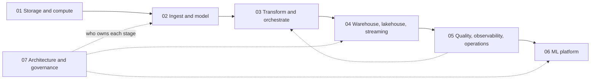

# Data Engineering

> How data gets from where it is born to where it is used: on a schedule, correctly, and in a shape the next stage can trust.

Position in the path: after [programming](../programming/README.md) (Python, SQL); [data analytics](../data-analytics/README.md) is recommended, not required. It comes alongside or before [data science](../data-science/README.md), and it is the pipeline layer under [generative AI](../generative-ai/README.md) and [AI engineering](../ai-engineering/README.md).

## What it is

A data platform is a chain of stages, and the pillars here follow the data along it. Bytes get a format and a place on disk, they are ingested and given a model, transformed on a schedule, stored at a price, watched, fed to models, and finally governed across teams.

The chain is hard to run for one reason, and it is the thread through all seven pillars.

> **Every stage has the same failure mode: it silently trusts the one before it. The engineering is in making that trust explicit: keys, contracts, tests, logical dates, monitored metrics.**

A pipeline that trusts its input does not crash when the input is wrong. It produces a plausible number, and the first alarm is a person holding it. So each pillar opens with a failure that raises no error, measured on data you can regenerate, and then adds the mechanism that would have made it visible.
## The core text

Martin Kleppmann's [*Designing Data-Intensive Applications*](https://dataintensive.net/) (O'Reilly, 2017) is the book behind this subject. Its subject is the logic that outlasts any one tool: why data is split and copied, what transactions actually promise, what a machine can know in a network, and how derived data stays correct. Tools come and go across these pillars, but when one of them makes a claim about ordering or "exactly once", this book is how you check it.

[Pillar 01](01-storage-and-compute-foundations/README.md) retells chapters 1 to 10 with code that runs, including real anomalies on real Postgres. Later pillars use the book where it sharpens a decision, with page pointers throughout, and chapter 12 frames the lakehouse and architecture choices in pillars 04 and 07. The [reading map](references.md#reading-map-designing-data-intensive-applications) lists every book chapter with the notes that use it. Read it beside pillar 01 the first time, and return to chapters 11 and 12 once you have run a pipeline.
## Course outcomes

By the end, you can build repeatable ingestion and well-modelled data; deliver tested, recoverable pipelines; choose storage and streaming systems by correctness, latency, and cost; detect and repair data incidents; build ML-platform foundations; and make defensible architecture and governance decisions.

## Before you begin

**Required:** [Programming](../programming/README.md): Python modules 01 to 03 and SQL up to its capstone. The zoomcamps assume SQL and teach none. Docker basics help, and they are introduced in early practice. [Data Analytics](../data-analytics/README.md) is recommended, not required.

**Learning model:** read the unit's chapters, use its deck where present, complete drills and practice, then keep the stated evidence of mastery. Core examples run locally; cloud coursework is optional enrichment, with local alternatives described in pillar READMEs.

## The seven pillars

| Pillar | The stage | A silent failure it opens | What makes the trust explicit | Mastery evidence | Deck |
|---|---|---|---|---|---|
| [01 Storage and compute foundations](01-storage-and-compute-foundations/README.md) | Data systems, bytes on disk, concurrent writers, machines that fail and agree | A file with a new column is read with the first file's schema, and the column is dropped | Stated schemas, isolation levels, request IDs, read plans, measuring before scaling | Measured system design and failure analysis | [pptx](01-storage-and-compute-foundations/slides/storage-and-compute-foundations.pptx), [pdf](01-storage-and-compute-foundations/slides/storage-and-compute-foundations.pdf) |
| [02 Ingest and modelling](02-ingest-and-modelling/README.md) | Getting data in, saying what a row means | A retried load doubles the day's rows | Keys, change capture, a declared grain, data contracts | Repeatable load, grain statement, contract | [pptx](02-ingest-and-modelling/slides/ingest-and-modelling.pptx), [pdf](02-ingest-and-modelling/slides/ingest-and-modelling.pdf) |
| [03 Transform and orchestrate](03-transform-and-orchestrate/README.md) | Tested models, built for the right day | An inner join loses 5,680 trips and about $96,000 with every test green | Grain tests, logical dates, idempotent writes, write-audit-publish | Green build and idempotent backfill | [pptx](03-transform-and-orchestrate/slides/transform-and-orchestrate.pptx), [pdf](03-transform-and-orchestrate/slides/transform-and-orchestrate.pdf) |
| [04 Warehouse, lakehouse and streaming](04-warehouse-lakehouse-streaming/README.md) | Where it rests, how it moves, what it costs | A rewrite dies halfway and a dashboard reads half of it as the truth | Table-format commits, event-time windows, committed offsets, byte limits | Costed architecture decision | [pptx](04-warehouse-lakehouse-streaming/slides/warehouse-lakehouse-streaming.pptx), [pdf](04-warehouse-lakehouse-streaming/slides/warehouse-lakehouse-streaming.pdf) |
| [05 Quality, observability and operations](05-quality-and-observability/README.md) | Finding out it is wrong, and running it in production | A source switches from miles to kilometres without telling anyone | Tests, monitors against history, lineage, playbooks | Monitor, lineage trace, incident playbook | [pptx](05-quality-and-observability/slides/quality-and-observability.pptx), [pdf](05-quality-and-observability/slides/quality-and-observability.pdf) |
| [06 ML platform](06-ml-platform/README.md) | Features, models and serving | A leaky join scores 2.79 offline and 5.48 in production | Point-in-time joins, a registry, gates, drift monitors | Point-in-time dataset and monitored service | [pptx](06-ml-platform/slides/ml-platform.pptx), [pdf](06-ml-platform/slides/ml-platform.pdf) |
| [07 Architecture and governance](07-architecture-and-governance/README.md) | Many pipelines, many teams, the regulator | Two correct tables join on `CA` and `California`, and a filed figure is less than half the truth | Ownership, global rules that can fail a build, access control, erasure | Defended architecture scenario | [pptx](07-architecture-and-governance/slides/architecture-and-governance.pptx), [pdf](07-architecture-and-governance/slides/architecture-and-governance.pdf) |

Read them in order the first time, because each pillar consumes the previous one's output. Pillars 01 to 03 are the critical path, since every later pillar assumes them. If your goal is ML rather than platform work, you can take pillar 04 lightly and go on to pillars 05 and 06. Pillar 07 sits across the chain, and the dotted line from 05 to 03 is the repair: an incident ends in a backfill and a new test. [references.md](references.md) is the shared library of books, papers, courses and videos.

The coursework is two DataTalksClub zoomcamps, kept as worked material and divided among the pillars they serve. Pillars 05 and 07 have no practice folder, and their chapter code runs from each chapter's `uv run --with ...` line.

## Where each tool sits

Tools are easier to compare within a layer than across one. Snowflake against Airflow isn't a real comparison: Snowflake stores and computes, Airflow schedules, and they often run together.

| Layer | Job | Tools |
|---|---|---|
| Ingest | Move data in | Fivetran, Airbyte, dlt, Debezium, Kafka |
| Store: files | Cheap, durable bytes | S3, GCS, Parquet, Iceberg, Delta |
| Store: analytical | Scan and aggregate | Snowflake, BigQuery, Redshift, ClickHouse, DuckDB |
| Store: operational | Serve the app | Postgres, Redis, DynamoDB, vector and graph stores |
| Transform | Model data | dbt, Spark, SQL |
| Orchestrate | Schedule, retry, backfill | Airflow, Dagster, Prefect |
| Observe and govern | Trust and control | Great Expectations, OpenLineage, catalogs |

## Units

### [01 Storage and compute foundations](01-storage-and-compute-foundations/README.md)

**Objectives:** define reliability and performance goals; choose data models and encodings ([Kleppmann 2017, ch. 1–4](https://dataintensive.net/)); explain row versus column storage; reproduce and prevent transaction anomalies (ch. 7); reason about replication, partitioning (ch. 5–6), clocks, consensus (ch. 8–9), and distributed compute (ch. 10); say what a commit promises under each durability setting; pick a store from its access pattern.

**Learning:** [reading order](01-storage-and-compute-foundations/README.md#reading-order), chapter code, and practice. **Evidence:** measure a representative workload, explain a failure mode, and defend the smallest system that meets the requirement.

### [02 Ingest and modelling](02-ingest-and-modelling/README.md)

**Objectives:** make loads repeatable; choose batch, CDC, or log ingestion ([Kleppmann 2017, ch. 11](https://dataintensive.net/)); declare table grain; model facts, dimensions, and slowly changing attributes ([Kimball and Ross](https://www.kimballgroup.com/data-warehouse-business-intelligence-resources/books/)); compare Data Vault and One Big Table; write a data contract (Breck et al., *Data Validation for Machine Learning*).

**Learning:** [reading order](02-ingest-and-modelling/README.md#reading-order) and DataTalks practice. **Evidence:** a rerunnable load, star-model grain statement, reconciliation check, and contract that rejects a bad batch. **Book chapters:** Kleppmann 3, 4, 11, and 12.

### [03 Transform and orchestrate](03-transform-and-orchestrate/README.md)

**Objectives:** structure transformations; test grain and joins; use dbt tests, snapshots, and incremental models (dbt documentation); reason about logical dates, retries, and backfills ([Kleppmann 2017, ch. 8–10](https://dataintensive.net/)); compare Dagster and Airflow.

**Learning:** [reading order](03-transform-and-orchestrate/README.md#reading-order), runnable chapter code, and practice. **Evidence:** a green tested model plus a backfill that produces identical output when rerun.

### [04 Warehouse, lakehouse and streaming](04-warehouse-lakehouse-streaming/README.md)

**Objectives:** estimate scan cost; select layout and partitioning; explain table-format transactions ([Armbrust et al.](https://www.vldb.org/pvldb/vol13/p3411-armbrust.pdf)); evaluate lakehouse trade-offs; implement safe producer/consumer semantics; reason about event time, watermarks, and lag ([Akidau et al.](https://www.vldb.org/pvldb/vol8/p1792-Akidau.pdf)); compare warehouses by concept (storage and compute separation, layout, concurrency); reason about object store consistency and cost.

**Learning:** [reading order](04-warehouse-lakehouse-streaming/README.md#reading-order), [deck](04-warehouse-lakehouse-streaming/slides/warehouse-lakehouse-streaming.pptx), and labelled practice. **Evidence:** a costed store decision plus a stream design that says exactly-once from where to where. **Book chapters and docs:** Kleppmann 3, 6, 7, 10–12; Kafka and Iceberg/Delta documentation.

### [05 Quality, observability and operations](05-quality-and-observability/README.md)

**Objectives:** define quality dimensions ([Schelter et al.](https://www.vldb.org/pvldb/vol11/p1781-schelter.pdf)); write batch tests and time-aware monitors ([Beyer et al.](https://sre.google/sre-book/table-of-contents/)); use lineage to bound an incident; contain and repair safely; write a blameless playbook and postmortem; run an expand-contract migration with no downtime; prove a backup by restoring it; size connections and diagnose bloat and replica lag; build slim CI with `state:modified+` and `--defer`; set a freshness SLO and page on symptoms.

**Learning:** [reading order](05-quality-and-observability/README.md#reading-order) and [deck](05-quality-and-observability/slides/quality-and-observability.pptx). **Evidence:** catch a planted fault, trace its impact, execute an idempotent repair, and add a preventive check. **Tools:** Great Expectations, dbt, OpenLineage.

### [06 ML platform](06-ml-platform/README.md)

**Objectives:** build point-in-time features (Kleppmann 2017, ch. 11, pp. 475–476); track experiments and models ([Wilson](https://www.manning.com/books/machine-learning-engineering-in-action)); compare batch and online serving; detect drift ([Gama et al.](http://eprints.bournemouth.ac.uk/22491/)); select appropriate platform maturity.

**Learning:** [chapters and practice](06-ml-platform/README.md), including the DataTalks MLOps coursework. **Evidence:** a point-in-time-safe training dataset, registered run/model, served prediction, and diagnosis of drift versus pipeline failure.

### [07 Architecture and governance](07-architecture-and-governance/README.md)

**Objectives:** compare centralised, mesh, fabric, and MDW architectures (Serra; [Dehghani](https://martinfowler.com/articles/data-mesh-principles.html)); design ownership and interoperability; control access; protect PII; account for deletion, retention, and audit obligations (Kleppmann 2017, ch. 11–12).

**Learning:** [chapters and scenarios](07-architecture-and-governance/README.md); the scenario prompts in [data architectures](07-architecture-and-governance/notes/01-data-architectures-mesh-fabric-mdw.md) are written as interview practice. **Evidence:** defend an architecture with mechanisms and trade-offs, then write an access/retention decision for a dataset.

## Rules of thumb

Each pillar's README has its own full list. These are the ones that cross stages.

| Rule | Where |
|---|---|
| State the schema on first read; inference destroys zip codes and big IDs silently | [01](01-storage-and-compute-foundations/notes/02-encoding-and-files.md) |
| Read, decide, then write needs serializable isolation or a lock; snapshot isolation allows write skew | [01](01-storage-and-compute-foundations/notes/04-transactions-and-isolation.md) |
| A timeout does not say whether a write applied, so retry with one request ID from client to store | [01](01-storage-and-compute-foundations/notes/06-when-distributed-systems-fail.md) |
| Do not order events by wall clock across machines, and do not build your own consensus | [01](01-storage-and-compute-foundations/notes/06-when-distributed-systems-fail.md), [01](01-storage-and-compute-foundations/notes/07-consistency-and-consensus.md) |
| Reach for DuckDB or Polars before Spark when the data fits on one machine | [01](01-storage-and-compute-foundations/notes/08-distributed-compute.md), [04](04-warehouse-lakehouse-streaming/notes/01-warehouse-and-store.md) |
| Every load is keyed and re-runnable: merge on a primary key, write to a path derived from the logical date | [02](02-ingest-and-modelling/notes/01-ingest.md), [03](03-transform-and-orchestrate/notes/02-orchestrate.md) |
| Put a contract at every producer and consumer boundary | [02](02-ingest-and-modelling/notes/04-data-contracts.md) |
| Define each metric once, in one mart, with an owner | [03](03-transform-and-orchestrate/notes/01-transform.md), [07](07-architecture-and-governance/notes/01-data-architectures-mesh-fabric-mdw.md) |
| Make a task idempotent before you let anything retry it | [03](03-transform-and-orchestrate/notes/04-idempotency-and-backfills.md) |
| Partition on the date you always filter by, cluster on the next filter, and do not partition small tables | [04](04-warehouse-lakehouse-streaming/notes/01-warehouse-and-store.md) |
| Commit output and offset together, or make the sink idempotent | [04](04-warehouse-lakehouse-streaming/notes/04-kafka-and-stream-semantics.md) |
| A test asks about a batch, a monitor asks about a batch against time, and you need both | [05](05-quality-and-observability/notes/02-monitors-and-lineage.md) |
| Contain before you diagnose, and never fix raw in place | [05](05-quality-and-observability/notes/03-incident-playbooks.md) |
| One function computes a feature everywhere, joined as of the prediction time | [06](06-ml-platform/notes/01-feature-stores.md) |
| On a drift alert, check for a pipeline fault before retraining | [06](06-ml-platform/notes/04-drift.md) |
| Name the system of record for each fact; everything else is derived and can be rebuilt | [04](04-warehouse-lakehouse-streaming/notes/03-lakehouse-vs-warehouse.md), [07](07-architecture-and-governance/notes/01-data-architectures-mesh-fabric-mdw.md) |
| A mesh is an ownership model, not a storage choice; contracts come before decentralisation | [07](07-architecture-and-governance/notes/01-data-architectures-mesh-fabric-mdw.md) |
| Hashed is not anonymous: pseudonymised data stays personal data | [07](07-architecture-and-governance/notes/02-access-control-pii-gdpr.md) |

## Resource map

### Related notes elsewhere

| Where | Why |
|---|---|
| [programming/](../programming/README.md) SQL and Python | The fluency the zoomcamps assume |
| [data-analytics/](../data-analytics/README.md) | Wrangling and statistics; the consumer of the marts in pillar 03 |
| [data-science/](../data-science/README.md) | The models that pillar 06 serves and monitors |
| [generative-ai/06-observability](../generative-ai/06-observability/README.md) | Tracing and scoring for LLM apps: the monitoring ideas of pillar 05 for a different model type |
| [generative-ai/08-eval](../generative-ai/08-eval/README.md) | Evaluation of LLM systems, which pillar 06's gates and drift checks sit beside |

### Coursework, with run labels

Labels: **offline** = runs on a laptop with no account once data is downloaded · **Docker** · **GCP** / **AWS** = needs a cloud account and billing · **pin** = unpinned dependencies; pin as stated · **legacy** = API or tool superseded · **reading** = videos or text, no code. These labels are read from the course material; the zoomcamp notebooks and modules were not executed. Module numbers are those of the 2024-era snapshot, and upstream has since renumbered, as [references.md](references.md#courses-and-videos) explains.

**DE Zoomcamp** ([course README](02-ingest-and-modelling/practice/datatalks-de/README.md))

| Module | Folder | Chapter | Needs |
|---|---|---|---|
| `01-docker-terraform` | [02](02-ingest-and-modelling/practice/datatalks-de/01-docker-terraform) | [Ingest](02-ingest-and-modelling/notes/01-ingest.md) | Docker (Postgres, pgAdmin, ingest container): offline. Terraform part: GCP (service-account key) |
| `02-workflow-orchestration` | [03](03-transform-and-orchestrate/practice/datatalks-de/02-workflow-orchestration) | [Orchestrate](03-transform-and-orchestrate/notes/02-orchestrate.md) | Reading (videos only in the snapshot); to follow along, Docker (Mage) + GCP |
| `03-data-warehouse` | [04](04-warehouse-lakehouse-streaming/practice/datatalks-de/03-data-warehouse) | [Warehouse and store](04-warehouse-lakehouse-streaming/notes/01-warehouse-and-store.md) | GCP (BigQuery, billing). BQML export: Docker (`tensorflow/serving`) |
| `04-analytics-engineering` | [03](03-transform-and-orchestrate/practice/datatalks-de/04-analytics-engineering) | [Transform](03-transform-and-orchestrate/notes/01-transform.md) | GCP (BigQuery + dbt Cloud), or offline with dbt Core + Postgres |
| `05-batch` | [04](04-warehouse-lakehouse-streaming/practice/datatalks-de/05-batch) | [Warehouse and store](04-warehouse-lakehouse-streaming/notes/01-warehouse-and-store.md) | Java 11 + Spark 3.3.2 (pin); offline locally. Dataproc and the GCS connector: GCP |
| `06-streaming` | [04](04-warehouse-lakehouse-streaming/practice/datatalks-de/06-streaming) | [Kafka](04-warehouse-lakehouse-streaming/notes/04-kafka-and-stream-semantics.md) | Docker (Kafka / Confluent compose, Redpanda); Java for the Kafka Streams examples; ksqlDB folder is SQL only |
| `projects/` | [02](02-ingest-and-modelling/practice/datatalks-de/projects) | Capstone | Reading: project brief and dataset list |

**MLOps Zoomcamp** ([course README](06-ml-platform/practice/datatalks-mlops/README.md), all in pillar 06)

| Module | Chapter | Needs |
|---|---|---|
| `01-intro` | [Maturity](06-ml-platform/notes/05-mlops-maturity-and-best-practices.md) | Offline after downloading the taxi Parquet files |
| `02-experiment-tracking` | [Tracking and registry](06-ml-platform/notes/02-experiment-tracking-and-model-registry.md) | `mlflow`, `hyperopt`, `xgboost` (pin): offline. Scenario 3 and `mlflow_on_aws.md`: AWS (EC2, RDS, S3) |
| `03-orchestration` | [Orchestrate](03-transform-and-orchestrate/notes/02-orchestrate.md) | Docker (Mage; pinned requirements in the module) |
| `04-deployment` | [Serving](06-ml-platform/notes/03-batch-and-online-serving.md) | `web-service/`: Docker, offline. `web-service-mlflow/`: AWS (S3). `streaming/`: Docker locally; AWS (Kinesis, Lambda, ECR) for real. `batch/`: legacy (Prefect 2 `orion`) + AWS S3 |
| `05-monitoring` | [Monitors](05-quality-and-observability/notes/02-monitors-and-lineage.md), [Drift](06-ml-platform/notes/04-drift.md) | Docker compose (Postgres, Adminer, Grafana): offline. Pin `evidently<0.7` (legacy API). Prefect: legacy |
| `06-best-practices` | [Maturity](06-ml-platform/notes/05-mlops-maturity-and-best-practices.md) | Unit tests: offline. Integration test: Docker + LocalStack, offline. Terraform and CI/CD: AWS + GitHub |
| `07-project` | Capstone | Reading: capstone brief and rubric |
| `generate/` | None | Course-site tooling, not coursework |

### Readings

[sources/](sources/) holds the shared PDFs and [references.md](references.md) maps each to its chapters. Run `/papers` or `/chapter` to fold in what the `/readings` router files here.

### Previous and next layer

| | Where |
|---|---|
| Previous | [data-analytics/](../data-analytics/README.md), on top of [programming/](../programming/README.md) |
| Next | [data-science/](../data-science/README.md) for the modelling side; [generative-ai/](../generative-ai/README.md) and [ai-engineering/](../ai-engineering/README.md), which use these pipelines as their data layer |

## Completion standard and next steps

Complete a portfolio containing a repeatable ingest/model, tested and orchestrated pipeline, costed storage or streaming decision, quality incident response, ML-platform exercise, and governed architecture decision. Every item should state its grain or contract, failure handling, evidence, and trade-offs. The capstone is MLOps `07-project` or the DE [project brief](02-ingest-and-modelling/practice/datatalks-de/projects): self-score against the evaluation criteria in the brief, with LocalStack standing in for the cloud criterion.

Continue to [Data Science](../data-science/README.md) for modelling depth, or [Generative AI](../generative-ai/README.md) and [AI Engineering](../ai-engineering/README.md) for LLM systems.

## Primary texts

- Kleppmann, *Designing Data-Intensive Applications*: the core text, run through Unit 01 and used across the rest
- Kimball and Ross, *The Data Warehouse Toolkit*, 2nd ed.: dimensional modelling in Unit 02
- Beyer et al., *Site Reliability Engineering*: monitoring and incidents in Unit 05
- Wilson, *Machine Learning Engineering in Action*: Unit 06
- Serra, *Deciphering Data Architectures*, excerpts: Unit 07, with attribution inferred from content
- Reis and Housley, *Fundamentals of Data Engineering*: lifecycle background for all units

Everything else: [references.md](references.md), including the [reading map](references.md#reading-map-designing-data-intensive-applications) for Kleppmann.
