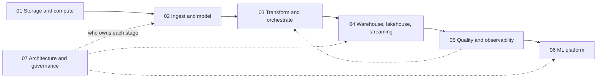

# Data Engineering

> How data gets from where it is born to where it is used: on a schedule, correctly, and in a shape the next stage can trust.

Position in the path: after [programming](../programming/README.md) (Python, SQL) and [data analytics](../data-analytics/README.md); alongside or before [data science](../data-science/README.md). It is the pipeline layer under [generative AI](../generative-ai/README.md) and [AI engineering](../ai-engineering/README.md). Interview summary: [8-data-eng-mlops](../practice/interviewing/guides/8-data-eng-mlops/00-overview.md).

## What it is

A data platform is a chain of stages, and the pillars here follow the data along it. Bytes get a format and a place on disk, they are ingested and given a model, transformed on a schedule, stored at a price, watched, fed to models, and finally governed across teams.

The chain is hard to run for one reason, and it is the thread through all seven pillars.

> **Every stage has the same failure mode: it silently trusts the one before it. The engineering is in making that trust explicit: keys, contracts, tests, logical dates, monitored metrics.**

A pipeline that trusts its input does not crash when the input is wrong. It produces a plausible number, and the first alarm is a person holding it. So each pillar opens with a failure that raises no error, measured on data you can regenerate, and then adds the mechanism that would have made it visible.

## The core text

Martin Kleppmann's [*Designing Data-Intensive Applications*](https://dataintensive.net/) (O'Reilly, 2017) is the book behind this subject. Its subject is the logic that outlasts any one tool: why data is split and copied, what transactions actually promise, what a machine can know in a network, and how derived data stays correct. Tools come and go across these pillars, but when one of them makes a claim about ordering or "exactly once", this book is how you check it.

[Pillar 01](01-storage-and-compute-foundations/README.md) retells chapters 1 to 10 with code that runs, including real anomalies on real Postgres. Later pillars use the book where it sharpens a decision, with page pointers throughout, and chapter 12 frames the lakehouse and architecture choices in pillars 04 and 07. The [reading map](CURRICULUM.md#reading-map-designing-data-intensive-applications) lists every book chapter with the notes that use it. Read it beside pillar 01 the first time, and return to chapters 11 and 12 once you have run a pipeline.

## The seven pillars

| Pillar | The stage | A silent failure it opens | What makes the trust explicit | Chapters | Deck |
|---|---|---|---|---|---|
| [01 Storage and compute foundations](01-storage-and-compute-foundations/README.md) | Data systems, bytes on disk, concurrent writers, machines that fail and agree | A file with a new column is read with the first file's schema, and the column is dropped | Stated schemas, isolation levels, request IDs, read plans, measuring before scaling | 8 | [pptx](01-storage-and-compute-foundations/slides/storage-and-compute-foundations.pptx), [pdf](01-storage-and-compute-foundations/slides/storage-and-compute-foundations.pdf) |
| [02 Ingest and modelling](02-ingest-and-modelling/README.md) | Getting data in, saying what a row means | A retried load doubles the day's rows | Keys, change capture, a declared grain, data contracts | 4 | [pptx](02-ingest-and-modelling/slides/ingest-and-modelling.pptx), [pdf](02-ingest-and-modelling/slides/ingest-and-modelling.pdf) |
| [03 Transform and orchestrate](03-transform-and-orchestrate/README.md) | Tested models, built for the right day | An inner join loses 5,680 trips and about $96,000 with every test green | Grain tests, logical dates, idempotent writes, write-audit-publish | 5 | [pptx](03-transform-and-orchestrate/slides/transform-and-orchestrate.pptx), [pdf](03-transform-and-orchestrate/slides/transform-and-orchestrate.pdf) |
| [04 Warehouse, lakehouse and streaming](04-warehouse-lakehouse-streaming/README.md) | Where it rests, how it moves, what it costs | A rewrite dies halfway and a dashboard reads half of it as the truth | Table-format commits, event-time windows, committed offsets, byte limits | 5 | [pptx](04-warehouse-lakehouse-streaming/slides/warehouse-lakehouse-streaming.pptx), [pdf](04-warehouse-lakehouse-streaming/slides/warehouse-lakehouse-streaming.pdf) |
| [05 Quality and observability](05-quality-and-observability/README.md) | Finding out it is wrong | A source switches from miles to kilometres without telling anyone | Tests, monitors against history, lineage, playbooks | 3 | [pptx](05-quality-and-observability/slides/quality-and-observability.pptx), [pdf](05-quality-and-observability/slides/quality-and-observability.pdf) |
| [06 ML platform](06-ml-platform/README.md) | Features, models and serving | A leaky join scores 2.79 offline and 5.48 in production | Point-in-time joins, a registry, gates, drift monitors | 5 | [pptx](06-ml-platform/slides/ml-platform.pptx), [pdf](06-ml-platform/slides/ml-platform.pdf) |
| [07 Architecture and governance](07-architecture-and-governance/README.md) | Many pipelines, many teams, the regulator | Two correct tables join on `CA` and `California`, and a filed figure is less than half the truth | Ownership, global rules that can fail a build, access control, erasure | 2 | [pptx](07-architecture-and-governance/slides/architecture-and-governance.pptx), [pdf](07-architecture-and-governance/slides/architecture-and-governance.pdf) |



Read them in order the first time, because each pillar consumes the previous one's output. Pillar 07 sits across the chain, and the dotted line from 05 to 03 is the repair: an incident ends in a backfill and a new test. [CURRICULUM.md](CURRICULUM.md) gives the sequence, the practice for each step and how you know you are done. [references.md](references.md) is the shared library of books, papers, courses and videos.

## How this folder is organised

```
data-engineering/
├── README.md, CURRICULUM.md, references.md
├── sources/                         shared PDFs for all seven pillars
└── NN-pillar/
    ├── README.md                    reading order, rules of thumb, deck, practice
    ├── notes/                       the chapters
    ├── references.md                this pillar's sources, mapped to its chapters
    ├── slides/                      lecture deck and its deck.yaml
    └── practice/                    chapter scripts and zoomcamp coursework, where the pillar has any
```

The coursework is two DataTalksClub zoomcamps, kept as worked material and divided among the pillars they serve. Pillars 05 and 07 have no practice folder, and their chapter code runs from each chapter's `uv run --with ...` line.

## Syllabus

These are the chapters on disk as of 2 November 2026.

### [01 Storage and compute foundations](01-storage-and-compute-foundations/README.md)

1. [Data systems and data models](01-storage-and-compute-foundations/notes/01-data-systems-and-data-models.md)
2. [Encoding and files](01-storage-and-compute-foundations/notes/02-encoding-and-files.md)
3. [Row and column stores](01-storage-and-compute-foundations/notes/03-row-and-column-stores.md)
4. [Transactions and isolation](01-storage-and-compute-foundations/notes/04-transactions-and-isolation.md)
5. [Partitioning and replication](01-storage-and-compute-foundations/notes/05-partitioning-and-replication.md)
6. [When distributed systems fail](01-storage-and-compute-foundations/notes/06-when-distributed-systems-fail.md)
7. [Consistency and consensus](01-storage-and-compute-foundations/notes/07-consistency-and-consensus.md)
8. [Distributed compute](01-storage-and-compute-foundations/notes/08-distributed-compute.md)

### [02 Ingest and modelling](02-ingest-and-modelling/README.md)

1. [Ingest](02-ingest-and-modelling/notes/01-ingest.md)
2. [Dimensional modelling](02-ingest-and-modelling/notes/02-dimensional-modelling.md)
3. [Data Vault and One Big Table](02-ingest-and-modelling/notes/03-data-vault-and-obt.md)
4. [Data contracts](02-ingest-and-modelling/notes/04-data-contracts.md)

### [03 Transform and orchestrate](03-transform-and-orchestrate/README.md)

1. [Transform](03-transform-and-orchestrate/notes/01-transform.md)
2. [Orchestrate](03-transform-and-orchestrate/notes/02-orchestrate.md)
3. [dbt tests, snapshots and incremental models](03-transform-and-orchestrate/notes/03-dbt-tests-snapshots-incremental.md)
4. [Idempotency and backfills](03-transform-and-orchestrate/notes/04-idempotency-and-backfills.md)
5. [Dagster and Airflow](03-transform-and-orchestrate/notes/05-dagster-and-airflow.md)

### [04 Warehouse, lakehouse and streaming](04-warehouse-lakehouse-streaming/README.md)

1. [Warehouse and store](04-warehouse-lakehouse-streaming/notes/01-warehouse-and-store.md)
2. [Table formats](04-warehouse-lakehouse-streaming/notes/02-table-formats.md)
3. [Lakehouse against warehouse](04-warehouse-lakehouse-streaming/notes/03-lakehouse-vs-warehouse.md)
4. [Kafka and stream semantics](04-warehouse-lakehouse-streaming/notes/04-kafka-and-stream-semantics.md)
5. [Cost](04-warehouse-lakehouse-streaming/notes/05-cost.md)

### [05 Quality and observability](05-quality-and-observability/README.md)

1. [Quality dimensions and tests](05-quality-and-observability/notes/01-quality-dimensions-and-tests.md)
2. [Monitors and lineage](05-quality-and-observability/notes/02-monitors-and-lineage.md)
3. [Incident playbooks](05-quality-and-observability/notes/03-incident-playbooks.md)

### [06 ML platform](06-ml-platform/README.md)

1. [Feature stores](06-ml-platform/notes/01-feature-stores.md)
2. [Experiment tracking and the model registry](06-ml-platform/notes/02-experiment-tracking-and-model-registry.md)
3. [Batch and online serving](06-ml-platform/notes/03-batch-and-online-serving.md)
4. [Drift](06-ml-platform/notes/04-drift.md)
5. [The MLOps maturity model and best practices](06-ml-platform/notes/05-mlops-maturity-and-best-practices.md)

### [07 Architecture and governance](07-architecture-and-governance/README.md)

1. [Data architectures: MDW, fabric, mesh](07-architecture-and-governance/notes/01-data-architectures-mesh-fabric-mdw.md)
2. [Access control, PII and GDPR](07-architecture-and-governance/notes/02-access-control-pii-gdpr.md)

## Rules of thumb

Each pillar's README has its own full list. These are the ones that cross stages.

| Rule | Where |
|---|---|
| State the schema on first read; inference destroys zip codes and big IDs silently | [01](01-storage-and-compute-foundations/notes/02-encoding-and-files.md) |
| Read, decide, then write needs serializable isolation or a lock; snapshot isolation allows write skew | [01](01-storage-and-compute-foundations/notes/04-transactions-and-isolation.md) |
| A timeout does not say whether a write applied, so retry with one request ID from client to store | [01](01-storage-and-compute-foundations/notes/06-when-distributed-systems-fail.md) |
| Do not order events by wall clock across machines, and do not build your own consensus | [01](01-storage-and-compute-foundations/notes/06-when-distributed-systems-fail.md), [01](01-storage-and-compute-foundations/notes/07-consistency-and-consensus.md) |
| Reach for DuckDB or Polars before Spark when the data fits on one machine | [01](01-storage-and-compute-foundations/notes/08-distributed-compute.md), [04](04-warehouse-lakehouse-streaming/notes/01-warehouse-and-store.md) |
| Every load is keyed and re-runnable: merge on a primary key, write to a path derived from the logical date | [02](02-ingest-and-modelling/notes/01-ingest.md), [03](03-transform-and-orchestrate/notes/02-orchestrate.md) |
| Put a contract at every producer and consumer boundary | [02](02-ingest-and-modelling/notes/04-data-contracts.md) |
| Define each metric once, in one mart, with an owner | [03](03-transform-and-orchestrate/notes/01-transform.md), [07](07-architecture-and-governance/notes/01-data-architectures-mesh-fabric-mdw.md) |
| Make a task idempotent before you let anything retry it | [03](03-transform-and-orchestrate/notes/04-idempotency-and-backfills.md) |
| Partition on the date you always filter by, cluster on the next filter, and do not partition small tables | [04](04-warehouse-lakehouse-streaming/notes/01-warehouse-and-store.md) |
| Commit output and offset together, or make the sink idempotent | [04](04-warehouse-lakehouse-streaming/notes/04-kafka-and-stream-semantics.md) |
| A test asks about a batch, a monitor asks about a batch against time, and you need both | [05](05-quality-and-observability/notes/02-monitors-and-lineage.md) |
| Contain before you diagnose, and never fix raw in place | [05](05-quality-and-observability/notes/03-incident-playbooks.md) |
| One function computes a feature everywhere, joined as of the prediction time | [06](06-ml-platform/notes/01-feature-stores.md) |
| On a drift alert, check for a pipeline fault before retraining | [06](06-ml-platform/notes/04-drift.md) |
| Name the system of record for each fact; everything else is derived and can be rebuilt | [04](04-warehouse-lakehouse-streaming/notes/03-lakehouse-vs-warehouse.md), [07](07-architecture-and-governance/notes/01-data-architectures-mesh-fabric-mdw.md) |
| A mesh is an ownership model, not a storage choice; contracts come before decentralisation | [07](07-architecture-and-governance/notes/01-data-architectures-mesh-fabric-mdw.md) |
| Hashed is not anonymous: pseudonymised data stays personal data | [07](07-architecture-and-governance/notes/02-access-control-pii-gdpr.md) |

## Resource map

### Related notes elsewhere

| Where | Why |
|---|---|
| [programming/](../programming/README.md) SQL and Python | The fluency the zoomcamps assume |
| [data-analytics/](../data-analytics/README.md) | Wrangling and statistics; the consumer of the marts in pillar 03 |
| [data-science/](../data-science/README.md) | The models that pillar 06 serves and monitors |
| [generative-ai/06-observability](../generative-ai/06-observability/README.md) | Tracing and scoring for LLM apps: the monitoring ideas of pillar 05 for a different model type |
| [generative-ai/08-eval](../generative-ai/08-eval/README.md) | Evaluation of LLM systems, which pillar 06's gates and drift checks sit beside |

### Coursework, with run labels

Labels: **offline** = runs on a laptop with no account once data is downloaded · **Docker** · **GCP** / **AWS** = needs a cloud account and billing · **pin** = unpinned dependencies; pin as stated · **legacy** = API or tool superseded · **reading** = videos or text, no code. These labels are read from the course material; the zoomcamp notebooks and modules were not executed. Module numbers are those of the 2024-era snapshot, and upstream has since renumbered, as [references.md](references.md#courses-and-videos) explains.

**DE Zoomcamp** ([course README](02-ingest-and-modelling/practice/datatalks-de/README.md))

| Module | Folder | Chapter | Needs |
|---|---|---|---|
| `01-docker-terraform` | [02](02-ingest-and-modelling/practice/datatalks-de/01-docker-terraform) | [Ingest](02-ingest-and-modelling/notes/01-ingest.md) | Docker (Postgres, pgAdmin, ingest container): offline. Terraform part: GCP (service-account key) |
| `02-workflow-orchestration` | [03](03-transform-and-orchestrate/practice/datatalks-de/02-workflow-orchestration) | [Orchestrate](03-transform-and-orchestrate/notes/02-orchestrate.md) | Reading (videos only in the snapshot); to follow along, Docker (Mage) + GCP |
| `03-data-warehouse` | [04](04-warehouse-lakehouse-streaming/practice/datatalks-de/03-data-warehouse) | [Warehouse and store](04-warehouse-lakehouse-streaming/notes/01-warehouse-and-store.md) | GCP (BigQuery, billing). BQML export: Docker (`tensorflow/serving`) |
| `04-analytics-engineering` | [03](03-transform-and-orchestrate/practice/datatalks-de/04-analytics-engineering) | [Transform](03-transform-and-orchestrate/notes/01-transform.md) | GCP (BigQuery + dbt Cloud), or offline with dbt Core + Postgres |
| `05-batch` | [04](04-warehouse-lakehouse-streaming/practice/datatalks-de/05-batch) | [Warehouse and store](04-warehouse-lakehouse-streaming/notes/01-warehouse-and-store.md) | Java 11 + Spark 3.3.2 (pin); offline locally. Dataproc and the GCS connector: GCP |
| `06-streaming` | [04](04-warehouse-lakehouse-streaming/practice/datatalks-de/06-streaming) | [Kafka](04-warehouse-lakehouse-streaming/notes/04-kafka-and-stream-semantics.md) | Docker (Kafka / Confluent compose, Redpanda); Java for the Kafka Streams examples; ksqlDB folder is SQL only |
| `projects/` | [02](02-ingest-and-modelling/practice/datatalks-de/projects) | Capstone | Reading: project brief and dataset list |

**MLOps Zoomcamp** ([course README](06-ml-platform/practice/datatalks-mlops/README.md), all in pillar 06)

| Module | Chapter | Needs |
|---|---|---|
| `01-intro` | [Maturity](06-ml-platform/notes/05-mlops-maturity-and-best-practices.md) | Offline after downloading the taxi Parquet files |
| `02-experiment-tracking` | [Tracking and registry](06-ml-platform/notes/02-experiment-tracking-and-model-registry.md) | `mlflow`, `hyperopt`, `xgboost` (pin): offline. Scenario 3 and `mlflow_on_aws.md`: AWS (EC2, RDS, S3) |
| `03-orchestration` | [Orchestrate](03-transform-and-orchestrate/notes/02-orchestrate.md) | Docker (Mage; pinned requirements in the module) |
| `04-deployment` | [Serving](06-ml-platform/notes/03-batch-and-online-serving.md) | `web-service/`: Docker, offline. `web-service-mlflow/`: AWS (S3). `streaming/`: Docker locally; AWS (Kinesis, Lambda, ECR) for real. `batch/`: legacy (Prefect 2 `orion`) + AWS S3 |
| `05-monitoring` | [Monitors](05-quality-and-observability/notes/02-monitors-and-lineage.md), [Drift](06-ml-platform/notes/04-drift.md) | Docker compose (Postgres, Adminer, Grafana): offline. Pin `evidently<0.7` (legacy API). Prefect: legacy |
| `06-best-practices` | [Maturity](06-ml-platform/notes/05-mlops-maturity-and-best-practices.md) | Unit tests: offline. Integration test: Docker + LocalStack, offline. Terraform and CI/CD: AWS + GitHub |
| `07-project` | Capstone | Reading: capstone brief and rubric |
| `generate/` | None | Course-site tooling, not coursework |

### Readings

[sources/](sources/) holds the shared PDFs and [references.md](references.md) maps each to its chapters. Run `/papers` or `/chapter` to fold in what the `/readings` router files here.

### Interviewing guide

[8-data-eng-mlops/00-overview.md](../practice/interviewing/guides/8-data-eng-mlops/00-overview.md). The scenario prompts in [data architectures](07-architecture-and-governance/notes/01-data-architectures-mesh-fabric-mdw.md) are written as interview practice.

### Previous and next layer

| | Where |
|---|---|
| Previous | [data-analytics/](../data-analytics/README.md), on top of [programming/](../programming/README.md) |
| Next | [data-science/](../data-science/README.md) for the modelling side; [generative-ai/](../generative-ai/README.md) and [ai-engineering/](../ai-engineering/README.md), which use these pipelines as their data layer |
