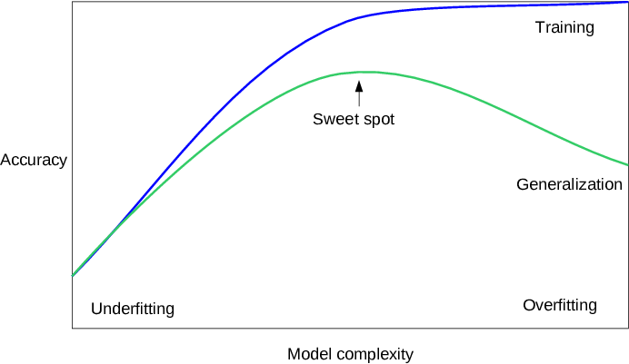
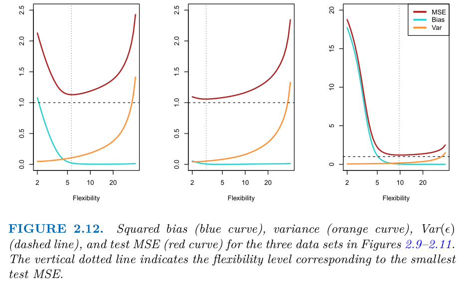
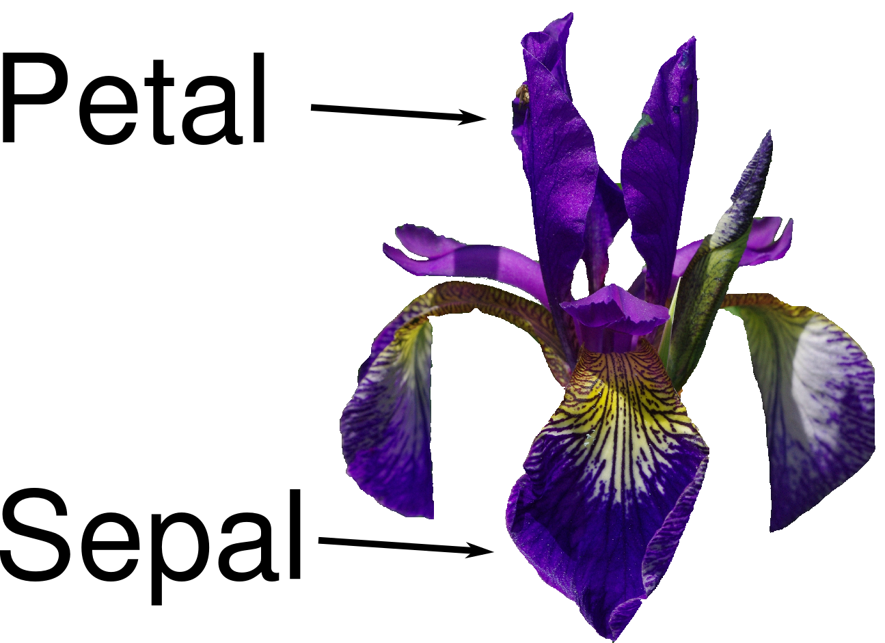
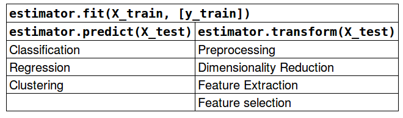

# Statistical Foundations

> A census analyst can tell you who earned over $50k last year. A data scientist is asked who will next year, and has to know whether the answer holds on people the model never saw. This note fixes the vocabulary for that question: what a model is estimating, why it fails on new data, how to split data so you can tell, and the four-line scikit-learn loop every classical model shares.

**In plain words.** A model is a rule learned from past examples, like a new estate agent who has seen a few hundred house sales and now guesses prices. What matters is how well the guesses hold up on houses the agent has never seen, and that can be far worse than on the sales already studied. This chapter gives you the words for that gap and the habit of hiding some data away to measure it, which is the check behind every prediction you'll ship at work.

Code blocks in this pillar run top to bottom within a note, as in a notebook, from the note's own `notes/` folder (`uv run --with scikit-learn --with pandas --with matplotlib python`). The printed output shown came from running them. Where a number comes from a book or paper instead, the sentence says so.

---

## Why a readings layer comes first

Classical machine learning is applied statistics with a compute budget. Every technique in this pillar answers the same question, *how do I estimate a function from samples so that it holds on samples I haven't seen?*, and every failure is a failure to answer it: overfitting, leakage, a metric that rewards the wrong thing, a test set you peeked at.

This layer is mostly reading. The serious code starts in [02](02-supervised-learning.md). What this note does is fix the terms, demonstrate the bias-variance trade-off once, show the one API shape you will use everywhere, and say which book chapter to read alongside which later note.

> **A model is an estimate of $f$ in $y = f(x) + \varepsilon$. Learning is choosing $\hat f$ from a family of functions. Generalisation is how close $\hat f$ stays to $f$ on new $x$.**

The rest of this note is about that last sentence. [The data generating process](../../../data-analytics/02-probability-and-statistics/notes/07-data-generating-process.md#a-better-fit-is-not-better-generalisation) in data analytics makes the same point from the analyst's side: a better fit on the rows you have is not better generalisation.

---

## The problem setting

| Term | Meaning | Where it shows up |
|---|---|---|
| Sample, data point | One row $x_i$ with features $x_{i1..p}$ | Everywhere |
| Feature | One column; numeric, categorical, text, image | [03](03-feature-engineering-and-pipelines.md), [NLP text representation](../../03-nlp/notes/01-text-representation.md) |
| Target, label | The $y$ you want to predict | Supervised learning only |
| Supervised | Learn $x \to y$ from labelled pairs | [02](02-supervised-learning.md), [06](06-ensembles.md) |
| Unsupervised | Find structure in $x$ alone | [05](05-unsupervised-learning.md) |
| Classification | $y$ is a class from a finite set | [02](02-supervised-learning.md), [NLP text classification](../../03-nlp/notes/02-text-classification.md) |
| Regression | $y$ is a real number | [02](02-supervised-learning.md) |
| Generalisation | Performance on data not used to fit | [04](04-model-evaluation.md) |

ISLP opens with three data sets that map onto the table. Wage (3,000 men in the central Atlantic region) is regression, where the wage rises with age until about 60 and then falls. Smarket (daily S&P 500 direction from the previous five days' returns) is classification with a faint signal: the previous-day return looks almost the same on up and down days, yet QDA fitted on 2001 to 2004 called 2005 correctly about 60% of the time. NCI60 (6,830 gene measurements on 64 cancer cell lines) is unsupervised with $p \gg n$, where two principal components already suggest at least four clusters among the 14 cancer types, although the labels were not used for the plot (*ISLP*, ch. 1).

Two questions come before any model, and Müller & Guido open with them (*Introduction to ML with Python*, ch. 1, "Knowing your task and knowing your data"):

- What question am I answering, and is the data I have able to answer it?
  No algorithm can predict from information the data lacks: M&G's example is a last name as the only feature, which cannot predict gender (ch. 1).
- How will I measure success, and what does a wrong answer cost?

M&G's closing chapter adds three practical points (*Introduction to ML with Python*, ch. 8, "From prototype to production", "Testing production systems"). First, bound the value before building: if a perfect fraud detector would save $100 a month the project is not worth starting, while a model that automates only 10% of decisions and routes the rest to a person can already pay off. Second, offline accuracy on a collected test set is only the first check; the consequence of a model in the whole system is judged by an A/B test, a blind comparison in which some users get the new model and the rest the incumbent for a set period. The chapter gives no sample size, duration or significance test, so treat it as a pointer, not a method. Third, data-dependent preprocessing should be written as a custom estimator so it stays inside the pipeline and the cross-validation loop (see the API section below). The authors also recommend Sculley et al.'s technical-debt paper for the cost each extra pipeline step adds.

Most failed projects fail here, not in model choice. [Breiman (Statistical Science, 2001)](https://doi.org/10.1214/ss/1009213726) made the measure of success the line between two cultures: one validates an assumed data model with goodness-of-fit tests and residuals, the other judges a model by its predictive accuracy. Cox's published reply goes back to the first question: "I would prefer to start with an issue, a question or a scientific hypothesis".

### The running example: adult census income

The rest of this pillar keeps returning to one table, the adult census data that Müller & Guido use in ch. 4 and that ships with the practice notebooks. Each row is a person; the target is whether they earned more than $50k. Notes [03](03-feature-engineering-and-pipelines.md), [04](04-model-evaluation.md), [06](06-ensembles.md), [07](07-boosting-in-practice.md) and [08](08-model-interpretability.md) encode it, evaluate on it, boost on it and explain it.

```python
import pandas as pd

cols = ["age", "workclass", "fnlwgt", "education", "education-num", "marital-status",
        "occupation", "relationship", "race", "gender", "capital-gain", "capital-loss",
        "hours-per-week", "native-country", "income"]
adult = pd.read_csv("../practice/intro-to-ml-in-python/data/adult.data", header=None,
                    names=cols, skipinitialspace=True, na_values="?")
print(adult.shape)
print(adult["income"].value_counts(normalize=True).round(3).to_dict())
print(adult[["workclass", "occupation", "native-country"]].isna().sum().to_dict())
```

```text
(32561, 15)
{'<=50K': 0.759, '>50K': 0.241}
{'workclass': 1836, 'occupation': 1843, 'native-country': 583}
```

The second line of output is the first thing to know about any classification problem. Always guessing "<=50K" is right about three times in four, so a model's accuracy has to be read against that number and not against zero.

---

## Bias, variance and model complexity

The expected squared error of a regression model at a point decomposes into three parts:

$$
\mathbb{E}\big[(y - \hat f(x))^2\big] = \underbrace{\big(\mathbb{E}[\hat f(x)] - f(x)\big)^2}_{\text{bias}^2} + \underbrace{\mathrm{Var}\big[\hat f(x)\big]}_{\text{variance}} + \underbrace{\sigma^2_\varepsilon}_{\text{irreducible}}
$$

- **Bias** is error from the model family being too simple: a straight line fit to a curve.
- **Variance** is error from the fit depending too much on which samples you happened to draw: a degree-15 polynomial through 20 points.
- **Irreducible error** is the noise in $y$ itself. No model removes it.

Raising model complexity trades bias for variance. The test-error curve is U-shaped: falls while bias drops, rises once variance dominates. The sweet spot is the model you want.

You can see the decomposition directly by drawing many training sets from a known function, which only a simulation allows. Here $f(x) = \sin(2\pi x)$, the noise has standard deviation 0.3, each training set has 30 points, and the polynomial degree is the complexity knob:

```python
import numpy as np

def f(x): return np.sin(2 * np.pi * x)
rng = np.random.default_rng(0)
x_grid = np.linspace(0.05, 0.95, 50)

print("degree  bias^2  variance  test_mse")
for degree in [1, 3, 5, 7, 9]:
    preds = []
    for _ in range(200):
        x = rng.uniform(0, 1, 30)
        y = f(x) + rng.normal(0, 0.3, 30)
        preds.append(np.polyval(np.polyfit(x, y, degree), x_grid))
    preds = np.array(preds)
    bias2 = ((preds.mean(0) - f(x_grid)) ** 2).mean()
    var = preds.var(0).mean()
    print(f"{degree:>6}  {bias2:6.3f}  {var:8.3f}  {bias2 + var + 0.09:8.3f}")
```

```text
degree  bias^2  variance  test_mse
     1   0.157     0.021     0.268
     3   0.003     0.013     0.106
     5   0.000     0.025     0.115
     7   0.001     0.196     0.287
     9   0.010    17.864    17.963
```

The straight line is all bias. Degree 3 to 5 is the sweet spot. By degree 9 the average fit is still close to the truth but any single fit swings widely with the sample. `test_mse` is bias² + variance + 0.09, where 0.09 is the irreducible $\sigma^2$. See [Estimation](../../../data-analytics/02-probability-and-statistics/notes/04-estimation.md#estimators-bias-and-variance) in data analytics for the same split on a single estimator. [Shmueli (Statistical Science, 2010)](https://doi.org/10.1214/10-STS330) uses this decomposition to separate explaining from predicting: explanatory modelling focuses on minimising bias, predictive modelling on bias and variance together, so "the 'wrong' model can sometimes predict better than the correct one".


*Image source: Müller & Guido, Introduction to Machine Learning with Python, ch. 2 (companion repo `images/`)*

| Symptom | Training score | Test score | Diagnosis | Fix |
|---|---|---|---|---|
| Underfitting | Low | Low, close to train | High bias | More features, more flexible model, less regularisation |
| Overfitting | High | Much lower | High variance | More data, simpler model, more regularisation, early stopping |
| Good fit | High | Close to train | — | Stop tuning; check the test set once |


*Image Source: James et al., *An Introduction to Statistical Learning with Applications in Python* (Springer, 2023), Fig. 2.12*

ISLP draws the same decomposition for three simulated truths, and the lesson is that the sweet spot belongs to the data, not to the method: the test-MSE minimum falls at a flexibility of roughly 6 when the truth is smooth and curved, at about 3 when it is nearly linear, and at about 10 when it is strongly non-linear. In all three, test MSE never goes below the dashed $\mathrm{Var}(\varepsilon)$ line (*ISLP*, ch. 2, Fig. 2.12). The book's working definition of overfitting is the useful one: a model overfits when a less flexible model would have given a smaller test MSE, and it is not simply "training error is much lower than test error", since training error is lower than test error for nearly every fit. It also names the failure to avoid, which is to pick the most flexible method because it has the lowest training MSE (*ISLP*, ch. 2). For the same trade-off in classification, with the Bayes error as the floor, see the KNN numbers in [02](02-supervised-learning.md).

**Complexity relative to data size.** The right complexity depends on how much data you have: more varied data supports a more complex model without overfitting (*Introduction to ML with Python*, ch. 2, "Relation of model complexity to dataset size"). Collecting more data is often a better fix than a cleverer model. Ng's ex5 makes this measurable with learning curves ([04](04-model-evaluation.md#learning-curves-and-bias-variance-diagnosis)).

**Regularisation** is the general name for any constraint that pulls the fit toward simplicity: an L2 penalty on weights (ridge), an L1 penalty (lasso, which also zeros features), a maximum tree depth, a minimum number of neighbours. Every model in [02](02-supervised-learning.md) has one main complexity knob, and its strengths-and-weaknesses table names it.

---

## Probability as ML uses it

You need far less probability theory to *use* these models than the textbooks cover, but four ideas recur. For the basics underneath them (conditional probability, expectation, variance) see [Probability foundations](../../../data-analytics/02-probability-and-statistics/notes/02-probability-foundations.md); for maximum likelihood as an estimation method, [Estimation](../../../data-analytics/02-probability-and-statistics/notes/04-estimation.md).

| Idea | Used in | One line |
|---|---|---|
| Likelihood | Logistic regression, naive Bayes, language models ([makemore](../../../generative-ai/09-llms-from-scratch/notes/02-makemore.md)) | How probable the observed data is under the model's parameters; training maximises it |
| Negative log-likelihood | [Cross-entropy](../../../generative-ai/01-llm-fundamentals/notes/06-pretraining-data-and-objectives.md#entropy-cross-entropy-kl-and-perplexity) loss everywhere, from [02](02-supervised-learning.md) to [nanoGPT](../../../generative-ai/09-llms-from-scratch/notes/03-nanogpt.md) | $-\frac1n \sum \log p_\theta(y_i \mid x_i)$; minimising it is maximum likelihood |
| Gaussian | Anomaly detection ([05](05-unsupervised-learning.md)), weight initialisation ([makemore](../../../generative-ai/09-llms-from-scratch/notes/02-makemore.md)) | Mean and variance describe it fully; sums of many small effects tend toward it |
| Conditional independence | Naive Bayes ([02](02-supervised-learning.md), [NLP text classification](../../03-nlp/notes/02-text-classification.md)) | Assume features are independent given the class; wrong, but the classifier is often still good |

The Bayesian reading of the same models (priors as regularisers, posteriors instead of point estimates, MCMC) lives in the data-analytics subject: [`data-analytics/04-bayesian-analysis/`](../../../data-analytics/04-bayesian-analysis/README.md). Ridge regression is the MAP estimate under a Gaussian prior on the weights; lasso is the MAP estimate under a Laplace prior. That is the bridge between the two subjects.

Efron and Hastie give the same bridge with numbers. For $N$ independent $N(\theta_i, 1)$ observations with $N \ge 4$, the James-Stein rule, which shrinks every estimate toward the grand mean, has lower total squared error than the raw estimates for every $\theta$, with no prior assumed, so the unshrunk maximum-likelihood estimate is inadmissible. Under the matching Bayes model with $N=20$ and prior variance $A=1$, the risks are 20 for the raw estimates, 11.5 for James-Stein and 10 for the true Bayes rule. The guarantee assumes the variance is known and counts total error: in the book's 1000-run baseball simulation (18 players, 90 at bats each) James-Stein wins for 14 of 18 players and loses for the four with the most extreme true averages. For ridge, a prior $\beta \sim N(0, (\sigma^2/\lambda) I)$ gives a posterior mean equal to the ridge estimate $(S + \lambda I)^{-1} S \hat\beta$. On the diabetes data (442 patients, 10 standardised predictors, $\lambda = 0.1$) ridge cuts the standard error of the `tc` coefficient from 416.2 to 43.6 and flips `ldl` from +476.7 to −70.8. The authors add that the two effects, less variance and more bias, nearly offset each other for predicting the response, so the gain is in the coefficients, not necessarily the predictions (*Computer Age*, ch. 7).

---

## Train, validation, test

The one discipline that separates a real result from a fooled one:

> **The test set is touched once, at the end. Everything you tune is tuned on data the test set never saw.**

| Split | Used for | Typical share |
|---|---|---|
| Training | Fitting parameters | 60–80% |
| Validation (or CV folds) | Choosing hyperparameters, features, model family | 10–20%, or k-fold over the training part |
| Test | One final estimate of generalisation | 10–20% |

`train_test_split` shuffles and holds out 25% by default, which M&G call "a good rule of thumb" and a somewhat arbitrary size (*Introduction to ML with Python*, ch. 1, "Training and testing data"). Shuffling matters: iris is sorted by label, so its last 25% of rows would all be class 2. Fix `random_state` so the split is reproducible, and pass `stratify=y` for classification so the class balance matches.

Two ways to break this, both covered in [04](04-model-evaluation.md):

- **Tuning on the test set**: choosing $C$ for an SVM by test score turns the test set into a validation set, and the reported score is optimistic.
- **Leakage**: fitting a scaler or feature selector on all the data before splitting. The model has then seen statistics of the test rows ([03](03-feature-engineering-and-pipelines.md#leakage-and-why-pipelines-exist)).

[Training and tuning](09-training-and-tuning.md) runs the full loop on real data, from the split through search to the final score.

---

## The scikit-learn API in four lines

Müller & Guido's first application, classifying iris species with k-nearest neighbours, shows the shape every estimator shares (*Introduction to ML with Python*, ch. 1, "A first application").


*Image source: Müller & Guido, Introduction to Machine Learning with Python, ch. 1*

```python
from sklearn.datasets import load_iris
from sklearn.model_selection import train_test_split
from sklearn.neighbors import KNeighborsClassifier

iris = load_iris()                      # a Bunch: .data (150, 4), .target (150,), .feature_names
X_train, X_test, y_train, y_test = train_test_split(
    iris["data"], iris["target"], random_state=0)   # 112 train, 38 test

knn = KNeighborsClassifier(n_neighbors=1)  # 1. instantiate with hyperparameters
knn.fit(X_train, y_train)                  # 2. fit on training data (learned state ends in _)
y_pred = knn.predict(X_test)               # 3. predict
print(knn.score(X_test, y_test))           # 4. score: accuracy for classifiers, R^2 for regressors
```

```text
0.9736842105263158
```

That is 37 of 38 correct on one split with one seed and `n_neighbors=1`, so it carries no interval. M&G read it as the expected accuracy on new irises only "under some mathematical assumptions" they never state (ch. 1, "Evaluating the model"). [04](04-model-evaluation.md) supplies the repeated splits that put an error bar on it.

That uniformity is a design decision. The scikit-learn paper names it as a goal of the library: "API consistency" over many algorithms, for non-specialists, by code convention rather than inheritance, so that anything with a `fit` method can join in ([arXiv:1201.0490](https://arxiv.org/abs/1201.0490), Pedregosa et al., JMLR 2011). Consistency is a design claim there: the paper reports no usability study, and its one benchmark table measures time on a single dataset.

Before fitting, **look at the data**. A scatter matrix (`pd.plotting.scatter_matrix(df, c=y_train)`) shows whether the classes separate on the raw features at all, and catches unit errors and outliers before they cost you a day.

| Method | On | Returns |
|---|---|---|
| `fit(X, y)` | Every estimator | `self`, with learned attributes ending in `_` (`coef_`, `cluster_centers_`) |
| `predict(X)` | Supervised models, some clusterers | Labels or values |
| `predict_proba(X)` / `decision_function(X)` | Most classifiers | Class probabilities / signed margins ([02](02-supervised-learning.md#uncertainty-estimates)) |
| `transform(X)` | Preprocessors, PCA, vectorisers | A new feature matrix |
| `fit_transform(X)` | Transformers | Fit then transform, sometimes faster |
| `score(X, y)` | Supervised models | Default metric |


*Image source: Müller & Guido, Introduction to Machine Learning with Python, ch. 8*

Because every estimator has this shape, you can chain them ([03 — pipelines](03-feature-engineering-and-pipelines.md)) and search over them ([04 — grid search](04-model-evaluation.md)). Writing your own estimator means subclassing `BaseEstimator` (and `TransformerMixin` or `ClassifierMixin`), taking every hyperparameter in `__init__` without logic, and returning `self` from `fit` (*Introduction to ML with Python*, ch. 8).

---

## The shape of this pillar

The pillar runs as a line of six sections, and the [syllabus in the README](../README.md#syllabus) gives the order. It opens with an overview of which problem each family answers. Note numbers are stable ids, not the reading order: the unsupervised notes 05 and 05b come after note 08, because they use the metrics, forests and SHAP taught before them. Neural networks follow in [deep learning](../../02-deep-learning/README.md), and Bayesian methods are in [data analytics](../../../data-analytics/04-bayesian-analysis/README.md).

## Reading map

These books live in data-analytics' [`sources/`](../../../data-analytics/sources) (shared with the stats course), apart from Müller & Guido which is [here](../../sources/mueller-guido-introduction-to-ml-with-python.pdf).

| Book | Read with | Focus |
|---|---|---|
| James, Witten, Hastie, Tibshirani, Taylor, *An Introduction to Statistical Learning* (Python ed.) | ch. 1–2 → 01; ch. 3–4, 6, 9 → 02; ch. 5 → 04; ch. 6–7 → 03; ch. 8 → 06, 07; ch. 10 → [deep learning](../../02-deep-learning/README.md); ch. 12 → 05 | The canonical theory text; free at [statlearning.com](https://www.statlearning.com/) |
| Müller & Guido, *Introduction to Machine Learning with Python* | ch. 1–6, 8 → 01–06; ch. 7 → [NLP](../../03-nlp/README.md) | The code-first companion; notebooks in [practice](../practice/intro-to-ml-in-python) |
| Bruce, Bruce & Gedeck, *Practical Statistics for Data Scientists* | ch. 1–3 before 04 | Working statistics, chapter-level |
| Reinhart, *Statistics Done Wrong* | Before reading any metric in 04 | Inference pitfalls |
| Efron & Hastie, *Computer Age Statistical Inference* | After 06; ch. 7 → 01 (James-Stein, ridge as a prior); ch. 8 → [02](02-supervised-learning.md) (spam tree) | Frequentist-to-Bayes bridge, bootstrap, boosting theory |
| Downey, *Think Bayes*; McElreath, *Statistical Rethinking* | With the data-analytics Bayesian notes | Bayesian intuition |

Return to these after each later note: a technique you have just used makes the chapter that explains it readable.

---

## Practice

- [`01-introduction.ipynb`](../practice/intro-to-ml-in-python/01-introduction.ipynb): NumPy, SciPy sparse matrices, pandas, the iris kNN. Runs offline; needs `scikit-learn>=1.4` and the local `mglearn` package (run from the notebook's folder).
- [`practice/udacity_mlnd_python_practice.ipynb`](../practice/udacity_mlnd_python_practice.ipynb): own Udacity MLND Connect Intensive exercise. pandas and seaborn plots (histogram, scatter, bar) of the iris data, the "look at your data" step above. Needs `seaborn` and a `data/iris.txt` that is not in the repo (substitute `sns.load_dataset("iris")`).

---

## Pitfalls

| Pitfall | Symptom | Fix |
|---|---|---|
| Reading accuracy without the base rate | 76% accuracy on adult census looks decent; it is what always saying "<=50K" gets | Print `value_counts(normalize=True)` before fitting anything |
| Treating noise as bias | The test score stops improving with any model or feature | Estimate the irreducible error (repeat labels, human agreement) before tuning further |
| Reading the test set during development | The test score drops the day the model meets real data | Hold it back; tune on validation or CV ([04](04-model-evaluation.md)) |
| Fixing variance with a bigger model | Train score rises while test score falls | Regularise, simplify or add data; bigger helps only with high bias |
| Shuffling data that has an order | Great offline score, poor live score, on time-stamped or grouped rows | Split by time or group, the way production meets data |

## Try it

1. Rerun the bias-variance simulation with 300 points per training set instead of 30. Which column moves, and what happens to the best degree?
2. Sweep `n_neighbors` from 1 to 30 on the iris split above and plot train and test score. Mark the region of overfitting.
3. Using `adult`, compute the accuracy of the rule "predict >50K if `education-num` >= 13". Compare it with the base rate.

<details>
<summary>Answers</summary>

1. Variance collapses for the high degrees (17.9 down to 0.003 at degree 9) while bias barely moves, so degree 5 becomes the best fit and degrees 7 and 9 are nearly as good: more data supports more complexity. This is the "complexity relative to data size" point above.
2. `n_neighbors=1` has train score 1.0 and is the leftmost point of the overfitting region. Iris is small and easy, so test score stays high across most of the sweep, and it falls away only at large k.
3. Run `((adult["education-num"] >= 13) == (adult["income"] == ">50K")).mean()`. It comes out at 0.752, below the base rate of 0.759, so a sensible-looking rule loses to guessing the majority class on accuracy. Later notes show what wins.

</details>

## Interview checklist

| Question | Answer |
|---|---|
| What is the bias-variance decomposition? | Expected squared error = bias² + variance + irreducible noise. Bias comes from a too-simple family, variance from sensitivity to the sample |
| How do you diagnose under- vs overfitting? | Low train and low test: underfit. High train and much lower test: overfit |
| Why three splits rather than two? | Parameters fit on train, choices made on validation, the final honest estimate on test once |
| What is regularisation? | Any constraint pulling the fit toward simplicity: L1 or L2 penalty, depth limit, early stopping |
| Relation of ridge and lasso to Bayes? | MAP estimates under a Gaussian prior (ridge) and a Laplace prior (lasso) |
| What is minimising cross-entropy equivalent to? | Maximum likelihood of the labels under the model |
| What does scikit-learn's estimator API buy? | `fit`, `predict`, `transform` are uniform, so estimators chain in pipelines and plug into search |
| Supervised or unsupervised learning? | Supervised learning learns $x \to y$ from labelled pairs, with a class or a number as the target. Unsupervised learning has no $y$ and finds structure in $x$ alone. |

## Next

[Supervised learning](02-supervised-learning.md): the model families, each with its complexity knob, strengths and failure mode.
