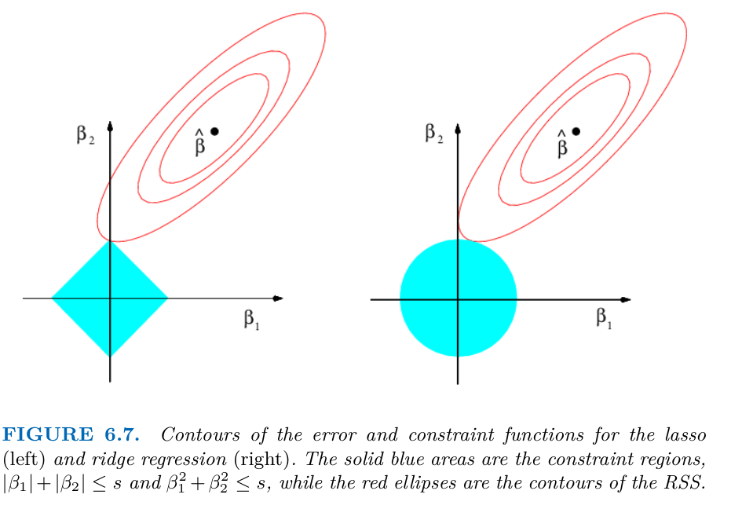
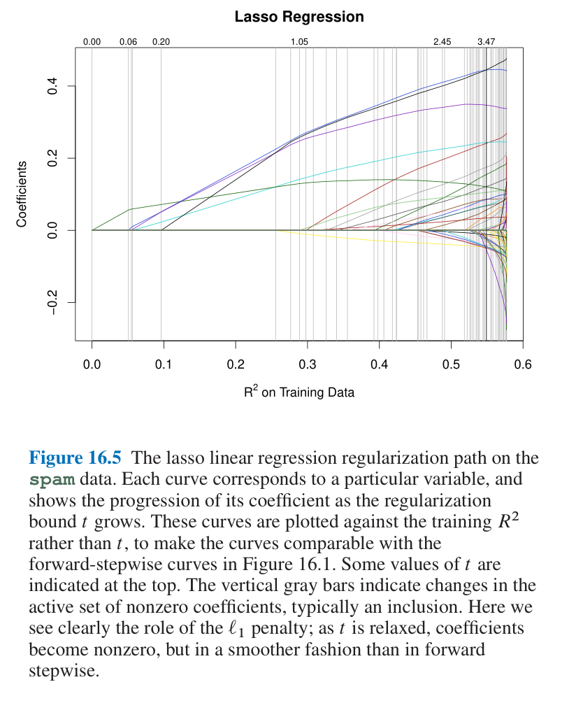
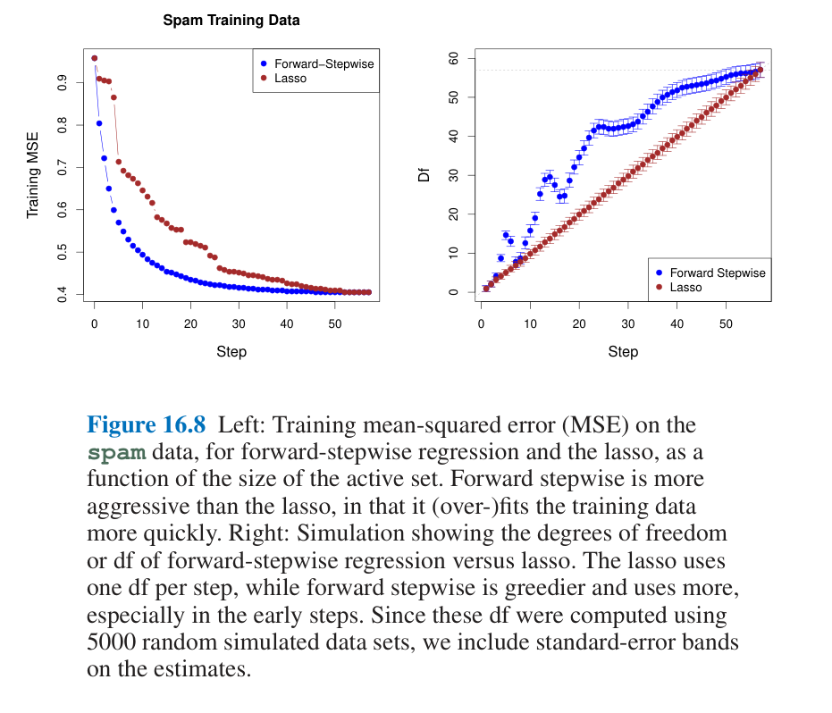
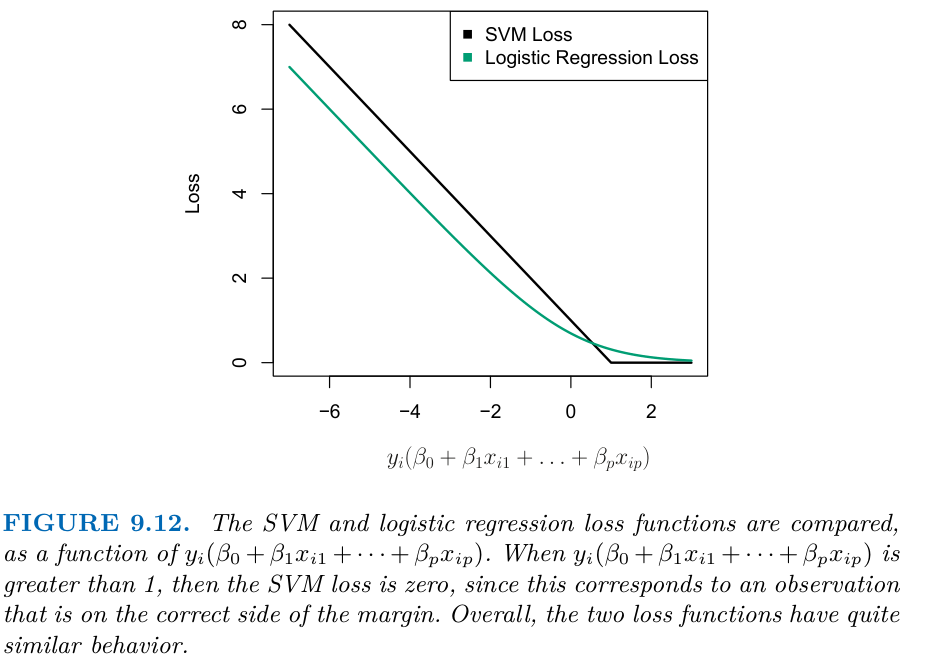
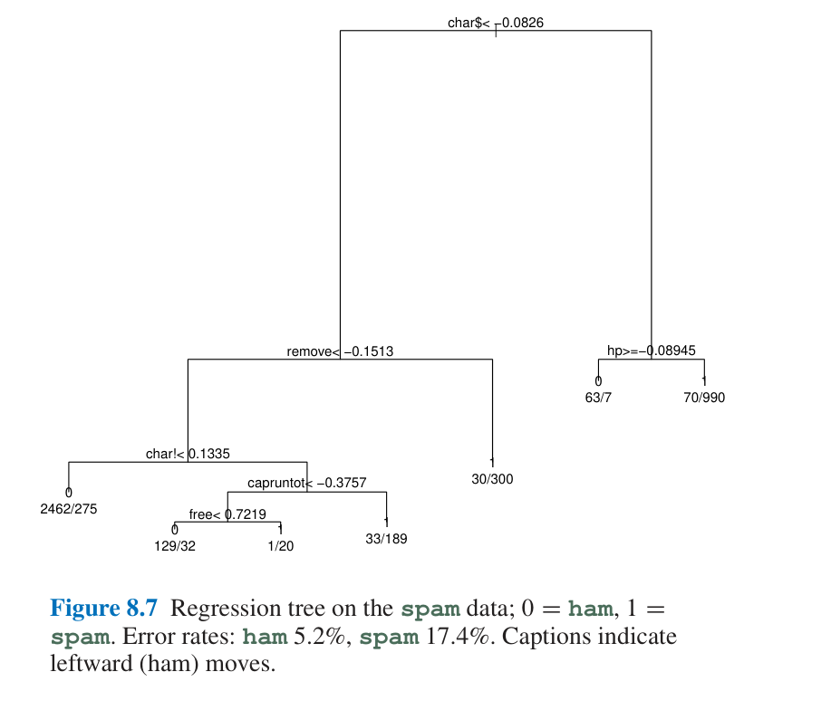
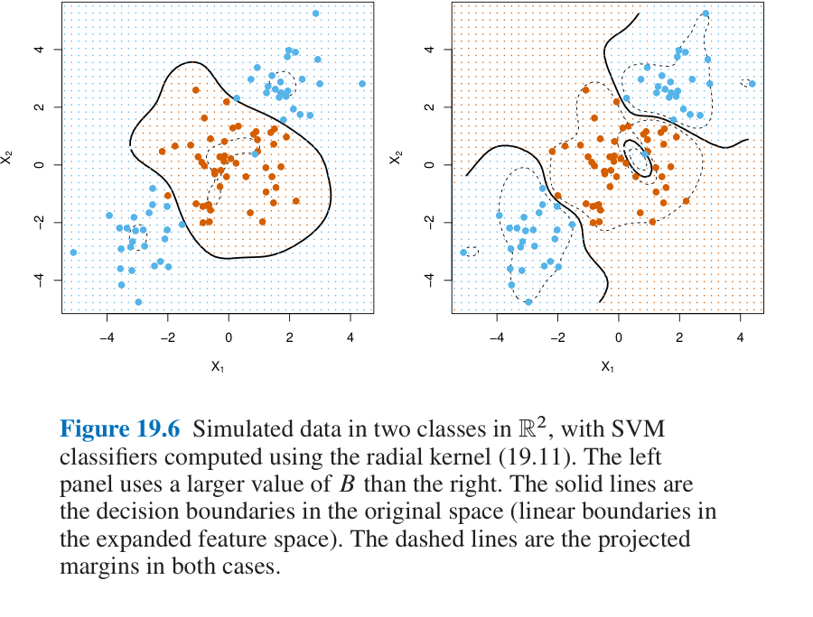
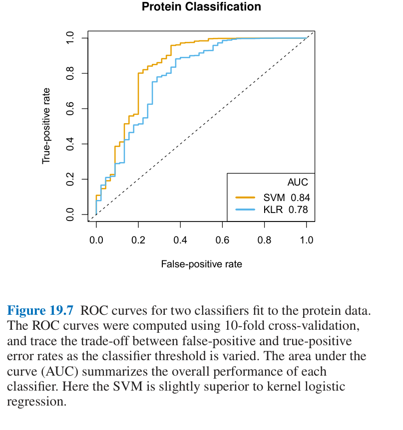
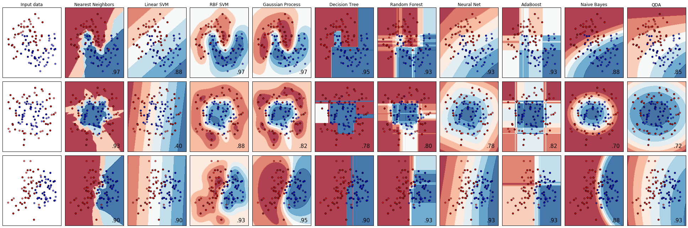

# Supervised Learning

> You have a table and a target. Which model do you try first, and how do you know whether it is too simple or too flexible? This note walks the classical families (nearest neighbours, linear models, naive Bayes, trees, kernel SVMs, small neural networks), each with the one knob that controls its complexity, what it is good at and how it fails, plus the from-scratch versions from Ng's exercises.

**In plain words.** Supervised learning means showing a computer past cases with the answers attached, such as old emails marked spam or not, so that it can label new ones. The families of model here are different ways of writing that rule: copy the most similar past case, add up weighted clues, or ask a chain of yes-or-no questions. Each has a dial that runs from rigid to flexible. Your job at work is to pick a family and set the dial so that it learns the pattern and not the quirks of the old cases.

Blocks run top to bottom from this `notes/` folder, on the breast-cancer data that ships with scikit-learn, so the numbers below are this split's. Figures attributed to M&G come from the book's own examples.

---

## The two tasks

The target picks the task, and after it the loss, the metric and the baseline. [Choosing a metric](11-choosing-a-metric.md#the-map) has that map for every kind of target.

| | Classification | Regression |
|---|---|---|
| Target | A class label from a fixed set | A continuous number |
| Example (M&G ch. 2) | Breast-cancer benign/malignant; `make_forge` two-class toy | House prices (M&G's Boston data, removed from scikit-learn 1.2); `make_wave` 1-D toy |
| Default `score` | Accuracy | $R^2$ |
| Loss in training | Log-loss (logistic), hinge (SVM), Gini/entropy (trees) | Squared error |

The test for which one you have: *is there continuity between possible outputs?* Income in dollars is regression; the language of a website is classification.

Every model below has a **complexity knob**. Turning it trades the bias and variance of [01](01-statistical-foundations.md#bias-variance-and-model-complexity), and the first thing to do with any new model is to sweep that knob and plot train and test score against it.

---

## k-nearest neighbours

The simplest model: memorise the training set; predict by looking at the $k$ closest training points (majority vote for classification, mean for regression).

```python
from sklearn.neighbors import KNeighborsClassifier
from sklearn.datasets import load_breast_cancer
from sklearn.model_selection import train_test_split

cancer = load_breast_cancer()
X_train, X_test, y_train, y_test = train_test_split(
    cancer.data, cancer.target, stratify=cancer.target, random_state=66)

# Sweep the complexity knob: small k = complex (jagged boundary), large k = simple
for k in range(1, 11):
    clf = KNeighborsClassifier(n_neighbors=k).fit(X_train, y_train)
    print(k, round(clf.score(X_train, y_train), 3), round(clf.score(X_test, y_test), 3))
```

```text
1 1.0 0.902
2 0.977 0.888
3 0.958 0.923
4 0.955 0.923
5 0.948 0.923
6 0.946 0.937
7 0.944 0.93
8 0.941 0.93
9 0.934 0.916
10 0.939 0.916
```

The single-neighbour model gets every training point right and is the worst on test. That is overfitting made visible.

KNN also yields a score, not just a vote: the fraction of the $k$ neighbours in the positive class. In Bruce and Bruce's loan example, 14 of the 20 nearest loans to a new one defaulted, so the label is default and the propensity is $14/20 = 0.7$. That fraction is what lets you move the cutoff below 0.5 when the positive class is rare (*Practical Statistics*, ch. 6).

ISLP puts numbers on the same U-shape with a known answer. On its simulated two-class data (100 points per class), the best any classifier can do is the Bayes error, 0.1304 on the test set; KNN with $K=10$ gets 0.1363, while $K=1$ and $K=100$ get 0.1695 and 0.1925 (low bias and high variance at one end, the reverse at the other). Over 200 training and 5,000 test points the test error is U-shaped in $1/K$ with its minimum near $K=10$ and the training error is 0 at $K=1$ (*ISLP*, ch. 2; the chapter prints the Bayes error as 0.133 in one place and 0.1304 in another). Against OLS, KNN pays for dimension: with 50 training points and a strongly non-linear truth it wins at one or two predictors and loses from four, and adding noise predictors up to $p=20$ multiplies its test MSE more than ten-fold (*ISLP*, ch. 3, Figs. 3.19 and 3.20, simulated data).

| | |
|---|---|
| Knob | `n_neighbors` (and the distance metric) |
| Good at | A baseline in minutes; small, low-dimensional data |
| Fails on | Many features (distances stop meaning anything); sparse data; large training sets (prediction is slow) |
| Needs | Feature scaling: distances are dominated by the largest-range feature |

---

## Linear models

Predict with a weighted sum: $\hat y = w \cdot x + b$. For classification, threshold it at zero. scikit-learn fits this for prediction and reports no standard errors. See [Regression and GLMs](../../../data-analytics/02-probability-and-statistics/notes/06-regression-and-glms.md#ols-in-statsmodels) in data analytics for the inference side, in `statsmodels`.

### Regression: OLS, ridge, lasso

| Model | Objective | Effect | Knob |
|---|---|---|---|
| `LinearRegression` (OLS) | $\min \lVert y - Xw \rVert^2$ | No complexity control; overfits with many features | — |
| `Ridge` | $+\ \alpha \lVert w \rVert_2^2$ | Shrinks all weights toward 0 | `alpha` (higher = simpler) |
| `Lasso` | $+\ \alpha \lVert w \rVert_1$ | Sets some weights exactly to 0: built-in feature selection | `alpha`; raise `max_iter` when small |
| `ElasticNet` | Both penalties | Lasso's sparsity with ridge's stability | `alpha`, `l1_ratio` |

M&G show the effect on their extended Boston data (506 rows, 104 features, one split; *Introduction to ML with Python*, ch. 2, "Linear models for regression"): OLS scores 0.95 on train and 0.61 on test; ridge at `alpha=1` gets 0.89 / 0.75; lasso at `alpha=0.01` uses 33 of the 104 features and generalises about as well (test 0.77). Their default `alpha=1` lasso underfits with 4 features (train 0.29, test 0.21), and `alpha=0.0001` uses 94 and overfits again (test 0.64). Learning curves on subsets of the same data show OLS learning nothing below about 400 points while ridge does, so regularisation matters most when data is scarce. That dataset has since been removed from scikit-learn, so here is the same experiment on the diabetes data, expanded to squares and products of its features so that OLS has room to overfit:

```python
import numpy as np
from sklearn.datasets import load_diabetes
from sklearn.linear_model import LinearRegression, Ridge, Lasso
from sklearn.preprocessing import PolynomialFeatures

d = load_diabetes()
Xd = PolynomialFeatures(degree=3, include_bias=False).fit_transform(d.data)
Xd_train, Xd_test, yd_train, yd_test = train_test_split(Xd, d.target, random_state=0)
print("features:", Xd.shape[1], "rows in train:", Xd_train.shape[0])

for name, model in [("OLS", LinearRegression()),
                    ("Ridge a=0.1", Ridge(alpha=0.1)),
                    ("Lasso a=0.1", Lasso(alpha=0.1, max_iter=100_000))]:
    model.fit(Xd_train, yd_train)
    print(f"{name:12} train {model.score(Xd_train, yd_train):.2f}  test {model.score(Xd_test, yd_test):.2f}"
          f"  nonzero {(np.abs(model.coef_) > 1e-8).sum()}")
```

```text
features: 285 rows in train: 331
OLS          train 0.90  test -9.32  nonzero 285
Ridge a=0.1  train 0.55  test 0.37  nonzero 285
Lasso a=0.1  train 0.55  test 0.36  nonzero 7
```

With 285 features and 331 rows OLS memorises the training set, and its test R² of -9.32 is far worse than predicting the mean. Both penalties rescue it at the cost of train score. Ridge keeps all 285 weights small; lasso matches it with 7. That is why you try lasso when you suspect only a few features matter.

The penalties have a pedigree worth citing: the L1 penalty and its property of setting weights exactly to zero come from the lasso paper ([doi:10.1111/j.2517-6161.1996.tb02080.x](https://doi.org/10.1111/j.2517-6161.1996.tb02080.x), Tibshirani, JRSS-B 1996).

**Ridge vs lasso.** Default to ridge. Use lasso when you expect only a few features to matter, or need a model you can read.


*Image Source: James et al., *An Introduction to Statistical Learning with Applications in Python* (Springer, 2023), Fig. 6.7*

The picture says why the penalties behave differently: the first point where an RSS ellipse touches the constraint region is the estimate, and the lasso's diamond has corners on the axes where a coefficient is exactly zero, while the ridge disc has none (*ISLP*, ch. 6). When one coefficient at a time is estimated on orthonormal columns, ridge divides each least-squares coefficient by $1+\lambda$ and the lasso subtracts $\lambda/2$ and clips at zero (soft-thresholding). The lasso is the posterior mode under a Laplace prior, ridge the posterior mode and mean under a Gaussian one. Neither wins in general: on simulated data with 45 predictors and 50 rows, ridge is slightly better when all 45 matter, and the lasso is better when 2 do, and 10-fold CV on the sparse case keeps only the 2 signal variables at its minimum (*ISLP*, ch. 6). Standardise first, because the penalty skips the intercept and is not scale-equivariant. For PCR and PLS, the chapter finds PLS "often performs no better than ridge regression or PCR" and calls ridge a continuous version of PCR.

**The lasso path, and how it is computed.** Exact best-subset regression tries $2^p$ subsets, which becomes prohibitive past about 40 predictors, and forward stepwise adds one variable at a time and moves every coefficient to the new least-squares fit. The lasso gives a whole family of fits, one per $\lambda$ (or per bound $t$ on $\lVert\beta\rVert_1$), and for squared error the coefficient paths are piecewise linear, so the exact path is cheap (*Computer Age*, ch. 16).


*Image Source: Efron and Hastie, *Computer Age Statistical Inference* (Cambridge University Press, 2016), Fig. 16.5*

Least-angle regression (LAR) draws that path: it moves the active coefficients toward their least-squares fit, keeping each one's correlation with the residual tied, and stops when an outside variable catches up, so a whole path costs about one least-squares fit. LAR is the lasso path only with one change, that a coefficient crossing zero is dropped from the active set, which happens mostly when predictors are highly correlated. Each LAR step spends exactly one degree of freedom, in the covariance sense of [01](01-statistical-foundations.md#correcting-the-training-error-cross-validation-and-covariance-penalties), so the active-set size is an unbiased estimate of df. Forward stepwise spends more, and unevenly: in a parametric bootstrap of 5,000 simulated data sets from the full spam fit, stepwise reached about 40 df by step 25 where the lasso had spent 25 (read off Fig. 16.8, right).


*Image Source: Efron and Hastie, *Computer Age Statistical Inference* (Cambridge University Press, 2016), Fig. 16.8*

For logistic and other losses the path is no longer piecewise linear, so glmnet fits a grid instead. The largest useful penalty is $\lambda_{\max} = \max_j |\langle x_j, y\rangle|/n$ on standardised predictors (the smallest $\lambda$ with all coefficients zero), and a sensible grid is 100 values equally spaced on the log scale from $\lambda_{\max}$ down to $\epsilon\lambda_{\max}$, with $\epsilon$ such as 0.001. Path-wise coordinate descent solves each $\lambda$ by cycling over one coefficient at a time, and every update is a soft-threshold of a simple inner product with the residual, which is cheap on sparse data. Three devices make it fast: warm starts from the previous $\lambda$, iterating on a guessed active set and then confirming with one full sweep, and the *strong rule*, which admits any variable with $|\langle x_j, r\rangle| \ge 2\lambda_{k+1} - \lambda_k$ rather than only those above $\lambda_{k+1}$ and rarely errs. The elastic net shrinks correlated variables toward each other and picks them in groups, which helps because the lasso "has difficulty in choosing among the correlated cousins"; its coordinate update is the same soft-threshold, divided by $1 + (1-\alpha)\lambda$.

The payoff is at scale. On the spam emails with binarised variables and all pairwise interactions (3,061 predictors after dropping degenerate ones) glmnet fits the whole lasso path in 6 s, while forward-stepwise logistic regression, which refits a GLM after every variable, takes a long time and stopped at 134 variables on convergence trouble. The lasso's minimum test error is 0.057, against 0.064 for stepwise and 0.071 for the lasso on main effects only, and its largest active set had 682 variables (*Computer Age*, ch. 16, one split, 2015 software). Choosing $\lambda$ by 10-fold CV and scoring the metric you care about, not the one the fit minimised, is the book's default. The chapter also warns that confidence intervals computed after selection ignore the selection: in an HIV drug-resistance regression the lasso kept 7 of 30 mutation sites at the CV-chosen $\lambda$ of 0.003, and after conditioning on the selection only one, s25, stayed significant.

**Learning curves for ridge** show the data-size effect from [01](01-statistical-foundations.md): with enough data, regularisation matters less and OLS catches up.

[Training and tuning](09-training-and-tuning.md#regularisation-is-one-idea) shows that this penalty, a tree's depth limit and a network's weight decay are one idea.

### Classification: logistic regression and linear SVM

Both draw a hyperplane. They differ in loss (log-loss vs hinge), not in the shape of the boundary.

```python
from sklearn.linear_model import LogisticRegression
from sklearn.svm import LinearSVC

# sklearn >= 1.4: lbfgs needs more iterations on unscaled data (fix applied in this repo's copy)
logreg = LogisticRegression(C=1, max_iter=10000).fit(X_train, y_train)
svm = LinearSVC(C=1, max_iter=20000).fit(X_train, y_train)
print("logreg", round(logreg.score(X_test, y_test), 3), "linear svm", round(svm.score(X_test, y_test), 3))
```

```text
logreg 0.944 linear svm 0.944
```

The knob is **`C`, the inverse of regularisation strength**: high `C` fits each training point harder (complex); low `C` keeps weights small (simple). Note the inversion against `alpha` above. `penalty="l1"` gives sparse coefficients, as lasso does.

**Hinge vs log-loss, and the two meanings of `C`.** The linear SVM minimises hinge loss plus a ridge penalty, $\sum_i \max(0,\,1-y_i f(x_i)) + \lambda\sum_j\beta_j^2$. Hinge loss is exactly zero once a point is on the right side of the margin; log-loss never reaches zero but is tiny far from the boundary, which is why the two "often give very similar results", and the chapter's rule of thumb is SVMs when classes are well separated, logistic regression when they overlap (*ISLP*, ch. 9). Efron and Hastie say why at the population level: the hinge loss is minimised by the sign of the Bayes rule, so it learns only which side a point is on, while the binomial deviance is minimised by the logit of the class probability. On separable data ridged logistic regression converges to the SVM's direction as $\lambda \to 0$, and plain logistic regression has no finite maximum-likelihood fit there (*Computer Age*, ch. 19).


*Image Source: James et al., *An Introduction to Statistical Learning with Applications in Python* (Springer, 2023), Fig. 9.12*

The book's text defines $C$ as a budget on total slack (large $C$: wide margin, many support vectors, high bias), but scikit-learn's `C` is a cost on slack, so there small $C$ gives the wide margin. Read `C` from the library's side. Its lab picks `C` by 5-fold CV over `[0.001, ..., 100]` on 50 simulated points (best `C=1`, CV accuracy 0.74), and on 63 training samples with 2,308 genes uses a linear kernel, because $p \gg n$ (0 training errors, 2 of 20 test errors). Kernels are not special to SVMs: logistic regression can use them too.

**Confounding in a logistic fit.** On ISLP's simulated `Default` data (10,000 customers, 3.33% default) the coefficient on `student` is +0.40 alone (4.31% default for students against 2.92% for others) and -0.65 once `balance` is in the model. Students carry higher balances, and at the same balance and income a student is less likely to default (0.058 against 0.105 at balance $1,500). Read a coefficient as "holding the others fixed", never as the marginal effect (*ISLP*, ch. 4).

**Multiclass.** Linear classifiers are binary by nature. One-vs-rest trains one classifier per class and predicts the class with the highest score. `LogisticRegression` uses a true multinomial (softmax) loss by default.

| | |
|---|---|
| Knob | `alpha` (regression), `C` (classification) |
| Good at | Very many features; sparse data (text, [NLP text classification](../../03-nlp/notes/02-text-classification.md)); huge datasets (`SGDClassifier`, `solver="sag"`); fast to train and predict; coefficients readable |
| Fails on | Low-dimensional data with non-linear boundaries, unless you add features ([03](03-feature-engineering-and-pipelines.md)) |
| Caution | Coefficients of correlated features can flip sign; don't over-read them |

### Vectors, matrix products and the gradient

Stack the $n$ rows of features into a matrix $X$ of shape $(n \times d)$ and the weights into a column $w$ of shape $(d \times 1)$. One matrix product gives every prediction at once: $\hat y = Xw$, shape $(n \times 1)$. The inner dimensions must match and vanish; the outer ones remain. The **transpose** $X^\top$ flips rows and columns to $(d \times n)$, so with the residual $r = Xw - y$ (one error per row), $X^\top r$ turns it into one number per feature. That is why $X^\top$ appears in the gradient below and in the normal equation, the closed-form solution in [Ng's exercises](#the-same-models-from-scratch-ngs-exercises).

A **derivative** is a slope: how much the loss $L$ changes per unit nudge of a weight. You can measure it by nudging: $(L(w+\epsilon) - L(w-\epsilon)) / 2\epsilon$. With several weights, a **partial derivative** $\partial L / \partial w_j$ nudges one weight and holds the rest fixed. Collect all $d$ of them and you have the **gradient** $\nabla L$, a vector that points uphill. **Gradient descent** steps the other way, $w \leftarrow w - \eta \nabla L$, where the **learning rate** $\eta$ sets the step length. For mean squared error the slope works out to $\nabla L = \frac{2}{n} X^\top (Xw - y)$. Too small an $\eta$ crawls. Too large overshoots the valley and the loss grows each step, as the second run below shows.

```python
import numpy as np

rng = np.random.default_rng(0)
n, d = 100, 3
X = rng.normal(size=(n, d))                      # (n, d)
w_true = np.array([2.0, -1.0, 0.5])
y = X @ w_true + 0.1 * rng.normal(size=n)        # (n,)

def loss(w):
    return np.mean((X @ w - y) ** 2)             # (n,d)(d,) -> (n,)

def grad(w):
    return (2 / n) * X.T @ (X @ w - y)           # (d,n)(n,) -> (d,)

w = np.zeros(d)
eps, e0 = 1e-6, np.array([1.0, 0, 0])
print("analytic    dL/dw0:", round(grad(w)[0], 4))
print("finite-diff dL/dw0:", round((loss(w + eps * e0) - loss(w - eps * e0)) / (2 * eps), 4))

for eta in (0.1, 1.1):
    w = np.zeros(d)
    for _ in range(20):
        w = w - eta * grad(w)
    print(f"eta={eta}: loss after 20 steps {loss(w):.4g}, w={w.round(2)}")
```

```text
analytic    dL/dw0: -4.7218
finite-diff dL/dw0: -4.7218
eta=0.1: loss after 20 steps 0.008627, w=[ 1.99 -1.    0.47]
eta=1.1: loss after 20 steps 1.429e+09, w=[-34085.75  -5248.68  -1718.19]
```

Setup: seed 0, 100 rows, 3 standard-normal features, true weights $(2, -1, 0.5)$, noise sd 0.1, start at $w = 0$. The analytic and finite-difference slopes agree to four decimals, so the formula is right; use the same check on any gradient you derive by hand. With $\eta = 0.1$ twenty steps recover the weights; with $\eta = 1.1$ the loss explodes. The cutoff depends on the data: for this $X$ any $\eta$ above 0.83 diverges, which is 2 divided by the largest [eigenvalue](05-unsupervised-learning.md#principal-component-analysis) (2.40) of $\frac{2}{n} X^\top X$. When the loss depends on the weights through several layers, the chain rule multiplies the slopes of the stages: see [Backpropagation](../../02-deep-learning/notes/01-neural-networks-fundamentals.md#backpropagation) and, for the numeric version, [Derivatives, numerically](../../../generative-ai/09-llms-from-scratch/notes/01-micrograd.md#derivatives-numerically). Those notes write `dW` for $\partial L / \partial W$, the same object for a matrix of weights.

---

## Naive Bayes

Fit per-class statistics of each feature independently and apply Bayes' rule. Training is a single pass over the data.

| Variant | Data | Statistic per class |
|---|---|---|
| `GaussianNB` | Continuous | Mean and std per feature |
| `BernoulliNB` | Binary | Count of non-zero per feature |
| `MultinomialNB` | Counts (word counts) | Mean count per feature |

Knob: `alpha` (additive smoothing: pretends every feature was seen `alpha` extra times in every class). Naive Bayes is the classic fast text baseline ([NLP text classification](../../03-nlp/notes/02-text-classification.md)); usually slightly worse than a linear model, trained much faster.

---

## Decision trees

A tree asks a sequence of if/else questions ("is feature 3 ≤ 0.8?"), each chosen to make the resulting groups as pure as possible. A leaf predicts the majority class (or mean value) of its training points.

```python
from sklearn.tree import DecisionTreeClassifier

full = DecisionTreeClassifier(random_state=0).fit(X_train, y_train)
tree = DecisionTreeClassifier(max_depth=4, random_state=0).fit(X_train, y_train)
print("unpruned ", round(full.score(X_train, y_train), 3), round(full.score(X_test, y_test), 3))
print("max_depth", round(tree.score(X_train, y_train), 3), round(tree.score(X_test, y_test), 3))
print("features used:", (tree.feature_importances_ > 0).sum(), "of", X_train.shape[1])  # zero means unused, not "unimportant"
```

```text
unpruned  1.0 0.895
max_depth 0.988 0.902
features used: 10 of 30
```

A tree grown until every leaf is pure memorises the training set. M&G's breast-cancer run shows the same: unpruned train 1.000 and test 0.937, `max_depth=4` train 0.988 and test 0.951 (*Introduction to ML with Python*, ch. 2, "Decision trees"). Control it with **pre-pruning**: `max_depth`, `max_leaf_nodes`, or `min_samples_leaf`. scikit-learn also has cost-complexity post-pruning (`ccp_alpha`).

**Two quirks to remember:**

- **No scaling needed.** Each split looks at one feature at a time.
- **Trees can't extrapolate.** On the RAM-price time series (M&G ch. 2), a tree predicts the last known price forever after the training range, while a linear model on log-price continues the trend.

Efron and Hastie's spam tree shows what a grown tree looks like on real data (4,601 emails, 40% spam, 57 word and character frequencies that the book standardises, so some split values are negative). Seven leaves, each labelled with its ham/spam counts, and the first split is on the proportion of `$` characters:


*Image Source: Efron and Hastie, *Computer Age Statistical Inference* (Cambridge University Press, 2016), Fig. 8.7*

The leaf counts add up to the full 2,788 ham and 1,813 spam, so the error rates can be recomputed: 134 ham fall in spam-labelled leaves (4.8%) and 314 spam in ham-labelled leaves (17.3%). The caption prints 5.2% and 17.4%, so the ham rate does not match its own leaves (the text also calls this tree "Figure 8.6" when it means 8.7). Both rates are apparent, on the training emails, and the authors note trees are unstable and easy to over-interpret (*Computer Age*, ch. 8).

A single tree is rarely the best model. Its value is as the building block of [06 — ensembles](06-ensembles.md), where random forests and gradient boosting fix its variance.

---

## Kernelized support vector machines

A linear model in a richer feature space. Adding $x_1^2$ as a feature turns a curved boundary into a plane in 3-D. The **kernel trick** computes inner products in that expanded space without building it.

| Kernel | Implicit features |
|---|---|
| Polynomial | All products of features up to a degree |
| RBF (Gaussian) | Infinite-dimensional; similarity decays with distance: $k(x, x') = \exp(-\gamma \lVert x - x' \rVert^2)$ |

Only the training points on or inside the margin, the **support vectors**, define the boundary. The soft-margin formulation, where `C` prices each margin violation so that non-separable data still has a solution, is the contribution of the original paper, which combined ten degree-4 polynomial classifiers to reach 1.1% test error on the NIST digit benchmark, 60,000 training images and 10,000 test images with no pre-processing ([doi:10.1007/bf00994018](https://doi.org/10.1007/bf00994018), Cortes and Vapnik, Machine Learning 1995). That ties the purpose-built LeNet4 rather than beating it, while using nothing about image geometry. On the smaller USPS digits (7,300 training and 2,000 test images, centred, de-slanted and smoothed), polynomial degrees 2 to 7 all reach 4.2 to 4.7% error against 12.0% for linear, while the implicit feature space grows from about 33,000 to about $10^{16}$ dimensions. The authors read that as no over-fitting, from one dataset with no error bars. The paper runs polynomial kernels only, penalises the square of the total slack in its experiments rather than the linear penalty `SVC` uses, and reports no value of `C`, so the tuning advice below doesn't rest on it.

```python
from sklearn.svm import SVC
from sklearn.preprocessing import MinMaxScaler

scaler = MinMaxScaler().fit(X_train)           # fit on train only (see 03)
svc = SVC(kernel="rbf", C=1000, gamma="scale").fit(scaler.transform(X_train), y_train)
raw = SVC(kernel="rbf", C=1000, gamma=1.0).fit(X_train, y_train)   # unscaled: distances are dominated by the largest-valued features
print("unscaled", round(raw.score(X_test, y_test), 3))
print("scaled  ", round(svc.score(scaler.transform(X_test), y_test), 3))
```

```text
unscaled 0.629
scaled   0.972
```

M&G report the same collapse (train 1.00, test 0.63 unscaled) and the cause: breast-cancer feature ranges span several orders of magnitude, which the kernel's single `gamma` cannot serve (*Introduction to ML with Python*, ch. 2, "Kernelized support vector machines"). They put SVMs in comfortable reach to about 10,000 samples and hard at 100,000.

**What the kernel changes in the fit.** The fitted function is $f(x) = \alpha_0 + \sum_{i \in S} \alpha_i K(x, x_i)$ over the support set $S$, a sum of bumps centred on training points. The Lagrange dual uses the data only through the $n \times n$ Gram matrix of inner products, so cost grows linearly in the number of features $p$ and potentially cubically in $n$ (in practice about $O(n^2\lvert S\rvert)$), which suits wide data. Ridge regression gets the same reparametrisation, $\hat\beta = X^\top\hat\alpha$ with $\hat\alpha = (XX^\top + \lambda I)^{-1}y$, which costs $O(n^2p)$ instead of $O(np^2)$ (*Computer Age*, ch. 19). The polynomial kernel $(1 + \langle x, z\rangle)^d$ is, in the authors' words, "mainly useful as existence proofs", and the radial kernel is the usual choice. Wide data show where a margin classifier earns its place: on leukemia gene expression (3,571 genes, 72 patients, 47 ALL and 25 AML) a separating hyperplane exists and logistic regression fails, and the optimal-margin fit uses 42 of the 72 points as support vectors. Fit on a random 50 and tested on the other 22, no test point was misclassified although several fell inside the margin (one split, no repetition).


*Image Source: Efron and Hastie, *Computer Age Statistical Inference* (Cambridge University Press, 2016), Fig. 19.6*

The slack budget $B$ is the overfitting knob. The left fit tolerates some margin errors and looks reasonable, while the right one, with a smaller $B$, builds a small island to capture one blue point in a sea of brown. The budget is tuned by cross-validation, and a larger one means more support points and a lower-variance fit. Kernels also reach objects that are not vectors: any similarity that behaves like an inner product defines one. For proteins, counting every 3-gram of the 20 amino-acid letters gives $20^3 = 8{,}000$ counts per protein, and the string kernel is computed from tree structures without forming those vectors. On 1,708 proteins (1,663 negative, 45 positive), 10-fold CV, with a very small $\lambda$ chosen by CV, the kernel SVM scores AUC 0.84 and kernel logistic regression 0.78. It is a single run on one data set, with no variance reported.


*Image Source: Efron and Hastie, *Computer Age Statistical Inference* (Cambridge University Press, 2016), Fig. 19.7*

The authors add the limits: kernel methods are not immune to the curse of dimensionality, the quadratic penalty keeps every feature in the model so there is no sparsity (swap in an L1 penalty for that), and the popularity of SVMs rests on classification performance, since classifiers are less sensitive to bias-variance trade-offs than regression is (*Computer Age*, ch. 19).

| Knob | Small value | Large value |
|---|---|---|
| `gamma` | Wide kernel, smooth boundary | Narrow kernel, every point its own island |
| `C` | Heavy regularisation | Fit every training point |

Tune them **together** ([04 — grid search](04-model-evaluation.md#grid-search)).

| | |
|---|---|
| Good at | Small and medium data (up to ~10k samples) with features on similar scales; complex boundaries in few dimensions |
| Fails on | 100k+ samples (memory and time); unscaled features; interpretation |

Ng's ex6 implements the Gaussian kernel by hand and uses `sklearn.svm.SVC` on three 2-D datasets, then builds a **spam classifier**: email preprocessing (lower-case, strip HTML, normalise URLs, numbers and addresses, Porter stemming), a 1,899-word vocabulary, binary word-presence features, a linear SVM. That is the bag-of-words pipeline of [NLP text representation](../../03-nlp/notes/01-text-representation.md) written out by hand.

```python
# Ng ex6: the Gaussian kernel, from scratch
def gauss_kernel(x1, x2, sigma):
    return np.exp(-np.sum((x1 - x2) ** 2) / (2.0 * sigma ** 2))   # gamma = 1 / (2 sigma^2)

print(round(gauss_kernel(np.array([1., 2, 1]), np.array([0., 4, -1]), 2.0), 6))
```

```text
0.324652
```

---

## Neural networks (multilayer perceptrons)

A stack of linear models with a non-linearity between them: $h = \tanh(W_1 x + b_1)$, $\hat y = W_2 h + b_2$. Without the non-linearity, the stack collapses to one linear model.

```python
from sklearn.neural_network import MLPClassifier
from sklearn.preprocessing import StandardScaler

Xs_train = StandardScaler().fit(X_train).transform(X_train)
mlp = MLPClassifier(hidden_layer_sizes=[10, 10], alpha=1.0,
                    max_iter=1000, random_state=0).fit(Xs_train, y_train)
print(round(mlp.score(StandardScaler().fit(X_train).transform(X_test), y_test), 3))
```

```text
0.951
```

| Knob | Effect |
|---|---|
| `hidden_layer_sizes` | Width and depth: capacity. Parameters grow fast: 100 inputs and two layers of 100 give 20,100 weights, two layers of 1,000 give 1,101,000 (*Introduction to ML with Python*, ch. 2) |
| `alpha` | L2 penalty on weights |
| `activation` | `relu` (default) or `tanh` |
| `random_state` | Different seeds give visibly different boundaries on small data |

The tuning recipe from M&G: first build a network big enough to overfit, then shrink it or raise `alpha` until test performance is best. Scaling to mean 0 and variance 1 is required. Neural networks need more data, more tuning and more care than the other models here; for tabular data, gradient-boosted trees usually win ([06](06-ensembles.md)). ISLP's own tabular comparison agrees on the point that matters: on Hitters (263 players, 176 train and 87 test, one split) a 64-unit network with 1,345 parameters has test MAE 257.4, against 254.7 for linear regression and 252.3 for the lasso, and its authors say they spent a fair bit of time tuning the network to get there and advise Occam's razor. Their own lab run with a different network flips the order (229.5 against 259.7 and 257.2), so a few points either way on one 87-row test set is noise (*ISLP*, ch. 10). Where the network clearly wins is MNIST: the text reports 1.8% error for a dropout network against 7.2% for multinomial logistic regression, and the book's own lab run of a similar network gets 3.2% (accuracy 0.9681) against 0.9241 for the logistic baseline, so the gap is real but its size depends on the run. [neural network basics](../../02-deep-learning/notes/01-neural-networks-fundamentals.md) builds them from scratch.

---

## Uncertainty estimates

Most classifiers can say *how sure* they are, not only which class:

| Method | Range | Meaning |
|---|---|---|
| `decision_function(X)` | Any real number; sign = class (binary) | Margin from the boundary; scale is model-specific |
| `predict_proba(X)` | [0, 1], rows sum to 1 | Estimated class probabilities |

```python
from sklearn.ensemble import GradientBoostingClassifier

y_train_named = cancer.target_names[y_train]         # labels as strings, to show classes_
gbrt = GradientBoostingClassifier(random_state=0).fit(X_train, y_train_named)
print(gbrt.classes_)
print(gbrt.decision_function(X_test)[:4].round(2))   # signed margin; positive means classes_[1]
print(gbrt.predict_proba(X_test)[:4].round(3))       # probability of each class in classes_ order
agree = gbrt.classes_[(gbrt.decision_function(X_test) > 0).astype(int)] == gbrt.predict(X_test)
print(agree.all())
```

```text
['benign' 'malignant']
[-8.69 -8.75 -8.32 -8.77]
[[1. 0.]
 [1. 0.]
 [1. 0.]
 [1. 0.]]
True
```

A probability is only as good as the model's **calibration**: an overfit model reports 1.0 on points it gets wrong. You need these scores to move the decision threshold, which [04](04-model-evaluation.md#threshold-precisionrecall-and-roc) does, and [04](04-model-evaluation.md#calibration-is-a-08-really-80) shows how to check them. Niculescu-Mizil and Caruana compared ten learners' probabilities and found boosted trees and SVMs distort them in a sigmoid shape while logistic regression does not ([doi:10.1145/1102351.1102430](https://doi.org/10.1145/1102351.1102430), ICML 2005).

---

## Which model, when


*Image source: Müller & Guido, Introduction to Machine Learning with Python, companion repo `images/` (after scikit-learn's classifier comparison)*

| Model | Knob | Scale features? | Good for | Avoid when |
|---|---|---|---|---|
| kNN | `n_neighbors` | Yes | Small data, baseline, explanation by example | Many features, large n |
| Linear | `alpha` / `C` | Yes (for solvers and penalty) | High-dimensional, sparse, large data | Low-dim non-linear structure |
| Naive Bayes | `alpha` | No | Very fast text baselines | When accuracy matters most |
| Decision tree | `max_depth` | No | Explaining a model to people | Accuracy (use an ensemble) |
| Random forest | `max_features` | No | Strong default for tabular | Very sparse high-dim data |
| Gradient boosting | `learning_rate`, `n_estimators`, `max_depth` | No | Best tabular accuracy ([07](07-boosting-in-practice.md)) | You can't afford tuning |
| Kernel SVM | `C`, `gamma` | Yes | Medium data, similar-scale features | Large n |
| MLP | layers, `alpha` | Yes | Large data, time to tune | Small tabular data |

M&G's advice when faced with a new dataset (*Introduction to ML with Python*, ch. 2, "Summary and outlook"): start with a simple model (linear, naive Bayes or kNN) to learn what the data is like, then move to random forests, gradient boosting, SVMs or neural networks. All of them sit behind the same API, which is the reason a sweep across families costs a few lines. The scikit-learn paper makes that its case, a "consistent, task-oriented interface" that enables "easy comparison of methods" ([arXiv:1201.0490](https://arxiv.org/abs/1201.0490), Pedregosa et al., JMLR 2011), though it asserts this rather than measuring it.

---

## The same models, from scratch: Ng's exercises

Your own Coursera work implements the maths that scikit-learn hides. Each is the counterpart of a section above.

| Exercise | Implements | Key function |
|---|---|---|
| ex1 | Linear regression, one and many variables; batch gradient descent; feature normalisation; the normal equation | `computeCost`, `descendGradient`, `normEqtn` |
| ex2 | Logistic regression; regularised logistic regression on polynomial features (`mapFeature` to degree 6); decision boundary | `computeCost`, `optimizeTheta` (via `scipy.optimize`) |
| ex3 | Vectorised one-vs-all logistic regression on 5,000 handwritten digits; feed-forward with given NN weights | `predictOneVsAll`, `propagateForward` |
| ex4 | NN training: backpropagation, gradient checking, random initialisation | Taken up in [neural network basics](../../02-deep-learning/notes/01-neural-networks-fundamentals.md) |
| ex6 | Gaussian-kernel SVM; spam classifier | See [above](#kernelized-support-vector-machines) |

The core of ex1 and ex2, vectorised:

```python
import numpy as np
from scipy.special import expit   # sigmoid

def h_linear(theta, X):           # X has a leading column of ones
    return X @ theta

def cost_linear(theta, X, y):
    m = len(y)
    return ((h_linear(theta, X) - y) ** 2).sum() / (2 * m)

def gradient_descent(X, y, theta, alpha=0.01, iters=1500):
    m = len(y)
    for _ in range(iters):
        theta = theta - (alpha / m) * X.T @ (h_linear(theta, X) - y)   # simultaneous update
    return theta

def normal_equation(X, y):        # closed form, no learning rate, O(n^3) in features
    return np.linalg.pinv(X.T @ X) @ X.T @ y

def cost_logistic(theta, X, y, lam=0.0):
    m = len(y)
    h = expit(X @ theta)
    reg = lam / (2 * m) * (theta[1:] ** 2).sum()                       # never penalise the bias
    return -(y @ np.log(h) + (1 - y) @ np.log(1 - h)) / m + reg

# Ng ex1: profit of a food truck against city population
data = np.loadtxt("../practice/ng-machine-learning/ex1/data/ex1data1.txt", delimiter=",")
X1 = np.c_[np.ones(len(data)), data[:, 0]]
y1 = data[:, 1]
print("cost at zero   ", round(cost_linear(np.zeros(2), X1, y1), 2))
print("grad descent   ", gradient_descent(X1, y1, np.zeros(2)).round(3))
print("normal equation", normal_equation(X1, y1).round(3))
```

```text
cost at zero    32.07
grad descent    [-3.63   1.166]
normal equation [-3.896  1.193]
```

After 1,500 iterations gradient descent has not quite reached the closed-form answer, so running longer closes the gap. Three things these make concrete that the library hides: gradient descent diverges if the learning rate is too high (plot $J$ per iteration, ex1); features on different scales slow it badly (normalise first); and the regularisation term skips the bias weight.

---

## Practice

| Notebook | Covers | Runs |
|---|---|---|
| [`02-supervised-learning.ipynb`](../practice/intro-to-ml-in-python/02-supervised-learning.ipynb) | Everything above except the Ng section | Offline; `scikit-learn>=1.4`, local `mglearn`; `graphviz` for tree plots |
| [`ex1`](../practice/ng-machine-learning/ex1/ex1.ipynb), [`ex2`](../practice/ng-machine-learning/ex2/ex2.ipynb), [`ex3`](../practice/ng-machine-learning/ex3/ex3.ipynb), [`ex6`](../practice/ng-machine-learning/ex6/ex6.ipynb) | From-scratch linear/logistic regression, one-vs-all, SVMs, spam | Legacy: Python 2.7 kernels (`print` statements); ex3 uses `scipy.misc.toimage`, removed in SciPy 1.2. Data in each `data/` folder |

---

## Pitfalls

| Pitfall | Symptom | Fix |
|---|---|---|
| Unscaled features for a distance or margin model | kNN or SVC scores near the dummy rate, and scaling jumps it | Put a scaler in a pipeline ([03](03-feature-engineering-and-pipelines.md)) |
| Confusing `C` and `alpha` | Raising `C` makes the fit tighter, raising `alpha` makes it looser | Remember `C` is the inverse of regularisation strength |
| Reading coefficients as causes | A correlated feature flips sign between fits | Check stability across resamples; see [interpretability](08-model-interpretability.md) |
| A convergence warning ignored | Coefficients differ with solver or seed | Scale first, or raise `max_iter` until the warning goes |
| Trees on trending time data | Forecast flatlines at the last training value | Model the trend with a linear part, or difference the target |
| Trusting `predict_proba` from an overfit model | Probabilities of 1.0 on wrong answers | Check calibration ([04](04-model-evaluation.md#calibration-is-a-08-really-80)) |

## Try it

1. Sweep `C` over `[0.001, 0.01, 0.1, 1, 10, 100]` for `LogisticRegression` on the scaled breast-cancer split. Find where train and test scores part.
2. Fit `DecisionTreeClassifier` with `max_depth` from 1 to 10. Which depth does the test score peak at on this split?
3. Run `gradient_descent` on `X1, y1` with `alpha=0.03`. What happens to the cost, and why?
4. Extend `cost_logistic` to return its gradient and fit it on ex2's `data/ex2data1.txt` with `scipy.optimize.minimize`. Solutions are in [`ex2.ipynb`](../practice/ng-machine-learning/ex2/ex2.ipynb).

<details>
<summary>Answers</summary>

1. Very small `C` underfits, with both scores lower. From about `C=1` the train score reaches its ceiling while the test score flattens or drops, which is where more flexibility stops paying.
2. Print the sweep. The peak is usually at a small depth, and the unpruned tree is not the best one; the exact depth depends on the split, so rerun with a different `random_state` to see how unstable a single tree's choice is.
3. It diverges to infinity: the feature (city population in tens of thousands) has a large range, so a step of 0.03 overshoots and the cost grows every iteration. Normalising the feature first fixes it, which is the point ex1 makes.

</details>

## Interview checklist

| Question | Answer |
|---|---|
| What controls complexity in kNN, linear models, trees, RBF SVMs? | `n_neighbors`; `alpha` or `C`; `max_depth`; `C` with `gamma` |
| Ridge vs lasso? | Ridge shrinks all weights. Lasso sets some to exactly zero, so it selects features |
| Logistic regression vs linear SVM? | The same hyperplane shape with different losses: log-loss vs hinge. Logistic gives probabilities directly |
| Why do trees not need scaling? | Each split compares one feature to a threshold, so only the order of its values matters |
| Why can't trees or forests extrapolate? | Predictions are means of training leaves, so they never leave the training range |
| What is the kernel trick? | Computing inner products in an expanded feature space without building that space |
| What are support vectors? | The training points on or inside the margin, the only ones that define the boundary |
| Why is naive Bayes fast and often fine? | One pass of per-class statistics. Its independence assumption is wrong but the ranking is often good |
| Which model first on a new table? | A linear model or kNN to learn the data, then a forest or boosting |
| Gradient descent vs normal equation? | Iterative with a learning rate, vs closed form at about cubic cost in features |
| What does Elastic Net add to ridge and lasso? | It applies both penalties at once, aiming for lasso's sparsity with ridge's stability. Its two settings in scikit-learn are `alpha` and `l1_ratio`. |

## Next

[Feature engineering and pipelines](03-feature-engineering-and-pipelines.md): the features matter more than the model, and pipelines keep preprocessing honest.
