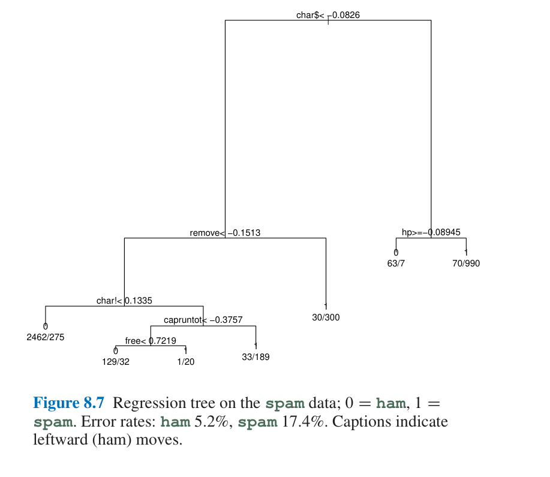
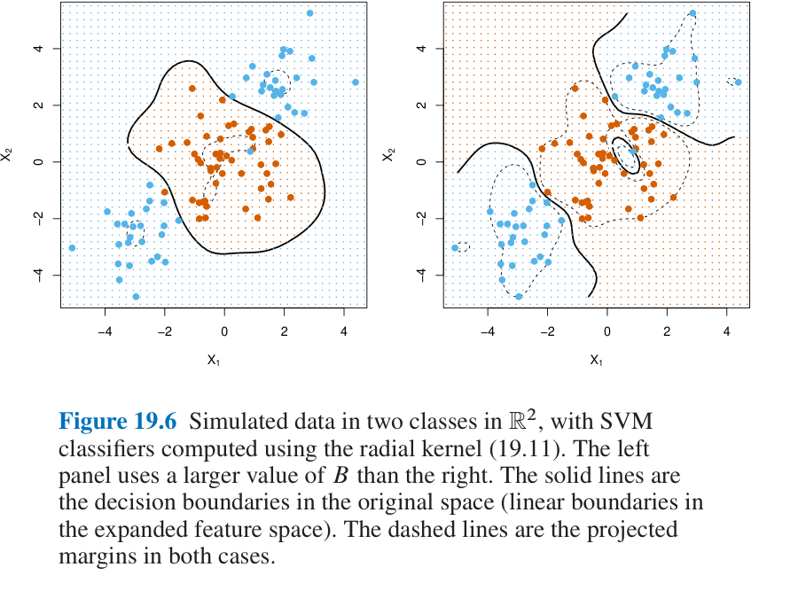
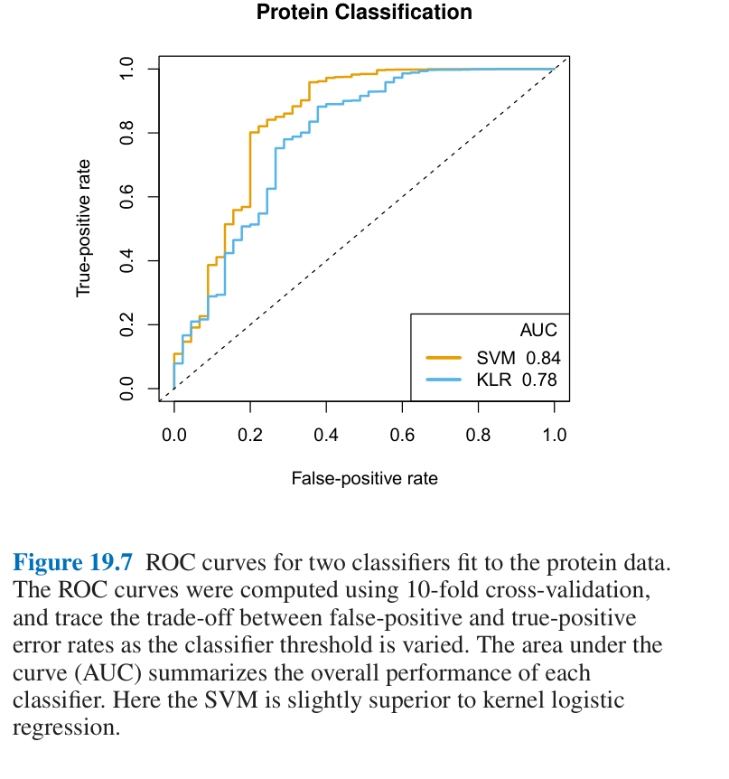
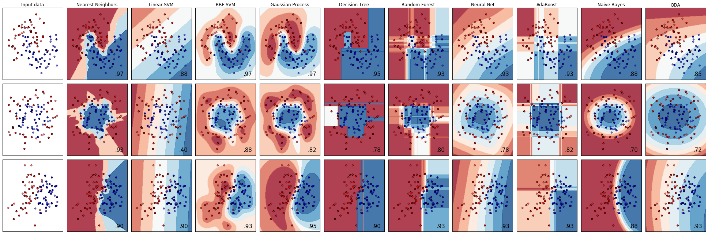

# Supervised Learning

> You have a table and a target. Which model do you try first, and how do you know whether it is too simple or too flexible? This note walks the classical families (nearest neighbours, linear models, naive Bayes, trees, kernel SVMs, small neural networks), each with the one knob that controls its complexity, what it is good at and how it fails, plus the from-scratch versions from Ng's exercises.

**In plain words.** Supervised learning means showing a computer past cases with the answers attached, such as old emails marked spam or not, so that it can label new ones. The families of model here are different ways of writing that rule: copy the most similar past case, add up weighted clues, or ask a chain of yes-or-no questions. Each has a dial that runs from rigid to flexible. Your job at work is to pick a family and set the dial so that it learns the pattern and not the quirks of the old cases.

Blocks run top to bottom from this `notes/` folder, on the breast-cancer data that ships with scikit-learn, so the numbers below are this split's. Figures attributed to M&G come from the book's own examples.

---

## The two tasks

The target picks the task, and after it the loss, the metric and the baseline. [Choosing a metric](11-choosing-a-metric.md#the-map) has that map for every kind of target.

| | Classification | Regression |
|---|---|---|
| Target | A class label from a fixed set | A continuous number |
| Example (M&G ch. 2) | Breast-cancer benign/malignant; `make_forge` two-class toy | House prices (M&G's Boston data, removed from scikit-learn 1.2); `make_wave` 1-D toy |
| Default `score` | Accuracy | $R^2$ |
| Loss in training | Log-loss (logistic), hinge (SVM), Gini/entropy (trees) | Squared error |

The test for which one you have: *is there continuity between possible outputs?* Income in dollars is regression; the language of a website is classification.

Three running examples from *The Elements of Statistical Learning* show the same split, and they recur in the sections below (*ESL*, ch. 1). Spam is classification: 4,601 labelled emails, each described by 57 word and punctuation frequencies. Prostate is regression: log PSA for 97 men, predicted from 8 clinical measurements. The ZIP-code digits are 10-class classification on 16×16 greyscale images. The spam example also carries the first lesson about error costs: filtering out a good email is worse than letting a spam through, so the two mistakes should not be counted equally, which is the subject of [Choosing a metric](11-choosing-a-metric.md#the-map).

Every model below has a **complexity knob**. Turning it trades the bias and variance of [01](01-statistical-foundations.md#bias-variance-and-model-complexity), and the first thing to do with any new model is to sweep that knob and plot train and test score against it.

---

## k-nearest neighbours

The simplest model: memorise the training set; predict by looking at the $k$ closest training points (majority vote for classification, mean for regression).

```python
from sklearn.neighbors import KNeighborsClassifier
from sklearn.datasets import load_breast_cancer
from sklearn.model_selection import train_test_split

cancer = load_breast_cancer()
X_train, X_test, y_train, y_test = train_test_split(
    cancer.data, cancer.target, stratify=cancer.target, random_state=66)

# Sweep the complexity knob: small k = complex (jagged boundary), large k = simple
for k in range(1, 11):
    clf = KNeighborsClassifier(n_neighbors=k).fit(X_train, y_train)
    print(k, round(clf.score(X_train, y_train), 3), round(clf.score(X_test, y_test), 3))
```

```text
1 1.0 0.902
2 0.977 0.888
3 0.958 0.923
4 0.955 0.923
5 0.948 0.923
6 0.946 0.937
7 0.944 0.93
8 0.941 0.93
9 0.934 0.916
10 0.939 0.916
```

The single-neighbour model gets every training point right and is the worst on test. That is overfitting made visible.

KNN also yields a score, not just a vote: the fraction of the $k$ neighbours in the positive class. In Bruce and Bruce's loan example, 14 of the 20 nearest loans to a new one defaulted, so the label is default and the propensity is $14/20 = 0.7$. That fraction is what lets you move the cutoff below 0.5 when the positive class is rare (*Practical Statistics*, ch. 6).

ISLP puts numbers on the same U-shape with a known answer. On its simulated two-class data (100 points per class), the best any classifier can do is the Bayes error, 0.1304 on the test set; KNN with $K=10$ gets 0.1363, while $K=1$ and $K=100$ get 0.1695 and 0.1925 (low bias and high variance at one end, the reverse at the other). Over 200 training and 5,000 test points the test error is U-shaped in $1/K$ with its minimum near $K=10$ and the training error is 0 at $K=1$ (*ISLP*, ch. 2; the chapter prints the Bayes error as 0.133 in one place and 0.1304 in another). Against OLS, KNN pays for dimension: with 50 training points and a strongly non-linear truth it wins at one or two predictors and loses from four, and adding noise predictors up to $p=20$ multiplies its test MSE more than ten-fold (*ISLP*, ch. 3, Figs. 3.19 and 3.20, simulated data).

**Why distance fails with many features.** ESL does the arithmetic behind the "many features" row below. With inputs uniform in a $p$-dimensional unit cube, a cubical neighbourhood that holds a fraction $r$ of the data has edge length $r^{1/p}$, so at $p=10$ capturing 1% of the points takes 63% of each feature's range and 10% takes 80%: the neighbourhood is no longer local. With 500 points uniform in a 10-dimensional unit ball, the median distance from the centre to the nearest point is about 0.52, more than halfway to the edge, so most points are nearer the boundary than to any other point and prediction there is extrapolation. For 10 standard-Gaussian features a random test point sits about 3.1 standard deviations from the origin (*ESL*, ch. 2, sec. 2.5 and exercise 2.4, calculations, not data). In the chapter's simulation (1,000 noiseless points on $[-1,1]^p$, target $e^{-8\lVert x\rVert^2}$, predicting at the origin), by $p=10$ the nearest neighbour is further than 0.5 from the origin in more than 99% of samples; the authors call the example "highly contrived", and when the target depends on one coordinate only the damage comes mostly through variance. Structure is the way out: when the truth is linear, least squares has expected prediction error of about $\sigma^2(1 + p/N)$, which grows linearly in $p$.

The same chapter gives the knob its meaning. k-NN has about $N/k$ effective parameters, usually more than a linear model's $p$, and at a point $x_0$ its expected error is $\sigma^2 + \big[f(x_0) - \tfrac1k\sum_{l} f(x_{(l)})\big]^2 + \sigma^2/k$: noise, a bias that tends to grow as the neighbours spread out, and a variance that falls as $1/k$. Training error is zero at $k=1$, so it cannot choose $k$. What the averaging is aiming at depends on the loss: squared error is minimised by the conditional mean, absolute error by the conditional median, and 0-1 loss by the most probable class, the Bayes classifier (*ESL*, ch. 2, secs. 2.3, 2.4 and 2.9).

**Kernel smoothing is k-NN with weights.** A k-NN average gives every neighbour the same weight and everything else none, so the fitted curve jumps as points enter and leave the window. The Nadaraya-Watson estimator weights each training point by a kernel that decays with distance from the query, and the curve is smooth (ESL's Fig. 6.1: 100 points from $\sin(4x)$ plus noise, a 30-nearest-neighbour running mean against an Epanechnikov kernel of half-width 0.2). Any local average is biased at the edge of the data, where the neighbours all lie on one side; fitting a kernel-weighted straight line at each query point (local linear regression) removes that bias to first order "at a modest cost in variance". A fixed-width window holds bias steady and lets variance rise where data is thin, and a k-nearest window does the reverse. These methods are memory-based like k-NN: the model is the training set, one prediction costs $O(N)$, and local regression "becomes less useful in dimensions much higher than two or three" (*ESL*, ch. 6).

**How good can nearest neighbours get?** Cover and Hart's 1967 result sets the scale: asymptotically the 1-NN error rate is "never more than twice the Bayes rate", so a 1-NN error of 10% means no classifier can go below 5%. The result needs training data dense enough that the nearest neighbour sits on the query point, and ESL adds that "In real problems the bias can be substantial." Where the boundary is irregular the method can still come first. On the STATLOG LANDSAT task, five-nearest-neighbours on 36 features (each pixel and its 8 neighbours in four spectral bands) had a test error of about 9.5%, the best of all the methods in that project, CART, neural networks and linear discriminant analysis among them (*ESL*, ch. 13, sec. 13.3.2). The choice of distance matters too. On handwritten ZIP codes (7,291 training and 2,007 test images), 1-NN with Euclidean distance has test error 0.055 against 0.049 for a carefully built neural network, and 1-NN with tangent distance, which ignores small rotations and similar distortions of a digit, has 0.026 (*ESL*, ch. 13, Table 13.1). It was also too slow to deploy for online classification, which is the memory-based cost again.

| | |
|---|---|
| Knob | `n_neighbors` (and the distance metric) |
| Good at | A baseline in minutes; small, low-dimensional data |
| Fails on | Many features (distances stop meaning anything); sparse data; large training sets (prediction is slow) |
| Needs | Feature scaling: distances are dominated by the largest-range feature |

---

## Linear models

Predict with a weighted sum: $\hat y = w \cdot x + b$. For classification, threshold it at zero. The family has its own note, [Linear models](02b-linear-models.md): [least squares, ridge and lasso](02b-linear-models.md#regression-ols-ridge-lasso), [logistic regression and the linear SVM](02b-linear-models.md#classification-logistic-regression-and-linear-svm), and [the gradient that fits them](02b-linear-models.md#vectors-matrix-products-and-the-gradient).

| | |
|---|---|
| Knob | `alpha` (regression) or `C` (classification): the strength of the penalty on the weights. Ridge (L2) shrinks them, lasso (L1) sets some to zero |
| Good at | Many features, sparse data, very large data; fast to fit and to predict; coefficients you can read |
| Fails on | Non-linear signal you have not built features for; coefficients read as causes when predictors are correlated |
| Needs | Feature scaling for the penalty to treat features alike |

---

## Naive Bayes

Fit per-class statistics of each feature independently and apply Bayes' rule. Training is a single pass over the data.

| Variant | Data | Statistic per class |
|---|---|---|
| `GaussianNB` | Continuous | Mean and std per feature |
| `BernoulliNB` | Binary | Count of non-zero per feature |
| `MultinomialNB` | Counts (word counts) | Mean count per feature |

Knob: `alpha` (additive smoothing: pretends every feature was seen `alpha` extra times in every class). Naive Bayes is the classic fast text baseline ([NLP text classification](../../03-nlp/notes/02-text-classification.md)); usually slightly worse than a linear model, trained much faster.

The independence assumption is usually false and the method works anyway. ESL's explanation is that the per-class density estimates can be badly biased while the posterior stays right near the decision boundary, which is the only place a classifier needs it, and so "naive Bayes classifiers often outperform far more sophisticated alternatives" (*ESL*, ch. 6, an argument, with no benchmark attached). The same reasoning warns against the opposite habit: when classification is the goal, learning each class density well "may be unnecessary, and can in fact be misleading".

---

## Decision trees

A tree asks a sequence of if/else questions ("is feature 3 ≤ 0.8?"), each chosen to make the resulting groups as pure as possible. A leaf predicts the majority class (or mean value) of its training points.

```python
from sklearn.tree import DecisionTreeClassifier

full = DecisionTreeClassifier(random_state=0).fit(X_train, y_train)
tree = DecisionTreeClassifier(max_depth=4, random_state=0).fit(X_train, y_train)
print("unpruned ", round(full.score(X_train, y_train), 3), round(full.score(X_test, y_test), 3))
print("max_depth", round(tree.score(X_train, y_train), 3), round(tree.score(X_test, y_test), 3))
print("features used:", (tree.feature_importances_ > 0).sum(), "of", X_train.shape[1])  # zero means unused, not "unimportant"
```

```text
unpruned  1.0 0.895
max_depth 0.988 0.902
features used: 10 of 30
```

A tree grown until every leaf is pure memorises the training set. M&G's breast-cancer run shows the same: unpruned train 1.000 and test 0.937, `max_depth=4` train 0.988 and test 0.951 (*Introduction to ML with Python*, ch. 2, "Decision trees"). Control it with **pre-pruning**: `max_depth`, `max_leaf_nodes`, or `min_samples_leaf`. scikit-learn also has cost-complexity post-pruning (`ccp_alpha`).

**Why trees grow on Gini or entropy, not on error rate.** ESL's example: a node with 400 points of each class can be split into (300, 100) and (100, 300), or into (200, 400) and (200, 0). Both leave a misclassification rate of 0.25, but the second makes a pure node. Gini and cross-entropy score the second split lower, and the error rate cannot tell the two apart (*ESL*, ch. 9, sec. 9.2.3). For a categorical feature with $q$ levels and a two-class target there are $2^{q-1}-1$ ways to split the levels into two groups; ordering the levels by their share of class 1 and splitting as if the feature were ordered finds the best one without the search.

**Two quirks to remember:**

- **No scaling needed.** Each split looks at one feature at a time.
- **Trees can't extrapolate.** On the RAM-price time series (M&G ch. 2), a tree predicts the last known price forever after the training range, while a linear model on log-price continues the trend.

Efron and Hastie's spam tree shows what a grown tree looks like on real data (4,601 emails, 40% spam, 57 word and character frequencies that the book standardises, so some split values are negative). Seven leaves, each labelled with its ham/spam counts, and the first split is on the proportion of `$` characters:


*Image Source: Efron and Hastie, *Computer Age Statistical Inference* (Cambridge University Press, 2016), Fig. 8.7*

The leaf counts add up to the full 2,788 ham and 1,813 spam, so the error rates can be recomputed: 134 ham fall in spam-labelled leaves (4.8%) and 314 spam in ham-labelled leaves (17.3%). The caption prints 5.2% and 17.4%, so the ham rate does not match its own leaves (the text also calls this tree "Figure 8.6" when it means 8.7). Both rates are apparent, on the training emails, and the authors note trees are unstable and easy to over-interpret (*Computer Age*, ch. 8).

ESL gives the same data a test score. On a random split of 3,065 training and 1,536 test emails, a tree sized by 10-fold CV with the one-standard-error rule has 17 leaves and 9.3% test error (sensitivity 86.3%, specificity 93.4%). Linear logistic regression gets 7.6%, and an additive logistic model with one smooth curve per predictor gets 5.3%; the tree's ROC area is about 0.95 against the additive model's 0.98 (*ESL*, ch. 9, one split; the Table 9.1 caption prints 5.5% for the additive model where the text says 5.3%). The authors' reading is that a tree has trouble with additive structure, which it can only approximate with many splits. Smooth shapes per feature are covered in [feature engineering](03-feature-engineering-and-pipelines.md#binning-interactions-and-polynomials).

A single tree is rarely the best model. Its value is as the building block of [06 — ensembles](06-ensembles.md), where random forests and gradient boosting fix its variance.

---

## Kernelized support vector machines

A linear model in a richer feature space. Adding $x_1^2$ as a feature turns a curved boundary into a plane in 3-D. The **kernel trick** computes inner products in that expanded space without building it.

| Kernel | Implicit features |
|---|---|
| Polynomial | All products of features up to a degree |
| RBF (Gaussian) | Infinite-dimensional; similarity decays with distance: $k(x, x') = \exp(-\gamma \lVert x - x' \rVert^2)$ |

Only the training points on or inside the margin, the **support vectors**, define the boundary. The soft-margin formulation, where `C` prices each margin violation so that non-separable data still has a solution, is the contribution of the original paper, which combined ten degree-4 polynomial classifiers to reach 1.1% test error on the NIST digit benchmark, 60,000 training images and 10,000 test images with no pre-processing ([doi:10.1007/bf00994018](https://doi.org/10.1007/bf00994018), Cortes and Vapnik, Machine Learning 1995). That ties the purpose-built LeNet4 rather than beating it, while using nothing about image geometry. On the smaller USPS digits (7,300 training and 2,000 test images, centred, de-slanted and smoothed), polynomial degrees 2 to 7 all reach 4.2 to 4.7% error against 12.0% for linear, while the implicit feature space grows from about 33,000 to about $10^{16}$ dimensions. The authors read that as no over-fitting, from one dataset with no error bars. The paper runs polynomial kernels only, penalises the square of the total slack in its experiments rather than the linear penalty `SVC` uses, and reports no value of `C`, so the tuning advice below doesn't rest on it.

```python
from sklearn.svm import SVC
from sklearn.preprocessing import MinMaxScaler

scaler = MinMaxScaler().fit(X_train)           # fit on train only (see 03)
svc = SVC(kernel="rbf", C=1000, gamma="scale").fit(scaler.transform(X_train), y_train)
raw = SVC(kernel="rbf", C=1000, gamma=1.0).fit(X_train, y_train)   # unscaled: distances are dominated by the largest-valued features
print("unscaled", round(raw.score(X_test, y_test), 3))
print("scaled  ", round(svc.score(scaler.transform(X_test), y_test), 3))
```

```text
unscaled 0.629
scaled   0.972
```

M&G report the same collapse (train 1.00, test 0.63 unscaled) and the cause: breast-cancer feature ranges span several orders of magnitude, which the kernel's single `gamma` cannot serve (*Introduction to ML with Python*, ch. 2, "Kernelized support vector machines"). They put SVMs in comfortable reach to about 10,000 samples and hard at 100,000.

**What the kernel changes in the fit.** The fitted function is $f(x) = \alpha_0 + \sum_{i \in S} \alpha_i K(x, x_i)$ over the support set $S$, a sum of bumps centred on training points. The Lagrange dual uses the data only through the $n \times n$ Gram matrix of inner products, so cost grows linearly in the number of features $p$ and potentially cubically in $n$ (in practice about $O(n^2\lvert S\rvert)$), which suits wide data. Ridge regression gets the same reparametrisation, $\hat\beta = X^\top\hat\alpha$ with $\hat\alpha = (XX^\top + \lambda I)^{-1}y$, which costs $O(n^2p)$ instead of $O(np^2)$ (*Computer Age*, ch. 19). The polynomial kernel $(1 + \langle x, z\rangle)^d$ is, in the authors' words, "mainly useful as existence proofs", and the radial kernel is the usual choice. Wide data show where a margin classifier earns its place: on leukemia gene expression (3,571 genes, 72 patients, 47 ALL and 25 AML) a separating hyperplane exists and logistic regression fails, and the optimal-margin fit uses 42 of the 72 points as support vectors. Fit on a random 50 and tested on the other 22, no test point was misclassified although several fell inside the margin (one split, no repetition).


*Image Source: Efron and Hastie, *Computer Age Statistical Inference* (Cambridge University Press, 2016), Fig. 19.6*

The slack budget $B$ is the overfitting knob. The left fit tolerates some margin errors and looks reasonable, while the right one, with a smaller $B$, builds a small island to capture one blue point in a sea of brown. The budget is tuned by cross-validation, and a larger one means more support points and a lower-variance fit. Kernels also reach objects that are not vectors: any similarity that behaves like an inner product defines one. For proteins, counting every 3-gram of the 20 amino-acid letters gives $20^3 = 8{,}000$ counts per protein, and the string kernel is computed from tree structures without forming those vectors. On 1,708 proteins (1,663 negative, 45 positive), 10-fold CV, with a very small $\lambda$ chosen by CV, the kernel SVM scores AUC 0.84 and kernel logistic regression 0.78. It is a single run on one data set, with no variance reported.


*Image Source: Efron and Hastie, *Computer Age Statistical Inference* (Cambridge University Press, 2016), Fig. 19.7*

The authors add the limits: kernel methods are not immune to the curse of dimensionality, the quadratic penalty keeps every feature in the model so there is no sparsity (swap in an L1 penalty for that), and the popularity of SVMs rests on classification performance, since classifiers are less sensitive to bias-variance trade-offs than regression is (*Computer Age*, ch. 19).

ESL puts numbers on the first limit. Early claims that the kernel lets the SVM "finesse the curse of dimensionality" get a flat reply: "Neither of these claims is true". In its "skin of the orange" simulation the true boundary is a second-degree polynomial, and the test error, averaged over 50 simulations, is 0.078 for a degree-2 polynomial SVM, 0.180 at degree 5 and 0.230 at degree 10, against a Bayes error of 0.029. Adding six noise features roughly doubles the first two, to 0.152 and 0.370, while MARS, which can ignore features, moves only from 0.156 to 0.173 (*ESL*, ch. 12, Table 12.2). A kernel weighs every feature alike, so scaling and feature selection stay your job. The hinge loss is also less special than it looks. On ESL's two-class mixture data (Bayes error 0.210) a radial-kernel SVM has test error 0.218 and a degree-4 polynomial SVM 0.245; logistic regression with the same kernels has 0.221 and 0.263 and returns class probabilities as well. What the hinge buys is sparsity: 42% and 45% of the training points are not support vectors and drop out of prediction (*ESL*, ch. 12, Figs. 12.3 and 12.5, regularisation "chosen in both cases to achieve good test error", so these errors are optimistic).

| Knob | Small value | Large value |
|---|---|---|
| `gamma` | Wide kernel, smooth boundary | Narrow kernel, every point its own island |
| `C` | Heavy regularisation | Fit every training point |

Tune them **together** ([04 — grid search](04-model-evaluation.md#grid-search)).

| | |
|---|---|
| Good at | Small and medium data (up to ~10k samples) with features on similar scales; complex boundaries in few dimensions |
| Fails on | 100k+ samples (memory and time); unscaled features; interpretation |

Ng's ex6 implements the Gaussian kernel by hand and uses `sklearn.svm.SVC` on three 2-D datasets, then builds a **spam classifier**: email preprocessing (lower-case, strip HTML, normalise URLs, numbers and addresses, Porter stemming), a 1,899-word vocabulary, binary word-presence features, a linear SVM. That is the bag-of-words pipeline of [NLP text representation](../../03-nlp/notes/01-text-representation.md) written out by hand.

```python
# Ng ex6: the Gaussian kernel, from scratch
import numpy as np

def gauss_kernel(x1, x2, sigma):
    return np.exp(-np.sum((x1 - x2) ** 2) / (2.0 * sigma ** 2))   # gamma = 1 / (2 sigma^2)

print(round(gauss_kernel(np.array([1., 2, 1]), np.array([0., 4, -1]), 2.0), 6))
```

```text
0.324652
```

---

## Neural networks (multilayer perceptrons)

A stack of linear models with a non-linearity between them: $h = \tanh(W_1 x + b_1)$, $\hat y = W_2 h + b_2$. Without the non-linearity, the stack collapses to one linear model.

```python
from sklearn.neural_network import MLPClassifier
from sklearn.preprocessing import StandardScaler

Xs_train = StandardScaler().fit(X_train).transform(X_train)
mlp = MLPClassifier(hidden_layer_sizes=[10, 10], alpha=1.0,
                    max_iter=1000, random_state=0).fit(Xs_train, y_train)
print(round(mlp.score(StandardScaler().fit(X_train).transform(X_test), y_test), 3))
```

```text
0.951
```

| Knob | Effect |
|---|---|
| `hidden_layer_sizes` | Width and depth: capacity. Parameters grow fast: 100 inputs and two layers of 100 give 20,100 weights, two layers of 1,000 give 1,101,000 (*Introduction to ML with Python*, ch. 2) |
| `alpha` | L2 penalty on weights |
| `activation` | `relu` (default) or `tanh` |
| `random_state` | Different seeds give visibly different boundaries on small data |

The tuning recipe from M&G: first build a network big enough to overfit, then shrink it or raise `alpha` until test performance is best. Scaling to mean 0 and variance 1 is required. Neural networks need more data, more tuning and more care than the other models here; for tabular data, gradient-boosted trees usually win ([06](06-ensembles.md)). ISLP's own tabular comparison agrees on the point that matters: on Hitters (263 players, 176 train and 87 test, one split) a 64-unit network with 1,345 parameters has test MAE 257.4, against 254.7 for linear regression and 252.3 for the lasso, and its authors say they spent a fair bit of time tuning the network to get there and advise Occam's razor. Their own lab run with a different network flips the order (229.5 against 259.7 and 257.2), so a few points either way on one 87-row test set is noise (*ISLP*, ch. 10). Where the network clearly wins is MNIST: the text reports 1.8% error for a dropout network against 7.2% for multinomial logistic regression, and the book's own lab run of a similar network gets 3.2% (accuracy 0.9681) against 0.9241 for the logistic baseline, so the gap is real but its size depends on the run. [neural network basics](../../02-deep-learning/notes/01-neural-networks-fundamentals.md) builds them from scratch.

ESL gives the same recipe with numbers: standardise every input to mean zero and standard deviation one, start the weights uniform over $[-0.7, +0.7]$, put down "a reasonably large number of units" (typically 5 to 100) and regularise, instead of tuning the count (*ESL*, ch. 11, sec. 11.5). On its mixture data a 10-hidden-unit network has test error 0.259 without weight decay and 0.223 with weight decay 0.02, against a Bayes error of 0.210, while the training error rises from 0.100 to 0.160 (*ESL*, ch. 11, Fig. 11.4). Structure beats size. On a deliberately small digit set (320 training and 160 test images, recreated from Le Cun 1989), a network with no hidden layer, which is multinomial logistic regression, gets 80.0% of test digits right; 12 fully connected hidden units get 87.0% with 3,214 weights; local connectivity with two levels of weight sharing gets 98.4% with 1,060 weights (*ESL*, ch. 11, Table 11.1). Weight sharing is the convolution of [CNNs](../../02-deep-learning/notes/04-convolutional-networks.md).

---

## Uncertainty estimates

Most classifiers can say *how sure* they are, not only which class:

| Method | Range | Meaning |
|---|---|---|
| `decision_function(X)` | Any real number; sign = class (binary) | Margin from the boundary; scale is model-specific |
| `predict_proba(X)` | [0, 1], rows sum to 1 | Estimated class probabilities |

```python
from sklearn.ensemble import GradientBoostingClassifier

y_train_named = cancer.target_names[y_train]         # labels as strings, to show classes_
gbrt = GradientBoostingClassifier(random_state=0).fit(X_train, y_train_named)
print(gbrt.classes_)
print(gbrt.decision_function(X_test)[:4].round(2))   # signed margin; positive means classes_[1]
print(gbrt.predict_proba(X_test)[:4].round(3))       # probability of each class in classes_ order
agree = gbrt.classes_[(gbrt.decision_function(X_test) > 0).astype(int)] == gbrt.predict(X_test)
print(agree.all())
```

```text
['benign' 'malignant']
[-8.69 -8.75 -8.32 -8.77]
[[1. 0.]
 [1. 0.]
 [1. 0.]
 [1. 0.]]
True
```

A probability is only as good as the model's **calibration**: an overfit model reports 1.0 on points it gets wrong. You need these scores to move the decision threshold, which [04b](04b-thresholds-pr-roc-and-calibration.md#threshold-precisionrecall-and-roc) does, and [04b](04b-thresholds-pr-roc-and-calibration.md#calibration-is-a-08-really-80) shows how to check them. Niculescu-Mizil and Caruana compared ten learners' probabilities and found boosted trees and SVMs distort them in a sigmoid shape while logistic regression does not ([doi:10.1145/1102351.1102430](https://doi.org/10.1145/1102351.1102430), ICML 2005).

---

## Which model, when


*Image source: Müller & Guido, Introduction to Machine Learning with Python, companion repo `images/` (after scikit-learn's classifier comparison)*

| Model | Knob | Scale features? | Good for | Avoid when |
|---|---|---|---|---|
| kNN | `n_neighbors` | Yes | Small data, baseline, explanation by example | Many features, large n |
| Linear | `alpha` / `C` | Yes (for solvers and penalty) | High-dimensional, sparse, large data | Low-dim non-linear structure |
| Naive Bayes | `alpha` | No | Very fast text baselines | When accuracy matters most |
| Decision tree | `max_depth` | No | Explaining a model to people | Accuracy (use an ensemble) |
| Random forest | `max_features` | No | Strong default for tabular | Very sparse high-dim data |
| Gradient boosting | `learning_rate`, `n_estimators`, `max_depth` | No | Best tabular accuracy ([07](07-boosting-in-practice.md)) | You can't afford tuning |
| Kernel SVM | `C`, `gamma` | Yes | Medium data, similar-scale features | Large n |
| MLP | layers, `alpha` | Yes | Large data, time to tune | Small tabular data |

M&G's advice when faced with a new dataset (*Introduction to ML with Python*, ch. 2, "Summary and outlook"): start with a simple model (linear, naive Bayes or kNN) to learn what the data is like, then move to random forests, gradient boosting, SVMs or neural networks. All of them sit behind the same API, which is the reason a sweep across families costs a few lines. The scikit-learn paper makes that its case, a "consistent, task-oriented interface" that enables "easy comparison of methods" ([arXiv:1201.0490](https://arxiv.org/abs/1201.0490), Pedregosa et al., JMLR 2011), though it asserts this rather than measuring it.

---

## The same models, from scratch: Ng's exercises

Your own Coursera work implements the maths that scikit-learn hides. Each is the counterpart of a section above.

| Exercise | Implements | Key function |
|---|---|---|
| ex1 | Linear regression, one and many variables; batch gradient descent; feature normalisation; the normal equation | `computeCost`, `descendGradient`, `normEqtn` |
| ex2 | Logistic regression; regularised logistic regression on polynomial features (`mapFeature` to degree 6); decision boundary | `computeCost`, `optimizeTheta` (via `scipy.optimize`) |
| ex3 | Vectorised one-vs-all logistic regression on 5,000 handwritten digits; feed-forward with given NN weights | `predictOneVsAll`, `propagateForward` |
| ex4 | NN training: backpropagation, gradient checking, random initialisation | Taken up in [neural network basics](../../02-deep-learning/notes/01-neural-networks-fundamentals.md) |
| ex6 | Gaussian-kernel SVM; spam classifier | See [above](#kernelized-support-vector-machines) |

The core of ex1 and ex2, vectorised:

```python
import numpy as np
from scipy.special import expit   # sigmoid

def h_linear(theta, X):           # X has a leading column of ones
    return X @ theta

def cost_linear(theta, X, y):
    m = len(y)
    return ((h_linear(theta, X) - y) ** 2).sum() / (2 * m)

def gradient_descent(X, y, theta, alpha=0.01, iters=1500):
    m = len(y)
    for _ in range(iters):
        theta = theta - (alpha / m) * X.T @ (h_linear(theta, X) - y)   # simultaneous update
    return theta

def normal_equation(X, y):        # closed form, no learning rate, O(n^3) in features
    return np.linalg.pinv(X.T @ X) @ X.T @ y

def cost_logistic(theta, X, y, lam=0.0):
    m = len(y)
    h = expit(X @ theta)
    reg = lam / (2 * m) * (theta[1:] ** 2).sum()                       # never penalise the bias
    return -(y @ np.log(h) + (1 - y) @ np.log(1 - h)) / m + reg

# Ng ex1: profit of a food truck against city population
data = np.loadtxt("../practice/ng-machine-learning/ex1/data/ex1data1.txt", delimiter=",")
X1 = np.c_[np.ones(len(data)), data[:, 0]]
y1 = data[:, 1]
print("cost at zero   ", round(cost_linear(np.zeros(2), X1, y1), 2))
print("grad descent   ", gradient_descent(X1, y1, np.zeros(2)).round(3))
print("normal equation", normal_equation(X1, y1).round(3))
```

```text
cost at zero    32.07
grad descent    [-3.63   1.166]
normal equation [-3.896  1.193]
```

After 1,500 iterations gradient descent has not quite reached the closed-form answer, so running longer closes the gap. Three things these make concrete that the library hides: gradient descent diverges if the learning rate is too high (plot $J$ per iteration, ex1); features on different scales slow it badly (normalise first); and the regularisation term skips the bias weight.

---

## Practice

| Notebook | Covers | Runs |
|---|---|---|
| [`02-supervised-learning.ipynb`](../practice/intro-to-ml-in-python/02-supervised-learning.ipynb) | Everything above except the Ng section | Offline; `scikit-learn>=1.4`, local `mglearn`; `graphviz` for tree plots |
| [`ex1`](../practice/ng-machine-learning/ex1/ex1.ipynb), [`ex2`](../practice/ng-machine-learning/ex2/ex2.ipynb), [`ex3`](../practice/ng-machine-learning/ex3/ex3.ipynb), [`ex6`](../practice/ng-machine-learning/ex6/ex6.ipynb) | From-scratch linear/logistic regression, one-vs-all, SVMs, spam | Legacy: Python 2.7 kernels (`print` statements); ex3 uses `scipy.misc.toimage`, removed in SciPy 1.2. Data in each `data/` folder |

---

## Pitfalls

| Pitfall | Symptom | Fix |
|---|---|---|
| Unscaled features for a distance or margin model | kNN or SVC scores near the dummy rate, and scaling jumps it | Put a scaler in a pipeline ([03](03-feature-engineering-and-pipelines.md)) |
| Trees on trending time data | Forecast flatlines at the last training value | Model the trend with a linear part, or difference the target |
| Trusting `predict_proba` from an overfit model | Probabilities of 1.0 on wrong answers | Check calibration ([04b](04b-thresholds-pr-roc-and-calibration.md#calibration-is-a-08-really-80)) |

## Try it

1. Fit `DecisionTreeClassifier` with `max_depth` from 1 to 10. Which depth does the test score peak at on this split?
2. Run `gradient_descent` on `X1, y1` with `alpha=0.03`. What happens to the cost, and why?
3. Extend `cost_logistic` to return its gradient and fit it on ex2's `data/ex2data1.txt` with `scipy.optimize.minimize`. Solutions are in [`ex2.ipynb`](../practice/ng-machine-learning/ex2/ex2.ipynb).

<details>
<summary>Answers</summary>

1. Print the sweep. The peak is usually at a small depth, and the unpruned tree is not the best one; the exact depth depends on the split, so rerun with a different `random_state` to see how unstable a single tree's choice is.
2. It diverges to infinity: the feature (city population in tens of thousands) has a large range, so a step of 0.03 overshoots and the cost grows every iteration. Normalising the feature first fixes it, which is the point ex1 makes.

</details>

## Interview checklist

| Question | Answer |
|---|---|
| What controls complexity in kNN, linear models, trees, RBF SVMs? | `n_neighbors`; `alpha` or `C`; `max_depth`; `C` with `gamma` |
| Why do trees not need scaling? | Each split compares one feature to a threshold, so only the order of its values matters |
| Why can't trees or forests extrapolate? | Predictions are means of training leaves, so they never leave the training range |
| What is the kernel trick? | Computing inner products in an expanded feature space without building that space |
| What are support vectors? | The training points on or inside the margin, the only ones that define the boundary |
| Why is naive Bayes fast and often fine? | One pass of per-class statistics. Its independence assumption is wrong but the ranking is often good |
| Which model first on a new table? | A linear model or kNN to learn the data, then a forest or boosting |
| Gradient descent vs normal equation? | Iterative with a learning rate, vs closed form at about cubic cost in features |

## Next

[Linear models](02b-linear-models.md): the family this note only summarises, with ridge, lasso, logistic regression and the gradient that fits them. Then [Feature engineering and pipelines](03-feature-engineering-and-pipelines.md).
