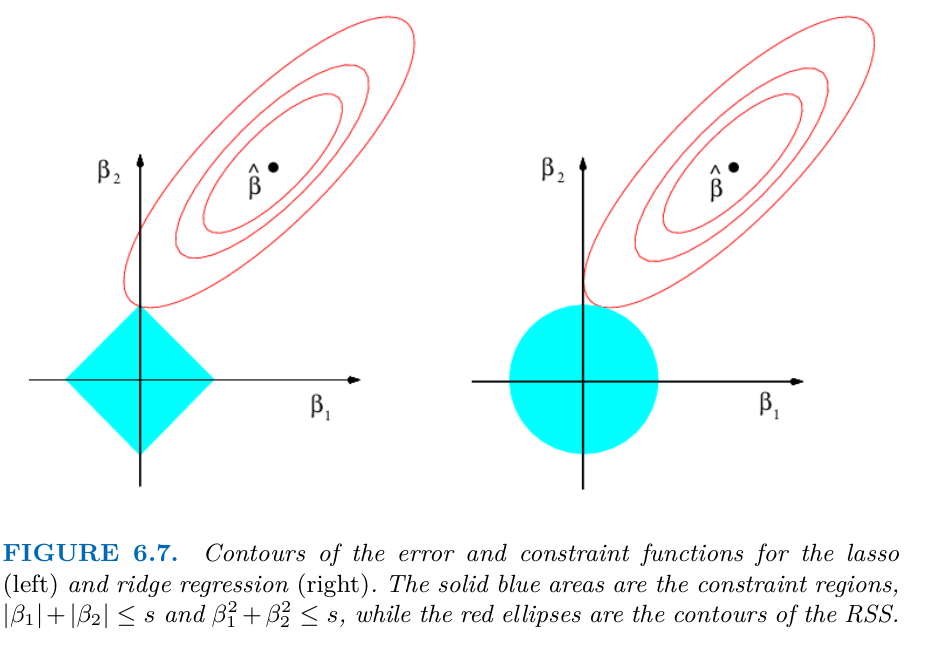
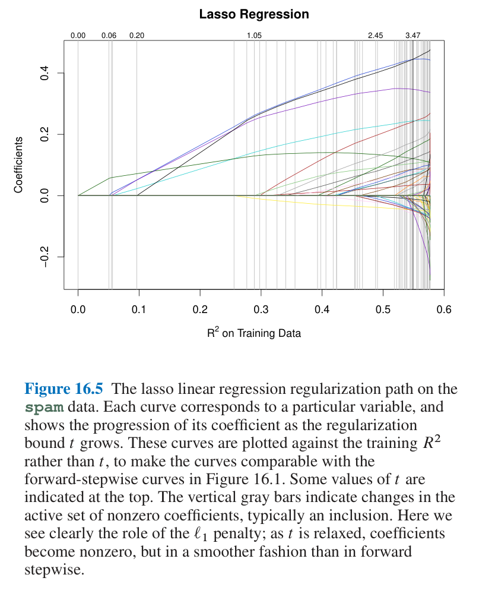
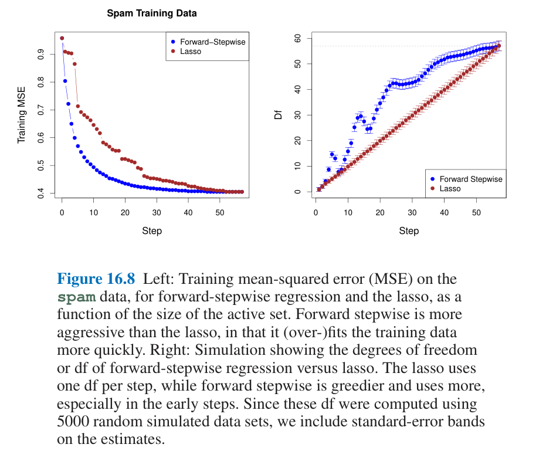
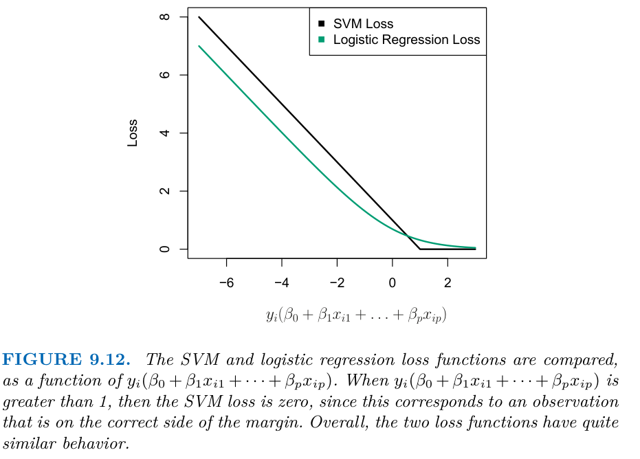

# Linear Models

> A weighted sum of the features is the first model to try on almost any table, and the one every later model is measured against. Which penalty do you put on the weights, what does a coefficient tell you, and how does the fit get found? This note covers least squares, ridge and lasso, logistic regression and the linear SVM, and the gradient that trains them.

**In plain words.** A linear model scores a case by adding up clues, each multiplied by a weight: so much for income, so much for age. Training means finding the weights. A penalty keeps them small so that the model does not chase noise, and one kind of penalty sets some of them to exactly zero, which tells you which clues it ignored. At work this is the baseline you fit first and the model you reach for when there are more columns than you can inspect.

This note continues [Supervised learning](02-supervised-learning.md), which introduces the other families. Blocks run top to bottom from this `notes/` folder; the first block rebuilds that note's breast-cancer split, so the numbers match.

Predict with a weighted sum: $\hat y = w \cdot x + b$. For classification, threshold it at zero. scikit-learn fits this for prediction and reports no standard errors. See [Regression and GLMs](../../../data-analytics/02-probability-and-statistics/notes/06-regression-and-glms.md#ols-in-statsmodels) in data analytics for the inference side, in `statsmodels`.

---

## Regression: OLS, ridge, lasso

| Model | Objective | Effect | Knob |
|---|---|---|---|
| `LinearRegression` (OLS) | $\min \lVert y - Xw \rVert^2$ | No complexity control; overfits with many features | — |
| `Ridge` | $+\ \alpha \lVert w \rVert_2^2$ | Shrinks all weights toward 0 | `alpha` (higher = simpler) |
| `Lasso` | $+\ \alpha \lVert w \rVert_1$ | Sets some weights exactly to 0: built-in feature selection | `alpha`; raise `max_iter` when small |
| `ElasticNet` | Both penalties | Lasso's sparsity with ridge's stability | `alpha`, `l1_ratio` |

M&G show the effect on their extended Boston data (506 rows, 104 features, one split; *Introduction to ML with Python*, ch. 2, "Linear models for regression"): OLS scores 0.95 on train and 0.61 on test; ridge at `alpha=1` gets 0.89 / 0.75; lasso at `alpha=0.01` uses 33 of the 104 features and generalises about as well (test 0.77). Their default `alpha=1` lasso underfits with 4 features (train 0.29, test 0.21), and `alpha=0.0001` uses 94 and overfits again (test 0.64). Learning curves on subsets of the same data show OLS learning nothing below about 400 points while ridge does, so regularisation matters most when data is scarce. That dataset has since been removed from scikit-learn, so here is the same experiment on the diabetes data, expanded to squares and products of its features so that OLS has room to overfit:

```python
import numpy as np
from sklearn.datasets import load_breast_cancer, load_diabetes
from sklearn.model_selection import train_test_split
from sklearn.linear_model import LinearRegression, Ridge, Lasso
from sklearn.preprocessing import PolynomialFeatures

cancer = load_breast_cancer()                    # the same split as note 02, used by the classifiers below
X_train, X_test, y_train, y_test = train_test_split(
    cancer.data, cancer.target, stratify=cancer.target, random_state=66)

d = load_diabetes()
Xd = PolynomialFeatures(degree=3, include_bias=False).fit_transform(d.data)
Xd_train, Xd_test, yd_train, yd_test = train_test_split(Xd, d.target, random_state=0)
print("features:", Xd.shape[1], "rows in train:", Xd_train.shape[0])

for name, model in [("OLS", LinearRegression()),
                    ("Ridge a=0.1", Ridge(alpha=0.1)),
                    ("Lasso a=0.1", Lasso(alpha=0.1, max_iter=100_000))]:
    model.fit(Xd_train, yd_train)
    print(f"{name:12} train {model.score(Xd_train, yd_train):.2f}  test {model.score(Xd_test, yd_test):.2f}"
          f"  nonzero {(np.abs(model.coef_) > 1e-8).sum()}")
```

```text
features: 285 rows in train: 331
OLS          train 0.90  test -9.32  nonzero 285
Ridge a=0.1  train 0.55  test 0.37  nonzero 285
Lasso a=0.1  train 0.55  test 0.36  nonzero 7
```

With 285 features and 331 rows OLS memorises the training set, and its test R² of -9.32 is far worse than predicting the mean. Both penalties rescue it at the cost of train score. Ridge keeps all 285 weights small; lasso matches it with 7. That is why you try lasso when you suspect only a few features matter.

ESL runs the whole family on one small real table, and the result is a caution about reading such comparisons. On the prostate data (97 men, 8 standardised predictors, one random split into 67 training and 30 test cases, each method's complexity chosen by 10-fold CV with the one-standard-error rule), test error is 0.521 for least squares, 0.492 for best subset and for ridge, 0.479 for the lasso, 0.449 for principal components regression and 0.528 for partial least squares, against 1.057 for predicting the training mean. The standard errors of those test errors run from 0.105 to 0.179, so every gap between the methods is inside the noise of a 30-row test set (*ESL*, ch. 3, Table 3.3). The table supports one statement: each method roughly halves the baseline error. In the chapter's simulation with correlated predictors (300 rows, 31 predictors with pairwise correlation 0.85, 10 of them with non-zero coefficients, 50 runs), the performance of best subset, forward stepwise and backward stepwise is "very similar", so the cheap greedy searches lose little (*ESL*, ch. 3, Fig. 3.6).

The penalties have a pedigree worth citing: the L1 penalty and its property of setting weights exactly to zero come from the lasso paper ([doi:10.1111/j.2517-6161.1996.tb02080.x](https://doi.org/10.1111/j.2517-6161.1996.tb02080.x), Tibshirani, JRSS-B 1996). The penalty travels beyond regression: the graphical lasso puts it on the inverse covariance matrix of a Gaussian, where a zero entry means two variables are conditionally independent given the rest, and so draws a sparse network (*ESL*, ch. 17, Fig. 17.1: 11 proteins measured on 7,466 cells).

**Ridge vs lasso.** Default to ridge. Use lasso when you expect only a few features to matter, or need a model you can read.


*Image Source: James et al., *An Introduction to Statistical Learning with Applications in Python* (Springer, 2023), Fig. 6.7*

The picture says why the penalties behave differently: the first point where an RSS ellipse touches the constraint region is the estimate, and the lasso's diamond has corners on the axes where a coefficient is exactly zero, while the ridge disc has none (*ISLP*, ch. 6). When one coefficient at a time is estimated on orthonormal columns, ridge divides each least-squares coefficient by $1+\lambda$ and the lasso subtracts $\lambda/2$ and clips at zero (soft-thresholding). The lasso is the posterior mode under a Laplace prior, ridge the posterior mode and mean under a Gaussian one. Neither wins in general: on simulated data with 45 predictors and 50 rows, ridge is slightly better when all 45 matter, and the lasso is better when 2 do, and 10-fold CV on the sparse case keeps only the 2 signal variables at its minimum (*ISLP*, ch. 6). Standardise first, because the penalty skips the intercept and is not scale-equivariant. For PCR and PLS, the chapter finds PLS "often performs no better than ridge regression or PCR" and calls ridge a continuous version of PCR.

ESL's Table 3.4 puts three estimators side by side for orthonormal columns: best subset keeps the largest least-squares coefficients untouched and zeroes the rest (hard thresholding), ridge scales every coefficient by $1/(1+\lambda)$, and the lasso moves each toward zero by a constant and clips at zero. The same chapter is the textbook source for three facts used here: the Gaussian prior behind ridge has $\lambda = \sigma^2/\tau^2$, the ratio of noise variance to prior variance; the leaps-and-bounds algorithm makes exact best subset feasible only up to about 30 or 40 predictors; and after $k$ LAR steps the fit has spent exactly $k$ degrees of freedom (*ESL*, ch. 3).

**The lasso path, and how it is computed.** Exact best-subset regression tries $2^p$ subsets, which becomes prohibitive past about 40 predictors, and forward stepwise adds one variable at a time and moves every coefficient to the new least-squares fit. The lasso gives a whole family of fits, one per $\lambda$ (or per bound $t$ on $\lVert\beta\rVert_1$), and for squared error the coefficient paths are piecewise linear, so the exact path is cheap (*Computer Age*, ch. 16).


*Image Source: Efron and Hastie, *Computer Age Statistical Inference* (Cambridge University Press, 2016), Fig. 16.5*

Least-angle regression (LAR) draws that path: it moves the active coefficients toward their least-squares fit, keeping each one's correlation with the residual tied, and stops when an outside variable catches up, so a whole path costs about one least-squares fit. LAR is the lasso path only with one change, that a coefficient crossing zero is dropped from the active set, which happens mostly when predictors are highly correlated. Each LAR step spends exactly one degree of freedom, in the covariance sense of [01](01-statistical-foundations.md#correcting-the-training-error-cross-validation-and-covariance-penalties), so the active-set size is an unbiased estimate of df. Forward stepwise spends more, and unevenly: in a parametric bootstrap of 5,000 simulated data sets from the full spam fit, stepwise reached about 40 df by step 25 where the lasso had spent 25 (read off Fig. 16.8, right).


*Image Source: Efron and Hastie, *Computer Age Statistical Inference* (Cambridge University Press, 2016), Fig. 16.8*

For logistic and other losses the path is no longer piecewise linear, so glmnet fits a grid instead. The largest useful penalty is $\lambda_{\max} = \max_j |\langle x_j, y\rangle|/n$ on standardised predictors (the smallest $\lambda$ with all coefficients zero), and a sensible grid is 100 values equally spaced on the log scale from $\lambda_{\max}$ down to $\epsilon\lambda_{\max}$, with $\epsilon$ such as 0.001. Path-wise coordinate descent solves each $\lambda$ by cycling over one coefficient at a time, and every update is a soft-threshold of a simple inner product with the residual, which is cheap on sparse data. Three devices make it fast: warm starts from the previous $\lambda$, iterating on a guessed active set and then confirming with one full sweep, and the *strong rule*, which admits any variable with $|\langle x_j, r\rangle| \ge 2\lambda_{k+1} - \lambda_k$ rather than only those above $\lambda_{k+1}$ and rarely errs. The elastic net shrinks correlated variables toward each other and picks them in groups, which helps because the lasso "has difficulty in choosing among the correlated cousins"; its coordinate update is the same soft-threshold, divided by $1 + (1-\alpha)\lambda$.

The payoff is at scale. On the spam emails with binarised variables and all pairwise interactions (3,061 predictors after dropping degenerate ones) glmnet fits the whole lasso path in 6 s, while forward-stepwise logistic regression, which refits a GLM after every variable, takes a long time and stopped at 134 variables on convergence trouble. The lasso's minimum test error is 0.057, against 0.064 for stepwise and 0.071 for the lasso on main effects only, and its largest active set had 682 variables (*Computer Age*, ch. 16, one split, 2015 software). Choosing $\lambda$ by 10-fold CV and scoring the metric you care about, not the one the fit minimised, is the book's default. The chapter also warns that confidence intervals computed after selection ignore the selection: in an HIV drug-resistance regression the lasso kept 7 of 30 mutation sites at the CV-chosen $\lambda$ of 0.003, and after conditioning on the selection only one, s25, stayed significant.

**More features than rows.** When $p \gg N$, ESL's rule is "less fitting is better". In its simulation (100 samples, Gaussian features with pairwise correlation 0.2, every feature given a non-zero coefficient, signal-to-noise ratio 2, 100 runs) ridge is fitted at $\lambda$ = 0.001, 100 and 1,000. The lightest penalty wins at $p=20$, the middle one at $p=100$ and the heaviest at $p=1{,}000$, where the fit uses about 43 effective degrees of freedom: with a thousand real effects and a hundred rows "we don't have a hope for finding them" and shrinking everything is the best available move (*ESL*, ch. 18, Fig. 18.1). Real genomic tables repeat the caution from the prostate comparison above. On 14 cancer classes (144 training and 54 test samples, 16,063 genes) the regularised linear methods make between 11.8 and 17 test errors out of 54 and k-NN makes 26, but "the standard error of each test-error estimate is about 3, so such comparisons are inconclusive". What does differ is how many genes each keeps: 269 for the L1-penalised multinomial and 384 for the elastic net, against all 16,063 for the L2 methods (*ESL*, ch. 18, Table 18.1, one split).

**Choosing complexity without a validation set.** The Bayesian alternative to cross-validation is the model evidence, the probability of the data with the weights integrated out. On the sine data of Bishop's *Pattern Recognition and Machine Learning* (*PRML*) the evidence favours the cubic among polynomial orders 0 to 9: a richer model that fits no better is penalised for the prior volume it wastes (*PRML*, ch. 3, Fig. 3.14, one synthetic data set). The same algebra gives an effective number of parameters $\gamma$, the count of weights the data determines, with the rest held near zero by the prior (ch. 3, p. 170). scikit-learn's `BayesianRidge` sets its penalty this way.

**Learning curves for ridge** show the data-size effect from [01](01-statistical-foundations.md): with enough data, regularisation matters less and OLS catches up.

[Training and tuning](09-training-and-tuning.md#regularisation-is-one-idea) shows that this penalty, a tree's depth limit and a network's weight decay are one idea.

## Classification: logistic regression and linear SVM

Both draw a hyperplane. They differ in loss (log-loss vs hinge), not in the shape of the boundary.

```python
from sklearn.linear_model import LogisticRegression
from sklearn.svm import LinearSVC

# sklearn >= 1.4: lbfgs needs more iterations on unscaled data (fix applied in this repo's copy)
logreg = LogisticRegression(C=1, max_iter=10000).fit(X_train, y_train)
svm = LinearSVC(C=1, max_iter=20000).fit(X_train, y_train)
print("logreg", round(logreg.score(X_test, y_test), 3), "linear svm", round(svm.score(X_test, y_test), 3))
```

```text
logreg 0.944 linear svm 0.944
```

The knob is **`C`, the inverse of regularisation strength**: high `C` fits each training point harder (complex); low `C` keeps weights small (simple). Note the inversion against `alpha` above. `penalty="l1"` gives sparse coefficients, as lasso does.

**Hinge vs log-loss, and the two meanings of `C`.** The linear SVM minimises hinge loss plus a ridge penalty, $\sum_i \max(0,\,1-y_i f(x_i)) + \lambda\sum_j\beta_j^2$. Hinge loss is exactly zero once a point is on the right side of the margin; log-loss never reaches zero but is tiny far from the boundary, which is why the two "often give very similar results", and the chapter's rule of thumb is SVMs when classes are well separated, logistic regression when they overlap (*ISLP*, ch. 9). Efron and Hastie say why at the population level: the hinge loss is minimised by the sign of the Bayes rule, so it learns only which side a point is on, while the binomial deviance is minimised by the logit of the class probability. On separable data ridged logistic regression converges to the SVM's direction as $\lambda \to 0$, and plain logistic regression has no finite maximum-likelihood fit there (*Computer Age*, ch. 19).


*Image Source: James et al., *An Introduction to Statistical Learning with Applications in Python* (Springer, 2023), Fig. 9.12*

The book's text defines $C$ as a budget on total slack (large $C$: wide margin, many support vectors, high bias), but scikit-learn's `C` is a cost on slack, so there small $C$ gives the wide margin. Read `C` from the library's side. Its lab picks `C` by 5-fold CV over `[0.001, ..., 100]` on 50 simulated points (best `C=1`, CV accuracy 0.74), and on 63 training samples with 2,308 genes uses a linear kernel, because $p \gg n$ (0 training errors, 2 of 20 test errors). Kernels are not special to SVMs: logistic regression can use them too.

**Confounding in a logistic fit.** On ISLP's simulated `Default` data (10,000 customers, 3.33% default) the coefficient on `student` is +0.40 alone (4.31% default for students against 2.92% for others) and -0.65 once `balance` is in the model. Students carry higher balances, and at the same balance and income a student is less likely to default (0.058 against 0.105 at balance $1,500). Read a coefficient as "holding the others fixed", never as the marginal effect (*ISLP*, ch. 4).

**Sign flips on a real table.** ESL's South African heart-disease fit (160 cases and 302 controls) shows the caution row below in practice. With every predictor in the model, obesity gets a negative coefficient (-0.035, Z score -1.19) and systolic blood pressure is not significant (Z 1.02), which the authors put down to correlation among the predictors. After stepwise selection keeps tobacco, LDL, family history and age, the tobacco coefficient of 0.081 (standard error 0.026) reads as follows: one more kilogram of lifetime tobacco multiplies the odds of heart disease by $e^{0.081} = 1.084$, with an approximate 95% interval of 1.03 to 1.14 (*ESL*, ch. 4, Tables 4.2 and 4.3, a sample of 160 cases and 302 controls).

**What logistic regression fits, and where it breaks.** For $M$ features logistic regression has $M$ adjustable parameters, while the Gaussian generative model behind LDA has $M(M+5)/2+1$, which grows quadratically (*PRML*, ch. 4, p. 205). There is no closed form; the standard fit is iteratively reweighted least squares, Newton's method with a weighted least-squares solve at each step (ch. 4, p. 208). On linearly separable data the maximum-likelihood fit does not exist: the magnitude of $w$ goes to infinity, the sigmoid becomes a step, and every training point gets probability 1, so the penalty is required and not optional (ch. 4, p. 206). Least squares on class indicators, the shortcut the next paragraph warns against, lacks robustness to outliers, because points far on the correct side of the boundary still pull it (ch. 4, p. 186, Fig. 4.4, synthetic data).

**Linear discriminant analysis, and why not to regress on class indicators.** LDA models each class as a Gaussian with a covariance matrix shared by all classes, which makes the boundary between any two classes linear. QDA gives each class its own covariance and gets quadratic boundaries, at a cost of $(K-1)\{p(p+3)/2+1\}$ parameters against LDA's $(K-1)(p+1)$. Logistic regression reaches the same linear form without assuming anything about how $x$ is distributed. If the classes really are Gaussian, that caution costs about 30% in asymptotic efficiency in the worst case (Efron 1975, as reported in *ESL*, ch. 4: with 30% more data logistic regression does as well). In exchange it is not thrown by gross outliers, which LDA is, and the authors call it "a safer, more robust bet" while saying the two give very similar results in their experience. On perfectly separable data LDA's estimates stay finite where the logistic ones do not. Fitting least squares to 0/1 indicator columns, one per class, is the shortcut to avoid with three or more classes, because a class lying between two others can be *masked* and never predicted. On ESL's vowel data (11 classes, 10 inputs) indicator regression has test error 0.67 where LDA has 0.56, QDA 0.53 and logistic regression 0.51, with training errors of 0.48, 0.32, 0.01 and 0.22 (*ESL*, ch. 4, Table 4.1, one split whose sizes the chapter does not give). In the STATLOG benchmark the book reports, LDA was among the top three classifiers on 7 of 22 datasets, so it is a baseline worth a line of code: `LinearDiscriminantAnalysis` and `QuadraticDiscriminantAnalysis` in scikit-learn.

**Multiclass.** Linear classifiers are binary by nature. One-vs-rest trains one classifier per class and predicts the class with the highest score. `LogisticRegression` uses a true multinomial (softmax) loss by default; softmax is defined in [DS 02/01](../../02-deep-learning/notes/01-neural-networks-fundamentals.md#the-forward-pass).

| | |
|---|---|
| Knob | `alpha` (regression), `C` (classification) |
| Good at | Very many features; sparse data (text, [NLP text classification](../../03-nlp/notes/02-text-classification.md)); huge datasets (`SGDClassifier`, `solver="sag"`); fast to train and predict; coefficients readable |
| Fails on | Low-dimensional data with non-linear boundaries, unless you add features ([03](03-feature-engineering-and-pipelines.md)) |
| Caution | Coefficients of correlated features can flip sign; don't over-read them |

## Vectors, matrix products and the gradient

Stack the $n$ rows of features into a matrix $X$ of shape $(n \times d)$ and the weights into a column $w$ of shape $(d \times 1)$. One matrix product gives every prediction at once: $\hat y = Xw$, shape $(n \times 1)$. The inner dimensions must match and vanish; the outer ones remain. The **transpose** $X^\top$ flips rows and columns to $(d \times n)$, so with the residual $r = Xw - y$ (one error per row), $X^\top r$ turns it into one number per feature. That is why $X^\top$ appears in the gradient below and in the normal equation, the closed-form solution in [Ng's exercises](02-supervised-learning.md#the-same-models-from-scratch-ngs-exercises).

A **derivative** is a slope: how much the loss $L$ changes per unit nudge of a weight. You can measure it by nudging: $(L(w+\epsilon) - L(w-\epsilon)) / 2\epsilon$. With several weights, a **partial derivative** $\partial L / \partial w_j$ nudges one weight and holds the rest fixed. Collect all $d$ of them and you have the **gradient** $\nabla L$, a vector that points uphill. **Gradient descent** steps the other way, $w \leftarrow w - \eta \nabla L$, where the **learning rate** $\eta$ sets the step length. For mean squared error the slope works out to $\nabla L = \frac{2}{n} X^\top (Xw - y)$. Too small an $\eta$ crawls. Too large overshoots the valley and the loss grows each step, as the second run below shows.

```python
import numpy as np

rng = np.random.default_rng(0)
n, d = 100, 3
X = rng.normal(size=(n, d))                      # (n, d)
w_true = np.array([2.0, -1.0, 0.5])
y = X @ w_true + 0.1 * rng.normal(size=n)        # (n,)

def loss(w):
    return np.mean((X @ w - y) ** 2)             # (n,d)(d,) -> (n,)

def grad(w):
    return (2 / n) * X.T @ (X @ w - y)           # (d,n)(n,) -> (d,)

w = np.zeros(d)
eps, e0 = 1e-6, np.array([1.0, 0, 0])
print("analytic    dL/dw0:", round(grad(w)[0], 4))
print("finite-diff dL/dw0:", round((loss(w + eps * e0) - loss(w - eps * e0)) / (2 * eps), 4))

for eta in (0.1, 1.1):
    w = np.zeros(d)
    for _ in range(20):
        w = w - eta * grad(w)
    print(f"eta={eta}: loss after 20 steps {loss(w):.4g}, w={w.round(2)}")
```

```text
analytic    dL/dw0: -4.7218
finite-diff dL/dw0: -4.7218
eta=0.1: loss after 20 steps 0.008627, w=[ 1.99 -1.    0.47]
eta=1.1: loss after 20 steps 1.429e+09, w=[-34085.75  -5248.68  -1718.19]
```

Setup: seed 0, 100 rows, 3 standard-normal features, true weights $(2, -1, 0.5)$, noise sd 0.1, start at $w = 0$. The analytic and finite-difference slopes agree to four decimals, so the formula is right; use the same check on any gradient you derive by hand. With $\eta = 0.1$ twenty steps recover the weights; with $\eta = 1.1$ the loss explodes. The cutoff depends on the data: for this $X$ any $\eta$ above 0.83 diverges, which is 2 divided by the largest [eigenvalue](05-unsupervised-learning.md#principal-component-analysis) (2.40) of $\frac{2}{n} X^\top X$. When the loss depends on the weights through several layers, the chain rule multiplies the slopes of the stages: see [Backpropagation](../../02-deep-learning/notes/01-neural-networks-fundamentals.md#backpropagation) and, for the numeric version, [Derivatives, numerically](../../../generative-ai/09-llms-from-scratch/notes/01-micrograd.md#derivatives-numerically). Those notes write `dW` for $\partial L / \partial W$, the same object for a matrix of weights.

---

## Pitfalls

| Pitfall | Symptom | Fix |
|---|---|---|
| Confusing `C` and `alpha` | Raising `C` makes the fit tighter, raising `alpha` makes it looser | Remember `C` is the inverse of regularisation strength |
| Reading coefficients as causes | A correlated feature flips sign between fits | Check stability across resamples; see [interpretability](08-model-interpretability.md) |
| A convergence warning ignored | Coefficients differ with solver or seed | Scale first, or raise `max_iter` until the warning goes |
| A penalty on unscaled features | The feature with the largest units keeps its weight and the rest are shrunk away | Standardise inside a pipeline ([03](03-feature-engineering-and-pipelines.md)) |
| A hand-derived gradient trusted unchecked | Loss falls slowly or not at all, with no error raised | Compare it with a central difference before training |

## Try it

1. Sweep `C` over `[0.001, 0.01, 0.1, 1, 10, 100]` for `LogisticRegression` on the scaled breast-cancer split. Find where train and test scores part.
2. Refit `Lasso` on the cubic diabetes features with `alpha` in `[0.01, 0.1, 1, 10]`. How many coefficients survive at each, and what happens to the test score?
3. Rerun the gradient-descent loop with `eta` of 0.8 and 0.9. Which one diverges, and what number in the data decides it?

<details>
<summary>Answers</summary>

1. Very small `C` underfits, with both scores lower. From about `C=1` the train score reaches its ceiling while the test score flattens or drops, which is where more flexibility stops paying.
2. On this split (`random_state=0`, 285 features, 331 training rows) the non-zero counts are 17, 7, 2 and 0. Test $R^2$ is 0.36 at the first two, 0.28 at `alpha=1` and 0.00 at `alpha=10`, where every weight is zero and the model predicts the mean.
3. After 20 steps the loss is 0.13 at 0.8 and about 1,356 at 0.9. The largest eigenvalue of $(2/n)X^\top X$ is 2.40 for this $X$, and steps above $2/2.40 = 0.83$ grow instead of shrinking.

</details>

## Interview checklist

| Question | Answer |
|---|---|
| Ridge vs lasso? | Ridge shrinks all weights. Lasso sets some to exactly zero, so it selects features |
| What does Elastic Net add to ridge and lasso? | It applies both penalties at once, aiming for lasso's sparsity with ridge's stability. Its two settings in scikit-learn are `alpha` and `l1_ratio`. |
| Logistic regression vs linear SVM? | The same hyperplane shape with different losses: log-loss vs hinge. Logistic gives probabilities directly |
| Why scale before a penalised linear model? | The penalty is on the size of the weights, and a weight's size depends on its feature's units |
| How do you check a gradient you derived? | Nudge one weight both ways and compare $(L(w+\epsilon) - L(w-\epsilon))/2\epsilon$ with the formula |
| What happens when the learning rate is too large? | Each step overshoots by more than it corrects and the loss grows. For least squares the limit is 2 over the largest eigenvalue of the Hessian |
| What is linear regression, and when do you use it? | A weighted sum of the features, fitted by least squares. It is the first model to try on almost any table, and the one every later model is measured against. |
| What is gradient descent? | The gradient points uphill, so step the other way: w ← w − η∇L, where the learning rate η sets the step length. Too small crawls. Too large overshoots and the loss grows. |
| What do the L2 and L1 penalties do to the weights? | Ridge adds α‖w‖₂² to the squared-error objective and shrinks all weights toward 0. Lasso adds α‖w‖₁ and sets some weights exactly to 0. |
| How do you choose the regularisation strength? | By cross-validation, 10-fold in the book's default, scoring the metric you care about and not the one the fit minimised. |
| One weight is larger than another. Is that feature more important? | Not safely. Coefficients of correlated features can flip sign between fits, so don't over-read them. Check stability across resamples. |
| Which model for sparse, very wide data? | A linear model. It handles very many features and sparse data such as text, scales to huge datasets with `SGDClassifier`, and is fast to train and predict. |
| Predictors correlate positively with the target, yet one gets a negative weight. Why? | Correlation among the predictors. In ESL's heart-disease fit, obesity gets a negative coefficient with every predictor in the model. |

## Next

[Feature engineering and pipelines](03-feature-engineering-and-pipelines.md): the features matter more than the model, and pipelines keep preprocessing honest. The other model families (naive Bayes, trees, kernel SVMs, small neural networks) are back in [Supervised learning](02-supervised-learning.md#naive-bayes).
