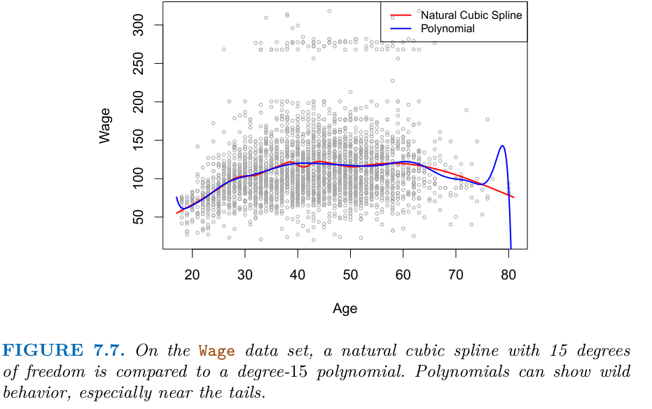

# Feature Engineering and Pipelines

> How you represent the data usually matters more than which model you pick. Encode categoricals, bin or expand numeric features for linear models, select what helps, add what a domain expert knows, and wrap every fitted transformation in a `Pipeline` so cross-validation never sees the test fold.

**In plain words.** A model only sees the columns you give it, so a delivery date means nothing to it until you turn it into something like "day of the week" or "weeks until Christmas". That translating is feature engineering, and at work it's often where the biggest gains come from. The other half of this chapter is keeping the model honest, because like a student who has glimpsed the exam paper, a model that has seen any trace of the test data looks better than it is. A pipeline is the routine that stops that happening.

Blocks run top to bottom from this `notes/` folder. Outputs came from running them; figures attributed to M&G are the book's own.

---

## Why representation matters

[02](02-supervised-learning.md) assumed a clean matrix of continuous numbers. Real tables have categories ("workclass = Private"), dates, counts and text. The best representation depends on the model:

| Model family | Wants |
|---|---|
| Linear models, SVMs, MLPs | Scaled numeric features; expanded features (bins, interactions, polynomials) to fit non-linear shapes |
| Trees and ensembles | Raw features; no scaling; they find interactions themselves |
| kNN | Scaled features, few of them |

---

## Categorical variables

The adult census dataset (M&G ch. 4, [`adult.data`](../practice/intro-to-ml-in-python/data/adult.data)) predicts income > $50k. M&G use six columns: age, workclass, education, gender, hours-per-week and occupation. Four of those are strings.

### One-hot encoding

Replace a column with $k$ categories by $k$ binary columns.

```python
import numpy as np
import pandas as pd
from sklearn.model_selection import train_test_split

cols = ["age", "workclass", "fnlwgt", "education", "education-num", "marital-status",
        "occupation", "relationship", "race", "gender", "capital-gain", "capital-loss",
        "hours-per-week", "native-country", "income"]
adult = pd.read_csv("../practice/intro-to-ml-in-python/data/adult.data", header=None, names=cols,
                    skipinitialspace=True, na_values="?")
data = adult[["age", "workclass", "education", "gender", "hours-per-week", "occupation"]]
y = (adult["income"] == ">50K").astype(int)
print(data.gender.value_counts())    # always check for typos: "Male" vs "male" become separate categories

dummies = pd.get_dummies(data)       # encodes every string column
print(data.shape, "->", dummies.shape)
```

```text
gender
Male      21790
Female    10771
Name: count, dtype: int64
(32561, 6) -> (32561, 42)
```

**Encode train and test together, or with a fitted encoder.** `get_dummies` on train and test separately can produce different columns when a category appears in only one of them.

**Integers can be categories.** A survey answer coded 1–5 or a zip code is categorical even though it looks numeric. `get_dummies` will not encode it unless you convert it to string first.

### OneHotEncoder and ColumnTransformer

The scikit-learn way: a fitted transformer that remembers the categories from training, applied per column.

```python
from sklearn.compose import ColumnTransformer
from sklearn.linear_model import LogisticRegression
from sklearn.preprocessing import OneHotEncoder, StandardScaler

X_train, X_test, y_train, y_test = train_test_split(data, y, stratify=y, random_state=0)

ct = ColumnTransformer([
    ("scaling", StandardScaler(), ["age", "hours-per-week"]),
    ("onehot", OneHotEncoder(sparse_output=False, handle_unknown="ignore"),
               ["workclass", "education", "gender", "occupation"]),
])
X_train_trans = ct.fit_transform(X_train)   # fit categories and scaling on train only
X_test_trans = ct.transform(X_test)          # unseen category -> all zeros (handle_unknown)
logreg = LogisticRegression(max_iter=1000).fit(X_train_trans, y_train)
print(X_train_trans.shape, round(logreg.score(X_test_trans, y_test), 3))
```

```text
(24420, 44) 0.811
```

The base rate is 0.759, so these six columns add real signal. Missing values in `workclass` and `occupation` went through as their own all-zero pattern here; [the boosting note](07-boosting-in-practice.md) compares how libraries treat them natively.

`sparse=` was renamed `sparse_output=` in scikit-learn 1.2 and the old name removed in 1.4; see the migration map in [04](04-model-evaluation.md#scikit-learn-migration-map-020--14).

| Encoding | When |
|---|---|
| One-hot | Few categories; linear models |
| Ordinal (`OrdinalEncoder`) | Categories with an order; tree models |
| Frequency encoding | Very many categories; reads no target, so it also works with no labels, though it merges levels of equal size |
| Target encoding | Very many categories (IDs, zip codes); needs a target, and cross-fitting to avoid leakage, so it [can't be used for clustering](05b-clustering-categorical-and-mixed-data.md#encodings-which-ones-need-a-label); [weight of evidence](../../../data-analytics/06-applied-analyses/notes/02-credit-scoring.md#weight-of-evidence) is a target encoding learned on the training set only |
| Native categorical support | `HistGradientBoostingClassifier(categorical_features=...)`, LightGBM |

---

## Binning, interactions and polynomials

A linear model on one feature fits a line. Three ways to give it more shape:

**Binning** cuts a continuous feature into intervals and one-hot encodes them; the model learns a constant per bin, i.e. a step function.

```python
from sklearn.preprocessing import KBinsDiscretizer
from sklearn.linear_model import LinearRegression
from sklearn.tree import DecisionTreeRegressor

rng = np.random.default_rng(0)                 # a wiggly 1-D toy like M&G's make_wave
x_wave = rng.uniform(-3, 3, size=(200, 1))
y_wave = np.sin(4 * x_wave[:, 0]) + x_wave[:, 0] + rng.normal(0, 0.5, 200)

kb = KBinsDiscretizer(n_bins=10, strategy="uniform", encode="onehot-dense")
x_binned = kb.fit_transform(x_wave)
lin_plain = LinearRegression().fit(x_wave, y_wave).score(x_wave, y_wave)
pred_lin = LinearRegression().fit(x_binned, y_wave).predict(x_binned)
pred_tree = DecisionTreeRegressor(min_samples_leaf=1).fit(x_binned, y_wave).predict(x_binned)
print("line on x R2", round(lin_plain, 3), "| line on bins R2", round(np.corrcoef(pred_lin, y_wave)[0, 1] ** 2, 3))
print("largest gap between linear and tree on bins:", round(np.abs(pred_lin - pred_tree).max(), 6))
```

```text
line on x R2 0.751 | line on bins R2 0.864
largest gap between linear and tree on bins: 0.0
```

The linear model and the decision tree on binned features make *identical* predictions (M&G show the same on `make_wave`): binning gives the linear model the tree's flexibility and does nothing for the tree.

**Interactions** add the product of the bin indicators with the original feature, so each bin gets its own slope.

**Polynomials** add $x^2, x^3, \ldots$ and cross-products:

```python
from sklearn.datasets import load_diabetes
from sklearn.ensemble import RandomForestRegressor
from sklearn.linear_model import Ridge
from sklearn.preprocessing import PolynomialFeatures

d = load_diabetes()
Xd_tr, Xd_te, yd_tr, yd_te = train_test_split(d.data, d.target, random_state=0)
poly = PolynomialFeatures(degree=2, include_bias=False).fit(Xd_tr)
Xp_tr, Xp_te = poly.transform(Xd_tr), poly.transform(Xd_te)
print("features", Xd_tr.shape[1], "->", Xp_tr.shape[1])
for name, m in [("ridge", Ridge(alpha=0.01)), ("forest", RandomForestRegressor(n_estimators=300, random_state=0))]:
    print(name, round(m.fit(Xd_tr, yd_tr).score(Xd_te, yd_te), 3), "->", round(m.fit(Xp_tr, yd_tr).score(Xp_te, yd_te), 3))
```

```text
features 10 -> 65
ridge 0.357 -> 0.366
forest 0.247 -> 0.202
```

M&G see a stronger version of the same pattern on Boston housing: 13 MinMax-scaled features expanded to 105 columns (104 plus the constant), one split of 379 training rows. Ridge improves from 0.621 to 0.753 test $R^2$ and a random forest gets *worse* (0.799 → 0.763). Even with the extra columns, ridge (0.753) does not catch the plain forest (0.799). Expanded features can help linear models and are mostly noise to trees (*Introduction to ML with Python*, ch. 4, "Interactions and polynomials"; the book's `X_train_poly.shape` is `(379, 105)`).

| Technique | Helps | Cost |
|---|---|---|
| Binning | Linear models on low-dim data | Loses within-bin information |
| Interactions | Linear models where effects combine | Feature count grows quadratically |
| Polynomials | Smooth non-linear trends | Extreme values at the edges with high degree; overfitting |
| Splines | Smooth non-linear trends without edge blow-up | Knot placement and degrees of freedom to choose |

**Splines are the safer polynomial.** A global polynomial of high degree is a bad way to buy flexibility, because one wiggle anywhere moves the whole curve. A regression spline fits low-degree pieces joined at knots, constrained to be continuous with continuous first and second derivatives; a cubic spline with $K$ knots costs $K+4$ degrees of freedom, and a natural spline adds the constraint that the fit is linear beyond the boundary knots, which tames the tails. On ISLP's Wage data (males in the central Atlantic region, wage in thousands of dollars on age), a natural cubic spline with 15 degrees of freedom stays sensible at ages above 70 where a degree-15 polynomial swings wildly (*ISLP*, ch. 7, Fig. 7.7).


*Image Source: James et al., *An Introduction to Statistical Learning with Applications in Python* (Springer, 2023), Fig. 7.7*

Ask for degrees of freedom and let the library place the knots at quantiles of the feature: `df=4` puts three interior knots at the 25th, 50th and 75th percentiles of age (33.75, 42 and 51), and ten-fold CV on the same data finds about 3 df enough for a natural spline and about 4 for a cubic one, with a straight line (1 df) inadequate (*ISLP*, ch. 7). Treat the number of degrees of freedom as a hyperparameter inside the pipeline. The same chapter's other devices are a smoothing spline (a roughness penalty replaces knots, effective df falls from $n$ to 2 as $\lambda$ grows; LOOCV chose 6.8 effective df here) and local regression, which the authors warn degrades once there are more than three or four predictors. For several features, a generalised additive model fits $y = \beta_0 + f_1(x_1) + \dots + f_p(x_p)$, one smooth shape per feature, so each effect stays readable but interactions must be added by hand (*ISLP*, ch. 7).

---

## Univariate non-linear transforms

Count data (visits, purchases, word counts) is usually heavily skewed: many small values, a few huge ones. Linear models and neural networks prefer roughly Gaussian features.

```python
# Skewed counts, built the way M&G build theirs: Poisson with a log-normal-ish rate per row
rng = np.random.RandomState(0)
Xc = rng.normal(size=(1000, 3))
w = rng.normal(size=3)
Xc_counts = rng.poisson(10 * np.exp(Xc))
yc = np.dot(Xc, w)
Xc_tr, Xc_te, yc_tr, yc_te = train_test_split(Xc_counts, yc, random_state=0)
print("raw  ", round(Ridge().fit(Xc_tr, yc_tr).score(Xc_te, yc_te), 3))
print("log1p", round(Ridge().fit(np.log1p(Xc_tr), yc_tr).score(np.log1p(Xc_te), yc_te), 3))   # log(x + 1): handles zeros
```

```text
raw   0.622
log1p 0.875
```

These match the 0.622 and 0.875 M&G print for this recipe (*Introduction to ML with Python*, ch. 4, "Univariate nonlinear transformations"; synthetic Poisson counts, 1000 × 3, `log(X + 1)`, ridge).

Other options: `np.sqrt`, `PowerTransformer` (Box-Cox, Yeo-Johnson), `QuantileTransformer`. Transforming the *target* also helps regression on skewed targets (`TransformedTargetRegressor`). Trees ignore monotone transforms of features entirely.

---

## Automatic feature selection

Fewer features means simpler, faster and sometimes more general models. Three strategies, cheapest first:

| Strategy | Class | How |
|---|---|---|
| Univariate statistics | `SelectKBest`, `SelectPercentile` (`f_classif`, `f_regression`, `chi2`, `mutual_info_*`) | Test each feature against the target alone; keep the top |
| Model-based | `SelectFromModel(RandomForestClassifier(), threshold="median")` | Fit a model with importances or L1 coefficients; keep features above a threshold |
| Iterative | `RFE(estimator, n_features_to_select=40)`, `SequentialFeatureSelector` | Fit, drop the weakest feature, refit, repeat |

M&G's experiment adds 50 noise features to the 30 breast-cancer features. Here it is again:

```python
from sklearn.datasets import load_breast_cancer
from sklearn.ensemble import RandomForestClassifier
from sklearn.feature_selection import RFE, SelectFromModel, SelectPercentile
from sklearn.preprocessing import StandardScaler as SS

cancer = load_breast_cancer()
rng = np.random.RandomState(42)
Xn = np.hstack([cancer.data, rng.normal(size=(len(cancer.data), 50))])
Xn_tr, Xn_te, yn_tr, yn_te = train_test_split(Xn, cancer.target, random_state=0, test_size=0.5)
scale = SS().fit(Xn_tr)
Xn_tr, Xn_te = scale.transform(Xn_tr), scale.transform(Xn_te)

def lr_score(tr, te):
    return round(LogisticRegression(max_iter=5000).fit(tr, yn_tr).score(te, yn_te), 3)

print("all 80 features ", lr_score(Xn_tr, Xn_te))
for name, sel in [("univariate 50%  ", SelectPercentile(percentile=50)),
                  ("model-based     ", SelectFromModel(RandomForestClassifier(n_estimators=100, random_state=42), threshold="median")),
                  ("RFE to 40       ", RFE(RandomForestClassifier(n_estimators=100, random_state=42), n_features_to_select=40))]:
    sel.fit(Xn_tr, yn_tr)
    real = sel.get_support()[:30].sum()
    print(name, lr_score(sel.transform(Xn_tr), sel.transform(Xn_te)), "real features kept:", real)
```

```text
all 80 features  0.954
univariate 50%   0.965 real features kept: 26
model-based      0.961 real features kept: 28
RFE to 40        0.986 real features kept: 29
```

Every selector beats keeping the noise, and each kept most of the 30 real features. The book's split (breast cancer plus 50 noise columns, 80 features, 284 training rows, `test_size=.5`, logistic regression) gives 0.930 with everything, 0.940 univariate (50% of features kept) and 0.951 for model-based and RFE (forest of 100 trees, 40 features kept; *Introduction to ML with Python*, ch. 4, "Automatic feature selection"), so the order among selectors moves with the split and only the gain over no selection is stable. Selection only pays off when you suspect many features are noise; with a regularised model on clean data it rarely helps.

The classical, model-aware version of the same idea is subset selection for linear models. Searching every subset costs $2^p$ fits (1,048,576 at $p=20$), forward stepwise costs $1 + p(p+1)/2$ (211 at $p=20$), and exhaustive search is infeasible beyond roughly $p=40$. Forward and best-subset choices can differ even at small size: on ISLP's Credit data they agree up to three predictors and diverge at four. The training error always falls as variables are added, so the size is chosen by an estimate of test error, and the criteria disagree: on Credit, $C_p$ picks six variables, adjusted $R^2$ seven and BIC four, because BIC's penalty $\log(n)\,d\,\hat\sigma^2$ exceeds $C_p$'s $2d\hat\sigma^2$ once $n>7$. Validation and 10-fold CV both pick six there, and the one-standard-error rule (the smallest model within one standard error of the best) picks three (*ISLP*, ch. 6, Credit data, 10 predictors). The criteria need an estimate of the noise variance, so they are not usable when $p \ge n$; there only a held-out or cross-validated error is honest (*ISLP*, ch. 6).

Feature selection is a fitted step. Selecting on all data and then cross-validating is the leakage bug below.

---

## Expert knowledge

The Citi Bike rental series (M&G ch. 4, [`citibike.csv`](../practice/intro-to-ml-in-python/data/citibike.csv)) shows the value of domain features. It counts rentals per 3-hour slot for one station across August 2015, so the first 184 slots train and the rest test, in time order. Start from the raw POSIX timestamp and add what someone who rides a bike knows:

```python
from sklearn.preprocessing import OneHotEncoder as OHE

bikes = pd.read_csv("../practice/intro-to-ml-in-python/data/citibike.csv", parse_dates=["starttime"])
rentals = bikes.set_index("starttime").resample("3h").size()
ts = rentals.index
posix = ((ts - pd.Timestamp("1970-01-01")) // pd.Timedelta("1s")).to_numpy().reshape(-1, 1)
hour = ts.hour.to_numpy().reshape(-1, 1)
hour_week = np.hstack([ts.day_of_week.to_numpy().reshape(-1, 1), hour])
onehot = OHE(sparse_output=False).fit_transform(hour_week)
inter = PolynomialFeatures(degree=2, interaction_only=True, include_bias=False).fit_transform(onehot)
yb = rentals.to_numpy()

def r2(model, F, n=184):
    return round(model.fit(F[:n], yb[:n]).score(F[n:], yb[n:]), 2)

rf = RandomForestRegressor(n_estimators=100, random_state=0)
print(len(yb), "slots")
print("POSIX time, forest     ", r2(rf, posix))
print("hour, forest           ", r2(rf, hour))
print("hour + weekday, forest ", r2(rf, hour_week))
print("hour + weekday, linear ", r2(LinearRegression(), hour_week))
print("one-hot, ridge         ", r2(Ridge(), onehot))
print("one-hot pairs, ridge   ", r2(Ridge(), inter))
```

```text
248 slots
POSIX time, forest      -0.04
hour, forest            0.6
hour + weekday, forest  0.84
hour + weekday, linear  0.13
one-hot, ridge          0.62
one-hot pairs, ridge    0.85
```

The book's runs agree (*Introduction to ML with Python*, ch. 4, "Case study": first 184 slots train, last 64 test, ridge on one-hot hour and weekday with `PolynomialFeatures(degree=2, interaction_only=True)` reaches 0.85 against 0.84 for the forest). A forest on the raw POSIX time scores −0.04 because trees cannot extrapolate past the training range, and the interaction ridge, unlike the forest, has coefficients you can plot per hour and weekday.

The forest on the timestamp has nothing to split on past the training range, so it predicts roughly the last value it saw (trees can't extrapolate; see [02](02-supervised-learning.md#decision-trees)). These reproduce M&G's ladder. Treating weekday and hour as numbers gives the linear model a slope it should not have (0.13), and one-hot encoding repairs it (0.62).

A person who knows bikes are rented on commutes and weekends writes `X_hour_week` in one line; no model discovers it from the raw timestamp. The final ridge model is also readable: one coefficient per hour-of-day-and-weekday cell.

## Text as features

Text becomes a feature matrix the same way a category does: a vectoriser learns a vocabulary from the training split and turns each document into counts (bag of words) or tf-idf weights. That makes it a fitted step, so it belongs in the pipeline. On the 25,000-review IMDb training set M&G get a 25,000 × 74,849 count matrix; logistic regression scores 0.88 mean 5-fold accuracy untuned and 0.89 with `C` tuned (test 0.88). Dropping words seen in fewer than five documents (`min_df=5`) cuts the vocabulary to 27,271 columns with no change in CV score; the built-in 318-word stopword list removes only 305 of them and lowers CV accuracy to 0.88. Bigrams are where the gain is:

```python
pipe = make_pipeline(TfidfVectorizer(min_df=5), LogisticRegression(max_iter=1000))
grid = {"logisticregression__C": [0.001, 0.01, 0.1, 1, 10, 100],
        "tfidfvectorizer__ngram_range": [(1, 1), (1, 2), (1, 3)]}
GridSearchCV(pipe, grid, cv=5).fit(texts_train, y_train)
```

The book's best setting is `ngram_range=(1, 3)` with `C=100` at 0.91 CV accuracy, up from 0.89, and its heat map shows bigrams carry most of the gain and trigrams little (*Introduction to ML with Python*, ch. 7, "Bag-of-words with more than one word"). All figures are one dataset, one classifier and two-decimal scores, so the 0.88 against 0.89 differences between `min_df`, stopwords and tf-idf are not distinguishable. The chapter also notes that cross-validating on pre-vectorised data is safe only because plain `CountVectorizer` learns no statistics beyond the vocabulary; tf-idf does, so use a pipeline. Lemmatisation, topic models and embeddings are covered in the [NLP pillar](../../03-nlp/README.md).

---

## Leakage and why pipelines exist

The classic bug (M&G ch. 6):

```python
from sklearn.model_selection import GridSearchCV
from sklearn.preprocessing import MinMaxScaler
from sklearn.svm import SVC

Xc_tr, Xc_te, ycx_tr, ycx_te = train_test_split(cancer.data, cancer.target, random_state=0)
param_grid = {"C": [0.01, 0.1, 1, 10, 100], "gamma": [0.01, 0.1, 1, 10, 100]}

scaler = MinMaxScaler().fit(Xc_tr)          # fit on ALL training data
wrong = GridSearchCV(SVC(), param_grid, cv=5).fit(scaler.transform(Xc_tr), ycx_tr)
print("best CV with leaked scaler:", round(wrong.best_score_, 3))
```

```text
best CV with leaked scaler: 0.981
```

Inside each CV split, the validation fold was already used to fit the scaler. The CV score is optimistic because the "unseen" data shaped the preprocessing. With scaling the bias is small. With feature selection it is enormous, as M&G show: select the top 5% of 10,000 *pure-noise* features against random targets, then cross-validate ridge.

```python
from sklearn.feature_selection import f_regression
from sklearn.model_selection import cross_val_score
from sklearn.pipeline import Pipeline

rnd = np.random.RandomState(42)
Xnoise = rnd.normal(size=(100, 10000))
ynoise = rnd.normal(size=100)              # no relation to X at all

selected = SelectPercentile(f_regression, percentile=5).fit(Xnoise, ynoise).transform(Xnoise)
print("select, then CV:", round(cross_val_score(Ridge(), selected, ynoise, cv=5).mean(), 2))

pipe = Pipeline([("select", SelectPercentile(f_regression, percentile=5)), ("ridge", Ridge())])
print("CV the pipeline:", round(cross_val_score(pipe, Xnoise, ynoise, cv=5).mean(), 2))
```

```text
select, then CV: 0.89
CV the pipeline: -0.03
```

The correct answer is that there is no signal, and a score below zero says so. Selecting outside the loop reported a strong model on random numbers. The book's run of the same recipe (100 × 10,000 Gaussian noise, `SelectPercentile` at 5%, ridge, 5-fold) gets 0.91 outside the loop and −0.25 inside a `Pipeline` (*Introduction to ML with Python*, ch. 6, "Information leakage"). The book is candid that the scaler version of the bug is usually mild: on breast cancer, scaling outside the loop reports CV 0.98 against 0.97 test, and the pipeline gives the same 0.97 test score and the same best `C` and `gamma`. Leakage through selection or feature extraction, which learns from the target or from structure in the data, is the one that can be large.

**Rule:** any step with a `fit` (scaling, imputation, encoding, selection, PCA, target encoding, vectorising text) must be refit inside each fold. A `Pipeline` does that for you. Resampling is the same kind of step: in [note 10](10-imbalance-errors-and-drift.md#the-leak-resampling-before-you-split), SMOTE before the split reports a ROC-AUC of 0.98 for a model that truly scores 0.70.

McKinney calls such steps *stateful transformations*: Patsy's `standardize(x0)` and `center(x1)` must reuse the training mean and standard deviation on new rows, which `patsy.build_design_matrices([X.design_info], new_data)` does. His worked case also shows the pitfall. On the Titanic training file (177 training rows and 86 test rows lack `Age`) he fills `Age` with the training median, then fits logistic regression on `Pclass`, `IsFemale` and `Age`. Four-fold CV with `C=10` scores 0.7723, 0.8027, 0.7703 and 0.7883 (mean 0.783). The median was computed on all training rows before the folds were cut, so every fold's validation rows helped set it. For a median that leak is tiny, but the clean version puts `SimpleImputer(strategy="median")` inside a `Pipeline`. The book makes no claim that the features are good (*Python for Data Analysis*, ch. 13).

---

## Pipelines

A pipeline chains transformers and a final estimator into one estimator, so `fit`, `predict`, `score` and cross-validation treat the whole chain as one model. The scikit-learn paper gives this two sentences: a `Pipeline` "behaves as a standard estimator", so `GridSearchCV` can tune all its steps ([arXiv:1201.0490](https://arxiv.org/abs/1201.0490), Pedregosa et al., JMLR 2011). It sells that as convenience and never mentions leakage. The case for pipelines in the section above is M&G's.


*Image source: Müller & Guido, Introduction to Machine Learning with Python, companion repo `images/pipeline.png`*

```python
from sklearn.pipeline import make_pipeline

pipe = Pipeline([("scaler", MinMaxScaler()), ("svm", SVC())])
param_grid = {"svm__C": [0.01, 0.1, 1, 10, 100],      # <step name>__<parameter>
              "svm__gamma": [0.01, 0.1, 1, 10, 100]}
grid = GridSearchCV(pipe, param_grid, cv=5).fit(Xc_tr, ycx_tr)
print(round(grid.best_score_, 3), round(grid.score(Xc_te, ycx_te), 3), grid.best_params_)

# make_pipeline names steps automatically: "minmaxscaler", "svc"
pipe_short = make_pipeline(MinMaxScaler(), SVC(C=100))
print(list(pipe_short.named_steps))
```

```text
0.981 0.972 {'svm__C': 1, 'svm__gamma': 1}
['minmaxscaler', 'svc']
```

**Accessing steps.** `pipe.named_steps["logisticregression"].coef_` for a fitted pipeline; inside a grid search, `grid.best_estimator_.named_steps[...]`.

### Grid-searching the preprocessing too

On Boston housing, a `StandardScaler`, `PolynomialFeatures` and `Ridge` pipeline searched over degree 1–3 and `alpha` picks degree 2 with `alpha=10` and scores 0.77 test $R^2$, against 0.63 without the polynomial step; degree 3 is clearly worse in the CV heat map (*Introduction to ML with Python*, ch. 6, "Grid-searching preprocessing steps"). Parameters are addressed as `step__param`, and `make_pipeline` names a step by its lower-cased class name, adding `-1`, `-2` for duplicates.

The preprocessing has hyperparameters as well, and you can search them jointly with the model's:

```python
pipe = make_pipeline(StandardScaler(), PolynomialFeatures(), Ridge())
param_grid = {"polynomialfeatures__degree": [1, 2, 3],
              "ridge__alpha": [0.001, 0.01, 0.1, 1, 10, 100]}
grid = GridSearchCV(pipe, param_grid, cv=5).fit(Xd_tr, yd_tr)
print(grid.best_params_, round(grid.score(Xd_te, yd_te), 3))
```

```text
{'polynomialfeatures__degree': 1, 'ridge__alpha': 10} 0.358
```

On the diabetes data the search finds no reason to expand, while M&G's Boston run settles on degree 2 with `alpha=10`. Let the search decide.

You can even search *which* steps to use by treating a step as a parameter:

```python
pipe = Pipeline([("preprocessing", StandardScaler()), ("classifier", SVC())])
param_grid = [
    {"classifier": [SVC()], "preprocessing": [StandardScaler(), None],
     "classifier__gamma": [0.001, 0.01, 0.1, 1],
     "classifier__C": [0.1, 1, 10, 100]},
    {"classifier": [RandomForestClassifier(n_estimators=100)],
     "preprocessing": [None], "classifier__max_features": [1, 2, 3]},
]
grid = GridSearchCV(pipe, param_grid, cv=5).fit(Xc_tr, ycx_tr)
print(grid.best_params_["classifier"], round(grid.score(Xc_te, ycx_te), 3))
```

```text
SVC() 0.979
```

`Pipeline(memory="cache_dir")` caches fitted transformers so a grid search doesn't refit an expensive step for every model parameter.

### The general interface

Every step except the last must have `fit` and `transform`. The last needs `fit` and, depending on use, `predict`, `score` or `transform`. Internally, `pipeline.fit` calls `fit_transform` on each step in turn and passes the output on; `predict` calls `transform` on each step and `predict` on the last.

---

## Rules

| Rule | Why |
|---|---|
| Put every fitted preprocessing step in a pipeline | Leakage, and the pipeline is what you deploy |
| Use `ColumnTransformer` for mixed-type tables | One object holds the per-column logic |
| `handle_unknown="ignore"` in production encoders | New categories appear after deployment |
| Expand features for linear models, not for trees | Trees find interactions; extra features are noise to them |
| Log-transform skewed counts | Linear models and NNs assume roughly symmetric inputs |
| Try a domain feature before a bigger model | Citi Bike: hour + weekday beat every model on the timestamp |

---

## Practice

| Notebook | Covers | Runs |
|---|---|---|
| [`04-representing-data-feature-engineering.ipynb`](../practice/intro-to-ml-in-python/04-representing-data-feature-engineering.ipynb) | Encoding, binning, polynomials, transforms, selection, Citi Bike | Offline; `scikit-learn>=1.4`, local `mglearn`; data in `data/` |
| [`06-algorithm-chains-and-pipelines.ipynb`](../practice/intro-to-ml-in-python/06-algorithm-chains-and-pipelines.ipynb) | Leakage, pipelines, grid search over pipelines | Offline; same |

---

## Pitfalls

| Pitfall | Symptom | Fix |
|---|---|---|
| Fitting a scaler, selector or encoder on all the data | CV score is higher than the score on truly new data, and far higher with feature selection | Put the step in a `Pipeline` and cross-validate the pipeline |
| `get_dummies` on train and test separately | Shape mismatch at predict time, or columns in a different order | Use a fitted `OneHotEncoder` with `handle_unknown="ignore"` |
| Numeric codes treated as numbers | A linear model learns a slope across zip codes | Convert to string or list the column in the one-hot step |
| Stray whitespace in categories | " Private" and "Private" become two columns | Check `value_counts()`; `skipinitialspace=True` when reading |
| Polynomials with high degree | Wild predictions at the edges of the range | Scale first, keep degree low, regularise |
| A random split on time data | The forecast looks excellent and then fails | Split in time order, as the Citi Bike block does; a [rolling-origin backtest](../../../data-analytics/06-applied-analyses/notes/01-forecasting.md#backtest-because-one-split-is-one-anecdote) repeats that across many dates |

## Try it

1. Add `native-country` to the `ColumnTransformer` on adult. Does the accuracy change, and how many columns did it cost?
2. In the Citi Bike block, add one-hot `hour` only (no weekday) to ridge and compare with the ladder.
3. Rerun the pure-noise experiment with `percentile=1` and with 1,000 rather than 10,000 features. Which way does the leaked score move?
4. Replace `StandardScaler` with `MinMaxScaler` in the adult transformer. Does logistic regression care?

<details>
<summary>Answers</summary>

1. On this split the accuracy stays at 0.811 and the matrix grows from 44 to 86 columns: country is mostly one value, so it holds little signal for this model.
2. Ridge on hour alone cannot see weekends, so it falls well short of the row with the weekday. The interaction row is where the commute peaks get to differ across days.
3. Print it. Fewer selected features or fewer features to choose from both lower the chance of spurious correlation, so the leaked score falls, while the pipeline's stays around zero or below.
4. Barely, because both bring the two numeric columns to a comparable range. The point of a scaler here is to stop `age` and hours from swamping the 0/1 columns.

</details>

## Interview checklist

| Question | Answer |
|---|---|
| Why does representation matter more than the model? | It sets what any model can see; a domain feature can beat a stronger model on raw input, as Citi Bike shows |
| One-hot vs ordinal vs target encoding? | One-hot for few categories and linear models; ordinal for ordered or tree use; target encoding for high cardinality, with cross-fitting |
| What is data leakage? | Information from the validation or test data reaching training, through preprocessing, features or the split |
| Why must a scaler be inside CV? | Its statistics otherwise include the validation fold, so CV scores are optimistic |
| Why do pipelines matter beyond leakage? | The fitted chain is the artefact you deploy, and you can tune preprocessing jointly with the model |
| When does feature selection help? | When many features are noise. A regularised model on clean data rarely gains |
| Why do polynomials help linear models and not trees? | Trees already cut in any shape and find interactions; expanded columns only add noise to them |
| Why log-transform counts? | Skewed inputs let a few huge values dominate a linear fit; log1p makes them more symmetric and handles zeros |
| What does `handle_unknown="ignore"` do? | Encodes an unseen category as all zeros, so production data doesn't crash |
| Which preprocessing steps must be refit inside each fold? | Any step with a `fit`: scaling, imputation, encoding, selection, PCA, target encoding, vectorising text. A `Pipeline` does that for you. |

## Next

[Model evaluation](04-model-evaluation.md): cross-validation, grid search and metrics that match the business question.
