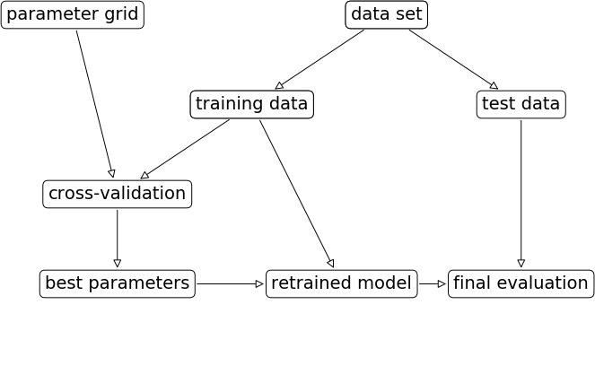

# Model Evaluation

> A model scored 90%. Is that good? This note gives the machinery to answer: cross-validation instead of one split, grid search with a held-out test set (or nested CV), a metric chosen from the business consequence of each error type, thresholds read off precision–recall and ROC curves, and learning curves to decide whether you need more data or a different model.

This is the layer interviews probe hardest: metric interpretation, train/test discipline and leakage are the most common failure modes. Blocks run top to bottom from this `notes/` folder.

---

## Cross-validation

A single `train_test_split` gives a score that depends on which points landed in the test set. **k-fold cross-validation** splits the data into $k$ folds, trains $k$ models each holding out one fold, and reports $k$ scores.

```python
from sklearn.model_selection import cross_val_score, cross_validate
from sklearn.linear_model import LogisticRegression
from sklearn.datasets import load_iris

iris = load_iris()
logreg = LogisticRegression(max_iter=1000)
scores = cross_val_score(logreg, iris.data, iris.target, cv=5)
print(scores.round(3), round(scores.mean(), 3))

res = cross_validate(logreg, iris.data, iris.target, cv=5, return_train_score=True)
print(sorted(res))
```

```text
[0.967 1.    0.933 0.967 1.   ] 0.973
['fit_time', 'score_time', 'test_score', 'train_score']
```

What CV buys:

- Every point is in a test fold exactly once, so the estimate doesn't depend on a lucky split.
- The **spread** of fold scores says how sensitive the model is to the training data. A range of 0.90–1.00 means "about 95%, give or take."
- More data is used for training: 80% per model at `cv=5` vs 75% for the default split.

What it doesn't do: return a model. `cross_val_score` evaluates a *procedure*; refit on all the data for the final model.

### Splitters

| Splitter | When | Note |
|---|---|---|
| `KFold(n_splits, shuffle=True)` | Regression; data in random order | Without `shuffle`, ordered data (iris is sorted by class) gives 0% folds |
| `StratifiedKFold` | Classification (the default for classifiers) | Keeps class proportions in each fold |
| `LeaveOneOut` | Very small data | $n$ fits; high-variance estimate |
| `ShuffleSplit`, `StratifiedShuffleSplit` | Control train/test sizes and repeats independently; subsample large data | |
| `GroupKFold` | Several rows per subject (patient, user, speaker) | The same group is never in train and test; otherwise you measure memorisation of the person |
| `TimeSeriesSplit` | Temporal data | Always train on the past, test on the future |
| `RepeatedStratifiedKFold` | Small data; want a tighter estimate | |

**The groups rule generalises:** the split must mirror how the model meets new data in production. New users → split by user. Next month → split by time.

---

## Grid search

Hyperparameters (`C`, `gamma`, `max_depth`) are not learned by `fit`. Search them, but the score you used to pick them is no longer an honest estimate.


*Image source: Müller & Guido, Introduction to Machine Learning with Python, companion repo `images/`*

The three-way split from [01](01-statistical-foundations.md): pick parameters on validation, report on test once.

```python
from sklearn.model_selection import GridSearchCV, train_test_split
from sklearn.svm import SVC

X_train, X_test, y_train, y_test = train_test_split(iris.data, iris.target, random_state=0)
param_grid = {"C": [0.001, 0.01, 0.1, 1, 10, 100],
              "gamma": [0.001, 0.01, 0.1, 1, 10, 100]}
grid = GridSearchCV(SVC(), param_grid, cv=5, return_train_score=True)
grid.fit(X_train, y_train)               # CV on train only; then refits best on all of train

print(grid.best_params_)
print(round(grid.best_score_, 3))        # mean CV score: optimistic, used for selection
print(round(grid.score(X_test, y_test), 3))   # the honest number
```

```text
{'C': 10, 'gamma': 0.1}
0.973
0.974
```

### Reading the results

`pd.DataFrame(grid.cv_results_)` has one row per parameter combination. Pivot the mean test score into a $C \times \gamma$ heatmap:

| Heatmap shows | Meaning | Action |
|---|---|---|
| Best values in the interior | Range is right | Refine around the best |
| Best values on an edge | The optimum may be outside | Extend the range |
| Flat, no change | Parameter doesn't matter, or the scale is wrong | Change scale (log), or drop it |

Search parameters on a **log scale** (0.001, 0.01, …). A list of dicts lets you search conditional spaces, e.g. `gamma` only for `kernel="rbf"`.

```python
cond_grid = [{"kernel": ["rbf"], "C": [0.01, 0.1, 1, 10, 100], "gamma": [0.01, 0.1, 1, 10]},
             {"kernel": ["linear"], "C": [0.01, 0.1, 1, 10, 100]}]
print(GridSearchCV(SVC(), cond_grid, cv=5).fit(X_train, y_train).best_params_)
```

```text
{'C': 10, 'gamma': 0.1, 'kernel': 'rbf'}
```

`RandomizedSearchCV` samples from distributions (`scipy.stats.loguniform`) instead of a grid; with many parameters it finds good regions in far fewer fits. `HalvingGridSearchCV` (experimental) discards poor candidates early.

### Nested cross-validation

When you have no separate test set, wrap the grid search in an outer CV:

```python
scores = cross_val_score(GridSearchCV(SVC(), param_grid, cv=5), iris.data, iris.target, cv=5)
print(round(scores.mean(), 3))   # an estimate of how well "grid search over SVC" generalises
```

```text
0.98
```

5 × 5 × 36 = 900 fits. It evaluates the model *selection procedure*, not one model. `n_jobs=-1` parallelises.

Why bother: Varma and Simon built "null" datasets of 40 samples with no signal, so the true error of any classifier was 50%, and tuned two classifiers by minimising CV error. The minimum CV error averaged 37.8% for shrunken centroids and 41.7% for an SVM, and on more than one-fifth of datasets the optimism exceeded 20 points. Nested CV gave an almost unbiased estimate, with a slight pessimism from training on 39 samples rather than 40 ([doi:10.1186/1471-2105-7-91](https://doi.org/10.1186/1471-2105-7-91), BMC Bioinformatics 2006).

---

## Metrics: keep the end goal in mind

Accuracy treats every mistake the same. Business consequences rarely do.

| Error | Also called | Cancer screening | Spam filter |
|---|---|---|---|
| False positive | Type I | Healthy patient sent for more tests (cost, stress) | Real email lost in spam (bad) |
| False negative | Type II | Cancer missed (very bad) | Spam in the inbox (annoying) |

### Imbalanced data and the dummy baseline

On the digits dataset relabelled "is it a 9?" (10% positives), a classifier that always says "not 9" scores 90% accuracy.

```python
from sklearn.datasets import load_digits
from sklearn.dummy import DummyClassifier
from sklearn.tree import DecisionTreeClassifier

digits = load_digits()
X_train, X_test, y_train, y_test = train_test_split(digits.data, digits.target == 9, random_state=0)

models = {"most_frequent": DummyClassifier(strategy="most_frequent"),
          "stratified": DummyClassifier(strategy="stratified", random_state=0),   # random by class rate
          "tree depth 2": DecisionTreeClassifier(max_depth=2, random_state=0),
          "logistic": LogisticRegression(C=0.1, max_iter=2000)}
for name, m in models.items():
    print(name, round(m.fit(X_train, y_train).score(X_test, y_test), 3))
```

```text
most_frequent 0.896
stratified 0.802
tree depth 2 0.918
logistic 0.984
```

Only the last is clearly useful.

Always compare against a dummy. If accuracy barely beats it, accuracy is the wrong metric.

### Confusion matrix, precision, recall, F1

```python
from sklearn.metrics import confusion_matrix, classification_report

clf = models["logistic"]
pred = clf.predict(X_test)
print(confusion_matrix(y_test, pred))    # [[TN FP], [FN TP]]
print(classification_report(y_test, pred, target_names=["not nine", "nine"]))
```

```text
[[402   1]
 [  6  41]]
              precision    recall  f1-score   support

    not nine       0.99      1.00      0.99       403
        nine       0.98      0.87      0.92        47

    accuracy                           0.98       450
   macro avg       0.98      0.93      0.96       450
weighted avg       0.98      0.98      0.98       450
```

| Metric | Formula | Answers | Optimise when |
|---|---|---|---|
| Accuracy | $(TP+TN)/n$ | Fraction right | Balanced classes, symmetric costs |
| Precision (PPV) | $TP/(TP+FP)$ | Of those flagged, how many are real? | False positives are costly (drug trials, spam) |
| Recall (sensitivity, TPR) | $TP/(TP+FN)$ | Of the real ones, how many did we catch? | False negatives are costly (cancer, fraud) |
| Specificity | $TN/(TN+FP)$ | Of the negatives, how many did we leave alone? | |
| FPR | $FP/(FP+TN)$ | | The x-axis of ROC |
| F1 | $2PR/(P+R)$ | Harmonic mean of P and R | One number for an imbalanced positive class |
| $F_\beta$ | weights recall $\beta$ times | | Asymmetric preference |

The dummy "always not-nine" has accuracy 0.90 and F1 0.00 on the positive class. F1 exposes it.

---

## Threshold, precision–recall and ROC

`predict` thresholds `decision_function` at 0 or `predict_proba` at 0.5 ([02](02-supervised-learning.md#uncertainty-estimates)). Moving the threshold trades precision for recall without retraining.

```python
from sklearn.metrics import precision_score, recall_score

svc = SVC(gamma=0.001).fit(X_train, y_train)
for t in [0, -0.8]:                      # a lower threshold catches more positives
    p = svc.decision_function(X_test) > t
    print(t, "precision", round(precision_score(y_test, p), 3), "recall", round(recall_score(y_test, p), 3))
```

```text
0 precision 0.978 recall 0.936
-0.8 precision 0.758 recall 1.0
```

**Never pick the threshold on the test set.** Use a validation set or CV; `TunedThresholdClassifierCV` (scikit-learn 1.5) does this for you.

### Precision–recall curve

```python
from sklearn.ensemble import RandomForestClassifier
from sklearn.metrics import precision_recall_curve, average_precision_score

rf = RandomForestClassifier(n_estimators=100, random_state=0).fit(X_train, y_train)
precision, recall, thresholds = precision_recall_curve(y_test, svc.decision_function(X_test))
print(len(thresholds), "thresholds on the curve")
print("AP svc", round(average_precision_score(y_test, svc.decision_function(X_test)), 3),
      "rf", round(average_precision_score(y_test, rf.predict_proba(X_test)[:, 1]), 3))   # area under the PR curve
```

```text
450 thresholds on the curve
AP svc 0.997 rf 0.979
```

The closer the curve hugs the top right, the better. Average precision summarises it; with heavy imbalance it is more informative than ROC AUC, because it ignores the large pool of true negatives. Davis and Goadrich prove the two spaces are linked, in that one curve dominates another in ROC exactly when it dominates in PR, but that optimising AUC-ROC does not guarantee optimising the area under the PR curve, and that straight-line interpolation between PR points is invalid ([doi:10.1145/1143844.1143874](https://doi.org/10.1145/1143844.1143874), ICML 2006). Never draw a PR curve by connecting a handful of points with lines.

### ROC curve and AUC

```python
from sklearn.metrics import roc_curve, roc_auc_score

fpr, tpr, thresholds = roc_curve(y_test, svc.decision_function(X_test))
print("AUC svc", round(roc_auc_score(y_test, svc.decision_function(X_test)), 3),
      "rf", round(roc_auc_score(y_test, rf.predict_proba(X_test)[:, 1]), 3))
```

```text
AUC svc 1.0 rf 0.995
```

ROC plots TPR against FPR over all thresholds. **AUC** is the probability that a random positive gets a higher score than a random negative: 0.5 is chance, 1.0 is perfect ranking. A random predictor always scores 0.5 regardless of class balance, which makes AUC a better model-selection metric than accuracy on imbalanced data.

On M&G's digits "is it a 9?" example, SVMs with `gamma` 1, 0.1 and 0.01 all have accuracy 0.90 (the dummy rate), but AUC 0.50, 0.90 and 1.00. The model with `gamma=0.01` ranks perfectly; only the default threshold is wrong.

### The running example: adult census

The same questions on the pillar's table, using a one-hot logistic regression as the first honest model. Who is flagged as a high earner, and what does that cost?

```python
import numpy as np
import pandas as pd
from sklearn.compose import make_column_selector, make_column_transformer
from sklearn.pipeline import make_pipeline
from sklearn.preprocessing import OneHotEncoder, StandardScaler

cols = ["age", "workclass", "fnlwgt", "education", "education-num", "marital-status",
        "occupation", "relationship", "race", "gender", "capital-gain", "capital-loss",
        "hours-per-week", "native-country", "income"]
adult = pd.read_csv("../practice/intro-to-ml-in-python/data/adult.data", header=None, names=cols,
                    skipinitialspace=True, na_values="?").drop(columns=["fnlwgt", "education"])
ya = (adult.pop("income") == ">50K").astype(int)
Xa_dev, Xa_test, ya_dev, ya_test = train_test_split(adult, ya, stratify=ya, test_size=0.2, random_state=0)
Xa_tr, Xa_val, ya_tr, ya_val = train_test_split(Xa_dev, ya_dev, stratify=ya_dev, test_size=0.25, random_state=0)

prep = make_column_transformer(
    (StandardScaler(), make_column_selector(dtype_include="number")),
    (OneHotEncoder(handle_unknown="ignore"), make_column_selector(dtype_exclude="number")))
adult_clf = make_pipeline(prep, LogisticRegression(max_iter=2000)).fit(Xa_tr, ya_tr)

base = ya_test.mean()
s_val, s_test = adult_clf.predict_proba(Xa_val)[:, 1], adult_clf.predict_proba(Xa_test)[:, 1]
print("dummy accuracy", round(1 - base, 3), "| model accuracy", round(adult_clf.score(Xa_test, ya_test), 3))
print("AUC", round(roc_auc_score(ya_test, s_test), 3), "| AP", round(average_precision_score(ya_test, s_test), 3),
      "(AP of a random ranker is the base rate,", round(base, 3), ")")

# Business rule: of those we flag, at least 80% must really be high earners.
# Pick the threshold on validation, then report on test once.
p, r, t = precision_recall_curve(ya_val, s_val)
thr = t[np.argmax(p[:-1] >= 0.80)]
for name, yy, ss in [("default 0.5", ya_test, s_test >= 0.5), (f"tuned {thr:.2f}", ya_test, s_test >= thr)]:
    print(name, "precision", round(precision_score(yy, ss), 3), "recall", round(recall_score(yy, ss), 3))
```

```text
dummy accuracy 0.759 | model accuracy 0.847
AUC 0.901 | AP 0.754 (AP of a random ranker is the base rate, 0.241 )
default 0.5 precision 0.725 recall 0.584
tuned 0.61 precision 0.783 recall 0.484
```

Accuracy says the model is about nine points better than always answering "low earner". AUC and AP say the ranking is strong. The threshold lines say what that means for a decision: holding the flagged group to about 80% precision costs about a tenth of recall, and the validation target of 0.80 came out at 0.783 on test, because a threshold picked on one sample is itself an estimate.

| Curve | Axes | Use when |
|---|---|---|
| Precision–recall | P vs R | Positive class rare; you care about the flagged set |
| ROC | TPR vs FPR | Ranking quality overall; balanced-ish data |

### Calibration: is a 0.8 really 80%?

Thresholds and expected-cost decisions assume `predict_proba` means what it says. Check with a reliability diagram and fix with a held-out recalibration:

```python
from sklearn.calibration import CalibratedClassifierCV, calibration_curve
from sklearn.metrics import brier_score_loss
from sklearn.naive_bayes import GaussianNB

Xn_tr, Xn_te = prep.fit_transform(Xa_dev).toarray(), prep.transform(Xa_test).toarray()
nb = GaussianNB().fit(Xn_tr, ya_dev)
cal = CalibratedClassifierCV(GaussianNB(), method="isotonic", cv=5).fit(Xn_tr, ya_dev)   # "sigmoid" is Platt, for less data
for name, m in [("naive Bayes", nb), ("recalibrated", cal)]:
    prob = m.predict_proba(Xn_te)[:, 1]
    frac, mean = calibration_curve(ya_test, prob, n_bins=5)     # the numbers a reliability diagram plots
    print(name, "Brier", round(brier_score_loss(ya_test, prob), 3), "| predicted", mean.round(2), "| actual", frac.round(2))
```

```text
naive Bayes Brier 0.45 | predicted [0.   0.31 0.48 0.7  1.  ] | actual [0.03 0.04 0.   0.   0.34]
recalibrated Brier 0.143 | predicted [0.06 0.3  0.43] | actual [0.05 0.13 0.49]
```

Gaussian naive Bayes on a one-hot table is a deliberately bad case: its scores pile up at 0 and 1, and only a third of the 1.0 bin is positive. Recalibration brings the Brier score down from 0.45 to 0.143 and the predicted probabilities much nearer to what happens, without touching how the model ranks in any large way. Niculescu-Mizil and Caruana established the shape of the table below by comparing ten learners' probabilities ([doi:10.1145/1102351.1102430](https://doi.org/10.1145/1102351.1102430), ICML 2005).

| Model | Typical miscalibration |
|---|---|
| Logistic regression | Usually well calibrated |
| Naive Bayes | Pushed towards 0 and 1 |
| SVM (`decision_function`), boosted trees | Sigmoid-shaped distortion |
| Random forest | Pulled away from 0 and 1 |
| Deep networks | Overconfident; temperature scaling (one scalar on the logits) fixes most of it |

Deep networks made calibration a live research question. Guo et al. found modern deep nets overconfident ([arXiv:1706.04599](https://arxiv.org/abs/1706.04599), ICML 2017). On CIFAR-100 a 5-layer LeNet's confidence matched its accuracy, while a 110-layer ResNet was more accurate but much more confident than it was right. Depth, width, weight decay and batch norm all moved calibration. Of the post-hoc fixes they tested, temperature scaling (a one-parameter Platt scaling) worked best on most datasets. Minderer et al. revisit this and find recent non-convolutional architectures (vision transformers, MLP-Mixer) among the best calibrated, with architecture mattering more than size ([arXiv:2106.07998](https://arxiv.org/abs/2106.07998), NeurIPS 2021).

---

## Multiclass and regression metrics

**Multiclass.** The confusion matrix is $K \times K$; read the off-diagonals for which classes are confused. F1 per class, averaged:

| Average | Weights | Use when |
|---|---|---|
| `macro` | Every class equally | Small classes matter as much as large |
| `weighted` | By class support | Default in `classification_report` |
| `micro` | Every sample equally (= accuracy for single-label) | Each sample matters equally |

**Regression.** $R^2$ (default `score`) is fine for model comparison. For reporting, use a unit the business understands: MAE (robust to outliers), RMSE (penalises big misses), MAPE (relative error; undefined at zero).

---

## Using a metric in model selection

Pass `scoring` to CV and grid search; the default is accuracy (classifiers) or $R^2$ (regressors).

```python
gamma_grid = {"gamma": [0.0001, 0.01, 0.1, 1, 10]}
for scoring in ["accuracy", "roc_auc"]:
    g = GridSearchCV(SVC(), gamma_grid, scoring=scoring).fit(X_train, y_train)
    print(scoring, g.best_params_, "test AUC", round(roc_auc_score(y_test, g.decision_function(X_test)), 3))

from sklearn.metrics import get_scorer_names
print(len(get_scorer_names()), "scorers, e.g.", [s for s in get_scorer_names() if s.startswith("neg_mean")][:2])
```

```text
accuracy {'gamma': 0.0001} test AUC 0.992
roc_auc {'gamma': 0.01} test AUC 1.0
58 scorers, e.g. ['neg_mean_absolute_error', 'neg_mean_absolute_percentage_error']
```

The two scorers pick different winners, as they do on M&G's split (test AUC 0.92 against 1.00 there). Choose the scorer before you search.

Error metrics are negated (`neg_mean_absolute_error`) because scikit-learn always maximises.

---

## Learning curves and bias-variance diagnosis

Ng's ex5 makes the diagnosis from [01](01-statistical-foundations.md#bias-variance-and-model-complexity) operational. Fit regularised linear regression on the water-level/dam-outflow data with an increasing number of training examples; plot training error and cross-validation error against $m$.

```python
# Ng ex5, vectorised: regularised linear regression cost and learning curve
def compute_cost(theta, X, y, lam=0.0):
    m = len(y)
    err = X @ theta - y
    return (err @ err) / (2 * m) + lam / (2 * m) * (theta[1:] @ theta[1:])

def fit(X, y, lam=0.0):                                  # closed form; ex5 uses scipy.optimize
    reg = lam * np.eye(X.shape[1]); reg[0, 0] = 0
    return np.linalg.pinv(X.T @ X + reg) @ X.T @ y

def ng_learning_curve(X, y, Xval, yval, lam=0.0):
    train_err, val_err = [], []
    for i in range(1, len(y) + 1):
        theta = fit(X[:i], y[:i], lam)
        train_err.append(compute_cost(theta, X[:i], y[:i], 0.0))   # report errors WITHOUT the penalty
        val_err.append(compute_cost(theta, Xval, yval, 0.0))
    return train_err, val_err

from scipy.io import loadmat
ex5 = loadmat("../practice/ng-machine-learning/ex5/data/ex5data1.mat")
Xe, ye, Xev, yev = ex5["X"], ex5["y"].ravel(), ex5["Xval"], ex5["yval"].ravel()
ones = lambda a: np.c_[np.ones(len(a)), a]
tr, va = ng_learning_curve(ones(Xe), ye, ones(Xev), yev)
print("m        ", list(range(2, 13, 2)))
print("train err", np.round(tr[1::2], 1))
print("val err  ", np.round(va[1::2], 1))
```

```text
m         [2, 4, 6, 8, 10, 12]
train err [ 0.   2.8 19.4 18.2 23.3 22.4]
val err   [110.3  48.4  33.8  30.9  28.9  29.4]
```

Both errors level off together, high: the straight line is too simple, and more data will not fix it.

| Curve shape | Diagnosis | More data helps? | Fix |
|---|---|---|---|
| Train and val error both high, converge quickly | High bias (underfit): ex5's straight line | No | More features (ex5: degree-8 polynomial), less regularisation, bigger model |
| Train error low, large gap to val error | High variance (overfit): ex5's polynomial with $\lambda = 0$ | Yes | More data, more regularisation, fewer features |
| Both low, small gap | Good fit | Marginal | Ship it |

Ex5 then selects $\lambda$ on the validation set: sweep $\lambda \in \{0, 0.001, \ldots, 10\}$, pick the one with lowest validation error ($\lambda \approx 3$), report test error once. That is grid search written out by hand.

scikit-learn's version:

```python
from sklearn.datasets import load_diabetes
from sklearn.linear_model import Ridge
from sklearn.model_selection import learning_curve

X, y = load_diabetes(return_X_y=True)
sizes, train_scores, val_scores = learning_curve(Ridge(alpha=1), X, y, cv=5,
                                                 train_sizes=np.linspace(0.2, 1.0, 5))
print(sizes, train_scores.mean(axis=1).round(2), val_scores.mean(axis=1).round(2))
# validation_curve sweeps one hyperparameter instead of training size
```

```text
[ 70 141 211 282 353] [0.19 0.29 0.36 0.41 0.43] [0.14 0.28 0.35 0.39 0.41]
```

---

## Rules

| Rule | Why |
|---|---|
| Report a test score exactly once, after all choices | Every look at it is a choice that leaks |
| Split the way production meets data (groups, time) | Otherwise CV measures memorisation |
| Compare against `DummyClassifier` first | 90% accuracy can be zero skill |
| Choose the metric from the cost of each error type | Accuracy assumes FP and FN cost the same |
| Use AUC or average precision for model selection on imbalanced data; tune the threshold separately | Ranking quality and operating point are separate decisions |
| Plot a learning curve before collecting more data | It tells you whether more data can help |
| Search hyperparameters on a log scale, check the best isn't on an edge | |

---

## scikit-learn migration map (0.20 → 1.4)

The vendored M&G notebooks were written against scikit-learn 0.20. This repo's copies were updated for 1.4+ (#35) and `environment.yml` pins `scikit-learn>=1.4`.

| Old API | New API | Changed in |
|---|---|---|
| `from sklearn.cross_validation import ...` | `from sklearn.model_selection import ...` | Removed 0.20 |
| `from sklearn.grid_search import GridSearchCV` | `from sklearn.model_selection import GridSearchCV` | Removed 0.20 |
| `DummyClassifier()` (default `strategy="warn"`) | `DummyClassifier(strategy="stratified")` or `"prior"` explicitly | Default changed 0.24/1.1 |
| `OneHotEncoder(sparse=False)` | `OneHotEncoder(sparse_output=False)` | Renamed 1.2, old name removed 1.4 |
| `GridSearchCV(..., iid=True)` | Drop `iid` | Removed 1.0 (0.24 deprecation) |
| `LogisticRegression()` (convergence warnings on unscaled data) | `LogisticRegression(max_iter=1000)` or scale first | Default solver `lbfgs` since 0.22 |
| `vectorizer.get_feature_names()` | `get_feature_names_out()` (all transformers) | Removed 1.2 |
| `from sklearn.externals import joblib` | `import joblib` | Removed 0.23 |
| `load_boston()` | `fetch_california_housing()` or `mglearn.datasets.load_extended_boston()` | Removed 1.2 |

Where the fixes landed:

| Notebook | Change |
|---|---|
| `02-supervised-learning.ipynb` | `LogisticRegression(max_iter=1000)`, `DummyClassifier(strategy="stratified")` |
| `04-representing-data-feature-engineering.ipynb` | `OneHotEncoder(sparse_output=False)` in cells 18, 21, 26 |
| `05-model-evaluation-and-improvement.ipynb` | No stale imports (uses `mglearn` helpers) |
| `01`, `03`, `06`, `08` | Clean |
| `approaching-almost-any-nlp-problem-on-kaggle.ipynb` (NLP pillar) | `iid=True` removed from `GridSearchCV` (cells 41, 43) |
| `04`, `07` and Sarkar `Ch04a`, `Ch06c`, `Ch06d`, `Ch06e`, `Ch07c`, `Ch09e` | `get_feature_names()` → `get_feature_names_out()` (2026-10-31; the 2026-07 audit missed it) |
| Sarkar `Ch08c` | `sklearn.externals.joblib` → `joblib` (2026-10-31) |
| Ng ML exercises | Clean (no sklearn) |

`cross_validation` appearing in Sarkar's `Ch06b` is an LDA topic word in a notebook output, not an import.

---

## Practice

| Notebook | Covers | Runs |
|---|---|---|
| [`05-model-evaluation-and-improvement.ipynb`](../practice/intro-to-ml-in-python/05-model-evaluation-and-improvement.ipynb) | Everything above except ex5 | Offline; `scikit-learn>=1.4`, local `mglearn` |
| [`ex5.ipynb`](../practice/ng-machine-learning/ex5/ex5.ipynb) | Regularised linear regression, learning curves, polynomial features, selecting $\lambda$ | Legacy: Python 2.7 kernel; `scipy.io.loadmat` data in `ex5/data/` |

---

## Pitfalls

| Pitfall | Symptom | Fix |
|---|---|---|
| Accuracy on imbalanced data | A model at 90% accuracy has F1 near zero on the class you care about | Compare to `DummyClassifier`; use F1, AP or AUC |
| Reporting `best_score_` as the result | The published number is above what the test set or production gives | Report on untouched test data, or use nested CV |
| Picking the threshold on the test set | Test precision is exactly on target, then drifts in production | Tune on validation or with `TunedThresholdClassifierCV` |
| Random split with repeat subjects or time order | CV is excellent and production is poor | `GroupKFold`, `TimeSeriesSplit`; mirror how the model meets new data |
| Best grid value on the edge of the range | Heatmap's highest cell sits on a border | Extend the range before trusting it |
| ROC AUC on heavy imbalance | AUC looks high but the flagged set is mostly false positives | Read precision–recall as well |
| Taking probabilities at face value | Decile of 0.8 scores contains 60% positives | Plot a reliability diagram and recalibrate on held-out data |
| Tuning on a metric nobody uses | The model improves and the business number does not | Choose the scorer from the error costs first |

## Try it

1. On the adult block, change the business rule to "catch 80% of high earners" and read the threshold and precision from the validation curve.
2. Run `cross_val_score` on iris with `KFold(n_splits=3)` and no shuffle. Explain the scores.
3. In the digits block, search `SVC` hyperparameters with `scoring="average_precision"` and compare with the `roc_auc` winner.
4. Run ex5's polynomial case: expand `Xe` to degree 8, normalise, and call `ng_learning_curve` with `lam=0` and `lam=3`. Worked solution in [`ex5.ipynb`](../practice/ng-machine-learning/ex5/ex5.ipynb).

<details>
<summary>Answers</summary>

1. Take the last index where `r[:-1] >= 0.80`, since recall falls as the threshold rises. Precision is well below the 80% of the block above: the two targets pull against each other, which is the trade-off a business has to settle.
2. All zero. Iris is sorted by class, so each fold holds a class the training folds never saw. `shuffle=True` or stratification fixes it.
3. Both pick `gamma=0.01` on this split. They can differ when the positive class is rarer, and AP is the one that reflects the flagged set.

</details>

## Interview checklist

| Question | Answer |
|---|---|
| Why cross-validate rather than one split? | The estimate does not depend on one lucky split, and the spread shows sensitivity to the data |
| What does nested CV estimate? | The generalisation of the whole selection procedure, not of one model |
| Precision vs recall? | Of those flagged, how many are real; of the real ones, how many were caught |
| When is accuracy misleading? | Imbalanced classes or asymmetric costs, where a dummy can score high |
| What does AUC mean? | The probability a random positive ranks above a random negative |
| ROC or PR on imbalance? | PR: it ignores the large pool of true negatives |
| How do you pick a threshold? | From the cost of each error, on validation data, then report on test once |
| What is calibration, and how do you fix it? | Whether scores match frequencies. Reliability diagram; Platt, isotonic, or temperature scaling |
| How do you read a learning curve? | High and converged means bias, so more data will not help. A large gap means variance, so more data will help |
| How do you split for grouped or temporal data? | So production's situation holds: by subject, or past-to-future |

## Next

[Unsupervised learning](05-unsupervised-learning.md): no labels: scaling, PCA, NMF, t-SNE, clustering, anomaly detection and recommenders.
