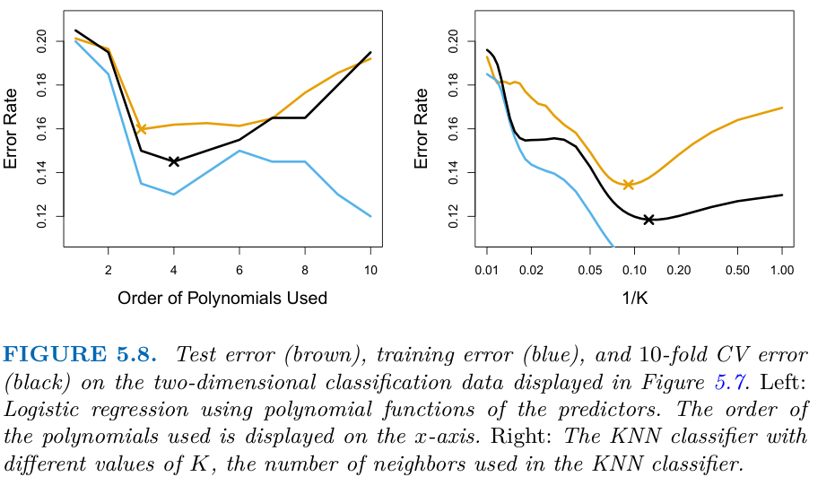
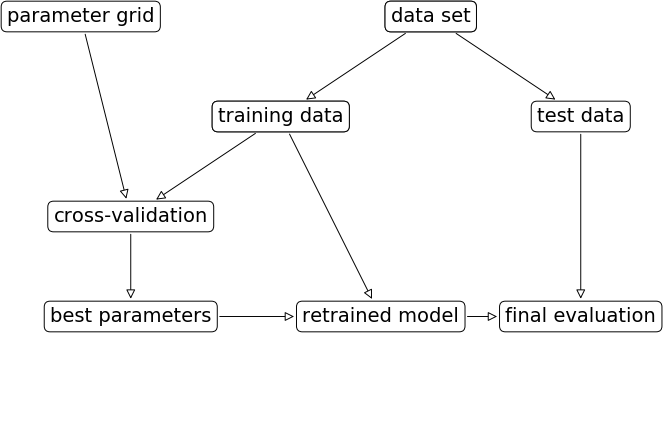
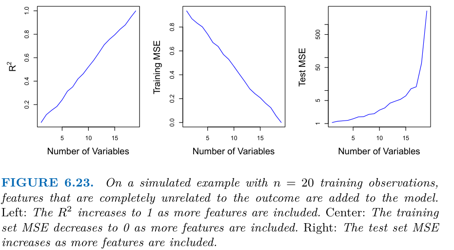

# Model Evaluation

> A model scored 90%. Is that good? This note gives the machinery to answer: cross-validation instead of one split, grid search with a held-out test set (or nested CV), a metric chosen from the business consequence of each error type, and learning curves to decide whether you need more data or a different model. Thresholds and the precision–recall and ROC curves are in the next note, [04b](04b-thresholds-pr-roc-and-calibration.md).

**In plain words.** A score means little until you know what it's compared with and what each mistake costs. If hardly any emails are spam, a filter that lets everything through scores highly and catches nothing. A missed cancer and a needless follow-up scan are both "errors", yet nobody would price them the same. Evaluation is the job of testing a model fairly on data it hasn't seen, with a measure that reflects those costs, so you can tell your manager whether to trust it.

This is the layer interviews probe hardest: metric interpretation, train/test discipline and leakage are the most common failure modes. Blocks run top to bottom from this `notes/` folder.

---

## Cross-validation

A single `train_test_split` gives a score that depends on which points landed in the test set. **k-fold cross-validation** splits the data into $k$ folds, trains $k$ models each holding out one fold, and reports $k$ scores.

```python
from sklearn.model_selection import cross_val_score, cross_validate
from sklearn.linear_model import LogisticRegression
from sklearn.datasets import load_iris

iris = load_iris()
logreg = LogisticRegression(max_iter=1000)
scores = cross_val_score(logreg, iris.data, iris.target, cv=5)
print(scores.round(3), round(scores.mean(), 3))

res = cross_validate(logreg, iris.data, iris.target, cv=5, return_train_score=True)
print(sorted(res))
```

```text
[0.967 1.    0.933 0.967 1.   ] 0.973
['fit_time', 'score_time', 'test_score', 'train_score']
```

What CV buys:

- Every point is in a test fold exactly once, so the estimate doesn't depend on a lucky split.
- The **spread** of fold scores says how sensitive the model is to the training data. A range of 0.90–1.00 means "about 95%, give or take."
- More data is used for training: 80% per model at `cv=5` vs 75% for the default split.

What it doesn't do: return a model. `cross_val_score` evaluates a *procedure*; refit on all the data for the final model.

**How many folds, and what CV is good for.** ISLP's advice is $k=5$ or 10, because leave-one-out has the least bias but averages $n$ highly correlated fits and so has high variance, while a single validation split is both noisy and trained on less data (*ISLP*, ch. 5). The noise is concrete: on the Auto data (392 cars, `mpg` on polynomials of `horsepower`, one 196/196 split) the linear, quadratic and cubic validation MSEs are 23.62, 18.76 and 18.80 at one seed and 20.76, 16.95 and 16.97 at another, so the level moves by about three MSE units with the split while the ranking holds. Leave-one-out and 10-fold agree closely there (degree 1 to 5: 24.23, 19.25, 19.34, 19.42, 19.03 against 24.21, 19.19, 19.28, 19.48, 19.14), and for least squares leave-one-out is free, since $\mathrm{CV}_{(n)} = \frac1n\sum_i\big((y_i-\hat y_i)/(1-h_i)\big)^2$ needs one fit and the leverages $h_i$ (*ISLP*, ch. 5, lab). A model-based penalty such as $C_p$ or SURE corrects the training error without refits, and warns that CV estimates the average error of the procedure more than that of one fitted rule ([01](01-statistical-foundations.md#correcting-the-training-error-cross-validation-and-covariance-penalties), *Computer Age*, ch. 12).

The same ladder on one small table shows why each rung exists. A 1-nearest-neighbour classifier on iris (150 flowers) scores 1.0 on the rows it was fitted on, since it stores them; 0.907 on a 50/50 holdout; 0.96 and 0.907 when the two halves swap roles; 0.967, 0.967, 0.933, 0.933 and 1.0 over five folds (mean 0.96); and 0.96 under leave-one-out (150 fits). The book prints the last mean as an "error rate", but it is accuracy (*Python Data Science Handbook*, ch. 5).


*Image Source: James et al., *An Introduction to Statistical Learning with Applications in Python* (Springer, 2023), Fig. 5.8*

The figure shows what to trust CV for. The training error (blue) keeps falling with flexibility, the true test error (brown) is U-shaped, and the 10-fold CV curve (black) tracks the test curve's shape and puts its minimum within a step of the true one: for the polynomial logistic fits CV picks order 4 where the test minimum is at order 3, and the true test error is about the same for orders 3 to 6 (0.201, 0.197, 0.160, 0.162 for orders 1 to 4, against a Bayes error of 0.133). Read the plot and the CV curve sits below the test curve in both panels, so use it to choose the hyperparameter, not to quote the level (*ISLP*, ch. 5, simulated data, one run).

### Splitters

| Splitter | When | Note |
|---|---|---|
| `KFold(n_splits, shuffle=True)` | Regression; data in random order | Without `shuffle`, ordered data (iris is sorted by class) gives 0% folds; M&G's `KFold(3)` on iris scores 0 in every fold, `shuffle=True, random_state=0` gives 0.90/0.96/0.96, and leave-one-out (150 fits) gives 0.95 (*Introduction to ML with Python*, ch. 5) |
| `StratifiedKFold` | Classification (the default for classifiers) | Keeps class proportions in each fold |
| `LeaveOneOut` | Very small data | $n$ fits; high-variance estimate |
| `ShuffleSplit`, `StratifiedShuffleSplit` | Control train/test sizes and repeats independently; subsample large data | |
| `GroupKFold` | Several rows per subject (patient, user, speaker) | The same group is never in train and test; otherwise you measure memorisation of the person |
| `TimeSeriesSplit` | Temporal data | Always train on the past, test on the future. For a single holdout, cut at a date: train on rows up to it and test on rows after, then assert the two sizes add up to the source's (*ML Engineering in Action*, ch. 6) |
| `RepeatedStratifiedKFold` | Small data; want a tighter estimate | |

**The groups rule generalises:** the split must mirror how the model meets new data in production. New users → split by user. Next month → split by time.

[Training and tuning](09-training-and-tuning.md#when-to-change-the-folds) runs these splitters on real data, and shows what [a fold's spread](09-training-and-tuning.md#k-fold-and-what-a-folds-spread-tells-you) does and doesn't tell you.

---

## Grid search

Hyperparameters (`C`, `gamma`, `max_depth`) are not learned by `fit`. Search them, but the score you used to pick them is no longer an honest estimate.


*Image source: Müller & Guido, Introduction to Machine Learning with Python, companion repo `images/`*

The three-way split from [01](01-statistical-foundations.md): pick parameters on validation, report on test once. The cost of skipping it is visible in M&G's iris run (6 × 6 grid over `C` and `gamma` for an `SVC`): scoring the winning grid point on the data it was tuned on reports 0.97, while a proper train/validation/test split (84/28/38 rows) scores 0.92 on the untouched test rows (*Introduction to ML with Python*, ch. 5, "Overfitting the validation set"). With `GridSearchCV(cv=5)` the 36-point grid costs 36 × 5 = 180 fits plus one refit; the same grid under nested 5 × 5 CV is 900.

```python
from sklearn.model_selection import GridSearchCV, train_test_split
from sklearn.svm import SVC

X_train, X_test, y_train, y_test = train_test_split(iris.data, iris.target, random_state=0)
param_grid = {"C": [0.001, 0.01, 0.1, 1, 10, 100],
              "gamma": [0.001, 0.01, 0.1, 1, 10, 100]}
grid = GridSearchCV(SVC(), param_grid, cv=5, return_train_score=True)
grid.fit(X_train, y_train)               # CV on train only; then refits best on all of train

print(grid.best_params_)
print(round(grid.best_score_, 3))        # mean CV score: optimistic, used for selection
print(round(grid.score(X_test, y_test), 3))   # the honest number
```

```text
{'C': 10, 'gamma': 0.1}
0.973
0.974
```

### Reading the results

`pd.DataFrame(grid.cv_results_)` has one row per parameter combination. Pivot the mean test score into a $C \times \gamma$ heatmap:

| Heatmap shows | Meaning | Action |
|---|---|---|
| Best values in the interior | Range is right | Refine around the best |
| Best values on an edge | The optimum may be outside | Extend the range |
| Flat, no change | Parameter doesn't matter, or the scale is wrong | Change scale (log), or drop it |

Search parameters on a **log scale** (0.001, 0.01, …). A list of dicts lets you search conditional spaces, e.g. `gamma` only for `kernel="rbf"`.

```python
cond_grid = [{"kernel": ["rbf"], "C": [0.01, 0.1, 1, 10, 100], "gamma": [0.01, 0.1, 1, 10]},
             {"kernel": ["linear"], "C": [0.01, 0.1, 1, 10, 100]}]
print(GridSearchCV(SVC(), cond_grid, cv=5).fit(X_train, y_train).best_params_)
```

```text
{'C': 10, 'gamma': 0.1, 'kernel': 'rbf'}
```

`RandomizedSearchCV` samples from distributions (`scipy.stats.loguniform`) instead of a grid; with many parameters it finds good regions in far fewer fits. `HalvingGridSearchCV` (experimental) discards poor candidates early.

### Nested cross-validation

When you have no separate test set, wrap the grid search in an outer CV:

```python
scores = cross_val_score(GridSearchCV(SVC(), param_grid, cv=5), iris.data, iris.target, cv=5)
print(round(scores.mean(), 3))   # an estimate of how well "grid search over SVC" generalises
```

```text
0.98
```

5 × 5 × 36 = 900 fits (the book's iris run gives mean accuracy 0.98 for the procedure; *Introduction to ML with Python*, ch. 5, "Nested cross-validation"). It evaluates the model *selection procedure*, not one model. `n_jobs=-1` parallelises.

Why bother: Varma and Simon built "null" datasets of 40 samples with no signal, so the true error of any classifier was 50%, and tuned two classifiers by minimising CV error. The minimum CV error averaged 37.8% for shrunken centroids and 41.7% for an SVM, and on more than one-fifth of datasets the optimism exceeded 20 points. Nested CV gave an almost unbiased estimate, with a slight pessimism from training on 39 samples rather than 40 ([doi:10.1186/1471-2105-7-91](https://doi.org/10.1186/1471-2105-7-91), BMC Bioinformatics 2006). The setup was 6,000 Gaussian features per dataset, the shrunken-centroid parameter tuned by 10-fold CV and the SVM by leave-one-out CV; nested CV averaged 54.2% against the true 50.0% on the null data, and 35.3% against 32.0% for an SVM on data with 10 informative features. The paper tests only these two classifiers on synthetic data with far more features than samples, and gives no cost for the nested loop. Keeping the best of many tries is the [multiple comparisons](../../../data-analytics/02-probability-and-statistics/notes/05-hypothesis-testing.md#multiple-comparisons) problem from data analytics.

[Training and tuning](09-training-and-tuning.md#the-honest-final-number) measures how far a search winner's score flatters it on the adult census.

---

## Metrics: keep the end goal in mind

Accuracy treats every mistake the same. Business consequences rarely do. [Choosing a metric](11-choosing-a-metric.md#the-map) starts from the target and says which metric to reach for. This section has the detail.

| Error | Also called | Cancer screening | Spam filter |
|---|---|---|---|
| False positive | Type I | Healthy patient sent for more tests (cost, stress) | Real email lost in spam (bad) |
| False negative | Type II | Cancer missed (very bad) | Spam in the inbox (annoying) |

[Imbalance, errors and drift](10-imbalance-errors-and-drift.md#accuracy-lies-errors-cost) prices these two errors for a card lender, and [credit scoring](../../../data-analytics/06-applied-analyses/notes/02-credit-scoring.md#set-the-policy) turns the same trade-off into an approval cutoff.

[Hypothesis testing](../../../data-analytics/02-probability-and-statistics/notes/05-hypothesis-testing.md#the-recipe) in data analytics names the same two cells, with a decision rule in place of the model: rejecting a true null is the false positive, and missing a real effect is the false negative.

### Imbalanced data and the dummy baseline

On the digits dataset relabelled "is it a 9?" (10% positives), a classifier that always says "not 9" scores 90% accuracy.

```python
from sklearn.datasets import load_digits
from sklearn.dummy import DummyClassifier
from sklearn.tree import DecisionTreeClassifier

digits = load_digits()
X_train, X_test, y_train, y_test = train_test_split(digits.data, digits.target == 9, random_state=0)

models = {"most_frequent": DummyClassifier(strategy="most_frequent"),
          "stratified": DummyClassifier(strategy="stratified", random_state=0),   # random by class rate
          "tree depth 2": DecisionTreeClassifier(max_depth=2, random_state=0),
          "logistic": LogisticRegression(C=0.1, max_iter=2000)}
for name, m in models.items():
    print(name, round(m.fit(X_train, y_train).score(X_test, y_test), 3))
```

```text
most_frequent 0.896
stratified 0.802
tree depth 2 0.918
logistic 0.984
```

Only the last is clearly useful.

Always compare against a dummy. If accuracy barely beats it, accuracy is the wrong metric.

The same collapse appears inside a fitted model. In Bruce and Bruce's loan data 5.0% of loans default, and a logistic regression trained on all of them flags only 0.39% as defaults (log-odds above 0), under a twelfth of the expected number. Giving each defaulted loan weight $1/p$ (about 20, with $p$ the default rate) and paid-off loans weight 1 lifts the flagged share to 43%. The two fits differ in more than the weights (the first used a training split, the second all loans), so read the jump as an order of magnitude, not a controlled effect (*Practical Statistics*, ch. 5).

[Imbalance, errors and drift](10-imbalance-errors-and-drift.md#imbalance-what-each-remedy-does) tests what class weights, resampling and threshold moving each do when the positive class is rare.

### Confusion matrix, precision, recall, F1

The book's 9-versus-rest numbers make the point on one split (403 not-nine, 47 nine in the test set): majority-class dummy accuracy 0.90, a depth-2 tree 0.92, logistic regression 0.98, so accuracy barely separates the first two. F1 on the "nine" class does: 0.00 for the majority dummy, 0.10 for a random-proportion dummy, 0.55 for the tree and 0.89 for logistic regression (precision 0.95, recall 0.83; *Introduction to ML with Python*, ch. 5, "Metrics for binary classification").

```python
from sklearn.metrics import confusion_matrix, classification_report

clf = models["logistic"]
pred = clf.predict(X_test)
print(confusion_matrix(y_test, pred))    # [[TN FP], [FN TP]]
print(classification_report(y_test, pred, target_names=["not nine", "nine"]))
```

```text
[[402   1]
 [  6  41]]
              precision    recall  f1-score   support

    not nine       0.99      1.00      0.99       403
        nine       0.98      0.87      0.92        47

    accuracy                           0.98       450
   macro avg       0.98      0.93      0.96       450
weighted avg       0.98      0.98      0.98       450
```

| Metric | Formula | Answers | Optimise when |
|---|---|---|---|
| Accuracy | $(TP+TN)/n$ | Fraction right | Balanced classes, symmetric costs |
| Precision (PPV) | $TP/(TP+FP)$ | Of those flagged, how many are real? | False positives are costly (drug trials, spam) |
| Recall (sensitivity, TPR) | $TP/(TP+FN)$ | Of the real ones, how many did we catch? | False negatives are costly (cancer, fraud) |
| Specificity | $TN/(TN+FP)$ | Of the negatives, how many did we leave alone? | |
| FPR | $FP/(FP+TN)$ | | The x-axis of ROC |
| F1 | $2PR/(P+R)$ | Harmonic mean of P and R | One number for an imbalanced positive class |
| $F_\beta$ | weights recall $\beta$ times | | Asymmetric preference |
| Balanced accuracy | $\tfrac12\big(TP/(TP+FN) + TN/(TN+FP)\big)$ | Mean recall over the two classes; 0.5 is chance | Skewed classes when you have no costs |
| Matthews correlation (MCC) | $\dfrac{TP\cdot TN - FP\cdot FN}{\sqrt{(TP+FP)(TP+FN)(TN+FP)(TN+FN)}}$ | Correlation between prediction and truth; 0 is chance, 1 is perfect | One number that uses all four cells, with no costs |

The dummy "always not-nine" has accuracy 0.90 and F1 0.00 on the positive class. F1 exposes it.

Balanced accuracy and MCC expose it too, and they don't need you to pick a positive class for F1 to report:

```python
from sklearn.metrics import accuracy_score, balanced_accuracy_score, matthews_corrcoef

for name, m in models.items():
    pred = m.predict(X_test)
    print(f"{name:14s} accuracy {accuracy_score(y_test, pred):.3f}  "
          f"balanced {balanced_accuracy_score(y_test, pred):.3f}  MCC {matthews_corrcoef(y_test, pred):.3f}")
```

```text
most_frequent  accuracy 0.896  balanced 0.500  MCC 0.000
stratified     accuracy 0.802  balanced 0.485  MCC -0.028
tree depth 2   accuracy 0.918  balanced 0.729  MCC 0.515
logistic       accuracy 0.984  balanced 0.935  MCC 0.915
```

The tree's accuracy of 0.918 looks close to the dummy's 0.896, and the other two columns show how wide the gap really is. [Brodersen et al.](https://doi.org/10.1109/ICPR.2010.764) (ICPR 2010) argue for balanced accuracy on this ground: when accuracy is high only because of an imbalanced test set, balanced accuracy "will drop to chance". [Chicco and Jurman](https://doi.org/10.1186/s12864-019-6413-7) (BMC Genomics 2020) argue for MCC over accuracy and F1 when you have a threshold. Neither is a cost, and each has limits.

This table comes back with new labels. In a [RAG pipeline](../../../generative-ai/02-rag-retrieval/notes/01-rag-pipeline.md#measure-each-stage), a relevant chunk in the top k is a true positive, an irrelevant one a false positive and a relevant chunk left out a false negative. The cut-off k plays the part of the threshold, and the true negatives are the rest of the corpus, so many that accuracy says nothing. [Reading the errors](12-reading-the-errors.md#the-procedure) then uses the four cells as a place to work: open the rows in each one and find out why the model got them wrong.

---

## Threshold, precision–recall and ROC

This section, with the adult-census running example and the calibration subsection, moved to [Thresholds, precision–recall, ROC and calibration](04b-thresholds-pr-roc-and-calibration.md): how to move a threshold, read a precision–recall or ROC curve, and check that a 0.8 really is 80%.

---

## Multiclass and regression metrics

**Multiclass.** The confusion matrix is $K \times K$; read the off-diagonals for which classes are confused. F1 per class, averaged:

On the ten-class digits task with logistic regression (450 test images) the book gets accuracy 0.953, micro-F1 0.953 and macro-F1 0.954, with 8 and 3 the hardest classes (*Introduction to ML with Python*, ch. 5, "Multiclass classification"). Micro-F1 equals accuracy here, as the table says.

| Average | Weights | Use when |
|---|---|---|
| `macro` | Every class equally | Small classes matter as much as large |
| `weighted` | By class support | Default in `classification_report` |
| `micro` | Every sample equally (= accuracy for single-label) | Each sample matters equally |

**Regression.** $R^2$ (default `score`) is fine for model comparison. For reporting, use a unit the business understands: MAE (robust to outliers), RMSE (penalises big misses), MAPE (relative error; undefined at zero). MAPE is not in scikit-learn's core scorers in the book's edition, so Wilson writes it as `np.mean(np.abs((y_true - y_pred) / y_true)) * 100`, and returns every agreed metric from one function (MAE, MAPE, MSE, RMSE, explained variance, $R^2$) so that nobody has to choose a metric before the experiments run (*ML Engineering in Action*, ch. 6).

---

## Using a metric in model selection

Pass `scoring` to CV and grid search; the default is accuracy (classifiers) or $R^2$ (regressors). The block below uses ROC-AUC, and the rules and pitfalls later also name average precision. Both score a model's ranking of the rows, higher is better, and [04b](04b-thresholds-pr-roc-and-calibration.md#roc-curve-and-auc) defines them. Here they only matter as scorers to search on.

```python
gamma_grid = {"gamma": [0.0001, 0.01, 0.1, 1, 10]}
for scoring in ["accuracy", "roc_auc"]:
    g = GridSearchCV(SVC(), gamma_grid, scoring=scoring).fit(X_train, y_train)
    print(scoring, g.best_params_, "test AUC", round(roc_auc_score(y_test, g.decision_function(X_test)), 3))

from sklearn.metrics import get_scorer_names
print(len(get_scorer_names()), "scorers, e.g.", [s for s in get_scorer_names() if s.startswith("neg_mean")][:2])
```

```text
accuracy {'gamma': 0.0001} test AUC 0.992
roc_auc {'gamma': 0.01} test AUC 1.0
58 scorers, e.g. ['neg_mean_absolute_error', 'neg_mean_absolute_percentage_error']
```

The two scorers pick different winners, as they do on M&G's split (test AUC 0.992 against 1.000 there; test accuracy 0.973 against 1.000, *Introduction to ML with Python*, ch. 5, "Using evaluation metrics in model selection"). Choose the scorer before you search.

Error metrics are negated (`neg_mean_absolute_error`) because scikit-learn always maximises.

---

## Learning curves and bias-variance diagnosis

Ng's ex5 makes the diagnosis from [01](01-statistical-foundations.md#bias-variance-and-model-complexity) operational. Fit regularised linear regression on the water-level/dam-outflow data with an increasing number of training examples; plot training error and cross-validation error against $m$. The best complexity also moves with the data: on VanderPlas's noisy polynomial data the validation curve peaks at degree 3 with 40 points, and at about degree 6 with 200, where even degree 20 is not seriously overfit (*Python Data Science Handbook*, ch. 5).

```python
# Ng ex5, vectorised: regularised linear regression cost and learning curve
def compute_cost(theta, X, y, lam=0.0):
    m = len(y)
    err = X @ theta - y
    return (err @ err) / (2 * m) + lam / (2 * m) * (theta[1:] @ theta[1:])

def fit(X, y, lam=0.0):                                  # closed form; ex5 uses scipy.optimize
    reg = lam * np.eye(X.shape[1]); reg[0, 0] = 0
    return np.linalg.pinv(X.T @ X + reg) @ X.T @ y

def ng_learning_curve(X, y, Xval, yval, lam=0.0):
    train_err, val_err = [], []
    for i in range(1, len(y) + 1):
        theta = fit(X[:i], y[:i], lam)
        train_err.append(compute_cost(theta, X[:i], y[:i], 0.0))   # report errors WITHOUT the penalty
        val_err.append(compute_cost(theta, Xval, yval, 0.0))
    return train_err, val_err

from scipy.io import loadmat
ex5 = loadmat("../practice/ng-machine-learning/ex5/data/ex5data1.mat")
Xe, ye, Xev, yev = ex5["X"], ex5["y"].ravel(), ex5["Xval"], ex5["yval"].ravel()
ones = lambda a: np.c_[np.ones(len(a)), a]
tr, va = ng_learning_curve(ones(Xe), ye, ones(Xev), yev)
print("m        ", list(range(2, 13, 2)))
print("train err", np.round(tr[1::2], 1))
print("val err  ", np.round(va[1::2], 1))
```

```text
m         [2, 4, 6, 8, 10, 12]
train err [ 0.   2.8 19.4 18.2 23.3 22.4]
val err   [110.3  48.4  33.8  30.9  28.9  29.4]
```

Both errors level off together, high: the straight line is too simple, and more data will not fix it.

| Curve shape | Diagnosis | More data helps? | Fix |
|---|---|---|---|
| Train and val error both high, converge quickly | High bias (underfit): ex5's straight line | No | More features (ex5: degree-8 polynomial), less regularisation, bigger model |
| Train error low, large gap to val error | High variance (overfit): ex5's polynomial with $\lambda = 0$ | Yes | More data, more regularisation, fewer features |
| Both low, small gap | Good fit | Marginal | Ship it |

Ex5 then selects $\lambda$ on the validation set: sweep $\lambda \in \{0, 0.001, \ldots, 10\}$, pick the one with lowest validation error ($\lambda \approx 3$), report test error once. That is grid search written out by hand.

scikit-learn's version:

```python
from sklearn.datasets import load_diabetes
from sklearn.linear_model import Ridge
from sklearn.model_selection import learning_curve

X, y = load_diabetes(return_X_y=True)
sizes, train_scores, val_scores = learning_curve(Ridge(alpha=1), X, y, cv=5,
                                                 train_sizes=np.linspace(0.2, 1.0, 5))
print(sizes, train_scores.mean(axis=1).round(2), val_scores.mean(axis=1).round(2))
# validation_curve sweeps one hyperparameter instead of training size
```

```text
[ 70 141 211 282 353] [0.19 0.29 0.36 0.41 0.43] [0.14 0.28 0.35 0.39 0.41]
```

[Training and tuning](09-training-and-tuning.md#reading-performance-during-training) reads these curves on the adult census, with more rows and then with more training on the x-axis.

**When the features outnumber the rows, training scores stop meaning anything.** ISLP adds pure-noise features to a 20-row least-squares fit one at a time: $R^2$ climbs to 1 and training MSE falls to 0, while the test MSE explodes by orders of magnitude (the plot's axis is logarithmic).


*Image Source: James et al., *An Introduction to Statistical Learning with Applications in Python* (Springer, 2023), Fig. 6.23*

With $p \ge n$ a perfect fit is guaranteed whatever the features contain, so report a held-out or cross-validated error only, never training error, $R^2$ or in-sample p-values (*ISLP*, ch. 6, simulated, $n=20$, one run). A lasso with 20 true signals and $n=100$ sees its test MSE nearly double as $p$ grows from 20 to 2,000, so adding features is not free even when the penalty is tuned.

---

## Rules

| Rule | Why |
|---|---|
| Report a test score exactly once, after all choices | Every look at it is a choice that leaks |
| Split the way production meets data (groups, time) | Otherwise CV measures memorisation |
| Compare against `DummyClassifier` first | 90% accuracy can be zero skill |
| Choose the metric from the cost of each error type | Accuracy assumes FP and FN cost the same |
| Use AUC or average precision for model selection on imbalanced data; tune the threshold separately ([04b](04b-thresholds-pr-roc-and-calibration.md)) | Ranking quality and operating point are separate decisions |
| Plot a learning curve before collecting more data | It tells you whether more data can help |
| Search hyperparameters on a log scale, check the best isn't on an edge | |

---

## scikit-learn migration map (0.20 → 1.4)

The vendored M&G notebooks were written against scikit-learn 0.20. This repo's copies were updated for 1.4+ (#35) and `environment.yml` pins `scikit-learn>=1.4`.

| Old API | New API | Changed in |
|---|---|---|
| `from sklearn.cross_validation import ...` | `from sklearn.model_selection import ...` | Removed 0.20 |
| `from sklearn.grid_search import GridSearchCV` | `from sklearn.model_selection import GridSearchCV` | Removed 0.20 |
| `DummyClassifier()` (default `strategy="warn"`) | `DummyClassifier(strategy="stratified")` or `"prior"` explicitly | Default changed 0.24/1.1 |
| `OneHotEncoder(sparse=False)` | `OneHotEncoder(sparse_output=False)` | Renamed 1.2, old name removed 1.4 |
| `GridSearchCV(..., iid=True)` | Drop `iid` | Removed 1.0 (0.24 deprecation) |
| `LogisticRegression()` (convergence warnings on unscaled data) | `LogisticRegression(max_iter=1000)` or scale first | Default solver `lbfgs` since 0.22 |
| `vectorizer.get_feature_names()` | `get_feature_names_out()` (all transformers) | Removed 1.2 |
| `from sklearn.externals import joblib` | `import joblib` | Removed 0.23 |
| `load_boston()` | `fetch_california_housing()` or `mglearn.datasets.load_extended_boston()` | Removed 1.2 |

Where the fixes landed:

| Notebook | Change |
|---|---|
| `02-supervised-learning.ipynb` | `LogisticRegression(max_iter=1000)`, `DummyClassifier(strategy="stratified")` |
| `04-representing-data-feature-engineering.ipynb` | `OneHotEncoder(sparse_output=False)` in cells 18, 21, 26 |
| `05-model-evaluation-and-improvement.ipynb` | No stale imports (uses `mglearn` helpers) |
| `01`, `03`, `06`, `08` | Clean |
| `approaching-almost-any-nlp-problem-on-kaggle.ipynb` (NLP pillar) | `iid=True` removed from `GridSearchCV` (cells 41, 43) |
| `04`, `07` and Sarkar `Ch04a`, `Ch06c`, `Ch06d`, `Ch06e`, `Ch07c`, `Ch09e` | `get_feature_names()` → `get_feature_names_out()` (2026-10-31; the 2026-07 audit missed it) |
| Sarkar `Ch08c` | `sklearn.externals.joblib` → `joblib` (2026-10-31) |
| Ng ML exercises | Clean (no sklearn) |

`cross_validation` appearing in Sarkar's `Ch06b` is an LDA topic word in a notebook output, not an import.

---

## Practice

| Notebook | Covers | Runs |
|---|---|---|
| [`05-model-evaluation-and-improvement.ipynb`](../practice/intro-to-ml-in-python/05-model-evaluation-and-improvement.ipynb) | Everything above except ex5 | Offline; `scikit-learn>=1.4`, local `mglearn` |
| [`ex5.ipynb`](../practice/ng-machine-learning/ex5/ex5.ipynb) | Regularised linear regression, learning curves, polynomial features, selecting $\lambda$ | Legacy: Python 2.7 kernel; `scipy.io.loadmat` data in `ex5/data/` |

---

## Pitfalls

| Pitfall | Symptom | Fix |
|---|---|---|
| Accuracy on imbalanced data | A model at 90% accuracy has F1 near zero on the class you care about | Compare to `DummyClassifier`; use F1, AP or AUC |
| Reporting `best_score_` as the result | The published number is above what the test set or production gives | Report on untouched test data, or use nested CV |
| Random split with repeat subjects or time order | CV is excellent and production is poor | `GroupKFold`, `TimeSeriesSplit`; mirror how the model meets new data |
| Best grid value on the edge of the range | Heatmap's highest cell sits on a border | Extend the range before trusting it |
| Tuning on a metric nobody uses | The model improves and the business number does not | Choose the scorer from the error costs first |

## Try it

1. Run `cross_val_score` on iris with `KFold(n_splits=3)` and no shuffle. Explain the scores.
2. In the digits block, search `SVC` hyperparameters with `scoring="average_precision"` and compare with the `roc_auc` winner.
3. Run ex5's polynomial case: expand `Xe` to degree 8, normalise, and call `ng_learning_curve` with `lam=0` and `lam=3`. Worked solution in [`ex5.ipynb`](../practice/ng-machine-learning/ex5/ex5.ipynb).

<details>
<summary>Answers</summary>

1. All zero. Iris is sorted by class, so each fold holds a class the training folds never saw. `shuffle=True` or stratification fixes it.
2. Both pick `gamma=0.01` on this split. They can differ when the positive class is rarer, and AP is the one that reflects the flagged set.

</details>

## Interview checklist

| Question | Answer |
|---|---|
| Why cross-validate rather than one split? | The estimate does not depend on one lucky split, and the spread shows sensitivity to the data |
| What does nested CV estimate? | The generalisation of the whole selection procedure, not of one model |
| Precision vs recall? | Of those flagged, how many are real; of the real ones, how many were caught |
| When is accuracy misleading? | Imbalanced classes or asymmetric costs, where a dummy can score high |
| How do you read a learning curve? | High and converged means bias, so more data will not help. A large gap means variance, so more data will help |
| How do you split for grouped or temporal data? | So production's situation holds: by subject, or past-to-future |
| Recall or specificity? | Recall is $TP/(TP+FN)$, the share of real positives caught. Specificity is $TN/(TN+FP)$, the share of negatives left alone. The first counts misses and the second counts false alarms. |

## Next

[Thresholds, precision–recall, ROC and calibration](04b-thresholds-pr-roc-and-calibration.md) turns a score into a decision. After that, [Ensembles](06-ensembles.md): you can now score a model honestly, so build the strongest one for a table, through bagging, random forests and gradient boosting.
