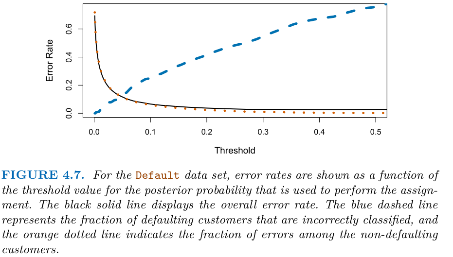

# Thresholds, precision–recall, ROC and calibration

> A model's score is not yet a decision. This note picks up where [model evaluation](04-model-evaluation.md) stops: the threshold that turns a score into a yes or no, the precision–recall and ROC curves that show every threshold at once, the adult-census example that applies them, and calibration, which asks whether a score of 0.8 means 80%.

**In plain words.** A classifier hands back a number, and someone has to choose the line above which it says yes. Moving the line trades missed cases for false alarms. The curves draw that trade for every line at once, and calibration checks that the number itself can be believed as a probability.

Blocks run top to bottom from the same `notes/` folder as [04](04-model-evaluation.md), whose split, metric and confusion-matrix sections this note assumes.

---

## Threshold, precision–recall and ROC

`predict` thresholds `decision_function` at 0 or `predict_proba` at 0.5 ([02](02-supervised-learning.md#uncertainty-estimates)). Moving the threshold trades precision for recall without retraining.

ISLP shows the cost of leaving it at 0.5 on its simulated `Default` data (10,000 customers, 333 defaulters, LDA on balance and student status, training data). Overall error is 2.75% against 3.33% for always answering "no default", yet 252 of the 333 defaulters (75.7%) are missed. Dropping the threshold to 0.2 cuts the missed share to 41.4% and raises overall error to 3.73%, because 235 non-defaulters are now flagged (*ISLP*, ch. 4).


*Image Source: James et al., *An Introduction to Statistical Learning with Applications in Python* (Springer, 2023), Fig. 4.7*

The curve is the reason overall error is a poor guide here: it barely moves while the miss rate on the rare class swings from near 0 to over 0.7. Pick the threshold from the costs of the two errors, not from the lowest total (*ISLP*, ch. 4, training-set errors).

```python
from sklearn.metrics import precision_score, recall_score

svc = SVC(gamma=0.001).fit(X_train, y_train)
for t in [0, -0.8]:                      # a lower threshold catches more positives
    p = svc.decision_function(X_test) > t
    print(t, "precision", round(precision_score(y_test, p), 3), "recall", round(recall_score(y_test, p), 3))
```

```text
0 precision 0.978 recall 0.936
-0.8 precision 0.758 recall 1.0
```

M&G's own version of the move uses a 400 : 50 blob problem and `SVC(gamma=.05)` (113 test points, 9 positives): lowering the threshold from 0 to −0.8 lifts class-1 recall from 0.67 to 1.00 while precision slips from 0.35 to 0.32 (*Introduction to ML with Python*, ch. 5, "Taking uncertainty into account"). The same chapter shows F1 and average precision disagreeing on a 4,000 : 500 problem: F1 puts the SVC ahead (0.656 against 0.610 for a 100-tree forest), average precision puts the forest ahead (0.666 against 0.663) and AUC does too (0.937 against 0.916). Which model is better depends on which operating region you care about.

**Never pick the threshold on the test set.** Use a validation set or CV; `TunedThresholdClassifierCV` (scikit-learn 1.5) does this for you.

### Precision–recall curve

```python
from sklearn.ensemble import RandomForestClassifier
from sklearn.metrics import precision_recall_curve, average_precision_score

rf = RandomForestClassifier(n_estimators=100, random_state=0).fit(X_train, y_train)
precision, recall, thresholds = precision_recall_curve(y_test, svc.decision_function(X_test))
print(len(thresholds), "thresholds on the curve")
print("AP svc", round(average_precision_score(y_test, svc.decision_function(X_test)), 3),
      "rf", round(average_precision_score(y_test, rf.predict_proba(X_test)[:, 1]), 3))   # area under the PR curve
```

```text
450 thresholds on the curve
AP svc 0.997 rf 0.979
```

The closer the curve hugs the top right, the better. Average precision summarises it; with heavy imbalance it is more informative than ROC AUC, because it ignores the large pool of true negatives. Davis and Goadrich prove the two spaces are linked: for a fixed number of positives and negatives, one curve dominates another in ROC exactly when it dominates in PR. Once curves cross, that link gives no ranking, and optimising AUC-ROC doesn't guarantee the area under the PR curve. On a constructed example with 20 positives and 2,000 negatives, **AUC-ROC prefers one curve (0.875 against 0.813) and AUC-PR prefers the other (0.514 against 0.038)**, because PR area comes mostly from high precision at low recall. Straight-line interpolation between PR points is also a mistake, because precision need not change linearly with recall: from a single point at recall 0.02, with 433 positives and 56,164 negatives, a line gives an area of 0.50 where their interpolation gives 0.031 ([doi:10.1145/1143844.1143874](https://doi.org/10.1145/1143844.1143874), ICML 2006). These examples show that it can happen, not how often, and the paper treats the area under the PR curve, not average precision. Never draw a PR curve by connecting a handful of points with lines.

### ROC curve and AUC

```python
from sklearn.metrics import roc_curve, roc_auc_score

fpr, tpr, thresholds = roc_curve(y_test, svc.decision_function(X_test))
print("AUC svc", round(roc_auc_score(y_test, svc.decision_function(X_test)), 3),
      "rf", round(roc_auc_score(y_test, rf.predict_proba(X_test)[:, 1]), 3))
```

```text
AUC svc 1.0 rf 0.995
```

ROC plots TPR against FPR over all thresholds. It is also a sort and two cumulative sums (Bruce and Bruce do this in R; tie-free scores give the same curve as `roc_curve`):

```python
idx = np.argsort(-score)                        # most likely positive first
tpr = np.cumsum(y[idx]) / y.sum()               # recall after taking the top k
fpr = np.cumsum(1 - y[idx]) / (1 - y).sum()     # 1 - specificity after the top k
```

Lift reads the same ranking against a budget. If the top decile holds 0.3% responders where picking blindly gives 0.1%, the lift there is 3 (the book's illustration). That is the natural chart when you can only audit, mail or call the top slice (*Practical Statistics*, ch. 5). **AUC** is the probability that a random positive gets a higher score than a random negative: 0.5 is chance, 1.0 is perfect ranking. A random predictor always scores 0.5 regardless of class balance, which makes AUC a better model-selection metric than accuracy on imbalanced data.

On M&G's digits "is it a 9?" example (*Introduction to ML with Python*, ch. 5; 47 nines in 450 test images), SVMs with `gamma` 1, 0.05 and 0.01 all have accuracy 0.90 (the dummy rate), but AUC 0.50, 0.90 and 1.00 (the book's prose says 0.5 for the middle one, but its printed output is 0.90). The model with `gamma=0.01` ranks perfectly; only the default threshold is wrong.

### The running example: adult census

The same questions on the pillar's table, using a one-hot logistic regression as the first honest model. Who is flagged as a high earner, and what does that cost?

```python
import numpy as np
import pandas as pd
from sklearn.compose import make_column_selector, make_column_transformer
from sklearn.pipeline import make_pipeline
from sklearn.preprocessing import OneHotEncoder, StandardScaler

cols = ["age", "workclass", "fnlwgt", "education", "education-num", "marital-status",
        "occupation", "relationship", "race", "gender", "capital-gain", "capital-loss",
        "hours-per-week", "native-country", "income"]
adult = pd.read_csv("../practice/intro-to-ml-in-python/data/adult.data", header=None, names=cols,
                    skipinitialspace=True, na_values="?").drop(columns=["fnlwgt", "education"])
ya = (adult.pop("income") == ">50K").astype(int)
Xa_dev, Xa_test, ya_dev, ya_test = train_test_split(adult, ya, stratify=ya, test_size=0.2, random_state=0)
Xa_tr, Xa_val, ya_tr, ya_val = train_test_split(Xa_dev, ya_dev, stratify=ya_dev, test_size=0.25, random_state=0)

prep = make_column_transformer(
    (StandardScaler(), make_column_selector(dtype_include="number")),
    (OneHotEncoder(handle_unknown="ignore"), make_column_selector(dtype_exclude="number")))
adult_clf = make_pipeline(prep, LogisticRegression(max_iter=2000)).fit(Xa_tr, ya_tr)

base = ya_test.mean()
s_val, s_test = adult_clf.predict_proba(Xa_val)[:, 1], adult_clf.predict_proba(Xa_test)[:, 1]
print("dummy accuracy", round(1 - base, 3), "| model accuracy", round(adult_clf.score(Xa_test, ya_test), 3))
print("AUC", round(roc_auc_score(ya_test, s_test), 3), "| AP", round(average_precision_score(ya_test, s_test), 3),
      "(AP of a random ranker is the base rate,", round(base, 3), ")")

# Business rule: of those we flag, at least 80% must really be high earners.
# Pick the threshold on validation, then report on test once.
p, r, t = precision_recall_curve(ya_val, s_val)
thr = t[np.argmax(p[:-1] >= 0.80)]
for name, yy, ss in [("default 0.5", ya_test, s_test >= 0.5), (f"tuned {thr:.2f}", ya_test, s_test >= thr)]:
    print(name, "precision", round(precision_score(yy, ss), 3), "recall", round(recall_score(yy, ss), 3))
```

```text
dummy accuracy 0.759 | model accuracy 0.847
AUC 0.901 | AP 0.754 (AP of a random ranker is the base rate, 0.241 )
default 0.5 precision 0.725 recall 0.584
tuned 0.61 precision 0.783 recall 0.484
```

Accuracy says the model is about nine points better than always answering "low earner". AUC and AP say the ranking is strong. The threshold lines say what that means for a decision: holding the flagged group to about 80% precision costs about a tenth of recall, and the validation target of 0.80 came out at 0.783 on test, because a threshold picked on one sample is itself an estimate. See [the bootstrap](../../../data-analytics/02-probability-and-statistics/notes/04-estimation.md#the-bootstrap) in data analytics for putting an interval on an estimate like this one. ISLP's check of the idea: for a statistic with no formula, 1,000 bootstrap resamples of one 100-pair data set give a standard error of 0.087, against 0.083 from 1,000 fresh simulated data sets (*ISLP*, ch. 5). The bootstrap also tests a model's own assumptions: for a linear fit to the curved Auto relationship its slope standard error is 0.0074 against the formula's 0.006, and the two agree once the quadratic term is in.

| Curve | Axes | Use when |
|---|---|---|
| Precision–recall | P vs R | Positive class rare; you care about the flagged set |
| ROC | TPR vs FPR | Ranking quality overall; balanced-ish data |

### Calibration: is a 0.8 really 80%?

Thresholds and expected-cost decisions assume `predict_proba` means what it says. Check with a reliability diagram and fix with a held-out recalibration:

```python
from sklearn.calibration import CalibratedClassifierCV, calibration_curve
from sklearn.metrics import brier_score_loss
from sklearn.naive_bayes import GaussianNB

Xn_tr, Xn_te = prep.fit_transform(Xa_dev).toarray(), prep.transform(Xa_test).toarray()
nb = GaussianNB().fit(Xn_tr, ya_dev)
cal = CalibratedClassifierCV(GaussianNB(), method="isotonic", cv=5).fit(Xn_tr, ya_dev)   # "sigmoid" is Platt, for less data
for name, m in [("naive Bayes", nb), ("recalibrated", cal)]:
    prob = m.predict_proba(Xn_te)[:, 1]
    frac, mean = calibration_curve(ya_test, prob, n_bins=5)     # the numbers a reliability diagram plots
    print(name, "Brier", round(brier_score_loss(ya_test, prob), 3), "| predicted", mean.round(2), "| actual", frac.round(2))
```

```text
naive Bayes Brier 0.45 | predicted [0.   0.31 0.48 0.7  1.  ] | actual [0.03 0.04 0.   0.   0.34]
recalibrated Brier 0.143 | predicted [0.06 0.3  0.43] | actual [0.05 0.13 0.49]
```

Gaussian naive Bayes on a one-hot table is a deliberately bad case: its scores pile up at 0 and 1, and only a third of the 1.0 bin is positive. Recalibration brings the Brier score down from 0.45 to 0.143 and the predicted probabilities much nearer to what happens, without touching how the model ranks in any large way. Niculescu-Mizil and Caruana established the shape of the table below by comparing ten learners' probabilities ([doi:10.1145/1102351.1102430](https://doi.org/10.1145/1102351.1102430), ICML 2005).

| Model | Typical miscalibration |
|---|---|
| Logistic regression | Usually well calibrated |
| Naive Bayes | Pushed towards 0 and 1 |
| SVM (`decision_function`), boosted trees | Sigmoid-shaped distortion |
| Random forest | Pulled away from 0 and 1 |
| Deep networks | Often overconfident; temperature scaling (one scalar on the logits) removes the average bias, not the rest (Guo; Minderer, below) |

Deep networks made calibration a live research question. Guo et al. found modern deep nets overconfident ([arXiv:1706.04599](https://arxiv.org/abs/1706.04599), ICML 2017). On CIFAR-100 a 5-layer LeNet's confidence matched its accuracy, while a 110-layer ResNet was more accurate but much more confident than it was right. Depth, width, weight decay and batch norm all moved calibration. Of the post-hoc fixes they tested, temperature scaling (a one-parameter Platt scaling) worked best on most datasets. Minderer et al. revisit this on recent ImageNet classifiers, and release measurements for 180 models from 16 families ([arXiv:2106.07998](https://arxiv.org/abs/2106.07998), NeurIPS 2021). On ImageNet validation, scored by top-label expected calibration error (ECE, the average gap between confidence and accuracy, here in 100 equal-mass bins), their results suggest no general trend for recent or highly accurate networks to be poorly calibrated compared with older or less accurate ones, though within most families the larger, more accurate members have slightly higher ECE. Recent non-convolutional families (vision transformers, MLP-Mixer) are among the best calibrated, more clearly after temperature scaling, since BiT, a ConvNet, overlaps them before it. Size and pretraining don't fully explain the gap, though the pretraining test used BiT alone. The authors speculate that architecture, in particular its spatial inductive bias, plays an important role, and their abstract says the results suggest it is a major determinant.

Three points are easy to miss:

- **What temperature scaling removes.** It leaves accuracy alone and corrects average over- or underconfidence. Differences between families remain after it.
- **Shift.** They fit the temperature on clean ImageNet and tested on corrupted ImageNet. Calibration error still grew with corruption for every family, though more slowly for MLP-Mixer and ViT. Our reading is that a temperature fitted before shift doesn't fully carry over; the authors stress the other side, that some recent families' calibration decays so slowly under shift that the decay in accuracy is likely more relevant in practice.
- **Which number to choose on.** In the one cost model they tested, abstaining on the least confident predictions, the more accurate of two BiT models cost less at abstention rates up to 70%. Its gap was 0.08 in error against 0.009 in ECE. That gap is lopsided, but the more accurate model also won in most practical cost settings in a cross-family pair with gaps of 0.03 on both (ResNeXt-WSL against ViT-B/32). The bin count can also flip the sign of the link between ECE and accuracy (temperature-scaled BiT on ImageNet, 15 to 5,000 bins), so compare the two together.

These are 2021 image classifiers, so don't carry the ranking to other domains or later models.

[Imbalance, errors and drift](10-imbalance-errors-and-drift.md#calibration-the-bridge-from-score-to-price) shows why it matters to a lender, who has to turn a score into a price.

---

## Next

[Multiclass and regression metrics, model selection and learning curves](04-model-evaluation.md#multiclass-and-regression-metrics): back in the first half, then [Ensembles](06-ensembles.md).
