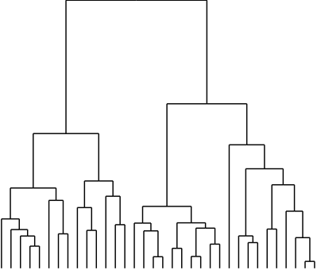
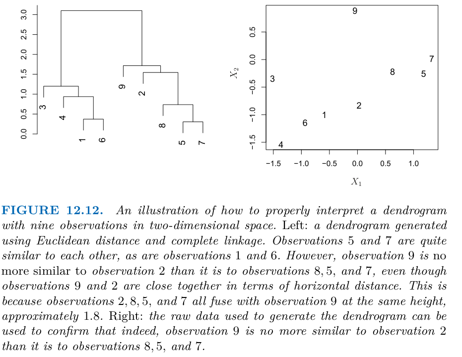
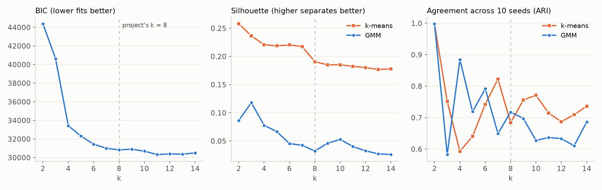

# Unsupervised Learning

> You have no labels and no score to tell you if you are right. Transform the data (scaling, PCA, NMF, t-SNE) or group it (k-means, agglomerative, DBSCAN), then judge the result mostly by looking at it. Plus the two Ng exercises that sit next door: Gaussian anomaly detection and collaborative filtering.

**In plain words.** Imagine being handed a box of unlabelled holiday photos, or a shop's customer list, and asked to sort them into piles with nobody to tell you the right ones. That's unsupervised learning: shrink the data down to something you can look at, or group similar things, with no answer key. At work it's how you find groups of customers, spot the odd transaction and suggest the next film. Since no score says you're right, someone has to check that the piles make sense.

Blocks run top to bottom from this `notes/` folder. Figures attributed to M&G are the book's own; the face examples need the `fetch_lfw_people` download, so they are reported and not rerun here.

---

## Two kinds, one problem

| Kind | Goal | Examples |
|---|---|---|
| Transformations | A new representation: fewer dimensions, more interpretable parts, a 2-D picture | Scaling, PCA, NMF, t-SNE |
| Clustering | Partition the data into groups of similar items | k-means, agglomerative, DBSCAN |

**The challenge:** there is no ground truth, so there is no score that says the model did well. Was the clustering of face photos by pose, lighting or identity? You have to look. Unsupervised methods are therefore used most for *exploration* and as *preprocessing* for a supervised model, where the downstream score does give feedback.

---

## Preprocessing and scaling

| Scaler | Result | Use when |
|---|---|---|
| `StandardScaler` | Mean 0, variance 1 per feature | Default for SVMs, linear models, MLPs, PCA |
| `RobustScaler` | Median and IQR | Outliers present |
| `MinMaxScaler` | Range [0, 1] | Bounded inputs needed (images, some NNs) |
| `Normalizer` | Each *row* to unit length | Only direction matters (text vectors, cosine) |

**Scale train and test with the same fitted scaler.** Fitting a second `MinMaxScaler` on the test set maps it to [0, 1] independently and shifts every point relative to the training data: M&G's plot shows the test points visibly displaced. `fit` on train, `transform` both, inside a pipeline ([03](03-feature-engineering-and-pipelines.md#pipelines)).

Effect on a kernel SVM on breast cancer (`SVC(C=100)`, `random_state=0`, scaler fitted on train only): 0.63 unscaled, 0.97 with `MinMaxScaler`, 0.96 with `StandardScaler` (*Introduction to ML with Python*, ch. 3, "Applying data transformations").

---

## Principal component analysis

PCA rotates the data so the first axis follows the direction of maximum variance, the second the maximum variance orthogonal to it, and so on. Keep the first $k$ to reduce dimensions.

```python
import numpy as np
from sklearn.datasets import load_breast_cancer, load_digits, make_blobs, make_moons
from sklearn.decomposition import PCA
from sklearn.preprocessing import StandardScaler

cancer = load_breast_cancer()
X_scaled = StandardScaler().fit_transform(cancer.data)    # PCA is scale-sensitive: scale first
pca = PCA(n_components=2).fit(X_scaled)
X_pca = pca.transform(X_scaled)                            # 569 x 30 -> 569 x 2
print(pca.components_.shape)                    # each row is a direction in feature space
print(pca.explained_variance_ratio_.round(3))   # how much variance each component keeps
```

```text
(2, 30)
[0.443 0.19 ]
```

The 2-D projection of breast cancer separates benign and malignant well, so even a linear classifier on two components does reasonably. Components are hard to interpret: each mixes all 30 features with positive and negative weights.

### Eigenfaces: PCA as feature extraction

On Labeled Faces in the Wild (3,023 images of 62 people, 87×65 px = 5,655 pixels; M&G keep at most 50 images per person, leaving 2,063), a 1-nearest-neighbour classifier on raw pixels scores 26.6% on a stratified split with `random_state=0`. After `PCA(n_components=100, whiten=True)` fitted on the training rows it scores 35.7%, against about 1.6% for chance over 62 people (*Introduction to ML with Python*, ch. 3, "Principal component analysis"). Distances between principal-component vectors are a better measure of face similarity than distances between pixels. Reconstructing a face from 10, 50, 100, 500 components shows coarse-to-fine detail.

Scaling changes what PCA finds, not only how well. On ISLP's USArrests (50 US states, four variables with very different variances: Assault 6,945, UrbanPop 209.5, Rape 87.7, Murder 19.0), unscaled PCA puts almost all of PC1 on Assault, simply because it has the largest variance. Standardised to sd 1, PC1 explains 62.0% of the variance with roughly equal weight on the three crime variables (0.54, 0.58, 0.54) and 0.28 on urban population, PC2 explains 24.7% (87% together) and loads 0.87 on urban population, and the scree plot has its elbow after PC2 (*ISLP*, ch. 12). Each component is defined only up to sign, so compare loadings by magnitude, as the check above does.

### From scratch: Ng ex7

```python
# Ng ex7: PCA via SVD of the covariance matrix
def pca_svd(X_norm):
    m = X_norm.shape[0]
    Sigma = X_norm.T @ X_norm / m              # covariance (features already normalised)
    U, S, _ = np.linalg.svd(Sigma)
    return U, S                                 # columns of U = principal directions

def project(X_norm, U, K):  return X_norm @ U[:, :K]
def recover(Z, U, K):       return Z @ U[:, :K].T

# Choose K: smallest K with sum(S[:K]) / sum(S) >= 0.99  ("99% of variance retained")
U, S = pca_svd(X_scaled)
print("K for 99%:", np.searchsorted(np.cumsum(S) / S.sum(), 0.99) + 1)
print("agrees with sklearn, up to sign:", np.allclose(np.abs(U[:, 0]), np.abs(pca.components_[0])))
```

```text
K for 99%: 17
agrees with sklearn, up to sign: True
```

Ex7 applies this to 2-D toy data (projection and reconstruction lines), then to 5,000 32×32 faces reduced to 100 dimensions.

---

## Non-negative matrix factorisation

Like PCA, but components and coefficients are constrained to be **non-negative**. The data must be non-negative too (pixels, word counts, audio spectra). The result is additive parts: a face as "a bit of this lighting plus a bit of this pose."

```python
from sklearn.decomposition import NMF
digits = load_digits()
nmf = NMF(n_components=15, init="nndsvda", max_iter=1000, random_state=0).fit(digits.data[:1400])
X_nmf = nmf.transform(digits.data[1400:])
print(X_nmf.shape, "min coefficient", X_nmf.min(), "| reconstruction error", round(nmf.reconstruction_err_, 1))
```

```text
(397, 15) min coefficient 0.0 | reconstruction error 615.5
```

| | PCA | NMF |
|---|---|---|
| Components | Orthogonal, ordered by variance | Not ordered; all equally important |
| Signs | Mixed | Non-negative |
| Changing `n_components` | First components unchanged | All components change |
| Good for | Compression, decorrelation, visualisation | Interpretable parts; separating additive sources (M&G unmix three signals) |

NMF over word counts is a topic model: see [NLP topic models](../../03-nlp/notes/03-topic-models-and-summarization.md).

---

## Manifold learning: t-SNE

t-SNE finds a 2-D layout that preserves *neighbourhoods*: points close in the original space stay close. It is for visualisation only.

```python
from sklearn.manifold import TSNE
from sklearn.metrics import adjusted_rand_score
from sklearn.cluster import KMeans

digits_tsne = TSNE(random_state=42).fit_transform(digits.data)   # no transform(): can't map new points
digits_pca = PCA(n_components=2).fit_transform(digits.data)
for name, xy in [("PCA  ", digits_pca), ("t-SNE", digits_tsne)]:
    labels = KMeans(n_clusters=10, n_init=10, random_state=0).fit_predict(xy)
    print(name, "ARI of 10 clusters on the 2-D picture vs true digit:", round(adjusted_rand_score(digits.target, labels), 2))
```

```text
PCA   ARI of 10 clusters on the 2-D picture vs true digit: 0.39
t-SNE ARI of 10 clusters on the 2-D picture vs true digit: 0.89
```

On the 8×8 digits, PCA's 2-D projection overlaps most classes; t-SNE separates nearly all ten without seeing labels ([JMLR 2008](https://www.jmlr.org/papers/v9/vandermaaten08a.html), van der Maaten and Hinton). Rules for reading a t-SNE plot: cluster sizes and distances between clusters mean little; run more than one `perplexity`; never use it as features for a model. How far a 2-D map bends neighbourhoods has been measured: on six single-cell RNA-seq datasets, a point's 30 nearest neighbours on a 2-D t-SNE or UMAP map and in the original space differed by a mean Jaccard distance above 0.7, and the authors advise clustering in the full space and showing the map only afterwards ([PLOS Computational Biology, 2023](https://doi.org/10.1371/journal.pcbi.1011288), Chari and Pachter). UMAP is from the same family of neighbour-graph methods and usually faster ([arXiv:1802.03426](https://arxiv.org/abs/1802.03426), McInnes et al., preprint). In the authors' laptop timings, with one figure per cell and no spread, a single-core UMAP took 87 seconds on MNIST against 292 for multi-core FIt-SNE and 1,450 for Barnes-Hut t-SNE, though on these same 8×8 digits it was 9 against 17 for Barnes-Hut. On GoogleNews subsamples they find its scaling with sample count comparable to FIt-SNE's. The authors present UMAP as usable beyond plots, for later clustering or anomaly detection, which the paper does not evaluate; the rule above about not using an embedding as features is this note's caution for t-SNE. Its global-structure claim is hedged: the paper says "arguably", credits the Laplacian Eigenmaps initialisation and the cross-entropy objective, and notes that t-SNE started the same way can match UMAP on one measure. It treats mapping new points as future work, with no method or evaluation. [NLP embeddings](../../03-nlp/notes/04-embeddings-and-similarity.md) uses t-SNE to plot word vectors.

---

## Clustering

### k-means

Alternate two steps until assignments stop changing: assign each point to the nearest centre; move each centre to the mean of its points.

```python
X, y_blob = make_blobs(n_samples=300, centers=3, random_state=1)
kmeans = KMeans(n_clusters=3, n_init="auto", random_state=0).fit(X)
print(kmeans.cluster_centers_.round(1))
print(kmeans.predict([[0.0, 4.0]]))       # new points go to the nearest centre
```

```text
[[ -1.5   4.4]
 [-10.1  -3.9]
 [ -7.1  -8. ]]
[0]
```

scikit-learn's default start, `init="k-means++"`, spreads the first centres apart instead of taking them at random. Its authors prove the seeding alone is $O(\log k)$-competitive with the optimal clustering ([ACM DL](https://dl.acm.org/doi/10.5555/1283383.1283494), Arthur and Vassilvitskii, SODA 2007).

Ng's ex7 version shows there is nothing more to it:

```python
def find_closest(X, centroids):
    d = ((X[:, None, :] - centroids[None, :, :]) ** 2).sum(-1)   # (m, K) squared distances
    return d.argmin(1)

def compute_centroids(X, idx, K):
    return np.array([X[idx == k].mean(0) for k in range(K)])

def run_kmeans(X, K, iters=10, seed=0):
    rng = np.random.default_rng(seed)
    C = X[rng.choice(len(X), K, replace=False)]   # init from random data points
    for _ in range(iters):
        idx = find_closest(X, C)
        C = compute_centroids(X, idx, K)
    return C, idx

from scipy.io import loadmat
X7 = loadmat("../practice/ng-machine-learning/ex7/data/ex7data2.mat")["X"]
C, idx = run_kmeans(X7, 3)
print(X7.shape, C.round(2).tolist(), np.bincount(idx))
```

```text
(300, 2) [[1.95, 5.03], [3.04, 1.02], [6.03, 3.0]] [ 98 102 100]
```

Ex7 then compresses a 128×128 bird photo by clustering its pixels' RGB values into 16 colours: each pixel stores a 4-bit index instead of 24 bits. That is **vector quantisation**: k-means as a decomposition where each point is represented by one component (its centre). M&G show that with many clusters (more than the input dimensions), k-means can be used as a feature expansion: 10 cluster distances make `two_moons` linearly separable.

**Failure cases.** k-means assumes clusters are round, of similar size and similar density, because it only uses distance to the centre. It fails on stretched clusters, clusters of different density and non-convex shapes (`two_moons`). Results depend on initialisation, hence `n_init`: the objective has many local optima, and ISLP's six random starts on 150 simulated 2-D points with $K=3$ end at objective values of 235.8 (four of the six), 310.9 and 320.9. Its lab gets inertia 78.06 with `n_init=1` against 75.04 with `n_init=20` on 50 points, and the authors recommend 20 or 50 starts with a fixed `random_state` (*ISLP*, ch. 12).

[Segmentation and RFM](../../../data-analytics/06-applied-analyses/notes/05-segmentation-and-rfm.md#does-clustering-do-better) puts k-means to work on a retailer's customers and asks whether its segments beat hand-drawn rules. [States and sequences](../../../data-analytics/06-applied-analyses/notes/08-states-and-sequences.md#clustering-into-journey-types) clusters customers by the order of what they did. There the input is a distance matrix and not a table of coordinates, so k-means is out and hierarchical clustering takes over.

### Agglomerative clustering

Start with every point as its own cluster; repeatedly merge the two most similar clusters until `n_clusters` remain.

| `linkage` | Merges the pair that | Tends to give |
|---|---|---|
| `ward` (default) | Least increases total within-cluster variance | Equally sized clusters |
| `average` | Has smallest average pairwise distance | |
| `complete` | Has smallest maximum pairwise distance | |
| `single` | Has smallest minimum distance | Chains; one giant cluster |

No `predict` for new points. The merge history is a tree, drawn as a **dendrogram**:


*Image source: Müller & Guido, Introduction to Machine Learning with Python, companion repo `images/`*

```python
from scipy.cluster.hierarchy import dendrogram, ward
linkage_array = ward(X)
d = dendrogram(linkage_array, no_plot=True)   # long vertical lines = merging very different clusters: a natural cut
print(linkage_array[-3:, 2].round(1))         # the last three merge distances
```

```text
[ 12.4  51.2 144.9]
```

A dendrogram is read on the vertical axis only. Two leaves that sit next to each other horizontally need not be similar, since the tree can be flipped at every fusion ($2^{n-1}$ orderings); closeness is the height at which two observations first join.


*Image Source: James et al., *An Introduction to Statistical Learning with Applications in Python* (Springer, 2023), Fig. 12.12*

In the figure observation 9 looks close to 2 but fuses with 2, 8, 5 and 7 at the same height (about 1.8), and the scatter on the right confirms it is no nearer to 2 than to the others (*ISLP*, ch. 12, nine points, Euclidean distance, complete linkage). The same chapter prefers average or complete linkage to single (more balanced trees), warns that centroid linkage can invert, uses correlation rather than Euclidean distance when the shape of a profile matters more than its volume (shoppers' purchases), and shows that standardising each variable changes which shoppers cluster. It also says clustering is not robust: re-clustering after dropping a random subset of observations often changes the result, so vary the scaling and linkage and cluster subsets before believing a partition (*ISLP*, ch. 12).

Sarkar uses the same Ward dendrogram to cluster movies by their descriptions in [NLP topic models](../../03-nlp/notes/03-topic-models-and-summarization.md).

### DBSCAN

Density-based: a point with at least `min_samples` neighbours within `eps` is a core point; clusters are connected core points plus their neighbours; everything else is **noise** (label −1).

```python
from sklearn.cluster import DBSCAN
Xm, ym = make_moons(n_samples=200, noise=0.05, random_state=0)
Xm_scaled = StandardScaler().fit_transform(Xm)     # eps is a distance: scale first
labels = DBSCAN(eps=0.5, min_samples=5).fit_predict(Xm_scaled)
km_labels = KMeans(n_clusters=2, n_init=10, random_state=0).fit_predict(Xm_scaled)
print("DBSCAN clusters", len(set(labels) - {-1}), "ARI", round(adjusted_rand_score(ym, labels), 2))
print("k-means ARI", round(adjusted_rand_score(ym, km_labels), 2))
```

```text
DBSCAN clusters 2 ARI 1.0
k-means ARI 0.5
```

The algorithm dates from Ester et al. ([KDD 1996](https://cdn.aaai.org/KDD/1996/KDD96-037.pdf)).

DBSCAN finds the number of clusters itself, handles arbitrary shapes (it solves `two_moons`), and flags outliers. `eps` is the hard parameter: too small and everything is noise, too large and everything is one cluster. `HDBSCAN` (scikit-learn 1.3+) removes most of that sensitivity.

### Comparing and evaluating

| With ground truth | Without ground truth |
|---|---|
| **Adjusted Rand Index** (ARI), normalised mutual information: 1 = same partition, ~0 = random. Ignore label names | **Silhouette** (−1 to 1): compactness vs separation. Favours round clusters; DBSCAN's correct `two_moons` gets a *worse* silhouette than k-means's wrong one |
| Never use accuracy: cluster 0 vs label 0 is arbitrary (M&G: the partition `[0,0,1,1,0]` against `[1,1,0,0,1]` scores accuracy 0.00 and ARI 1.00) | Robustness: do clusters survive noise, different parameters, subsampling? |

In practice, the only reliable check is to inspect the clusters by hand. M&G's LFW case study runs all three algorithms on eigenfaces: DBSCAN finds one big cluster plus noise (the noise is faces with hats, open mouths, odd angles: an outlier detector); k-means with 10 clusters gives blurred "average faces" by pose and lighting; agglomerative gives similar groups with less uniform sizes. None finds identity. The numbers, on 2,063 faces reduced to 100 whitened PCA components (*Introduction to ML with Python*, ch. 3, "Clustering"): DBSCAN at the default `eps` and `min_samples=3` labels every point noise; at `eps=15` it gives 27 noise points and one cluster of 2,036; at `eps=7` it gives 2,006 noise points and 13 clusters of 3 to 9 images. k-means (10 clusters) sizes run from 64 to 386 and agglomerative (ward) from 26 to 623. The two partitions agree at ARI 0.13, and the dendrogram shows no natural cut.

| Algorithm | Specify | New points | Shapes | Noise |
|---|---|---|---|---|
| k-means | `n_clusters` | `predict` | Round, similar size | No |
| Agglomerative | `n_clusters` or distance cut | No | Depends on linkage | No |
| DBSCAN | `eps`, `min_samples` | No | Any | Yes |
| Gaussian mixture | `n_components` | `predict_proba` | Ellipses | Via low likelihood |

---

## Anomaly detection: Ng ex8, part 1

Model normal behaviour with a Gaussian per feature, then flag points with low density. Ex8 does this on server latency and throughput.

```python
def fit_gaussian(X):
    return X.mean(0), X.var(0)

def density(X, mu, var):
    # product of independent per-feature Gaussians (ex8 also does the full multivariate version)
    return np.prod(np.exp(-(X - mu) ** 2 / (2 * var)) / np.sqrt(2 * np.pi * var), axis=1)

def select_threshold(y_val, p_val):
    best_eps, best_f1 = 0, 0
    for eps in np.linspace(p_val.min(), p_val.max(), 1000):
        pred = p_val < eps
        tp = (pred & (y_val == 1)).sum(); fp = (pred & (y_val == 0)).sum(); fn = (~pred & (y_val == 1)).sum()
        if tp == 0: continue
        f1 = 2 * tp / (2 * tp + fp + fn)
        if f1 > best_f1: best_eps, best_f1 = eps, f1
    return best_eps, best_f1

ex8 = loadmat("../practice/ng-machine-learning/ex8/data/ex8data1.mat")
mu, var = fit_gaussian(ex8["X"])
eps, f1 = select_threshold(ex8["yval"].ravel(), density(ex8["Xval"], mu, var))
print(f"epsilon {eps:.2e}  F1 {f1:.3f}  flagged {(density(ex8['X'], mu, var) < eps).sum()} of {len(ex8['X'])}")
```

```text
epsilon 9.00e-05  F1 0.875  flagged 6 of 307
```

Two points worth carrying forward:

- **Train on unlabeled normal data, choose $\varepsilon$ on a labelled validation set by F1.** Accuracy would be useless: anomalies are rare ([04](04-model-evaluation.md#imbalanced-data-and-the-dummy-baseline)).
- **Anomaly detection vs supervised classification.** Use density estimation when positives are very few and future anomalies may look unlike past ones; use a classifier when you have many positives of a stable kind.

scikit-learn equivalents: `EllipticEnvelope` (Gaussian), [`IsolationForest`](#isolation-forest-on-tabular-data), `LocalOutlierFactor`, `OneClassSVM`.

### Isolation forest on tabular data

The Gaussian asks how likely a point is. An **isolation forest** asks how easy it is to cut off, and never models density at all. Liu, Ting and Zhou start from one observation: anomalies are "few and different", so random splitting separates them quickly ([*Isolation Forest*](https://doi.org/10.1109/icdm.2008.17), ICDM 2008). Build a tree by picking a random column and a random split value, and repeat until each point sits alone. A point's **path length** is how many splits that took. Average it over the trees, and short paths mean anomalies. The score is $s = 2^{-E(h)/c(n)}$, where $E(h)$ is the average path length and $c(n)$ the average for $n$ points, so a score near 1 flags an anomaly. Their defaults are 100 trees, each grown on just 256 sampled rows.

```python
from sklearn.ensemble import IsolationForest
from sklearn.metrics import roc_auc_score

forest = IsolationForest(n_estimators=100, max_samples=256, random_state=0).fit(ex8["X"])
print(f"forest AUC {roc_auc_score(ex8['yval'].ravel(), -forest.score_samples(ex8['Xval'])):.3f}")
```

```text
forest AUC 0.878
```

There's no win to report on this data, and that's the first result. [`practice/isolation_forest.py`](../practice/isolation_forest.py) scores both methods the same way:

```text
ex8: train 307, validation 307, validation anomalies 9
Gaussian per feature   AUC 0.870  best validation F1 0.875  flagged in train 5 of 307
Isolation forest       AUC 0.878  best validation F1 0.875  flagged in train 6 of 307
  forest seed 0: AUC 0.878  F1 0.875
  forest seed 1: AUC 0.884  F1 0.875
  forest seed 2: AUC 0.870  F1 0.875
  forest seed 3: AUC 0.887  F1 0.875
  forest seed 4: AUC 0.881  F1 0.875
```

Both reach the same F1. The AUC gap is smaller than the spread between forest seeds, and with nine anomalies it means nothing. (The Gaussian flags 5 here and 6 above because two thresholds tie on F1 and the two searches stop at different ones.) One round cloud of server readings in two columns is what a Gaussian is built for, so a forest has little to add. The difference shows on tables that break the Gaussian's assumptions, so the script generates some, with five seeds each. Here, normal rows sit in two operating regimes across six columns. One kind of anomaly lies far out in a column and the other in the empty valley between the regimes:

```text
two regimes, six columns, mean AUC (sd) over five seeds
Gaussian per feature       far 0.935 (0.008)  valley 0.000 (0.000)
Gaussian, full covariance  far 1.000 (0.000)  valley 0.001 (0.001)
Isolation forest           far 0.929 (0.003)  valley 1.000 (0.000)
one column on an exponential scale, both anomaly kinds: full Gaussian 0.493, forest 0.952
```

An AUC of 0.000 is the worst possible, not merely poor. The valley is near the overall mean, so a single Gaussian rates those points as the *most* normal in the table. The forest gets them all, since a point alone in a gap is easy to cut off. But the forest isn't simply better: a full-covariance Gaussian beats it on anomalies far out, 1.000 to 0.929. Pick by the shape of your normal data. A skewed column, such as an amount, is the other common break. The forest assumes no distribution, so a long tail doesn't break it, though it isn't blind to scale either: split values are drawn evenly across a column's range.

Liu et al. make two further claims, and both held up here.


```text
clumped anomalies inside the training data, AUC by sub-sample size
  psi 16    1.000 (0.000)
  psi 64    1.000 (0.000)
  psi 256   0.998 (0.001)
  psi 1024  0.969 (0.004)
  psi 4096  0.928 (0.010)

irrelevant noise columns added to the six real ones, mean AUC, both anomaly kinds
  0    forest 0.965  Gaussian per feature 0.468
  6    forest 0.844  Gaussian per feature 0.490
  20   forest 0.616  Gaussian per feature 0.501
  60   forest 0.489  Gaussian per feature 0.502
  200  forest 0.502  Gaussian per feature 0.515
```

**Fewer rows per tree can be better.** With more rows, a dense clump of anomalies stops looking few, so they mask each other. The paper reports the same direction on a clustered data set, Mulcross, with an AUC of 0.67 at 4,096 rows and 0.91 at 128. Our rates differ, as the data does, and the direction agrees.

**Irrelevant columns hurt it badly.** Each split picks a column at random, so noise columns waste splits. Sixty of them take the forest to chance on this table. The paper warns of this too, says the method "also suffers" from high dimensions, and adds a kurtosis-based column selector in its tests. So on a wide table, choose columns first. Liu et al.'s own comparison isn't one-sided either. Against the ORCA detector, the forest wins on the Http data, 1.00 to 0.36, and loses on Pima, 0.67 to 0.71, and on Ionosphere, 0.85 to 0.92. [LLM embeddings as features](../../03-nlp/notes/07-llm-embeddings-as-features.md) runs the same forest on embeddings, which is the case where this warning matters.

---

## Recommender systems: Ng ex8, part 2

Collaborative filtering on MovieLens (1,682 movies × 943 users, ratings 1–5, most missing). Learn a feature vector $x^{(i)}$ per movie and a preference vector $\theta^{(j)}$ per user so that $\theta^{(j)} \cdot x^{(i)}$ predicts the rating.

$$J = \tfrac{1}{2}\sum_{(i,j): r(i,j)=1} \left(\theta^{(j)\top} x^{(i)} - y^{(i,j)}\right)^2 + \tfrac{\lambda}{2}\lVert\Theta\rVert^2 + \tfrac{\lambda}{2}\lVert X\rVert^2$$

```python
def cofi_cost(X, Theta, Y, R, lam):
    E = (X @ Theta.T - Y) * R                      # only rated entries count
    J = 0.5 * (E ** 2).sum() + lam / 2 * ((Theta ** 2).sum() + (X ** 2).sum())
    X_grad = E @ Theta + lam * X
    Theta_grad = E.T @ X + lam * Theta
    return J, X_grad, Theta_grad

mov = loadmat("../practice/ng-machine-learning/ex8/data/ex8_movies.mat")
Y, R = mov["Y"], mov["R"]
print(Y.shape, "rated", int(R.sum()), f"({R.mean():.1%})")

# A few hundred steps of plain gradient descent on mean-normalised ratings, K=10
counts = np.maximum(R.sum(1, keepdims=True), 1)
mean = (Y * R).sum(1, keepdims=True) / counts
Yn = (Y - mean) * R
g = np.random.default_rng(0)
Xm_, Th = g.normal(0, 0.1, (Y.shape[0], 10)), g.normal(0, 0.1, (Y.shape[1], 10))
for i in range(301):
    J, Gx, Gt = cofi_cost(Xm_, Th, Yn, R, lam=5.0)
    Xm_, Th = Xm_ - 0.002 * Gx, Th - 0.002 * Gt
    if i % 150 == 0: print(i, round(J))
```

```text
(1682, 943) rated 100000 (6.3%)
0 50700
150 35054
300 34128
```

Ex8 checks the [gradient](02-supervised-learning.md#vectors-matrix-products-and-the-gradient) numerically, adds a new user's ratings, **mean-normalises** each movie's ratings (otherwise a user with no ratings gets predicted 0 for everything), and optimises with `scipy.optimize.fmin_cg`. This is low-rank matrix factorisation: the same idea as PCA and NMF, fitted only on observed entries. It is the ancestor of the embedding models in [NLP embeddings](../../03-nlp/notes/04-embeddings-and-similarity.md): $x^{(i)}$ is a learned movie embedding.

---

## Case: clustering a music library

A worked case from a real project, [listen-wiseer](https://github.com/ramseywise/listen-wiseer/tree/2f03e7dd906cc2362ce602e1fc44849579c2b732), a personal recommender. The full run is the [music clustering lab](../practice/music-clustering-lab/README.md). Every number here was measured there on the project's public feature file, except the one recorded metric marked as such.

**What was asked.** Given a saved playlist, suggest other tracks that belong in it. The design: a Gaussian mixture narrows the candidates ([`clustering.py`](https://github.com/ramseywise/listen-wiseer/blob/2f03e7dd906cc2362ce602e1fc44849579c2b732/src/recommend/modules/clustering.py)), then one LightGBM model per playlist ranks them ([`classifiers.py`](https://github.com/ramseywise/listen-wiseer/blob/2f03e7dd906cc2362ce602e1fc44849579c2b732/src/recommend/modules/classifiers.py)).

**The data.** 2,182 tracks from one person's library, 114 columns. The lab reads 98 through an allow-list, so track names and IDs never load, and it prints aggregates only. The core is nine Spotify audio features such as `energy` and `valence`, plus a position on the Every Noise at Once genre map (`top`, `left`) and a hand-built taxonomy of eight genre groups (`gen_8`). Every track sits in at least one playlist, so there are no true negatives.

**The constraint.** In November 2024 Spotify [cut Audio Features from new Web API apps](https://developer.spotify.com/blog/2024-11-27-changes-to-the-web-api). The project's README says the model "now relies on derived proxies". The code at this commit still reads the stored values, and all 2,182 rows are marked `features_source = spotify`, so the lab turns the claim into a test.

### Scale, then check what the clusters found

```python
import sys
sys.path.insert(0, "../practice/music-clustering-lab")
import numpy as np
from sklearn.cluster import KMeans
from sklearn.metrics import adjusted_rand_score
from sklearn.preprocessing import StandardScaler
import music_clustering_lab as lab

df = lab.load_library()   # pinned commit, SHA-256 checked, allow-listed columns only
raw = df[lab.AUDIO + ["duration_ms"]].to_numpy(float)
duration_only = KMeans(8, n_init=10, random_state=0).fit_predict(raw[:, [-1]])
for name, M in [("raw", raw), ("scaled", StandardScaler().fit_transform(raw))]:
    y = KMeans(8, n_init=10, random_state=0).fit_predict(M)
    print(name, "ARI with duration-only clusters:", round(adjusted_rand_score(y, duration_only), 3))

X = lab.audio_matrix(df)
playlists = lab.recover_playlists(df)   # anonymous integers, see "What broke"
for name, M in [("nine audio", X), ("project's 47", lab.project_matrix(df))]:
    d = lab.describe_partition(df, lab.fit_gmm(M, 8, 0).predict(M), X, playlists)
    print(f"{name:13} params {lab.n_params(8, M.shape[1]):5}  audio variance explained "
          f"{d['audio_variance_explained']:.3f}  NMI decade {d['nmi_decade']:.3f}")
```

```text
raw ARI with duration-only clusters: 0.988
scaled ARI with duration-only clusters: 0.072
nine audio    params   439  audio variance explained 0.357  NMI decade 0.039
project's 47  params  9407  audio variance explained 0.031  NMI decade 0.714
```

Unscaled, milliseconds are the clustering ([scaling](#preprocessing-and-scaling)). Scaling alone isn't enough. The project's matrix adds 24 key and 8 decade one-hots, which at full covariance means 9,407 parameters for 2,182 rows. Its clusters explain 3.1% of the audio variance and mostly sort tracks by decade. Choosing features is choosing what the clusters mean.

### Choosing k: the criteria disagree

```python
sweep = lab.k_sweep(X).set_index("k")   # 10 seeds per k
print(sweep.loc[[2, 3, 8, 11, 13], ["bic", "sil_kmeans", "sil_gmm", "ari_gmm", "min_cluster_gmm"]].round(3).to_string())
shuffled = lab.k_sweep(lab.shuffle_columns(X), seeds=range(3)).set_index("k")
print("shuffled columns: best BIC at k =", shuffled.bic.idxmin(), "| k-means silhouette at k=2:", round(shuffled.sil_kmeans[2], 3))
```

```text
          bic  sil_kmeans  sil_gmm  ari_gmm  min_cluster_gmm
k
2   44389.461       0.258    0.086    0.999              830
3   40616.242       0.236    0.118    0.582              339
8   30825.144       0.191    0.032    0.718               92
11  30323.131       0.182    0.040    0.637               49
13  30356.351       0.177    0.027    0.610               11
shuffled columns: best BIC at k = 7 | k-means silhouette at k=2: 0.107
```



*Image source: this lab's run of `music_clustering_lab.py`, 10 seeds per k*

BIC ([Schwarz 1978](https://doi.org/10.1214/aos/1176344136)) is lowest at 11, though 11 to 13 sit within seed noise and k=13 has a cluster of 11 tracks. Silhouette ([Rousseeuw 1987](https://doi.org/10.1016/0377-0427(87)90125-7), and [here](#comparing-and-evaluating)) peaks at 2 or 3, and it measures distance, so it favours [k-means](#k-means) over a mixture's ellipses by construction. Seed agreement ([ARI](https://doi.org/10.1007/BF01908075)) is highest at 2. The project's k=8 matches its eight taxonomy groups: a product reason, not a measurement, and it should be stated as one.

The shuffle is the check worth copying. Permuting each column separately destroys any real groups. Silhouette falls from 0.258 to 0.107, so the library has some structure. BIC still picks k=7, probably because components are spent fitting skewed features. A BIC minimum doesn't show that groups exist.

### Soft assignments

```python
posterior = lab.fit_gmm(X, 8, 0, n_init=5).predict_proba(X).max(1)
print(f"median top posterior {np.median(posterior):.3f}, under 0.8: {(posterior < .8).mean():.1%}")
for name, v in lab.soft_vs_hard_retrieval(df, playlists, df[lab.AUDIO].to_numpy(float)).items():
    print(f"{name:12} recall {v['recall']:.3f}  pool {v['pool']:.3f}")
```

```text
median top posterior 0.992, under 0.8: 14.1%
kmeans hard  recall 0.536  pool 0.204
gmm hard     recall 0.457  pool 0.188
gmm soft     recall 0.925  pool 0.620
```

A median posterior of 0.992 sits beside seed agreement of 0.718: a posterior is confidence inside one fitted model, not evidence the model is right. As a filter, soft assignment (keep any cluster at 0.05 or more, the project's threshold) finds 92.5% of held-out playlist members but keeps 62% of the library. Hard GMM loses to plain k-means.

### Naming clusters honestly

Name from the features, use the taxonomy as evidence, and only name a cluster that survives reseeding: median Jaccard of at least 0.75 after matching clusters across 10 seeds. The measure is from [Hennig 2007](https://doi.org/10.1016/j.csda.2006.11.025), who resamples the data and offers 0.75 only as a rough mark of good recovery, so the line is our choice and reseeding alone is the weaker test. He also warns that a stable cluster can still be meaningless.

| Name | Tracks | Jaccard | Largest `gen_8` group |
|---|---|---|---|
| low loudness / high instrumentalness | 158 | 0.908 | ambient 38%, 9.71x its overall share |
| high speechiness / low instrumentalness | 448 | 0.844 | dance 60%, 1.65x |
| high valence / high danceability | 511 | 0.767 | dance 70%, 1.94x |
| Five clusters left unnamed | 1,065 | 0.207 to 0.745 | |

"Ambient" would be a false name for the first row: 62% of it is something else.

### The reranker, and what its score means

One binary model per playlist, on the 1,597 tracks in exactly one playlist and the 26 playlists with at least 20 of them, five-fold twice, with scaler and GMM refit in each training fold.

```python
rerank = lab.rerank_cv(df, playlists)
print(rerank.groupby("method")[["auc", "p_at_10"]].mean().sort_values("auc").round(3).to_string())
print("base rate", round(rerank.base_rate.mean(), 3), "| P@10 ceiling", round(rerank.p_at_10_ceiling.mean(), 3))
```

```text
                              auc  p_at_10
method
LightGBM t2v only           0.596    0.083
GMM posterior overlap       0.742    0.147
cosine to centroid          0.833    0.250
LightGBM audio+posteriors   0.869    0.394
LightGBM audio              0.870    0.397
LightGBM map position only  0.899    0.556
LightGBM audio+proxies      0.919    0.590
LightGBM proxies            0.920    0.603
LightGBM audio+pp (leak)    1.000    0.891
base rate 0.038 | P@10 ceiling 0.891
```

An AUC of 0.870 means a random member outranks a random non-member 87% of the time. A P@10 of 0.397 means about four of the top ten belong, against 3.8% by chance. The non-members are tracks saved to *other* playlists, so this measures filing, not taste.

- **Clusters add nothing to the ranker.** Posteriors change AUC by -0.001 (95% CI -0.007 to +0.005 over playlists). Trees already carve the raw features.
- **Losing audio costs nothing on this task.** Proxies (map position, `gen_8`, year) beat audio by 0.050 (CI 0.028 to 0.075), and adding audio back changes -0.002 (CI -0.015 to +0.012). The same person wrote the taxonomy and filed the playlists, which flatters this result.
- **The co-occurrence proxy is nearly empty.** `t2v` alone scores 0.596, and its mean cosine is 0.334 within a playlist against 0.323 across.

### What broke

- **A leak in plain sight.** `pp_*` is the mean audio of a track's playlist, so tracks in one playlist share identical values: AUC 1.000. The file has no playlist column, yet this recovers 29 groups. The lab uses it only for anonymous labels.
- **Zero as missing.** 266 tracks have `top = left = 0`, meaning "not on the map". Proxy clusters partly find that gap (NMI 0.226 against 0.005 for audio), so the reranker treats those zeros as missing.
- **A recorded metric that needs its setup.** The project's [April run](https://github.com/ramseywise/listen-wiseer/blob/faca2e5/models/metrics/train_lightgbm_20260405_152511.jsonl), written by `train.py`, records mean AUC 0.954 and P@10 0.814 over 28 playlists on one 70/30 split. Rebuilding that recipe here gives 0.947 and 0.635, on a smaller population, so this is a check and not a reproduction. Its centroid uses test positives, yet fixing that gives 0.948. Dropping playlist-derived columns gives 0.934.

---

## Practice

| Notebook | Covers | Runs |
|---|---|---|
| [`03-unsupervised-learning.ipynb`](../practice/intro-to-ml-in-python/03-unsupervised-learning.ipynb) | Scaling, PCA, eigenfaces, NMF, t-SNE, k-means, agglomerative, DBSCAN, evaluation | Needs internet once: `fetch_lfw_people` downloads ~200 MB; otherwise offline with `scikit-learn>=1.4`, `mglearn` |
| [`ex7.ipynb`](../practice/ng-machine-learning/ex7/ex7.ipynb) | k-means from scratch, image compression, PCA, eigenfaces | Legacy: Python 2.7; `scipy.misc.imread`/`toimage` removed in SciPy 1.2 (use `imageio` / `PIL`) |
| [`ex8.ipynb`](../practice/ng-machine-learning/ex8/ex8.ipynb) | Gaussian anomaly detection, collaborative filtering | Legacy: Python 2.7 kernel; data in `ex8/data/` |
| [`music_clustering_lab.py`](../practice/music-clustering-lab/README.md) | Scaling and feature choice, k-means vs GMM, soft assignment, choosing k with BIC and silhouette, seed stability, naming clusters, a per-playlist LightGBM reranker | Script, not a notebook. Needs internet once to fetch its data; about a minute with `scikit-learn`, `lightgbm`, `pandas`, `pyarrow`, `matplotlib`, `scipy` |

---

## Pitfalls

| Pitfall | Symptom | Fix |
|---|---|---|
| Fitting a scaler on test data separately | Test points shift relative to train and scores drop for no visible reason | `fit` on train, `transform` both, inside a pipeline |
| PCA without scaling | The first component is whichever feature has the biggest unit | `StandardScaler` first, except for same-scale data such as pixels |
| Reading distances in a t-SNE plot | Conclusions about how far apart two groups are change with `perplexity` | Use it to look, never to measure, and rerun with other settings |
| Accuracy for a clustering | A perfect grouping scores near zero because labels are arbitrary | ARI or NMI with ground truth; silhouette and inspection without |
| k-means on non-round shapes | Moons or rings cut in half | DBSCAN or agglomerative with suitable linkage |
| `eps` without scaling in DBSCAN | Everything is noise, or one cluster | Scale first, then sweep `eps` |
| Collaborative filtering without mean normalisation | A new user is predicted 0 for every item | Subtract each item's mean rating |
| A Gaussian detector scores gap points as normal | Normal data has two regimes, and the gap sits near the overall mean. We measured an AUC of 0.000 | Plot the columns first, then use a forest or one Gaussian per regime |
| An isolation forest near chance on a wide table | Random splits land on irrelevant columns: AUC 0.965 at none, 0.489 at 60 | Select columns first |

## Try it

1. On breast cancer, find the smallest $K$ that keeps 90% of variance, then compare logistic-regression accuracy on those components with all 30 features.
2. Fit k-means with 2 to 8 clusters on the `make_blobs` data and print the silhouette of each. Does the score recover 3?
3. Sweep `eps` over 0.1, 0.2, 0.3, 0.5, 1.0, 2.0 on the scaled moons. When does DBSCAN give two clusters?
4. Compress an image with ex7's `run_kmeans` at K=16. Solution in [`ex7.ipynb`](../practice/ng-machine-learning/ex7/ex7.ipynb).
5. A colleague says an isolation forest is the modern replacement for a Gaussian detector. Using the tables in [the forest section](#isolation-forest-on-tabular-data), give one case where they're right and two where they aren't.

<details>
<summary>Answers</summary>

1. Seven components keep 90%. Five-fold accuracy in a pipeline is 0.972 against 0.981 with all 30, a small price for an input about 75% smaller.
2. No. The silhouette is 0.772 at 2 clusters and 0.721 at 3, because two of the three blobs sit close together. The score favours whichever split is cleanest and not the number that generated the data, which is why inspection stays part of the job.
3. At 0.1 and 0.2 there are seven fragments, with 161 and 6 points left as noise. At 0.3 and 0.5 there are two clusters and no noise. From 1.0 up everything is one cluster.
4. The solution is in the notebook linked above.
5. Right: anomalies between two regimes, 1.000 against 0.000 to 0.001, and a skewed column, 0.952 against 0.493. Wrong: on ex8 the two tie at an F1 of 0.875, on far-out anomalies a full-covariance Gaussian wins 1.000 to 0.929, and 60 irrelevant columns take the forest to chance.

</details>

## Interview checklist

| Question | Answer |
|---|---|
| Why is unsupervised evaluation hard? | There is no ground truth, so no score says the structure is the one you wanted |
| Why scale before PCA? | PCA maximises variance, so without scaling, the feature with the largest unit dominates |
| PCA vs NMF? | PCA: orthogonal, signed, ordered. NMF: non-negative additive parts, unordered |
| PCA vs t-SNE? | PCA is linear, has a `transform`, and gives features. t-SNE preserves neighbourhoods and is for looking |
| How does k-means work, and when does it fail? | Alternates assign and update. Fails on non-round, unequal-size or unequal-density clusters |
| k-means vs DBSCAN? | k-means needs `k` and predicts new points. DBSCAN finds `k`, handles any shape and flags noise, but needs `eps` |
| How do you evaluate a clustering? | ARI or NMI with labels; silhouette plus manual inspection and stability without |
| Anomaly detection vs classification? | Density when positives are rare or novel; a classifier when positives are many and stable |
| How does an isolation forest score a point? | By how few random splits isolate it, averaged over trees, each on a small sample. No density is modelled |
| When does a forest beat a Gaussian, and when not? | It wins on gaps between regimes and skewed columns. It ties on round clouds and fails when irrelevant columns swamp the splits |
| What is collaborative filtering? | Low-rank factorisation of the ratings matrix fitted on observed entries, learning item and user vectors |
| How do you pick k for a clustering? | Measure, then expect disagreement. On the music library BIC is lowest at 11 and silhouette peaks at 2 or 3. The project's k=8 matches its eight taxonomy groups, which is a product reason and should be stated as one. |
| When do you use unsupervised rather than supervised learning? | When there is no ground truth to score against. It is used most for exploration and as preprocessing for a supervised model, where the downstream score does give feedback. |
| How much can scaling change a result? | A lot for a distance model. On the music library, k-means clusters on raw features match clusters on duration alone at ARI 0.988, and at 0.072 once the features are scaled. |

## Next

[Clustering categorical and mixed data](05b-clustering-categorical-and-mixed-data.md): what to feed these methods when the columns aren't all numbers, and how to tell if the groups mean anything.
