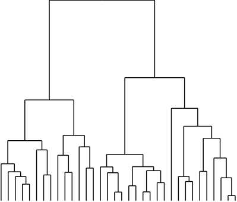

# Unsupervised Learning

> You have no labels and no score to tell you if you are right. Transform the data (scaling, PCA, NMF, t-SNE) or group it (k-means, agglomerative, DBSCAN), then judge the result mostly by looking at it. Plus the two Ng exercises that sit next door: Gaussian anomaly detection and collaborative filtering.

Blocks run top to bottom from this `notes/` folder. Figures attributed to M&G are the book's own; the face examples need the `fetch_lfw_people` download, so they are reported and not rerun here.

---

## Two kinds, one problem

| Kind | Goal | Examples |
|---|---|---|
| Transformations | A new representation: fewer dimensions, more interpretable parts, a 2-D picture | Scaling, PCA, NMF, t-SNE |
| Clustering | Partition the data into groups of similar items | k-means, agglomerative, DBSCAN |

**The challenge:** there is no ground truth, so there is no score that says the model did well. Was the clustering of face photos by pose, lighting or identity? You have to look. Unsupervised methods are therefore used most for *exploration* and as *preprocessing* for a supervised model, where the downstream score does give feedback.

---

## Preprocessing and scaling

| Scaler | Result | Use when |
|---|---|---|
| `StandardScaler` | Mean 0, variance 1 per feature | Default for SVMs, linear models, MLPs, PCA |
| `RobustScaler` | Median and IQR | Outliers present |
| `MinMaxScaler` | Range [0, 1] | Bounded inputs needed (images, some NNs) |
| `Normalizer` | Each *row* to unit length | Only direction matters (text vectors, cosine) |

**Scale train and test with the same fitted scaler.** Fitting a second `MinMaxScaler` on the test set maps it to [0, 1] independently and shifts every point relative to the training data: M&G's plot shows the test points visibly displaced. `fit` on train, `transform` both, inside a pipeline ([03](03-feature-engineering-and-pipelines.md#pipelines)).

Effect on a kernel SVM on breast cancer: 0.63 unscaled, 0.97 with `MinMaxScaler`, 0.96 with `StandardScaler`.

---

## Principal component analysis

PCA rotates the data so the first axis follows the direction of maximum variance, the second the maximum variance orthogonal to it, and so on. Keep the first $k$ to reduce dimensions.

```python
import numpy as np
from sklearn.datasets import load_breast_cancer, load_digits, make_blobs, make_moons
from sklearn.decomposition import PCA
from sklearn.preprocessing import StandardScaler

cancer = load_breast_cancer()
X_scaled = StandardScaler().fit_transform(cancer.data)    # PCA is scale-sensitive: scale first
pca = PCA(n_components=2).fit(X_scaled)
X_pca = pca.transform(X_scaled)                            # 569 x 30 -> 569 x 2
print(pca.components_.shape)                    # each row is a direction in feature space
print(pca.explained_variance_ratio_.round(3))   # how much variance each component keeps
```

```text
(2, 30)
[0.443 0.19 ]
```

The 2-D projection of breast cancer separates benign and malignant well, so even a linear classifier on two components does reasonably. Components are hard to interpret: each mixes all 30 features with positive and negative weights.

### Eigenfaces: PCA as feature extraction

On Labeled Faces in the Wild (3,023 images, 87×65 px = 5,655 pixels), a 1-nearest-neighbour classifier on raw pixels scores 0.23. After `PCA(n_components=100, whiten=True)` it scores 0.31. Distances between principal-component vectors are a better measure of face similarity than distances between pixels. Reconstructing a face from 10, 50, 100, 500 components shows coarse-to-fine detail.

### From scratch: Ng ex7

```python
# Ng ex7: PCA via SVD of the covariance matrix
def pca_svd(X_norm):
    m = X_norm.shape[0]
    Sigma = X_norm.T @ X_norm / m              # covariance (features already normalised)
    U, S, _ = np.linalg.svd(Sigma)
    return U, S                                 # columns of U = principal directions

def project(X_norm, U, K):  return X_norm @ U[:, :K]
def recover(Z, U, K):       return Z @ U[:, :K].T

# Choose K: smallest K with sum(S[:K]) / sum(S) >= 0.99  ("99% of variance retained")
U, S = pca_svd(X_scaled)
print("K for 99%:", np.searchsorted(np.cumsum(S) / S.sum(), 0.99) + 1)
print("agrees with sklearn, up to sign:", np.allclose(np.abs(U[:, 0]), np.abs(pca.components_[0])))
```

```text
K for 99%: 17
agrees with sklearn, up to sign: True
```

Ex7 applies this to 2-D toy data (projection and reconstruction lines), then to 5,000 32×32 faces reduced to 100 dimensions.

---

## Non-negative matrix factorisation

Like PCA, but components and coefficients are constrained to be **non-negative**. The data must be non-negative too (pixels, word counts, audio spectra). The result is additive parts: a face as "a bit of this lighting plus a bit of this pose."

```python
from sklearn.decomposition import NMF
digits = load_digits()
nmf = NMF(n_components=15, init="nndsvda", max_iter=1000, random_state=0).fit(digits.data[:1400])
X_nmf = nmf.transform(digits.data[1400:])
print(X_nmf.shape, "min coefficient", X_nmf.min(), "| reconstruction error", round(nmf.reconstruction_err_, 1))
```

```text
(397, 15) min coefficient 0.0 | reconstruction error 615.5
```

| | PCA | NMF |
|---|---|---|
| Components | Orthogonal, ordered by variance | Not ordered; all equally important |
| Signs | Mixed | Non-negative |
| Changing `n_components` | First components unchanged | All components change |
| Good for | Compression, decorrelation, visualisation | Interpretable parts; separating additive sources (M&G unmix three signals) |

NMF over word counts is a topic model: see [NLP topic models](../../03-nlp/notes/03-topic-models-and-summarization.md).

---

## Manifold learning: t-SNE

t-SNE finds a 2-D layout that preserves *neighbourhoods*: points close in the original space stay close. It is for visualisation only.

```python
from sklearn.manifold import TSNE
from sklearn.metrics import adjusted_rand_score
from sklearn.cluster import KMeans

digits_tsne = TSNE(random_state=42).fit_transform(digits.data)   # no transform(): can't map new points
digits_pca = PCA(n_components=2).fit_transform(digits.data)
for name, xy in [("PCA  ", digits_pca), ("t-SNE", digits_tsne)]:
    labels = KMeans(n_clusters=10, n_init=10, random_state=0).fit_predict(xy)
    print(name, "ARI of 10 clusters on the 2-D picture vs true digit:", round(adjusted_rand_score(digits.target, labels), 2))
```

```text
PCA   ARI of 10 clusters on the 2-D picture vs true digit: 0.39
t-SNE ARI of 10 clusters on the 2-D picture vs true digit: 0.89
```

On the 8×8 digits, PCA's 2-D projection overlaps most classes; t-SNE separates nearly all ten without seeing labels ([JMLR 2008](https://www.jmlr.org/papers/v9/vandermaaten08a.html), van der Maaten and Hinton). Rules for reading a t-SNE plot: cluster sizes and distances between clusters mean little; run more than one `perplexity`; never use it as features for a model. UMAP is the faster alternative with a claim to preserve more global structure, and it can map new points ([arXiv:1802.03426](https://arxiv.org/abs/1802.03426), McInnes et al., preprint). [NLP embeddings](../../03-nlp/notes/04-embeddings-and-similarity.md) uses t-SNE to plot word vectors.

---

## Clustering

### k-means

Alternate two steps until assignments stop changing: assign each point to the nearest centre; move each centre to the mean of its points.

```python
X, y_blob = make_blobs(n_samples=300, centers=3, random_state=1)
kmeans = KMeans(n_clusters=3, n_init="auto", random_state=0).fit(X)
print(kmeans.cluster_centers_.round(1))
print(kmeans.predict([[0.0, 4.0]]))       # new points go to the nearest centre
```

```text
[[ -1.5   4.4]
 [-10.1  -3.9]
 [ -7.1  -8. ]]
[0]
```

scikit-learn's default start, `init="k-means++"`, spreads the first centres apart instead of taking them at random. Its authors prove the seeding alone is $O(\log k)$-competitive with the optimal clustering ([ACM DL](https://dl.acm.org/doi/10.5555/1283383.1283494), Arthur and Vassilvitskii, SODA 2007).

Ng's ex7 version shows there is nothing more to it:

```python
def find_closest(X, centroids):
    d = ((X[:, None, :] - centroids[None, :, :]) ** 2).sum(-1)   # (m, K) squared distances
    return d.argmin(1)

def compute_centroids(X, idx, K):
    return np.array([X[idx == k].mean(0) for k in range(K)])

def run_kmeans(X, K, iters=10, seed=0):
    rng = np.random.default_rng(seed)
    C = X[rng.choice(len(X), K, replace=False)]   # init from random data points
    for _ in range(iters):
        idx = find_closest(X, C)
        C = compute_centroids(X, idx, K)
    return C, idx

from scipy.io import loadmat
X7 = loadmat("../practice/ng-machine-learning/ex7/data/ex7data2.mat")["X"]
C, idx = run_kmeans(X7, 3)
print(X7.shape, C.round(2).tolist(), np.bincount(idx))
```

```text
(300, 2) [[1.95, 5.03], [3.04, 1.02], [6.03, 3.0]] [ 98 102 100]
```

Ex7 then compresses a 128×128 bird photo by clustering its pixels' RGB values into 16 colours: each pixel stores a 4-bit index instead of 24 bits. That is **vector quantisation**: k-means as a decomposition where each point is represented by one component (its centre). M&G show that with many clusters (more than the input dimensions), k-means can be used as a feature expansion: 10 cluster distances make `two_moons` linearly separable.

**Failure cases.** k-means assumes clusters are round, of similar size and similar density, because it only uses distance to the centre. It fails on stretched clusters, clusters of different density and non-convex shapes (`two_moons`). Results depend on initialisation, hence `n_init`.

### Agglomerative clustering

Start with every point as its own cluster; repeatedly merge the two most similar clusters until `n_clusters` remain.

| `linkage` | Merges the pair that | Tends to give |
|---|---|---|
| `ward` (default) | Least increases total within-cluster variance | Equally sized clusters |
| `average` | Has smallest average pairwise distance | |
| `complete` | Has smallest maximum pairwise distance | |
| `single` | Has smallest minimum distance | Chains; one giant cluster |

No `predict` for new points. The merge history is a tree, drawn as a **dendrogram**:


*Image source: Müller & Guido, Introduction to Machine Learning with Python, companion repo `images/`*

```python
from scipy.cluster.hierarchy import dendrogram, ward
linkage_array = ward(X)
d = dendrogram(linkage_array, no_plot=True)   # long vertical lines = merging very different clusters: a natural cut
print(linkage_array[-3:, 2].round(1))         # the last three merge distances
```

```text
[ 12.4  51.2 144.9]
```

Sarkar uses the same Ward dendrogram to cluster movies by their descriptions in [NLP topic models](../../03-nlp/notes/03-topic-models-and-summarization.md).

### DBSCAN

Density-based: a point with at least `min_samples` neighbours within `eps` is a core point; clusters are connected core points plus their neighbours; everything else is **noise** (label −1).

```python
from sklearn.cluster import DBSCAN
Xm, ym = make_moons(n_samples=200, noise=0.05, random_state=0)
Xm_scaled = StandardScaler().fit_transform(Xm)     # eps is a distance: scale first
labels = DBSCAN(eps=0.5, min_samples=5).fit_predict(Xm_scaled)
km_labels = KMeans(n_clusters=2, n_init=10, random_state=0).fit_predict(Xm_scaled)
print("DBSCAN clusters", len(set(labels) - {-1}), "ARI", round(adjusted_rand_score(ym, labels), 2))
print("k-means ARI", round(adjusted_rand_score(ym, km_labels), 2))
```

```text
DBSCAN clusters 2 ARI 1.0
k-means ARI 0.5
```

The algorithm dates from Ester et al. ([KDD 1996](https://cdn.aaai.org/KDD/1996/KDD96-037.pdf)).

DBSCAN finds the number of clusters itself, handles arbitrary shapes (it solves `two_moons`), and flags outliers. `eps` is the hard parameter: too small and everything is noise, too large and everything is one cluster. `HDBSCAN` (scikit-learn 1.3+) removes most of that sensitivity.

### Comparing and evaluating

| With ground truth | Without ground truth |
|---|---|
| **Adjusted Rand Index** (ARI), normalised mutual information: 1 = same partition, ~0 = random. Ignore label names | **Silhouette** (−1 to 1): compactness vs separation. Favours round clusters; DBSCAN's correct `two_moons` gets a *worse* silhouette than k-means's wrong one |
| Never use accuracy: cluster 0 vs label 0 is arbitrary | Robustness: do clusters survive noise, different parameters, subsampling? |

In practice, the only reliable check is to inspect the clusters by hand. M&G's LFW case study runs all three algorithms on eigenfaces: DBSCAN finds one big cluster plus noise (the noise is faces with hats, open mouths, odd angles: an outlier detector); k-means with 10 clusters gives blurred "average faces" by pose and lighting; agglomerative gives similar groups with less uniform sizes. None finds identity.

| Algorithm | Specify | New points | Shapes | Noise |
|---|---|---|---|---|
| k-means | `n_clusters` | `predict` | Round, similar size | No |
| Agglomerative | `n_clusters` or distance cut | No | Depends on linkage | No |
| DBSCAN | `eps`, `min_samples` | No | Any | Yes |
| Gaussian mixture | `n_components` | `predict_proba` | Ellipses | Via low likelihood |

---

## Anomaly detection: Ng ex8, part 1

Model normal behaviour with a Gaussian per feature, then flag points with low density. Ex8 does this on server latency and throughput.

```python
def fit_gaussian(X):
    return X.mean(0), X.var(0)

def density(X, mu, var):
    # product of independent per-feature Gaussians (ex8 also does the full multivariate version)
    return np.prod(np.exp(-(X - mu) ** 2 / (2 * var)) / np.sqrt(2 * np.pi * var), axis=1)

def select_threshold(y_val, p_val):
    best_eps, best_f1 = 0, 0
    for eps in np.linspace(p_val.min(), p_val.max(), 1000):
        pred = p_val < eps
        tp = (pred & (y_val == 1)).sum(); fp = (pred & (y_val == 0)).sum(); fn = (~pred & (y_val == 1)).sum()
        if tp == 0: continue
        f1 = 2 * tp / (2 * tp + fp + fn)
        if f1 > best_f1: best_eps, best_f1 = eps, f1
    return best_eps, best_f1

ex8 = loadmat("../practice/ng-machine-learning/ex8/data/ex8data1.mat")
mu, var = fit_gaussian(ex8["X"])
eps, f1 = select_threshold(ex8["yval"].ravel(), density(ex8["Xval"], mu, var))
print(f"epsilon {eps:.2e}  F1 {f1:.3f}  flagged {(density(ex8['X'], mu, var) < eps).sum()} of {len(ex8['X'])}")
```

```text
epsilon 9.00e-05  F1 0.875  flagged 6 of 307
```

Two points worth carrying forward:

- **Train on unlabeled normal data, choose $\varepsilon$ on a labelled validation set by F1.** Accuracy would be useless: anomalies are rare ([04](04-model-evaluation.md#imbalanced-data-and-the-dummy-baseline)).
- **Anomaly detection vs supervised classification.** Use density estimation when positives are very few and future anomalies may look unlike past ones; use a classifier when you have many positives of a stable kind.

scikit-learn equivalents: `EllipticEnvelope` (Gaussian), `IsolationForest` (which isolates points with random splits rather than modelling density: [doi:10.1109/icdm.2008.17](https://doi.org/10.1109/icdm.2008.17), Liu et al., ICDM 2008), `LocalOutlierFactor`, `OneClassSVM`.

---

## Recommender systems: Ng ex8, part 2

Collaborative filtering on MovieLens (1,682 movies × 943 users, ratings 1–5, most missing). Learn a feature vector $x^{(i)}$ per movie and a preference vector $\theta^{(j)}$ per user so that $\theta^{(j)} \cdot x^{(i)}$ predicts the rating.

$$J = \tfrac{1}{2}\sum_{(i,j): r(i,j)=1} \left(\theta^{(j)\top} x^{(i)} - y^{(i,j)}\right)^2 + \tfrac{\lambda}{2}\lVert\Theta\rVert^2 + \tfrac{\lambda}{2}\lVert X\rVert^2$$

```python
def cofi_cost(X, Theta, Y, R, lam):
    E = (X @ Theta.T - Y) * R                      # only rated entries count
    J = 0.5 * (E ** 2).sum() + lam / 2 * ((Theta ** 2).sum() + (X ** 2).sum())
    X_grad = E @ Theta + lam * X
    Theta_grad = E.T @ X + lam * Theta
    return J, X_grad, Theta_grad

mov = loadmat("../practice/ng-machine-learning/ex8/data/ex8_movies.mat")
Y, R = mov["Y"], mov["R"]
print(Y.shape, "rated", int(R.sum()), f"({R.mean():.1%})")

# A few hundred steps of plain gradient descent on mean-normalised ratings, K=10
counts = np.maximum(R.sum(1, keepdims=True), 1)
mean = (Y * R).sum(1, keepdims=True) / counts
Yn = (Y - mean) * R
g = np.random.default_rng(0)
Xm_, Th = g.normal(0, 0.1, (Y.shape[0], 10)), g.normal(0, 0.1, (Y.shape[1], 10))
for i in range(301):
    J, Gx, Gt = cofi_cost(Xm_, Th, Yn, R, lam=5.0)
    Xm_, Th = Xm_ - 0.002 * Gx, Th - 0.002 * Gt
    if i % 150 == 0: print(i, round(J))
```

```text
(1682, 943) rated 100000 (6.3%)
0 50700
150 35054
300 34128
```

Ex8 checks the gradient numerically, adds a new user's ratings, **mean-normalises** each movie's ratings (otherwise a user with no ratings gets predicted 0 for everything), and optimises with `scipy.optimize.fmin_cg`. This is low-rank matrix factorisation: the same idea as PCA and NMF, fitted only on observed entries. It is the ancestor of the embedding models in [NLP embeddings](../../03-nlp/notes/04-embeddings-and-similarity.md): $x^{(i)}$ is a learned movie embedding.

---

## Practice

| Notebook | Covers | Runs |
|---|---|---|
| [`03-unsupervised-learning.ipynb`](../practice/intro-to-ml-in-python/03-unsupervised-learning.ipynb) | Scaling, PCA, eigenfaces, NMF, t-SNE, k-means, agglomerative, DBSCAN, evaluation | Needs internet once: `fetch_lfw_people` downloads ~200 MB; otherwise offline with `scikit-learn>=1.4`, `mglearn` |
| [`ex7.ipynb`](../practice/ng-machine-learning/ex7/ex7.ipynb) | k-means from scratch, image compression, PCA, eigenfaces | Legacy: Python 2.7; `scipy.misc.imread`/`toimage` removed in SciPy 1.2 (use `imageio` / `PIL`) |
| [`ex8.ipynb`](../practice/ng-machine-learning/ex8/ex8.ipynb) | Gaussian anomaly detection, collaborative filtering | Legacy: Python 2.7 kernel; data in `ex8/data/` |

---

## Pitfalls

| Pitfall | Symptom | Fix |
|---|---|---|
| Fitting a scaler on test data separately | Test points shift relative to train and scores drop for no visible reason | `fit` on train, `transform` both, inside a pipeline |
| PCA without scaling | The first component is whichever feature has the biggest unit | `StandardScaler` first, except for same-scale data such as pixels |
| Reading distances in a t-SNE plot | Conclusions about how far apart two groups are change with `perplexity` | Use it to look, never to measure, and rerun with other settings |
| Accuracy for a clustering | A perfect grouping scores near zero because labels are arbitrary | ARI or NMI with ground truth; silhouette and inspection without |
| k-means on non-round shapes | Moons or rings cut in half | DBSCAN or agglomerative with suitable linkage |
| `eps` without scaling in DBSCAN | Everything is noise, or one cluster | Scale first, then sweep `eps` |
| Collaborative filtering without mean normalisation | A new user is predicted 0 for every item | Subtract each item's mean rating |

## Try it

1. On breast cancer, find the smallest $K$ that keeps 90% of variance, then compare logistic-regression accuracy on those components with all 30 features.
2. Fit k-means with 2 to 8 clusters on the `make_blobs` data and print the silhouette of each. Does the score recover 3?
3. Sweep `eps` over 0.1, 0.2, 0.3, 0.5, 1.0, 2.0 on the scaled moons. When does DBSCAN give two clusters?
4. Compress an image with ex7's `run_kmeans` at K=16. Solution in [`ex7.ipynb`](../practice/ng-machine-learning/ex7/ex7.ipynb).

<details>
<summary>Answers</summary>

1. Seven components keep 90%. Five-fold accuracy in a pipeline is 0.972 against 0.981 with all 30, a small price for an input about 75% smaller.
2. No. The silhouette is 0.772 at 2 clusters and 0.721 at 3, because two of the three blobs sit close together. The score favours whichever split is cleanest and not the number that generated the data, which is why inspection stays part of the job.
3. At 0.1 and 0.2 there are seven fragments, with 161 and 6 points left as noise. At 0.3 and 0.5 there are two clusters and no noise. From 1.0 up everything is one cluster.

</details>

## Interview checklist

| Question | Answer |
|---|---|
| Why is unsupervised evaluation hard? | There is no ground truth, so no score says the structure is the one you wanted |
| Why scale before PCA? | PCA maximises variance, so without scaling, the feature with the largest unit dominates |
| PCA vs NMF? | PCA: orthogonal, signed, ordered. NMF: non-negative additive parts, unordered |
| PCA vs t-SNE? | PCA is linear, has a `transform`, and gives features. t-SNE preserves neighbourhoods and is for looking |
| How does k-means work, and when does it fail? | Alternates assign and update. Fails on non-round, unequal-size or unequal-density clusters |
| k-means vs DBSCAN? | k-means needs `k` and predicts new points. DBSCAN finds `k`, handles any shape and flags noise, but needs `eps` |
| How do you evaluate a clustering? | ARI or NMI with labels; silhouette plus manual inspection and stability without |
| Anomaly detection vs classification? | Density when positives are rare or novel; a classifier when positives are many and stable |
| What is collaborative filtering? | Low-rank factorisation of the ratings matrix fitted on observed entries, learning item and user vectors |

## Next

[Ensembles](06-ensembles.md): combine many trees through bagging, random forests and gradient boosting.
