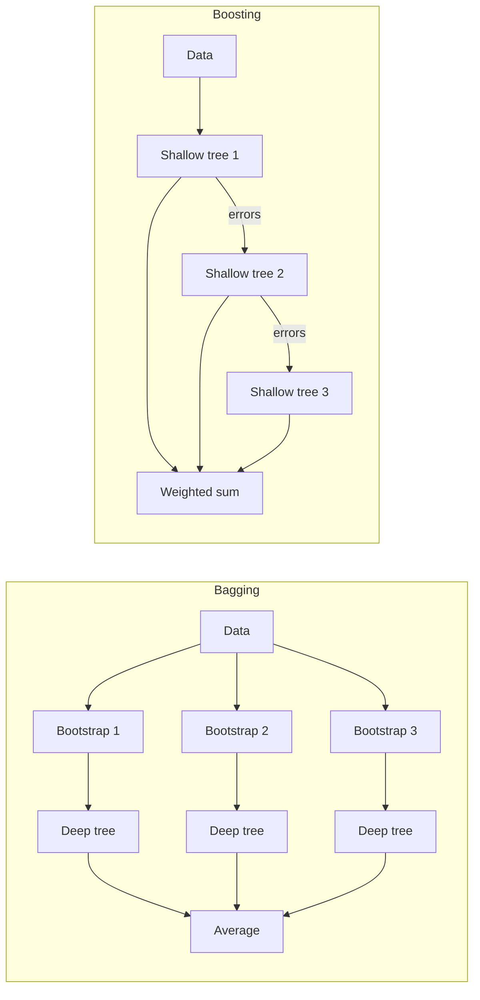

# Ensembles

> A single tree overfits, and many trees combined don't. Bagging averages independent deep trees to cut variance, which gives random forests. Boosting adds shallow trees one at a time, each fixing the last one's errors, to cut bias, which gives gradient boosting. Together they are the default for tabular data, and on the adult census they lift AUC from the 0.90 of the [evaluation note](04-model-evaluation.md) to 0.93.

Blocks run top to bottom from this `notes/` folder.



## Why combine models

A [decision tree](02-supervised-learning.md#decision-trees) has low bias and high variance: small changes in the data change the tree a lot. Averaging many models whose errors are not perfectly correlated reduces variance. If each of $B$ models has variance $\sigma^2$ and pairwise correlation $\rho$, the average has variance

$$\rho\sigma^2 + \frac{1-\rho}{B}\sigma^2$$

Adding more trees kills the second term; only *decorrelating* the trees attacks the first. That is the whole design of random forests.

| | Bagging / random forests | Boosting |
|---|---|---|
| Trees built | Independently, in parallel | Sequentially, each on the previous ensemble's errors |
| Each tree | Deep (low bias, high variance) | Shallow, depth 1–5 (high bias, low variance) |
| Reduces | Variance | Bias (and variance through shrinkage) |
| Combining | Average (or vote) | Weighted sum |
| More trees | Never hurts, only costs time | Eventually overfits without early stopping |
| Tuning effort | Low | Higher |

---

## Random forests

Breiman defined the method and its out-of-bag estimate ([doi:10.1023/a:1010933404324](https://doi.org/10.1023/a:1010933404324), Machine Learning 2001). Two sources of randomness make the trees different:

1. **Bootstrap sample.** Each tree trains on $n$ points drawn with replacement (about 63% unique; the remaining ~37% are "out-of-bag").
2. **Random feature subset at each split.** Each node considers only `max_features` randomly chosen features.

```python
from sklearn.datasets import load_breast_cancer
from sklearn.ensemble import RandomForestClassifier
from sklearn.model_selection import train_test_split
from sklearn.tree import DecisionTreeClassifier

cancer = load_breast_cancer()
X_train, X_test, y_train, y_test = train_test_split(cancer.data, cancer.target, random_state=0)

tree = DecisionTreeClassifier(random_state=0).fit(X_train, y_train)
forest = RandomForestClassifier(n_estimators=100, random_state=0, n_jobs=-1, oob_score=True).fit(X_train, y_train)
print(f"tree   train {tree.score(X_train, y_train):.3f}  test {tree.score(X_test, y_test):.3f}")
print(f"forest train {forest.score(X_train, y_train):.3f}  test {forest.score(X_test, y_test):.3f}  oob {forest.oob_score_:.3f}")
```

```text
tree   train 1.000  test 0.881
forest train 1.000  test 0.972  oob 0.962
```

The forest is ahead of a single tree with no tuning, and the out-of-bag score, which needs no separate validation set, is a fair estimate of the test score.

| Parameter | Effect | Default advice |
|---|---|---|
| `n_estimators` | More trees: smoother, more stable; diminishing returns | As many as time and memory allow (100–500) |
| `max_features` | Low: more random, less correlated trees, each weaker. High: trees alike | `"sqrt"` for classification, `1.0` for regression (scikit-learn defaults) |
| `max_depth`, `min_samples_leaf` | Pre-pruning; rarely needed | Tune only to cut memory/time |
| `n_jobs=-1` | Train trees on all cores | Always |
| `random_state` | Results vary between seeds with few trees | Fix it for reproducibility |

**Strengths:** strong out of the box, no scaling, handles mixed feature types, parallel, OOB score for free. **Weaknesses:** poor on very high-dimensional sparse data (text: use linear models, see [NLP text classification](../../03-nlp/notes/02-text-classification.md)); slow to predict with many deep trees; less interpretable than one tree; cannot extrapolate beyond the training range.

`ExtraTreesClassifier` adds a third source of randomness (random split thresholds); faster, sometimes as good.

---

## Gradient boosting

Friedman framed boosting as gradient descent on a loss ([doi:10.1214/aos/1013203451](https://doi.org/10.1214/aos/1013203451), Annals of Statistics 2001). Fit a shallow tree; compute the residuals (more generally, the negative gradient of the loss with respect to the current predictions); fit the next tree to those; add it scaled by a learning rate; repeat.

$$F_m(x) = F_{m-1}(x) + \eta \, h_m(x), \qquad h_m \approx -\frac{\partial L(y, F_{m-1}(x))}{\partial F_{m-1}(x)}$$

For squared error the negative gradient *is* the residual; for log-loss it is $y - p$. Gradient boosting is gradient descent in function space.

```python
from sklearn.ensemble import GradientBoostingClassifier

for label, params in [("default, depth 3, lr 0.1", {}), ("stumps, depth 1", {"max_depth": 1}), ("lr 0.01", {"learning_rate": 0.01})]:
    gbrt = GradientBoostingClassifier(random_state=0, **params).fit(X_train, y_train)
    print(f"{label:25} train {gbrt.score(X_train, y_train):.3f}  test {gbrt.score(X_test, y_test):.3f}")
```

```text
default, depth 3, lr 0.1   train 1.000  test 0.965
stumps, depth 1           train 0.991  test 0.972
lr 0.01                   train 0.988  test 0.958
```

| Parameter | Effect |
|---|---|
| `learning_rate` ($\eta$) | Shrinks each tree's contribution. Lower needs more trees, generalises better |
| `n_estimators` | Number of boosting rounds. **Too many overfits** |
| `max_depth` | Tree size; 1–5. Depth $d$ captures interactions of up to $d$ features |
| `subsample` < 1 | Stochastic gradient boosting: each tree on a random fraction; regularises |
| `n_iter_no_change`, `validation_fraction` | Early stopping |

**The tuning recipe:** fix `n_estimators` by time budget, then search `learning_rate` and `max_depth`; or use a low learning rate with early stopping on a validation set.

Because `n_estimators` and `learning_rate` trade against each other, a grid over both is wasteful; early stopping picks `n_estimators` for you.

### HistGradientBoosting

For more than ~10k rows, use `HistGradientBoostingClassifier` / `Regressor`: features are binned into ≤255 histograms, orders of magnitude faster, native missing-value and categorical support, early stopping on by default above 10k samples. It is scikit-learn's implementation of the LightGBM approach.

```python
import pandas as pd
from sklearn.ensemble import HistGradientBoostingClassifier
from sklearn.metrics import roc_auc_score
from sklearn.pipeline import make_pipeline
from sklearn.preprocessing import OneHotEncoder
from sklearn.compose import make_column_transformer

cols = ["age", "workclass", "fnlwgt", "education", "education-num", "marital-status",
        "occupation", "relationship", "race", "gender", "capital-gain", "capital-loss",
        "hours-per-week", "native-country", "income"]
adult = pd.read_csv("../practice/intro-to-ml-in-python/data/adult.data", header=None, names=cols,
                    skipinitialspace=True, na_values="?").drop(columns=["fnlwgt", "education"])
y = (adult.pop("income") == ">50K").astype(int)
cats = list(adult.select_dtypes(exclude="number").columns)
adult[cats] = adult[cats].astype("category")
Xa_train, Xa_test, ya_train, ya_test = train_test_split(adult, y, stratify=y, test_size=0.2, random_state=0)

hgb = HistGradientBoostingClassifier(max_iter=500, learning_rate=0.05, categorical_features="from_dtype",
                                     random_state=0).fit(Xa_train, ya_train)
one_hot = make_column_transformer((OneHotEncoder(handle_unknown="ignore"), cats), remainder="passthrough")
forest_a = make_pipeline(one_hot, RandomForestClassifier(n_estimators=300, n_jobs=-1, random_state=0)).fit(Xa_train, ya_train)
print(f"forest AUC {roc_auc_score(ya_test, forest_a.predict_proba(Xa_test)[:, 1]):.4f}")
print(f"HGB    AUC {roc_auc_score(ya_test, hgb.predict_proba(Xa_test)[:, 1]):.4f}  rounds {hgb.n_iter_}")
```

```text
forest AUC 0.8958
HGB    AUC 0.9269  rounds 193
```

Boosting beats the forest by 0.03 on the adult census, with no tuning beyond a lower learning rate, and it found 193 rounds by early stopping on its own internal validation split. This table recurs, across libraries and seeds, in the next note.

---

## Feature importance

Tree ensembles report `feature_importances_`: the total impurity decrease from splits on each feature, averaged over trees, normalised to sum to 1. The three models spread that credit differently:

```python
import numpy as np

gbrt = GradientBoostingClassifier(random_state=0).fit(X_train, y_train)
for name, m in [("tree", tree), ("forest", forest), ("boosting", gbrt)]:
    imp = m.feature_importances_
    print(f"{name:9} non-zero {int((imp > 0).sum()):2d} of {imp.size}   top 3 share {np.sort(imp)[-3:].sum():.2f}")
```

```text
tree      non-zero  9 of 30   top 3 share 0.89
forest    non-zero 30 of 30   top 3 share 0.39
boosting  non-zero 30 of 30   top 3 share 0.75
```

A single tree picks one of each correlated group, ignoring the rest. Forest feature subsets force it to try the others, so credit spreads. Three caveats follow, and [model interpretability](08-model-interpretability.md) shows each on real output:

- **Impurity importance favours high-cardinality features** and is computed on training data, so it rewards what the model overfit.
- **Correlated features share or steal credit.** A low importance doesn't mean a feature is useless.
- **Importance says how much, never which direction.** Use permutation importance, partial dependence and SHAP instead.

---

## Stacking and voting

Combine different model families rather than many trees:

```python
from sklearn.ensemble import StackingClassifier
from sklearn.linear_model import LogisticRegression
from sklearn.preprocessing import StandardScaler
from sklearn.svm import SVC

svc = make_pipeline(StandardScaler(), SVC(probability=True, random_state=0))
stack = StackingClassifier(
    estimators=[("rf", RandomForestClassifier(random_state=0)), ("svc", svc)],
    final_estimator=LogisticRegression(), cv=5).fit(X_train, y_train)   # the meta-model sees out-of-fold predictions
print(f"rf {forest.score(X_test, y_test):.3f}  svc {svc.fit(X_train, y_train).score(X_test, y_test):.3f}  stack {stack.score(X_test, y_test):.3f}")
```

```text
rf 0.972  svc 0.965  stack 0.972
```

Gains are usually small and the system gets harder to maintain. Kaggle uses stacking heavily (see the Kaggle notebook in [NLP text classification](../../03-nlp/notes/02-text-classification.md)); production usually doesn't.

---

## Beyond scikit-learn

XGBoost, LightGBM and CatBoost run most tabular production boosting. All three expose a scikit-learn-compatible API, so they drop into the pipelines and grid searches of [feature engineering and pipelines](03-feature-engineering-and-pipelines.md) and [evaluation](04-model-evaluation.md). [Boosting in practice](07-boosting-in-practice.md) compares them on the adult census.

---

## Rules of thumb

| Rule | Why |
|---|---|
| Random forest is the first serious model on a tabular problem | Strong with no tuning; gives a bar to beat |
| Gradient boosting (Hist/LightGBM/XGBoost) when you need the last points of accuracy | Best tabular performance; needs tuning |
| Use early stopping instead of grid-searching `n_estimators` | Learning rate and rounds trade off |
| More forest trees never overfit; more boosting rounds do | Averaging vs sequential fitting |
| Report permutation importance or SHAP, not impurity importance | Impurity importance is biased and train-set based |
| Don't use tree ensembles on sparse text features | Linear models win there |

---

## Pitfalls

| Pitfall | Symptom | Fix |
|---|---|---|
| Boosting with too many rounds and no early stopping | Train at 1.0, test below the earlier rounds | `n_iter_no_change` or a staged test on a validation set |
| Reading forest train accuracy as quality | Train 1.000 for every forest | Use test or `oob_score_` |
| Grid over `n_estimators` and `learning_rate` | Long search with a flat optimum | Early stopping picks rounds |
| Forest on sparse text | Slow and worse than a linear model | Linear model first |
| Extrapolating with trees | Prediction flat beyond the training range, as in the RAM price example of [`02-supervised-learning.ipynb`](../practice/intro-to-ml-in-python/02-supervised-learning.ipynb) | Use a linear trend plus trees on the residual, or features that don't need extrapolating |
| Quoting `feature_importances_` as a finding | A random column gets non-trivial credit | [Permutation importance](08-model-interpretability.md) on held-out data |
| Stacking without out-of-fold predictions | Meta-model trusts overfit base models | Use `cv=` in `StackingClassifier` |

## Try it

1. Set `max_features=1.0` on the forest above, so it is plain bagging. Does the test score change? Explain with the $\rho\sigma^2$ term.
2. Grow a forest on breast cancer with `n_estimators` of 1, 5, 25, 100, 500. Where does the out-of-bag score stop improving?
3. Fit gradient boosting with `n_estimators=2000, learning_rate=0.5, max_depth=3`, and use `staged_predict` to find the best round on the test set. Why is that test score now optimistic?

<details>
<summary>Answers</summary>

1. On this split plain bagging scores 0.986 and the `sqrt` forest 0.972, a difference of two test rows out of 143. So the term is not visible here: on a small, easy dataset correlated trees are good enough. Compare over many splits before claiming a winner.
2. Out-of-bag accuracy is 0.883 at 5 trees (with a warning, because some points are never out of bag), 0.960 at 25, 0.962 at 100, and 0.960 at 500. It stops improving around 25 to 100.
3. Accuracy peaks at 0.986 at round 90 and is 0.979 at round 2000. The peak is optimistic because you chose the round using the test set. Pick it on a validation set instead.

</details>

For the notebook version, see [`02-supervised-learning.ipynb`](../practice/intro-to-ml-in-python/02-supervised-learning.ipynb), section "Ensembles of Decision Trees". It runs offline with `scikit-learn>=1.4` and the local `mglearn`.

## Interview checklist

| Question | Answer |
|---|---|
| Bagging vs boosting? | Bagging averages independent deep trees to cut variance. Boosting adds shallow trees sequentially to cut bias |
| Why does a random forest subset features? | It decorrelates the trees, which attacks the $\rho\sigma^2$ term that more trees cannot |
| What is the out-of-bag score? | Accuracy on points left out of each tree's bootstrap, about 37% per tree, giving a validation estimate at no extra cost |
| Do more trees overfit? | Not in a forest. In boosting, yes, without early stopping |
| What does a boosting tree fit? | The negative gradient of the loss at the current prediction: residuals for squared error, $y - p$ for log-loss |
| What does the learning rate do? | Shrinks each tree's contribution. Lower needs more trees and usually generalises a little better |
| What makes `HistGradientBoosting` fast? | Binning features into at most 255 values before searching splits |
| Why can't trees extrapolate? | A leaf predicts a constant from training targets, so predictions stop at the training range |
| When is stacking worth it? | Competitions, when the last small gain matters more than maintenance |

## Next

[Boosting in practice](07-boosting-in-practice.md): the libraries that made boosting the default, tested head to head.
