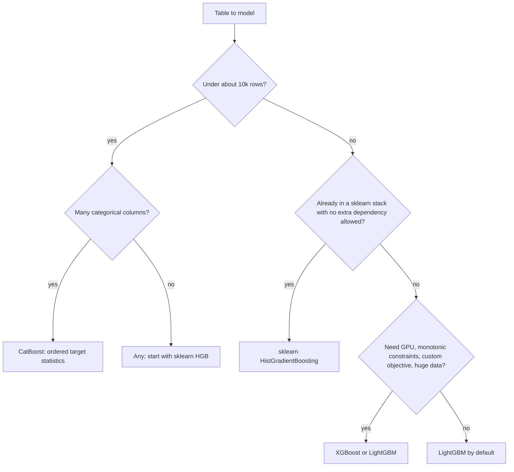

# Boosting in Practice

> You have settled on gradient boosting for a table. Now there are four libraries, each claiming to be best, each with its own knobs. Which do you pick, and does it matter? On the adult census they finish within a thousandth of AUC of each other, well inside the noise from the split. What differs is speed, how they treat categories and missing values, and what they ask you to tune. This note explains those differences and how to choose.

[Ensembles](06-ensembles.md) gave the idea: add shallow trees, each fitted to the gradient of the loss. This note is about the engineering that made that idea the default for tables. Blocks run top to bottom from this `notes/` folder with the packages in the command below; the numbers are from running them.

```bash
uv run --python 3.12 --with scikit-learn --with xgboost --with lightgbm --with catboost --with pandas python ...
```

## The experiment

[`compare_boosters.py`](../practice/boosting-comparison/compare_boosters.py) trains every library on adult census, 32,561 rows, after dropping `fnlwgt` (a sampling weight) and `education` (a copy of `education-num`). All use learning rate 0.05, up to 2,000 rounds, and patience of 50 on a validation set. The test set is 20%, and the whole thing repeats over five seeds. Nothing else is tuned, so this measures defaults.

| Model | AUC | sd | Log-loss | Accuracy | Seconds | Rounds |
|---|---|---|---|---|---|---|
| Majority class | 0.5000 | 0.0000 | 0.5519 | 0.7592 | 0.0 | 0 |
| Random forest, 300 trees, one-hot | 0.8969 | 0.0028 | 0.4018 | 0.8506 | 0.8 | 300 |
| sklearn `GradientBoosting`, one-hot | 0.9294 | 0.0030 | 0.2769 | 0.8737 | 15.7 | 975 |
| sklearn `HistGradientBoosting` | 0.9291 | 0.0025 | 0.2765 | 0.8720 | 3.3 | 285 |
| XGBoost `hist` | 0.9292 | 0.0025 | 0.2766 | 0.8739 | 0.5 | 255 |
| LightGBM | 0.9295 | 0.0024 | 0.2758 | 0.8750 | 0.6 | 230 |
| CatBoost | 0.9297 | 0.0030 | 0.2761 | 0.8741 | 5.9 | 666 |

*Own run, mean of five seeds, four threads, on a laptop busy with other work. Treat seconds as rough ratios.*

Read it in this order:

1. **The libraries are tied.** The AUC gap from best to worst is 0.0006, while the same model moves by about 0.003 between seeds. No conclusion about which library is better is available from this table, and a blog post claiming one from a single split is reading noise. Across the seeds no library wins every time: CatBoost wins seeds 1 and 4 for AUC, XGBoost seed 3, LightGBM seed 0, and sklearn's classic booster seed 2.
2. **Boosting beats the untuned forest by 0.03 AUC.** The forest is the fast bar to clear. Its log-loss of 0.40 is much worse than its AUC suggests: unpruned trees give overconfident probabilities on some rows, which is a [calibration](04-model-evaluation.md#calibration-is-a-08-really-80) issue and not a ranking one.
3. **Speed varies by 30x.** The classic booster sorts every feature at every node, while the histogram libraries bin once. On a table this small it hardly matters. On 10M rows it decides what you can afford.

The original benchmarks agree in shape. CatBoost's authors report their library ahead by 1 to 2% in log-loss on Adult against LightGBM and XGBoost (0.270 against +2.4% and +2.2%), but they tune each on their own split and preprocess all with ordered target statistics, and it is their own benchmark ([arXiv:1706.09516](https://arxiv.org/abs/1706.09516), Prokhorenkova et al., NeurIPS 2018). That lead is much smaller than the gap in our table between tuned and default models usually is, and our run has none of it.

The choice between trees and neural networks is a separate question. Grinsztajn et al. benchmark both across 45 tabular datasets and find tree-based models remain state of the art on medium-sized data of about 10K samples, with a 20,000 compute-hour search for each learner ([arXiv:2207.08815](https://arxiv.org/abs/2207.08815), NeurIPS 2022).

## What every library shares

They all fit trees one at a time to gradient statistics. Chen and Guestrin's formulation is the clearest statement of what happens at each node, and the others are variations on it ([arXiv:1603.02754](https://arxiv.org/abs/1603.02754), KDD 2016).

For each row, take the first derivative $g_i$ and second derivative $h_i$ of the loss at the current prediction. With a penalty $\gamma T + \frac{1}{2}\lambda \lVert w \rVert^2$ on the number of leaves $T$ and on leaf weights $w$, the best weight for a leaf holding rows $I$, and the gain from splitting $I$ into $L$ and $R$, are

$$w^* = -\frac{\sum_{i \in I} g_i}{\sum_{i \in I} h_i + \lambda}, \qquad
\text{gain} = \frac{1}{2}\left[\frac{G_L^2}{H_L + \lambda} + \frac{G_R^2}{H_R + \lambda} - \frac{(G_L + G_R)^2}{H_L + H_R + \lambda}\right] - \gamma$$

A leaf is a Newton step, and that is more than a formula. Check it by hand against a real one-tree XGBoost model:

```python
import numpy as np
import pandas as pd
import xgboost as xgb

rng = np.random.default_rng(0)
x = rng.uniform(size=(1000, 1))
y0 = (rng.uniform(size=1000) < np.where(x[:, 0] > 0.5, 0.8, 0.2)).astype(int)

booster = xgb.train({"max_depth": 1, "eta": 1.0, "lambda": 1.0, "base_score": 0.5,
                     "objective": "binary:logistic", "min_child_weight": 0},
                    xgb.DMatrix(x, label=y0), num_boost_round=1)
leaf_values = booster.get_dump(dump_format="json")[0]

p = 0.5                                # the prediction before the first tree
g, h = p - y0, np.full(1000, p * (1 - p))     # log-loss derivatives at p
right = x[:, 0] > 0.5                 # the split the tree found is close to the true one
leaf_ids = booster.predict(xgb.DMatrix(x), pred_leaf=True).astype(int)
for side in np.unique(leaf_ids):
    I = leaf_ids == side
    print("leaf", side, "rows", I.sum(), "by hand", round(-g[I].sum() / (h[I].sum() + 1.0), 4),
          "in the model", round(float(booster.predict(xgb.DMatrix(x[I][:1]), output_margin=True)[0]), 4))
```

@@A@@

The same paper shows two other things worth knowing. Its sparsity-aware algorithm learns a default direction for missing values at each split, and runs more than 50 times faster than a naive version on the Allstate-10K dataset, because it only visits non-missing entries. And it gives a benchmark of one era's libraries: on 1M Higgs rows, 500 trees of depth 8, XGBoost took 0.68 seconds per tree where scikit-learn took 28.5, for AUCs of 0.8304 and 0.8302. Neither of those is a modern sklearn: that is the gap `HistGradientBoosting` closed.

Boosting is also sequential by nature, not just by habit. Karbasi and Larsen show that cutting rounds below a threshold forces an exponential blow-up in training work ([arXiv:2301.09627](https://arxiv.org/abs/2301.09627), preprint). This is why every library here parallelises *inside* a tree, on split finding, and never across rounds.

## Where they differ



| | sklearn HGB | XGBoost | LightGBM | CatBoost |
|---|---|---|---|---|
| Split finding | Histogram, up to 255 bins | Histogram (`hist`), or exact | Histogram | Histogram |
| Tree growth | Leaf-wise | Depth-wise (`hist` also allows leaf-wise) | Leaf-wise | Symmetric (oblivious): same split at each level |
| Key size knob | `max_leaf_nodes` (31) | `max_depth` (6) | `num_leaves` (31) | `depth` (6) |
| Categoricals | Native, `categorical_features` up to 255 levels | `enable_categorical=True` | Native, as `category` dtype | Ordered target statistics, `cat_features` |
| Missing values | Native | Learned default direction | Native | Numeric yes; categorical needs a label |
| Early stopping | Built in, internal validation split | `early_stopping_rounds` with `eval_set` | `early_stopping` callback | `early_stopping_rounds` |
| Dependency | Already there | Extra | Extra | Extra, larger |

The defaults in brackets come from each library's documentation: [scikit-learn](https://scikit-learn.org/stable/modules/ensemble.html), [XGBoost](https://xgboost.readthedocs.io/), [LightGBM](https://lightgbm.readthedocs.io/), [CatBoost](https://catboost.ai/docs/).

**LightGBM's contributions** are named in its title paper: Gradient-based One-Side Sampling keeps rows with large gradients and samples the rest, and Exclusive Feature Bundling merges features that are rarely non-zero together. The authors report up to over 20 times the speed of conventional GBDT at almost the same accuracy on their benchmarks ([NeurIPS 2017](https://papers.nips.cc/paper/6907-lightgbm-a-highly-efficient-gradient-boosting-decision-tree), Ke et al.). Leaf-wise growth is the source of its main pitfall: a tree with 31 leaves can be up to 30 levels deep on one side, so on small data you should cap `num_leaves` or `min_child_samples`.

## How CatBoost avoids target leakage

Trees want numbers. If a category has too many levels to one-hot, the obvious trick is to replace each level with the mean of the target for that level. Prokhorenkova et al. show that this leaks: each row's own label is in its own feature. The extreme case is a column that is unique per row, such as an ID, where the encoding is the label itself. Their fix is to order the rows randomly and encode each row using only the rows before it, like a sequence of arriving data.

This is easy to see. The block adds a useless ID column to adult, encodes it both ways and fits the same booster:

```python
from lightgbm import LGBMClassifier
from sklearn.metrics import roc_auc_score
from sklearn.model_selection import train_test_split

cols = ["age", "workclass", "fnlwgt", "education", "education-num", "marital-status",
        "occupation", "relationship", "race", "gender", "capital-gain", "capital-loss",
        "hours-per-week", "native-country", "income"]
adult = pd.read_csv("../practice/intro-to-ml-in-python/data/adult.data", header=None, names=cols,
                    skipinitialspace=True, na_values="?").drop(columns=["fnlwgt", "education"])
y = (adult.pop("income") == ">50K").astype(int)
cats = list(adult.select_dtypes(exclude="number").columns)
adult[cats] = adult[cats].astype("category")
X_dev, X_test, y_dev, y_test = train_test_split(adult, y, stratify=y, test_size=0.2, random_state=0)
X_tr, X_val, y_tr, y_val = train_test_split(X_dev, y_dev, stratify=y_dev, test_size=0.2, random_state=0)

rng = np.random.default_rng(0)
ids_tr = rng.integers(0, 3000, len(X_tr))        # a meaningless ID with about 3,000 levels
prior = y_tr.mean()

def greedy(ids, y, a=1.0):                       # mean of the target per level, own row included
    s = pd.Series(y.values).groupby(ids).agg(["sum", "count"])
    return (s["sum"].reindex(ids).values + a * prior) / (s["count"].reindex(ids).values + a)

def ordered(ids, y, seed=0, a=1.0):              # the same mean, using only rows earlier in a random order
    order = np.random.default_rng(seed).permutation(len(ids))
    total, count, out = {}, {}, np.zeros(len(ids))
    for i in order:
        k = ids[i]
        out[i] = (total.get(k, 0.0) + a * prior) / (count.get(k, 0) + a)
        total[k] = total.get(k, 0.0) + y.values[i]
        count[k] = count.get(k, 0) + 1
    return out

def score_with(col_tr, name):
    ids_te = rng.integers(0, 3000, len(X_test))  # at test time the ID says nothing
    s = pd.Series(y_tr.values).groupby(ids_tr).agg(["sum", "count"])
    te = (s["sum"].reindex(ids_te).fillna(0).values + prior) / (s["count"].reindex(ids_te).fillna(0).values + 1)
    m = LGBMClassifier(n_estimators=200, learning_rate=0.05, verbose=-1, n_jobs=4, random_state=0)
    m.fit(X_tr.assign(id_te=col_tr), y_tr)
    print(f"{name:10} train AUC {roc_auc_score(y_tr, m.predict_proba(X_tr.assign(id_te=col_tr))[:, 1]):.3f}"
          f"  test AUC {roc_auc_score(y_test, m.predict_proba(X_test.assign(id_te=te))[:, 1]):.3f}")

base = LGBMClassifier(n_estimators=200, learning_rate=0.05, verbose=-1, n_jobs=4, random_state=0).fit(X_tr, y_tr)
print(f"no ID      train AUC {roc_auc_score(y_tr, base.predict_proba(X_tr)[:, 1]):.3f}"
      f"  test AUC {roc_auc_score(y_test, base.predict_proba(X_test)[:, 1]):.3f}")
score_with(greedy(ids_tr, y_tr), "greedy")
score_with(ordered(ids_tr, y_tr), "ordered")
```

@@B@@

@@BP@@

Their paper quantifies the same effect across libraries: with greedy target statistics, log-loss on Adult is 1.1% worse than with ordered ones, on Amazon it is 40% worse, and leave-one-out on Adult is 5.5% worse. Ordered statistics are the safe default. The same argument extends to the boosting itself: a model's residuals on its own training rows are biased ("prediction shift"), so CatBoost's ordered mode computes each row's gradient from a model that has not seen it. That is most useful on small data, where the plain mode on Adult loses 1.1% log-loss and on Internet 3.9%, and it costs about 1.7 times the training time of plain mode on Epsilon.

The takeaway generalises past CatBoost. **Any encoding that reads the target must be fitted out of fold**, like every other fitted step in [feature engineering and pipelines](03-feature-engineering-and-pipelines.md#leakage-and-why-pipelines-exist). scikit-learn's `TargetEncoder` does this with internal cross-fitting.

## Tuning order

The important knobs are few, and they interact. Fix the learning rate, let early stopping pick the rounds, then tune tree size and sampling:

```python
for lr in [0.3, 0.1, 0.05, 0.02]:
    m = LGBMClassifier(learning_rate=lr, n_estimators=5000, verbose=-1, n_jobs=4, random_state=0)
    m.fit(X_tr, y_tr, eval_set=[(X_val, y_val)],
          callbacks=[__import__("lightgbm").early_stopping(50, verbose=False)])
    print(f"lr {lr:<5} rounds {m.best_iteration_:<5} test AUC {roc_auc_score(y_test, m.predict_proba(X_test)[:, 1]):.4f}")

for leaves in [4, 8, 16, 31, 64, 128]:
    m = LGBMClassifier(learning_rate=0.05, n_estimators=5000, num_leaves=leaves, verbose=-1, n_jobs=4, random_state=0)
    m.fit(X_tr, y_tr, eval_set=[(X_val, y_val)],
          callbacks=[__import__("lightgbm").early_stopping(50, verbose=False)])
    print(f"leaves {leaves:<4} rounds {m.best_iteration_:<5} test AUC {roc_auc_score(y_test, m.predict_proba(X_test)[:, 1]):.4f}")
```

@@C@@

@@CP@@

| Step | Knob | Range to try | Why |
|---|---|---|---|
| 1 | Learning rate | 0.1 for search, 0.02 to 0.05 for the final fit | Lower is slower and slightly better, with diminishing returns |
| 2 | Rounds | Early stopping, patience 50 | Rounds and learning rate trade against each other, so never grid them jointly |
| 3 | Tree size (`num_leaves`, `max_depth`) | 8 to 64 leaves, depth 3 to 8 | The main control of interaction order and overfitting |
| 4 | Minimum leaf size (`min_child_samples`) | 5 to 200 | Stops small noisy leaves; matters on small data |
| 5 | Row and column sampling | 0.5 to 1.0 | Decorrelates trees and speeds fitting. XGBoost's Higgs run at `colsample=0.5` trades a little AUC for a little speed |
| 6 | L1 and L2 on leaf weights | 0 to 10 on a log scale | Usually the smallest effect |

Use a random or Bayesian search over steps 3 to 6 on a coarse learning rate. Don't report the score it finds as the final one: reserve a test set, or use [nested CV](04-model-evaluation.md#nested-cross-validation).

## Pitfalls

| Pitfall | Symptom | Fix |
|---|---|---|
| Declaring a library winner from one split | A 0.001 AUC lead that flips with the seed | Repeat over seeds, compare gap to spread |
| Early stopping on the test set | Test score is optimistic, and live score is lower | A separate validation set for stopping, then test once |
| Target-encoding on the full training set | Train AUC near perfect, test no better or worse | Out-of-fold or ordered encoding |
| High `num_leaves` on small data | Train far above validation after few rounds | Cap leaves, raise `min_child_samples` |
| Trusting the out-of-the-box probabilities | Good AUC, poor log-loss or reliability | Recalibrate on held-out data ([evaluation](04-model-evaluation.md#calibration-is-a-08-really-80)) |
| Column dtypes that differ between train and serving | LightGBM errors, or silently uses other categories | Fix categories explicitly and save them with the model |
| Grid over `n_estimators` and learning rate | Long search with a flat result | Early stopping picks the rounds |
| `random_state` fixed once, and comparison made | A chosen seed flatters one candidate | Report mean and spread across seeds |

## Try it

1. Run `compare_boosters.py` with `LR = 0.1`. Does the ranking change, and what happens to the rounds and the seconds?
2. Add `class_weight="balanced"` (LightGBM) and compare AUC, log-loss and accuracy. Explain why they don't move together.
3. Train LightGBM with `max_depth=3` and `num_leaves=8` against the default. Which overfits first?
4. Implement a depth-1 XGBoost on regression with `objective="reg:squarederror"` and confirm the leaf weight by hand. What are $g$ and $h$ now?

<details>
<summary>Answers</summary>

1. Rounds shrink by about half or more, seconds with them, and the libraries remain tied within noise.
2. AUC is close to unchanged because reweighting hardly changes the ranking. Log-loss and calibration get worse because the weights push predicted probabilities up, and accuracy falls at a 0.5 threshold because the model now flags more rows.
3. The default. It has about four times the leaves per tree, so it fits the training set faster and early stopping fires sooner.
4. With $L = \frac{1}{2}(y - \hat{y})^2$, $g_i = \hat{y}_i - y_i$ and $h_i = 1$, so the leaf weight is the sum of residuals over $(n + \lambda)$: a shrunken mean of residuals.

</details>

## Interview checklist

| Question | Answer |
|---|---|
| Which boosting library is best? | On many tables they tie after sensible settings. Choose by speed, categorical handling and what is already in the stack |
| What does XGBoost add to classic gradient boosting? | Second-order leaf weights, explicit regularisation, sparsity-aware splits, and a fast systems design |
| What makes LightGBM fast? | Histograms, GOSS sampling, EFB bundling, leaf-wise growth |
| Leaf-wise vs depth-wise growth? | Leaf-wise splits the best leaf anywhere, so it gets lower loss per leaf but risks deep overfit trees on small data |
| What is a symmetric tree? | Every node at a level uses the same split. Fast to predict, and regularised by its shape |
| What is target leakage in categorical encoding? | Using a row's own label to encode its feature, which the model memorises |
| What are ordered target statistics? | Encoding each row from earlier rows in a random order, so no row sees its own label |
| What is prediction shift? | Residuals on training rows are biased because the model has already seen them. CatBoost's ordered boosting avoids it |
| Why can't boosting be parallelised across rounds? | Each tree needs the last one's output, and theory says fewer rounds costs exponentially more work |
| How do you tune it? | Fix learning rate, early stop for rounds, then tree size, leaf size, sampling, regularisation |
| Trees or a neural net for a table? | Trees first: state of the art on medium-sized tabular data per Grinsztajn et al., and much cheaper |

## Next

[Model interpretability](08-model-interpretability.md): you have a good model. Now explain what it learned, without fooling yourself.
