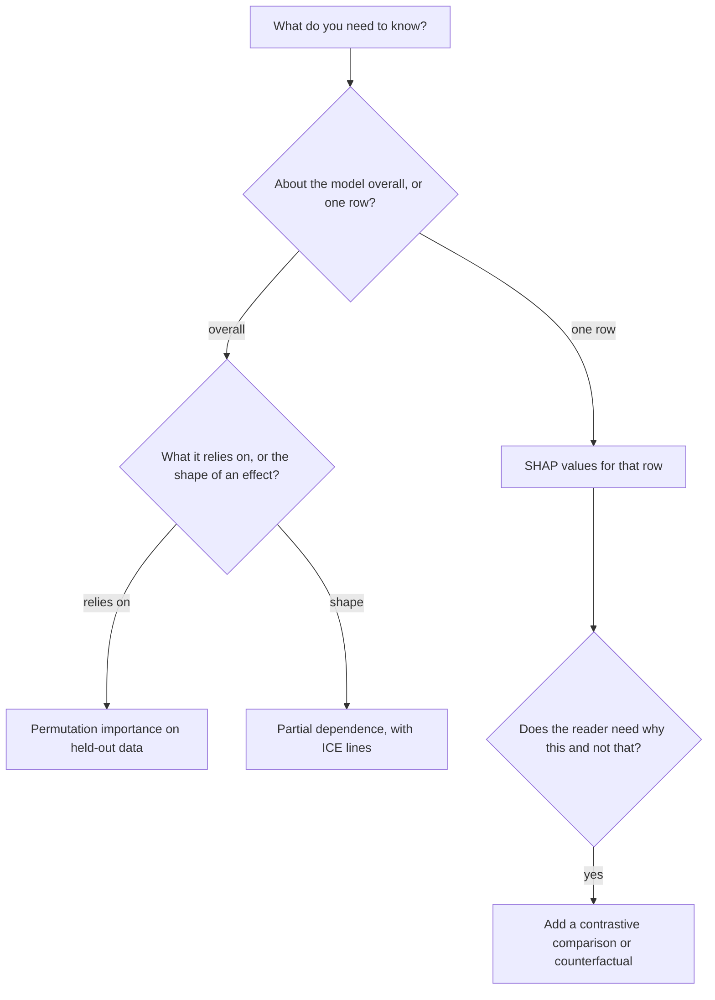

# Model Interpretability

> A reviewer asks why your model rejected this applicant, and which features it relies on. The boosted model of the last note has hundreds of trees, so you cannot read it. Three tools answer the three questions people really ask: permutation importance for what the model relies on, partial dependence for how a feature moves the prediction, and SHAP for why one row got its score. Each can mislead, in ways this note shows on the adult census.

Blocks run top to bottom from this `notes/` folder with:

```bash
uv run --python 3.12 --with scikit-learn --with lightgbm --with shap --with pandas python ...
```

## Which question are you asking?

"Interpretable" is not one property. Lipton's survey separates *transparency* (a person can step through the model, each part means something, the training is understood) from *post-hoc explanation* (text, visualisations, local explanations, examples) and cautions that a linear model on heavily engineered features is not obviously more transparent than a deep net ([arXiv:1606.03490](https://arxiv.org/abs/1606.03490), Lipton, 2016 preprint, later in CACM). Everything below is post-hoc: it describes the model without being the model.



| Tool | Answers | Scope | Depends on the data's correlations? |
|---|---|---|---|
| Permutation importance | How much does the score fall if this column is scrambled? | Global | Yes: correlated columns cover for each other |
| Partial dependence | How does the average prediction change with this column? | Global, one or two features | Yes: it evaluates impossible rows |
| ICE | Same, per row | Row-level lines | Yes |
| SHAP | How much did each feature push this row's score from the average? | Local, aggregates to global | Yes: the usual algorithms make independence assumptions |
| LIME | Which features matter in a simple model fitted around this row? | Local | Depends on the sampling |

## Setup: the model to explain

We use LightGBM on the same adult split as the last note, with a pure-noise column and a random high-cardinality column added on purpose, so we can see which tools credit them.

```python
import numpy as np
import pandas as pd
from lightgbm import LGBMClassifier, early_stopping
from sklearn.metrics import roc_auc_score
from sklearn.model_selection import train_test_split

cols = ["age", "workclass", "fnlwgt", "education", "education-num", "marital-status",
        "occupation", "relationship", "race", "gender", "capital-gain", "capital-loss",
        "hours-per-week", "native-country", "income"]
adult = pd.read_csv("../practice/intro-to-ml-in-python/data/adult.data", header=None, names=cols,
                    skipinitialspace=True, na_values="?").drop(columns=["fnlwgt", "education"])
y = (adult.pop("income") == ">50K").astype(int)
cats = list(adult.select_dtypes(exclude="number").columns)
adult[cats] = adult[cats].astype("category")

rng = np.random.default_rng(0)
adult["noise"] = rng.normal(size=len(adult))                  # no relation to income
adult["noisy_id"] = rng.integers(0, 5000, len(adult)).astype(float)   # high cardinality, no signal
X_dev, X_test, y_dev, y_test = train_test_split(adult, y, stratify=y, test_size=0.2, random_state=0)
X_tr, X_val, y_tr, y_val = train_test_split(X_dev, y_dev, stratify=y_dev, test_size=0.2, random_state=0)

model = LGBMClassifier(learning_rate=0.05, n_estimators=2000, verbose=-1, n_jobs=4, random_state=0)
model.fit(X_tr, y_tr, eval_X=X_val, eval_y=y_val, callbacks=[early_stopping(50, verbose=False)])
print("rounds", model.best_iteration_, "test AUC", round(roc_auc_score(y_test, model.predict_proba(X_test)[:, 1]), 4))
```

@@A@@

## Built-in importances, and why not to stop there

Every tree library reports how much loss reduction each feature contributed, summed over splits. It is computed on training data, so it credits whatever the model overfit:

```python
gain = pd.Series(model.booster_.feature_importance("gain"), index=X_tr.columns)
print((gain / gain.sum()).sort_values(ascending=False).round(3).to_string())
```

@@B@@

@@BP@@

Bias towards columns with many values is a documented property of impurity importance: [doi:10.1186/1471-2105-8-25](https://doi.org/10.1186/1471-2105-8-25) (Strobl et al., BMC Bioinformatics 2007).

## Permutation importance

Shuffle one column in held-out data, breaking its link with the target, and see how much the score falls. Scoring on held-out data means overfit features earn nothing. The idea goes back to Breiman's random forest paper ([doi:10.1023/a:1010933404324](https://doi.org/10.1023/a:1010933404324), Machine Learning 2001), and the model needs no retraining.

```python
from sklearn.inspection import permutation_importance

Xs = X_test.iloc[:3000]; ys = y_test.iloc[:3000]
perm = permutation_importance(model, Xs, ys, scoring="roc_auc", n_repeats=5, random_state=0, n_jobs=1)
imp = pd.DataFrame({"drop": perm.importances_mean, "sd": perm.importances_std}, index=Xs.columns)
print(imp.sort_values("drop", ascending=False).round(4).to_string())
```

@@C@@

@@CP@@

**The correlated-column trap.** If two columns carry the same information, shuffling one does little, since the model reads the other:

```python
X2 = adult.copy()
X2["age_copy"] = X2["age"] + rng.normal(0, 1, len(X2))       # a near-duplicate of age
a, b, c, d = train_test_split(X2, y, stratify=y, test_size=0.2, random_state=0)
m2 = LGBMClassifier(learning_rate=0.05, n_estimators=400, verbose=-1, n_jobs=4, random_state=0).fit(a, c)
p2 = permutation_importance(m2, b.iloc[:3000], d.iloc[:3000], scoring="roc_auc", n_repeats=5, random_state=0)
print(pd.Series(p2.importances_mean, index=a.columns)[["age", "age_copy"]].round(4).to_string())
print("age without a copy", round(imp.loc["age", "drop"], 4))
```

@@D@@

@@DP@@ Hooker et al. argue that permuting also forces the model to extrapolate into impossible rows, a 20-year-old who has worked for 40 years, and they recommend methods that condition on the other features or refit ([arXiv:1905.03151](https://arxiv.org/abs/1905.03151), preprint, later in Statistics and Computing).

## Partial dependence and ICE

Partial dependence fixes one column at a value for every row, predicts, and averages, across a grid of values. It is Friedman's tool from the original gradient boosting paper ([doi:10.1214/aos/1013203451](https://doi.org/10.1214/aos/1013203451), Annals of Statistics 2001). ICE keeps one line per row so you can see what the average hides ([arXiv:1309.6392](https://arxiv.org/abs/1309.6392), Goldstein et al., JCGS 2015).

```python
from sklearn.inspection import partial_dependence

Xp = X_test.sample(1000, random_state=0).astype({"age": float})    # the API refuses integer columns
pd_age = partial_dependence(model, Xp, ["age"], kind="both", grid_resolution=8, percentiles=(0.05, 0.95))
grid = pd_age["grid_values"][0].round(0)
ice = pd_age["individual"][0]
print("age            ", grid)
print("average P(high)", pd_age["average"][0].round(3))
print("ICE 10th pct   ", np.percentile(ice, 10, axis=0).round(3))
print("ICE 90th pct   ", np.percentile(ice, 90, axis=0).round(3))
print("observed rate  ", [round(y_test[X_test.age.between(g - 3, g + 3)].mean(), 3) for g in grid])
```

@@E@@

@@EP@@

Two limits. **It is not causal**: the curve shows what the model does, and a model trained on observational data has not learned what happens if you age someone. **It ignores correlation**: setting `age=20` on a row with `education-num=16` and `marital-status=Widowed` asks the model about a person who hardly exists. Where this matters, plot only over observed combinations or use accumulated local effects.

## SHAP

Permutation and PDP describe the model as a whole. The rejected applicant wants an account of one row. Lundberg and Lee show that LIME, DeepLIFT, layer-wise relevance propagation, and three earlier Shapley-based methods are all *additive feature attributions*, explaining a prediction as a baseline plus one number per feature. Among those, the Shapley values of cooperative game theory are the unique solution with local accuracy (the numbers sum to the prediction), missingness (an absent feature gets zero) and consistency (if a feature matters more to the model, its number does not fall) ([arXiv:1705.07874](https://arxiv.org/abs/1705.07874), NIPS 2017). In their Mechanical Turk studies of two small problems, with 30 and 52 people, SHAP agreed with human explanations more strongly than LIME and DeepLIFT did.

Plain Shapley needs every subset of features, which is exponential. `TreeExplainer` computes exact values for tree ensembles in polynomial time ([doi:10.1038/s42256-019-0138-9](https://doi.org/10.1038/s42256-019-0138-9), Lundberg et al., Nature Machine Intelligence 2020). Other model types use the slower Kernel SHAP.

```python
import shap

explainer = shap.TreeExplainer(model)
Xe = X_test.iloc[:2000]
values = explainer.shap_values(Xe)
values = values[1] if isinstance(values, list) else values         # older shap returned one array per class
base = np.ravel(explainer.expected_value)[-1]

raw = model.predict_proba(Xe, raw_score=True)
print("local accuracy gap:", round(float(np.abs(values.sum(1) + base - raw).max()), 6))
print((pd.Series(np.abs(values).mean(0), index=Xe.columns)).sort_values(ascending=False).round(3).head(10).to_string())
```

@@F@@

@@FP@@

Now one row. The numbers are in log-odds, and they add up:

```python
i = int(np.flatnonzero((raw > 0) & (y_test.iloc[:2000].values == 0))[0])   # first false positive
row = pd.Series(values[i], index=Xe.columns).sort_values(key=np.abs, ascending=False)
print("actual income >50K:", y_test.iloc[i], "| P(>50K) =", round(float(model.predict_proba(Xe.iloc[[i]])[0, 1]), 3))
print("base value", round(float(base), 3), "+ sum of SHAP", round(float(values[i].sum()), 3), "=", round(float(raw[i]), 3))
print(pd.DataFrame({"value": Xe.iloc[i][row.index[:6]].astype(str), "shap": row.values[:6].round(3)}).to_string())
```

@@G@@

@@GP@@

**Caveats.** With correlated features, Shapley values split credit in ways that depend on the algorithm. Lundberg and Lee's Kernel SHAP assumes feature independence when it fills in missing features. SHAP's additive numbers look causal and aren't: a large value for `marital-status` says the model uses it, not that a wedding raises income. Compare global SHAP with permutation importance as a sanity check, since they answer different questions but should not wildly disagree.

## LIME, and explanations for LLMs

LIME fits a small linear model around one prediction by sampling perturbed copies of the row. Its best-known demonstration is a logistic regression on image features deliberately trained on 20 images so that wolves always have snow in the background: the classifier then said "wolf" whenever there was snow, and the experiment tests whether subjects can detect that from the explanations ([arXiv:1602.04938](https://arxiv.org/abs/1602.04938), Ribeiro et al., KDD 2016). The [NLP sentiment note](../../03-nlp/notes/06-sentiment-analysis.md) applies it to text.

The same questions recur for language models. Huang et al. find ChatGPT's self-explanations for sentiment are about as faithful as occlusion and LIME on their metrics, much cheaper to produce, and quite different on agreement metrics, which they take as a reason to rethink how such explanations are evaluated ([arXiv:2310.11207](https://arxiv.org/abs/2310.11207), preprint). Grosse et al. attribute behaviour to training examples rather than features, scaling influence functions to a 52-billion-parameter model, and find that influence falls to near zero when the order of key phrases is flipped ([arXiv:2308.03296](https://arxiv.org/abs/2308.03296), preprint).

## Does explaining help anyone?

Tools produce numbers. People make decisions. The evidence about the second step is sobering.

| Study | Setup | Finding |
|---|---|---|
| Miller ([arXiv:1706.07269](https://arxiv.org/abs/1706.07269), Artificial Intelligence 2019) | Survey of explanation in philosophy, psychology and cognitive science | Explanations people want are contrastive, selected, social, and causal rather than probabilistic. A SHAP bar chart is none of these by default |
| Dodge et al. ([arXiv:1901.07694](https://arxiv.org/abs/1901.07694), IUI 2019) | More than 160 Mechanical Turk workers, four explanation styles | Global and local styles reveal different fairness problems, and a person's prior position strongly shapes the reaction |
| Wang and Yin ([doi:10.1145/3397481.3450650](https://doi.org/10.1145/3397481.3450650), IUI 2021) | Four explanation types on recidivism and forest cover prediction | On the low-expertise task none reliably improved understanding, uncertainty recognition and calibrated trust together. Feature contribution did better with more expertise. Counterfactuals did not improve calibrated trust |

So: test your explanation on the person it is for. Answer the contrastive question when you can ("you would have been approved if..."). Keep humans who have to act on it in the evaluation.

## Pitfalls

| Pitfall | Symptom | Fix |
|---|---|---|
| Impurity importance as the answer | A random high-cardinality column ranks highly | Permutation importance on held-out data |
| Permutation with correlated features | Two copies of an important feature both look minor | Group them and permute together, or drop one and refit |
| Reading PDP as causal | "Raise age to 50 and income rises" | The curve describes the model, and the model is observational |
| A PDP hiding opposite effects | The average is flat but the ICE lines fan out | Always plot ICE, or split by the interacting feature |
| Explaining a bad model | Careful SHAP analysis of a model at AUC 0.6 | Check the model first; an explanation of noise is noise |
| Comparing SHAP across models or scales | Values differ by output unit (log-odds, probability) | State the output space and the background data |
| Trusting a nice explanation | Stakeholder approves a model after one bar chart | Evaluate decisions made with the explanation, not satisfaction with it |

## Try it

1. Add a second copy of `capital-gain` with noise. How do permutation importance and mean |SHAP| each divide the credit?
2. Plot a two-way partial dependence of `age` and `hours-per-week`. Is there an interaction the one-way curves miss?
3. Fit a logistic regression on one-hot adult. Compare its largest coefficients with the SHAP ranking. What do you need to do before coefficients can be compared at all?
4. Pick the row explained above and find the smallest change to one feature that takes it below 0.5. Which of the three Miller findings does this speak to?

<details>
<summary>Answers</summary>

1. Permutation importance of each copy falls, because the model can read the other. SHAP splits the credit between them, so each gets a share and the sum stays about the same as before.
2. Yes, mildly: hours help more in mid-career than at the extremes of age. One-way curves average that away.
3. Features must be on a comparable scale, so standardise numeric columns first. Even then a coefficient is conditional on all the others and doesn't include non-linear effects.
4. Contrastive: people ask why this outcome and not another. A counterfactual answers exactly that, at the cost of choosing among many possible changes.

</details>

## Interview checklist

| Question | Answer |
|---|---|
| Why not trust built-in feature importance? | It is measured on training data and is biased towards high-cardinality features |
| How does permutation importance work? | Shuffle one column in held-out data and measure the score drop, with no retraining |
| Its main weakness? | Correlated features cover for each other, and shuffling creates unrealistic rows |
| What is a partial dependence plot? | The average prediction as one feature is set to each value across all rows |
| PDP vs ICE? | ICE keeps a line per row, so it reveals interactions that the average hides |
| What are SHAP values? | Shapley attributions of a prediction relative to a baseline. They sum to the prediction minus the baseline |
| What three properties define SHAP? | Local accuracy, missingness, consistency |
| Why is TreeExplainer fast? | It uses tree structure to compute exact values in polynomial time |
| SHAP vs LIME? | Both are local additive attributions. LIME fits a surrogate with heuristic weights; SHAP's weights come from the Shapley axioms |
| Is SHAP causal? | No. It explains the model's behaviour and not the world's |
| What do people want from an explanation? | Contrastive, selected, causal, social answers. User studies find explanation benefits depend on task and expertise |

## Next

The classical families are done. The [deep learning pillar](../../02-deep-learning/README.md) starts from the `MLPClassifier` of [supervised learning](02-supervised-learning.md#neural-networks-multilayer-perceptrons) and builds up from backprop by hand.
