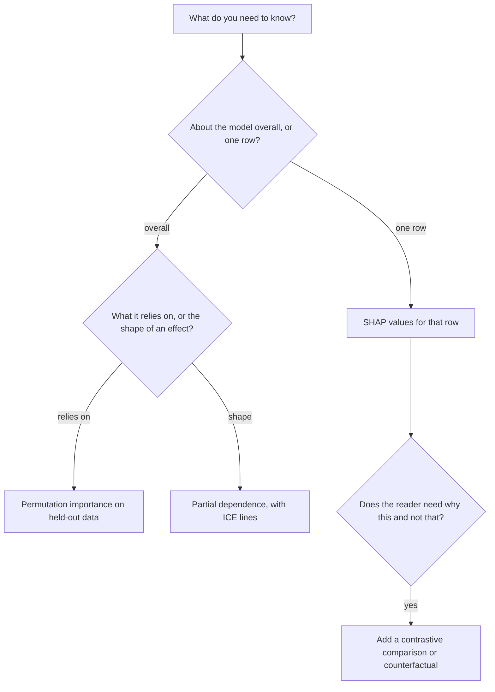
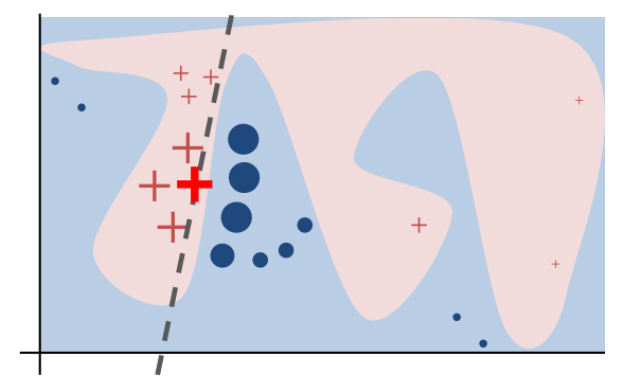

# Model Interpretability

> A reviewer asks why your model rejected this applicant, and which features it relies on. The boosted model of [note 07](07-boosting-in-practice.md) has hundreds of trees, so you cannot read it. Three tools answer the three questions people really ask: permutation importance for what the model relies on, partial dependence for how a feature moves the prediction, and SHAP for why one row got its score. Each can mislead, in ways this note shows on the adult census.

**In plain words.** A big model can't explain itself, yet customers, managers and regulators will all ask why it said no. These tools answer by experiment: like a cook leaving out one ingredient at a time to see which one the dish depends on, they change an input and watch the answer move. Treat what they tell you as a description of the model and not of the world. Finding that a model leans on someone's postcode doesn't mean that the postcode caused anything.

Blocks run top to bottom from this `notes/` folder with:

```bash
uv run --python 3.12 --with scikit-learn --with lightgbm --with shap --with pandas python ...
```

## Which question are you asking?

"Interpretable" is not one property. Lipton's survey separates *transparency* (a person can step through the model, each part means something, the training is understood) from *post-hoc explanation* (text, visualisations, local explanations, examples) and cautions that a linear model on heavily engineered features is not obviously more transparent than a deep net ([arXiv:1606.03490](https://arxiv.org/abs/1606.03490), Lipton, 2016 preprint, later in CACM). Everything below is post-hoc: it describes the model without being the model.



| Tool | Answers | Scope | Depends on the data's correlations? |
|---|---|---|---|
| Permutation importance | How much does the score fall if this column is scrambled? | Global | Yes: correlated columns cover for each other |
| Partial dependence | How does the average prediction change with this column? | Global, one or two features | Yes: it evaluates impossible rows |
| ICE | Same, per row | Row-level lines | Yes |
| SHAP | How much did each feature push this row's score from the average? | Local, aggregates to global | Yes: the usual algorithms make independence assumptions |
| LIME | Which features matter in a simple model fitted around this row? | Local | Depends on the sampling |

## Setup: the model to explain

We use LightGBM on the same adult split as [note 07](07-boosting-in-practice.md), with a pure-noise column and a random high-cardinality column added on purpose, so we can see which tools credit them.

```python
import numpy as np
import pandas as pd
from lightgbm import LGBMClassifier, early_stopping
from sklearn.metrics import roc_auc_score
from sklearn.model_selection import train_test_split

cols = ["age", "workclass", "fnlwgt", "education", "education-num", "marital-status",
        "occupation", "relationship", "race", "gender", "capital-gain", "capital-loss",
        "hours-per-week", "native-country", "income"]
adult = pd.read_csv("../practice/intro-to-ml-in-python/data/adult.data", header=None, names=cols,
                    skipinitialspace=True, na_values="?").drop(columns=["fnlwgt", "education"])
y = (adult.pop("income") == ">50K").astype(int)
cats = list(adult.select_dtypes(exclude="number").columns)
adult[cats] = adult[cats].astype("category")

rng = np.random.default_rng(0)
adult["noise"] = rng.normal(size=len(adult))                  # no relation to income
adult["noisy_id"] = rng.integers(0, 5000, len(adult)).astype(float)   # high cardinality, no signal
X_dev, X_test, y_dev, y_test = train_test_split(adult, y, stratify=y, test_size=0.2, random_state=0)
X_tr, X_val, y_tr, y_val = train_test_split(X_dev, y_dev, stratify=y_dev, test_size=0.2, random_state=0)

model = LGBMClassifier(learning_rate=0.05, n_estimators=2000, verbose=-1, n_jobs=4, random_state=0)
model.fit(X_tr, y_tr, eval_X=X_val, eval_y=y_val, callbacks=[early_stopping(50, verbose=False)])
print("rounds", model.best_iteration_, "test AUC", round(roc_auc_score(y_test, model.predict_proba(X_test)[:, 1]), 4))
```

```text
rounds 180 test AUC 0.9248
```

## Built-in importances, and why not to stop there

Every tree library reports how much loss reduction each feature contributed, summed over splits. It is computed on training data, so it credits whatever the model overfit:

```python
gain = pd.Series(model.booster_.feature_importance("gain"), index=X_tr.columns)
print((gain / gain.sum()).sort_values(ascending=False).round(3).to_string())
```

```text
relationship      0.278
capital-gain      0.180
education-num     0.133
marital-status    0.087
age               0.086
occupation        0.072
capital-loss      0.052
hours-per-week    0.038
noisy_id          0.028
noise             0.023
workclass         0.009
gender            0.007
native-country    0.005
race              0.001
```

The two random columns take about 5% of the gain between them and rank above `workclass`, `gender`, `native-country` and `race`. They have no relation to income, so that credit is the model fitting noise in the training set. The ordering of the real columns is also unsafe to quote: `age` is only fifth.

Bias towards columns with many values is a documented property of impurity importance: [doi:10.1186/1471-2105-8-25](https://doi.org/10.1186/1471-2105-8-25) (Strobl et al., BMC Bioinformatics 2007).

## Permutation importance

Shuffle one column in held-out data, breaking its link with the target, and see how much the score falls. Scoring on held-out data means overfit features earn nothing. The idea goes back to Breiman's random forest paper ([doi:10.1023/a:1010933404324](https://doi.org/10.1023/a:1010933404324), Machine Learning 2001), and the model needs no retraining.

```python
from sklearn.inspection import permutation_importance

Xs = X_test.iloc[:3000]; ys = y_test.iloc[:3000]
perm = permutation_importance(model, Xs, ys, scoring="roc_auc", n_repeats=5, random_state=0, n_jobs=1)
imp = pd.DataFrame({"drop": perm.importances_mean, "sd": perm.importances_std}, index=Xs.columns)
print(imp.sort_values("drop", ascending=False).round(4).to_string())
```

```text
drop      sd
capital-gain    0.0574  0.0020
age             0.0564  0.0036
marital-status  0.0276  0.0031
education-num   0.0241  0.0008
relationship    0.0231  0.0023
occupation      0.0155  0.0011
capital-loss    0.0142  0.0014
hours-per-week  0.0127  0.0024
workclass       0.0027  0.0005
gender          0.0024  0.0004
native-country  0.0009  0.0004
race            0.0005  0.0005
noise           0.0003  0.0002
noisy_id        0.0002  0.0002
```

The noise columns are now at the bottom, within about one standard deviation of zero. `age` moves from fifth to second and `relationship` from first to fifth. `relationship` and `marital-status` overlap heavily (nearly every `Husband` is `Married-civ-spouse`), so each covers for the other when shuffled, which pulls both down here.

**The correlated-column trap.** If two columns carry the same information, shuffling one does little, since the model reads the other:

```python
X2 = adult.copy()
X2["age_copy"] = X2["age"] + rng.normal(0, 1, len(X2))       # a near-duplicate of age
a, b, c, d = train_test_split(X2, y, stratify=y, test_size=0.2, random_state=0)
m2 = LGBMClassifier(learning_rate=0.05, n_estimators=400, verbose=-1, n_jobs=4, random_state=0).fit(a, c)
p2 = permutation_importance(m2, b.iloc[:3000], d.iloc[:3000], scoring="roc_auc", n_repeats=5, random_state=0)
print(pd.Series(p2.importances_mean, index=a.columns)[["age", "age_copy"]].round(4).to_string())
print("age without a copy", round(imp.loc["age", "drop"], 4))
```

```text
age         0.0061
age_copy    0.0294
age without a copy 0.0564
```

Adding a noisy copy cut the importance of `age` by a factor of nine, and the two together now sum to about 0.036, well under the 0.056 it had alone. A reader of this table would conclude age hardly matters. The fix is to group correlated columns and permute them together, or to drop one and refit. Hooker et al. argue that permuting also forces the model to extrapolate into impossible rows, a 20-year-old who has worked for 40 years, and they recommend methods that condition on the other features or refit ([arXiv:1905.03151](https://arxiv.org/abs/1905.03151), preprint, later in Statistics and Computing).

## Partial dependence and ICE

Partial dependence fixes one column at a value for every row, predicts, and averages, across a grid of values. It is Friedman's tool from the original gradient boosting paper ([doi:10.1214/aos/1013203451](https://doi.org/10.1214/aos/1013203451), Annals of Statistics 2001). ICE keeps one line per row so you can see what the average hides ([arXiv:1309.6392](https://arxiv.org/abs/1309.6392), Goldstein et al., JCGS 2015).

```python
from sklearn.inspection import partial_dependence

Xp = X_test.sample(1000, random_state=0).astype({"age": float})    # the API refuses integer columns
pd_age = partial_dependence(model, Xp, ["age"], kind="both", grid_resolution=8, percentiles=(0.05, 0.95))
grid = pd_age["grid_values"][0].round(0)
ice = pd_age["individual"][0]
print("age            ", grid)
print("average P(high)", pd_age["average"][0].round(3))
print("ICE 10th pct   ", np.percentile(ice, 10, axis=0).round(3))
print("ICE 90th pct   ", np.percentile(ice, 90, axis=0).round(3))
print("observed rate  ", np.array([y_test[X_test.age.between(g - 3, g + 3)].mean() for g in grid]).round(3))
```

```text
age             [19. 26. 32. 38. 44. 51. 57. 63.]
average P(high) [0.031 0.147 0.202 0.239 0.26  0.281 0.271 0.248]
ICE 10th pct    [0.001 0.004 0.005 0.007 0.009 0.013 0.011 0.011]
ICE 90th pct    [0.044 0.493 0.694 0.76  0.77  0.781 0.778 0.746]
observed rate   [0.005 0.098 0.211 0.318 0.363 0.394 0.351 0.267]
```

The average rises steeply to about 0.28 at age 51 and then eases. ICE shows what that hides: at age 51 one row in ten is still under 0.013 and one row in ten is at 0.78, so age matters only to rows whose other features make them plausible earners. The final line is not the same thing as the curve: observed rates climb higher (0.394 at 51) because older people in the data also differ in other ways, while the partial dependence holds the others fixed.

Two limits. **It is not causal**: the curve shows what the model does, and a model trained on observational data has not learned what happens if you age someone. **It ignores correlation**: setting `age=20` on a row with `education-num=16` and `marital-status=Widowed` asks the model about a person who hardly exists. Where this matters, plot only over observed combinations or use accumulated local effects. See [Correlation and causation](../../../data-analytics/03-experimentation-and-causality/notes/04-correlation-and-causation.md#when-you-cannot-randomise) in data analytics for what the causal question needs.

## SHAP

Permutation and PDP describe the model as a whole. The rejected applicant wants an account of one row. Lundberg and Lee show that LIME, DeepLIFT, layer-wise relevance propagation, and three earlier Shapley-based methods are all *additive feature attributions*, explaining a prediction as a baseline plus one number per feature. Among those, the Shapley values of cooperative game theory are the unique solution, once you fix how a feature counts as absent, with local accuracy (the baseline plus the numbers equals the prediction), missingness (a feature absent from the simplified input gets zero, which is not the same as a feature whose value is 0) and consistency (if a new model makes a feature contribute more whatever the other inputs, its number does not fall) ([arXiv:1705.07874](https://arxiv.org/abs/1705.07874), NIPS 2017). In their Mechanical Turk studies of two small problems, with 30 and 52 people, SHAP matched the most common human answer more closely than LIME did on both and the original DeepLIFT did on the one where it is plotted. The authors state as an assumption that agreement with people is the right yardstick, and they report no significance test.

Plain Shapley needs every subset of features, which is exponential. `TreeExplainer` computes exact values for tree ensembles in polynomial time ([doi:10.1038/s42256-019-0138-9](https://doi.org/10.1038/s42256-019-0138-9), Lundberg et al., Nature Machine Intelligence 2020). The 2017 paper's Kernel SHAP works on any model. The regression behind it costs $O(2^M + M^3)$ for $M$ features with approximate expectations, which the authors call efficient for small $M$, and their experiments sample subsets rather than visit them all. That paper also gives faster routes for specific forms, such as linear models.

```python
import shap

explainer = shap.TreeExplainer(model)
Xe = X_test.iloc[:2000]
values = explainer.shap_values(Xe)
values = values[1] if isinstance(values, list) else values         # older shap returned one array per class
base = np.ravel(explainer.expected_value)[-1]

raw = model.predict_proba(Xe, raw_score=True)
print("local accuracy gap:", round(float(np.abs(values.sum(1) + base - raw).max()), 6))
print((pd.Series(np.abs(values).mean(0), index=Xe.columns)).sort_values(ascending=False).round(3).head(10).to_string())
```

```text
local accuracy gap: 0.0
age               0.827
marital-status    0.724
relationship      0.641
capital-gain      0.537
education-num     0.440
occupation        0.368
hours-per-week    0.269
capital-loss      0.135
gender            0.097
noisy_id          0.065
```

A gap of zero is local accuracy in action: for every one of the 2,000 rows, the base value plus the SHAP numbers equals the model's raw score. The global ranking is mean absolute SHAP, and it is a different statistic from permutation importance. `capital-gain` is first by permutation but only fourth here, because it is zero for most people: SHAP measures typical movement per row, permutation measures what breaks in the ranking. The noise column `noisy_id` gets 0.065 here, small but not zero, since SHAP describes the model as fitted and the model did fit some noise.

Now one row. The numbers are in log-odds, and they add up:

```python
i = int(np.flatnonzero((raw > 0) & (y_test.iloc[:2000].values == 0))[0])   # first false positive
row = pd.Series(values[i], index=Xe.columns).sort_values(key=np.abs, ascending=False)
print("actual income >50K:", y_test.iloc[i], "| P(>50K) =", round(float(model.predict_proba(Xe.iloc[[i]])[0, 1]), 3))
print("base value", round(float(base), 3), "+ sum of SHAP", round(float(values[i].sum()), 3), "=", round(float(raw[i]), 3))
print(pd.DataFrame({"value": Xe.iloc[i][row.index[:6]].astype(str), "shap": row.values[:6].round(3)}).to_string())
```

```text
actual income >50K: 0 | P(>50K) = 0.543
base value -2.387 + sum of SHAP 2.559 = 0.172
                             value   shap
education-num                   13  0.828
relationship               Husband  0.753
marital-status  Married-civ-spouse  0.653
occupation          Prof-specialty  0.452
age                             66  0.347
capital-gain                     0 -0.253
```

This is the first false positive in the sample: a 66-year-old married professional with a degree, predicted as a high earner at 0.543, who in fact is not. The average person starts at -2.387 log-odds (about 8% after the sigmoid, and that is an average of log-odds, not the base rate). The degree, the marriage and the occupation each push up, and the lack of capital gains pushes down. Now the reviewer has something to argue with: whether a 66-year-old is plausibly working full time is a question the features do not ask. Reading a row like this one is step 3 of [Reading the errors](12-reading-the-errors.md#step-3-read-rows), which does it across all four cells before anyone tunes anything.

**Caveats.** With correlated features, Shapley values split credit in ways that depend on the algorithm. Lundberg and Lee's Kernel SHAP assumes feature independence, and optionally model linearity, when it fills in missing features, simplifications of that estimator rather than of SHAP's definition. SHAP's additive numbers look causal and aren't: a large value for `marital-status` says the model uses it, not that a wedding raises income. Compare global SHAP with permutation importance as a sanity check, since they answer different questions but should not wildly disagree. Where an applicant or a regulator can ask for the reason, a model you can read directly may be the better answer, as [credit scoring](../../../data-analytics/06-applied-analyses/notes/02-credit-scoring.md#recommendation) argues. To ask the causal question you need a design, not an explanation: [matching and weighting](../../../data-analytics/03-experimentation-and-causality/notes/05-matching-and-weighting.md) in data analytics estimates an effect from observational data and shows how far a sound design can still miss.

## LIME, and explanations for LLMs

LIME fits a small linear model around one prediction. It switches off parts of the input, weights each perturbed sample by its closeness to the original and keeps a few features. The paper's experiments use text and images only, so running it on a tabular row goes beyond them, and the authors concede that a model highly non-linear around the prediction may have no faithful local explanation. Its wolf-and-snow experiment is a logistic regression on image features deliberately trained on 20 hand-picked images, wolves with snow and huskies without. On 60 further images it said "wolf" when there was snow or a light background at the bottom. Before explanations, 10 of 27 graduate students with machine-learning coursework trusted it and 12 named snow or the background as a feature; after them, 3 and 25 ([arXiv:1602.04938](https://arxiv.org/abs/1602.04938), Ribeiro et al., KDD 2016). The authors call that sample small, and every subject saw the same order with no control group. Their larger study had 100 Mechanical Turk users per setting choose the better of two text classifiers, and 89% were right with LIME on picked examples against 68% for a greedy explainer on random ones. The [NLP sentiment note](../../03-nlp/notes/06-sentiment-analysis.md) applies it to text.


*Image Source: Ribeiro et al., ["Why Should I Trust You?": Explaining the Predictions of Any Classifier](https://arxiv.org/abs/1602.04938) (2016), Fig. 3*

The same questions recur for language models. Huang et al. find ChatGPT's self-explanations for sentiment are about as faithful as occlusion and LIME on their metrics, much cheaper to produce, and quite different on agreement metrics, which they take as a reason to rethink how such explanations are evaluated ([arXiv:2310.11207](https://arxiv.org/abs/2310.11207), preprint). The numbers come from 100 Stanford Sentiment Treebank sentences with one ChatGPT version and no confidence intervals: explain-then-predict comprehensiveness 0.19 for self-explanation against 0.15 for occlusion and 0.17 for LIME, but rank correlation with those two only 0.07 to 0.13. LIME needed about 183 API calls and 20 minutes per sentence even after cutting the default 5,000, and asking for an explanation lowered accuracy from 92% to 85% (explanation first) or 88% (prediction first). Grosse et al. attribute behaviour to training examples rather than features, scaling influence functions to a 52-billion-parameter model, and find that influence falls to near zero when the order of key phrases is flipped ([arXiv:2308.03296](https://arxiv.org/abs/2308.03296), preprint). The flip result comes from synthetic fictional-fact and translation sequences on 810M to 52B pretrained models: reversing the order of English and Mandarin text cut influence by at least an order of magnitude (0.116 to 0.030 in the translation example, against 0.020 for a Mandarin-only sequence), which is a drop to roughly noise level, not to exactly zero. The authors cover only the MLP layers of pretrained models, not fine-tuned ones, and say influence functions will miss nonlinear training effects such as circuit formation.

## Does explaining help anyone?

Tools produce numbers. People make decisions. The evidence about the second step is sobering.

| Study | Setup | Finding |
|---|---|---|
| Miller ([arXiv:1706.07269](https://arxiv.org/abs/1706.07269), Artificial Intelligence 2019) | Review of over 250 publications in philosophy, psychology and cognitive science, mostly people explaining to people; the transfer to AI is the author's argument | Explanations people want are contrastive, selected (in a biased way) and social, and causes work better in them than probabilities, though probabilities still matter. Miller doesn't discuss SHAP. Our reading: a SHAP bar chart attributes the model's output, and it isn't contrastive or interactive by default |
| Dodge et al. ([arXiv:1901.07694](https://arxiv.org/abs/1901.07694), IUI 2019) | 160 US Mechanical Turk workers each rating, on one 1-7 item, the fairness of six predictions from a logistic regression the authors trained on five COMPAS-dataset features (raw or debiased data, between subjects; 2 of the 6 cases chosen so that flipping race changes the prediction); four template explanation styles, no no-explanation control | Local styles widened the rating gap between those cases and the others more than global ones. In the first model the style-by-case interaction across the four styles was marginal (p = 0.07, no pooled local-against-global test); what-if against feature-weight explanations gave p = 0.02, and no effect sizes are reported. On race-flip cases, the authors read the what-if style as lowering ratings only for people who already saw using race as unfair, an interaction (p = 0.05) that appeared once prior positions entered the model. Among people who trusted ML, global styles were rated fairer than case-based ones (interaction p = 0.07). This measures perceived fairness, not decisions or whether unfairness was detected |
| Wang and Yin ([doi:10.1145/3397481.3450650](https://doi.org/10.1145/3397481.3450650), IUI 2021) | Four explanation types on recidivism and forest cover prediction | On the low-expertise task none reliably improved understanding, uncertainty recognition and calibrated trust together. Feature contribution did better with more expertise. Counterfactuals did not improve calibrated trust |

So: test your explanation on the person it is for. Answer the contrastive question when you can ("you would have been approved if..."). Keep humans who have to act on it in the evaluation.

## Pitfalls

| Pitfall | Symptom | Fix |
|---|---|---|
| Impurity importance as the answer | A random high-cardinality column ranks highly | Permutation importance on held-out data |
| Permutation with correlated features | Two copies of an important feature both look minor | Group them and permute together, or drop one and refit |
| Reading PDP as causal | "Raise age to 50 and income rises" | The curve describes the model, and the model is observational |
| A PDP hiding opposite effects | The average is flat but the ICE lines fan out | Always plot ICE, or split by the interacting feature |
| Explaining a bad model | Careful SHAP analysis of a model at AUC 0.6 | Check the model first; an explanation of noise is noise |
| Comparing SHAP across models or scales | Values differ by output unit (log-odds, probability) | State the output space and the background data |
| Trusting a nice explanation | Stakeholder approves a model after one bar chart | Evaluate decisions made with the explanation, not satisfaction with it |

## Try it

1. Add a second copy of `capital-gain` with noise. How do permutation importance and mean |SHAP| each divide the credit?
2. Plot a two-way partial dependence of `age` and `hours-per-week`. Is there an interaction the one-way curves miss?
3. Fit a logistic regression on one-hot adult. Compare its largest coefficients with the SHAP ranking. What do you need to do before coefficients can be compared at all?
4. Pick the row explained above and find the smallest change to one feature that takes it below 0.5. Which of the four Miller findings does this speak to?

<details>
<summary>Answers</summary>

1. With 300 trees and noise of sd 1, the model barely uses the copy. Permutation moves from 0.0627 to 0.0687 for the original and 0.0019 for the copy. Mean |SHAP| moves from 0.661 to 0.627 and 0.103. Compare `age`, where the copy took most of the credit: how trees divide credit depends on which column the splitter happens to prefer, so neither tool promises an even split.
2. Yes. Going from 15 to 60 hours adds about 0.016 at age 20 (0.014 to 0.030) and about 0.158 at age 52 (0.144 to 0.302), on a 600-row sample with `age` and `hours-per-week` cast to float. Pass `features=("age", "hours-per-week")` to `partial_dependence`.
3. Features must be on a comparable scale, so standardise numeric columns first. Even then a coefficient is conditional on all the others and doesn't include non-linear effects.
4. Contrastive: people ask why this outcome and not another. The smallest change answers that, with "below 0.5" as the other outcome, at the cost of choosing among many possible changes.

</details>

## Interview checklist

| Question | Answer |
|---|---|
| Why not trust built-in feature importance? | It is measured on training data and is biased towards high-cardinality features |
| How does permutation importance work? | Shuffle one column in held-out data and measure the score drop, with no retraining |
| Its main weakness? | Correlated features cover for each other, and shuffling creates unrealistic rows |
| What is a partial dependence plot? | The average prediction as one feature is set to each value across all rows |
| PDP vs ICE? | ICE keeps a line per row, so it reveals interactions that the average hides |
| What are SHAP values? | Shapley attributions of a prediction relative to a baseline. They sum to the prediction minus the baseline |
| What three properties define SHAP? | Local accuracy, missingness, consistency. They single out Shapley values once you fix how a feature counts as absent |
| Why is TreeExplainer fast? | It uses tree structure to compute exact values in polynomial time |
| SHAP vs LIME? | Both are local additive attributions. LIME fits a surrogate with heuristic weights; Kernel SHAP's weights are derived from the Shapley axioms |
| Is SHAP causal? | No. It explains the model's behaviour and not the world's |
| What do people want from an explanation? | Contrastive, selected, causal, social answers. User studies find explanation benefits depend on task and expertise |

## Next

[Unsupervised learning](05-unsupervised-learning.md): the labels go away. Scaling, PCA, NMF, t-SNE, clustering, anomaly detection and recommenders, using the forests, metrics and explanations you now have.
