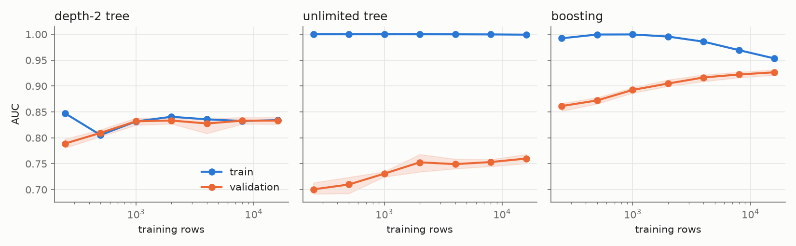
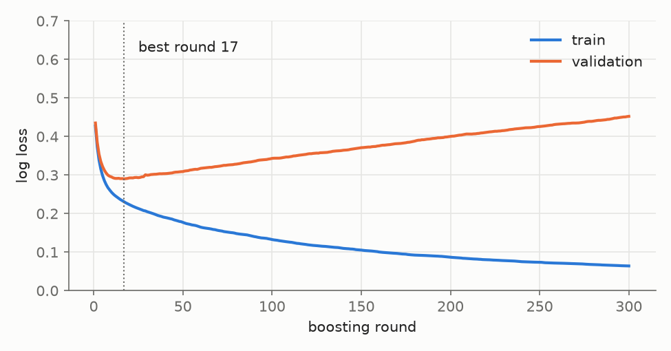
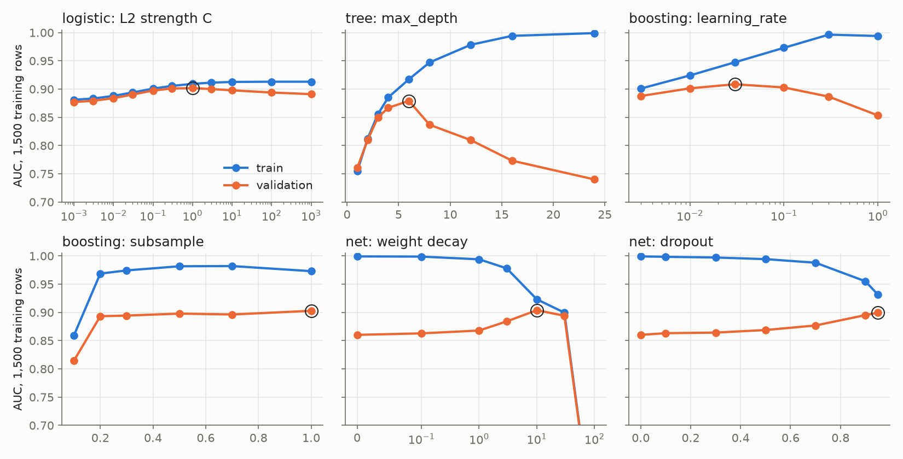
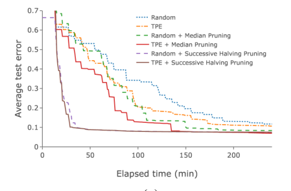
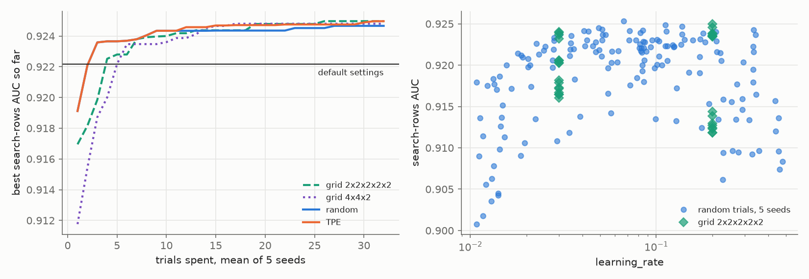

# Training and Tuning

> You know the model families. This note is what you do with one: split the data, beat a baseline, read the curves that say what is wrong, use folds to separate real differences from luck, regularise, stop at the right round, search at a sensible budget, and report one number you can defend. Adult census runs through all of it.

**In plain words.** Think of a student preparing for an exam. Practice questions are for learning. A mock exam shows how the learning is going. The real exam happens once, and its result is what counts. A student who memorises the practice answers aces the practice and fails the exam. Training a model is the same job: practice rows, mock rows, exam rows, and habits that make the model learn the method and not the answers.

Blocks run top to bottom from this `notes/` folder. The whole note takes about 5 minutes, nearly all of it in the search, and needs `optuna`, `torch` and `scipy` on top of the usual packages.

The model families are in [note 02](02-supervised-learning.md).

---

## Split, baseline, fit

Before any model, cut the rows into three piles. Each answers a different question, and stops being able to answer it once you use it for something else.

```text
all 32,561 rows
├── development (80%)
│   ├── training (60% of all)     the model sets its weights here
│   └── validation (20% of all)   you choose settings and models here
└── test (20% of all)             read once, at the end, for the number you report
```

| Pile | Who learns from it | The question it answers |
|---|---|---|
| Training | The model, through `fit` | Can this model capture the pattern at all? |
| Validation | You, through every decision you make | Which model and which settings work on rows the model did not see? |
| Test | Nobody | How well will the final choice do on new rows? |

The trap is the middle row. A person who reads validation scores and changes a setting is a learning algorithm too, so those scores drift optimistic as decisions pile up. That is why the third pile exists, as [note 01](01-statistical-foundations.md#train-validation-test) explains.

```python
import warnings
import numpy as np, pandas as pd, matplotlib.pyplot as plt
from sklearn.compose import make_column_transformer, make_column_selector
from sklearn.preprocessing import StandardScaler, OneHotEncoder
from sklearn.model_selection import train_test_split
from sklearn.pipeline import make_pipeline
from sklearn.dummy import DummyClassifier
from sklearn.linear_model import LogisticRegression
from sklearn.ensemble import HistGradientBoostingClassifier as HGB
from sklearn.metrics import accuracy_score, roc_auc_score, log_loss

warnings.filterwarnings("ignore")
cols = ["age", "workclass", "fnlwgt", "education", "education-num", "marital-status",
        "occupation", "relationship", "race", "gender", "capital-gain", "capital-loss",
        "hours-per-week", "native-country", "income"]
adult = pd.read_csv("../practice/intro-to-ml-in-python/data/adult.data", header=None, names=cols,
                    skipinitialspace=True, na_values="?").drop(columns=["fnlwgt", "education"])
ya = (adult.pop("income") == ">50K").astype(int)
for c in adult.columns[~adult.columns.isin(adult.select_dtypes("number").columns)]:
    adult[c] = adult[c].astype("category")     # HGB reads this dtype natively

Xa_dev, Xa_test, ya_dev, ya_test = train_test_split(adult, ya, stratify=ya, test_size=0.2, random_state=0)
Xa_tr, Xa_val, ya_tr, ya_val = train_test_split(Xa_dev, ya_dev, stratify=ya_dev, test_size=0.25, random_state=0)
prep = make_column_transformer(
    (StandardScaler(), make_column_selector(dtype_include="number")),
    (OneHotEncoder(handle_unknown="ignore"), make_column_selector(dtype_exclude="number")))

print(f"train {len(Xa_tr)}, validation {len(Xa_val)}, test {len(Xa_test)}; positive rate {ya.mean():.3f}")
```
```text
train 19536, validation 6512, test 6513; positive rate 0.241
```

The test rows stay out of everything until the last section. Next comes a baseline, the score of a model with no brain, so that every later number means something.

```python
models = {
    "dummy": DummyClassifier(strategy="most_frequent"),
    "logistic": make_pipeline(prep, LogisticRegression(max_iter=1000)),
    "boosting": HGB(categorical_features="from_dtype", random_state=0),
}
for name, m in models.items():
    m.fit(Xa_tr, ya_tr)
    print(f"{name:9s} train acc {accuracy_score(ya_tr, m.predict(Xa_tr)):.3f}  val acc {accuracy_score(ya_val, m.predict(Xa_val)):.3f}"
          f"  train AUC {roc_auc_score(ya_tr, m.predict_proba(Xa_tr)[:, 1]):.3f}  val AUC {roc_auc_score(ya_val, m.predict_proba(Xa_val)[:, 1]):.3f}")
```
```text
dummy     train acc 0.759  val acc 0.759  train AUC 0.500  val AUC 0.500
logistic  train acc 0.855  val acc 0.851  train AUC 0.911  val AUC 0.906
boosting  train acc 0.888  val acc 0.868  train AUC 0.949  val AUC 0.925
```

The dummy always predicts "under 50K" and gets 0.759 accuracy, the share of people under 50K. Its AUC of 0.500 says it ranks no better than a coin.

Logistic regression's validation AUC here is 0.906. [Note 04b](04b-thresholds-pr-roc-and-calibration.md#the-running-example-adult-census) reports 0.901 for the same model on the test rows. Those are different rows, and a gap of 0.005 is within the range the folds below will show.

## Reading performance during training

One score says how good a model is. Train and validation side by side say what is wrong with it. There are two useful x-axes: more rows, and more training.

**More rows** gives the learning curve. Each point averages five fits on different slices, a procedure the next section explains, and the shaded band is their range.

```python
from sklearn.model_selection import learning_curve, StratifiedKFold
from sklearn.tree import DecisionTreeClassifier

TRAIN, VAL, INK, MUTED = "#2a78d6", "#eb6834", "#222222", "#6b6b68"
plt.rcParams.update({"figure.facecolor": "#fcfcfb", "axes.facecolor": "#fcfcfb", "axes.edgecolor": MUTED,
                     "axes.grid": True, "grid.color": "#e6e6e3", "axes.spines.top": False,
                     "axes.spines.right": False, "font.size": 10, "lines.linewidth": 2,
                     "text.color": INK, "axes.labelcolor": INK, "xtick.color": MUTED, "ytick.color": MUTED})
IMG = "../../sources/images/"

cv5 = StratifiedKFold(5, shuffle=True, random_state=0)
sizes = [250, 500, 1000, 2000, 4000, 8000, 16000]
curves = {"depth-2 tree": make_pipeline(prep, DecisionTreeClassifier(max_depth=2, random_state=0)),
          "unlimited tree": make_pipeline(prep, DecisionTreeClassifier(random_state=0)),
          "boosting": HGB(categorical_features="from_dtype", random_state=0)}
fig, axes = plt.subplots(1, 3, figsize=(11, 3.4), sharey=True)
for ax, (name, m) in zip(axes, curves.items()):
    n, tr, va = learning_curve(m, Xa_dev, ya_dev, train_sizes=sizes, cv=cv5, scoring="roc_auc")
    ax.plot(n, tr.mean(1), "o-", color=TRAIN, label="train"); ax.plot(n, va.mean(1), "o-", color=VAL, label="validation")
    ax.fill_between(n, va.min(1), va.max(1), color=VAL, alpha=.15)
    ax.set_xscale("log"); ax.set_title(name, loc="left"); ax.set_xlabel("training rows")
    print(f"{name:15s} n=250: train {tr[0].mean():.3f} val {va[0].mean():.3f} | n={n[-1]}: train {tr[-1].mean():.3f} val {va[-1].mean():.3f} gap {tr[-1].mean() - va[-1].mean():.3f}")
axes[0].set_ylabel("AUC"); axes[0].legend(frameon=False, loc="lower right")
fig.tight_layout(); fig.savefig(IMG + "training-tuning-learning-curves-adult.png", dpi=150)
```
```text
depth-2 tree    n=250: train 0.847 val 0.789 | n=16000: train 0.834 val 0.833 gap 0.001
unlimited tree  n=250: train 1.000 val 0.701 | n=16000: train 0.999 val 0.760 gap 0.239
boosting        n=250: train 0.992 val 0.861 | n=16000: train 0.953 val 0.927 gap 0.027
```



The three panels are the three patterns you will keep seeing.

| Plot shows | Reading | Adult, 16,000 rows | What to do |
|---|---|---|---|
| Lines meet, both low | Underfitting. The model cannot express the pattern | Depth-2 tree, train 0.834, validation 0.833 | A richer model or better features. More rows will not help |
| Lines stay far apart | Overfitting. It is memorising | Unlimited tree, train 0.999, validation 0.760 | Regularise, or get more rows |
| Small gap, validation high and still creeping up | Healthy | Boosting, train 0.953, validation 0.927 | Move on, or add rows if they are cheap |

The unlimited tree's gap only shrinks from 0.299 to 0.239 with 64 times the rows. The depth-2 tree's gap of 0.001 is no comfort, since both its lines sit nearly 0.1 below boosting: a small gap says nothing about whether a model is good. [Note 04](04-model-evaluation.md#learning-curves-and-bias-variance-diagnosis) has the same diagnosis on a smaller example.

`HistGradientBoostingClassifier` turns on its own early stopping above 10,000 rows by default, so the last boosting point here stops itself. Later blocks switch that off when they need fixed rounds.

**More training** gives the iteration curve: score a boosting model set up to overfit after every round.

```python
hot = HGB(categorical_features="from_dtype", learning_rate=0.3, max_leaf_nodes=63, min_samples_leaf=5,
          max_iter=300, early_stopping=False, random_state=0).fit(Xa_tr, ya_tr)
tr_loss = [log_loss(ya_tr, p) for p in hot.staged_predict_proba(Xa_tr)]
va_loss = [log_loss(ya_val, p) for p in hot.staged_predict_proba(Xa_val)]
best = int(np.argmin(va_loss)) + 1
print(f"best round {best}: val loss {min(va_loss):.4f}; round 300: val loss {va_loss[-1]:.4f}, train loss {tr_loss[-1]:.4f}")

fig, ax = plt.subplots(figsize=(6.5, 3.4))
r = np.arange(1, 301)
ax.plot(r, tr_loss, color=TRAIN, label="train"); ax.plot(r, va_loss, color=VAL, label="validation")
ax.axvline(best, color=MUTED, ls=":", lw=1); ax.annotate(f"best round {best}", (best, .62), xytext=(best + 8, .62))
ax.set_xlabel("boosting round"); ax.set_ylabel("log loss"); ax.set_ylim(0, .7); ax.legend(frameon=False, loc="upper right")
fig.tight_layout(); fig.savefig(IMG + "training-tuning-iteration-curve-adult.png", dpi=150)
```
```text
best round 17: val loss 0.2900; round 300: val loss 0.4524, train loss 0.0640
```



Train loss falls to 0.0640 while validation loss hits its best of 0.2900 at round 17 and rises to 0.4524.

## k-fold, and what a fold's spread tells you

One validation pile gives one number, which depends on which rows landed there. **k-fold cross-validation** repeats the split. Cut the development rows into $k$ equal parts called **folds**. Train on $k-1$ of them, score on the one left out, and rotate until every fold has been the left-out one.

```text
5-fold, T = trained on, V = scored on
fit 1:  V T T T T
fit 2:  T V T T T
fit 3:  T T V T T
fit 4:  T T T V T
fit 5:  T T T T V     five scores; every row is scored exactly once
```

The mean of the five is steadier than one split, and the spread is new information.

```python
from sklearn.model_selection import cross_val_score, KFold

log_cv = cross_val_score(models["logistic"], Xa_dev, ya_dev, cv=cv5, scoring="roc_auc")
hgb_cv = cross_val_score(models["boosting"], Xa_dev, ya_dev, cv=cv5, scoring="roc_auc")
print("logistic", log_cv.round(4), f"mean {log_cv.mean():.4f} sd {log_cv.std(ddof=1):.4f}")
print("boosting", hgb_cv.round(4), f"mean {hgb_cv.mean():.4f} sd {hgb_cv.std(ddof=1):.4f}")
d = hgb_cv - log_cv
print("boosting minus logistic, fold by fold", d.round(4), f"mean {d.mean():.4f} sd {d.std(ddof=1):.4f}")

shuffled = np.random.default_rng(0).permutation(len(Xa_dev))
for n in (500, 2000):
    means, naive = [], []
    for k in range(len(Xa_dev) // n)[:20]:          # disjoint samples, so these runs are truly independent
        i = shuffled[k * n:(k + 1) * n]
        s = cross_val_score(models["boosting"], Xa_dev.iloc[i], ya_dev.iloc[i], cv=cv5, scoring="roc_auc")
        means.append(s.mean()); naive.append(s.std(ddof=1) / np.sqrt(5))
    print(f"n={n:5d}, {len(means)} independent samples: mean CV AUC {np.mean(means):.4f}; true sd of the CV mean {np.std(means, ddof=1):.4f}; "
          f"naive fold sd/sqrt(5) averages {np.mean(naive):.4f}, ranges {min(naive):.4f}-{max(naive):.4f}")
```
```text
logistic [0.9143 0.908  0.9103 0.9053 0.9033] mean 0.9082 sd 0.0043
boosting [0.9313 0.9257 0.9322 0.928  0.9223] mean 0.9279 sd 0.0041
boosting minus logistic, fold by fold [0.0169 0.0177 0.0219 0.0227 0.019 ] mean 0.0197 sd 0.0025
n=  500, 20 independent samples: mean CV AUC 0.8758; true sd of the CV mean 0.0252; naive fold sd/sqrt(5) averages 0.0147, ranges 0.0070-0.0296
n= 2000, 13 independent samples: mean CV AUC 0.8960; true sd of the CV mean 0.0066; naive fold sd/sqrt(5) averages 0.0069, ranges 0.0042-0.0116
```

**Spread sizes up your differences.** Each model's folds have a standard deviation near 0.004, so configurations 0.001 apart are not meaningfully different.

**Compare models fold by fold.** Boosting beats logistic by 0.0197 and won all five folds. The fold-by-fold differences have a standard deviation of 0.0025, smaller than either model's 0.0041 or 0.0043, because a fold of easy rows is easy for both models. Pairing removes that shared luck.

**The fold spread is not a clean standard error.** It is tempting to divide it by $\sqrt{5}$. The last two lines test that by running 5-fold on separate, non-overlapping samples and measuring how much the CV mean truly varies. At 500 rows the true standard deviation is 0.0252 and the naive formula averages 0.0147, too confident by about 40%. At 2,000 rows they roughly agree on average, 0.0066 and 0.0069, but one run's naive figure ranges from 0.0042 to 0.0116. These are 20 and 13 samples: rough.

Bengio and Grandvalet, [*No Unbiased Estimator of the Variance of K-Fold Cross-Validation*](https://jmlr.org/papers/volume5/grandvalet04a/grandvalet04a.pdf) (JMLR 2004), prove that no universal unbiased estimator of this variance exists. Folds share training rows, so their scores are correlated. On Letter (trees, 10 folds) the single-example variance was only 50 to 70% of the total, so using it alone runs low. Treat the spread as rough; compare with paired differences.

### When to change the folds

The folds must mimic how the model will meet new data. The API is in [note 04](04-model-evaluation.md#splitters).

```python
from sklearn.model_selection import GroupKFold, TimeSeriesSplit
from sklearn.ensemble import HistGradientBoostingRegressor as HGR

Xt, yt = Xa_dev.iloc[:200], ya_dev.iloc[:200]
for name, cv in [("plain", KFold(5, shuffle=True, random_state=1)), ("stratified", StratifiedKFold(5, shuffle=True, random_state=1))]:
    rates = [yt.iloc[te].mean() for _, te in cv.split(Xt, yt)]
    print(f"{name:10s} positive rate per fold {np.round(rates, 3)}")

gkf = GroupKFold(5)
groups = Xa_dev["occupation"].astype(object).fillna("unknown")
g = cross_val_score(models["boosting"], Xa_dev, ya_dev, cv=gkf, groups=groups, scoring="roc_auc")
print("GroupKFold on occupation", g.round(4), f"mean {g.mean():.4f} sd {g.std(ddof=1):.4f}")

bikes = pd.read_csv("../practice/intro-to-ml-in-python/data/citibike.csv", parse_dates=["starttime"])
y_b = bikes.set_index("starttime").resample("3h").size().astype(float)
X_b = pd.DataFrame({"hour": y_b.index.hour, "weekday": y_b.index.weekday, "t": np.arange(len(y_b)),
                    "prev": y_b.shift(1).values, "prev_day": y_b.shift(8).values}, index=y_b.index).dropna()
y_b = y_b.loc[X_b.index]
reg = HGR(max_iter=100, learning_rate=0.1, min_samples_leaf=5, random_state=0)
sh = cross_val_score(reg, X_b, y_b, cv=KFold(5, shuffle=True, random_state=0), scoring="r2")
ts = cross_val_score(reg, X_b, y_b, cv=TimeSeriesSplit(5), scoring="r2")
print(len(y_b), "slots")
print("shuffled KFold R2", sh.round(3), f"mean {sh.mean():.3f}")
print("TimeSeriesSplit R2", ts.round(3), f"mean {ts.mean():.3f}")
```
```text
plain      positive rate per fold [0.2   0.225 0.3   0.35  0.3  ]
stratified positive rate per fold [0.275 0.275 0.275 0.275 0.275]
GroupKFold on occupation [0.9149 0.8625 0.9282 0.9227 0.9329] mean 0.9122 sd 0.0286
240 slots
shuffled KFold R2 [0.517 0.763 0.685 0.718 0.555] mean 0.648
TimeSeriesSplit R2 [0.374 0.46  0.679 0.673 0.761] mean 0.590
```

| Your data | Splitter | Measured above |
|---|---|---|
| Classes, especially rare ones or few rows | `StratifiedKFold` | On 200 rows the plain split's positive rate runs from 0.2 to 0.35 across folds. Stratified holds 0.275 in all five |
| Rows belong to groups, and new data brings new groups | `GroupKFold` | Holding out whole occupations drops mean AUC from 0.9279 to 0.9122, and the spread jumps from 0.0041 to 0.0286, with a worst fold of 0.8625 |
| Rows arrive over time | `TimeSeriesSplit` | Shuffled folds claim R² 0.648, forward-only folds 0.590 |

Holding occupation out asks "how would this do on a job it has never seen?" Most folds transfer and one does not. Occupation stands in here for customers, patients or stores, where the group split is usually the honest one.

Adult has no time column, so the last row detours to the course's Citi Bike counts. Shuffling lets the model train on next Tuesday to predict this Monday. The forward folds also climb from 0.374 to 0.761 as their training history grows, so this model wants more history.

## Regularisation is one idea

A training set is signal plus noise. Fitting noise takes extreme behaviour: a leaf for one odd person, a huge weight on a rare category. So add a cost for it.

$$\text{minimise} \quad \text{training loss} + \lambda \times \text{complexity}$$

This works because the costs are lopsided. Signal repeats across many rows, so the data pays for it easily. Noise does not repeat, so a small price removes much of it. You accept a little bias to remove more variance. [Note 01](01-statistical-foundations.md#bias-variance-and-model-complexity) has the decomposition. Either way, a penalty or a limit on the model, you set it with a validation curve.

| Family | Knob | What it limits |
|---|---|---|
| Linear | L2, `C` (bigger `C` is a weaker penalty) | Size of the weights |
| Linear | L1 | Number of non-zero weights |
| Trees | `max_depth`, `min_samples_leaf` | How finely the tree may slice the rows |
| Boosting | `learning_rate` (shrinkage) | How much each tree may correct |
| Boosting | `subsample` | How many rows each tree sees |
| Nets | Weight decay | Size of the weights, the L2 idea again |
| Nets | Dropout | How much units may rely on each other |

The blocks below train on 1,500 rows, because 19,536 would hide much of the overfitting, and score on the full validation pile.

```python
from sklearn.base import clone
from sklearn.ensemble import GradientBoostingClassifier as GBC

Xs, _, ys, _ = train_test_split(Xa_tr, ya_tr, train_size=1500, stratify=ya_tr, random_state=0)

def curve(make_model, values):
    """Fit one model per knob value on the 1,500 rows; score on the full validation set."""
    out = []
    for v in values:
        m = make_model(v).fit(Xs, ys)
        out.append((v, roc_auc_score(ys, m.predict_proba(Xs)[:, 1]), roc_auc_score(ya_val, m.predict_proba(Xa_val)[:, 1])))
    return np.array(out)

gbc = lambda **k: make_pipeline(prep, GBC(n_estimators=300, max_depth=3, random_state=0, **k))
tree = lambda **k: make_pipeline(prep, DecisionTreeClassifier(random_state=0, **k))
results = {
    "logistic: L2 strength C": curve(lambda c: make_pipeline(prep, LogisticRegression(C=c, max_iter=5000)), [.001, .003, .01, .03, .1, .3, 1, 3, 10, 100, 1000]),
    "tree: max_depth": curve(lambda d: tree(max_depth=d), [1, 2, 3, 4, 6, 8, 12, 16, 24]),
    "tree: min_samples_leaf": curve(lambda l: tree(min_samples_leaf=l), [1, 2, 5, 10, 20, 50, 100, 200]),
    "boosting: learning_rate": curve(lambda r: gbc(learning_rate=r), [.003, .01, .03, .1, .3, 1]),
    "boosting: subsample": curve(lambda s: gbc(learning_rate=.1, subsample=s), [.1, .2, .3, .5, .7, 1.0]),
}
print(f"{'knob':26s} {'value':>6s} {'train':>6s} {'val':>6s}")
for k, a in results.items():
    for i in sorted({0, int(a[:, 2].argmax()), len(a) - 1}):
        print(f"{k:26s} {a[i, 0]:6g} {a[i, 1]:6.3f} {a[i, 2]:6.3f}" + ("  <- best" if i == a[:, 2].argmax() else ""))

print("\n    C   L1 nonzero  L1 val   L2 nonzero  L2 val")
for c in (.01, .03, .1, 1, 100):
    l1 = make_pipeline(prep, LogisticRegression(penalty="l1", solver="liblinear", C=c)).fit(Xs, ys)
    l2 = make_pipeline(prep, LogisticRegression(C=c, max_iter=5000)).fit(Xs, ys)
    print(f"{c:5g} {np.sum(l1[-1].coef_ != 0):11d} {roc_auc_score(ya_val, l1.predict_proba(Xa_val)[:, 1]):7.3f} "
          f"{np.sum(l2[-1].coef_ != 0):12d} {roc_auc_score(ya_val, l2.predict_proba(Xa_val)[:, 1]):7.3f}")
```
```text
knob                        value  train    val
logistic: L2 strength C     0.001  0.881  0.877
logistic: L2 strength C         1  0.909  0.902  <- best
logistic: L2 strength C      1000  0.913  0.891
tree: max_depth                 1  0.755  0.761
tree: max_depth                 6  0.917  0.879  <- best
tree: max_depth                24  0.999  0.740
tree: min_samples_leaf          1  1.000  0.725
tree: min_samples_leaf         20  0.923  0.877  <- best
tree: min_samples_leaf        200  0.835  0.841
boosting: learning_rate     0.003  0.901  0.888
boosting: learning_rate      0.03  0.947  0.908  <- best
boosting: learning_rate         1  0.994  0.853
boosting: subsample           0.1  0.859  0.815
boosting: subsample             1  0.973  0.903  <- best

    C   L1 nonzero  L1 val   L2 nonzero  L2 val
 0.01           5   0.824           83   0.884
 0.03           8   0.887           83   0.890
  0.1          10   0.895           83   0.897
    1          29   0.901           83   0.902
  100          71   0.893           83   0.894
```

L1 and L2 reach nearly the same best validation score, 0.901 and 0.902, but L1 at `C=1` uses 29 non-zero weights where L2 keeps all 83, so L1 is the choice when a shorter model is worth something. See [note 02](02-supervised-learning.md#regression-ols-ridge-lasso) for lasso. Subsampling did not help: full rows won at 0.903 and a tenth of the rows fell to 0.815. That is one seed on a small sample, but a knob is a hypothesis until a validation curve agrees.

Now a small network, averaged over three seeds. The mechanics live in the [deep learning note](../../02-deep-learning/notes/02-optimisation-and-regularisation.md#regularisation), which measures both knobs on digits.

```python
import torch
from torch import nn
torch.set_num_threads(4)
enc = clone(prep).fit(Xs)
def dense(X):
    Z = enc.transform(X)
    return Z.toarray() if hasattr(Z, "toarray") else Z

Xs_np, Xv_np = dense(Xs), dense(Xa_val)
T_s, T_val = torch.tensor(Xs_np, dtype=torch.float32), torch.tensor(Xv_np, dtype=torch.float32)
t_y = torch.tensor(ys.values, dtype=torch.float32)

def net_auc(weight_decay=0.0, dropout=0.0, epochs=120, seeds=(0, 1, 2)):
    tr, va = [], []
    for s in seeds:
        torch.manual_seed(s)
        net = nn.Sequential(nn.Linear(T_s.shape[1], 256), nn.ReLU(), nn.Dropout(dropout),
                            nn.Linear(256, 256), nn.ReLU(), nn.Dropout(dropout), nn.Linear(256, 1))
        opt = torch.optim.AdamW(net.parameters(), lr=1e-3, weight_decay=weight_decay)
        for _ in range(epochs):
            net.train()
            for idx in torch.randperm(len(t_y)).split(64):
                opt.zero_grad()
                nn.functional.binary_cross_entropy_with_logits(net(T_s[idx]).squeeze(1), t_y[idx]).backward()
                opt.step()
        net.eval()
        with torch.no_grad():
            tr.append(roc_auc_score(ys, net(T_s).squeeze(1).numpy())); va.append(roc_auc_score(ya_val, net(T_val).squeeze(1).numpy()))
    return np.mean(tr), np.mean(va)

wd_vals, do_vals = [0, .1, 1, 3, 10, 30, 100], [0, .1, .3, .5, .7, .9, .95, .98]
results["net: weight decay"] = np.array([(w, *net_auc(weight_decay=w)) for w in wd_vals])
results["net: dropout"] = np.array([(p, *net_auc(dropout=p)) for p in do_vals])
for k in ("net: weight decay", "net: dropout"):
    print(k, "(value, train, val)")
    for v, tr, va in results[k]:
        print(f"  {v:6g} {tr:.3f} {va:.3f}")
```
```text
net: weight decay (value, train, val)
       0 0.999 0.860
     0.1 0.999 0.863
       1 0.994 0.868
       3 0.978 0.884
      10 0.923 0.904
      30 0.900 0.894
     100 0.500 0.500
net: dropout (value, train, val)
       0 0.999 0.860
     0.1 0.998 0.863
     0.3 0.997 0.864
     0.5 0.994 0.869
     0.7 0.988 0.877
     0.9 0.955 0.895
    0.95 0.932 0.900
    0.98 0.904 0.888
```

```python
show = ["logistic: L2 strength C", "tree: max_depth", "boosting: learning_rate", "boosting: subsample", "net: weight decay", "net: dropout"]
logx = {"logistic: L2 strength C", "boosting: learning_rate"}
fig, axes = plt.subplots(2, 3, figsize=(11, 5.6), sharey=True)
for ax, k in zip(axes.flat, show):
    a = results[k]
    ax.plot(a[:, 0], a[:, 1], "o-", color=TRAIN, label="train"); ax.plot(a[:, 0], a[:, 2], "o-", color=VAL, label="validation")
    if k in logx: ax.set_xscale("log")
    if k == "net: weight decay": ax.set_xscale("symlog", linthresh=.1)
    ax.set_title(k, loc="left"); i = a[:, 2].argmax(); ax.plot(a[i, 0], a[i, 2], "o", ms=11, mfc="none", color=INK)
    ax.set_ylim(.7, 1.005)
axes[0, 0].legend(frameon=False, loc="lower right")
for ax in axes[:, 0]: ax.set_ylabel("AUC, 1,500 training rows")
fig.tight_layout(); fig.savefig(IMG + "training-tuning-regularisation-knobs-adult.png", dpi=150)
```



The circle marks the best validation score. Across panels the shape repeats: too little capacity, a peak, then train climbing while validation falls. A depth of 6 scores 0.879 and a depth of 24 scores 0.740 while its train AUC reaches 0.999. A learning rate of 0.03 scores 0.908 and a rate of 1 scores 0.853.

The network shows the far side of the hump. With no regularisation it has train 0.999 and validation 0.860. Weight decay of 10 lifts validation to 0.904; a decay of 100 kills the network at 0.500, below the panel. Dropout follows the same path: 0.860 with none, a peak of 0.900 at 0.95, and 0.888 at 0.98. AdamW multiplies the decay by the learning rate, so useful values look huge; do not copy one between setups with different learning rates.

## Early stopping is regularisation too

The iteration curve found its best round at 17. Stopping there is regularisation, and a linear model shows why: weights start at zero and grow as training runs, so stopping early keeps them small, which is what the L2 penalty asks for.

```python
w, b = np.zeros(Xs_np.shape[1]), 0.0
yy = ys.values
for step in range(1, 100001):
    p = 1 / (1 + np.exp(-(Xs_np @ w + b)))
    w -= 0.3 * Xs_np.T @ (p - yy) / len(yy); b -= 0.3 * (p - yy).mean()
    if step in {10, 100, 1000, 10000, 100000}:
        s = Xv_np @ w + b
        print(f"GD step={step:<7d} |w| {np.linalg.norm(w):6.2f}  AUC {roc_auc_score(ya_val, s):.4f}")
for c in (.003, .01, .03, .1, 1, 10, 1000):
    m = LogisticRegression(C=c, max_iter=20000).fit(Xs_np, yy)
    print(f"L2 C={c:<9g} |w| {np.linalg.norm(m.coef_):6.2f}  AUC {roc_auc_score(ya_val, m.decision_function(Xv_np)):.4f}")
```
```text
GD step=10      |w|   0.75  AUC 0.8679
GD step=100     |w|   1.93  AUC 0.8864
GD step=1000    |w|   3.88  AUC 0.9013
GD step=10000   |w|   7.21  AUC 0.8993
GD step=100000  |w|  13.18  AUC 0.8947
L2 C=0.003     |w|   0.62  AUC 0.8792
L2 C=0.01      |w|   1.07  AUC 0.8838
L2 C=0.03      |w|   1.58  AUC 0.8902
L2 C=0.1       |w|   2.37  AUC 0.8973
L2 C=1         |w|   4.88  AUC 0.9016
L2 C=10        |w|   9.27  AUC 0.8978
L2 C=1000      |w|  19.37  AUC 0.8912
```

The two lists trace one path, with $|w|$ the size of the weights. Gradient descent ([note 02](02-supervised-learning.md#vectors-matrix-products-and-the-gradient)) at step 1,000 has size 3.88 and AUC 0.9013. The L2 fit at `C=1` has size 4.88 and AUC 0.9016. Training time and penalty strength are two handles on one thing. Prechelt, [*Early Stopping, But When?*](https://page.mi.fu-berlin.de/prechelt/Biblio/stop_tricks1997.pdf) (Neural Networks: Tricks of the Trade, 1998), says the same of networks: stopping works by limiting the effective size of each dimension, as weight decay does.

The practical knob is **patience**, the rounds without improvement to wait before giving up. It exists because real validation curves wobble. Prechelt shows one with 16 local minima before overfitting truly starts, and across 1,296 runs on 12 problems, slower stopping rules bought about 4% lower test error for about four times the training.

```python
base = dict(categorical_features="from_dtype", learning_rate=0.3, max_leaf_nodes=63, min_samples_leaf=5, random_state=0)
print("patience  stopped at  best round  val loss as fitted  val loss cut back to best")
for pat in (5, 25, 100):
    # sklearn holds out 15% of the training rows to decide when to stop
    m = HGB(max_iter=1000, early_stopping=True, n_iter_no_change=pat, validation_fraction=0.15, **base).fit(Xa_tr, ya_tr)
    best = int(np.argmax(m.validation_score_))       # entry 0 is before any tree, so the index is the round
    staged = list(m.staged_predict_proba(Xa_val))
    print(f"{pat:8d} {m.n_iter_:11d} {best:11d} {log_loss(ya_val, staged[-1]):19.4f} {log_loss(ya_val, staged[best - 1]):26.4f}")
m = HGB(max_iter=1000, early_stopping=False, **base).fit(Xa_tr, ya_tr)
print(f"no early stopping, 1000 rounds: val loss {log_loss(ya_val, m.predict_proba(Xa_val)):.4f}")
```
```text
patience  stopped at  best round  val loss as fitted  val loss cut back to best
       5          21          16              0.2960                     0.2918
      25          41          16              0.3083                     0.2918
     100         116          16              0.3561                     0.2918
no early stopping, 1000 rounds: val loss 0.8426
```

All three runs agree the best round was 16, yet validation loss gets worse with more patience, 0.2960 to 0.3561. scikit-learn's `HistGradientBoostingClassifier` stops training but keeps the rounds it ran while waiting. Cut back to the best round and all three give 0.2918, against 0.8426 with no stopping. Check what your library does: [note 07's LightGBM run](07-boosting-in-practice.md#tuning-order) reads `best_iteration_`, and Prechelt's advice is to always keep the best weights.

The rows that decide when to stop have been used, so they cannot also give your final score. Once you know the stopping point, you can retrain on train plus validation together, which is Prechelt's suggestion for real applications.

## Hyperparameter search

A **hyperparameter** is a setting you choose and the model does not learn. Knobs interact, so you search, and the budget is the number of models you can afford to fit.

**Grid search** tries every combination, so four values on five knobs costs 4⁵ = 1,024 fits. To fit a budget you must drop values or knobs.

**Random search** draws every knob at random from a range. Bergstra and Bengio, [*Random Search for Hyper-Parameter Optimization*](https://jmlr.org/papers/v13/bergstra12a.html) (JMLR 2012), explain why that beats a grid. Usually few knobs matter, and you cannot know which. Nine grid trials test the important knob at 3 values, and nine random trials test it at 9. In a 7-knob network problem one to four knobs mattered, the learning rate always among them, and 8 random trials matched or beat grids averaging 100. Trials are independent, so you can stop or add more at any time. (*ML Engineering in Action*, ch. 7) 8 knobs with 4 values is 4⁸ = 32,768 fits, about 1.9 days at an assumed 5 s each.

**Bayesian search** uses earlier trials to choose the next. The Tree-structured Parzen Estimator of Bergstra et al., [*Algorithms for Hyper-Parameter Optimization*](https://papers.nips.cc/paper_files/paper/2011/file/86e8f7ab32cfd12577bc2619bc635690-Paper.pdf) (NeurIPS 2011), splits past trials into good and bad, models each group's settings as $l(x)$ and $g(x)$, and next tries the $x$ with the highest $l(x)/g(x)$. On their 32-knob network search (convex, 200 trials) it reached 14.13% test error against 18.97% for random. [Optuna](https://arxiv.org/abs/1907.10902) (Akiba et al., KDD 2019) makes this the default, with the search space in ordinary code through `trial.suggest_*`. The same chapter warns that TPE is sequential, so at high concurrency it sees few finished trials and degrades toward random search. His 400 iterations took 3 h 34 min on one core; 600 iterations at parallelism 8 on four Spark nodes took under 30 min (not like for like).


*Image Source: Akiba et al., *Optuna: A Next-generation Hyperparameter Optimization Framework* (KDD 2019), Fig. 11a*

Below, each method gets 32 fits and five seeds. The validation pile is cut in half: the **search rows** choose the winner and the **report rows** then score it, so no method flatters itself on its own rows. The first grid spreads two values over all five knobs. The second puts four values on the knobs people trust most.

```python
import time, itertools, optuna
from optuna.samplers import RandomSampler, TPESampler
from optuna.importance import get_param_importances, FanovaImportanceEvaluator
optuna.logging.set_verbosity(optuna.logging.WARNING)

X_sr, X_rr = train_test_split(Xa_val, stratify=ya_val, test_size=0.5, random_state=0)
search_idx, report_idx = Xa_val.index.get_indexer(X_sr.index), Xa_val.index.get_indexer(X_rr.index)
yv_ = ya_val.values

def evaluate(p):
    """Fit one configuration. Returns its AUC on the search rows, its AUC on the report rows, and its scores."""
    m = HGB(categorical_features="from_dtype", max_iter=200, early_stopping=False, random_state=0, **p).fit(Xa_tr, ya_tr)
    q = m.predict_proba(Xa_val)[:, 1]
    return roc_auc_score(yv_[search_idx], q[search_idx]), roc_auc_score(yv_[report_idx], q[report_idx]), q

def suggest(tr):
    return {"learning_rate": tr.suggest_float("learning_rate", .01, .5, log=True),
            "max_leaf_nodes": tr.suggest_int("max_leaf_nodes", 4, 128, log=True),
            "min_samples_leaf": tr.suggest_int("min_samples_leaf", 5, 200, log=True),
            "l2_regularization": tr.suggest_float("l2_regularization", 1e-3, 30, log=True),
            "max_features": tr.suggest_float("max_features", .3, 1.)}

def run_sampler(sampler, budget=32):
    log = []
    def objective(tr):
        p = suggest(tr); r = evaluate(p); log.append((p, *r))
        return r[0]                                  # the search only ever sees the search rows
    study = optuna.create_study(direction="maximize", sampler=sampler)
    study.optimize(objective, n_trials=budget)
    return log, study

t0 = time.time()
default = evaluate({})
keys = ["learning_rate", "max_leaf_nodes", "min_samples_leaf", "l2_regularization", "max_features"]
grid5 = [dict(zip(keys, v)) for v in itertools.product((.03, .2), (8, 64), (10, 100), (.01, 1.), (.5, 1.))]
grid3 = [dict(zip(keys, v)) for v in itertools.product((.01, .03, .1, .3), (4, 8, 32, 128), (10, 100))]
runs, studies = {}, {}
for name, g in [("grid 2x2x2x2x2", grid5), ("grid 4x4x2", grid3)]:
    res = [(p, *evaluate(p)) for p in g]
    runs[name] = [[res[i] for i in np.random.default_rng(s).permutation(32)] for s in range(5)]   # arrival order only
for name, S in [("random", RandomSampler), ("TPE", TPESampler)]:
    out = [run_sampler(S(seed=s)) for s in range(5)]
    runs[name], studies[name] = [o[0] for o in out], [o[1] for o in out]

def winner(run, k=32): return max(run[:k], key=lambda t: t[1])
print(f"default settings: search {default[0]:.4f} report {default[1]:.4f}   ({time.time() - t0:.0f}s for all trials)")
print(f"{'method':15s} {'search@8':>8s} {'report@8':>8s} {'search@32':>9s} {'report@32':>9s} {'sd':>7s} {'worst':>7s} {'distinct LRs':>12s}")
for name, rs in runs.items():
    w8, w32 = [winner(r, 8) for r in rs], [winner(r) for r in rs]
    print(f"{name:15s} {np.mean([w[1] for w in w8]):8.4f} {np.mean([w[2] for w in w8]):8.4f} {np.mean([w[1] for w in w32]):9.4f} "
          f"{np.mean([w[2] for w in w32]):9.4f} {np.std([w[2] for w in w32], ddof=1):7.4f} {np.mean([min(t[1] for t in r) for r in rs]):7.4f} {len({t[0]['learning_rate'] for t in rs[0]}):12d}")
imps = [get_param_importances(s, evaluator=FanovaImportanceEvaluator(seed=0)) for s in studies["random"]]
print("importance over the random searches, mean (min-max):")
for k in keys:
    v = [i[k] for i in imps]
    print(f"  {k:18s} {np.mean(v):.2f} ({min(v):.2f}-{max(v):.2f})")

```
```text
default settings: search 0.9222 report 0.9244   (121s for all trials)
method          search@8 report@8 search@32 report@32      sd   worst distinct LRs
grid 2x2x2x2x2    0.9239   0.9275    0.9250    0.9285  0.0000  0.9118            2
grid 4x4x2        0.9235   0.9263    0.9248    0.9269  0.0000  0.8995            4
random            0.9240   0.9268    0.9247    0.9277  0.0008  0.9033           32
TPE               0.9240   0.9268    0.9250    0.9281  0.0005  0.9091           32
importance over the random searches, mean (min-max):
  learning_rate      0.61 (0.35-0.82)
  max_leaf_nodes     0.10 (0.03-0.21)
  min_samples_leaf   0.06 (0.02-0.15)
  l2_regularization  0.05 (0.00-0.14)
  max_features       0.19 (0.11-0.42)
```

```python
fig, axes = plt.subplots(1, 2, figsize=(11, 3.8))
styles = {"grid 2x2x2x2x2": ("#1a9e77", "--"), "grid 4x4x2": ("#7a4fbf", ":"), "random": (TRAIN, "-"), "TPE": (VAL, "-")}
ax = axes[0]
for name, rs in runs.items():
    bsf = np.maximum.accumulate(np.array([[t[1] for t in r] for r in rs]), axis=1)
    ax.plot(range(1, 33), bsf.mean(0), color=styles[name][0], ls=styles[name][1], label=name)
ax.axhline(default[0], color=INK, lw=1); ax.annotate("default settings", (32, default[0]), xytext=(0, -11), textcoords="offset points", fontsize=8, ha="right")
ax.set_xlabel("trials spent, mean of 5 seeds"); ax.set_ylabel("best search-rows AUC so far"); ax.legend(frameon=False, loc="lower right", fontsize=8)
ax = axes[1]
rand = [t for r in runs["random"] for t in r]
ax.plot([t[0]["learning_rate"] for t in rand], [t[1] for t in rand], "o", ms=5, color=TRAIN, alpha=.6, label="random trials, 5 seeds")
ax.plot([t[0]["learning_rate"] for t in runs["grid 2x2x2x2x2"][0]], [t[1] for t in runs["grid 2x2x2x2x2"][0]], "D", ms=6, color="#1a9e77", alpha=.7, label="grid 2x2x2x2x2")
ax.set_xscale("log"); ax.set_xlabel("learning_rate"); ax.set_ylabel("search-rows AUC"); ax.legend(frameon=False, loc="lower right", fontsize=8)
fig.tight_layout(); fig.savefig(IMG + "training-tuning-search-comparison-adult.png", dpi=150)
```



The honest result: on this data, at this budget, they tie. All four finish within 0.0003 on search rows and 0.0016 on report rows, close to the seed-to-seed spread of 0.0005 to 0.0008, and each beats the default settings' report score by 0.0025 to 0.0041. Much of what a search buys is avoiding bad settings.

Three things explain the tie. The plateau is wide once the learning rate is sensible, and the learning rate carries about 0.61 of the importance (fANOVA over the random searches, a rough estimate from 32 trials). The grid's values came from prior knowledge of good boosting settings, which a new problem will not give you. And TPE's first 10 trials are random by default, leaving it 22 to exploit. The right panel shows Bergstra and Bengio's geometry: the grid tried 2 learning rates, random tried 32.

| Situation | Use |
|---|---|
| One or two knobs, cheap fits | Grid. It is easy to read as a heatmap |
| Several knobs, an unfamiliar problem | Random, as the baseline any cleverer method has to beat |
| Each fit is expensive, or many knobs | TPE through Optuna, plus pruning |
| Rounds of boosting | Early stopping, not search |

**Pruning** changes the budget itself: a trial reports its score as it trains and is stopped if it trails the others. In Akiba et al.'s four-hour network test, TPE ran 35.8 trials without pruning and 1,278.6 with it.

## The honest final number

The winner of any search looks better than it is, because you chose it partly for its luck on those rows. Cawley and Talbot, [*On Over-fitting in Model Selection*](https://jmlr.org/papers/volume11/cawley10a/cawley10a.pdf) (JMLR 2010), show that the variance of the selection score can pick a worse model, and that on kernel machines the bias was often as large as the differences between algorithms. To measure it, take the 32 random configurations, choose a winner on some rows, and score that winner on the rest.

```python
q = np.array([t[3] for t in runs["random"][0]])    # 32 configurations' scores on every validation row
rng = np.random.default_rng(0)
print("selection rows  winner there  winner on the other rows  optimism  sd on other rows")
for n_sel in (100, 300, 1000, 3256):
    there, other = [], []
    for _ in range(100):
        perm = rng.permutation(len(yv_)); a, b = perm[:n_sel], perm[n_sel:]
        sc = [roc_auc_score(yv_[a], c[a]) for c in q]
        j = int(np.argmax(sc)); there.append(sc[j]); other.append(roc_auc_score(yv_[b], q[j, b]))
    print(f"{n_sel:14d} {np.mean(there):13.4f} {np.mean(other):25.4f} {np.mean(there) - np.mean(other):9.4f} {np.std(other, ddof=1):17.4f}")
print(f"best of the 32 on all {len(yv_)} rows: {max(roc_auc_score(yv_, c) for c in q):.4f}")
```
```text
selection rows  winner there  winner on the other rows  optimism  sd on other rows
           100        0.9308                    0.9223    0.0085            0.0054
           300        0.9292                    0.9247    0.0046            0.0019
          1000        0.9266                    0.9253    0.0013            0.0017
          3256        0.9267                    0.9252    0.0015            0.0034
best of the 32 on all 6512 rows: 0.9261
```

With 100 selection rows the winner claims 0.9308, truly scores 0.9223, and has optimism of 0.0085. That true score only matches the default settings, which scored 0.9222 and 0.9244 on the two halves, so tuning on too few rows found luck and gained nothing. By 1,000 rows, optimism has fallen to 0.0013.

Now the only use of the test rows: fix the choice, refit on all development rows, score once.

```python
win = winner(runs["TPE"][0])
final = HGB(categorical_features="from_dtype", max_iter=200, early_stopping=False, random_state=0, **win[0]).fit(Xa_dev, ya_dev)
dflt = HGB(categorical_features="from_dtype", max_iter=200, early_stopping=False, random_state=0).fit(Xa_dev, ya_dev)
logi = clone(models["logistic"]).fit(Xa_dev, ya_dev)
dum = clone(models["dummy"]).fit(Xa_dev, ya_dev)
print("winner", {k: round(v, 3) for k, v in win[0].items()})
rng = np.random.default_rng(0)
pt = final.predict_proba(Xa_test)[:, 1]; yv = ya_test.values
boots = [roc_auc_score(yv[i], pt[i]) for i in (rng.integers(0, len(yv), len(yv)) for _ in range(500))]
print(f"dummy acc {accuracy_score(ya_test, dum.predict(Xa_test)):.3f}")
print(f"logistic AUC {roc_auc_score(ya_test, logi.predict_proba(Xa_test)[:, 1]):.4f} acc {accuracy_score(ya_test, logi.predict(Xa_test)):.3f}")
print(f"default boosting AUC {roc_auc_score(ya_test, dflt.predict_proba(Xa_test)[:, 1]):.4f} acc {accuracy_score(ya_test, dflt.predict(Xa_test)):.3f}")
print(f"tuned boosting AUC {roc_auc_score(yv, pt):.4f} acc {accuracy_score(yv, final.predict(Xa_test)):.3f}, bootstrap 95% {np.percentile(boots, 2.5):.4f}-{np.percentile(boots, 97.5):.4f}")
```
```text
winner {'learning_rate': 0.069, 'max_leaf_nodes': 20, 'min_samples_leaf': 18, 'l2_regularization': 0.008, 'max_features': 0.839}
dummy acc 0.759
logistic AUC 0.9013 acc 0.847
default boosting AUC 0.9263 acc 0.873
tuned boosting AUC 0.9272 acc 0.873, bootstrap 95% 0.9209-0.9337
```

This matches the rest of the pillar: dummy 0.759 accuracy, logistic AUC 0.9013, boosting about 0.93. Tuning moved AUC from 0.9263 to 0.9272, a gain of 0.0009 inside a bootstrap interval 0.0128 wide, and accuracy did not move at all. That fits [note 07](07-boosting-in-practice.md#tuning-order), where tuning moved AUC by under 0.003. The jump from logistic to boosting is 0.025. Choose the family first and tune with the time left.

**Nested cross-validation** is the other honest option. It wraps the whole search inside an outer CV: each outer fold runs its own search on its training rows, then scores the winner on rows the search never saw. The mechanics, and how bad the non-nested number gets on null data, are in [note 04](04-model-evaluation.md#nested-cross-validation).

```python
from sklearn.model_selection import RandomizedSearchCV
from scipy.stats import loguniform, randint, uniform
space = {"learning_rate": loguniform(.01, .5), "max_leaf_nodes": randint(4, 129), "min_samples_leaf": randint(5, 201),
         "l2_regularization": loguniform(1e-3, 30), "max_features": uniform(.3, .7)}
t0 = time.time()
inner = StratifiedKFold(3, shuffle=True, random_state=1)
search = RandomizedSearchCV(HGB(categorical_features="from_dtype", max_iter=200, early_stopping=False, random_state=0),
                            space, n_iter=8, cv=inner, scoring="roc_auc", random_state=0, refit=True)
out = []
for tr_i, te_i in cv5.split(Xa_dev, ya_dev):
    search.fit(Xa_dev.iloc[tr_i], ya_dev.iloc[tr_i])
    out.append((search.best_score_, roc_auc_score(ya_dev.iloc[te_i], search.predict_proba(Xa_dev.iloc[te_i])[:, 1]), search.best_params_["learning_rate"]))
out = np.array(out)
print("outer folds", out[:, 1].round(4), "chosen learning rates", out[:, 2].round(3))
print(f"inner best {out[:, 0].mean():.4f}, nested outer {out[:, 1].mean():.4f} sd {out[:, 1].std(ddof=1):.4f}  [{time.time() - t0:.0f}s]")
```
```text
outer folds [0.9313 0.9251 0.9308 0.9267 0.9229] chosen learning rates [0.097 0.097 0.097 0.097 0.097]
inner best 0.9243, nested outer 0.9274 sd 0.0036  [56s]
```

Nested CV gives 0.9274, close to the hold-out test score of 0.9272, at a cost of 5 × (8 × 3 + 1) = 125 fits. Its answer is about the *procedure* and names no one model, so you still run the search once on all the data to get what you ship. And here the inner score is below the outer one, 0.9243 against 0.9274, the opposite of optimism. Inner models train on less data, and with 26,048 rows and 8 tries, selection bias is smaller than that handicap. All five outer folds also chose the same learning rate, 0.097, a sign the choice is stable. Nesting earns its cost with few rows and many tries.

| | Hold-out test | Nested CV |
|---|---|---|
| Good when | You have thousands of rows | Few rows, where one test pile is too noisy to trust |
| Cost | One search, one refit | Outer folds × the search |
| You get | A score for one specific model | A score for the procedure, plus its spread |

## The loop, as a checklist

| Step | What to do | On adult |
|---|---|---|
| 1. Split | Train, validation, test. Mimic how new data arrives. Lock the test rows away | 19,536, 6,512, 6,513 |
| 2. Baseline | Fit a dummy, then a simple model | 0.759 accuracy, then AUC 0.906 on validation |
| 3. Fit a strong default | Usually boosting on a table | Validation AUC 0.925 |
| 4. Read the curves | Train against validation, by rows and rounds. Name the problem before touching a knob | Gap 0.027, healthy |
| 5. Cross-validate | Compare candidates fold by fold, against the spread | Boosting +0.0197, sd 0.0025 |
| 6. Regularise | Validation curve for the knob the diagnosis points to | Learning rate 0.03 on 1,500 rows |
| 7. Stop early | Set patience, keep the best round, not the last | Round 16, loss 0.2918 |
| 8. Search | Random or TPE, fixed budget, rows set aside to check the winner | +0.0025 to 0.0041 on report rows |
| 9. Final number | Refit on train plus validation, read the test rows once, give an interval | 0.9272, 95% 0.9209 to 0.9337 |
| 10. Stop | If a step moves less than the spread, ship. [Note 10](10-imbalance-errors-and-drift.md) asks what this number hides | |

---

## Pitfalls

| Pitfall | Symptom | Fix |
|---|---|---|
| Reading the test pile while still deciding | Test fine, live lower | One read, at the end. To iterate, cut a new test pile |
| Tuning on too few rows | Gain vanishes on fresh rows | Measured above: optimism of 0.0085 at 100 rows. More rows or fewer tries |
| Shuffling rows that have time or group structure | Great CV, weak live | `TimeSeriesSplit` or `GroupKFold`. Measured above: R² 0.648 against 0.590 |
| Patience without rollback | More patience, worse model | Cut back to the best round. Measured above: 0.3561 against 0.2918 |
| The winner sits at the edge of its range | Search looks finished but is not | Use log ranges, and widen at a bound |
| Week spent tuning | Gain of 0.0009 | Family and features first |

---

## Try it

1. A model scores train AUC 0.98 and validation AUC 0.80 at 2,000 rows, and validation has stopped rising across the last three sizes of the learning curve. Name the problem and your first two moves.
2. You predict which customers churn next quarter, with several rows per customer across four years. Which splitter, and how should its score differ from a shuffled `KFold`?

<details>
<summary>Answers</summary>

1. Overfitting: the gap is 0.18 and more rows have stopped helping. First regularise, with a validation curve, because it is cheap. Try features or a different family if the peak is still too low.
2. Both time and groups apply. Train on earlier quarters and score a later one, and if future customers will be new, keep each customer on one side as well. Expect the score to fall and the spread to widen, as the occupation and Citi Bike runs did.

</details>

---

## Interview checklist

| Question | Answer |
|---|---|
| What are train, validation and test for? | Train fits the weights, validation chooses models and settings, test gives one final number and is read once |
| How do you read a learning curve? | Low and together is underfitting, far apart is overfitting, high with a small gap is healthy |
| What is a fold? | One of $k$ equal parts, each taking a turn as the scored rows |
| What does fold spread tell you? | The rough size of the noise. Not a clean standard error, since folds share training rows |
| What is regularisation, in one line? | A cost on complexity, which removes more noise than signal because noise does not repeat |
| L1 or L2? | L1 zeroes weights, L2 shrinks all of them. Here, equal scores with 29 weights against 83 |
| Why is early stopping regularisation? | Weights grow with training, so time acts like penalty strength |
| Grid or random? | Random is the usual answer, since few knobs matter. They tied here, on a well-chosen grid |
| What is nested CV for? | An honest score for a whole tuning procedure, mainly on small data |
| Why is the search winner's score optimistic? | It was chosen partly for luck on those rows. Measured: 0.0085 at 100 rows, 0.0013 at 1,000 |
| How much does tuning help? | Usually less than choosing the right family. Here 0.0009 on test against 0.025 from logistic to boosting |

---

## Next

[Model interpretability](08-model-interpretability.md): you have a good model and a number you can defend. Now explain what it learned, without fooling yourself. What that number hides comes later, in [Imbalance, errors and drift](10-imbalance-errors-and-drift.md).
