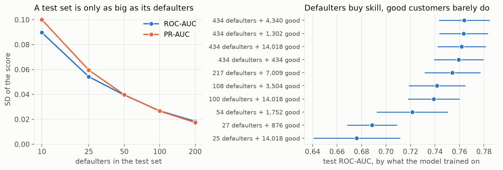
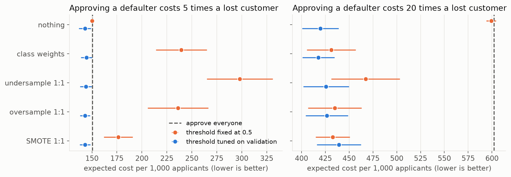
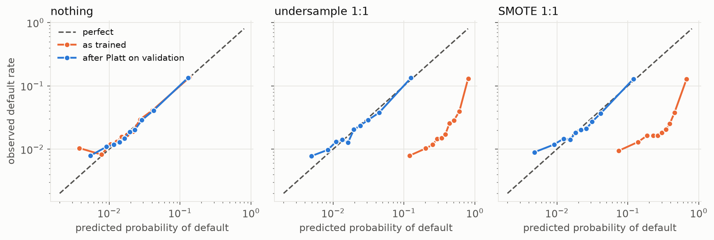
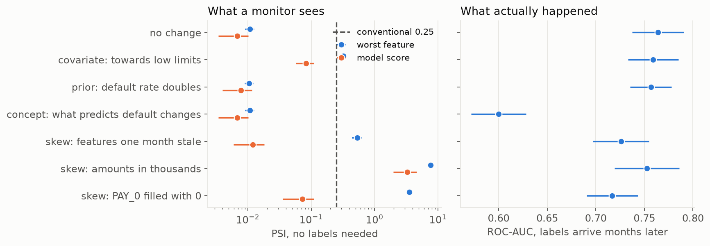

# Imbalance, Errors and Drift

> When 3 customers in 100 default, a model that approves everyone is 97% accurate and worthless. This chapter decides what each error costs in lending, measures how much data a rare event needs, tests SMOTE and its rivals on the same splits, repairs the probabilities they distort, and shows what drift looks like before the labels arrive.

**In plain words.** A lender wants to spot the few borrowers who won't pay back. Think of a smoke alarm in a house that almost never has a fire: an alarm that never rings is right nearly every day and useless on the one day that counts, while one that rings at every slice of toast gets switched off. You choose how sensitive to make it by weighing a missed fire against a ruined dinner. This chapter does that for loans, checks whether popular tricks for rare events really help, makes sure "5% risk" really means 5 in 100, and watches for the day the world stops looking like the data the model learned from.

[Credit scoring](../../../data-analytics/06-applied-analyses/notes/02-credit-scoring.md) stopped at a scorecard on South German Credit: 1,000 rows, 30% bad. This chapter picks up there with far more data, a much rarer outcome and a boosted model that gets trained, calibrated and monitored. It follows [training and tuning](09-training-and-tuning.md) and keeps that note's discipline: train, validation and test are separate, and everything is chosen on validation. Blocks run top to bottom from this `notes/` folder with `uv run --python 3.12 --with scikit-learn --with imbalanced-learn --with pandas --with xlrd --with matplotlib --with scipy`. The heavy runs live in the [lab](../practice/credit-default-lab/README.md) and are cached, so run it first or expect a few minutes on the first pass.

## The data, and a choice we made

The data is [Default of Credit Card Clients](https://doi.org/10.24432/C55S3H): 30,000 card customers in Taiwan in 2005, CC BY 4.0, with six months of repayment status, bills and payments, and one label: did they default next month. It defaults at 22.1%, not rare enough for this chapter, so `make_rare()` keeps every good customer and a random subset of defaulters until 3% remain. **The 3% is our choice.** It changes the base rate and nothing else: who defaults, given their features, is untouched. Every absolute rate below belongs to that thinned population, not to any real book.

As in note 02, sex, marriage and age are never inputs. `features()` also log-scales the money columns and folds the undocumented education codes into "other".

```python
import sys
sys.path.insert(0, "../practice/credit-default-lab")
import numpy as np, pandas as pd
import credit_default_lab as lab
from sklearn.dummy import DummyClassifier

pd.set_option("display.width", 130, "display.max_columns", 30)
raw = lab.load_credit()                                # downloads once, checks sha256, caches under data/
rare, spare = lab.make_rare(raw, lab.PREVALENCE, seed=0)   # keep the good customers, thin the defaulters
tr, va, te = lab.split(rare, seed=0)
xtr, xva, xte = lab.features(tr), lab.features(va), lab.features(te)
ytr, yva, yte = (d[lab.TARGET].to_numpy() for d in (tr, va, te))
print(f"file {len(raw):,} rows at {raw[lab.TARGET].mean():.1%}; case {len(rare):,} rows at {rare[lab.TARGET].mean():.1%}")
print(f"train {len(ytr):,} ({ytr.sum()} defaulters), validation {len(yva):,} ({yva.sum()}), test {len(yte):,} ({yte.sum()})")
print("always approve, accuracy", round(DummyClassifier().fit(xtr, ytr).score(xte, yte), 3))
```

```text
file 30,000 rows at 22.1%; case 24,087 rows at 3.0%
train 14,452 (434 defaulters), validation 4,817 (144), test 4,818 (145)
always approve, accuracy 0.97
```

## Accuracy lies; errors cost

The model below catches none of the defaulters at the default threshold and matches the always-approve dummy's accuracy, exactly the trap the [evaluation note](04-model-evaluation.md) warned about. Its ranking is fine. What's missing is a decision rule.

A decision needs a null hypothesis. Take H0 as "this applicant is good", the convention in note 04 where the positive class is the bad event. Then:

| Error | Statistics name | In lending | What it costs |
|---|---|---|---|
| Decline a good customer | Type I, rate α | Lost customer | The margin we'd have earned, and it's quiet: nobody ever sees it |
| Approve a defaulter | Type II, rate β | Credit loss | Exposure × loss given default, and it's loud: it lands in the accounts |

Flip H0 and the names swap, so state yours. Note 02's assumed loan of 5,000 at 60% loss given default loses 3,000 on a defaulter. Against a margin of 600, that's its 5:1 ratio; a thin 150 margin makes it 20:1. These are assumptions, and we carry both. The cost-minimising rule is to decline when P(default) ≥ cost of a lost customer ÷ (sum of both costs), or 1/6 at 5:1 and 1/21 at 20:1, but only if the probabilities are real. Hold that thought.

```python
model = lab.make_pipeline(None, "boosted", {"max_leaf_nodes": 4, "max_iter": 300}, False, seed=0).fit(xtr, ytr)
p = model.predict_proba(xte)[:, 1]
print("model at 0.5: accuracy", round(np.mean((p >= .5) == yte), 3), " defaulters caught", round(np.mean(p[yte == 1] >= .5), 3))

def errors(y, p, threshold, loss=3000, margin=600):
    decline = p >= threshold
    type1 = np.sum((y == 0) & decline)          # H0 "this applicant is good", wrongly rejected
    type2 = np.sum((y == 1) & ~decline)         # a defaulter wrongly approved
    return dict(threshold=threshold, declined=decline.mean().round(3), type1=type1, type2=type2,
                alpha=(type1 / (y == 0).sum()).round(3), beta=(type2 / (y == 1).sum()).round(3),
                money_per_1000=int((loss * type2 + margin * type1) / len(y) * 1000))

print(pd.DataFrame([errors(yte, p, t) for t in (0.5, 1 / 6, 0.05)]).round(3).to_string(index=False))
```

```text
model at 0.5: accuracy 0.97  defaulters caught 0.0
 threshold  declined  type1  type2  alpha  beta  money_per_1000
     0.500     0.000      0    145  0.000 1.000           90286
     0.167     0.018     71    129  0.015 0.890           89165
     0.050     0.108    452     79  0.097 0.545          105479
```

Pushing the threshold down trades β for α. At 0.05 the lender catches 45% of defaulters but pays more: α goes from 1.5% to 9.7%, and 452 good customers lost outweigh 50 more defaulters caught at this ratio. The "best" α isn't a statistical constant like 5%. It comes from the price list.

## Significance, power and what a rare event needs

[Hypothesis testing](../../../data-analytics/02-probability-and-statistics/notes/05-hypothesis-testing.md) has the theory; here's what rarity does to it. Suppose a new policy might cut defaults by a fifth. The sample size for a two-proportion test at α = 0.05 and power 0.8 depends on variance, and variance is governed by the rare class.

```python
n = lab.sample_size_two_proportions(0.03, 0.024)
print(f"3.0% vs 2.4%: {n:,} applicants per arm, about {int(n * .03)} defaults in the control arm; simulated power {lab.simulated_power(.03, .024, n):.3f}")
n2 = lab.sample_size_two_proportions(0.22, 0.22 * .8)
print(f"22% vs 17.6% (same 20% cut): {n2:,} per arm, about {int(n2 * .22)} defaults")
print(f"no defaults among 1,000 approved: exact 95% upper bound {1 - 0.05 ** (1 / 1000):.4f}, rule of three {3 / 1000:.4f}")
noise, trained = lab.metric_noise(raw), lab.training_events(raw)
print(noise.round(3).to_string(index=False))
print(trained.groupby(["events", "goods"])[["roc_auc", "pr_auc"]].mean().round(3))
lab.figure_events(noise, trained);
```

```text
3.0% vs 2.4%: 11,452 applicants per arm, about 343 defaults in the control arm; simulated power 0.809
22% vs 17.6% (same 20% cut): 1,284 per arm, about 282 defaults
no defaults among 1,000 approved: exact 95% upper bound 0.0030, rule of three 0.0030
 events  roc_auc  pr_auc
     10    0.090   0.100
     25    0.054   0.060
     50    0.039   0.040
    100    0.027   0.027
    200    0.018   0.017
              roc_auc  pr_auc
events goods
25     14018    0.676   0.077
27     876      0.689   0.095
54     1752     0.721   0.109
100    14018    0.739   0.124
108    3504     0.742   0.129
217    7009     0.754   0.138
434    434      0.759   0.133
       1302     0.763   0.141
       4340     0.764   0.141
       14018    0.762   0.143
```



Three lessons, all measured:

- **Count events, not rows.** Detecting the same 20% cut takes 1,284 per arm at a 22% rate and 11,452 at 3%, and the simulation agrees with the formula at power 0.809. The events needed are of a similar order, 282 and 343. And in lending the outcome takes months to arrive, so the experiment is slower than the count suggests.
- **A test set is as big as its defaulters.** With 50 defaulters, the SD of ROC-AUC is 0.039, more than any gap between methods in this chapter's next table. To detect a difference you need a few hundred events or several seeds.
- **Good customers saturate early, defaulters do not.** Training on all 434 defaulters and just 434 good customers gives ROC-AUC 0.759 against 0.762 with all 14,018. Keeping all good customers and just 25 defaulters gives 0.676. That's why undersampling can be cheap and thinning positives is costly. If you've seen no defaults among 1,000 approved loans, the rule of three still only bounds the true rate at 0.3%.

## Imbalance: what each remedy does

Five things you can do to the training data or loss, plus one you do after:

- **Nothing.** Fit on the data as it is.
- **Class weights.** Count each defaulter as many customers in the loss.
- **Random undersampling.** Discard good customers until the classes match.
- **Random oversampling.** Copy defaulters until they match.
- **SMOTE** ([Chawla et al., 2002](https://arxiv.org/abs/1106.1813)). For each defaulter pick one of its 5 nearest defaulter neighbours, and create a new point somewhere on the line between them. Replicas make the decision region small and specific; the paper's argument is that interpolation makes it more general. Needing neighbours means it needs scaled features.
- **Threshold moving.** Leave the data alone and change the cut-off: the row "nothing" with a tuned threshold. It can't change PR-AUC, ROC-AUC or Brier, because those don't look at the cut-off. It only changes the decisions.

```python
a, b = np.array([6.0, 4.0]), np.array([4.0, 3.0])     # Chawla's worked example
print("three synthetic points:", [(a + g * (b - a)).tolist() for g in (0.25, 0.5, 0.75)])
```

```text
three synthetic points: [[5.5, 3.75], [5.0, 3.5], [4.5, 3.25]]
```

`imblearn`'s `Pipeline` is the tool: a sampler is a step that runs in `fit` and is skipped in `predict`, so validation and test data are never resampled. Here's every method once, on one split.

```python
from imblearn.over_sampling import RandomOverSampler, SMOTE
from imblearn.pipeline import Pipeline
from imblearn.under_sampling import RandomUnderSampler
from sklearn.ensemble import HistGradientBoostingClassifier
from sklearn.metrics import average_precision_score, brier_score_loss, roc_auc_score
from sklearn.preprocessing import StandardScaler

def hgb(**kw):
    return HistGradientBoostingClassifier(max_leaf_nodes=4, max_iter=300, learning_rate=0.05, early_stopping=False, random_state=0, **kw)

pipes = {
    "nothing": Pipeline([("scale", StandardScaler()), ("clf", hgb())]),
    "class weights": Pipeline([("scale", StandardScaler()), ("clf", hgb(class_weight="balanced"))]),
    "undersample": Pipeline([("scale", StandardScaler()), ("rus", RandomUnderSampler(random_state=0)), ("clf", hgb())]),
    "oversample": Pipeline([("scale", StandardScaler()), ("ros", RandomOverSampler(random_state=0)), ("clf", hgb())]),
    "SMOTE": Pipeline([("scale", StandardScaler()), ("smote", SMOTE(k_neighbors=5, random_state=0)), ("clf", hgb())]),
}
rows = []
for name, pipe in pipes.items():
    pipe.fit(xtr, ytr)
    pv, pt = pipe.predict_proba(xva)[:, 1], pipe.predict_proba(xte)[:, 1]
    t = lab.tune_threshold(yva, pv)
    rows.append(dict(method=name, pr_auc=average_precision_score(yte, pt), roc_auc=roc_auc_score(yte, pt),
                     brier=brier_score_loss(yte, pt), threshold=t,
                     cost_at_05=lab.expected_cost(yte, pt, 0.5), cost_tuned=lab.expected_cost(yte, pt, t)))
print(pd.DataFrame(rows).round(3).to_string(index=False))
```

```text
       method  pr_auc  roc_auc  brier  threshold  cost_at_05  cost_tuned
      nothing   0.120    0.750  0.028      0.239     150.477     150.477
class weights   0.122    0.739  0.159      0.868     267.746     149.440
  undersample   0.119    0.737  0.197      0.864     356.787     142.175
   oversample   0.127    0.744  0.158      0.785     262.557     144.043
        SMOTE   0.116    0.732  0.105      0.726     170.610     145.704
```

On this seed undersampling looks like the winner at 142.2. Don't believe it: the test set holds 145 defaulters. So the lab repeats everything over 20 seeds, each giving all methods the same split and a small grid chosen on validation PR-AUC. The seeds share the same good customers, so they aren't independent, and we call a difference within noise when the mean paired difference is smaller than its SD. Costs are in units of one lost customer, per 1,000 applicants. "Tuned" means the threshold minimising cost on validation.

```python
c = lab.compare(raw)     # boosted, 3%, 20 seeds, every method on each seed's split, small grid on validation PR-AUC
print(lab.scoreboard(c))
for col in ("pr_auc", "roc_auc", "brier"):
    for m in ("class weights", "undersample 1:1", "oversample 1:1", "SMOTE 1:1"):
        d, sd, wins, n = lab.paired(c, m, "nothing", col)
        print(f"{col:8s} {m:16s} minus nothing {d:+.4f} (SD {sd:.4f}), lower on {wins}/{n} seeds")
print("approve everyone costs", round(c.cost_all_5.mean(), 1), "at 5:1 and", round(c.cost_all_20.mean(), 1), "at 20:1")
print("the 1/6 formula on the untouched model:", round(c[c.method == "nothing"].cost_bayes_5.mean(), 1), "; 1/21 at 20:1:", round(c[c.method == "nothing"].cost_bayes_20.mean(), 1))
print("seed SD of tuned cost:", round(c[c.method == "nothing"].cost_tuned_5.std(), 1), "at 5:1 and", round(c[c.method == "nothing"].cost_tuned_20.std(), 1), "at 20:1")
print("tuned ratio picked:", c[c.method == "SMOTE, ratio tuned"].ratio.value_counts().to_dict())
lg = lab.compare(raw, "logistic")
print("logistic, nothing:", lg[lg.method == "nothing"][["pr_auc", "roc_auc", "cost_tuned_5", "cost_tuned_20"]].mean().round(3).to_dict())
b, l = c[c.method == "nothing"].set_index("seed"), lg[lg.method == "nothing"].set_index("seed")
for col in ("roc_auc", "cost_tuned_5", "cost_tuned_20"):
    print(f"boosted minus logistic, {col}: {(b[col] - l[col]).mean():+.3f} (SD {(b[col] - l[col]).std():.3f})")
lab.figure_comparison(c);
```

```text
                     pr_auc  roc_auc  brier  cost_at_0.5  cost_tuned  cost20_at_0.5  cost20_tuned
method
nothing               0.142    0.760  0.028        150.1       143.0          599.2         419.8
class weights         0.142    0.759  0.154        239.5       144.5          431.3         417.8
undersample 1:1       0.128    0.754  0.188        298.0       144.0          467.2         425.8
oversample 1:1        0.139    0.757  0.150        236.2       143.1          435.0         426.7
SMOTE 1:1             0.131    0.738  0.122        176.4       143.1          432.7         439.2
SMOTE, ratio tuned    0.137    0.748  0.046        148.2       142.4          530.7         430.5
SMOTE + undersample   0.131    0.746  0.136        193.2       143.1          427.6         427.2
SMOTE-NC 1:1          0.133    0.738  0.150        233.4       142.7          446.6         438.3
pr_auc   class weights    minus nothing -0.0001 (SD 0.0113), lower on 9/20 seeds
pr_auc   undersample 1:1  minus nothing -0.0141 (SD 0.0219), lower on 16/20 seeds
pr_auc   oversample 1:1   minus nothing -0.0028 (SD 0.0150), lower on 9/20 seeds
pr_auc   SMOTE 1:1        minus nothing -0.0113 (SD 0.0260), lower on 15/20 seeds
roc_auc  class weights    minus nothing -0.0010 (SD 0.0077), lower on 13/20 seeds
roc_auc  undersample 1:1  minus nothing -0.0056 (SD 0.0149), lower on 12/20 seeds
roc_auc  oversample 1:1   minus nothing -0.0029 (SD 0.0103), lower on 12/20 seeds
roc_auc  SMOTE 1:1        minus nothing -0.0220 (SD 0.0180), lower on 18/20 seeds
brier    class weights    minus nothing +0.1268 (SD 0.0210), lower on 0/20 seeds
brier    undersample 1:1  minus nothing +0.1602 (SD 0.0076), lower on 0/20 seeds
brier    oversample 1:1   minus nothing +0.1226 (SD 0.0253), lower on 0/20 seeds
brier    SMOTE 1:1        minus nothing +0.0948 (SD 0.0218), lower on 0/20 seeds
approve everyone costs 150.5 at 5:1 and 601.9 at 20:1
the 1/6 formula on the untouched model: 142.9 ; 1/21 at 20:1: 420.2
seed SD of tuned cost: 5.9 at 5:1 and 19.1 at 20:1
tuned ratio picked: {0.1: 11, 0.25: 5, 1.0: 2, 0.5: 2}
logistic, nothing: {'pr_auc': 0.121, 'roc_auc': 0.732, 'cost_tuned_5': 147.862, 'cost_tuned_20': 433.447}
boosted minus logistic, roc_auc: +0.028 (SD 0.016)
boosted minus logistic, cost_tuned_5: -4.898 (SD 6.408)
boosted minus logistic, cost_tuned_20: -13.616 (SD 26.840)
```



Reading it:

- **Discrimination.** No method beats doing nothing. Class weights and oversampling tie it. SMOTE is the one gap beyond noise on ROC-AUC, 0.022 lower (SD 0.018) and lower on 18 of 20 seeds. SMOTE-NC, the paper's variant for coded columns, scores the same 0.738, so interpolating ordinal codes isn't the explanation.
- **Brier.** Every balanced method is far worse, 0.122 to 0.188 against 0.028, on all 20 seeds. That's the probabilities breaking; see below.
- **Cost.** Once the threshold is tuned, the spread at 5:1 is 142.4 to 144.5, under a third of the seed SD of 5.9. The threshold matters and the remedy mostly doesn't. Tuning isn't even necessary on the untouched model: the formula's 1/6 gives 142.9 and 1/21 gives 420.2, against 143.0 and 419.8 tuned.
- **At 0.5.** A 1:1 training set moves the 0.5 cut-off to about the base rate: with exact undersampling, 0.5 after resampling means p ≥ 0.03 before it, which is what a 32:1 cost ratio would ask for. That explains the figure. At 20:1 it's roughly right, and balancing beats doing nothing, 433 against 599. At 5:1 it declines far too many, 298 for undersampling against 150. Resampling at 0.5 is threshold moving with an unstated cost ratio.
- **Modest prize.** At 5:1 on a 3% book, few applicants ever reach a 1/6 risk, so the model saves only 5% against approving everyone, 143.0 against 150.5. At 20:1 it saves 30%, 419.8 against 601.9. If your ratio is low and your base rate lower, don't expect heroics.

## Does SMOTE lose to a tuned threshold?

We started this chapter with a claim: "SMOTE often loses to a tuned threshold". Treated as a hypothesis, here's the test across learners, default rates and cost ratios. `SMOTE_at_0.5` and `SMOTE_tuned` are cost differences from a tuned threshold on the untouched model, written as mean (SD), SMOTE's wins. Positive means SMOTE costs more.

```python
print(lab.smote_vs_threshold(raw).to_string(index=False))
print("arm size for 1.0% vs 0.8%:", lab.sample_size_two_proportions(0.01, 0.008))
t = lab.compare(raw, "tree")
print("tree, Chawla's recipe minus plain undersampling, ROC-AUC, SD, lower on:", lab.paired(t, "SMOTE + undersample", "undersample 1:1", "roc_auc"))
print("boosted, same:", lab.paired(c, "SMOTE + undersample", "undersample 1:1", "roc_auc"))
nn = lab.neural_net(raw)
print(nn.groupby("method", sort=False)[["pr_auc", "roc_auc", "cost_05_5", "cost_tuned_5", "cost_05_20", "cost_tuned_20"]].mean().round(3))
for col in ("cost_tuned_5", "cost_tuned_20", "roc_auc"):
    print("neural net, SMOTE minus nothing,", col, lab.paired(nn, "SMOTE 1:1", "nothing", col))
```

```text
 learner   rate ratio  approve_all  tuned_threshold         SMOTE_at_0.5        SMOTE_tuned
 boosted 0.0300   5:1        150.5            143.0   +33.4 (13.0), 0/20  +0.1 (5.8), 12/20
 boosted 0.0300  20:1        601.9            419.8   +12.9 (21.3), 7/20 +19.3 (22.4), 4/20
logistic 0.0300   5:1        150.5            147.9  +138.1 (17.9), 0/20   +2.5 (5.0), 5/20
logistic 0.0300  20:1        601.9            433.4   +31.7 (23.6), 1/20 +13.0 (18.8), 6/20
    tree 0.0300   5:1        150.5            144.7  +105.2 (88.7), 1/20  -3.0 (4.5), 16/20
    tree 0.0300  20:1        601.9            442.2   +45.5 (61.2), 5/20 +12.6 (30.8), 8/20
 boosted 0.1000   5:1        499.8            341.7     +8.5 (7.7), 2/20   +7.8 (9.9), 5/20
 boosted 0.1000  20:1       1999.2            779.2  +310.9 (72.6), 0/20 +21.4 (23.5), 4/20
 boosted 0.2212   5:1       1105.8            547.9   +43.4 (13.6), 0/20   +5.2 (8.9), 4/20
 boosted 0.2212  20:1       4423.3            773.8 +1240.4 (83.1), 0/20  +5.0 (17.9), 7/20
arm size for 1.0% vs 0.8%: 34999
tree, Chawla's recipe minus plain undersampling, ROC-AUC, SD, lower on: (-0.0175, 0.017, 17, 20)
boosted, same: (-0.0081, 0.0139, 15, 20)
                pr_auc  roc_auc  cost_05_5  cost_tuned_5  cost_05_20  cost_tuned_20
method
nothing          0.127    0.742    149.709       146.472     597.094        436.488
oversample 1:1   0.104    0.707    246.866       149.626     468.223        462.017
SMOTE 1:1        0.101    0.683    253.425       147.966     488.481        485.886
neural net, SMOTE minus nothing, cost_tuned_5 (1.4944, 5.6451, 5, 10)
neural net, SMOTE minus nothing, cost_tuned_20 (49.3981, 39.8863, 0, 10)
neural net, SMOTE minus nothing, roc_auc (-0.0589, 0.0204, 10, 10)
```

**The result depends on which SMOTE you mean.**

- **SMOTE at 0.5, the way it's usually deployed,** loses to the tuned threshold beyond noise in 8 of the 10 rows, is within noise in the other 2, and never wins. Here the claim holds.
- **SMOTE with its own tuned threshold** is within noise in all 10 rows. Its mean is worse in 9 of 10, by up to 21 units, and better only for the tree at 5:1. That's a tie that leans one way, not a loss. It costs extra fitting and buys nothing, but it doesn't lose.
- **Neural net.** Here we expected SMOTE to help and it didn't: ROC-AUC 0.683 against 0.742, lower on all 10 seeds, and cost +49 (SD 40) at 20:1.

The papers, read in full, say this:

- **[Elor and Averbuch-Elor (2022)](https://arxiv.org/abs/2201.08528)**, a preprint, ran 73 datasets and 7 classifiers: "except for very weak classifiers (MLP and SVM), balancing the data and optimizing the decision threshold yield comparable prediction performance". F1 was 0.532 against 0.529 for CatBoost and 0.504 against 0.513 for LightGBM, threshold against SMOTE. Our tie agrees. They also find that a fixed threshold is where balancing helps, and that plain oversampling does as well as SMOTE for strong learners: our 20:1 column shows the same. They recommend the threshold for simplicity, one fit serving many metrics.
- **They differ from our neural net.** Their MLP scored F1 0.303 tuned against 0.411 with SMOTE. Ours is one small network on one dataset by a cost metric, so this is a data point, not a refutation. Their weak learners' baseline probabilities were poor; ours were usable.
- **[van den Goorbergh et al. (2022)](https://doi.org/10.1093/jamia/ocac093)** tested logistic and ridge regression: "outcome imbalance is not a problem in itself". Corrected models never beat the uncorrected AUROC in their median and classified about as well as an uncorrected model with a moved threshold, with far worse calibration. On their ovarian cancer case an uncorrected model at a threshold of 0.192 gave sensitivity 71% and specificity 76%, against 69% and 78% for SMOTE at 0.5. Our logistic row matches. Their limit was logistic only; our boosted rows extend the same pattern to one more learner.
- **[Chawla et al. (2002)](https://arxiv.org/abs/1106.1813)** points the other way, and it's worth saying why. They tested SMOTE combined with undersampling against plain undersampling, ranked by ROC area, and won almost every comparison, usually narrowly (Mammography, 0.926 against 0.933). Their one comparison with moving a threshold, on Phoneme with C4.5, favoured SMOTE across the whole curve. They never looked at probabilities, and they report the best curve across SMOTE amounts. Our run of their recipe goes the other way: for the tree, ROC-AUC 0.0175 lower than plain undersampling (SD 0.017), lower on 17 of 20 seeds. Also see their own warning: on Adult, a mixed-type dataset like ours, SMOTE-NC did worse than undersampling.

So the honest sentence for this chapter is narrower than the claim: **on this data, tune the threshold and leave the data alone; SMOTE with a fixed 0.5 usually loses, SMOTE with a tuned threshold ties, and neither repays its calibration damage.** That's one dataset, thinned by us. Elor's 73 datasets support the tie, not a general loss.

## The leak: resampling before you split

Resample first and split afterwards, and the validation folds contain copies of training rows, or points interpolated from them. Cross-validation then measures memory.

```python
from sklearn.model_selection import StratifiedKFold, cross_val_score

pool = pd.concat([tr, va])
x, y = lab.features(pool), pool[lab.TARGET].to_numpy()
cv = StratifiedKFold(5, shuffle=True, random_state=0)
smote = Pipeline([("scale", StandardScaler()), ("smote", SMOTE(random_state=0)), ("clf", hgb())])
right = cross_val_score(smote, x, y, cv=cv, scoring="roc_auc").mean()      # SMOTE refits inside each training fold

x_res, y_res = SMOTE(random_state=0).fit_resample(StandardScaler().fit_transform(x), y)   # the mistake: resample, then split
wrong = cross_val_score(hgb(), x_res, y_res, cv=cv, scoring="roc_auc").mean()
print(f"leaked {wrong:.3f}  pipeline {right:.3f}  test {roc_auc_score(yte, smote.fit(x, y).predict_proba(xte)[:, 1]):.3f}")
print(lab.leak(raw).groupby("sampler")[["leaked_cv", "pipeline_cv", "test"]].agg(["mean", "std"]).round(3))
```

```text
leaked 0.934  pipeline 0.726  test 0.742
        leaked_cv        pipeline_cv          test
             mean    std        mean    std   mean    std
sampler
ros         0.964  0.001       0.735  0.014  0.748  0.017
smote       0.984  0.001       0.697  0.016  0.703  0.013
```

ROC-AUC is the honest comparison here since it ignores the class mix. The leaked estimate says 0.98 for a model that truly scores 0.70, while the pipeline's 0.697 tracks the test score. SMOTE scores lower here because this block fixes a large model (15 leaves, 300 rounds) with no tuning; the grid above chooses smaller ones. The mistake is easy because `fit_resample` followed by `cross_val_score` is short and raises no error.

## Calibration: the bridge from score to price

A lender prices with a probability: expected loss = PD × LGD × exposure. Rank isn't enough. Note 04 has [reliability diagrams and the methods](04-model-evaluation.md#threshold-precisionrecall-and-roc); here's what resampling does to them.

```python
from sklearn.calibration import CalibratedClassifierCV
from sklearn.frozen import FrozenEstimator

fitted = pipes["SMOTE"]                                  # already fit on train
fixed = CalibratedClassifierCV(FrozenEstimator(fitted), method="sigmoid").fit(xva, yva)   # Platt, on validation
for name, q in (("SMOTE as trained", fitted.predict_proba(xte)[:, 1]), ("after Platt", fixed.predict_proba(xte)[:, 1])):
    print(f"{name:17s} mean PD {q.mean():.3f} (observed {yte.mean():.3f})  Brier {brier_score_loss(yte, q):.4f}  ROC-AUC {roc_auc_score(yte, q):.3f}  cost at 1/6 {lab.expected_cost(yte, q, 1 / 6):.0f}")

cal, rel = lab.calibration(raw)
print(cal.groupby(["method", "fix"], sort=False)[["mean_pd", "brier", "ece", "intercept", "slope", "cost_bayes"]].mean().round(3).to_string())
price = cal[cal.fix.isin(["raw", "Platt"])].groupby(["method", "fix"], sort=False)[["approved", "pred_loss", "real_loss"]].mean().round(3)
print(price.loc[["nothing", "SMOTE 1:1"]].to_string())
print(lab.compare(raw, "logistic").groupby("method", sort=False)[["cal_intercept", "cal_slope"]].mean().round(3).head(5).to_string())
lab.figure_reliability(rel);
```

```text
SMOTE as trained  mean PD 0.272 (observed 0.030)  Brier 0.1045  ROC-AUC 0.732  cost at 1/6 704
after Platt       mean PD 0.028 (observed 0.030)  Brier 0.0280  ROC-AUC 0.732  cost at 1/6 149
                             mean_pd  brier    ece  intercept  slope  cost_bayes
method          fix
nothing         raw            0.029  0.028  0.006      0.035  0.937     142.881
                Platt          0.030  0.028  0.007      0.006  1.002     143.587
                isotonic       0.030  0.028  0.007      0.001  0.803     143.410
                intercept      0.030  0.028  0.007      0.004  0.938     142.414
class weights   raw            0.345  0.154  0.315     -3.246  0.950     798.734
                Platt          0.030  0.028  0.006      0.009  1.005     142.476
                isotonic       0.030  0.028  0.007      0.005  0.808     144.655
                intercept      0.030  0.028  0.007      0.006  0.951     142.217
                prior shift    0.025  0.028  0.008      0.229  0.951     142.466
undersample 1:1 raw            0.395  0.188  0.364     -3.511  0.946     881.849
                Platt          0.030  0.028  0.006      0.009  0.995     144.925
                isotonic       0.030  0.028  0.007      0.008  0.825     144.334
                intercept      0.030  0.028  0.007      0.007  0.947     144.396
                prior shift    0.031  0.028  0.008     -0.036  0.947     144.770
oversample 1:1  raw            0.337  0.150  0.307     -3.205  0.936     780.324
                Platt          0.030  0.028  0.007      0.006  1.017     141.345
                isotonic       0.030  0.028  0.007      0.006  0.836     143.057
                intercept      0.030  0.028  0.006      0.004  0.936     141.760
                prior shift    0.024  0.028  0.008      0.270  0.937     142.777
SMOTE 1:1       raw            0.305  0.122  0.275     -2.930  1.004     777.480
                Platt          0.030  0.028  0.006      0.005  1.013     142.829
                isotonic       0.030  0.028  0.006      0.003  0.811     142.839
                intercept      0.030  0.028  0.006      0.005  1.004     142.113
                prior shift    0.018  0.028  0.012      0.545  1.005     148.381
                 approved  pred_loss  real_loss
method    fix
nothing   raw       0.973     23.168     25.035
          Platt     0.976     24.705     25.553
SMOTE 1:1 raw       0.206    113.153     10.146
          Platt     0.974     24.785     25.087
                 cal_intercept  cal_slope
method
nothing                  0.002      1.004
class weights           -3.489      0.812
undersample 1:1         -3.447      0.980
oversample 1:1          -3.495      0.800
SMOTE 1:1               -3.503      0.784
```



SMOTE as trained predicts an average PD of 30.5% on a book that defaults at 3.0%. The calibration intercept, the log-odds shift needed to make the average right, is -2.93. For scale, van den Goorbergh et al. found medians of -2.1 or lower at a 10% event rate and -4.5 or lower at 1%. Their logistic slopes fell below 1 for SMOTE, too extreme. Ours match for the logistic model, 0.784 against 1.004, but not for the boosted one, where the slope stays near 1: for trees here, the damage is the intercept.

For a price, it's stark. SMOTE's raw scores approve 20.6% at the 1/6 rule, predicting 11.3% default among them, when 1.0% happens. At 3,000 per default, that's 339 of expected loss priced into a loan that loses about 30. And the cost at 1/6 is 777 against 143. Tuning the threshold hid all this, because a threshold only needs order.

The repairs, all on held-out validation data, never on train:

- **Prior shift**, note 02's log-odds correction, needs no data but needs the mechanism to match. For undersampling it's right, intercept -0.036. For class weights and oversampling it leaves +0.23 and +0.27. For SMOTE it leaves +0.545, an average PD of 1.8%: SMOTE doesn't just change the prior, it moves the boundary.
- **Intercept recalibration**, van den Goorbergh et al.'s fix, and **Platt scaling** both restore the mean, to 0.030, with the Brier back to 0.028 for every method.
- **Isotonic** restores the mean too, but with 144 defaulters to fit on, the steps make a slope near 0.8. Note 04 warned about small calibration sets.

After repair every method has the same Brier as doing nothing, so the resampling and its repair cancel out. Their conclusion is ours: correction followed by recalibration is "only worth the effort if imbalance correction leads to better discrimination", and here it doesn't. The fix also costs validation data you could have used elsewhere.

## Drift: when the world moves

Calibration holds only while serving looks like training. The file has one outcome month per customer, so real drift in outcomes can't be measured from it. So the lab simulates each case on real rows, half of a held-out set per window, about 2,400 rows and 72 defaulters, and scores them with PSI from note 02, against the validation window. Amounts use quantile bins, coded columns use one bin per level.

- **Covariate shift**: P(x) moves, P(default | x) doesn't. We pick rows by credit limit alone, so the rule linking features to default can't change.
- **Prior shift**: the default rate moves. We swap in spare real defaulters to double it.
- **Concept shift**: P(default | x) moves. Same rows, same features, new labels: forbearance cures 60% of late payers who would have defaulted, and a shock hits 5% of high-utilisation customers who paid on time.
- **Train/serve skew**: the world hasn't moved, but serving computes features differently from training. Same rows, same labels.

```python
d = lab.drift(raw)
print(d.groupby("scenario", sort=False)[["default_rate", "mean_pd", "worst_psi", "worst_psi_quantile", "score_psi", "roc_auc", "cost"]].mean().round(3).to_string())
print(d.groupby("scenario", sort=False)[["worst_psi", "score_psi", "roc_auc", "cost"]].std().round(3).head(1).to_string())
print("largest no-change worst PSI across 20 seeds:", d[d.scenario == "no change"].worst_psi.max().round(3))
print(lab.monthly_psi(raw).round(3).to_string(index=False))
print("decline rate:", d.groupby("scenario", sort=False).decline.mean().round(3).to_dict())
lab.figure_drift(d);
```

```text
                                        default_rate  mean_pd  worst_psi  worst_psi_quantile  score_psi  roc_auc     cost
scenario
no change                                      0.030    0.030      0.011               0.010      0.007    0.764  140.992
covariate: towards low limits                  0.036    0.036      0.319               0.319      0.083    0.759  169.033
prior: default rate doubles                    0.060    0.032      0.011               0.010      0.008    0.757  262.661
concept: what predicts default changes         0.034    0.030      0.011               0.010      0.007    0.600  177.854
skew: features one month stale                 0.030    0.034      0.531               0.049      0.012    0.726  152.304
skew: amounts in thousands                     0.030    0.043      7.706               7.706      3.291    0.753  145.081
skew: PAY_0 filled with 0                      0.030    0.022      3.539               3.664      0.073    0.717  150.311
           worst_psi  score_psi  roc_auc   cost
scenario
no change      0.002      0.003    0.027  9.451
largest no-change worst PSI across 20 seeds: 0.014
month  bill_psi  status_psi_quantile  status_psi_levels  customers_at_1
  Apr     0.000                0.000              0.000               0
  May     0.003                0.002              0.004               0
  Jun     0.010                0.004              0.005               2
  Jul     0.023                0.017              0.018               4
  Aug     0.041                0.027              0.031              28
  Sep     0.068                0.050              0.927            3688
decline rate: {'no change': 0.024, 'covariate: towards low limits': 0.033, 'prior: default rate doubles': 0.029, 'concept: what predicts default changes': 0.024, 'skew: features one month stale': 0.041, 'skew: amounts in thousands': 0.02, 'skew: PAY_0 filled with 0': 0.001}
```



- **Covariate shift** is loud and harmless to the model. Worst PSI is 0.319, on credit limit. ROC-AUC is unchanged within noise at 0.759, and mean PD still matches the default rate at 0.036. Cost rises from 141 to 169 because the book got riskier. The model is right; a business decision is due.
- **Prior shift** is nearly silent. The default rate doubles to 6% and PSI stays at the no-change 0.011, because only 3% of rows changed. Mean PD stays at 0.032. Rare classes hide from feature monitors.
- **Concept shift** is silent. The features are identical by construction, so every PSI equals the no-change row, while ROC-AUC falls from 0.764 to 0.600. Nothing short of labels will show it.
- **Stale features** are subtle. Reading last month's values gives a worst PSI of 0.531 by level, but 0.049 with quantile bins, and only 0.012 on the score. ROC-AUC falls to 0.726. The cause is real and in the file: code 1 of repayment status belongs to September, with 3,688 customers against 28 in August, and PSI by level jumps from 0.031 to 0.927 while quantile bins report 0.050. The file can't say why, but it reads like a change of recording, not behaviour. **Bin coded columns by level.**
- **PAY_0 filled with 0**, the classic late join. PSI 3.5, score PSI just 0.073. Declines collapse from 2.4% to 0.1%, and cost hits 150, the approve-everyone line. The model has silently stopped working.
- **Amounts in thousands**, a broken feed: PSI 7.7, the mean PD rises to 0.043, yet ROC-AUC holds at 0.753. Huge alarm, moderate harm.

The score monitor alone misses most of this, so watch inputs too. PSI's noise floor here was 0.011, topping out at 0.014 across 20 seeds; the 0.1 and 0.25 lines are conventions.

For what to do next, go to the [drift note](../../../data-engineering/06-ml-platform/notes/04-drift.md) in the data engineering pillar. It covers real against virtual drift, Wilson's table of drift types, why PSI must be calibrated on your own windows, the many-features problem, domain classifiers, and retraining policy. It also makes the point this section leans on: in credit scoring, labels arrive a year late, so input and prediction monitors are what you have, and a broken feed is an incident, not a reason to retrain.

## Case: a card lender with a 3% default rate

This case is hypothetical; the rows are real and the rate is our doing.

**What the business asked.** Should we approve this applicant, and at what price? The risk team wanted a probability it could price from, not a rank. Marketing wanted to know why so many good customers were declined. Those are the two errors, and they have owners.

**What the data looked like.** 24,087 customers, 3% defaulted, 434 defaulters in training and 145 in test. Most columns are amounts, plus coded statuses whose documentation doesn't cover all the values in use. With so few test events, one split can crown the wrong method, as it did above.

**Which model and why.** A shallow boosted model with no resampling. It beat logistic regression by about 0.03 of ROC-AUC on the same splits, enough here, unlike note 02's 1,000 rows where they tied. We found no remedy that beat doing nothing on any score, so the extra steps failed to justify themselves. The threshold came from the cost ratio, 1/6 or 1/21, with the validation search as a check on it.

**What the score means.** Without resampling, 0.05 means about 5 in 100 such applicants default in this population: mean PD 0.029 against 0.030 observed, Brier 0.028. In a real book, correct for the true base rate as note 02 does. ROC-AUC of 0.76 means a random defaulter outranks a random good customer 76% of the time, and PR-AUC of 0.142 is nearly five times the 0.03 of random ranking, though modest in absolute terms.

**What broke.** Four things. First, the assumption that a model would earn its keep: at 5:1 it saves just 5%, because few customers reach a 1/6 risk, and the conversation had to move to the true cost ratio before anything else. Second, a balanced trial model looked fine on PR-AUC and would have mispriced every loan by a factor of ten. Third, a resampled cross-validation promised 0.98. Fourth, the feature store: one month's lag dropped ROC-AUC to 0.726 while the score monitor showed 0.012, and only a by-level monitor on inputs caught it.

## Pitfalls

| Pitfall | Symptom | Fix |
|---|---|---|
| Resampling before splitting | CV of 0.98 and a test score of 0.70 | Put the sampler in an `imblearn` `Pipeline` |
| Reading a resampled model's scores as PD | Mean PD 30% on a 3% book | Don't resample, or recalibrate on untouched validation data |
| Prior shift after SMOTE | Average PD still wrong, 1.8% against 3.0% | Prior shift suits undersampling; refit intercept or Platt otherwise |
| Leaving a threshold at 0.5 after balancing | Declines far too many at a low cost ratio | Set it from the costs, then check on validation |
| Comparing methods on one split | The "winner" changes with the seed | Several seeds, same splits, paired differences |
| Counting rows instead of events | A 5,000-row test set with 150 defaulters treated as large | Report the number of events and the SD of the score |
| Automatic early stopping on resampled data | `HistGradientBoosting` turns it on above 10,000 rows and holds out resampled rows | Set `early_stopping=False`, or supply your own validation |
| Quantile bins on a coded column | PSI 0.05 for a shift that is 0.93 by level | One bin per level for coded columns |
| Trusting a score monitor alone | Stale features move score PSI by 0.012 | Monitor inputs too, per [the drift note](../../../data-engineering/06-ml-platform/notes/04-drift.md) |
| Quoting PSI 0.25 as a law | Alarms that never ring, or always do | Calibrate on your own windows |

## Try it

1. What threshold does a 10:1 cost ratio imply? And what cost ratio is a balanced undersampled model at 0.5 implicitly assuming at a 3% default rate?
2. Use `lab.sample_size_two_proportions` to find the arm size for 1.0% against 0.8%. How many defaults is that in the control arm?
3. In the leak block, swap `SMOTE` for `RandomOverSampler`. What do you expect from the leaked estimate, and why doesn't the leak vanish?
4. Why is prior shift exact for undersampling but not for SMOTE?
5. In the drift block, the concept row shows the same PSI as no change, to the third decimal. Why, and what monitor could see it?

<details>
<summary>Answers</summary>

1. 1/11, about 0.091. A 0.5 cut after 1:1 undersampling means p ≥ 0.03 on the original scale, and solving 1/(1+r) = 0.03 gives r ≈ 32.
2. 34,998 per arm by the block's formula, about 350 defaults in the control arm. Rarer events and smaller gaps get expensive quickly.
3. About 0.96, from the lab's table: 0.964 leaked against 0.735 by pipeline. Exact copies of a defaulter land in both training and validation folds, and the tree can memorise them.
4. Undersampling removes good customers at random, so P(x | class) is unchanged and only the odds move. SMOTE adds points that weren't drawn from P(x | default), so the model learns a different boundary, not only a different base rate.
5. The rows and features are identical, only the labels differ, and PSI reads no labels. Only something using outcomes can see it: early delinquency as a proxy, then full labels when they arrive.

</details>

## Interview checklist

| Question | Answer |
|---|---|
| What are Type I and II errors in lending? | With H0 "applicant is good": declining a good customer, and approving a defaulter. Cost each, then set the threshold |
| Which threshold minimises cost? | Decline when P ≥ c_FP / (c_FP + c_FN), if probabilities are calibrated |
| How much data does a rare event need? | Count events. On this data, the same 20% cut needs 11,452 per arm at 3% and 1,284 at 22% |
| Why does accuracy fail? | Approve-all scores 97% at a 3% rate, and catches nothing |
| Why are defaulters worth more than good customers in training? | 434 defaulters with 434 good customers scored 0.759; all good customers with 25 defaulters scored 0.676 |
| What does SMOTE do? | Interpolates between a minority point and one of its minority neighbours |
| Does SMOTE help? | Here, no. At 0.5 it usually lost to a tuned threshold. With its own tuned threshold it tied. Elor's 73 datasets found the tie for strong learners |
| When might balancing still help? | When the threshold can't be moved, and with weak learners per Elor. Random oversampling did as well for strong learners |
| How does resampling leak? | Copies or interpolations of training rows land in validation folds. Use a pipeline, so it runs only in training folds |
| What does resampling do to probabilities? | Inflates them, here mean PD of 0.31 on a 3% book and intercept -2.9. Ranking barely moves, Brier collapses |
| How do you repair them? | Prior shift for undersampling; intercept or Platt on held-out data otherwise; isotonic only with plenty of data |
| Covariate or concept shift? | P(x) moves, against P(y given x) moves. The first is visible without labels, the second is not |
| What is train/serve skew? | Serving computes features differently from training. A stale month or a filled null, with no change in the world |
| What does PSI measure, and when does it fail? | Distribution change in a feature or score. It can't see concept shift or a rare class's prior, and quantile bins can hide a coded column |

## Next

[Deep learning](../../02-deep-learning/README.md): the same discipline of splits, thresholds and calibration, now with models that learn their own features.
