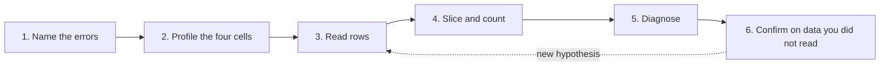

# Reading the Errors: What a Model Finds and What It Misses

> A metric says how often the model is wrong, and only the wrong rows say why. This chapter reads a credit model's errors in six steps, then tests a harder question: when you learn from errors you have read, how do you avoid fitting to them? A fix made from pure noise looks good on the rows you read and costs money on the rows you didn't.

**In plain words.** A teacher who marks a test and looks only at the average learns little. Going through the wrong answers shows whether pupils ran out of time, misread question 4, or never met fractions. There is a trap, though. Spend long enough on one class's answers and you will start teaching to that class's mistakes, and the next class will do no better. So you keep some papers aside, and you check your new lesson on those.

[DS 02/03](../../02-deep-learning/notes/03-structuring-ml-projects.md#error-analysis-count-before-you-build) introduced error analysis as a count: how many mistakes could a fix cover? [DS 01/10](10-imbalance-errors-and-drift.md#accuracy-lies-errors-cost) priced the errors. This chapter does what comes between them, using one model throughout. The code is in [`practice/reading_errors.py`](../practice/reading_errors.py), and every table below is its output.

## The data, and why it isn't note 10's

The model is the credit lab's boosted model, with the same features and the same 5:1 cost ratio, so its decline threshold is still $1/6$. Sex, marriage and age aren't inputs. What changes is the base rate. [DS 01/10](10-imbalance-errors-and-drift.md#the-data-and-a-choice-we-made) kept a random subset of defaulters to reach 3%, because that chapter was about rarity. Here we keep the natural 22.1%.

The reason is arithmetic. At 3% the test set holds only 145 defaulters, and a 1,500-row reading set would hold about 45. Cut that by sex, by age and by credit limit and most cells have a handful of people. The natural rate gives us errors to read. The costs here aren't comparable with note 10's, and the threshold stays at $1/6$ because costs set it, not the base rate.

The other change is the split:

```python
def carve(raw, seed):
    """The test set stays fixed. Everything else is re-dealt: 18,000 train, 1,500 eyeball, 4,500 blackbox."""
    _, _, test = lab.split(raw, seed=0)
    rest = raw.drop(test.index)
    train, dev = train_test_split(rest, train_size=18_000, stratify=rest[T], random_state=seed)
    eyeball, blackbox = train_test_split(dev, train_size=1_500, stratify=dev[T], random_state=seed)
    return train, eyeball, blackbox, test
```

```text
rows: train 18000, eyeball 1500, blackbox 4500, test 6000; default rate 0.221; defaulters in eyeball 332, in test 1327
```

The eyeball set is the part we read. The blackbox set is scored but never read. The names come from [Ng's *Machine Learning Yearning*](https://home-wordpress.deeplearning.ai/wp-content/uploads/2022/03/andrew-ng-machine-learning-yearning.pdf), and the second half of this chapter explains why they matter.

## The procedure



### Step 1: name the errors

Start by saying which class is positive. Here it is "will default", and predicted positive means declined, so the null from [DS 01/10](10-imbalance-errors-and-drift.md#accuracy-lies-errors-cost) is "this applicant is good". Flip either choice and the names swap, so a table with no stated positive class can't be read. Then give each error its meaning in the domain. A false positive is a good customer declined, and a false negative is a defaulter approved.

Set the table at the decision threshold, not at the 0.5 a library defaults to:

```text
--- step 1: positive class = will default, predicted positive = declined (eyeball) ---
threshold 0.500: TP  123  FP   69  FN  209  TN 1099   declined 0.128  cost per 1,000 742.7
threshold 0.167: TP  244  FP  445  FN   88  TN  723   declined 0.459  cost per 1,000 590.0
approve everyone: cost per 1,000 1106.7
```

These are two different models of the business. At 0.5 the errors are mostly missed defaulters, and at $1/6$ they are mostly declined good customers. Studying the 0.5 table would send you to fix a problem the lender doesn't have.

[Manning, Raghavan and Schütze](https://nlp.stanford.edu/IR-book/html/htmledition/evaluation-of-unranked-retrieval-sets-1.html) (ch. 8) warn off accuracy because a system tuned for it can do well by calling every document nonrelevant, when normally over 99.9% are. Here accuracy falls from 81.5% at 0.5 to 64.5% at $1/6$, the cheaper threshold.

### Step 2: profile the four cells

Each cell holds a different kind of person. Comparing them shows what the model has picked up on.

```text
--- step 2: the four cells, median of each column (months_late and score are means; eyeball) ---
        n     limit     bill    paid  status  util  paid_share   age  months_late  score
cell
TP    244   60000.0  13810.5  1142.0     1.0  0.46        0.05  35.0         2.73   0.50
FN     88  100000.0  29107.5  2469.0     0.0  0.39        0.07  34.0         0.10   0.12
FP    445   90000.0   8460.0  1107.0     0.0  0.15        0.06  32.0         1.36   0.32
TN    723  190000.0  40066.0  4000.0     0.0  0.31        0.07  34.0         0.07   0.10

standardised differences (0.2 small, 0.8 large)
             FN vs TP  FN vs TN  FP vs TN  FP vs TP
limit            0.57     -0.51     -0.72      0.27
bill             0.34     -0.22     -0.79     -0.32
paid             0.79     -0.38     -1.13      0.02
status          -1.42     -0.12      0.60     -0.65
months_late     -1.77      0.10      1.14     -0.75
util             0.04      0.15     -0.13     -0.23
paid_share       0.52     -0.02     -0.19      0.34
age             -0.05      0.03     -0.05     -0.12
```

Two comparisons do the work. **FN against TP** shows which defaulters the model misses. Missed defaulters barely have any late months (0.10 against 2.73, a standardised gap of −1.77) and carry higher limits. The model finds the defaulters who have already started missing payments, and it misses the ones who hadn't. **FP against TN** shows which good customers look risky. They have late months of their own (1.14 standard deviations more) and much smaller limits and payments.

Now look at **FN against TN**, the column that matters most for what comes next. Missed defaulters and correctly approved customers look almost the same on status and late months (−0.12 and 0.10), and only moderately different on money. Two more checks:

```text
the approved and the declined: mean predicted risk against what happened (eyeball)
approved  n  811  mean score 0.102  default rate 0.109
declined  n  689  mean score 0.381  default rate 0.354
FN against TN among the approved, a fresh logistic on the same inputs, 5-fold ROC-AUC 0.699
the model's own score, FN against TN among the approved, ROC-AUC 0.683
```

The approved group defaulted at 10.9% against a mean predicted risk of 10.2%, so the model knew. A false negative at a score of 0.12 is less a mistake than a bet at 12% that lost. And a new logistic regression trained on the same inputs separates FN from TN at 0.699, hardly more than the 0.683 from the model's own score. So whatever else tells those two groups apart isn't easy to get from these columns.

### Step 3: read rows

Random rows first. Read only the most confident mistakes and you get a distorted picture, because they are unusual by construction.

```text
--- step 3: five random FN (defaulter approved) ---
        limit    bill  paid  status  months_late  util  age    education  score
ID
16325  140000  110575     0       0            0  0.79   44   university   0.14
26336  300000     880   788      -2            0  0.00   32     graduate   0.09
27689   50000   45688  2500       0            0  0.91   25   university   0.13
9760   200000      80  2230      -1            0  0.00   45  high school   0.15
26353  300000     850   850      -2            0  0.00   30   university   0.12
five most confident FN
        limit   bill   paid  status  months_late  util  age   education  score
ID
22751  350000  30625  60396      -1            0  0.09   32    graduate   0.04
18340   20000  19568   4641       0            0  0.98   22       other   0.05
7017   230000  14529   5500       0            0  0.06   31  university   0.07
9852   100000  64254   2211       0            0  0.64   52  university   0.07
12284  210000   1262  33414      -1            0  0.01   34    graduate   0.07
```

```text
--- step 3: five random FP (good customer declined) ---
        limit   bill  paid  status  months_late  util  age   education  score
ID
11652  130000   -915     0       1            1 -0.01   30    graduate   0.28
1126   300000   2285     0      -1            0  0.01   38    graduate   0.21
29481   20000  16354  1700       0            1  0.82   32  university   0.25
28810  280000    832     0      -1            1  0.00   36    graduate   0.28
10531  180000    787   398      -1            0  0.00   36  university   0.23
five most confident FP
        limit    bill  paid  status  months_late  util  age    education  score
ID
9672   170000    2400     0       2            6  0.01   48     graduate   0.84
28302   60000    6731  1300       2            6  0.11   34  high school   0.83
2715    30000   27143  1800       2            6  0.90   35   university   0.78
2054   140000  136184  6400       2            6  0.97   37  high school   0.77
18989  100000   95890  2000       3            6  0.96   30     graduate   0.77
```

Compare the two kinds of sample. The confident false positives are people six months behind at status 2 or 3, and it would be easy to conclude that the model trusts payment status too much. The random ones suggest a different story: people on large limits with tiny bills who paid little that month (1126, 28810, 10531), and the model is treating the small payment as a warning. The random false negatives include people at status 0 with a bill near their limit (16325, 27689). The note here is what is read and no more: a story about a few rows, to be tested later.

[Ng](https://home-wordpress.deeplearning.ai/wp-content/uploads/2022/03/andrew-ng-machine-learning-yearning.pdf) gives sizes for this: about 10 mistakes is very small, 20 rough, 50 good and 100 very good. Our 1,500 rows hold 533 errors, more than anyone will read one by one. Ng also warns that "if you are working on a task that even humans cannot do well, then the exercise of examining an Eyeball dev set will not be as helpful". Credit default may be such a task, since no human could say which of those rows defaults from the row alone. Expect reading to produce hypotheses and few certainties.

[Errudite](https://aclanthology.org/P19-1073/) (Wu et al., ACL 2019) sets out what goes wrong with reading. It reviews ten papers that analysed samples of 50 to 200 errors, often under 5% of all errors, and warns that "the common practice of manual, subjective categorization of a small sample of errors can yield biased and incomplete conclusions". The same error group in one re-check ranged "13.8% to 45.2% of all errors" depending on how it was defined. Its principles are to define each error group precisely, apply the definition to the whole dataset including correct predictions, and test hypotheses with counterfactuals. Note the middle one. "Small bill and small payment" means little until you know how the model does on such rows that it got right. Its case for sampling bias is an argument rather than a measurement.

**Check the labels too.** One filter turned up a puzzle:

```text
no bill and no payment in six months: 38 rows, 13 labelled default (0.342); of those defaults, 0 are FN
share of all FN: 0.000
```

Thirty-eight people had no bill and made no payment in six months, and 13 of them are labelled as defaulting on the next payment. What would they have defaulted on? This dataset gives us no way to audit that, and the model declines all 13, so none are false negatives. It goes on the list as a question for whoever owns the labels. [Northcutt et al.](https://arxiv.org/abs/2103.14749) (NeurIPS 2021 Datasets and Benchmarks) found at least 3.3% of test labels wrong across ten widely used datasets, a lower bound and a share of labels rather than of errors. Model rankings held at natural noise levels, but the margin can be thin: "ResNet-18 outperforms ResNet-50 if the prevalence of originally mislabeled test examples increases by just 6%." Ng's warning applies if you do relabel: "If you fix only the labels of examples that your system had misclassified, you might introduce bias into your evaluation."

For a single row, the local explanation from [DS 01/08](08-model-interpretability.md#shap) says what drove the score:

```text
most confident FN: score 0.036, log-odds pushes: PAY_AMT1=60396 (-0.40), PAY_0=-1 (-0.31), BILL_AMT1=30625 (-0.24), LIMIT_BAL=350000 (-0.22)
most confident FP: score 0.842, log-odds pushes: PAY_0=2 (+1.50), PAY_6=7 (+0.43), PAY_3=7 (+0.21), PAY_2=2 (+0.19)
```

The missed defaulter paid 60,396 on a 30,625 bill with status −1. Everything the model can see looks excellent, so no reweighting of these columns would catch that row. The false positive shows status doing most of the pushing. Remember what these numbers are: a description of the model, and no reason why this person defaulted.

### Step 4: slice and count

A **slice** is a subgroup you can name. For each, compute error rates with intervals and its share of all cost. The share is the ceiling on what any fix for that slice could gain, the same logic as in [DS 02/03](../../02-deep-learning/notes/03-structuring-ml-projects.md#error-analysis-count-before-you-build). Slices can use columns the model isn't allowed to see, and when the model is barred from a column, error rates across it should be reported. Dropping sex from the inputs doesn't mean sex stops mattering.

```text
--- step 4: slices of the eyeball set ---
                                 n  default    FPR    FNR  cost/1000  share of rows  share of cost      p     BH
slice
sex: female                    901    0.204  0.363  0.277    571.587          0.601          0.582  0.466  False
sex: male                      599    0.247  0.410  0.250    617.696          0.399          0.418  0.466  False
marriage: married              682    0.245  0.363  0.263    596.774          0.455          0.460  0.842  False
marriage: other                 22    0.227  0.588  0.200    681.818          0.015          0.017  0.694  False
marriage: single               796    0.201  0.390  0.269    581.658          0.531          0.523  0.774  False
age_band: 30-39                571    0.198  0.352  0.319    597.198          0.381          0.385  0.856  False
age_band: 40-49                297    0.229  0.345  0.265    569.024          0.198          0.191  0.738  False
age_band: 50+                  146    0.274  0.443  0.200    595.890          0.097          0.098  0.949  False
age_band: under 30             486    0.228  0.421  0.234    592.593          0.324          0.325  0.953  False
education: graduate            547    0.188  0.340  0.301    559.415          0.365          0.346  0.449  False
education: high school         253    0.285  0.475  0.264    715.415          0.169          0.205  0.090  False
education: other                20    0.050  0.211  1.000    450.000          0.013          0.010  0.589  False
education: university          680    0.229  0.389  0.237    572.059          0.453          0.440  0.593  False
limit: under 50k               413    0.341  0.654  0.163    709.443          0.275          0.331  0.015  False
limit: 50k-140k                385    0.265  0.339  0.294    638.961          0.257          0.278  0.388  False
limit: 140k-240k               345    0.162  0.329  0.357    565.217          0.230          0.220  0.659  False
limit: 240k+                   357    0.092  0.235  0.455    422.969          0.238          0.171  0.001   True
status: paid or none (<=0)    1132    0.140  0.266  0.547    613.074          0.755          0.784  0.055  False
status: 1 month late           196    0.332  0.931  0.015    647.959          0.131          0.144  0.217  False
status: 2+ months late         172    0.628  1.000  0.000    372.093          0.115          0.072  0.000   True
bill: near limit (util>=0.8)   398    0.251  0.369  0.320    678.392          0.265          0.305  0.113  False
```

`p` tests each slice's cost against the rest with Welch's t-test, and `BH` marks which survive the [Benjamini-Hochberg correction](../../../data-analytics/02-probability-and-statistics/notes/05-hypothesis-testing.md#multiple-comparisons). On a set this size, only two do, and both are slices where cost is *low*. Intervals are [Wilson intervals](../../../data-analytics/02-probability-and-statistics/notes/04-estimation.md#when-wald-fails-wilson), because Wald intervals fail on small counts:

```text
intervals for the largest gaps
                          n    FPR  FPR lo  FPR hi    FNR  FNR lo  FNR hi
slice
sex: male               599  0.410   0.366   0.456  0.250   0.187   0.325
sex: female             901  0.363   0.328   0.398  0.277   0.218   0.346
age_band: under 30      486  0.421   0.372   0.472  0.234   0.165   0.321
age_band: 50+           146  0.443   0.352   0.538  0.200   0.105   0.348
status: 2+ months late  172  1.000   0.943   1.000  0.000   0.000   0.034
```

Be wary of small slices. "education: other" shows a false negative rate of 1.000 from one defaulter in 20 rows. That is what [partial pooling](../../../data-analytics/04-bayesian-analysis/notes/07-multilevel-models-and-partial-pooling.md#the-ab-application-reading-many-segments) is for: it pulls small groups towards the overall rate in proportion to how little data they have.

**Sex.** Error rates can differ by sex even though the model never sees it, because men and women differ on the features and in how often they default. On the larger blackbox set:

```text
--- sex, a column the model does not use (blackbox) ---
male    n 1773  prevalence 0.237  PPV 0.408  FPR 0.342  FNR 0.240  FPR from the identity 0.342
        95% Wilson: FPR 0.317 to 0.368, FNR 0.202 to 0.284
female  n 2727  prevalence 0.211  PPV 0.379  FPR 0.318  FNR 0.273  FPR from the identity 0.318
        95% Wilson: FPR 0.299 to 0.338, FNR 0.238 to 0.311
```

The intervals overlap here, so this table doesn't show a clear difference. But some gap has to appear in general, and [Chouldechova](https://doi.org/10.1089/big.2016.0047) (*Big Data* 2017) shows why. Whenever the base rates differ, these quantities are tied by an identity:

$$FPR = \frac{p}{1-p}\cdot\frac{1-PPV}{PPV}\cdot(1-FNR)$$

where $p$ is the prevalence and $PPV$ is precision. The "FPR from the identity" column above recovers the observed rate exactly. Chouldechova's conclusion: "if the PPV is the same across groups—but the prevalence differs between groups, the instrument cannot achieve equal false positive and false negative rates across those groups." So you have to choose which equality you want, and there is no setting that gives all of them. The result concerns equal precision at a threshold. Calibration doesn't imply it, since "well-calibrated scores can fail to satisfy predictive parity at a given threshold", and the paper points to concurrent work by Kleinberg et al. for the related result on calibration, which isn't read here. In lending, which gap is acceptable is a legal and policy question, so report the numbers to the people who decide.

### Step 5: diagnose

Each pattern points to a different action, and most of them aren't "change the model".

| What you see | What it means | What to do | In this run |
|---|---|---|---|
| Errors look identical to correct rows on every feature | The information isn't in the data | Find a new source, or accept the limit | Largely the false negatives: FN and TN look alike on status, the approved are calibrated, and a new model adds 0.016 of AUC |
| Labels look wrong | Label noise | Audit labels before changing the model | 13 defaults among 38 rows with no activity, unresolved |
| One group's errors concentrate | The model underfits it, or the group is small | A general feature, more data, partial pooling | Under-50k limits cost more, but see below |
| FP and FN trade off along the score | The threshold | Move it from the cost ratio, leave the model alone | See below |
| Errors grow with time since training | Drift | [DS 01/10's drift section](10-imbalance-errors-and-drift.md#drift-when-the-world-moves) | Can't be read here: one snapshot, no later outcomes |

Slices with high cost may not be underfitted at all. Under-50k limits have a 34% default rate on the eyeball set, so more of them land near the threshold. The check is calibration inside the slice, and step 6 below does this on the blackbox set: predicted 0.310 and actual 0.314. So the model is right about the group, and the higher cost comes from the group being riskier. Moving on would be correct.

For the threshold, sweep it:

```text
--- step 5: moving the threshold on the eyeball set ---
t 0.100  FP  795  FN   21  cost/1000  600.0
t 0.130  FP  603  FN   50  cost/1000  568.7
t 0.167  FP  445  FN   88  cost/1000  590.0
t 0.200  FP  337  FN  107  cost/1000  581.3
t 0.250  FP  226  FN  133  cost/1000  594.0
t 0.300  FP  157  FN  150  cost/1000  604.7
t 0.400  FP   90  FN  189  cost/1000  690.0
t 0.500  FP   69  FN  209  cost/1000  742.7
blackbox cost/1000 at t 0.130: 563.3
blackbox cost/1000 at t 0.167: 541.6
```

The eyeball set seems to prefer 0.13, at 568.7 against 590.0. On the blackbox set, 0.13 costs 563.3 against 541.6 at $1/6$. The threshold from the cost ratio stands, and this is a small example of what the rest of this chapter is about.

### Step 6: confirm on data you did not read

Everything you found on the eyeball set is a hypothesis until it holds on rows you didn't read.

```text
--- step 6: the same slices on the blackbox set (4,500 rows, not read) ---
                               eyeball                blackbox
                             cost/1000      p     BH cost/1000      p     BH
slice
limit: under 50k               709.443  0.015  False   624.268  0.003   True
limit: 240k+                   422.969  0.001   True   431.925  0.000   True
status: 2+ months late         372.093  0.000   True   288.210  0.000   True
status: paid or none (<=0)     613.074  0.055  False   564.740  0.000   True
education: high school         715.415  0.090  False   605.263  0.132  False
bill: near limit (util>=0.8)   678.392  0.113  False   589.786  0.123  False
calibration inside slices on the blackbox set: mean score against default rate
  limit: under 50k             score 0.310  default 0.314
  limit: 240k+                 score 0.144  default 0.130
  status: 2+ months late       score 0.698  default 0.712
  status: paid or none (<=0)   score 0.138  default 0.137
slices surviving BH: eyeball 2 of 21, blackbox 7 of 21
blackbox cost overall 541.6; approve everyone 1105.6
```

Three things happened. The stable slices held: low limits cost more, high limits less, and people two or more months behind cost least of all, because the model declines all of them and 71% of them default. Two slices that looked bad on the eyeball set faded: high-school education (715 down to 605, not significant on either) and bills near the limit. And some slices that didn't pass BH on 1,500 rows did on 4,500, because the larger set has more power. BH on a small set is cautious, and this is one reason a blackbox set is bigger than an eyeball set. Ng puts blackbox sets at 1,000 to 10,000 examples.

## Learning from errors without fitting to them

Reading errors is how you get ideas, and it is also a way to overfit that doesn't feel like one. Nothing was retrained on the eyeball set, yet any change you make because of those rows has been fitted to them.

**Split what you read from what you score.** Ng's rule: "Since you will gain intuition about the examples in the Eyeball dev set, you will start to overfit the Eyeball dev set faster." The warning sign is also his: "If you see the performance on the Eyeball dev set improving much more rapidly than the performance on the Blackbox dev set, you have overfit the Eyeball dev set." The test set sits apart from both, read by nobody and used once.

**Fix classes of error, never rows.** Each hypothesis should name a mechanism and a feature that exists at prediction time, and it should be written down before you score it. "Row 16325 should have been declined" is a row. "The model can't see utilisation, so people near their limit look fine at status 0" is a class. [Errudite](https://aclanthology.org/P19-1073/) describes the aim as helping "generalization from a single observation to a larger set". [CheckList](https://arxiv.org/abs/2005.04118) (Ribeiro et al., ACL 2020) provides a useful form for it, though its method starts from a list of capabilities rather than from errors: templates that generate test cases, and tests of invariance and direction, which you can keep once an error class is known. Written down, a class becomes a test that any later model has to pass.

**Treat a slice scan as many tests.** Scan fifty slices and some will look terrible by chance. Apply the correction from [DA 02/05](../../../data-analytics/02-probability-and-statistics/notes/05-hypothesis-testing.md#multiple-comparisons), confirm on the blackbox set, and use [partial pooling](../../../data-analytics/04-bayesian-analysis/notes/07-multilevel-models-and-partial-pooling.md#the-ab-application-reading-many-segments) for small groups. [Slice Finder](https://arxiv.org/abs/1807.06068) (Chung et al.; read in the arXiv version that extends the ICDE 2019 paper) automates the search: a one-sided Welch's t-test on each slice's loss against its counterpart, an effect-size threshold, and a false discovery procedure. It rejects Bonferroni and Benjamini-Hochberg for interactive use, where the number of tests isn't fixed in advance, and uses α-investing. For a single offline scan like ours, BH is enough.

**Count the rounds.** [Dwork et al.](https://doi.org/10.1126/science.aaa9375) (*Science* 2015; read here in the [NeurIPS companion paper](https://arxiv.org/abs/1506.02629), since the journal text wasn't available) show the danger is real: "Reusing a holdout set adaptively multiple times can easily lead to overfitting to the holdout set itself." With random labels, where true accuracy can't beat 50%, using a holdout to pick 500 of 10,000 attributes gave reported accuracy over 63% on both training and holdout data. Their remedy, Thresholdout, answers from the holdout only when training and holdout disagree, and stops when its budget is spent. The rule of thumb here, to refresh the blackbox set after several rounds, is this chapter's practical advice following from that logic, and the paper doesn't state it. Ng does say to refresh the eyeball set, by moving examples over from the blackbox set or by getting new labelled data.

**Check for hindsight features.** Errors invite you to add whatever explains them, and the thing that best explains a default is often something that happened after the decision. For each new feature, compare its timestamp with the decision's. [DS 01/10's stale-data case](10-imbalance-errors-and-drift.md#drift-when-the-world-moves) has the mirror image of this problem.

## The demonstration: a fix from noise and a fix from a mechanism

Here is the argument as an experiment, with both fixes defined before any scoring.

**The noise fix.** Add ten columns of pure random numbers, cut each into five equal parts, and so scan fifty slices on the eyeball set. Take the slice with the highest cost and "fix" it by tuning a separate threshold for it on the eyeball rows. Nothing in those columns means anything.

**The mechanism fix.** The hypothesis came from the reading in step 3, and the script records it above the code: the model sees money as absolute amounts, but risk should depend on a bill relative to the limit and on a payment relative to what was due, and shallow trees build ratios badly from separate logged amounts. So add six months of utilisation and five of payment share, all dated September or earlier, before the October outcome. Retrain on the training set.

```python
def features_plus(raw):
    x = lab.features(raw)
    for k in range(1, 7):
        x[f"util_{k}"] = raw[f"BILL_AMT{k}"] / raw["LIMIT_BAL"]
    for k in range(1, 6):
        x[f"paid_share_{k}"] = (raw[f"PAY_AMT{k}"] / raw[f"BILL_AMT{k + 1}"].clip(lower=1)).clip(upper=2)
    return x
```

Both get scored on the eyeball and blackbox sets. The run uses seeds 0 to 29, thirty in all, chosen before the first run. Each seed deals a new split and new noise, and the test set stays out of it. Later runs of the script only added printouts. The seeds and the two fixes never changed.

```text
--- the demonstration: seeds 0-29, 30 runs, each a new split and new noise ---
seed 0:
worst             noise_1 q1
worst cost eye    798.722045
worst cost bb     556.167401
worst p             0.002798
raw p<.05                  2
BH                         0
patch t             0.110233
noise eye          25.333333
noise bb           -2.444444
real eye           15.333333
real bb            -4.444444

over 30 seeds: base cost eyeball 553.7, blackbox 545.7
worst noise slice cost: on eyeball 695.9, the same slice on blackbox 547.6
noise slices with raw p<.05, mean of 50: 2.5; seeds with any BH survivor: 1
gain in cost per 1,000 applicants, positive is better
            mean     sd    min    max  seeds > 0  seeds < 0
noise eye  18.56   7.82   4.67  29.33         30          0
noise bb   -8.33   8.57 -35.11   2.67          3         27
real eye    4.07  11.09 -20.00  24.67         18         10
real bb    -1.08   6.35 -13.11   9.33         13         17
```


**The noise fix does what the argument predicts.** The worst noise slice costs 695.9 on the eyeball set on average, and the same slice costs 547.6 on the blackbox set, about the overall 545.7. It was bad by chance, and the badness doesn't return. About 2.5 of the 50 slices reach raw $p<.05$, exactly what chance gives, and BH let one through on just 1 seed of 30. Tuning a threshold gained 18.6 per 1,000 on the eyeball set, on all 30 seeds, because you can't fail to improve on rows you tuned on. On the blackbox set the same fix lost 8.3, and it lost on 27 of 30.

**The mechanism fix did not work, which we didn't expect.** It gained 4.1 on the eyeball set and lost 1.1 on the blackbox set, with 13 seeds above zero and 17 below. On seed 0, whose eyeball rows produced the hypothesis, it gained 15.3 on those rows and lost 4.4 on the blackbox. That looked convincing on the set we read, and it was the same pattern as the noise fix at a smaller size. A plausible, well-argued story, from reading real rows, didn't survive. Treating seeds as independent, which overstates precision because splits overlap, the mean blackbox gain is −1.1 give or take about 2.3, so a sizeable gain looks unlikely. One more caveat: on seeds other than 0, some of seed 0's eyeball rows land in the blackbox set, but that would flatter the fix, and it still didn't show.

Step 2 told us this might happen. The false negatives looked like the true negatives, and the approved group was calibrated. Boosted trees have already extracted most of what these columns hold, including, it seems, much of what the ratios would add. The diagnosis in the first row of the table was the right one, and the honest next step is a new data source or accepting the limit. A better story about the same columns won't do it.

The test set, used once, on a comparison fixed before any of this ran:

```text
--- the test set, used once (seed 0, 6,000 rows, a noise slice can't transfer so it isn't scored) ---
baseline 577.7  real-mechanism fix 572.2  gain 5.5 (bootstrap 95% -7.3 to 18.2)  approve everyone 1105.8
```

A gain of 5.5 with an interval from −7.3 to 18.2, so no evidence of a gain. The noise fix isn't scored there, because a random column on new rows can't carry over. The test set is now spent for this comparison, and a second hypothesis would need new unread data.

**And what happens if you keep going?** Take half the blackbox set and reuse it. Each round, nudge the threshold on a random noise slice by a random amount, and keep the change if it helps that half. Score the other half without choosing anything:

```text
--- reusing a holdout: noise patches kept if they help half A, 20 rounds, 30 seeds ---
gain in cost per 1,000, mean over seeds
       reused half  fresh half
round
1             2.09       -0.19
5             5.90        0.90
10           10.47        2.03
20           16.46       -1.91
```

After 20 rounds the reused half reports a gain of 16.5 per 1,000, and the fresh half shows −1.9. Every patch is noise. A held-out set can only be used to select so many times before it becomes another training set, and no individual step looks wrong.

## The same habit in retrieval, judges and traces

[DS 01/11](11-choosing-a-metric.md#one-table-four-jobs) showed that one table runs through retrieval, judges and guardrails. The procedure runs through them too. Open coding of traces in [GA 08/02](../../../generative-ai/08-eval/notes/02-defining-correct.md#find-failure-modes-by-reading-error-analysis) is this chapter's procedure on text: read the first thing that went wrong, group, count, and confirm on data you did not read. [GA 08/14](../../../generative-ai/08-eval/notes/14-calibrating-judges-with-checks-and-critiques.md) runs it on an LLM judge: slice the judge's errors, code its critiques, and test whether a critique reports what drove the verdict.

| Step here | In retrieval and LLM evals |
|---|---|
| Name the errors | State the positive class. A judge's false positive passes a bad output ([GA 08/05](../../../generative-ai/08-eval/notes/05-llm-as-judge.md)) |
| Profile the cells | Missed chunks against found chunks, and distractors against useful ones ([GA 02/01](../../../generative-ai/02-rag-retrieval/notes/01-rag-pipeline.md#measure-each-stage), [GA 08/07](../../../generative-ai/08-eval/notes/07-evaluating-rag-and-grounding.md#retrieval-metrics)) |
| Read rows | [Read the transcripts](../../../generative-ai/08-eval/notes/09-reading-results.md#read-the-transcripts), random ones before the dramatic ones |
| Slice and count | [Slice before you conclude](../../../generative-ai/08-eval/notes/09-reading-results.md#slice-before-you-conclude), with the correction for many slices |
| Eyeball and blackbox | [Dev and held-out eval sets](../../../generative-ai/08-eval/notes/03-eval-datasets.md#splits-versioning-contamination). A prompt rewritten from failures it was scored on is the noise fix again ([AIE 01/09](../../../ai-engineering/01-prompt-engineering/notes/09-evaluating-prompts.md)) |
| Fix classes, not rows | A rule that names one failing trace in the system prompt is a row fix. Check it with [verification loops](../../../ai-engineering/03-harness-engineering/notes/05-verification-loops.md) on traces it hasn't seen |

Prompts and judge instructions are especially easy to overfit, because they take no training run and because a sentence that names a failing case reads as a sensible improvement.

## Pitfalls

- **Reading the table at 0.5.** The 0.5 table here shows mostly missed defaulters and the $1/6$ table mostly declined good customers. Fix the threshold first.
- **Reading only the most confident mistakes.** They gave a story about payment status that random rows didn't support.
- **Calling a lost bet an error to be fixed.** About one in nine approved customers defaults here, and the model said so in advance.
- **Treating high slice cost as underfitting.** The under-50k group costs more and is calibrated at 0.310 against 0.314. Check inside the slice first.
- **Believing a scan without correction.** Fifty noise slices gave about 2.5 raw hits per seed, and the worst one cost 696 on the rows that picked it and 548 on new ones.
- **Scoring a fix on the rows that suggested it.** The noise fix gained 18.6 on them and lost 8.3 elsewhere.
- **Assuming a good story must help.** The mechanism fix read well and gained nothing detectable. Report that, and don't keep trying variants on the same blackbox set until one wins.
- **Reusing a holdout without counting.** After 20 rounds of noise, the reused half showed a gain of 16.5.
- **Reading a small slice's rate.** A false negative rate of 1.000 came from one defaulter.
- **Fixing only the labels of misclassified rows.** This biases the evaluation, as Ng warns. Audit correct rows too.
- **Adding a feature that knows the future.** Compare each new feature's date with the decision's.

## Try it

1. Swap the positive class to "will repay". What is a false positive now, and which column of the step 1 table changes meaning?
2. Check Chouldechova's identity by hand for women on the blackbox set: prevalence 0.211, PPV 0.379 and FNR 0.273.
3. Limits under 50k carry 33.1% of eyeball-set cost. What is the most any fix limited to that slice could save per 1,000 applicants, from a cost of 590.0?
4. On the eyeball set, "limit: under 50k" has $p=0.015$, the third smallest of 21. Show by hand why BH at $q=0.05$ doesn't count it as a discovery.
5. A colleague wants to try a second feature idea, now that the first has failed. Which set can they score it on, and which can't they?

<details><summary>Answers</summary>

1. A false positive becomes a defaulter predicted to repay, which is what we now call a false negative. FP and FN swap names, as do TP and TN. The rows and the costs don't change.
2. $0.211/0.789 = 0.267$; $(1-0.379)/0.379 = 1.639$; $1-0.273 = 0.727$. The product is about 0.319, against the observed 0.318. The difference is rounding in the inputs.
3. $0.331\times 590.0 \approx 195$ per 1,000. That is a ceiling that assumes every error in the slice vanishes, which no fix achieves.
4. BH compares the $i$-th smallest p-value to $q\cdot i/m$. Here that is $0.05\times 3/21 = 0.0071$, and $0.015$ is larger. It held up on the blackbox set later, so BH was cautious on the small set.
5. The blackbox set, with the count of rounds going up by one, and a fresh eyeball sample would be better for the reading. The test set is spent for this comparison, so a final figure needs new data.

</details>

## Interview checklist

| Question | Answer |
|---|---|
| What comes first in error analysis? | Stating the positive class and setting the table at the decision threshold. Otherwise you study errors the business doesn't have. |
| What do FN vs TP and FP vs TN show? | Which defaulters the model misses, and which good customers look risky. |
| Why read random errors before confident ones? | Confident mistakes are unusual by construction. Here they suggested a story random rows didn't support. |
| What is the eyeball and blackbox split? | Ng's: read one part of dev, score the other. Faster gains on eyeball than on blackbox means you have overfit eyeball. |
| How do you treat a slice scan? | As many tests. Correct with BH or similar, confirm on unread data, pool small groups. |
| Slice Finder's method? | One-sided Welch's t-test against the counterpart, an effect-size threshold, and α-investing for interactive use. |
| What is the ceiling? | A slice's share of all errors or cost: the most a fix for it could gain. |
| Can a model that doesn't use sex treat the sexes differently? | Yes. Features and base rates differ. Report error rates by group on columns the model can't see. |
| What does Chouldechova's result say? | With equal PPV and different prevalence, FPR and FNR can't both be equal. It concerns predictive parity at a threshold, not calibration. |
| How do you avoid fitting to errors you have read? | Split reading from scoring, fix classes with a named mechanism and write it down first, correct for many tests, count rounds, check feature dates. |
| What did the noise fix show? | Over 30 seeds, +18.6 on the eyeball set and −8.3 on the blackbox set. |
| Does a fix from a real mechanism always work? | No. Ours gained 4.1 on the eyeball set and lost 1.1 on the blackbox set. Errors that look like correct rows point to missing information. |
| What does holdout reuse do? | Selecting on it turns it into training data. Dwork et al. got over 63% on random labels. Refresh it, or use something like Thresholdout. |

## Next

[Deep learning](../../02-deep-learning/README.md): the same discipline of splits, thresholds and calibration, now with models that learn their own features.
