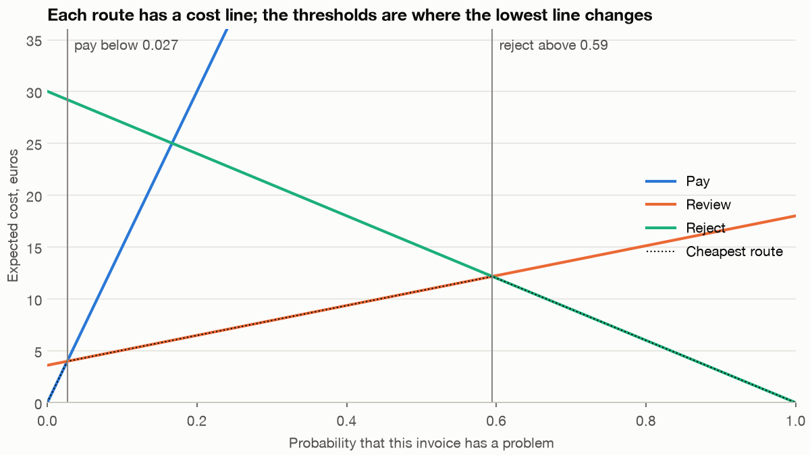

# Automate, Review or Reject: Two Thresholds and What They Cost

> A model that can only say yes or no has to guess on the cases it finds hard. Give it a third answer, "ask a person", and the question stops being how accurate it is. It becomes which decisions it may take alone, what a person's four minutes are worth, and what you will and won't notice when the world changes.

**In plain words.** A hospital triage nurse doesn't diagnose everyone. Clear cases go home, clear emergencies go straight through, and the unclear ones wait for a doctor. The doctor's time is expensive and not perfect, so the nurse's skill lies in sending the doctor the cases where a doctor changes the outcome. Those aren't always the most alarming cases. A patient who is obviously having a heart attack doesn't need a second opinion.

[DS 01/10](10-imbalance-errors-and-drift.md#accuracy-lies-errors-cost) priced two errors and turned them into one threshold. [DS 01/11](11-choosing-a-metric.md#one-table-four-jobs) asked which number a decision needs, and [DS 01/12](12-reading-the-errors.md) read the rows the model got wrong. This chapter adds the third route. We work an invoice example, but nothing in the method is about invoices: the same reasoning applies to a credit file, as the last section shows, and to a model sorting support tickets or flagging transactions. The code is in [`practice/review_queue.py`](../practice/review_queue.py), and every table below is its output.

## The data, and what it can't tell you

The invoices are generated by [`practice/invoices.py`](../practice/invoices.py). Each has a supplier's tenure and record, a purchase-order match, a price difference, a duplicate score, a changed bank account and a few other columns. The generator decides how likely each invoice is to have a problem, and about 6% do. Every price is invented too: paying a problem costs 150 euros, sending back a good invoice costs 30, and a clerk's four minutes cost 3. The clerk catches 90% of problems and wrongly sends back 2% of good invoices.

Generated data gives us something real data can't: the true probability of every invoice, so we can see how far the model falls short of a perfect one. It also means that results describe this generator. So the policy runs again on the real credit file at the end, where nobody chose the signal.

```text
Prices: paying a problem 150, rejecting a good invoice 30, review 3, catch 0.9, false alarm 0.02
Perfect clerk: pay below 0.020, reject above 0.900
This clerk:    pay below 0.027, reject above 0.595. No review route: reject above 0.167
Problem rate 0.060; oracle AUC 0.861
```

The oracle uses the true probabilities, and its AUC of 0.861 is the ceiling. The model reaches 0.858, so this is a nearly solved scoring problem with a lot of unavoidable noise, and any gain from here comes from what we do with the scores.

## The vocabulary, and one collision

The literature calls this the *reject option*: a classifier may decline to answer. That is the review route here, and it collides with "reject", which this chapter uses for sending an invoice back. When you read the papers: **their "reject" means abstain**, and our "reject" is an automated decision.

[GA 08/04](../../../generative-ai/08-eval/notes/04-graders.md) meets the same idea from the grading side: score a language model's "I don't know" the same as a wrong answer, and guessing always wins. Each number below answers a different question.

- **Straight-through rate:** the share of cases decided with no person involved. Papers call this *coverage*.
- **Precision on the automated share:** of the cases decided alone, how many were decided correctly. For a pay route, its complement is the *error rate on paid invoices*, which papers call *selective risk*.
- **Human correction rate:** of the cases people see, the share where the person's decision differs from what the model suggested.
- **Risk-coverage curve:** selective risk at each level of coverage, from sliding the threshold.

The first two are the trade-off. The third is a product metric, and [DS 01/14](14-learning-from-corrections.md#a-correction-rate-reads-two-things-at-once) shows why not to over-read it.

## Price each route, and the thresholds follow

Take an invoice with probability $p$ of having a problem. Write $a$ for the cost of paying a problem, $r$ for the cost of rejecting a good invoice, $h$ for one review, $c$ for the clerk's catch rate and $f$ for the clerk's false-alarm rate. Each route has an expected cost that is a straight line in $p$:

$$\text{pay}: pa \qquad \text{reject}: (1-p)r \qquad \text{review}: h + p(1-c)a + (1-p)fr$$

Pick the lowest line. The thresholds are where the lines cross:

$$p_{\text{pay}} = \frac{h + fr}{ca + fr} \qquad\qquad p_{\text{reject}} = \frac{r(1-f) - h}{(1-c)a + r(1-f)}$$

```python
def thresholds(c=Prices()):
    lo = (c.review + c.false_alarm * c.reject_good) / (c.catch * c.pay_problem + c.false_alarm * c.reject_good)
    keep = c.reject_good * (1 - c.false_alarm)
    hi = (keep - c.review) / ((1 - c.catch) * c.pay_problem + keep)
    return lo, hi
```



This is an old result. [Chow's 1970 paper, *On Optimum Recognition Error and Reject Tradeoff*](https://doi.org/10.1109/TIT.1970.1054406), is the usual citation. It sits behind a paywall, so we read only its abstract, which says it "describes an optimum rejection rule and presents a general relation between the error and reject probabilities". [Bartlett and Wegkamp (JMLR 2008)](https://jmlr.org/papers/v9/bartlett08a.html) state the rule plainly for the symmetric case, where both errors cost 1 and abstaining costs $d$: predict negative if $\eta(x) < d$, abstain if $d \le \eta(x) \le 1-d$, and predict positive if $\eta(x) > 1-d$. Set $a=r=1$, $h=d$, $c=1$, $f=0$ in the formulas above and that is what you get. Two of their remarks carry over. "We never reject if $d > 1/2$", because guessing then costs less than abstaining, and "the rejection cost $d$ should be known a priori", dictated by things like the cost of further tests. Our version differs by letting the errors cost different amounts and the person be imperfect, and those change the answer.

With a perfect clerk, the thresholds would be 0.020 and 0.900. With this clerk they are 0.027 and 0.595. The pay threshold rises, because a clerk who misses problems buys less. The reject threshold falls much further, because sending a likely problem to a clerk who misses 10% of them now risks an expected 15 euros on top of the 3 for the review, so rejecting it outright looks cheap sooner.

Notice how low the pay threshold sits. We pay automatically only when the problem probability is under 2.7%, against a base rate of 6%. That follows from the 50:1 ratio of the cost of paying a problem to the cost of a review, not from anything about this model. And the reject threshold isn't near the one-threshold rule of 1/6, because review has taken over the whole range where a person adds value.

## Does the review route pay for itself?

Here are seven policies on the same 50,000 test invoices, over 20 seeds. `cost` is expected euros per invoice, using the clerk's catch and false-alarm rates in expectation.

```text
Policies, mean of 20 seeds on 50,000 test invoices; model AUC 0.858
                               straight_through  paid  reviewed  rejected  error_paid  precision_reject  correction_rate  cost
policy
pay everything                            1.000 1.000     0.000     0.000       0.061               NaN              NaN 9.076
review everything                         0.000 0.000     1.000     0.000         NaN               NaN            0.100 4.471
one threshold                             1.000 0.911     0.000     0.089       0.030             0.372              NaN 5.802
two, perfect clerk assumed                0.506 0.506     0.494     0.000       0.011             0.932            0.173 3.427
two, priced                               0.619 0.607     0.381     0.012       0.013             0.730            0.203 3.312
two, searched on validation               0.607 0.594     0.393     0.013       0.013             0.722            0.199 3.341
two, priced, true probability             0.625 0.611     0.375     0.014       0.013             0.740            0.202 3.242
one threshold minus two, priced: +2.490 euros per invoice (sd 0.086, 20/20 seeds)
two, perfect clerk assumed minus two, priced: +0.115 euros per invoice (sd 0.037, 20/20 seeds)
two, priced minus two, searched on validation: -0.028 euros per invoice (sd 0.048, 2/20 seeds)
Searched thresholds: lo 0.026 (sd 0.004), hi 0.580 (sd 0.055)
```

Four things stand out.

**Two thresholds beat one, by a lot.** Moving from one threshold to two saves 2.49 euros per invoice, on every seed. The straight-through rate falls from 100% to 62%, and that loss is the price of the saving. A team that optimises the straight-through rate alone would never make this trade.

**Reviewing everything beats one threshold.** At 4.47 against 5.80, a clerk on every invoice is better than the model alone. That isn't a law. It follows from a cheap clerk who catches 90%, and a higher review price would reverse it.

**Getting the clerk wrong costs little here, but it changes the routes.** Assuming a perfect clerk costs 0.115 euros per invoice on every seed. It rejects nothing automatically, so the reject route with 73% precision never opens, and those likely problems all go to the clerk.

**Searching for thresholds doesn't beat pricing them.** A grid search on 10,000 validation invoices wins on only 2 of 20 seeds, and costs 0.028 euros more on average, because it fits the validation noise. With calibrated scores and known prices, the formula needs fewer labels than a search does. A search has a job when the prices are known and the scores aren't probabilities, which we come to below.

The perfect-probability row costs 3.242 against the model's 3.312, so a better model could gain at most 0.07 euros per invoice. The change of policy gained 2.49. This gap between a model improvement and a decision improvement is common, and it's easy to miss when the team's dashboard is an AUC.

## When review stops paying

The band between the thresholds depends on two numbers that are easy to assume and rarely measured: what a review costs and how often it catches a problem.

```text
Review price and catch rate (seed 0); saving in euros per invoice against one threshold
 review  catch    lo    hi  reviewed  saving
      1  0.600 0.018 0.318     0.506   1.586
      1  0.750 0.014 0.425     0.624   2.376
      1  0.900 0.012 0.640     0.737   3.257
      1  0.990 0.011 0.919     0.796   3.981
      3  0.600 0.040 0.295     0.235   0.960
      3  0.750 0.032 0.395     0.308   1.588
      3  0.900 0.027 0.595     0.385   2.339
      3  0.990 0.024 0.854     0.429   2.928
     10  0.600 0.117 0.217     0.054   0.096
     10  0.750 0.094 0.290     0.098   0.398
     10  0.900 0.078 0.437     0.146   0.869
     10  0.990 0.071 0.628     0.175   1.264
     20  0.600 0.227 0.105     0.000   0.000
     20  0.750 0.182 0.141     0.000   0.000
     20  0.900 0.152 0.212     0.026   0.026
     20  0.990 0.138 0.304     0.060   0.134
```

At a review price of 20, a clerk who catches 60% or 75% has no band at all. The pay threshold is above the reject threshold, so the review line is never the lowest, and the rule falls back to one threshold. At 20 euros and a 90% catch rate, a 2.6% band saves 0.026. A review route is an investment you can price before you build the screen. And the best way to widen it can be cheaper reviews or better clerks' tools, rather than a better model.

Rows with a 0.60 catch rate also show that the saving in euros can look healthy when people catch less than you hoped. At 3 euros and a 60% catch, the saving is still 0.96 euros per invoice. So measure the catch rate, because [DS 01/14](14-learning-from-corrections.md#a-correction-rate-reads-two-things-at-once) shows that the correction rate won't tell you.

## When the queue is full

The formula assumes that anyone can review anything. In practice, a team has a capacity. So which invoices should get the 5% of review slots? The instinct is "the riskiest". That's wrong.

```text
Review capacity, seed 0. Outside capacity the one-threshold rule decides
 capacity                    rule  cost  lowest_p  highest_p
    0.400 largest expected saving 3.171     0.027      0.594
    0.400           highest score 3.247     0.026      0.953
    0.200 largest expected saving 3.370     0.056      0.503
    0.200           highest score 3.493     0.064      0.953
    0.100 largest expected saving 4.030     0.103      0.360
    0.100           highest score 4.405     0.148      0.953
    0.050 largest expected saving 4.661     0.137      0.257
    0.050           highest score 5.279     0.290      0.953
    0.020 largest expected saving 5.157     0.155      0.201
    0.020           highest score 5.562     0.491      0.953
Share with a positive expected saving from review: 0.385
```

Give review to the invoices where it saves the most: the gap between the review line and the lower of the other two lines. As capacity falls, that band shrinks around the point where the pay and reject lines cross, which is 1/6, and at 2% it runs from 0.155 to 0.201. These are the invoices where the decision without a person is closest to a coin flip in euros.

The highest-score rule fills the queue with invoices that have $p$ up to 0.953. A person can only agree with those, so that queue costs money and changes little. At 5% capacity it costs 5.279 against 4.661. The queue that feels most useful to reviewers, because they keep finding real problems, is the one that wastes them.

## When costs vary by invoice

Paying a problem on a 5,000 euro invoice costs more than on a 50 euro one. So the prices can vary per invoice, and the thresholds are computed row by row. Here the cost of a paid problem scales with the invoice amount, keeping the mean at 150.

```text
Paying a problem scales with amount, mean 150, median 81 (seed 0)
                policy  paid  reviewed  rejected  error_paid  money_lost_paid  cost
       flat thresholds 0.603     0.385     0.011       0.012            1.194 3.404
thresholds per invoice 0.660     0.326     0.014       0.019            0.763 2.726
```

The error rate on paid invoices gets *worse*, 1.9% against 1.2%, and the money lost on them falls by more than a third. Small invoices with a modest risk go straight through and large ones go to a person. This is why a target such as "under 1.5% error on the automated share" can point the wrong way when costs vary. It counts a 50 euro mistake and a 5,000 euro mistake the same.

## Calibration is the precondition

The formula takes $p$ at its word. If the score isn't a probability, the thresholds are in the wrong place, however good the ranking. [DS 01/10](10-imbalance-errors-and-drift.md#calibration-the-bridge-from-score-to-price) showed resampling distorting probabilities, and class weights do the same.

```text
Calibration, mean of 10 seeds. 'near lo' is the scores within a factor of two of the pay threshold
                                   auc   ece  predicted_near_lo  actual_near_lo  paid  error_paid  cost_priced  cost_searched
variant
plain, raw                       0.857 0.003              0.026           0.025 0.600       0.013        3.317          3.341
plain, Platt                     0.857 0.003              0.026           0.026 0.614       0.014        3.318          3.340
class weights, raw               0.855 0.252              0.041           0.005 0.003       0.002        6.714          3.382
class weights, Platt             0.855 0.004              0.027           0.027 0.604       0.014        3.348          3.357
class weights, Platt on 2,000    0.855 0.006              0.027           0.027 0.599       0.014        3.364          3.371
class weights, isotonic on 2,000 0.851 0.008              0.027           0.031 0.629       0.014        3.406          3.383
```

`predicted_near_lo` and `actual_near_lo` compare what the score claims with what happens for invoices near the pay threshold.

Class weights keep the ranking, with an AUC of 0.855 against 0.857, and destroy the routes. The router pays 0.3% of invoices instead of 60%, and the cost doubles to 6.714. The AUC would never tell you. A threshold search rescues it, at 3.382, because a search only needs the ordering. Platt scaling, a slope and intercept fitted on the score's log-odds on held-out data, repairs the probabilities and gets to 3.348.

Two details are worth keeping. The region that matters is the tail, around 0.027, and a calibration check averaged over all scores can hide trouble there, so check near the thresholds. And isotonic regression on 2,000 invoices, which hold about 120 problems, predicts 0.027 where the truth is 0.031. It costs 3.406 against Platt's 3.364 on the same rows, for the reason in [DS 01/10](10-imbalance-errors-and-drift.md#calibration-the-bridge-from-score-to-price): it needs more events than this.

## When customers differ

Now suppose the router serves many customers, companies that each send it their own invoices, on one shared score, and their problem rates differ. A score of 2% may mean 1% at one customer and 5% at another, so one set of thresholds pays too much for some and reviews too much for others. A threshold per customer sounds like the fix, but most customers have few labels. Twenty rows may hold no problem at all, and a fit on those rows says this customer never has one, so pay everything.

The tool is **partial pooling**, from [DA 04/07](../../../data-analytics/04-bayesian-analysis/notes/07-multilevel-models-and-partial-pooling.md#three-ways-to-estimate-one-number-per-group): start each customer at the shared answer, and let its own labels move it only as far as they can justify. Correct each customer with one number, an offset $\delta_k$ added to the score's log-odds. That's the Platt fit from the last section with the slope held at one. Then apply the same price thresholds to the corrected probability.

Estimate $\hat\delta_k$ from that customer's labels, with its variance $v_k$ from the fit. Estimate $\tau^2$, how much customers really differ, across all of them by moments: each customer's $\hat\delta_k^2 - v_k$ estimates it, so take their average weighted by $1/v_k$, and floor it at zero. Then shrink:

$$\tilde\delta_k = \hat\delta_k \cdot \frac{\tau^2}{\tau^2 + v_k}$$

It's the weight from DA 04/07, with $v_k$ in the place of $\sigma^2/n$. If customers don't really differ, $\tau^2$ comes out near zero and everyone gets the global answer. With offsets spread at 1.0, $\tau^2$ came out at 0.958. A customer with 5,000 labels has a $v_k$ near 0.003 and keeps almost all its own offset. A customer with 20 labels has a median $v_k$ of 0.628 and keeps about 60% of it. At a rate near 7%, 19% to 31% of the 20-label customers here have no problem in their labels, and then no finite offset fits. For those, the pooled fit aims at half a problem instead of none, and leaves the customer out of the $\tau^2$ estimate. Its $v_k$ is about 2.1, so it keeps about 31% of an offset that says "fewer problems than average": a mean of -0.321, against -0.115 for customers with one problem. Zero problems reads as safer than one.

Here's that on 40 generated customers, eight at each of 20, 50, 200, 1,000 and 5,000 labels, over 20 seeds, at this chapter's prices, from [`practice/tenant_thresholds.py`](../practice/tenant_thresholds.py). The lab draws scores at random, with a mean near 7%, and a customer's true log-odds are its score plus its offset, so with `sd_true` at 0 the score is the truth and the global regret of 0.000 is by construction. Labels are a random sample of each customer's rows, and $\tau^2$ always has the large customers in its estimate, so a book of only small customers is untested.

Regret is the extra euros per invoice above routing on the true probability. `sd_true` is how far offsets really spread, in log-odds. The opening example's 2% that is really 5% is an offset of about 0.95. At zero spread the table omits 50 and 1,000 labels.

```text
method          one global threshold  each customer alone  alone, global if no fit  partial pooling
sd_true labels
0.0     20                     0.000                1.429                    0.112            0.000
        200                    0.000                0.043                    0.043            0.000
        5000                   0.000                0.001                    0.001            0.000
0.4     20                     0.056                1.883                    0.146            0.048
        50                     0.063                0.413                    0.176            0.044
        200                    0.052                0.044                    0.044            0.021
        1000                   0.069                0.008                    0.008            0.007
        5000                   0.057                0.001                    0.001            0.001
1.0     20                     0.387                1.278                    0.250            0.166
        50                     0.361                0.283                    0.190            0.122
        200                    0.539                0.043                    0.057            0.039
        1000                   0.437                0.009                    0.009            0.009
        5000                   0.378                0.002                    0.002            0.002

mean over all customer sizes, equal weight per customer
sd_true
0.0                            0.000                0.357                    0.076            0.000
0.4                            0.059                0.470                    0.075            0.024
1.0                            0.421                0.323                    0.102            0.068
```

The second column is the fit taken literally, and its 20-label regret, up to 1.883 euros per invoice, comes mostly from one rule: no problem in the labels, so pay everything. The third column sends those customers to the global answer, and that alone cuts 1.278 to 0.250 at wide spread, which beats the global threshold's 0.387. So a per-customer threshold needs a rule for the empty case, and it still loses to pooling.

One global threshold uses no labels, so it costs about 0.4 at any size when customers truly differ. Its column should be flat, and its moves, 0.361 to 0.539 at `sd_true` 1.0, are the noise in this table. Partial pooling is at or tied for the best in every row. Its closest call, 0.039 against 0.043 at 200 labels with wide spread, is within that noise: pooling lost 5 of the 20 seeds.

Four limits. We generated exactly the difference the method assumes, a shift in log-odds. If a customer's score also ranks differently, one offset can't repair it, so compare its AUC on audited labels with the global AUC. The lab doesn't run that check. Shrinking to zero also assumes the shared score is right on average across customers. If it isn't, recalibrate it first, which we didn't test. The offset stays only as good as its labels. A live queue labels only the invoices it was sent, so [audit a random sample](14-learning-from-corrections.md#audit-a-random-sample) for small customers. And log which offset and thresholds decided each case: a customer asking why an invoice was paid needs the values in force that day.

## When calibration drifts

Freeze the model, then change the world in three ways, using the terms from [DS 01/10](10-imbalance-errors-and-drift.md#drift-when-the-world-moves). `score_psi` is the population stability index of the scores against validation, and needs no labels. `recal` refits Platt on 10,000 fresh labelled invoices.

```text
Drift with the model frozen. 'recal' refits Platt on 10,000 fresh labelled invoices
                             scenario  problem_rate  score_psi  mean_score  paid  reviewed  error_paid  cost  paid_recal  error_paid_recal  cost_recal
                            no change         0.061      0.001       0.061 0.602     0.386       0.014 3.339       0.555             0.013       3.345
            prior: twice the problems         0.114      0.009       0.072 0.575     0.407       0.027 5.116       0.232             0.016       4.632
covariate: newer suppliers, fewer POs         0.117      0.251       0.114 0.385     0.582       0.014 4.399       0.409             0.014       4.378
              concept: new fraud type         0.078      0.001       0.060 0.607     0.382       0.033 5.181       0.249             0.029       4.747
```

Read the rows against what a dashboard without labels can see.

- **Covariate drift, newer suppliers.** PSI is 0.251 and the alarm rings. The straight-through share falls, and the error on paid invoices stays at 1.4%. The model handled it: the new invoices are riskier and it says so. The alarm was true and the router was fine.
- **Twice the problems.** PSI is 0.009, which most playbooks call stable. The paid share falls by 2.7 points, and the error rate on paid invoices doubles to 2.7%.
- **A new fraud type.** PSI is 0.001, the paid share doesn't move and the mean score doesn't move. The true error on paid invoices more than doubles to 3.3%. Nothing the model sees has changed, only what those inputs mean.

So the worst case is a silent one: the automated share looks the same and the dashboard is green. Only labels on automated invoices can reveal it, and by construction nobody looks at those. [DS 01/14](14-learning-from-corrections.md#audit-a-random-sample) is about getting them.

Recalibration fixes what recalibration can fix. With twice the problems, it restores the error to 1.6%, at the price of a much smaller paid share, 23%, and the cost falls from 5.116 to 4.632. With the new fraud type it lifts every score, so the paid share falls to 25%, but the error stays at 2.9%, because a slope and intercept can't single out the round-amount invoices. That needs a retrain with new labels.

The first row carries a smaller warning. With no drift at all, refitting Platt moves the paid share from 60% to 56% at almost no cost. Scores are dense near the pay threshold, so the paid share swings easily on a small recalibration. Don't read a move of a few points in the straight-through rate as news.

## When the target is a number and not a price

Sometimes nobody will name a cost, or a contract names an error rate: "pay as many as possible, at under 1% error". [Geifman and El-Yaniv (NeurIPS 2017)](https://arxiv.org/abs/1705.08500) work this view, and they make the case against pricing plainly: the cost model "can be very useful when we can quantify the involved costs, but in many applications of interest meaningful costs are hard to reason". Their example is the cost of disengaging an autopilot.

Their method, Selection with Guaranteed Risk (SGR), needs only a score that ranks and a set of labelled data. It binary-searches for a threshold, and at each candidate it takes a binomial tail bound on the error among the cases kept, spending the failure probability $\delta$ across the steps. The point of the bound is that the validation error at a threshold is a noisy estimate, and picking the highest threshold that looks good selects for lucky ones. They report a CIFAR-10 result with a target of 1% at $\delta=0.001$: test risk 0.0092 at 78.56% coverage, with the bound at 0.0099.

Here is SGR at 99% confidence against the naive rule, which takes the largest share whose validation error meets the target.

```text
Pay as many as possible under an error target, confidence 99%; 200 draws per row, judged on 200,000 fresh invoices
best_share is the largest share a very large sample allows
 target  best_share  labelled method  paid  paid_none  error_paid  broke_target
  0.010       0.422       500  naive 0.509      0.005       0.012         0.690
  0.010       0.422       500    SGR 0.000      1.000       0.000         0.000
  0.010       0.422      2000  naive 0.456      0.005       0.011         0.610
  0.010       0.422      2000    SGR 0.000      1.000       0.000         0.000
  0.010       0.422     10000  naive 0.430      0.000       0.010         0.565
  0.010       0.422     10000    SGR 0.018      0.925       0.001         0.000
  0.010       0.422     50000  naive 0.426      0.000       0.010         0.555
  0.010       0.422     50000    SGR 0.193      0.195       0.006         0.000
  0.020       0.806       500  naive 0.776      0.000       0.021         0.530
  0.020       0.806       500    SGR 0.000      1.000       0.000         0.000
  0.020       0.806      2000  naive 0.791      0.000       0.020         0.495
  0.020       0.806      2000    SGR 0.079      0.830       0.002         0.000
  0.020       0.806     10000  naive 0.803      0.000       0.020         0.455
  0.020       0.806     10000    SGR 0.648      0.000       0.015         0.000
  0.020       0.806     50000  naive 0.801      0.000       0.020         0.335
  0.020       0.806     50000    SGR 0.754      0.000       0.017         0.000
SGR threshold for 2% on 50,000 labels: certified on clean data, then under the new fraud type: paid 0.769, error 0.0377
```

Over 200 draws, the naive rule broke its target between 33.5% and 69% of the time, and SGR never did. It isn't free, though, and the price is far higher here than the paper's result suggests. With a 1% target and 2,000 labels, SGR pays nothing at all on every draw. Even 50,000 labels pay 19% where 42% is possible. With a 2% target, 10,000 labels are enough to pay 65% against a possible 81%.

The figure below shows why. Even the safest invoices here have an error rate of about half a percent, because the outcome is noisy at every score. A 1% target leaves little room between that and the bound's allowance for chance, and a 2% target leaves far more. So before you promise an error rate, compute how many labels the promise needs, and find out whether you have them.

And the guarantee assumes new data looks like the labelled data. Certify 2% on 50,000 labels, then introduce the new fraud type, and the router pays 77% at 3.77% error. The certificate describes data that no longer arrives.


The left panel shows why model tuning can disappoint: most of the cost lies in how far along the curve you go, not in the gap between the two lines. The credit panel is seed 0, so its point differs a little from the 20-seed mean below.

## Does conformal prediction earn its place?

Conformal prediction is often suggested for this job, so we tested it. Split conformal, as [Angelopoulos and Bates (arXiv 2021)](https://arxiv.org/abs/2107.07511) teach it, takes a score, computes $s = 1 - \hat{f}(X)_Y$ on a calibration set, and takes a corrected quantile $\hat{q}$. The prediction set is every class whose score clears it. Then, if the calibration and test data are exchangeable,

$$1-\alpha \le P(Y \in C) \le 1-\alpha + \frac{1}{n+1}$$

However bad the model. With two classes, a set can be {good}, {problem}, both or neither. So it routes invoices: a one-class set is automated and the rest go to a person. Which means, in the binary case, conformal is two thresholds on $p$. All that differs is how they're chosen: by a coverage level $\alpha$ rather than by costs.

```text
Split conformal on 10,000 calibration invoices (seed 0); singletons automated, the rest reviewed
  method  alpha  coverage  cover_problem  cover_good  only_good  only_problem  both  empty  error_paid  cost
marginal  0.200     0.800          0.002       0.849      0.815         0.000 0.000  0.185       0.019 3.564
by class  0.200     0.799          0.827       0.797      0.703         0.237 0.060  0.000       0.014 7.480
marginal  0.100     0.902          0.034       0.955      0.929         0.002 0.000  0.069       0.031 4.957
by class  0.100     0.898          0.906       0.898      0.519         0.135 0.346  0.000       0.010 5.159
marginal  0.050     0.952          0.250       0.995      0.977         0.016 0.007  0.000       0.044 6.728
by class  0.050     0.950          0.955       0.950      0.332         0.077 0.591  0.000       0.008 4.293
marginal  0.020     0.983          0.712       1.000      0.834         0.000 0.166  0.000       0.020 3.694
by class  0.020     0.981          0.982       0.981      0.174         0.038 0.788  0.000       0.006 4.042
marginal  0.010     0.992          0.858       1.000      0.643         0.000 0.357  0.000       0.013 3.231
by class  0.010     0.991          0.989       0.991      0.115         0.024 0.861  0.000       0.005 4.063
Priced thresholds on the same invoices: cost 3.171, paid 0.603, reviewed 0.385, error on paid 0.0120
Lowest conformal cost in the table: 3.231. Trivial 'always good' set covers 0.942
Coverage across 300 calibration draws, n = 1,000, alpha 0.1: mean 0.900, 5th to 95th percentile 0.882 to 0.916
Uncalibrated class-weighted scores, by class, alpha 0.05: cover problem 0.950, cover good 0.950
Concept drift, marginal, alpha 0.05, promised 0.95: coverage 0.933, cover problem 0.199
Concept drift, by class, alpha 0.05, promised 0.95: coverage 0.943, cover problem 0.868
```

`cover_problem` and `cover_good` are the coverage among true problems and among good invoices.

**As a router, it doesn't earn its place.** No value of $\alpha$ is named by the costs, so you end up searching over it. The best row costs 3.231 and priced thresholds cost 3.171, and at $\alpha=0.1$ the cost is 4.957 and the promise is met. Our $\alpha = 0.1$ promise is the telling one. It covers 90% of invoices while covering only 3.4% of the true problems, because a trivial set that always says "good" covers 94.2%. Angelopoulos and Bates warn about this: their group example has 90% marginal coverage made of always covering a 90% group and never covering a 10% group. Marginal coverage means averaged over everyone, and here, everyone is mostly good. They add that problems "where different mistakes cost different amounts, often require the language of risk control", which is a framework beyond plain sets.

**As a statement about one class, it does something the rest of this chapter doesn't.** Class-conditional conformal calibrates each class separately. At $\alpha = 0.05$, it covers 95.5% of problems: at most about 5% of problems get a set that excludes "problem", on *any* scorer. Run it on the raw class-weighted scores, whose probabilities are badly wrong, and it still delivers 0.950 and 0.950. Everything earlier needed calibration, and this doesn't. If an auditor asks "what share of problems can get paid without a person seeing them?", this gives a direct answer.

The small print is real. The answer holds only while the data stays exchangeable. Under the new fraud type, the same set covers 86.8% of problems against a promise of 95%. It is also a statement about the average over all problems, not about any one kind, the conditional coverage that the paper says is generally impossible to get. And the sampling spread needs labels: across 300 calibration sets of 1,000, coverage at $\alpha=0.1$ ran from 0.882 to 0.916, matching the paper's range of 0.88 to 0.92 and its advice that $n=1000$ is "sufficient for most purposes". For a by-class guarantee, that means about 1,000 *problems*, or nearly 17,000 invoices at a 6% base rate.

The paper's own treatment of this exact task points the same way. Its section 5.5 says selective accuracy "cannot be controlled with techniques we've seen so far", because accuracy needn't be monotone in the cutoff, and it scans thresholds using a binomial upper bound. That's the SGR idea. So, for one error target, use SGR, for a cost, price it, and keep by-class conformal for the rare case where someone wants a recall promise that doesn't depend on calibration.

## The same policy on real data

Now the credit file, at its natural 22.1% default rate, with the note 10 prices: a default costs 3,000 and a declined good customer 600. Nothing in that file tells us about an analyst, so we assume one, reviewing for 60, catching 70% with 10% false alarms, and a weaker one catching 50% with 20% false alarms. Those are guesses, and the analyst is what you'd measure first.

```text
Credit prices, reused from note 10 with an assumed analyst: review 60, catch 0.7, false alarm 0.1. Approve below 0.056, decline above 0.333, one threshold 0.167
Weak analyst, catch 0.5, false alarm 0.2: approve below 0.111, decline above 0.212
                                    straight_through  paid  reviewed  rejected  error_paid  precision_reject  correction_rate    cost
policy
approve everyone                               1.000 1.000     0.000     0.000       0.221               NaN              NaN 663.500
review everyone                                0.000 0.000     1.000     0.000         NaN               NaN            0.378 305.780
one threshold                                  1.000 0.573     0.000     0.427       0.100             0.383              NaN 330.990
two, priced                                    0.241 0.058     0.759     0.182       0.042             0.589            0.357 237.407
two, priced, weak analyst                      0.650 0.333     0.350     0.317       0.072             0.453            0.401 313.054
one threshold, weak analyst prices             1.000 0.573     0.000     0.427       0.100             0.383              NaN 330.990
one threshold minus two, priced: +93.58 per applicant (sd 4.86, 20/20 seeds)
one threshold, weak analyst prices minus two, priced, weak analyst: +17.94 per applicant (sd 4.02, 20/20 seeds)
SGR for a 10% default target on 6,000 validation rows: approves 0.387, default rate 0.080
```

The shape holds: two thresholds beat one on all 20 seeds. The proportions change a lot. The ratio of error cost to review cost is the same 50:1 as on invoices, but the base rate is 22.1%, so few applicants score under the 5.6% approve threshold. The priced policy automates only 24% and sends 76% to a person. That's not a failure of the method. It's what these prices recommend for scores like these. If someone names a default target instead, SGR at 10% on 6,000 validation rows approves 38.7% at a default rate of 8.0%.

And the win depends on the person. The assumed analyst is better than the model, which flatters review. With the weaker analyst the saving falls from 93.58 to 17.94 per applicant, and the straight-through rate rises to 65%. Review everyone, at 305.78, beat the one-threshold rule too, under the stronger analyst. So don't carry the invoice numbers into your system. Carry the method, then measure the catch rate and review time.

## Pitfalls

- **Optimising the straight-through rate.** It rose towards 100% as cost rose by 2.49 euros per invoice. Treat it as a capacity constraint, not an objective.
- **Assuming the person is perfect.** A perfect-clerk rule never opens the reject route here, costing 0.115 euros per invoice on every seed. Measure the catch rate with seeded known problems.
- **Sending the highest scores to review.** At 5% capacity that cost 5.279 against 4.661. Rank by expected saving.
- **Checking AUC after a change to class weights.** AUC stayed at 0.855 while the priced cost doubled. Check calibration near the thresholds.
- **Watching only input and score drift.** A new fraud type moved PSI by 0.001 and more than doubled the error on paid invoices.
- **Treating PSI as bad news.** The largest PSI, 0.251, came with an unchanged error rate on paid invoices.
- **Picking the largest share that looks safe on validation.** It broke its target up to 69% of the time. Use a bound, and count the labels it needs.
- **Reading "90% coverage" as 90% of the cases you care about.** Marginal coverage of problems was 3.4%.
- **Carrying a certificate across a shift.** The 2% guarantee became 3.77% under the new fraud type.
- **Fitting a threshold per customer on a handful of labels.** With no problem in the labels the fit pays everything: up to 1.883 euros per invoice at 20 labels. Shrink each customer towards the shared answer.
- **Setting one error target when costs vary.** Thresholds per invoice raised the error rate on paid invoices and cut the money lost.

## Try it

1. With review at 10 and a catch rate of 0.75 (other prices as above), compute both thresholds by hand, and check them against the sensitivity table.
2. Set $a=r=1$, $c=1$, $f=0$ and $h=d$. Show that the band collapses when $d > 1/2$, and say what the rule does then.
3. At these prices, reviewing everything costs 4.471 and one threshold costs 5.802. At what review price does reviewing everything stop winning?
4. A stakeholder wants "under 1% error, at 99% confidence" on invoices with a 6% base rate, and has 2,000 labels. What can you promise, and what would you ask for?
5. Why does a by-class conformal set still hold its coverage on the raw class-weighted scores, when the priced thresholds collapsed on them?

<details><summary>Answers</summary>

1. $p_{\text{pay}} = (10 + 0.02\times30)/(0.75\times150 + 0.02\times30) = 10.6/113.1 = 0.094$. $p_{\text{reject}} = (30\times0.98 - 10)/(0.25\times150 + 30\times0.98) = 19.4/66.9 = 0.290$. Both match the row for review 10, catch 0.750.
2. The thresholds become $d$ and $1-d$. They meet at $d = 1/2$, and above that the lower is above the upper, so the review line is never the lowest. The rule falls back to one threshold, as in Bartlett and Wegkamp's "we never reject if $d > 1/2$".
3. Reviewing everything costs the review price plus a fixed amount; one threshold has no review in it. They are equal at $3 + (5.802 - 4.471) = 4.331$ euros.
4. SGR on 2,000 labels paid nothing on all 200 draws, so you can promise nothing yet at that confidence. Ask for many more labels (50,000 got to 19%), a looser target (2% with 10,000 labels paid 65%), or a price, which needs far fewer.
5. Conformal calibrates on the ranks of the scores within each class and doesn't need the score to be a probability. The priced thresholds take the score's value at face value. A search on validation also survived, for the same reason.

</details>

## Interview checklist

| Question | Answer |
|---|---|
| What is a reject option? | A classifier may abstain and pass a case to a person. "Reject" in the literature means abstain, not an automated "no". |
| Coverage, selective risk? | Coverage is the share the model decides alone. Selective risk is the error rate on that share. |
| How do you set two thresholds? | Write each route's expected cost as a line in $p$; take the crossings. Error costs, review cost and the person's accuracy all enter. |
| What's Chow's rule, in its symmetric form? | With errors costing 1 and abstaining $d$: abstain when $d \le \eta \le 1-d$, and never abstain if $d > 1/2$. |
| Why not optimise straight-through rate? | Raising it to 100% here cost 2.49 euros per invoice. It's a capacity constraint, not a goal. |
| Who should go to review under a capacity limit? | The cases where review saves the most, close to where pay and reject cost the same. Not the highest scores. |
| What does an imperfect reviewer change? | The pay threshold rises and the reject threshold falls a lot, and the reject route opens. |
| What breaks if the score isn't calibrated? | The thresholds. Class weights held AUC at 0.855 and doubled the cost. Search on validation or recalibrate. |
| Search or formula for thresholds? | With calibrated scores and known prices the formula won on 18 of 20 seeds. Search if the score is only a ranking. |
| Which drift can't a label-free dashboard see? | Concept drift. PSI stayed at 0.001 and the paid error more than doubled. |
| Can Platt fix concept drift? | No. It lifts everyone. Here the error stayed at 2.9% and throughput fell to 25%. You need new labels and a retrain. |
| What does SGR give you? | The largest coverage with a binomial bound on selective risk at chosen confidence, for any ranking score. It needs many labels when the target sits near the error on the safest cases. |
| Marginal vs class-conditional conformal? | Marginal averages over everyone: 90% coverage covered 3.4% of problems. Class-conditional calibrates per class, for any scorer, given exchangeability. |
| Is conformal a good router? | Not for binary decisions with known costs: it's two thresholds picked by coverage, so it can't beat pricing. |
| One threshold or one per customer? | Neither. Partially pool: shrink each customer's log-odds offset by $\tau^2/(\tau^2 + v_k)$, so its labels move it only as far as they justify. |
| How do results carry over? | The method does, the numbers don't. On credit the same policy automated 24%, and a weaker analyst cut the saving from 93.58 to 17.94. |

## Next

[Learning from corrections](14-learning-from-corrections.md): what the people in the review queue teach the model, what they can't, and how to measure the invoices nobody looks at. For where this router sits in a whole system, read [DE 06/06](../../../data-engineering/06-ml-platform/notes/06-ml-system-framing-to-monitoring.md).
