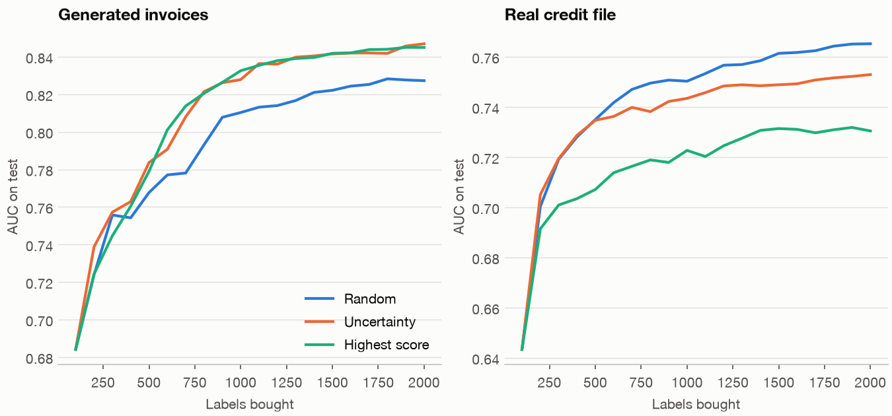

# Learning from Corrections: What People Teach a Model, and What They Can't

> Every correction a reviewer makes looks like a free training label. It is, for the cases the model chose to show them. The invoices it paid without asking are the ones you most need to know about, and nothing in the correction log mentions them.

**In plain words.** A restaurant learns about its food from complaints. Complaints are useful and they are cheap, but a plate that came back without one wasn't necessarily good, and a dish nobody ordered gets no complaints at all. A chef who treats silence as praise will keep serving a bad dish, and will read the falling complaint count as success. The fix is dull: now and then, taste a plate at random.

[Note 13](13-automate-review-or-reject.md) split invoices into pay, review and reject, and priced each route. This chapter is about the labels that queue produces. It covers how to get labels, what wrong labels do, which rows to label next, and what corrections can't show you. [DS 01/12](12-reading-the-errors.md#learning-from-errors-without-fitting-to-them) warned about fitting to the rows you read, and that warning returns here at the scale of a production loop. The code is in [`practice/learning_from_corrections.py`](../practice/learning_from_corrections.py), and every table below is its output.

Most of it runs on the generated invoices from note 13, because a simulation is the only place where we know the truth about invoices nobody checked. That also limits what it can prove: the results describe this generator, and the clerk is a simulation. Active learning also runs on the real credit file, where the disagreement between the two turns out to be the most useful finding.

## Who labels, and by what rule

A label is a decision someone made under a rule, and there are four choices to make before anyone starts.

- **Who decides.** The person closest to the outcome knows the most and has the least time. A cheap annotator costs less per row and more per correct row if the task needs judgement. Price it as note 13 priced the clerk: cost and accuracy together.
- **What the rule says.** Write down what counts as a problem, with the hard cases included. [GA 08/02](../../../generative-ai/08-eval/notes/02-defining-correct.md) makes this argument for evals, and it holds here unchanged.
- **Which label you will wait for.** A clerk's opinion arrives in minutes. The true outcome, such as a duplicate payment found at reconciliation, can take months. Quick labels let you retrain sooner, and they carry the clerk's errors.
- **What you do with disagreement.** Choose in advance: a senior person decides, or the row is marked as ambiguous and the rule gets rewritten. Averaging two people hides a rule that doesn't work.

Measure the annotator as well as the model. Note 13 assumed a catch rate of 0.9; the way to learn the real one is to seed known problems into the queue and count how many come back.

## Agreement is not correctness

The usual check is to label a sample twice and compute Cohen's kappa, which is agreement corrected for chance: $\kappa = (p_o - p_e)/(1 - p_e)$, where $p_o$ is the observed agreement and $p_e$ is what two people would reach by chance given how often each flags a problem. [GA 08/02](../../../generative-ai/08-eval/notes/02-defining-correct.md) works the arithmetic. Here are three pairs of simulated annotators, where we also know who is right.

```text
Pairs of annotators on 20,000 invoices
                            pair  raw_agreement  kappa  recall_a  recall_b  recall_on_blind_spot
        two careful, independent          0.943  0.550     0.802     0.787                 0.798
careful and one who rarely flags          0.923  0.045     0.802     0.054                 0.798
    two careful, same blind spot          0.977  0.797     0.826     0.818                 0.000
Problems in the blind spot: 0.130 of all problems
```

The first row is two careful people working independently, each catching about 80% of problems. The second row shows why raw agreement fails on a rare class: one person flags almost nothing, raw agreement is still 0.923, and kappa falls to 0.045. Kappa did its job there.

The third row is the trap. These two are individually better, at about 82% recall, and they have the highest kappa in the table, at 0.797. They also share a blind spot: neither ever flags a changed bank account, which accounts for 13% of all problems. Their recall on those is 0.000. Kappa measures whether people agree, so two people who were trained the same way can agree on the same mistake. It can't see this without a source of truth outside the pair, such as seeded problems or later outcomes.

Kappa also needs more data than people give it, because the rare class drives it.

```text
How far kappa moves on a sample of double-labelled invoices
 double_labelled  problems_expected  kappa_5th  kappa_95th
             200             12.500      0.312       0.740
             500             31.250      0.409       0.656
            2000            125.000      0.489       0.611
```

Double-label 200 invoices and you expect about 12 problems, and kappa could land anywhere from 0.312 to 0.740 for the same two people. That range covers the difference between "rewrite the rule" and "fine". At a 6% base rate, 2,000 double labels still leave 0.489 to 0.611.

## Noise: what it breaks depends on its shape

Now train on labels that are wrong in three different ways. All four rows are judged on true outcomes, at note 13's priced thresholds.

```text
Noisy labels, 20,000 training rows, mean of 5 seeds. All judged on true outcomes
                         auc  mean_score  paid_noisy_cal  error_paid_noisy_cal  cost_noisy_cal  paid_clean_cal  error_paid_clean_cal  cost_clean_cal
labels
none                   0.857       0.057           0.625                 0.014           3.321           0.625                 0.014           3.321
symmetric 5%           0.851       0.102           0.001                 0.002           4.414           0.606                 0.014           3.386
misses 30% of problems 0.854       0.044           0.664                 0.015           3.439           0.624                 0.014           3.380
misses small invoices  0.830       0.046           0.656                 0.018           3.664           0.526                 0.015           3.607
```

Three things come out of this.

**Ranking can survive while probabilities don't.** Flip 5% of labels at random and AUC barely moves, from 0.857 to 0.851. This agrees with the rule of thumb in [DS 02/03](../../02-deep-learning/notes/03-structuring-ml-projects.md) that random noise in a large training set is tolerable, if you judge the model by ranking. Now look at the router. On a 6% base rate, flipping 5% of labels nearly doubles the mean score, from 0.057 to 0.102, because many more good invoices become "problems" than the reverse. Calibrated on those same noisy labels, the router pays 0.1% of invoices and costs 4.414. Calibrating instead on 5,000 true labels brings it back to 3.386. A small set of trusted labels repairs what a large noisy set broke.

**Missing problems looks like an improvement.** A clerk who misses 30% of problems pushes the mean score down, to 0.044, and the router pays more: 66.4% of invoices against 62.5%. That reads as a gain in the straight-through rate, and the cost rises from 3.321 to 3.439.

**Noise that depends on the invoice is the shape calibration can't fix.** The last row has the same overall share of wrong labels, as the next table shows, but the misses fall on small invoices. AUC drops to 0.830. A true-label calibration only rescales the score, so it can't restore a ranking the model never learned, and the cost only reaches 3.607.

## Finding the wrong labels

[Confident learning](https://arxiv.org/abs/1911.00068) (Northcutt, Jiang and Chuang, JAIR 2021) estimates which labels are wrong from two inputs: out-of-sample predicted probabilities and the noisy labels themselves. For each class it takes a threshold, the mean predicted probability of that class among rows labelled with it. A row counts as confidently belonging to a class if its probability clears that class's threshold, and it's flagged if that class differs from its label. Here is the binary form, as the script uses it.

```python
def confident_flags(y_noisy, p):
    """Binary confident joint. A class's threshold is its mean self-confidence; collisions go to the larger probability."""
    t1, t0 = p[y_noisy == 1].mean(), (1 - p[y_noisy == 0]).mean()
    conf1, conf0 = p >= t1, (1 - p) >= t0
    says1 = conf1 & (~conf0 | (p >= 0.5))
    says0 = conf0 & (~conf1 | (p < 0.5))
    return (y_noisy == 0) & says1, (y_noisy == 1) & says0, t0, t1
```

The paper assumes class-conditional noise: the chance of a wrong label depends only on the true class, not on the row. Its Table 4 reports, on CIFAR-10 with synthetic noise, precision from 56% to 82% and recall from 78% to 98% across its methods and settings. Its Table 2 shows training on the cleaned labels reaching 91.1% against 78.4% for the baseline at 20% noise. On ImageNet, a human check of 500 flagged examples found 58% "were either multi-label, ontological issues, or errors". We compared it with the plain rule "the out-of-fold prediction disagrees with the label".

```text
Confident learning against 'prediction disagrees with label'
                        share_wrong  flagged  precision  recall  argmax_flagged  argmax_precision  argmax_recall  t_problem  t_good
labels
symmetric 5%                  0.050    0.107      0.347   0.737           0.100             0.475          0.941      0.196   0.907
misses 30% of problems        0.022    0.051      0.205   0.468           0.046             0.123          0.252      0.175   0.961
misses small invoices         0.022    0.038      0.121   0.210           0.044             0.110          0.215      0.219   0.962
```

This isn't the paper's result. Precision runs from 0.121 to 0.347, well below its image results. On symmetric noise the plain rule beats it on both precision and recall. Confident learning wins only on the second row, where its per-class thresholds suit the shape of the noise. On the third row the noise depends on the invoice, the assumption fails, and both methods find about a fifth of the wrong labels.

We didn't test why precision is so much lower, but the likely reason is the data. Note 13 measured an oracle AUC of 0.861: even the true probability can't separate problems from good invoices well, because the outcome has a lot of chance in it. An invoice with a high score and a "good" label is quite often really good. Images are different, since a clear picture of a dog has one right answer. Don't carry these precision figures from images to noisy tabular outcomes.

Does cleaning help anyway?

```text
Retraining after the flags; all calibrated on 5,000 true labels
                        auc_kept  cost_kept  auc_pruned  cost_pruned  auc_clerk_fixed  cost_clerk_fixed  auc_all_true  cost_all_true
labels
symmetric 5%               0.851      3.386       0.856        3.344            0.857             3.335         0.857          3.321
misses 30% of problems     0.854      3.380       0.856        3.348            0.855             3.340         0.857          3.321
misses small invoices      0.830      3.607       0.835        3.526            0.829             3.634         0.857          3.321
```

A little, on the shapes it was built for: 3.386 falls to 3.344 by removing the flagged rows, and to 3.335 by having the clerk check them. Note the last row. A clerk who misses things, sent the flagged rows, makes the model worse than leaving them alone: 3.634 against 3.607. Removing them gives 3.526. The gap to true labels stays large in that row, at 3.321, because what's missing is problems nobody flagged. Treat the flags as a list to review, never as a cleaning rule, and check the result on trusted labels.

## Rules instead of hand labels

Sometimes you have people who know the rules and no budget to label. Weak supervision writes those rules as labelling functions, each of which votes or abstains. [Snorkel](https://arxiv.org/abs/1711.10160) (Ratner et al., PVLDB 2017) then learns how far to trust each function, from their agreements and disagreements alone, and trains a model on the resulting soft labels. In its workshop study, 14 scored participants had 7 hours of instruction and 2.5 hours of development time to write functions. They averaged an F1 of 30.4, against 20.9 for models trained on hand-labelled datasets representing 7 hours of labelling. Its tasks are ones where the signals can be written as rules.

We wrote eight rules for the invoices.

```text
Labelling functions on 20,000 invoices
                                rule   votes  fires_on  accuracy
                bank details changed problem     0.031     0.260
            price far from the order problem     0.039     0.472
                      near-duplicate problem     0.004     0.233
         no order and wrong quantity problem     0.028     0.346
         supplier with a poor record problem     0.037     0.150
               order matches closely    good     0.307     0.981
long-standing supplier, no duplicate    good     0.312     0.951
    clean extraction, right quantity    good     0.265     0.958
Mean votes per invoice 1.02; share with no vote 0.290
```

The rules that say "problem" are mostly wrong, with accuracy from 0.150 to 0.472, and that's expected on a rare class. They are still informative: a rule that's right 26% of the time picks out problems at more than four times the 6% base rate.

```text
Models trained on each source of labels, calibrated on 5,000 true labels, mean of 5 seeds
                                    auc  cost_priced
source
rules: majority vote              0.800        3.773
rules: learned weights            0.783        4.119
rules + 4 copies: majority vote   0.771        4.061
rules + 4 copies: learned weights 0.562        4.461
200 clerk labels                  0.692        4.411
1,000 clerk labels                0.784        4.021
5,000 clerk labels                0.826        3.696
```

Three results, and one disagrees with the method's name.

- **Rules can stand in for a lot of labelling.** A majority vote over eight rules, costing 3.773, sits between 1,000 and 5,000 clerk labels.
- **Learned weights lost to the plain vote**: 4.119 against 3.773. Our version is an independent EM sketch, not Snorkel's model. But the paper's own analysis predicts this. Label density is the mean number of votes per row, and it says that at low density there's "limited room for even an optimal weighting of the labeling functions to diverge much from the majority vote". Snorkel includes an optimiser that picks between the two for this reason. Our density is 1.02.
- **Correlated rules break the independence assumption.** Add four copies of one rule and a majority vote falls to 4.061, while the learned weights collapse to an AUC of 0.562, because the model reads the copies' agreement as evidence that they are accurate. Snorkel learns correlations partly for this reason. The sketch doesn't.

Two warnings about flattering this result. We wrote the rules while knowing the generator, which real rule writers don't. And every row was calibrated on 5,000 true labels, so rules replaced labels for training but not for calibration. A rule also can't teach what its writer hasn't imagined, which matters in the loop below.

## Which rows should a person label first?

Active learning lets the model choose its next labels. In uncertainty sampling, the simplest form, you label the rows it's least sure about. Settles' [survey](https://burrsettles.com/pub/settles.activelearning.pdf) opens with a text example: after 30 new labels, "the accuracy of uncertainty sampling is 81%, while the random baseline is only 73%". It's also honest about the evidence. Active learning reduces the labels needed "in the majority of reported results (though, admittedly, this may be due to the publication bias)".

The simulation starts from 100 random labels and buys 100 at a time up to 2,000, comparing random, uncertainty (nearest 0.5) and highest score, which is what a queue of the riskiest items gives you. Models are calibrated on a fixed random validation set that isn't counted in the budget, a disclosed advantage to every strategy. Each `diff` is uncertainty minus random, with the seeds won of 10.

```text
    data  learner  batch  miss  labels  auc_random  auc_unc_diff  auc_wins  cost_random  cost_unc_diff  cost_wins  auc_top_diff  problems_random  problems_unc
invoices logistic    100 0.000    2000       0.849         0.003         9        3.410         -0.021          7        -0.001            0.062         0.312
invoices  boosted    100 0.000    2000       0.827         0.020        10        3.670         -0.206         10         0.018            0.062         0.323
invoices  boosted    500 0.000    2000       0.821         0.022        10        3.762         -0.247         10         0.023            0.059         0.285
invoices  boosted    100 0.300    2000       0.813         0.022        10        3.816         -0.255         10         0.021            0.062         0.316
  credit logistic    100 0.000    2000       0.739        -0.026         0      250.742          4.346          3        -0.079            0.222         0.478
  credit  boosted    100 0.000    2000       0.765        -0.012         0      243.776         -0.802          6        -0.035            0.222         0.459
  credit  boosted    500 0.000    2000       0.763        -0.005         2      244.708         -1.138          8        -0.017            0.219         0.420
```



**On invoices, uncertainty wins.** With boosting at 2,000 labels it adds 0.020 AUC and takes 0.206 euros off the cost, on all ten seeds. Logistic regression gains little (0.003), since its simple shape doesn't need many labels.

**On real credit data, it loses on AUC.** Against random it loses 0.026 with logistic regression, on all ten seeds, and 0.012 with boosting, also on all ten. The cost column is more mixed. Boosted cost is better by 0.802 on 6 of 10 seeds, a small gain on a cost near 244 that shrinks as labels grow. Logistic cost is worse by 4.346. Highest score on credit is worse again, by 0.035 and 0.079.

We can't name the cause from this run, though the survey has seen it before: Schein and Ungar showed, it reports, that active learning "can sometimes require more labeled instances than passive learning even when using the same model class", logistic regression in their case. One visible difference is that credit outcomes are harder to predict and the labelled set becomes far from representative, 46 to 48% defaulters against 22%. The practical point is that you can't know which case you are in without running a comparison, and the comparison needs a random sample anyway.

**Two worries didn't appear.** The survey warns that picking the top rows of a large batch is myopic and can be "much worse than random sampling". Batches of 500 did as well as batches of 100 on invoices. Missing 30% of problems didn't hurt either: the gain at 2,000 labels stayed at 0.022. These are results on this generator, so read them as "not always", not as "never".

**The bias outlives the model.** The survey says the labelled rows "are a biased distribution, not drawn i.i.d. from the underlying natural density", and it advises random sampling, at least for pilots, when the model class may change. On invoices the uncertainty set is about a third problems against the true 6%. Keep such a set for training and never estimate a rate from it, and use a random set for calibration.

A review queue from note 13 is already an active learner of a sort: the rows people see were chosen by the model. Everything above about bias applies to it, whether or not anyone called it active learning.

## A correction rate reads two things at once

Note 13 listed the human correction rate as a product metric: of the cases people see, how often they change the model's suggestion. Hold the model fixed and vary the clerk.

```text
The correction rate cannot tell a tired clerk from a good model
                         case  reviewed  correction_rate  problems_in_accepted  error_paid  final_error
strong model, clerk catch 0.9     0.380            0.210                 0.012       0.013        0.023
strong model, clerk catch 0.6     0.380            0.213                 0.049       0.013        0.036
strong model, clerk catch 0.3     0.380            0.217                 0.083       0.013        0.049
  weak model, clerk catch 0.9     0.468            0.182                 0.011       0.017        0.024
  weak model, clerk catch 0.6     0.468            0.181                 0.043       0.017        0.038
```

Across the first three rows, the clerk's catch rate falls from 0.9 to 0.3, and the problems hidden in what they accept rise nearly sevenfold, from 0.012 to 0.083. The correction rate barely moves, and it goes the wrong way: 0.210 to 0.217. The final error doubles. The two effects cancel. A clerk who catches a problem the model suggested paying registers a correction, and so does a clerk who waves through a problem the model suggested rejecting.

The last two rows swap in a weak model trained on 2,000 invoices. Now the correction rate falls to 0.182, and it reads as an improvement. A falling correction rate can mean a better model, a worse model or a clerk who has stopped looking. It's a useful signal that something changed. It can't say what.

## Audit a random sample

Silence is the other half. Here is one month through the router, with the truth.

```text
One month, strong model, 50,000 invoices. Share paid 0.610, reviewed 0.379, rejected 0.012
Truth: error on paid 0.0137, problems among clerk-accepted 0.0138, wrong final decisions 0.0232
Share of all problems that land in the paid route: 0.142; in review: 0.715; in reject: 0.143
```

A clerk sees 71.5% of the problems. The other 14.2% were paid without anyone looking, and those are the ones no correction will ever mention. Suppose 10% of them surface later as a complaint or a failed reconciliation. A dashboard that counts silence as correct then reports the following, with four alternatives alongside. The audit takes 1% of paid, 1% of clerk-accepted and 10% of auto-rejected invoices, and each estimator is drawn 500 times.

```text
Estimates over 500 audit draws. True error on paid 0.0137; true share of wrong final decisions 0.0232
paid: silence counts as correct, 10% of problems surface       mean 0.0014, 5th to 95th 0.0010 to 0.0017
paid: random audit, careful auditor                            mean 0.0138, 5th to 95th 0.0034 to 0.0255
paid: random audit, the same clerk                             mean 0.0124, 5th to 95th 0.0032 to 0.0241
final: silence and acceptance count as correct                 mean 0.0008, 5th to 95th 0.0006 to 0.0010
final: audit strata reweighted                                 mean 0.0233, 5th to 95th 0.0151 to 0.0321
Audit size: 530 invoices of 50,000, of which 305 paid; 0.032 euros per invoice at the clerk's price
```

Silence reports an error rate of 0.14% when the truth is 1.37%: it's wrong by a factor of ten, and very precisely wrong, as its narrow interval shows. Counting clerk decisions as truth as well gives 0.08% for final decisions, when the truth is 2.32%.

A random audit is unbiased and noisy: 0.0138, with a 90% range from 0.0034 to 0.0255. That's what 305 invoices can do, and it costs 3.2 cents per invoice at the clerk's price. Reweighting the strata by their sampling rates recovers the final error too, at 0.0233. If you ask the same clerk to audit, you inherit their misses (0.0124), so use a second person, or seeded problems, and measure the gap. This is the same point [DA 06/02](../../../data-analytics/06-applied-analyses/notes/02-credit-scoring.md) makes about reject inference: a model only sees outcomes for what it lets through, and you can't fix that from the data you already collected.

Rule for the design: **the sample must be chosen at random, before anyone looks, and independently of the score**. A sample of "suspicious" invoices measures how suspicious invoices behave. [GA 08/11](../../../generative-ai/08-eval/notes/11-production-and-the-maturity-ladder.md) reviews a rule-based sample of live traffic to find failures, and it's good at that. It can't give you a rate.

## How large an audit?

Two questions decide the size: how narrow an estimate you need, and how large a drift you must catch in one period.

```text
Audit size, with error on paid at 1.3% and a drift to 3.3%
 audited  errors_expected  ci_low  ci_high  zero_found_rule_of_3  zero_found_exact_95  false_alarm  power_at_drift  euros_at_clerk_price
     100            1.300   0.000    0.054                 0.030                0.030        0.042           0.421               300.000
     300            3.900   0.004    0.034                 0.010                0.010        0.044           0.775               900.000
    1000           13.000   0.007    0.022                 0.003                0.003        0.042           0.995              3000.000
    3000           39.000   0.009    0.018                 0.001                0.001        0.049           1.000              9000.000
Normal-approximation size for 80% power, two-sided: 878 per period
```

The interval columns are exact binomial intervals for 1.3%. `power_at_drift` is the chance a one-sided test at a 5% false-alarm rate catches a jump to 3.3%, the size of the new fraud type below. An audit of 100 misses it more often than not. An audit of 1,000 almost always catches it, for 3,000 euros per period. The rule of three is also useful: if you audit $n$ and find nothing, the 95% upper bound is about $3/n$, so a clean audit of 300 says only "under 1%". The working is in [DS 01/10](10-imbalance-errors-and-drift.md#significance-power-and-what-a-rare-event-needs).

## The loop, over eight months

Now close the loop. Each month the model retrains on its last four months of data (using the original history until four exist), with labels from one of the policies below. A new fraud type arrives in month 3. Each month is judged on fresh true outcomes, and `cost_with_audit` includes what the audit paid to the clerk.

- **True labels:** every invoice's outcome, which is unobtainable. It's the ceiling.
- **Never retrained:** the floor.
- **Silence is correct:** paid invoices count as good unless a problem surfaced (10% do).
- **Reviewed only:** only the invoices people saw.
- **Audit:** reviewed and rejected invoices, plus a random 5% (or 2%) of paid, weighted up.

We ran two versions: the fraud type falling on any round-amount invoice, and only on those that otherwise look clean. The second is the harder case for a queue, because the model sends about 80% of them straight to pay.

```text
Eight months, 10,000 invoices each, retrained monthly on the last three months. New fraud type from month 3, anywhere. Mean of 8 seeds, judged on fresh true outcomes
                          paid  reviewed  error_paid  new_type_paid   auc  cost_with_audit
policy             month
true labels        2     0.591     0.397       0.013          0.589 0.855            3.334
                   3     0.610     0.378       0.034          0.607 0.767            5.349
                   5     0.584     0.404       0.014          0.000 0.869            3.687
                   8     0.578     0.408       0.014          0.000 0.875            3.674
never retrained    2     0.599     0.390       0.014          0.604 0.851            3.391
                   3     0.598     0.391       0.035          0.601 0.762            5.398
                   5     0.599     0.391       0.035          0.597 0.762            5.419
                   8     0.597     0.392       0.035          0.591 0.765            5.382
silence is correct 2     0.645     0.340       0.015          0.648 0.854            3.379
                   3     0.676     0.306       0.036          0.678 0.765            5.607
                   5     0.684     0.292       0.026          0.333 0.836            4.717
                   8     0.693     0.276       0.017          0.000 0.871            3.905
reviewed only      2     0.526     0.462       0.012          0.535 0.853            3.421
                   3     0.522     0.468       0.033          0.527 0.765            5.179
                   5     0.036     0.956       0.007          0.000 0.867            4.627
                   8     0.137     0.856       0.008          0.000 0.873            4.373
audit              2     0.572     0.416       0.013          0.576 0.852            3.464
                   3     0.578     0.407       0.035          0.580 0.764            5.434
                   5     0.460     0.523       0.013          0.011 0.855            3.951
                   8     0.457     0.521       0.012          0.000 0.871            3.890
audit 2%           2     0.576     0.411       0.013          0.582 0.853            3.454
                   3     0.566     0.419       0.035          0.570 0.764            5.361
                   5     0.466     0.518       0.013          0.014 0.850            3.887
                   8     0.500     0.477       0.013          0.000 0.870            3.863
Mean cost per invoice, months 3 to 8, audit paid for: audit 4.224, audit 2% 4.229, never retrained 5.370, reviewed only 4.515, silence is correct 4.534, true labels 3.941
silence is correct minus audit 5%: +0.311 (sd 0.119, 8/8 seeds)
reviewed only minus audit 5%: +0.292 (sd 0.083, 8/8 seeds)
never retrained minus audit 5%: +1.146 (sd 0.119, 8/8 seeds)
audit 2% minus audit 5%: +0.005 (sd 0.101, 3/8 seeds)
```

```text
Eight months, 10,000 invoices each, retrained monthly on the last three months. New fraud type from month 3, only on invoices that look clean. Mean of 8 seeds, judged on fresh true outcomes
                          paid  reviewed  error_paid  new_type_paid   auc  cost_with_audit
policy             month
true labels        2     0.591     0.397       0.013          0.781 0.855            3.334
                   3     0.610     0.378       0.031          0.804 0.772            4.935
                   5     0.583     0.405       0.014          0.000 0.861            3.578
                   8     0.578     0.408       0.013          0.000 0.868            3.564
never retrained    2     0.599     0.390       0.014          0.794 0.851            3.391
                   3     0.598     0.391       0.031          0.796 0.767            4.990
                   5     0.599     0.391       0.032          0.791 0.765            5.024
                   8     0.597     0.392       0.031          0.789 0.770            4.948
silence is correct 2     0.645     0.340       0.015          0.846 0.854            3.379
                   3     0.676     0.306       0.032          0.878 0.769            5.133
                   5     0.695     0.282       0.029          0.685 0.815            4.878
                   8     0.692     0.277       0.018          0.023 0.859            3.836
reviewed only      2     0.526     0.462       0.012          0.729 0.853            3.421
                   3     0.522     0.468       0.030          0.717 0.770            4.838
                   5     0.052     0.940       0.011          0.000 0.856            4.501
                   8     0.128     0.864       0.008          0.000 0.865            4.292
audit              2     0.572     0.416       0.013          0.765 0.852            3.464
                   3     0.578     0.407       0.031          0.770 0.768            5.035
                   5     0.459     0.525       0.014          0.079 0.839            3.964
                   8     0.492     0.485       0.013          0.000 0.862            3.805
audit 2%           2     0.576     0.411       0.013          0.782 0.853            3.454
                   3     0.566     0.419       0.031          0.762 0.768            4.987
                   5     0.470     0.514       0.015          0.123 0.831            3.922
                   8     0.478     0.500       0.012          0.001 0.862            3.775
Mean cost per invoice, months 3 to 8, audit paid for: audit 4.122, audit 2% 4.099, never retrained 4.954, reviewed only 4.402, silence is correct 4.515, true labels 3.790
silence is correct minus audit 5%: +0.393 (sd 0.147, 8/8 seeds)
reviewed only minus audit 5%: +0.280 (sd 0.108, 8/8 seeds)
never retrained minus audit 5%: +0.832 (sd 0.126, 8/8 seeds)
audit 2% minus audit 5%: -0.023 (sd 0.083, 4/8 seeds)
```


We expected "silence counts as correct" to stay blind to the new fraud type for good, and that's **not what happened**. Review labels and the 10% of problems that surface are enough to teach it. By month 8 it pays almost none of the new type, even in the hard version, and its cost nearly matches the audit's: 3.905 against 3.890, and 3.836 against 3.805. So the case against silence isn't permanent blindness. It's these three things.

- **Slower recovery, which costs money.** At month 5, silence still pays 33% of the new type against 1.1% (and 68.5% against 7.9% in the hard version). Over months 3 to 8, it costs 0.311 euros per invoice more than a 5% audit, on all eight seeds, and 0.393 in the hard version. The audit itself costs about 0.07 at month 8's paid share.
- **A lasting error on paid invoices.** Labels biased towards "good" leave the model paying more, 69.3% of invoices, at an error rate of 1.7% against 1.2%.
- **A wrong measurement.** Nothing in this table shows this one. The team running this model reads 0.14% while the truth is 1.37%, and its dashboard won't show a new fraud type as a rise in error until the slow signal from surfaced problems arrives.

Training on **reviewed invoices only** fails differently and more dramatically. The model never sees the clean invoices, so by month 5 it believes almost everything is risky. It pays 3.6% of invoices and sends 95.6% to review. Its error on paid looks excellent, at 0.7%, and its automation is gone. Over months 3 to 8 it costs 0.292 more than the audit.

The rate of the audit made no measurable difference to retraining: 2% and 5% differ by +0.005 and −0.023, each with a standard deviation near 0.1. So choose the rate to get the measurement you need from the table above, and don't expect more of it to buy a better model.

One result we can't fully explain. The audit policy pays less than the true-labels ceiling at month 8 (45.7% against 57.8%), so its labels still inflate the scores. Every auto-rejected invoice enters as a problem and clerk false alarms enter as problems, which is a plausible cause, but we didn't test it. Its calibration is fitted on these labels too, and the fix to try first is to calibrate on the audited rows alone. Measuring this is what the audit is for.

The reading across both versions: retrain from something, since never retraining costs 1.146 and 0.832 more than the audit. Then keep a small random sample, mainly for measurement.

## Turning failures into test cases

[GA 08/03](../../../generative-ai/08-eval/notes/03-eval-datasets.md#harvest-from-failures) makes each confirmed production failure a row in a test suite. It's a good habit, and it has a trap that [DS 01/12](12-reading-the-errors.md#learning-from-errors-without-fitting-to-them) named: a suite built from failures tests whether you fixed those rows. So we took 30 confirmed failures of the new fraud type, added them to training in three ways, and scored each candidate on the suite, on unseen invoices of the same class, and overall.

```text
Thirty confirmed failures of a new class. 'stopped' means not paid automatically. Mean of 5 seeds
                                suite_stopped  same_class_unseen_stopped   auc  cost
candidate
old model                               0.727                      0.824 0.769 4.738
add the 30 failures                     1.000                      0.967 0.813 4.146
add the 30 failures, weight 50          1.000                      0.989 0.862 3.873
add 3,000 audited invoices              1.000                      1.000 0.846 3.864
```

All three candidates pass the suite at 1.000. Their overall costs run from 4.146 to 3.864. So the suite can gate a release, since a candidate that fails it isn't ready, and it can't rank the candidates that pass. Only fresh data can.

We expected a wider gap between the suite and unseen invoices of the same class, the sign of memorising. It's small here (1.000 against 0.967) because this class hangs on one clean feature, round amounts, which 30 rows are enough to find. Real failure classes are often messier, so keep measuring that gap. Weighting the 30 rows by 50 nearly matches 3,000 audited invoices on cost (3.873 against 3.864). That won't generalise far, for the same reason, and note what it needed first: someone had to confirm those 30 failures, so someone had to look at the paid invoices.

## Pitfalls

- **Treating kappa as accuracy.** The pair with the highest kappa, 0.797, had a recall of 0.000 on 13% of problems. Seed known problems.
- **Reporting kappa from a small sample.** With 200 double labels at a 6% base rate, the same pair ranged from 0.312 to 0.740.
- **Calibrating on noisy labels.** Symmetric noise of 5% left AUC at 0.851 and stopped the router paying almost anything. A set of 5,000 true labels repaired it.
- **Using confident learning as a cleaning rule.** Precision was 0.121 to 0.347 here, and the plain rule beat it on symmetric noise. Review the flags and check against trusted labels.
- **Assuming uncertainty sampling wins.** It won on generated invoices and lost AUC on all ten seeds on real credit data. Test on a random holdout before you commit.
- **Estimating a rate from an actively chosen sample.** About a third of the uncertainty-sampled invoices were problems, against a true 6%.
- **Reading the correction rate alone.** It stayed near 0.21 while the clerk's catch rate fell from 0.9 to 0.3 and the final error doubled.
- **Treating silence as confirmation.** It measured 0.14% against a true 1.37%.
- **Training on reviewed rows only.** By month 5, the model sent 95.6% of invoices to review.
- **Asking the reviewer to audit themselves.** You inherit their misses. Use a second person or seeded problems.
- **Ranking candidates on a suite of past failures.** Three candidates scored 1.000 and differed by 0.282 euros per invoice.

## Try it

1. Each annotator flags 6.7% of invoices and they agree on 94.3%. Compute chance agreement and kappa by hand. Why isn't it exactly the table's 0.550?
2. An audit of 300 paid invoices finds no errors. What can you claim at 95%? If the true rate is 1.3%, how likely is a clean audit?
3. Month 8 pays 45.7% of invoices at a 5% audit and 50.0% at a 2% audit. With review at 3 euros, what does each audit add per invoice?
4. Silence reports 0.14% and you know that 10% of problems surface. What estimate does that suggest, and why shouldn't you rely on it?
5. Using the confident-learning table's first row, recompute recall from `share_wrong`, `flagged` and `precision`.
6. A candidate model passes all 30 regression cases and its overall cost on fresh invoices is worse than the current model's. Ship it?

<details>
<summary>Answers</summary>

1. $p_e = 0.067^2 + 0.933^2 = 0.875$, so $\kappa = (0.943 - 0.875)/(1 - 0.875) = 0.544$. The flag rate of 6.7% is our approximation from recall and false alarms, and small changes in $p_e$ move kappa a lot on a rare class, which is part of why it's unstable.
2. Rule of three: the rate is below about $3/300 = 1\%$ at 95%. A clean audit at 1.3% has probability $0.987^{300} \approx 0.02$.
3. $0.457 \times 0.05 \times 3 = 0.069$ and $0.500 \times 0.02 \times 3 = 0.030$ euros per invoice.
4. $0.0014 / 0.1 = 1.4\%$, close to the truth here because we set the surfacing rate at 10%. In production that rate is unknown, it differs by problem type, and a new fraud type may not surface at all for months. Estimating it takes an audit.
5. Correct flags: $0.107 \times 0.347 = 0.0371$ of rows. Of the $0.050$ that are wrong, that's a recall of $0.742$, which matches the table's 0.737 after rounding.
6. No. The suite is a gate, and passing it doesn't overrule the fresh holdout. Find out what it broke, which may be that it fitted the failures and shifted the rest.

</details>

## Interview checklist

| Question | Answer |
|---|---|
| Why not raw agreement? | On a rare class, two people who flag little agree almost always. Kappa corrects for chance. |
| What can't kappa see? | A blind spot both people share. Agreement isn't correctness, so seed known problems. |
| What does label noise do? | Symmetric noise damages probabilities more than ranking. Noise tied to a feature damages ranking, and calibration can't repair it. |
| What is confident learning? | Per-class thresholds on out-of-sample probabilities, assuming noise depends only on the true class. Use its flags as a review list. |
| When does a weak-supervision model beat a majority vote? | When there are enough overlapping votes to learn from. At low label density the vote does about as well, and correlated rules can break an independence model. |
| Does uncertainty sampling beat random? | It depends, so test it. Here it won on generated invoices and lost AUC on real credit. Its labelled set is biased, so don't estimate rates from it. |
| Why is the correction rate a weak metric? | It can't distinguish a good model, a bad model and a clerk who stopped looking. It stayed near 0.21 as the catch rate fell to 0.3. |
| What is selection bias in corrections? | People see only what the model surfaced. Silence on the rest isn't confirmation: it read 0.14% against a true 1.37%. |
| How do you measure what nobody reviews? | Audit a random sample of each route, chosen before looking and independent of the score, with an independent reviewer, and reweight by sampling rates. |
| How large should the audit be? | Size it for the drift you must catch. Catching 1.3% to 3.3% took about 1,000 per period at a 5% false-alarm rate. |
| What happens if you train on reviewed rows only? | The model never sees clean rows, believes everything is risky and sends nearly everything to review. |
| Did silence stay blind to new fraud? | Not here. It recovered by month 8 at about the same cost, but more slowly, with a higher paid error and a measurement ten times too low. |
| How do you use failures as tests? | As a gate. All candidates can pass the suite and still differ on fresh data, so rank on a fresh holdout. |

## Next

[Deep learning](../../02-deep-learning/README.md): the same discipline of splits, thresholds and calibration, now with models that learn their own features.
