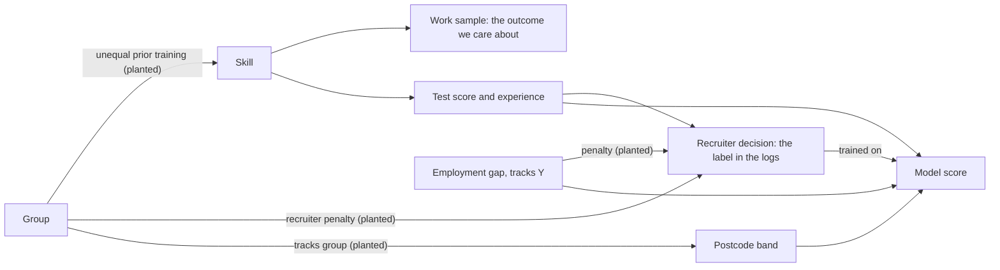

# Fairness in Automated Scoring: What to Measure, and What No Metric Settles

> A screening model advances 22.8% of one group and 10.7% of another. The second number is 0.469 of the first, and four other definitions of fair give four other readings of the same decisions. Some of those definitions cannot all hold at once, by arithmetic. An audit does not find out whether the model is fair. It states which gaps exist, how sure you are of them, which label they were measured against, and what closing each would cost. Skip that, and you ship whichever definition your default happened to satisfy, with nobody having chosen it.

**In plain words.** Suppose a swimming club picks its squad with a timed trial. You can ask whether each neighbourhood gets the same share of places, whether strong swimmers from each neighbourhood are equally likely to get in, or whether a trial time means the same thing wherever the swimmer comes from. Each is a reasonable question. When one neighbourhood has fewer pools, they have different answers, and you can't make all of them come out equal. You also have a harder problem if your record of who counted as strong was written by last year's selectors.

[Note 13](13-automate-review-or-reject.md) turned a score into routes and [note 14](14-learning-from-corrections.md) asked what labels people's decisions really give you. This chapter asks who those routes treat differently. The repo already has two neighbours, and this note doesn't repeat them: [AIE 09/03](../../../ai-engineering/09-safety-and-security/notes/03-guardrail-models.md#harm-and-fairness-in-deployed-output) tests a deployed output by swapping names in a pair of prompts, which asks about individuals, and [AIE 09/07](../../../ai-engineering/09-safety-and-security/notes/07-compliance-and-regulation.md) covers the EU AI Act's roles, risk tiers and dates. The swap test can't tell you what a model does to a group across thousands of decisions. That is the gap here.

**This is engineering, not legal advice.** Every legal statement below names the place it applies to and was checked on 2026-11-04. Whether a law is met is a question for counsel in that place. The US federal position in particular was moving when this was written.

## The scenario, and what is planted

Brackwater Freight is invented. It wants to screen applicants for shift supervisor with a model, and has capacity to interview the top 20%. The lab [`fairness_audit_lab.py`](../practice/fairness_audit_lab.py) generates 80,000 applicants from a seed, with groups A, B and C (70%, 24% and 6% of applicants) and a second attribute, X or Y (half each). These are labels on random draws. The differences between them are what we planted, so that an audit has something to find. They say nothing about any real group, employer or product, and every number below describes this generator.

We planted four things: unequal prior training that lowers group B's skill, a recruiter penalty on groups B and C that is harshest on applicants who are both B and Y, a further recruiter penalty for an employment gap, which is more common among Y, and a postcode band that tracks group. Every applicant also has a true outcome, a work sample, which only a generator can know for everybody.



Section 1 of the lab's output shows the first two plants before any model exists.

```text
           n  work_sample_pass  advanced_by_recruiter
group
A      13937             0.345                  0.312
B       4817             0.265                  0.117
C       1246             0.328                  0.233
   Past recruiters' ratio, B against A: 0.374
   The work sample's ratio, B against A: 0.770.
```

## Selection rate and the impact ratio

The **selection rate** is the share of a group advanced. The **impact ratio** (adverse-impact ratio) is a group's rate over the highest group's rate. Both need nothing but decisions and a group column, so this is where an audit starts.

```python
import math

def ratio_interval(k1, n1, k2, n2, z=1.96):
    """Selection-rate ratio and a 95% interval, by the delta method on the log ratio."""
    ratio = (k1 / n1) / (k2 / n2)
    se = math.sqrt(1 / k1 - 1 / n1 + 1 / k2 - 1 / n2)
    return ratio, ratio * math.exp(-z * se), ratio * math.exp(z * se)

# The unaware model (group and attribute columns dropped, postcode and gap kept)
# on 20,000 generated test applicants: selected, then applicants
print("B against A: %.3f [%.3f, %.3f]" % ratio_interval(515, 4817, 3178, 13937))
print("C against A: %.3f [%.3f, %.3f]" % ratio_interval(229, 1246, 3178, 13937))
```

```text
B against A: 0.469 [0.430, 0.512]
C against A: 0.806 [0.714, 0.910]
```

### The four-fifths rule: what it is

Applies to: US federal employment selection. The Uniform Guidelines at [29 CFR 1607.4(D)](https://www.law.cornell.edu/cfr/text/29/1607.4) say a rate "less than four-fifths (4/5) (or eighty percent)" of the highest group's is generally regarded as evidence of adverse impact. The same paragraph then limits itself: "Smaller differences in selection rate may nevertheless constitute adverse impact, where they are significant in both statistical and practical terms or where a user's actions have discouraged applicants disproportionately", and "Greater differences in selection rate may not constitute adverse impact where the differences are based on small numbers and are not statistically significant".

So it is a rule of thumb an enforcement agency used to decide what to look at. It is not:

- **A pass mark.** A ratio of 0.82 is not compliance. The Guidelines say so, and Fairlearn's documentation warns of "an unjustified feeling of legal invulnerability by conflating fairness with legality" ([Fairlearn, common fairness metrics](https://fairlearn.org/main/user_guide/assessment/common_fairness_metrics.html)).
- **A finding of discrimination.** Fairlearn again: "A violation of the rule is still not sufficient to demonstrate that illegal discrimination has occurred." Disparate impact (a neutral practice that falls harder on a protected group, also called adverse impact) is a claim under Title VII, the US employment discrimination statute. Showing it is the start of an argument about job-relatedness and alternatives, under [42 U.S.C. 2000e-2(k)](https://www.law.cornell.edu/uscode/text/42/2000e-2).
- **Portable.** "Outside its particular context in US federal employment law, the 'four fifths rule' has no validity," says the same page. Don't report it as a fairness standard for loans, content ranking or anything in the EU.

**Its status is changing. Check before relying on it.** As of 2026-11-04, the US Equal Employment Opportunity Commission's final rule "Rescission of Uniform Guidelines on Employee Selection Procedures" (RIN 3046-AB43) [was under White House review](https://www.reginfo.gov/public/do/eoDetails?rrid=1545969), received 16 October 2026 and not concluded, and the [regulatory agenda](https://www.reginfo.gov/public/do/eAgendaViewRule?pubId=202510&RIN=3046-AB43) targets final action in November 2026. We found no final publication. The agenda describes rescinding "the interpretive rulemaking portions" of the EEOC's version and says this "would not impact other agencies' interpretation and application". The rule's text isn't public, so whether 1607.4(D) itself goes is reported only as likely. A June 2026 [opinion of the Justice Department's Office of Legal Counsel](https://www.justice.gov/olc/media/1444871/dl) says the Guidelines "embrace an unconstitutional reading of Title VII", which is an executive-branch position and not a court ruling. One [law-firm summary](https://ogletree.com/insights-resources/blog-posts/eeoc-sends-oira-final-rule-rescinding-uniform-guidelines-on-employee-selection-procedures/) (Ogletree, October 2026, secondary) notes that the statute remains and private plaintiffs can still sue, that rescission "removes the roadmap", not the burden, and that the Labor Department's contractor office removed its own version effective 26 October 2026. The arithmetic of the ratio won't change. Its federal standing may.

Applies to: New York City. The [Local Law 144 rules](https://rules.cityofnewyork.us/wp-content/uploads/2023/04/DCWP-NOA-for-Use-of-Automated-Employment-Decisionmaking-Tools-2.pdf) define selection rate and impact ratio, require them by sex, by race and ethnicity and by the intersections, and require an audit no more than a year old with published results. We found no pass threshold in that text. An auditor may exclude a category under 2% of the data, with a justification and the counts reported.

### A low ratio does not name its cause

Section 9 of the lab reruns the world with plants removed, over five seeds per row. The unaware model drops the group and attribute columns, and the third column also drops postcode and gap.

```text
                   unaware_ratio_B  no_proxy_ratio_B  unaware_ratio_B_sd
as planted                   0.497             0.640               0.015
no recruiter bias            0.641             0.640               0.013
no skill gap                 0.763             0.988               0.026
neither                      0.979             0.988               0.031
```

With recruiters playing fair, the ratio is still 0.641, because a skill gap of 0.35 standard deviations thins the top 20% of the distribution harder than it moves the mean. The work-sample rates alone read 0.770, and picking from the tail reads lower. A low ratio can come from the model, from the label, from the world before anyone applied, or from all three. The next sections separate them.

## Demographic parity, equalized odds, equal opportunity

These three criteria ask different questions of the same decisions. "Qualified" below means having the true outcome, and TPR and FPR are the share of qualified and of unqualified people who get selected.

| Criterion | Asks for equality of | Needs a true outcome? | Fails when |
|---|---|---|---|
| Demographic parity | Selection rate | No | Base rates differ and the score is accurate |
| Equal opportunity | TPR | Yes | Qualified people in one group are passed over more |
| Equalized odds | TPR and FPR | Yes | As above, or unqualified people in one group get through more |

The last two come from [arXiv:1610.02413](https://arxiv.org/abs/1610.02413) (Hardt, Price and Srebro, NeurIPS 2016), who point out that a perfect predictor always satisfies them, which demographic parity doesn't promise. Chouldechova calls parity "well-suited to contexts such as employment or admissions", where equal proportions may be wanted or required ([arXiv:1703.00056](https://arxiv.org/abs/1703.00056)). Parity says nothing about who within a group gets selected, and [arXiv:1711.07076](https://arxiv.org/abs/1711.07076) (Lipton, Chouldechova and McAuley, NeurIPS 2018) shows that methods reaching it indirectly can do so by reordering people within a group.

```python
import numpy as np

group = np.array(list("AAAAAAAABBBBBBBB"))
truth = np.array([1, 1, 1, 1, 0, 0, 0, 0, 1, 1, 0, 0, 0, 0, 0, 0])
chosen = np.array([1, 1, 1, 0, 1, 0, 0, 0, 1, 0, 1, 0, 0, 0, 0, 0], dtype=bool)

for g in "AB":
    at = group == g
    sel, y = chosen[at], truth[at]
    print(g, "selection %.2f  TPR %.2f  FPR %.2f  PPV %.2f" % (
        sel.mean(), sel[y == 1].mean(), sel[y == 0].mean(), y[sel].mean()))
```

```text
A selection 0.50  TPR 0.75  FPR 0.25  PPV 0.75
B selection 0.25  TPR 0.50  FPR 0.17  PPV 0.50
```

Group B's rate is half of A's and its TPR is two-thirds of A's. The numbers answer different questions, and all of them are right. With 16 people, this only shows the arithmetic.

## Calibration within groups

A score is **calibrated within groups** if, among people scored at s in any group, a share s have the outcome. Then a score means the same thing whoever holds it. [Note 13](13-automate-review-or-reject.md#calibration-is-the-precondition) needed calibration so thresholds could be priced. Here the check is run per group: bin the score and compare the observed rate across groups at the same score.

**Predictive parity** is the thresholded cousin: PPV equal across groups. A calibrated score doesn't guarantee it at a cutoff, as Chouldechova notes, because the groups can sit at different places within the bins above the cutoff.

Calibration has a hole we will come back to: it is only calibration against the label you have.

## The impossibility, in numbers

Two papers showed this at about the same time.

**Chouldechova's identity.** From the definitions alone, in each group with base rate p ([arXiv:1703.00056](https://arxiv.org/abs/1703.00056), [Big Data 2017](https://doi.org/10.1089/big.2016.0047), eq. 2.6), and FNR is the miss rate from [note 12](12-reading-the-errors.md#step-4-slice-and-count):

```text
FPR = p / (1 - p) * (1 - PPV) / PPV * (1 - FNR)
```

If two groups share PPV and FNR but differ in p, their FPR can't match. No choice of model escapes this, because it restates how a confusion table adds up. "We demonstrate that the criteria cannot all be simultaneously satisfied when recidivism prevalence differs across groups." Her case was a recidivism score, and the arithmetic doesn't care about the application.

```python
def fpr(p, ppv, tpr):
    return p / (1 - p) * (1 - ppv) / ppv * tpr

print(round(fpr(0.4, 0.6, 0.7), 3), round(fpr(0.3, 0.6, 0.7), 3))
```

```text
0.311 0.2
```

**Kleinberg's result.** [arXiv:1609.05807](https://arxiv.org/abs/1609.05807) (Kleinberg, Mullainathan and Raghavan, [ITCS 2017](https://doi.org/10.4230/LIPIcs.ITCS.2017.43)) works on the score, with no threshold. Take calibration within groups, and call the average score among people without the outcome x, and among people with it y. Balance means x matches across groups, and so does y. This is equalized odds stated on the score rather than at a cutoff. Calibration forces a line in each group, since the average score must equal the base rate:

```text
(1 - p) x + p y = p     which rearranges to     x + p (y - x - 1) = 0
```

For two different values of p to share one x and one y, both terms must vanish: x = 0 and y = 1, the perfect predictor. So their theorem says all three conditions together need perfect prediction or equal base rates. They also prove an approximate version, so being nearly fair on all three doesn't rescue it, and they don't tell you how to choose.

Section 5 of the lab runs this on a different score from the rest of the chapter. Trained on the work samples of 5,000 audited applicants instead of recruiter decisions, it uses no proxies and is recalibrated per group on validation. Calibration holds: observed rates agree across groups in each bin to within a few points. The two lines:

```text
A: base rate 0.345, mean score on non-passers x 0.279, on passers y 0.486, (1-p)x + py = 0.350
B: base rate 0.265, mean score on non-passers x 0.202, on passers y 0.404, (1-p)x + py = 0.256
```

The values of x and y differ by group, as the theorem says they must. The left side is the group's mean score, which matches the base rate to within sampling error because the curve was fit on another sample. Now four decision rules on the same score, on test:

```text
                                sel_A  sel_B  ppv_A  ppv_B  fpr_A  fpr_B  fnr_A  fnr_B
one cutoff at 0.45              0.308  0.173  0.621  0.601  0.178  0.094  0.446  0.608
equal PPV (0.62)                0.309  0.152  0.621  0.616  0.179  0.080  0.444  0.646
equal TPR                       0.257  0.228  0.653  0.565  0.136  0.135  0.514  0.514
equal TPR and FPR (randomised)  0.196  0.173  0.686  0.601  0.094  0.094  0.609  0.608
```

Equalise PPV and B's miss rate is 0.646 against 0.444. Equalise TPR and FPR and PPV spreads to 0.686 against 0.601. The lab asserts Chouldechova's identity for each row and group, and it holds exactly. These rows select different numbers of people, so don't compare their quality here.

The last row shows what equalized odds can cost. Hardt et al. note that it may need "different (possibly randomized) thresholds", because group ROC curves cross at few points. On this seed our version brings A down to B's point (on some seeds B must come down too): A's selection falls from 0.308 to 0.196 and its miss rate rises from 0.446 to 0.609, with coin flips deciding some of it, while B gains nothing. That is **leveling down**, and Fairlearn's [postprocessing guide](https://fairlearn.org/main/user_guide/mitigation/postprocessing.html) warns about it by name. Ask whether you could defend a coin flip deciding someone's job before using this.

So someone must own the choice. As Chouldechova puts it, fairness "is a social and ethical concept, not a statistical one". Set `SKILL_GAP` to zero in the lab and the one-cutoff row reads FPR 0.178 and 0.158, FNR 0.445 and 0.463: the conflict falls to a small gap once base rates match, as the theorems say.

## Small groups: put an interval on the ratio

A ratio on small counts can read almost anything. Section 6 of the lab takes one depot's 400 applicants, with the same model and cutoff.

```text
slice   n  selected  rate  rate_lo  rate_hi  ratio  ratio_lo  ratio_hi  fisher_p  short_by
    A 266        64 0.241    0.193    0.295  1.000       NaN       NaN       NaN         0
    B 104        17 0.163    0.105    0.246  0.679     0.419     1.103     0.124         4
    C  30         2 0.067    0.018    0.213  0.277     0.071     1.075     0.035         4
       0                      0.8                   1.6
     A                        |     o                   1.00 reference, n=266
     B             -------o---|---------                0.68 [0.42, 1.10] n=104
     C   ------o--------------|--------                 0.28 [0.07, 1.08] n=30
```

Both groups fail the point reading, and both intervals reach past 1. Four more people advanced in either group brings it to the floor, as `short_by` says. For C, the exact test gives p = 0.035 while the approximate interval just covers 1: with two selected, neither method is comfortable, so report the counts as well. The rates' intervals are Wilson intervals, explained in [DA 02/04](../../../data-analytics/02-probability-and-statistics/notes/04-estimation.md#when-wald-fails-wilson).

How does the reading behave as size changes? Group A has 1,000 applicants at a rate of 0.30, over 20,000 simulated repeats.

```text
 small_group_n  true_ratio_1.0_flagged  true_ratio_0.6_passed  coverage_at_0.6  interval_wholly_below_0.8
            20                   0.271                  0.256            0.953                      0.000
            50                   0.188                  0.147            0.949                      0.091
           200                   0.037                  0.023            0.957                      0.438
          1000                   0.001                  0.000            0.950                      0.946
```

At 20 applicants, a group treated exactly equally is flagged 27% of the time, and a true ratio of 0.6 passes 26% of the time. The interval's coverage is close to 95% at every size, but at 20 and 50 it almost never settles the question: with a true ratio of 0.6, it lies wholly below 0.8 in 0% and 9% of repeats. The Guidelines anticipate this: with numbers too small, look at a longer period or at similar use elsewhere, if they are comparable. Do that, or state plainly that the data can't support a conclusion. Don't quietly drop the group, as that is the group the audit exists for.

## Intersections: passing every margin isn't passing

Slices can hide inside margins. The lab applies the first remedy people reach for, group cutoffs that equalise selection across A, B and C, then looks at the crossed slices on 20,000 test applicants.

```text
       0                      0.8                   1.6
     A                        |     o                   1.00 reference, n=13937
     B                        |--o--                    0.90 [0.84, 0.97] n=4817
     C                      --|o---                     0.84 [0.74, 0.95] n=1246
     X                        |     o                   1.00 reference, n=9893
     Y                        |o--                      0.85 [0.80, 0.90] n=10107
       0                      0.8                   1.6
   A/X                        |     o                   1.00 reference, n=6882
   A/Y                        |-o-                      0.86 [0.81, 0.92] n=7055
   B/X                        |--o---                   0.91 [0.83, 1.00] n=2371
   B/Y                     --o|-                        0.77 [0.70, 0.85] n=2446
   C/X                       -|--o-----                 0.90 [0.76, 1.06] n=640
   C/Y                ----o---|                         0.65 [0.53, 0.80] n=606
```

On this draw every margin clears 0.8, and B/Y and C/Y read 0.77 and 0.65. That is one seed. Over 30 other seeds of this generator, B/Y averages 0.832 and falls under 0.8 on 6, and some crossing falls under 0.8 on 18. The worst crossing read below the worst margin on all 30, so that is the result to carry away, not 0.77. The cause here is mundane. This model has no interaction term, so it can't learn the extra penalty we planted on B/Y. It does learn the gap penalty, which pushes Y down inside each group, and cutoffs set on group alone leave that in place. The planted interaction sits in the recruiter decisions, where a more flexible model could pick it up.

Real systems show it too. [Gender Shades](https://proceedings.mlr.press/v81/buolamwini18a.html) (Buolamwini and Gebru, PMLR 2018) found error rates up to 34.7% for darker-skinned women against at most 0.8% for lighter-skinned men in commercial gender classifiers (abstract read). [arXiv:1711.05144](https://arxiv.org/abs/1711.05144) (Kearns, Neel, Roth and Wu, ICML 2018) gives this the name fairness gerrymandering: pass on predefined groups while failing a structured subgroup (abstract read).

Slicing has two costs. Cells shrink, so intervals widen; report the n. Comparisons multiply: five slices against a reference chosen in advance, at a 5% level, expect 0.25 false alarms per audit from chance alone. Picking the top slice from the data, as these panels do, makes it worse: with six equal slices the lab measures 0.47 false alarms per audit, and at least one in 28% of audits. Choose the slices before looking, and treat a finding on an unplanned slice as something to retest on the next window.

## Label bias: when the label is a previous decision

"Trained on recruiter decisions" means the target is what past recruiters did, and every metric that needs a label inherits that. Here is the same selection audited against each label, from section 4. The naive model is the one trained on all columns, group included.

```text
   naive    against history (the logs)   TPR A 0.583, B 0.251;  PPV A 0.720, B 0.613
   naive    against the work sample      TPR A 0.476, B 0.131;  PPV A 0.650, B 0.726
   unaware  against history (the logs)   TPR A 0.540, B 0.434;  PPV A 0.738, B 0.474
   unaware  against the work sample      TPR A 0.437, B 0.261;  PPV A 0.660, B 0.649
```

For the naive model the PPV gap changes sign. The logs say the B applicants it picked are worse than the A applicants it picked (0.613 against 0.720). On the work sample they are better (0.726 against 0.650), because the model holds them to a higher bar. The unaware model's PPV gap reads 26 points on the logs and 1 point on the work sample. The two labels also disagree on TPR. The naive model's gap is much the same size on both, 33 and 35 points, but B's TPR as a share of A's falls from 0.43 on the logs to 0.28 on the work sample. The unaware model's gap grows from 11 points to 18.

Calibration is the worst case for this, because it looks like a clean bill of health. The naive model is close to calibrated against history in every group (mean gap between A and B across bins: 0.033). Against the work sample the gap is 0.124, with B passing more often at the same score.

```text
    score_bin  mean_score  obs_A  obs_B
   (0.2, 0.35]      0.270  0.341  0.490      <- against the work sample
   (0.35, 0.5]      0.421  0.428  0.602
   (0.5, 0.7]       0.596  0.549  0.667
```

[Note 14](14-learning-from-corrections.md#audit-a-random-sample) gave the fix for labels nobody checked: a random audit. Here it is 5,000 applicants who sit the work sample whatever a recruiter says. Hardt et al. warn that "the measurement of the target variable might in itself be unreliable or biased" and that "Domain-specific scrutiny is required in defining and collecting a reliable target variable." The inference is ours: if the label is the problem, no metric computed from the label can tell you, so you need a check from outside it.

The same failure outside hiring: [Obermeyer et al.](https://doi.org/10.1126/science.aax2342) (Science 2019) report on a widely used US health algorithm that "The bias arises because the algorithm predicts health care costs rather than illness" (abstract read; full text was not available to us). A target can be a proxy too. A work sample is itself a choice of target, so validate it and don't call it the truth just because it beats the log.

## Proxies: removing the column doesn't remove the effect

The instinct is to delete the sensitive column. Section 3:

```text
3. Can the remaining columns identify group B? AUC on test
   from postcode band alone 0.827; from every unaware column 0.838
   all columns                  selection B 0.048, ratio 0.189
   group and attribute dropped  selection B 0.107, ratio 0.469
   proxies dropped too          selection B 0.131, ratio 0.600
   Decisions identical between the first two rows: 96.5%
   Most of that is people both reject. Of those either row advances, both do: 83.6%
```

Dropping the columns moved the ratio from 0.189 to 0.469, and 83.6% of those advanced by either version are advanced by both. Don't lean on the 96.5%: at 20% capacity, two unrelated selections already agree on about 68% of decisions. A model trained on a biased label reaches for whatever predicts that bias, so postcode picks up what the group column carried. Postcode and gap say nothing about the work sample in this generator, so dropping them moved the ratio to 0.600 and raised the work-sample pass rate of those selected, from 0.659 to 0.669. Set `PROXY_STRENGTH` to 0 in the lab and the AUC falls to 0.503, and the unaware ratio rises to 0.611.

Two limits. Real features rarely split so neatly into clean and tainted, and here the test score is clean by construction. Dropping a feature is also a decision to verify, as a real proxy can carry real signal. The test is to predict the group from your features, then ask which of the features that help have a job-related reason to be there. And 0.600 is still under 0.8: dropping proxies removed the recruiter effect, and left the base-rate gap.

## Measuring when you may not hold the data

You can't audit a group column you don't have, and many organisations don't hold one. There are four ways round it, with error we can measure since the generator knows the truth.

```text
                                                         rate_A  rate_B  ratio_B
true group (held out)                                     0.228   0.107    0.469
assign each person their likeliest group                  0.213   0.100    0.469
weight each person by P(group | band)                     0.214   0.147    0.686
voluntary survey, answer rate tied to outcome and group   0.332   0.255    0.768
same survey, reweighted by the true answer rates          0.230   0.103    0.446
```

The likeliest-group row's exact match is luck: both rates are off. Over five more seeds, the true ratio against the likeliest-group estimate read 0.482 and 0.440, 0.517 and 0.459, 0.498 and 0.525, 0.564 and 0.545, 0.498 and 0.477, so its error goes either way by up to 0.06. The weighted estimate read 0.69 to 0.73 on all five, against a truth of 0.48 to 0.56, so it hides much of the gap. That is what [arXiv:1811.11154](https://arxiv.org/abs/1811.11154) (Chen, Kallus, Mao, Svacha and Udell, FAT* 2019) analyses: bias of a thresholded estimate "varies strongly with the threshold chosen", and a weighted estimate's bias depends on how the outcome and the true class covary. Inference never removes the need for a validation set where the true group is known. Note the awkward loop: a proxy good enough to audit with is also good enough to discriminate with.

The survey's answer rates are assumptions: 75% and 45% for selected and rejected in A and C, 60% and 20% in B. Rejected applicants in group B going quiet makes the ratio read 0.768, and it needs the true answer rates to correct, which you won't have. Report the response rate by decision.

Other options need no group data at all. Run the [counterfactual swap from AIE 09/03](../../../ai-engineering/09-safety-and-security/notes/03-guardrail-models.md#harm-and-fairness-in-deployed-output) where the input has text. Or test on data built for the audit: New York's rules allow test data when historical data isn't enough, if you explain how it was made.

Applies to: the EU, under [Regulation (EU) 2024/1689](http://data.europa.eu/eli/reg/2024/1689/oj) as amended by [Regulation (EU) 2026/1744](http://data.europa.eu/eli/reg/2026/1744/oj). Recruitment screening is a high-risk use ([Annex III, point 4(a)](https://artificialintelligenceact.eu/annex/3/)), and for those systems [Article 10](https://artificialintelligenceact.eu/article/10/) requires examining data for possible biases and "appropriate measures to detect, prevent and mitigate" them, with data "relevant, sufficiently representative". It names no numeric threshold. Article 10(5), which covered processing sensitive data to detect bias, was deleted by the 2026 amendment, and the permission now sits in [Article 4a](https://artificialintelligenceact.eu/article/4a/). That allows special categories of personal data for bias detection and correction where strictly necessary, under conditions: other data including synthetic or anonymised can't do the job, pseudonymisation, access controls, deletion once corrected, and records of why it was necessary. We read these articles on a third-party copy and checked them against the Publications Office's copy of the official text, because EUR-Lex returned nothing to our fetch. [AIE 09/07](../../../ai-engineering/09-safety-and-security/notes/07-compliance-and-regulation.md) has the dates.

## Threshold mitigation, and what it costs

The direct remedy is a separate cutoff per group. Section 2 of the lab compares it with the alternatives, all at 20% capacity, and reports how many people pass the work sample (`ppv_true`) alongside the rate on the logs (`ppv_hist`).

```text
                                                  sel_A  sel_B  sel_C  ratio_B  ratio_C  ppv_true  ppv_hist
naive: all columns, one cutoff                    0.252  0.048  0.172    0.189    0.681     0.657     0.711
unaware: group and attribute dropped, one cutoff  0.228  0.107  0.184    0.469    0.806     0.659     0.699
unaware: proxies dropped too, one cutoff          0.218  0.131  0.194    0.600    0.889     0.669     0.689
group cutoffs on unaware, equal selection         0.202  0.182  0.169    0.902    0.837     0.653     0.672
group cutoffs on unaware, equal TPR on history    0.223  0.131  0.152    0.584    0.682     0.660     0.692
group cutoffs on unaware, equal TPR on outcomes   0.211  0.162  0.165    0.771    0.781     0.656     0.678
audited labels, no proxies, one cutoff            0.220  0.132  0.194    0.601    0.884     0.668     0.687
audited labels, no proxies, equal selection       0.204  0.185  0.169    0.904    0.824     0.662     0.669
```

Five things to read from it, all conditional on this generator.

- **The cost depends on the label you price it with.** Moving the unaware model to equal selection costs 2.7 points on the logs (0.699 to 0.672) and 0.6 points on the work sample (0.659 to 0.653). A business case built on history overstates the price of fairness when the history is biased. Counted on test, 2,585 people who pass the work sample are advanced before the move (of 3,922 advanced) and 2,554 after (of 3,909), so about 31 people.
- **Fixing the inputs beat fixing the output.** Dropping proxies raised the ratio and the quality with no group cutoffs at all. The audited row with equal selection reaches 0.904 at 0.662, against 0.902 at 0.653 for cutoffs on the tainted score, but it changes the label as well as the features, so this table doesn't separate the two.
- **Equalising selection isn't free inside the groups.** On the unaware model, PPV against the work sample for A and B goes from 0.660 and 0.649 at one cutoff to 0.676 and 0.570 at group cutoffs (the lab's second table). The B applicants added sit further down the score and pass less often, which is the gap the impossibility section predicts.
- **Equal TPR on history is worth little.** That row equalises a TPR measured against the biased label, and leaves B's ratio at 0.584.
- **A fix fitted on one sample doesn't stay exact.** The equal-outcomes row has equal TPR on validation, using outcomes only a generator has for everyone, and reads 0.410 for A against 0.358 for B on test (the lab's second table). C's selection in the equal-selection row is 0.169, not 0.200. Group cutoffs need monitoring like any threshold, per [note 13](13-automate-review-or-reject.md).

These costs need real cases to set them against. On 301,536 FICO credit scores, in a profit model that lends down to the score where 82% of people do not default, Hardt et al. report race-blind, equal opportunity, equalized odds and demographic parity at 99.3%, 92.8%, 80.2% and 69.8% of the maximum profit. [arXiv:1701.08230](https://arxiv.org/abs/1701.08230) (Corbett-Davies et al., KDD 2017; abstract read) looks at pretrial release decisions in Broward County, Florida, with public safety as the objective. There the unconstrained best rule is a single threshold and constrained rules use group-specific ones, and the trade-off "can be large in practice". Our 0.6 points describes one generator, so don't quote it as the price of fairness.

**Group cutoffs may not be legal or even possible.**

- Applies to: US employment. [42 U.S.C. 2000e-2(l)](https://www.law.cornell.edu/uscode/text/42/2000e-2) makes it unlawful "to adjust the scores of, use different cutoff scores for, or otherwise alter the results of, employment related tests" on the basis of race, color, religion, sex or national origin. The obvious remedy may therefore be the prohibited one. Whether a model score counts as such a test is a question for counsel. Treat this as a reason to fix features, labels and validation first.
- Deployment: Fairlearn notes that its `ThresholdOptimizer` "requires the sensitive features to be available at deployment time", so you would have to hold and use the attribute on each decision. If you may not, this method is off the table, however good its numbers look.

## What an audit report states

An audit report records what was measured, under what assumptions, and what remains unknown. It should state:

1. **The decision.** What is decided, by which model version, at which threshold, and who sees the result before it takes effect.
2. **The population and window.** Who is included and excluded, and over what dates.
3. **The labels.** Where each came from. Whether it's a prior human decision. What independent check exists, on how many cases, chosen how.
4. **The group data.** How it was obtained, how much is missing and by which decision, and any inference method with its validated error.
5. **Rates with counts.** Numerators, denominators, ratio and interval per group and pre-chosen slice, and the rule for small cells.
6. **Error rates and calibration**, with the label named for each, and which metric was chosen as primary, by whom and why.
7. **The alternatives tried**, including removing features, with the selection and quality effect of each on the same data.
8. **Jurisdiction and legal review.** Which law was considered, as of what date, reviewed by whom.
9. **What is not established.** Cause, job-relatedness and compliance, unless someone established them.
10. **When it gets repeated**, and what would trigger it sooner: a model change, a shift in applicants, or a change in the law.

Section 10 of the lab fills in the middle of that from this run.

```text
    Model: unaware, trained on recruiter decisions. Decision: top 20% advance. Data: generated, 20,000 test applicants
    A: 3178/13937 = 0.228; the reference
    B: 515/4817 = 0.107; ratio to A 0.469 (95% interval 0.430 to 0.512); short of 0.8 by 364 people
    C: 229/1246 = 0.184; ratio to A 0.806 (95% interval 0.714 to 0.910); short of 0.8 by 0 people
    Outcome label: recruiter decisions are a prior human judgement; 5,000 audited work samples used as the check
    Not established: the cause of the gap, job-relatedness, or whether any law is met. That is for counsel.
```

C's line is a useful one to teach from. The point reads 0.806 and the interval runs from 0.714 to 0.910, so "passes" isn't what the data says. Metrics also have limits that no report can compute away: Fairlearn notes that "group fairness metrics do not account for differences in individual experiences, nor do they account for procedural justice" ([overview](https://fairlearn.org/main/user_guide/fairness_in_machine_learning.html)). An appeals route, and a person able to overturn the result, are part of the system too.

## Pitfalls

- **Reporting a ratio without counts.** Symptom: a depot reads 0.28 and alarms everyone, on 2 selected out of 30, with an interval reaching 1.08.
- **Treating 0.8 as a pass.** Symptom: a report reads "compliant" because a ratio is 0.806, with an interval down to 0.714, in a place where the rule may not even apply.
- **Auditing with the training label.** Symptom: calibration across groups looks clean (a mean gap of 0.033), and against an independent check it isn't (0.124).
- **Deleting the column and declaring the model blind.** Symptom: 83.6% of the people advanced stay the same after removing it, and a feature set that predicts group with an AUC of 0.838.
- **Chasing every metric at once.** Symptom: each fix opens another gap, and a project review keeps finding a new failing number. With unequal base rates, some of those can't close. Choose a primary metric with the people who own the decision, and write down why.
- **Stopping at margins.** Symptom: group and attribute pass, and a crossing doesn't: on the lab's default seed B/Y reads 0.77, and over 30 seeds some crossing falls under 0.8 on 18.
- **Dropping small groups.** Symptom: the "excluded under n=30" footnote covers the people most likely to be harmed and least able to complain.
- **Pricing the fix on biased labels.** Symptom: the fix appears to cost 2.7 points of precision on the logs, and 0.6 on the work sample.
- **Assuming a low ratio proves model bias.** Symptom: an expensive retrain closes nothing. With recruiters playing fair the ratio was still 0.641, from the base rates.
- **Reusing another place's rule.** Symptom: an EU review cites the four-fifths rule. The EU text we read names no such number.

## Try it

Run the [lab](../practice/fairness_audit_lab.py) with `uv run fairness_audit_lab.py` from `practice/`. A setting that removes a planted effect can trip an assertion further down. The sections above that point still print, and the failure is itself the result.

1. By hand: 20 of 100 applicants in one group advance, and 300 of 1,000 in another. What's the ratio, its interval, and how many more selections reach 0.8?

<details><summary>Answer</summary>

The ratio is 0.20 / 0.30 = 0.667. With `ratio_interval(20, 100, 300, 1000)`, the interval is 0.445 to 0.998, just under 1. The floor is 0.8 x 0.30 x 100 = 24 selected, so 4 more people. A small move in the counts changes the reading, which is what to write down.

</details>

2. Set `PROXY_STRENGTH = 0.0`. How well does postcode identify group B, and what happens to the unaware model's ratio? Why did the naive row barely move?

<details><summary>Answer</summary>

Band's AUC falls from 0.827 to 0.503, chance. The unaware ratio rises from 0.469 to 0.611, close to the proxies-dropped row, since there is nothing left to pick up the group. The naive row moves little (0.189 to 0.193) because it sees the group column directly. Section 7 reads B/Y 0.802 here, a hair above the floor, and 10 of the 30 other seeds read under it, so don't call it fixed.

</details>

3. Set `SKILL_GAP` to zero for all groups. What happens to the conflict in section 5?

<details><summary>Answer</summary>

Base rates become 0.345 and 0.348, and the one-cutoff row reads FPR 0.178 and 0.158, FNR 0.445 and 0.463, against 0.178 and 0.094, 0.446 and 0.608. That is what the theorems say: equal base rates remove what forces the gap. This is one seed, so a small gap remains. Section 9's "no skill gap" row gives the matching control: without proxies the ratio is 0.988. An assertion in section 8 trips here, because the weighted estimator's direction depends on the world. That is a reason not to trust its direction anywhere.

</details>

4. Your stakeholder asks for one number that shows the model is fair. What do you write back?

<details><summary>Answer</summary>

There isn't one, and asking for one assumes the criteria agree. Offer the decision they need instead: which error matters more, for whom, and at what price. Give the table of ratio, error rates and quality across the alternatives, the label each number used, and the limits. The choice then belongs to the people accountable for it, with counsel for any legal reading.

</details>

## Interview checklist

| Question | Answer |
|---|---|
| Define the impact ratio. | A group's selection rate over the highest group's. It needs only decisions and groups. |
| What is the four-fifths rule? | A US federal employment rule of thumb in 29 CFR 1607.4(D): under 80% is generally regarded as evidence of adverse impact. Not a pass mark, not a finding of discrimination, not valid elsewhere, and under rescission review as of November 2026. |
| Equal opportunity or equalized odds? | Equal opportunity equalises TPR. Equalized odds also equalises FPR. Use the first when missing qualified people is the harm you care about, and know that both need a label you trust. |
| Can you have calibration and equalized odds? | Not with unequal base rates and an imperfect predictor, and two results say so. Kleinberg et al.: calibration plus balance of the mean score in each class, from the line (1-p)x + py = p. Chouldechova, at a threshold: equal PPV plus equal error rates, from FPR = p/(1-p) x (1-PPV)/PPV x (1-FNR). Her identity is about PPV, not calibration, since a calibrated score needn't have equal PPV at a cutoff. |
| Does a higher accuracy solve it? | Only at perfect prediction. Kleinberg et al. also prove an approximate version, so nearly satisfying all conditions needs nearly perfect prediction or nearly equal base rates. |
| Your ratio is 0.68 on 104 people. Report it how? | With counts and an interval: here 0.42 to 1.10. It doesn't establish a gap or its absence. Say what data would, such as a longer window. |
| Why isn't dropping the protected column enough? | Other columns can reconstruct it, and the model learns what predicts its label. Test by predicting the group from your features. In the lab: AUC 0.838, and 83.6% of those advanced by either version are advanced by both. |
| The training labels are past recruiter decisions. What now? | Every label-based metric inherits their bias, and calibration can look clean. Get an independent check on a random sample. Hardt et al. warn that the target's measurement may itself be biased, and that it needs domain scrutiny. |
| Which slices do you check? | Each attribute and pre-chosen intersections, with counts and intervals and a plan for multiple comparisons. Margins can pass while a crossing fails: 0.90 and 0.85 against 0.77 on the lab's default seed, and some crossing fails on 18 of 30 other seeds. |
| You may not hold demographic data. How do you audit? | Check what the law allows there (in the EU, Article 4a). Options are inference against a validated sample, voluntary data with response rates by decision, and counterfactual tests. Inference can understate or overstate a gap. Report the error. |
| Why not just use group thresholds? | They may close the ratio, but need the attribute at decision time, can level down, and in US employment may be barred outright by 42 U.S.C. 2000e-2(l). Try features and labels first. |
| What must an audit report say? | The decision, population, label provenance, group-data method, counts with intervals, error rates by named label, alternatives and their costs, jurisdiction and date, and what is not established. |

## Next

[Deep learning](../../02-deep-learning/README.md): the same discipline of splits, thresholds and calibration, now with models that learn their own features, which makes the proxy test here more important. To see a scoring loop as the last stage of a whole invoice system, with its rollout and monitoring, read [DE 06/06](../../../data-engineering/06-ml-platform/notes/06-ml-system-framing-to-monitoring.md).
