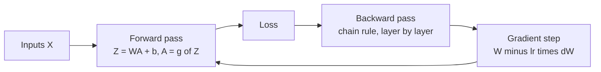

# Neural network basics

> A neural network is logistic regression stacked: forward pass, loss, backward pass by the chain rule, gradient step. Your Ng coursework builds that by hand in NumPy with a cache for every layer. PyTorch does the backward pass for you, and this chapter shows the two produce the same gradients, so you know what `loss.backward()` hides. Every later chapter in this pillar is written in PyTorch and uses one running dataset: the 1,797 8×8 handwritten digits that ship with scikit-learn.

**In plain words.** A neural network is a stack of simple scoring rules, each passing its answer to the next, that can learn a job like reading a handwritten digit on a form. Think of learning darts: you throw, see how far you missed, and adjust your aim a little before the next throw. A network does the same thing over and over, and that loop is all training is. This chapter writes the loop by hand and then in PyTorch, so that when a network at work misbehaves you know which part of it to check.

The sklearn `MLPClassifier` in [supervised learning](../../01-classical-ml/notes/02-supervised-learning.md) hides all of this. This chapter opens it up, and [micrograd](../../../generative-ai/09-llms-from-scratch/notes/01-micrograd.md) does it again as an autograd engine in about 100 lines.



## The forward pass

For an $L$-layer network with weights $W^{[l]}$, biases $b^{[l]}$ and activation $g$:

$$Z^{[l]} = W^{[l]} A^{[l-1]} + b^{[l]}, \qquad A^{[l]} = g^{[l]}(Z^{[l]}), \qquad A^{[0]} = X$$

The Ng DL convention stores examples as **columns**: $X$ is $(n_x, m)$, $W^{[l]}$ is $(n^{[l]}, n^{[l-1]})$. PyTorch stores them as **rows**: `X` is `(m, n_x)`. Getting these shapes right is half of every assignment, and forgetting the switch is the first bug when you port one.

| Activation | $g(z)$ | $g'(z)$ | Use |
|---|---|---|---|
| Sigmoid | $1/(1+e^{-z})$ | $g(1-g)$ | Binary output layer |
| tanh | $\tanh z$ | $1 - g^2$ | Hidden layers (zero-centred), RNNs |
| ReLU | $\max(0, z)$ | $1[z>0]$ | Default hidden layer |
| Leaky ReLU | $\max(0.01z, z)$ | $0.01$ or $1$ | Avoids dead units |
| Softmax | $e^{z_k}/\sum_j e^{z_j}$ | | Multiclass output |

Why a non-linear $g$ at all: a stack of linear layers multiplies out to one linear layer, so depth buys nothing without it.

**Logistic regression with a neural-network mindset** (course 1, week 2) is the one-layer case: flatten 64×64×3 cat images into 12,288-vectors, `sigmoid(w.T @ X + b)`, cross-entropy cost, gradient descent. Your notebook reaches about 70% test accuracy, and the point is the structure rather than the score.

## Backpropagation

Backpropagation is the chain rule applied from the loss back through each layer, reusing what the forward pass computed ([doi:10.1038/323533a0](https://doi.org/10.1038/323533a0) (Rumelhart, Hinton and Williams, Nature 1986)). For cross-entropy with a sigmoid output, $dZ^{[L]} = A^{[L]} - Y$. Then for each layer:

$$dW^{[l]} = \tfrac{1}{m} dZ^{[l]} A^{[l-1]\top}, \quad db^{[l]} = \tfrac{1}{m}\textstyle\sum dZ^{[l]}, \quad dA^{[l-1]} = W^{[l]\top} dZ^{[l]}, \quad dZ^{[l-1]} = dA^{[l-1]} \odot g'(Z^{[l-1]})$$

**Building your Deep Neural Network: Step by Step** (course 1, week 4) structures this as cached forward and backward functions. Here they are, cut down to the three the rest depend on:

```python
import numpy as np

def linear_activation_forward(A_prev, W, b, activation):
    Z = W @ A_prev + b
    A = np.maximum(0, Z) if activation == "relu" else 1 / (1 + np.exp(-Z))
    cache = (A_prev, W, b, Z)               # everything backward needs
    return A, cache

def linear_activation_backward(dA, cache, activation):
    A_prev, W, b, Z = cache
    m = A_prev.shape[1]
    if activation == "relu":
        dZ = dA * (Z > 0)
    else:
        s = 1 / (1 + np.exp(-Z)); dZ = dA * s * (1 - s)
    dW = dZ @ A_prev.T / m
    db = dZ.sum(axis=1, keepdims=True) / m
    dA_prev = W.T @ dZ
    return dA_prev, dW, db

def update_parameters(params, grads, lr):
    for l in range(1, len(params) // 2 + 1):
        params[f"W{l}"] -= lr * grads[f"dW{l}"]
        params[f"b{l}"] -= lr * grads[f"db{l}"]
    return params
```

The notebook's two wrappers loop over the layers. Written out, with He initialisation (explained in [the next chapter](02-optimisation-and-regularisation.md)):

```python
def init(sizes, seed=0):
    rng = np.random.default_rng(seed)
    p = {}
    for l in range(1, len(sizes)):
        p[f"W{l}"] = rng.standard_normal((sizes[l], sizes[l-1])) * np.sqrt(2 / sizes[l-1])
        p[f"b{l}"] = np.zeros((sizes[l], 1))
    return p

def forward(X, p):
    L, A, caches = len(p) // 2, X, []
    for l in range(1, L + 1):
        A, c = linear_activation_forward(A, p[f"W{l}"], p[f"b{l}"], "sigmoid" if l == L else "relu")
        caches.append(c)
    return A, caches

def cost(A, Y):
    A = np.clip(A, 1e-9, 1 - 1e-9)
    return float(-(Y * np.log(A) + (1 - Y) * np.log(1 - A)).mean())

def backward(A, Y, caches):
    L, grads = len(caches), {}
    A = np.clip(A, 1e-9, 1 - 1e-9)
    dA = (A - Y) / (A * (1 - A))            # dLoss/dA per example, summed over m inside dW
    for l in range(L, 0, -1):
        dA, grads[f"dW{l}"], grads[f"db{l}"] = linear_activation_backward(
            dA, caches[l-1], "sigmoid" if l == L else "relu")
    return grads
```

**Planar data classification with one hidden layer** (week 3) shows the payoff of a hidden layer on a 2-D "flower" that logistic regression cannot separate: your notebook goes from 47% to 90% with 4 tanh units, then sweeps hidden size from 1 to 50 to show overfitting. The same experiment on scikit-learn's moons, using the functions above:

```python
from sklearn.datasets import make_moons

Xm, ym = make_moons(600, noise=0.2, random_state=0)
X, Y = Xm[:400].T, ym[:400].reshape(1, -1)              # Ng shape: columns are examples
X_te, Y_te = Xm[400:].T, ym[400:].reshape(1, -1)

def fit(sizes, steps=3000, lr=0.5):
    p = init(sizes)
    for _ in range(steps):
        A, caches = forward(X, p)
        p = update_parameters(p, backward(A, Y, caches), lr)
    return p, cost(forward(X, p)[0], Y)

for sizes in ([2, 1], [2, 8, 1], [2, 16, 8, 1]):
    p, c = fit(sizes)
    acc = ((forward(X_te, p)[0] > 0.5) == Y_te).mean()
    print(f"{str(sizes):<14} train cost {c:.3f}  test accuracy {acc:.3f}")
```

```text
[2, 1]         train cost 0.288  test accuracy 0.895
[2, 8, 1]      train cost 0.058  test accuracy 0.955
[2, 16, 8, 1]  train cost 0.050  test accuracy 0.965
```

The one-layer network is logistic regression, and its straight boundary is the ceiling. One hidden layer removes that ceiling on this data. **Deep Neural Network: Application** makes the same comparison on the cat data: a 4-layer [12288, 20, 7, 5, 1] network reaches 80% test accuracy against 72% for the 2-layer network in your notebook.

### Checking hand-written gradients

Ng's Machine Learning ex4 trains a 400–25–10 network on 5,000 handwritten digits, with rows as examples and the bias as an explicit column of ones. It reaches about 96% training accuracy with `scipy.optimize.fmin_cg` and visualises the 25 hidden units as 20×20 images. It adds the two checks you should do on any hand-written backprop.

First, break symmetry with random initial weights, or every hidden unit computes the same thing. The ex4 version draws `Theta1` uniformly from ±0.12 for its 25 units over 401 inputs. Second, compare backprop to a centred finite difference. Course 2's **Gradient Checking** notebook repeats the check for an $L$-layer network with a deliberately planted bug to find, and this is a version you can run:

```python
def numerical_grad(J, theta, eps=1e-5):
    g = np.zeros_like(theta)
    for i in range(theta.size):
        e = np.zeros_like(theta); e.flat[i] = eps
        g.flat[i] = (J(theta + e) - J(theta - e)) / (2 * eps)
    return g

def rel_diff(g_num, g_bp):
    return np.linalg.norm(g_num - g_bp) / (np.linalg.norm(g_num) + np.linalg.norm(g_bp))

p = init([2, 8, 1])
A, caches = forward(X, p)
g_bp = backward(A, Y, caches)["dW1"]

def J(w):
    q = dict(p); q["W1"] = w
    return cost(forward(X, q)[0], Y)

g_num = numerical_grad(J, p["W1"])
print("correct backprop:", rel_diff(g_num, g_bp))
print("planted bug, gradient off by 10%:", rel_diff(g_num, 1.1 * g_bp))
```

```text
correct backprop: 9.110807226610613e-11
planted bug, gradient off by 10%: 0.04761904761148488
```

A relative difference below about $10^{-7}$ passes; your notebook uses the same threshold. ReLU's kink can raise it a little when a unit sits at zero. Turn the check off during training, because it costs one full forward pass per parameter, twice.

## The same network in PyTorch

Autograd records each operation in the forward pass and walks the record backwards, so you write only `forward`. Copy the NumPy weights into tensors and the gradients match to floating-point precision:

```python
import torch
import torch.nn.functional as F

torch.manual_seed(0)
tX, tY = torch.tensor(X.T, dtype=torch.float64), torch.tensor(Y.T, dtype=torch.float64)   # rows now
W1, b1 = torch.tensor(p["W1"], requires_grad=True), torch.tensor(p["b1"].T, requires_grad=True)
W2, b2 = torch.tensor(p["W2"], requires_grad=True), torch.tensor(p["b2"].T, requires_grad=True)

logits = torch.relu(tX @ W1.T + b1) @ W2.T + b2
loss = F.binary_cross_entropy_with_logits(logits, tY)
loss.backward()                                   # no caches: autograd kept the record

print("loss, NumPy vs PyTorch:", round(cost(A, Y), 6), round(loss.item(), 6))
print("max |dW1 NumPy - dW1 autograd|:", np.abs(g_bp - W1.grad.numpy()).max())
```

```text
loss, NumPy vs PyTorch: 0.707864 0.707864
max |dW1 NumPy - dW1 autograd|: 6.938893903907228e-17
```

So `backward()` is the notebook's `L_model_backward` with the bookkeeping done for you. The rest of the course stops writing it.

## The running example: digits

From here on the data is scikit-learn's digits, because it runs in seconds on a laptop and is the same kind of problem as Ng ex4's handwritten digits and your SIGNS and cat notebooks. It is small enough to overfit, which later chapters need. A helper loads and scales it, and `nn.Sequential` builds the model:

```python
import torch.nn as nn
from sklearn.datasets import load_digits
from sklearn.model_selection import train_test_split
from torch.utils.data import DataLoader, TensorDataset

digits = load_digits()
X_tr, X_te, y_tr, y_te = train_test_split(digits.data / 16.0, digits.target, test_size=0.3,
                                          random_state=0, stratify=digits.target)
X_tr, X_te = torch.tensor(X_tr, dtype=torch.float32), torch.tensor(X_te, dtype=torch.float32)
y_tr, y_te = torch.tensor(y_tr), torch.tensor(y_te)
train_ds = TensorDataset(X_tr, y_tr)
print(X_tr.shape, X_te.shape, "chance accuracy:", round(1 / 10, 2))
```

```text
torch.Size([1257, 64]) torch.Size([540, 64]) chance accuracy: 0.1
```

## The PyTorch training loop

The loop is the same everywhere, and each line hides a common bug (Raschka, *Build a Large Language Model (From Scratch)*, appendix A):

```python
def train(model, epochs=30, lr=1e-3, batch_size=32, seed=0, weight_decay=0.0):
    torch.manual_seed(seed)
    loader = DataLoader(train_ds, batch_size=batch_size, shuffle=True,
                        drop_last=True,     # a tiny last batch gives a noisy final update
                        num_workers=0)      # 0 = load in the main process; right for tiny data
    optimizer = torch.optim.AdamW(model.parameters(), lr=lr, weight_decay=weight_decay)
    for epoch in range(epochs):
        model.train()                       # dropout and batch norm in training mode
        for x, y in loader:
            logits = model(x)               # no softmax: cross_entropy applies log-softmax itself
            loss = F.cross_entropy(logits, y)
            optimizer.zero_grad()           # gradients accumulate across backward() by default
            loss.backward()
            optimizer.step()
    return model

def accuracy(model, X, y):
    model.eval()
    with torch.no_grad():                   # no graph built: less memory, faster
        return (model(X).argmax(1) == y).float().mean().item()

torch.manual_seed(0)
mlp = train(nn.Sequential(nn.Linear(64, 64), nn.ReLU(), nn.Linear(64, 10)))
print("MLP train", round(accuracy(mlp, X_tr, y_tr), 3), "test", round(accuracy(mlp, X_te, y_te), 3))

torch.save(mlp.state_dict(), "/tmp/mlp.pth")         # weights only
again = nn.Sequential(nn.Linear(64, 64), nn.ReLU(), nn.Linear(64, 10))
again.load_state_dict(torch.load("/tmp/mlp.pth"))    # rebuild the class, then load
print("reloaded test", round(accuracy(again, X_te, y_te), 3))
```

```text
MLP train 0.985 test 0.972
reloaded test 0.972
```

`num_workers=4` is Raschka's rule of thumb for real datasets. Keep it at 0 for tiny datasets and in notebooks, where worker processes cost more than they save and can crash the kernel. To go multi-GPU with `DistributedDataParallel`, run one process per GPU (from a script; DDP doesn't work inside Jupyter) and change four things:

- call `init_process_group("nccl", rank=rank, world_size=world_size)` at startup;
- wrap the model with `DDP(model.to(rank), device_ids=[rank])`;
- give the loader `sampler=DistributedSampler(train_ds)` and `shuffle=False`, so each rank sees a disjoint shard;
- call `train_loader.sampler.set_epoch(epoch)` every epoch, or every epoch reuses the same order.

Gradients are averaged across replicas after each backward pass, so the replicas stay identical. [nanoGPT](../../../generative-ai/09-llms-from-scratch/notes/03-nanogpt.md) runs the same pattern at GPT-2 scale with `torchrun`.

## Translating the Ng notebooks to PyTorch

The notebooks stay as they are, as your coursework. To reproduce one in the course framework, read across:

| Ng NumPy | Ng TF 1.x / Keras | PyTorch |
|---|---|---|
| `X` shape `(n_x, m)`, columns | `X` shape `(m, n_x)`, rows | `(m, n_x)`, rows; images are `(m, C, H, W)`, TF is `(m, H, W, C)` |
| `initialize_parameters_deep` | `tf.get_variable(name, shape, initializer=...)` | `nn.Linear(n_in, n_out)`, with `nn.init.kaiming_normal_` to set a scheme |
| `L_model_forward` | Chained `tf.matmul`, or `Sequential` | `model(x)`, written once in `forward` or `nn.Sequential` |
| `compute_cost`, sigmoid output | `tf.nn.sigmoid_cross_entropy_with_logits` | `F.binary_cross_entropy_with_logits(logits, y)` |
| Softmax cost by hand | `tf.nn.softmax_cross_entropy_with_logits` | `F.cross_entropy(logits, y)`, with integer labels and no softmax layer |
| `L_model_backward` with caches | `tf.gradients`, inside `minimize` | `loss.backward()` |
| `update_parameters` | `tf.train.AdamOptimizer(lr).minimize(cost)` | `optimizer.zero_grad(); loss.backward(); optimizer.step()` |
| `random_mini_batches` | `feed_dict` in a Python loop | `DataLoader(ds, batch_size=64, shuffle=True)` |
| `tf.placeholder` | `tf.placeholder(dtype, shape)` | A plain function argument |
| `sess.run(op, feed_dict)` | `with tf.Session() as sess` | Eager by default: call the model |
| Dropout mask with `keep_prob` | `tf.nn.dropout(x, keep_prob)` | `nn.Dropout(p)`, where `p` is the **drop** rate, so `p = 1 - keep_prob`; `model.eval()` turns it off |
| L2 term added to the cost | `tf.contrib.layers.l2_regularizer` | `AdamW(..., weight_decay=wd)` |
| `conv_forward`, `pool_forward` | `tf.nn.conv2d`, `Conv2D`, `MaxPool2D` | `nn.Conv2d(in_ch, out_ch, f, stride, padding)`, `nn.MaxPool2d` |
| `rnn_cell_forward`, `lstm_cell_forward` | `keras.layers.LSTM(n, return_sequences=True)` | `nn.LSTM(d, n, batch_first=True)`, which always returns the full sequence |
| `predict` with `A > 0.5` | `tf.argmax(Y_hat, 1)` | `model(x).argmax(1)` inside `torch.no_grad()` |

Two differences catch people out. PyTorch's `CrossEntropyLoss` takes logits and integer class ids where the Ng TF code takes logits and one-hot vectors. And `model.eval()` is a separate call from `torch.no_grad()`: the first changes dropout and batch norm, the second turns off the autograd record, and you usually want both at validation time.

## TensorFlow 1.x to 2.x: status and migration map

Most Ng DL notebooks were written for TF 1.x and standalone Keras 2.x. Phase 1 (#36) put `import tensorflow.compat.v1 as tf` + `tf.disable_v2_behavior()` into the TF notebooks. Two notebooks still use `tf.contrib`, which does not exist in TF2 at all, so compat mode can't save them. Use the PyTorch table above for new work. This one is for running a notebook as it stands.

| Notebook | Status | Blocker |
|---|---|---|
| `Improving Deep Neural Networks.../Tensorflow Tutorial.ipynb` | Phase 1 done | `tf.contrib.layers.xavier_initializer`: **Phase 2 required** |
| `Convolutional Neural Networks/Week1/Convolution model - Application.ipynb` | Phase 1 done | `tf.contrib.layers.flatten`, `fully_connected`, `xavier_initializer`: **Phase 2 required** |
| `CNN/Week2/ResNets/Residual Networks.ipynb` | Phase 1 done | Standalone Keras; runs with TF2 via compat.v1 |
| `CNN/Week3/Car detection.../Autonomous driving application.ipynb` | Phase 1 done | No `tf.contrib`; needs `yad2k` and YOLO weights |
| `CNN/Week4/Face Recognition for the Happy House.ipynb` | Phase 1 done | No `tf.contrib`; `keras.engine.topology` import is gone in Keras ≥2.4 |
| `CNN/Week4/Art Generation with Neural Style Transfer.ipynb` | Phase 1 done | No `tf.contrib`; needs VGG-19 weights |
| Course 5 Keras notebooks | Not migrated | Standalone `keras` 2.x imports (`keras.layers.embeddings`) |
| NumPy-only notebooks (courses 1, 2 except TF Tutorial; CNN Step by Step; RNN Step by Step; word vectors) | No TF | NumPy only |

**Phase 2 map** for the two `tf.contrib` notebooks:

| TF 1.x | TF 2.x |
|---|---|
| `tf.contrib.layers.xavier_initializer(seed=N)` | `tf.keras.initializers.GlorotUniform(seed=N)` |
| `tf.contrib.layers.flatten(P)` | `tf.keras.layers.Flatten()(P)` or `tf.reshape(P, [tf.shape(P)[0], -1])` |
| `tf.contrib.layers.fully_connected(F, n, activation_fn=None)` | `tf.keras.layers.Dense(n, activation=None)(F)` |
| `tf.get_variable(name, shape, initializer=...)` | `tf.Variable(initializer(shape=shape))` |
| `tf.placeholder(dtype, shape)` | Function argument, or `tf.keras.Input(shape)` |
| `with tf.Session() as sess: sess.run(op)` | Eager: `op.numpy()`; wrap hot functions in `@tf.function` |
| `keras.layers.X` (standalone) | `tf.keras.layers.X` (or Keras 3 `keras.layers.X` with a backend) |

The text notebooks' TF status (Sarkar Ch10a fixed; the condensed NLP course was TF2-native) is in [neural text models](06-neural-text-models.md).

## Is deep learning a different kind of model?

A network with 4,810 parameters on 1,257 training digits has more parameters than rows, and by the counting logic of [bias and variance](../../01-classical-ml/notes/01-statistical-foundations.md) it should overfit badly. It does not, which is often offered as proof that deep learning breaks the old rules. Wilson argues it doesn't ([arXiv:2503.02113](https://arxiv.org/abs/2503.02113) (Wilson, ICML 2025)). Benign overfitting and double descent can be reproduced with plain linear models and described by long-standing frameworks such as PAC-Bayes and countable hypothesis bounds. The unifying idea is a soft inductive bias: keep a very flexible hypothesis space and prefer simpler solutions in it, rather than restrict the space. A high-order polynomial with order-dependent regularisation does the same thing, and parameter counting was always a poor proxy for complexity. What the paper does treat as distinctive is representation learning: most model classes fit weights over fixed basis functions, while a network learns the basis as well.

The practical reading is that train and test curves stay your instruments, as in classical ML, and a network's parameter count alone tells you little about whether it will overfit. If reading those curves is new, [training and tuning](../../01-classical-ml/notes/09-training-and-tuning.md#reading-performance-during-training) is the place to learn it.

## Reading

Buduma, *Fundamentals of Deep Learning* ([PDF](../../sources/buduma-fundamentals-of-deep-learning.pdf)), ch. 1 (the neural network) and ch. 2 (training feed-forward networks) parallel this chapter. Its ch. 3 teaches the TensorFlow API rather than PyTorch, so use the translation table above with it.

| Set | Runs |
|---|---|
| [`ng-machine-learning/ex4`](../../01-classical-ml/practice/ng-machine-learning/ex4/ex4.ipynb) | Legacy: Python 2.7 kernel; `scipy.misc.toimage` removed in SciPy 1.2; data in `ex4/data/` |
| [`ng-deep-learning/Neural Networks and Deep Learning`](../practice/ng-deep-learning/Neural%20Networks%20and%20Deep%20Learning/) (4 notebooks) | Legacy, reading-only as stored: Python 3.5–3.6 kernels; the Coursera helper modules (`lr_utils`, `dnn_app_utils`, ...) and `datasets/` were not copied into the repo. They run once those are restored |

All are your own Coursera submissions, kept untouched, and their outputs are not stored, so the percentages quoted from them come from your earlier runs of the notes. Every other number in this chapter came from running the code shown.

## Pitfalls

| Symptom | Cause | Fix |
|---|---|---|
| Accuracy stays near chance and the loss barely moves | All weights equal, so every unit in a layer computes the same thing | Random initialisation |
| `RuntimeError: mat1 and mat2 shapes cannot be multiplied` when porting a notebook | Ng columns against PyTorch rows | Transpose `X`; store examples as rows |
| The loss flattens near 1.46 on ten classes instead of approaching 0, and accuracy is a little lower | A softmax layer before `F.cross_entropy`, which applies its own | Return logits from the model |
| The loss jumps around and gets worse as training goes on | `optimizer.zero_grad()` missing, so gradients accumulate | Zero the gradients before `backward()` |
| Validation accuracy differs between runs with the same weights | Dropout or batch norm still in training mode | `model.eval()` before evaluating |
| Memory climbs during a validation loop | Autograd graphs kept for every batch | `torch.no_grad()`, and `.item()` when logging the loss |
| A network ported from TF trains but scores lower | `keep_prob=0.8` copied as `nn.Dropout(0.8)`, which drops 80% | `p = 1 - keep_prob` |

## Try it

1. Remove the ReLU from the digits MLP so that it reads `nn.Linear(64, 64), nn.Linear(64, 10)`. What happens to test accuracy, and what does that tell you about the two layers?

   <details><summary>Answer</summary>

   I got train 0.984, test 0.974, about the same as with the ReLU (0.985, 0.972). The model is now linear, and the result says that scaled 8×8 digits are close to linearly separable, so this dataset barely rewards non-linearity. A single `nn.Linear(64, 10)` reaches only 0.926 test in the same 30 epochs, because it has not finished training. Two stacked linear layers can represent nothing the single layer can't, but they can converge faster under the same learning rate. To see non-linearity matter, use moons above, where the straight boundary stops at 0.895.

   </details>

2. In the gradient check, change `dW = dZ @ A_prev.T / m` to omit the `/ m`, with $m = 400$. What relative difference do you get, and does that value depend on the data?

   <details><summary>Answer</summary>

   0.995 when I ran it, a clear fail. A gradient scaled by a constant $c$ gives $|c-1|/(c+1)$ whatever the data, which is $399/401$ here. The 10% bug in the chapter gives $0.1/2.1 = 0.0476$, matching the printed value.

   </details>

3. Add `nn.Softmax(dim=1)` as the last layer of the digits MLP while keeping `F.cross_entropy`. Report train and test accuracy after the same 30 epochs, and say what went wrong.

   <details><summary>Answer</summary>

   Train 0.980, test 0.957, against 0.985 and 0.972 without it. Nothing crashes, which is why this bug survives. `F.cross_entropy` applies log-softmax to what are now probabilities, so a confident correct prediction can only reach a loss of $\ln(e+9) - 1 \approx 1.46$ rather than 0, and gradients shrink as predictions improve. Remove the layer and return logits.

   </details>

## Interview checklist

| Question | Answer |
|---|---|
| Why does a network need a non-linear activation? | Linear layers compose to one linear layer, so without one, depth adds no expressive power. |
| What is backpropagation? | The chain rule applied from the loss to each parameter, reusing activations cached in the forward pass, so the whole gradient costs about one extra forward pass. |
| Why not initialise all weights to zero? | Units in a layer stay identical, because they get identical gradients. Symmetry never breaks. |
| How do you test a hand-written gradient? | Compare it with a centred finite difference and look for a relative difference below about $10^{-7}$, then switch the check off for training. |
| Why does PyTorch's cross-entropy take logits? | It applies log-softmax itself, which is numerically more stable than taking the log of a softmax output. |
| What do `model.eval()` and `torch.no_grad()` each do? | `eval` switches layers such as dropout and batch norm to test behaviour. `no_grad` stops recording the graph. They are independent. |
| What do you need to change for DDP? | Init the process group, wrap the model, use `DistributedSampler` with `shuffle=False`, and call `set_epoch` each epoch. |
| Does having more parameters than rows mean a network must overfit? | No. Parameter count is a poor proxy for complexity, and flexible models with a preference for simple solutions generalise, as linear models with suitable regularisation can too (Wilson 2025). |

## Next

[Optimisation and regularisation](02-optimisation-and-regularisation.md): the same loop on the same digits, and what makes it train faster and generalise better.
