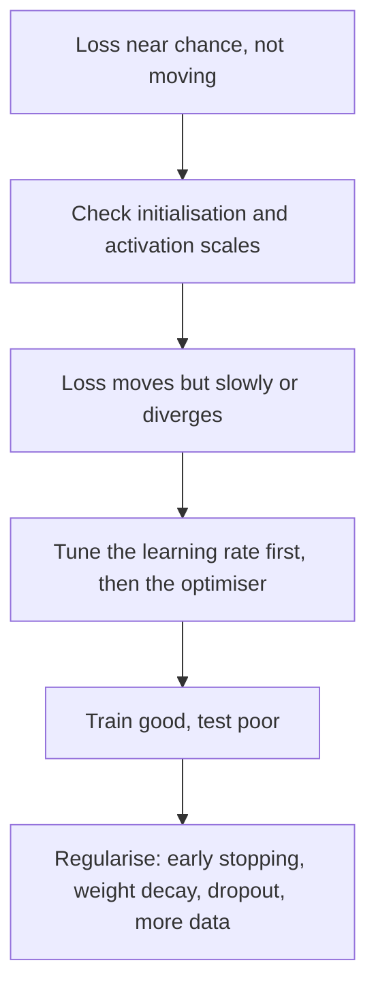

# Optimisation and regularisation

> A network that can fit the data is easy to write and hard to train. Set the initial weights wrong and it never starts. Set the learning rate wrong and it diverges. Train it on noisy labels and it memorises them. Course 2 of the Ng specialization works through the fixes in NumPy, and this chapter runs each one in PyTorch on the digits, including the two that are bugs in disguise: L2 inside Adam, and batch norm left in training mode.

**In plain words.** Training a network is like walking downhill in fog, looking for the lowest ground you can find: where you start, how long your strides are and how you keep your balance decide whether you get there at all. Even then it can go wrong in the way a student who memorises past exam papers goes wrong, by learning the answers, mistakes included, and not the subject. This chapter covers the settings that get training moving and the habits that stop a model memorising, which is often the difference between a model a team can ship and a wasted run.

Three questions run through the chapter, in order: does the signal survive through the layers (initialisation and normalisation), does the optimiser make progress (optimisers and learning rates), and does what it learned generalise (regularisation)? Check them in that order, because regularising a model that isn't training hides the real problem.



The setup repeats [the last chapter's](01-neural-networks-fundamentals.md) data and loop, with the options the experiments need:

```python
import numpy as np, torch, torch.nn as nn, torch.nn.functional as F
from sklearn.datasets import load_digits
from sklearn.model_selection import train_test_split
from torch.utils.data import DataLoader, TensorDataset

d = load_digits()
X_tr, X_te, y_tr, y_te = train_test_split(d.data / 16.0, d.target, test_size=0.3,
                                          random_state=0, stratify=d.target)
X_tr, X_te = torch.tensor(X_tr, dtype=torch.float32), torch.tensor(X_te, dtype=torch.float32)
y_tr, y_te = torch.tensor(y_tr), torch.tensor(y_te)

def accuracy(model, X, y):
    model.eval()
    with torch.no_grad():
        return (model(X).argmax(1) == y).float().mean().item()

def run(model, X=X_tr, y=y_tr, epochs=30, batch_size=32, make_opt=None, seed=0, on_epoch=None):
    torch.manual_seed(seed)
    opt = make_opt(model.parameters()) if make_opt else torch.optim.AdamW(model.parameters(), lr=1e-3, weight_decay=0.0)
    loader = DataLoader(TensorDataset(X, y), batch_size=batch_size, shuffle=True, drop_last=True)
    for ep in range(epochs):
        if on_epoch: on_epoch(ep)
        model.train()
        for xb, yb in loader:
            loss = F.cross_entropy(model(xb), yb)
            opt.zero_grad(); loss.backward(); opt.step()
    return model

def mlp(hidden=64, depth=2):
    layers, n = [], 64
    for _ in range(depth):
        layers += [nn.Linear(n, hidden), nn.ReLU()]
        n = hidden
    return nn.Sequential(*layers, nn.Linear(n, 10))
```

## Initialisation

Each layer multiplies the activations by its weights. If the weights are too small, the signal shrinks layer by layer and gradients with it. If too large, it grows until the loss is meaningless. Glorot and Bengio derived a scale that keeps variance roughly constant across layers for symmetric activations ([Glorot and Bengio, AISTATS 2010](https://proceedings.mlr.press/v9/glorot10a.html)). He et al. corrected it for ReLU, which zeroes half its inputs, by doubling the variance ([arXiv:1502.01852](https://arxiv.org/abs/1502.01852) (He et al., ICCV 2015)). Course 2's **Initialization** notebook compares them on a "circles" dataset:

| Scheme | Weights | Result in your notebook |
|---|---|---|
| Zeros | All 0 | Symmetry never broken: 50% accuracy, a flat line |
| Large random | `randn * 10` | Sigmoid saturates, slow, loss starts huge |
| He | `randn * sqrt(2 / n_prev)` | 96% test: the right default for ReLU |
| Xavier / Glorot | `randn * sqrt(1 / n_prev)` | The default for tanh |

Here is the same comparison in a 6-layer ReLU network on digits, printing the spread of activations at the first and last hidden layer before any training:

```python
def set_init(model, scheme):
    for m in model.modules():
        if isinstance(m, nn.Linear):
            if scheme == "zeros": nn.init.zeros_(m.weight)
            if scheme == "small": nn.init.normal_(m.weight, std=0.01)
            if scheme == "large": nn.init.normal_(m.weight, std=10.0)
            if scheme == "he":    nn.init.kaiming_normal_(m.weight, nonlinearity="relu")
            nn.init.zeros_(m.bias)
    return model

for scheme in ["zeros", "small", "large", "he"]:
    torch.manual_seed(0)
    m = set_init(mlp(depth=6), scheme)
    with torch.no_grad():
        a, stds = X_tr, []
        for layer in m:
            a = layer(a)
            if isinstance(layer, nn.ReLU): stds.append(a.std().item())
        start = F.cross_entropy(m(X_tr), y_tr).item()
    run(m, epochs=20)
    print(f"{scheme:<6} activation std first {stds[0]:.3g} last {stds[-1]:.3g}  "
          f"start loss {start:.3g}  test {accuracy(m, X_te, y_te):.3f}")
```

```text
zeros  activation std first 0 last 0  start loss 2.3  test 0.102
small  activation std first 0.023 last 1.04e-08  start loss 2.3  test 0.102
large  activation std first 23 last 1.04e+10  start loss 1.09e+12  test 0.446
he     activation std first 0.406 last 0.317  start loss 2.35  test 0.970
```

Zeros and too-small weights land on the same 0.102, ten-class chance on this split: with no signal reaching the last layer, there is nothing to learn from. Large weights start with a loss near $10^{12}$. Only He keeps the activations at a stable scale from first layer to last, and only it trains. PyTorch's `nn.Linear` default is a scaled uniform that is close enough for shallow networks, so you notice this mainly as depth grows. [makemore](../../../generative-ai/09-llms-from-scratch/notes/02-makemore.md#part-3-activations-gradients-and-batchnorm) revisits the idea with activation histograms.

## Normalising inside the network

Batch normalisation standardises each activation over the mini-batch, then applies a learned scale $\gamma$ and shift $\beta$ so the layer can still represent the identity. At test time it uses population statistics instead of the batch's. Ioffe and Szegedy showed it allows much higher learning rates and less careful initialisation, regularises somewhat, and reached the same accuracy on a state-of-the-art ImageNet model in 14× fewer steps; a batch-normalised ensemble scored 4.9% top-5 validation error ([arXiv:1502.03167](https://arxiv.org/abs/1502.03167) (Ioffe and Szegedy, ICML 2015)). The paper's explanation, reduced internal covariate shift, is disputed, and the practical benefits are not.

What batch norm costs you is a dependence on the batch. Each example's output depends on what else is in its batch, and training and test behaviour differ by construction. Wu and Johnson catalogue the consequences ([arXiv:2105.07576](https://arxiv.org/abs/2105.07576) (Wu and Johnson, 2021, preprint)). The exponential moving average used for test statistics can be inaccurate, and at very small normalisation batches this matters: on ResNet-50 with SGD at batch 256 and 100 epochs, they report top-1 error of 23.7 (EMA) against 23.5 (recomputed "precise" statistics) at normalisation batch 32, and 35.5 against 32.0 at normalisation batch 2. Recomputing needs only $10^3$ to $10^4$ samples, about 0.5% of training cost if done once per epoch. The same check on digits, with two bugs to look at: batch 1 crashes, and evaluating in training mode quietly loses accuracy.

```python
def bnnet():
    return nn.Sequential(nn.Linear(64, 64), nn.BatchNorm1d(64), nn.ReLU(),
                         nn.Linear(64, 64), nn.BatchNorm1d(64), nn.ReLU(), nn.Linear(64, 10))

for bs in [32, 2]:
    torch.manual_seed(0)
    m = run(bnnet(), epochs=10, batch_size=bs)
    ema = accuracy(m, X_te, y_te)

    m.train()                                       # the bug: forgot model.eval()
    with torch.no_grad():
        hits = [(m(X_te[i:i+8]).argmax(1) == y_te[i:i+8]).float().mean().item()
                for i in range(0, len(X_te), 8)]

    for mod in m.modules():                         # recompute "precise" statistics
        if isinstance(mod, nn.BatchNorm1d):
            mod.reset_running_stats(); mod.momentum = None   # None = plain average
    m.train()
    with torch.no_grad(): m(X_tr)
    print(f"batch {bs:>2}: eval {ema:.3f}  left in train mode {np.mean(hits):.3f}  "
          f"precise stats {accuracy(m, X_te, y_te):.3f}")
```

```text
batch 32: eval 0.983  left in train mode 0.892  precise stats 0.981
batch  2: eval 0.809  left in train mode 0.717  precise stats 0.820
```

Leaving the network in training mode cost about 9 points at batch 32, with no error message. Note too that `run` passes `drop_last=True`: without it the last batch here can hold one example, and `BatchNorm1d` raises `Expected more than 1 value per channel when training`. Batch 2 hurts in itself, and precise statistics recover only part of it, as they did in Wu and Johnson's table.

This is why Transformers use LayerNorm, which normalises within one example and has no batch dependence. The same dependence pushed the search for a replacement further. NFNets removed normalisation from ResNet-style ConvNets. They keep training stable at large batches with adaptive gradient clipping, which rescales each unit's gradient whenever its norm exceeds a fraction $\lambda$ of that unit's weight norm. $\lambda=0.01$ worked at batch sizes 1,024 to 4,096, and smaller batches tolerated larger values ([arXiv:2102.06171](https://arxiv.org/abs/2102.06171) (Brock et al., ICML 2021)). Without the clipping, the earlier NF-ResNets fell behind batch norm at batch 4,096 and above. NFNet-F1 matched EfficientNet-B7's 84.7% ImageNet top-1 with training steps 8.7 times faster (TPUv3, training only; no inference latency was reported), and putting batch norm back into the same architectures made training 20 to 40% slower for slightly lower accuracy. They also overfit badly without heavy explicit regularisation, and the best $\lambda$ may depend on optimiser, learning rate and batch size. Chen et al. drop normalisation statistics altogether and use a learned point-wise function, $\text{Derf}(x) = \gamma\,\mathrm{erf}(\alpha x + s) + \beta$ ([arXiv:2512.10938](https://arxiv.org/abs/2512.10938) (Chen et al., 2025-12, preprint)). They report ViT on ImageNet at 82.8 against 82.3 for LayerNorm, and DiT FID 43.94 against 45.91, and they attribute the gain to better generalisation rather than fitting. Their test is on Transformers. The layer is small enough to try on an MLP:

```python
class Derf(nn.Module):
    def __init__(self, d):
        super().__init__()
        self.alpha = nn.Parameter(torch.tensor(0.5)); self.s = nn.Parameter(torch.tensor(0.0))   # paper's init
        self.gamma = nn.Parameter(torch.ones(d));     self.beta = nn.Parameter(torch.zeros(d))
    def forward(self, x):
        return self.gamma * torch.erf(self.alpha * x + self.s) + self.beta

def norm_net(norm):
    return nn.Sequential(nn.Linear(64, 64), norm(64), nn.ReLU(), nn.Linear(64, 64), norm(64), nn.ReLU(), nn.Linear(64, 10))

for name, norm in [("LayerNorm", nn.LayerNorm), ("Derf", Derf)]:
    res = [accuracy(run(norm_net(norm), epochs=10, seed=s), X_te, y_te) for s in range(5)]
    print(f"{name:<10} test {np.mean(res):.3f} +- {np.std(res):.3f}, 5 seeds")
```

```text
LayerNorm  test 0.979 +- 0.002, 5 seeds
Derf       test 0.957 +- 0.004, 5 seeds
```

On this small MLP LayerNorm wins. That says nothing against the paper's Transformer results, and Derf here also sits before a ReLU, which isn't its tested setting. The lesson to carry over is that normalisation choices are architecture-specific.

## Optimisers

Plain gradient descent has one step size for every parameter and no memory. Each row of the table adds one thing:

| Optimiser | Update | Why |
|---|---|---|
| Mini-batch GD | Gradient on batches of 64–512 | Progress before seeing all data |
| Momentum | $v = \beta v + (1-\beta) dW$; $W \mathrel{-}= \alpha v$ | Smooths oscillation; $\beta = 0.9$ |
| RMSprop | $s = \beta s + (1-\beta) dW^2$; $W \mathrel{-}= \alpha\, dW / \sqrt{s + \epsilon}$ | Per-parameter step size |
| Adam | Momentum + RMSprop + bias correction $\hat v = v / (1 - \beta_1^t)$, $\hat s = s / (1 - \beta_2^t)$ | Default; $\alpha = 10^{-3}$, $\beta_1 = 0.9$, $\beta_2 = 0.999$, $\epsilon = 10^{-8}$ ([arXiv:1412.6980](https://arxiv.org/abs/1412.6980) (Kingma and Ba, ICLR 2015)) |
| AdamW | The Adam step, then $W \mathrel{-}= \alpha\lambda W$ applied outside the gradient | See below |
| Lion | $W \mathrel{-}= \alpha\,(\operatorname{sign}(\beta_1 v + (1-\beta_1) dW) + \lambda W)$; then $v = \beta_2 v + (1-\beta_2) dW$ | Found by program search; less memory than Adam |

Your **Optimization methods** notebook writes these in NumPy on "moons". After the same epochs: mini-batch GD 79.7%, momentum 79.7%, Adam 94%. Learning-rate decay completes that notebook. Here they are on digits after 10 epochs, over five seeds, with Lion written out to show how little it stores:

```python
class Lion(torch.optim.Optimizer):
    def __init__(self, params, lr=1e-4, b1=0.9, b2=0.99, wd=0.0):
        super().__init__(params, dict(lr=lr, b1=b1, b2=b2, wd=wd))
    @torch.no_grad()
    def step(self):
        for g in self.param_groups:
            for p in g["params"]:
                st = self.state[p]
                if "v" not in st: st["v"] = torch.zeros_like(p)        # momentum only: no second moment
                update = (g["b1"] * st["v"] + (1 - g["b1"]) * p.grad).sign()
                p -= g["lr"] * (update + g["wd"] * p)
                st["v"] = g["b2"] * st["v"] + (1 - g["b2"]) * p.grad

optimisers = {
    "SGD":          lambda q: torch.optim.SGD(q, lr=0.01),
    "SGD+momentum": lambda q: torch.optim.SGD(q, lr=0.01, momentum=0.9),
    "RMSprop":      lambda q: torch.optim.RMSprop(q, lr=1e-3),
    "Adam":         lambda q: torch.optim.Adam(q, lr=1e-3),
    "AdamW":        lambda q: torch.optim.AdamW(q, lr=1e-3, weight_decay=0.01),
    "Lion 1e-3":    lambda q: Lion(q, lr=1e-3),
    "Lion 3e-4":    lambda q: Lion(q, lr=3e-4),
    "Lion 1e-4":    lambda q: Lion(q, lr=1e-4),
}
for name, make in optimisers.items():
    res = [accuracy(run(mlp(), epochs=10, make_opt=make, seed=s), X_te, y_te) for s in range(5)]
    print(f"{name:<13} test {np.mean(res):.3f} +- {np.std(res):.3f}")
```

```text
SGD           test 0.428 +- 0.067
SGD+momentum  test 0.934 +- 0.006
RMSprop       test 0.957 +- 0.003
Adam          test 0.952 +- 0.004
AdamW         test 0.952 +- 0.004
Lion 1e-3     test 0.956 +- 0.014
Lion 3e-4     test 0.890 +- 0.004
Lion 1e-4     test 0.690 +- 0.024
```

The momentum and per-parameter columns clearly matter on a short budget. The gaps among the adaptive methods are within a standard deviation or two, and one tuned run on one dataset cannot rank them. That is the finding of AlgoPerf at much larger scale: Dahl et al. argue that the field cannot reliably identify training-algorithm improvements, because of three problems: how to measure when training is done, sensitivity to the workload, and fair comparison of tuning ([arXiv:2306.07179](https://arxiv.org/abs/2306.07179) (Dahl et al., 2023, preprint)). They propose time to a target result on fixed hardware across several workloads. Their eight baselines include AdamW, NadamW, Heavy Ball and Nesterov. Adaptive methods score higher, which they attribute largely to the difficulty of constructing good search spaces for the non-adaptive ones, and small changes such as a stride or extra batch-norm layers can reorder results. So they compare specific tuned instances rather than families.

Adam's own paper is more modest than its reputation. Its defaults are offered as "good default settings for the tested machine learning problems", and every plot is training loss, with no test error ([arXiv:1412.6980](https://arxiv.org/abs/1412.6980) (Kingma and Ba, ICLR 2015)). On logistic regression Adam **tied** SGD with Nesterov momentum on MNIST and tied AdaGrad on sparse IMDB bag-of-words, and on a three-layer CNN on CIFAR-10 its edge over SGD with momentum was "marginal"; its clear win was a dropout MLP on MNIST. Two parts hold up better than the benchmarks. With $\epsilon = 0$ each step is bounded by roughly $\alpha$, which the authors read as a trust region, so $\alpha$ sets the scale of a step whatever the gradient's size. And bias correction matters: in their VAE sweep over $\beta_2 \in \{0.99, 0.999, 0.9999\}$, dropping it made $\beta_2$ near 1 unstable in the first epochs, which is RMSprop with momentum's failure mode. The $O(\sqrt{T})$ regret proof covers only the online convex case, with a decaying $\alpha_t$ and $\beta_{1,t}$ rather than the constant defaults.

Lion's paper claims more than this run can test: up to 2% on ViT on ImageNet, up to 5× pre-training compute on JFT, and up to 2.3× on diffusion models ([arXiv:2302.06675](https://arxiv.org/abs/2302.06675) (Chen et al., NeurIPS 2023)). It recommends a 3–10× smaller learning rate and 3–10× larger weight decay than AdamW. Its authors also state its limits: the gain grows with batch size and is smaller under strong augmentation or batch sizes below 64, and it was not significant on some large language and image-text datasets. On this run, at batch 32 and only 10 epochs, the smaller rates fell behind, because each step moves every weight by the same small amount and the budget ran out.

### L2 is not weight decay inside Adam

For plain SGD, adding $\frac{\lambda}{2}\lVert W\rVert^2$ to the loss and shrinking weights directly are the same thing. Inside Adam they differ, because the L2 gradient gets divided by $\sqrt{s}$ with everything else. Loshchilov and Hutter's fix applies the decay outside the gradient; they report about 15% relative test-error reduction for ResNets on CIFAR-10 and ImageNet 32×32, and made the best $\alpha$ independent of the best $\lambda$ ([arXiv:1711.05101](https://arxiv.org/abs/1711.05101) (Loshchilov and Hutter, ICLR 2019)). AdamW is the LLM default, although the paper's evidence is image classification. In PyTorch, `Adam(weight_decay=...)` is the L2 form, and the same number does very different things:

```python
for name, make in [("Adam, weight_decay=0.1", lambda q: torch.optim.Adam(q, lr=1e-3, weight_decay=0.1)),
                   ("AdamW, weight_decay=0.1", lambda q: torch.optim.AdamW(q, lr=1e-3, weight_decay=0.1))]:
    torch.manual_seed(0)
    m = run(mlp(), make_opt=make)
    norm = sum(p.norm().item() ** 2 for p in m.parameters()) ** 0.5
    print(f"{name:<24} test {accuracy(m, X_te, y_te):.3f}  weight norm {norm:.2f}")
```

```text
Adam, weight_decay=0.1   test 0.102  weight norm 0.02
AdamW, weight_decay=0.1  test 0.972  weight norm 13.57
```

The L2 run drove the weights to nearly zero and learned nothing, at a setting that is harmless for AdamW. If you port code that uses `Adam(weight_decay=...)` to `AdamW`, retune $\lambda$.

### The learning rate comes first

Sweep the learning rate by factors of ten before touching anything else. Too low and the run hasn't finished; too high and it never settles:

```python
for lr in [1e-5, 1e-4, 1e-3, 1e-2, 1e-1, 1.0]:
    res = [accuracy(run(mlp(), epochs=10, make_opt=lambda q: torch.optim.Adam(q, lr=lr), seed=s), X_te, y_te)
           for s in range(3)]
    print(f"lr {lr:<7} test {np.mean(res):.3f}")
```

```text
lr 1e-05   test 0.174
lr 0.0001  test 0.647
lr 0.001   test 0.956
lr 0.01    test 0.961
lr 0.1     test 0.847
lr 1.0     test 0.100
```

In a real training run, the rate also changes over time. [nanoGPT](../../../generative-ai/09-llms-from-scratch/notes/03-nanogpt.md) uses AdamW with warmup and cosine decay.

D-Adaptation tries to remove the search: it maintains a lower bound on the distance to the solution and sets the rate from it, with no extra evaluations ([arXiv:2301.07733](https://arxiv.org/abs/2301.07733) (Defazio and Mishchenko, ICML 2023)). The authors report matching hand-tuned rates across more than a dozen problems, with `lr=1.0` as the setting to leave alone. On my small MLP and these short runs, it did not:

```python
from dadaptation import DAdaptAdam                    # pip install dadaptation

res = [accuracy(run(mlp(), epochs=30, make_opt=lambda q: DAdaptAdam(q, lr=1.0), seed=s), X_te, y_te)
       for s in range(5)]
print("D-Adapt Adam, 30 epochs, per seed:", np.round(res, 3))
res = [accuracy(run(mlp(), epochs=30, make_opt=lambda q: torch.optim.Adam(q, lr=1e-3), seed=s), X_te, y_te)
       for s in range(5)]
print("Adam lr=1e-3, 30 epochs, per seed:", np.round(res, 3))
```

```text
D-Adapt Adam, 30 epochs, per seed: [0.937 0.93  0.959 0.102 0.965]
Adam lr=1e-3, 30 epochs, per seed: [0.97  0.974 0.969 0.98  0.974]
```

One seed in five failed outright, and the rest fell behind plain Adam. Treat that as one small test at the default initial estimate $d_0$, rather than a verdict: the paper's result is about asymptotic rates and larger problems. It does show why you run a new optimiser on your own task with more than one seed.

## Regularisation

Your **Regularization** notebook uses data from a French football goalkeeper, deciding where the keeper should kick so that his teammates can head the ball:

| Technique | Implementation | Effect in your notebook |
|---|---|---|
| None | | 95% train, 91.5% test, wiggly boundary |
| L2 | Add $\frac{\lambda}{2m}\sum\lVert W\rVert_F^2$ to cost; $dW \mathrel{+}= \frac{\lambda}{m}W$ ("weight decay") | 94% / 93% |
| Dropout | Mask $D = (\text{rand} < p_{keep})$; $A \mathrel{*}= D / p_{keep}$ (inverted dropout); same mask in backward; **off at test time** | 93% / 95% |

Dropout comes from Srivastava et al., who frame it as training an exponential family of thinned networks that share weights ([JMLR 2014](https://jmlr.org/papers/v15/srivastava14a.html)). To make overfitting visible on digits I took 300 training rows and replaced the labels of 30% with random ones. A wide network has the capacity to memorise those flips:

```python
g = torch.Generator().manual_seed(0)
Xs, ys = X_tr[:300], y_tr[:300].clone()
flip = torch.rand(300, generator=g) < 0.3
ys[flip] = torch.randint(0, 10, (int(flip.sum()),), generator=g)

def wide(p=0.0):
    return nn.Sequential(nn.Linear(64, 512), nn.ReLU(), nn.Dropout(p),
                         nn.Linear(512, 512), nn.ReLU(), nn.Dropout(p), nn.Linear(512, 10))

for name, p, wd, epochs in [("none", 0, 0.0, 100), ("weight decay 1", 0, 1.0, 100), ("weight decay 3", 0, 3.0, 100),
                            ("dropout 0.5", 0.5, 0.0, 100), ("early stop, 8 epochs", 0, 0.0, 8)]:
    res = []
    for s in range(3):
        torch.manual_seed(s)
        m = run(wide(p), Xs, ys, epochs=epochs, seed=s,
                make_opt=lambda q: torch.optim.AdamW(q, lr=1e-3, weight_decay=wd))
        res.append((accuracy(m, Xs, ys), accuracy(m, X_te, y_te)))
    tr, te = np.mean(res, axis=0)
    print(f"{name:<22} noisy train {tr:.3f}  clean test {te:.3f}")
```

```text
none                   noisy train 1.000  clean test 0.694
weight decay 1         noisy train 0.998  clean test 0.733
weight decay 3         noisy train 0.857  clean test 0.790
dropout 0.5            noisy train 0.988  clean test 0.745
early stop, 8 epochs   noisy train 0.698  clean test 0.878
```

A training score of 1.000 on labels that are 30% noise means the model memorised the noise, and it costs about 18 test points against stopping early. Dropout and weight decay help, and on this problem simply stopping is best. In practice you get that effect by watching a validation curve and keeping the best checkpoint, since the right epoch count isn't known in advance. [Training and tuning](../../01-classical-ml/notes/09-training-and-tuning.md#early-stopping-is-regularisation-too) shows why stopping early works like a penalty on the weights.

### When dropout hurts: underfitting

Dropout rates have fallen as data has grown, from 0.5 to about 0.1 in BERT and ViT, and sometimes dropout hurts. Liu et al. show that dropout early in training reduces the directional variance of mini-batch gradients and aligns them better with the full-dataset gradient. So they propose **early dropout** for underfitting models, applied only at the start of training ([arXiv:2303.01500](https://arxiv.org/abs/2303.01500) (Liu et al., ICML 2023)). On ImageNet with ViT-T's basic recipe, baseline scored 73.9, standard dropout 67.9, early dropout 74.3. Models in the overfitting regime get **late** regularisation instead: stochastic depth took ViT-B from 81.6 to 82.3, while early dropout left it unchanged. A small MLP on digits underfits too:

```python
def small(p):
    return nn.Sequential(nn.Linear(64, 16), nn.ReLU(), nn.Dropout(p), nn.Linear(16, 10))

def stop_dropout_at(m, cut):
    def hook(ep):
        if cut is not None and ep == cut:
            for mod in m.modules():
                if isinstance(mod, nn.Dropout): mod.p = 0.0
    return hook

for name, p, cut in [("no dropout", 0.0, None), ("standard 0.2", 0.2, None), ("early 0.2, off at epoch 5", 0.2, 5)]:
    res = []
    for s in range(5):
        torch.manual_seed(s)
        m = small(p)
        run(m, epochs=20, seed=s, on_epoch=stop_dropout_at(m, cut))
        res.append(accuracy(m, X_te, y_te))
    print(f"{name:<26} test {np.mean(res):.3f} +- {np.std(res):.3f}")
```

```text
no dropout                 test 0.935 +- 0.005
standard 0.2               test 0.919 +- 0.007
early 0.2, off at epoch 5  test 0.934 +- 0.004
```

Standard dropout costs about 1.6 points here, and switching it off at epoch 5 gets that back. There is no gain over no dropout on this model, which is a smaller effect than the paper's on ViT.

## The Tensorflow Tutorial notebook

Course 2's first framework notebook builds a 3-layer softmax network for the SIGNS hand-gesture dataset in TF1 graph mode (placeholders, `tf.Session`, `tf.contrib.layers.xavier_initializer`). It is the notebook most broken by TF2. The status and map are in [the migration section](01-neural-networks-fundamentals.md#tensorflow-1x-to-2x-status-and-migration-map), and its modern form is the digits loop above, with images replacing the digits.

## Reading

Buduma, *Fundamentals of Deep Learning* ([PDF](../../sources/buduma-fundamentals-of-deep-learning.pdf)), ch. 4 (beyond gradient descent) parallels the optimiser sections.

| Set | Runs |
|---|---|
| [`Improving Deep Neural Networks`](../practice/ng-deep-learning/Improving%20Deep%20Neural%20Networks%20Hyperparameter%20tuning,%20Regularization%20and%20Optimization/) (Gradient Checking, Initialization, Optimization methods, Regularization, Tensorflow Tutorial) | Legacy, reading-only as stored: helper modules and `datasets/` were not copied. Gradient checking is covered in [neural network basics](01-neural-networks-fundamentals.md#checking-hand-written-gradients). The percentages in the tables come from your earlier runs of the notebooks |

Every digits number in this chapter came from running the code shown, with `uv run --with scikit-learn --with torch --with dadaptation`.

## Pitfalls

| Symptom | Cause | Fix |
|---|---|---|
| Test accuracy stays at chance and activations in the last layers are nearly zero | Weights initialised too small, or a dead network | He init for ReLU; plot activation scale per layer |
| Loss is `nan` or enormous after a step or two | Learning rate too high, or initialisation too large | Sweep the rate by factors of ten; clip gradients |
| Accuracy is lower at inference than at validation, with no error | Batch norm or dropout still in training mode | `model.eval()` |
| `Expected more than 1 value per channel when training` | Batch norm on a last batch of one | `drop_last=True` |
| Model learns nothing after adding `weight_decay` to Adam | L2 is divided by $\sqrt{s}$ in Adam, and the term comes to dominate when gradients are small | Use `AdamW` |
| Training accuracy is 1.0 and test is well below | Memorising noise | Early stopping first; then weight decay, dropout, more data |
| A new optimiser beat the old one by 0.5 points | Seed noise, or the tuning differed | Several seeds and an equal tuning budget before believing it |

## Try it

1. In the initialisation experiment, change `nn.ReLU` to `nn.Tanh` in `mlp` and compare `"small"`, `"he"` and Glorot (`nn.init.xavier_normal_`), three seeds each. Glorot is the textbook match for tanh. Does the run show that?

   <details><summary>Answer</summary>

   Small 0.330, He 0.975, Glorot 0.970, with standard deviations of 0.028, 0.002 and 0.003. So too-small weights still fail, and tanh is less fatal than ReLU there because it has gradient at zero. But He and Glorot are within noise at 6 layers: the factor of two between them does not separate them at this depth. The theory tells you the scale, not a measurable difference on every problem.

   </details>

2. In the noisy-label experiment, the early-stop row used 8 epochs because I already knew it worked. Do it the honest way: hold out 60 of the 300 noisy rows as a validation set, track validation accuracy per epoch, restore the best weights, and report clean test accuracy.

   <details><summary>Answer</summary>

   Across three seeds, best-validation weights scored 0.787, 0.728 and 0.835 on clean test, against 0.719, 0.715 and 0.702 for the last epoch. So it clearly helps, but falls short of the 0.878 from the fixed 8 epochs, because 60 noisy rows make a noisy instrument: validation accuracy peaked near 0.58 in all three seeds, and one seed picked epoch 53. Save `copy.deepcopy(model.state_dict())` when validation improves, then `load_state_dict` at the end.

   </details>

3. Add a cosine schedule to the digits MLP with `torch.optim.lr_scheduler.CosineAnnealingLR(opt, T_max=steps)` at `lr=0.01`, for 10 epochs, stepping after each batch. Compare to a constant `lr=0.01`, five seeds each.

   <details><summary>Answer</summary>

   Constant 0.963 +- 0.006, cosine 0.970 +- 0.003, stepping per batch with `T_max = 10 * len(loader)`. A small gain, and more consistent across seeds, since the step shrinks as training ends.

   </details>

## Interview checklist

| Question | Answer |
|---|---|
| Why does initialisation scale matter? | Each layer multiplies activation scale, so too small vanishes and too large explodes across depth. He and Glorot choose variance to keep it about constant. |
| Glorot or He? | He for ReLU, whose zeroing of half the inputs needs double the variance. Glorot for tanh and sigmoid. |
| What does batch norm do at test time? | It uses running statistics rather than batch statistics, which is why a missing `model.eval()` silently hurts. |
| Why do Transformers prefer LayerNorm? | It normalises within an example, so there's no dependence on batch composition or size. |
| Difference between Adam with L2 and AdamW? | In Adam the L2 gradient gets scaled by the adaptive denominator, so weights with large gradients are barely regularised. AdamW decays outside the gradient. |
| What is inverted dropout? | Zero units at random with $p$, and divide survivors by $1-p$ so the expected activation matches test time, where nothing is dropped. |
| Dropout in an underfitting model? | It hurts. Standard dropout lowered accuracy here and on ViT-T in Liu et al. Early dropout can help or at least not harm. |
| Regularising first, or learning rate first? | Learning rate. Regularisation is for a model that fits and doesn't generalise. |
| How do you compare two optimisers fairly? | Several seeds, an equal tuning budget and more than one workload, measured by time to a target. That's the AlgoPerf design. |

## Next

[Structuring ML projects](03-structuring-ml-projects.md): how to decide which of these knobs to touch next, and when the problem is the data rather than the model.
