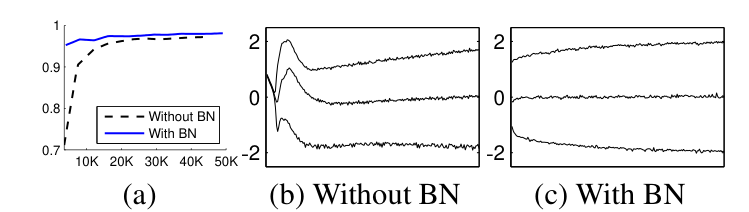
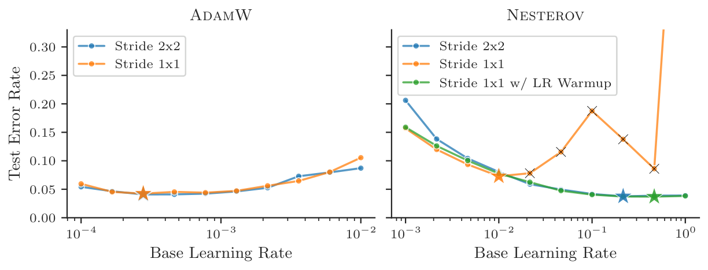
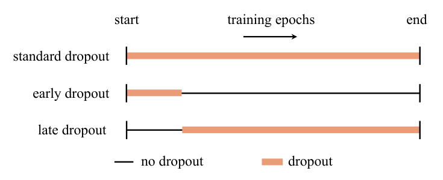

# What the training papers measured

> [Optimisation and regularisation](02-optimisation-and-regularisation.md) gives the settings that get a network training: He initialisation, batch norm in `eval()`, AdamW, a learning-rate sweep, early stopping. Each one comes from a paper, and the paper's headline is usually larger than what it measured. Batch norm's 14× speedup came with seven other changes. Adam's paper reports no test error. Take the headline at its word and you spend a week on a new optimiser or normalisation layer that was never tested on a problem like yours. This chapter reads the evidence behind each method and reruns what a laptop can rerun.

**In plain words.** A paper about a training method is a report of a few experiments, on particular models, at particular sizes. This chapter asks of each one what was run, how many times, and against what, and then tries the method on the digits network from the last chapter.

The chapter follows the last one's order: normalisation, optimisers, the learning rate, then dropout. The experiments use the same data and loop:

```python
import numpy as np, torch, torch.nn as nn, torch.nn.functional as F
from sklearn.datasets import load_digits
from sklearn.model_selection import train_test_split
from torch.utils.data import DataLoader, TensorDataset

d = load_digits()
X_tr, X_te, y_tr, y_te = train_test_split(d.data / 16.0, d.target, test_size=0.3,
                                          random_state=0, stratify=d.target)
X_tr, X_te = torch.tensor(X_tr, dtype=torch.float32), torch.tensor(X_te, dtype=torch.float32)
y_tr, y_te = torch.tensor(y_tr), torch.tensor(y_te)

def accuracy(model, X, y):
    model.eval()
    with torch.no_grad():
        return (model(X).argmax(1) == y).float().mean().item()

def run(model, X=X_tr, y=y_tr, epochs=30, batch_size=32, make_opt=None, seed=0, on_epoch=None):
    torch.manual_seed(seed)
    opt = make_opt(model.parameters()) if make_opt else torch.optim.AdamW(model.parameters(), lr=1e-3, weight_decay=0.0)
    loader = DataLoader(TensorDataset(X, y), batch_size=batch_size, shuffle=True, drop_last=True)
    for ep in range(epochs):
        if on_epoch: on_epoch(ep)
        model.train()
        for xb, yb in loader:
            loss = F.cross_entropy(model(xb), yb)
            opt.zero_grad(); loss.backward(); opt.step()
    return model

def mlp(hidden=64, depth=2):
    layers, n = [], 64
    for _ in range(depth):
        layers += [nn.Linear(n, hidden), nn.ReLU()]
        n = hidden
    return nn.Sequential(*layers, nn.Linear(n, 10))

torch.manual_seed(0)   # the first model below is built before `run` seeds, so fix its weights here
```

## Batch norm: what the paper measured

Ioffe and Szegedy ([arXiv:1502.03167](https://arxiv.org/abs/1502.03167) (Ioffe and Szegedy, ICML 2015)) measured batch normalisation on their own Inception variant, on ImageNet at single-crop top-1 validation accuracy. Adding the layer alone reached the baseline's 72.2% in under half the steps, 13.3M against 31.0M. The famous 14× (2.1M steps) also raised the learning rate fivefold, removed dropout and local response normalisation, cut L2 by five, sped up the decay, shuffled the data more thoroughly and reduced photometric distortions, with no breakdown of the speedup by change. That same learning rate sent the original network to infinity. These are counts of steps, not time, and there is no spread across runs. Their 4.9% top-5 validation error is an ensemble of six networks over 144 crops; one model on one crop scored 7.82%. The claim about less careful initialisation rests on an argument about scale rather than an experiment. Their explanation, reduced internal covariate shift, was measured on one typical activation of a small MNIST network, and the authors also offer scale invariance and a conjecture about Jacobians, so treat it as a hypothesis.


*Image Source: Ioffe and Szegedy, [Batch Normalization: Accelerating Deep Network Training by Reducing Internal Covariate Shift](https://arxiv.org/abs/1502.03167) (2015), Fig. 1*

## Training without batch statistics

Batch norm makes each example's output depend on its batch, which is the cost [the last chapter](02-optimisation-and-regularisation.md#normalising-inside-the-network) measured. The same dependence pushed the search for a replacement further. NFNets removed normalisation from ResNet-style ConvNets. They keep training stable at large batches with adaptive gradient clipping, which rescales each unit's gradient whenever its norm exceeds a fraction $\lambda$ of that unit's weight norm. $\lambda=0.01$ worked at batch sizes 1,024 to 4,096, and smaller batches tolerated larger values ([arXiv:2102.06171](https://arxiv.org/abs/2102.06171) (Brock et al., ICML 2021)). Without the clipping, the earlier NF-ResNets fell behind batch norm at batch 4,096 and above. NFNet-F1 matched EfficientNet-B7's 84.7% ImageNet top-1 with training steps 8.7 times faster (TPUv3, training only; no inference latency was reported), and putting batch norm back into the same architectures made training 20 to 40% slower for slightly lower accuracy. They also overfit badly without heavy explicit regularisation, and the best $\lambda$ may depend on optimiser, learning rate and batch size. Chen et al. drop normalisation statistics altogether and use a learned point-wise function, $\text{Derf}(x) = \gamma\,\mathrm{erf}(\alpha x + s) + \beta$ ([arXiv:2512.10938](https://arxiv.org/abs/2512.10938) (Chen et al., 2025-12, preprint)). They report ViT-B on ImageNet-1K top-1 at 82.8 against 82.3 for LayerNorm (300 epochs, batch 4,096), and DiT-L/4 FID 43.94 against 45.91, and they attribute the gain over LayerNorm to better generalisation rather than fitting, because Derf's training loss is higher. Every number is a single run with no seeds, the margin over Dynamic Tanh on ImageNet top-1 is 0.2 to 0.3 points, and on GPT-2 124M Derf only ties LayerNorm at 2.94 validation loss. $\alpha$ and $s$ are scalars per layer, $\gamma$ and $\beta$ per channel, which the code below follows. Their test is on Transformers. The layer is small enough to try on an MLP:

```python
class Derf(nn.Module):
    def __init__(self, d):
        super().__init__()
        self.alpha = nn.Parameter(torch.tensor(0.5)); self.s = nn.Parameter(torch.tensor(0.0))   # paper's init
        self.gamma = nn.Parameter(torch.ones(d));     self.beta = nn.Parameter(torch.zeros(d))
    def forward(self, x):
        return self.gamma * torch.erf(self.alpha * x + self.s) + self.beta

def norm_net(norm):
    return nn.Sequential(nn.Linear(64, 64), norm(64), nn.ReLU(), nn.Linear(64, 64), norm(64), nn.ReLU(), nn.Linear(64, 10))

for name, norm in [("LayerNorm", nn.LayerNorm), ("Derf", Derf)]:
    res = [accuracy(run(norm_net(norm), epochs=10, seed=s), X_te, y_te) for s in range(5)]
    print(f"{name:<10} test {np.mean(res):.3f} +- {np.std(res):.3f}, 5 seeds")
```

```text
LayerNorm  test 0.980 +- 0.002, 5 seeds
Derf       test 0.957 +- 0.004, 5 seeds
```

On this small MLP LayerNorm wins. That says nothing against the paper's Transformer results, and Derf here also sits before a ReLU, which isn't its tested setting. The lesson to carry over is that normalisation choices are architecture-specific.

## Comparing optimisers fairly

On the last chapter's [optimiser run](02-optimisation-and-regularisation.md#optimisers), the gaps among the adaptive methods were within a standard deviation or two, and one tuned run on one dataset cannot rank them. That is the finding of AlgoPerf at much larger scale: Dahl et al. argue that the field cannot reliably identify training-algorithm improvements, because of three problems: how to measure when training is done, sensitivity to the workload, and fair comparison of tuning ([arXiv:2306.07179](https://arxiv.org/abs/2306.07179) (Dahl et al., 2023, preprint)). They propose time to a target result on fixed hardware across several workloads. Their eight baselines include AdamW, NadamW, Heavy Ball and Nesterov. Adaptive methods score higher, which they attribute largely to the difficulty of constructing good search spaces for the non-adaptive ones, and small changes such as a stride or extra batch-norm layers can reorder results. So they compare specific tuned instances rather than families. Two of their numbers show the size of the effects. On a Wide ResNet 28-10 on CIFAR-10, changing the last stride from 2x2 to 1x1 raised Nesterov's test error from 0.0376 to 0.0726 while AdamW moved from 0.0407 to 0.0420, and warmup brought Nesterov back to 0.0378. On the benchmark, NadamW with a tuned $\beta_1$ reached the target on 7 of 8 workloads (score 0.850), while Heavy Ball and Nesterov hit none under the box search spaces, and a fixed 20-point list built from the larger searches lifted them to about 0.23, which supports reading their failure as a search-space result. This is the MLCommons working group's suite on 8 workloads with random search on 8 V100s, so it ranks tuned instances on that suite only.


*Image Source: Dahl et al., [Benchmarking Neural Network Training Algorithms](https://arxiv.org/abs/2306.07179) (2023), Fig. 2*

Adam's own paper is more modest than its reputation. Its defaults are offered as "good default settings for the tested machine learning problems", and no test error is reported anywhere: the comparison plots are training cost ([arXiv:1412.6980](https://arxiv.org/abs/1412.6980) (Kingma and Ba, ICLR 2015)). On logistic regression Adam **tied** SGD with Nesterov momentum on MNIST and tied AdaGrad on sparse IMDB bag-of-words, and on a three-layer CNN on CIFAR-10 its edge over SGD with momentum was "marginal"; its clear wins were MLPs on MNIST, with dropout against the first-order methods and without it against the quasi-Newton SFO. Two parts hold up better than the benchmarks. With $\epsilon = 0$ each step is bounded by roughly $\alpha$, which the authors read as a trust region, so $\alpha$ sets the scale of a step whatever the gradient's size. And bias correction matters: in their VAE sweep over $\beta_2 \in \{0.99, 0.999, 0.9999\}$, dropping it made $\beta_2$ near 1 unstable in the first epochs, which is RMSprop with momentum's failure mode. The $O(\sqrt{T})$ regret proof covers only the online convex case, with a decaying $\alpha_t$ and $\beta_{1,t}$ rather than the constant defaults.

Lion's paper claims more than the last chapter's run can test: up to 2% on ViT on ImageNet, up to 5× pre-training compute on JFT, and up to 2.3× on diffusion models ([arXiv:2302.06675](https://arxiv.org/abs/2302.06675) (Chen et al., NeurIPS 2023)). It recommends a 3–10× smaller learning rate and 3–10× larger weight decay than AdamW. Its authors also state its limits: the gain grows with batch size and is smaller under strong augmentation or batch sizes below 64, and it was not significant on some large language and image-text datasets. In that run, at batch 32 and only 10 epochs, the smaller rates fell behind.

## Removing the learning-rate search: D-Adaptation

D-Adaptation tries to remove the search: it maintains a lower bound on the distance to the solution and sets the rate from it, with no extra evaluations ([arXiv:2301.07733](https://arxiv.org/abs/2301.07733) (Defazio and Mishchenko, ICML 2023)). The authors report matching hand-tuned rates across more than a dozen problems, with `lr=1.0` as the setting to leave alone. Their own numbers are close but not uniform: ImageNet ResNet-50 76.43% against 76.09% for tuned SGD, and ViT-tiny on ImageNet 71.62% against 74.24% for Adam, the one clear loss, which they leave unexplained. The guarantee covers only convex Lipschitz problems with deterministic gradients, the deep-learning variants have no theory, and the largest model was RoBERTa at 110M parameters. On my small MLP and these short runs, it did not:

```python
from dadaptation import DAdaptAdam                    # pip install dadaptation

res = [accuracy(run(mlp(), epochs=30, make_opt=lambda q: DAdaptAdam(q, lr=1.0), seed=s), X_te, y_te)
       for s in range(5)]
print("D-Adapt Adam, 30 epochs, per seed:", np.round(res, 3))
res = [accuracy(run(mlp(), epochs=30, make_opt=lambda q: torch.optim.Adam(q, lr=1e-3), seed=s), X_te, y_te)
       for s in range(5)]
print("Adam lr=1e-3, 30 epochs, per seed:", np.round(res, 3))
```

```text
D-Adapt Adam, 30 epochs, per seed: [0.97  0.93  0.959 0.102 0.965]
Adam lr=1e-3, 30 epochs, per seed: [0.97  0.974 0.969 0.98  0.974]
```

One seed in five failed outright, and three of the other four fell behind plain Adam. Treat that as one small test at the default initial estimate $d_0$, rather than a verdict: the paper's result is about asymptotic rates and larger problems. It does show why you run a new optimiser on your own task with more than one seed.

## Dropout as ridge regression

Dropout has an exact statistical reading in the linear case. Zero each predictor with probability $\phi$ and scale the survivors by $1/(1-\phi)$, and the expected least-squares score equation gives $\hat\beta = \left(X^\top X + \tfrac{\phi}{1-\phi} D\right)^{-1} X^\top y$ with $D = \mathrm{diag}(\lVert x_j\rVert^2)$, a generalised ridge regression that is plain ridge once the variables are standardised. Adding i.i.d. noise to the inputs gives ridge too, so input distortion (shifted, tinted or noised copies of each image) is also a ridge-like penalty; with a nonlinear activation the identity holds only approximately (*Computer Age*, ch. 18, notes). The book's CIFAR-100 network raises the dropout rate with depth, 0.05 in layers 5 and 6, 0.10 in layers 8 and 9, 0.25 on the 2,000-unit dense layer and 0.5 on the output layer, and also bounds the L2 norm of every node's incoming weights at one; it says dropout works better in the deeper, denser layers (*Computer Age*, ch. 18).

## When dropout hurts: underfitting

Dropout rates have fallen as data has grown, from 0.5 to about 0.1 in BERT and ViT, and sometimes dropout hurts. Liu et al. show that dropout early in training reduces the directional variance of mini-batch gradients and aligns them better with the full-dataset gradient. So they propose **early dropout** for underfitting models, applied only at the start of training ([arXiv:2303.01500](https://arxiv.org/abs/2303.01500) (Liu et al., ICML 2023)). On ImageNet with ViT-T's basic recipe, baseline scored 73.9, standard dropout 67.9, early dropout 74.3. Models in the overfitting regime get **late** regularisation instead: stochastic depth took ViT-B from 81.6 to 82.3, while early dropout left it unchanged. The gains are small, 0.2 to 0.9 points, against a seed standard deviation of about 0.14 points (three seeds, ImageNet-1K, supervised vision only), and the advantage disappears at batch size 8192, which the authors take as support for the gradient-variance mechanism. A small MLP on digits underfits too:


*Image Source: Liu et al., [Dropout Reduces Underfitting](https://arxiv.org/abs/2303.01500) (2023), Fig. 2*

```python
def small(p):
    return nn.Sequential(nn.Linear(64, 16), nn.ReLU(), nn.Dropout(p), nn.Linear(16, 10))

def stop_dropout_at(m, cut):
    def hook(ep):
        if cut is not None and ep == cut:
            for mod in m.modules():
                if isinstance(mod, nn.Dropout): mod.p = 0.0
    return hook

for name, p, cut in [("no dropout", 0.0, None), ("standard 0.2", 0.2, None), ("early 0.2, off at epoch 5", 0.2, 5)]:
    res = []
    for s in range(5):
        torch.manual_seed(s)
        m = small(p)
        run(m, epochs=20, seed=s, on_epoch=stop_dropout_at(m, cut))
        res.append(accuracy(m, X_te, y_te))
    print(f"{name:<26} test {np.mean(res):.3f} +- {np.std(res):.3f}")
```

```text
no dropout                 test 0.935 +- 0.005
standard 0.2               test 0.919 +- 0.007
early 0.2, off at epoch 5  test 0.934 +- 0.004
```

Standard dropout costs about 1.6 points here, and switching it off at epoch 5 gets that back. There is no gain over no dropout on this model, which is a smaller effect than the paper's on ViT.

## Reading

Every digits number in this chapter came from running the code shown, with `uv run --with scikit-learn --with torch --with dadaptation`.

## Pitfalls

| Symptom | Cause | Fix |
|---|---|---|
| A new optimiser beat the old one by 0.5 points | Seed noise, or the tuning differed | Several seeds and an equal tuning budget before believing it |
| A paper's speedup does not appear when you add its layer | The headline bundled other changes: batch norm's 14× also raised the learning rate fivefold and removed dropout | Find the ablation that changes one thing. For batch norm alone it is under half the steps |
| A new normalisation layer loses to LayerNorm on your model | It was tested on another architecture, on single runs with margins of 0.2 to 0.5 points | Run it on your model with several seeds before adopting it |
| A learning-rate-free optimiser fails on some seeds | Its guarantee covers convex problems with deterministic gradients | Keep a tuned Adam run as the control and report per-seed results |
| Adding dropout lowered both training and test accuracy | The model was underfitting | Remove it, or apply it only in the first epochs |

## Try it

1. The D-Adaptation run builds each model before `run` sets the seed, so the first model's weights depend on what ran earlier. Seed before building (`torch.manual_seed(s)` then `mlp()`), and run 10 seeds at 30 epochs. How many fail?

   <details><summary>Answer</summary>

   Per seed: 0.202, 0.909, 0.933, 0.767, 0.972, 0.943, 0.098, 0.309, 0.954, 0.972. Three of ten finish below 0.5 and a fourth stops at 0.767, so the failure in the chapter's five seeds was not a fluke. The best seeds match Adam's 0.97. The method works on this task when its initial estimate suits the starting weights, and you cannot tell which seed that is in advance.

   </details>

2. The Derf comparison puts Derf before a ReLU, which is not the paper's setting. Remove the ReLUs so that Derf is the only nonlinearity, and compare with LayerNorm plus ReLU and Derf plus ReLU, five seeds each, seeding before the model is built.

   <details><summary>Answer</summary>

   LayerNorm plus ReLU 0.981 +- 0.003, Derf plus ReLU 0.955 +- 0.004, Derf alone 0.958 +- 0.006. Removing the ReLU does not close the gap: the two Derf networks are within noise of each other and both sit about 2 points under LayerNorm. On this MLP the ReLU was not the reason Derf lost.

   </details>

## Interview checklist

| Question | Answer |
|---|---|
| How do you compare two optimisers fairly? | Several seeds, an equal tuning budget and more than one workload, measured by time to a target. That's the AlgoPerf design. |
| Dropout in an underfitting model? | It hurts. Standard dropout lowered accuracy here and on ViT-T in Liu et al. Early dropout can help or at least not harm. |
| How much of batch norm's speedup is the layer? | Under half the steps to the baseline's accuracy, 13.3M against 31.0M on Inception. The 14× figure also changed the learning rate, dropout, L2 and the data pipeline, with no breakdown by change. |
| Does Adam's paper show that it generalises better? | No. It reports training cost and no test error, and it tied SGD with Nesterov momentum on MNIST logistic regression. |
| What does a learning-rate-free optimiser guarantee? | D-Adaptation's proof covers convex Lipschitz problems with deterministic gradients. On a small MLP here it failed on one seed in five, so it still needs a control run. |
| How is dropout related to ridge regression? | In linear least squares, dropping predictors with probability $\phi$ and rescaling gives a generalised ridge estimate, which is plain ridge once the variables are standardised. With a nonlinear activation it holds only approximately. |

## Next

[Structuring ML projects](03-structuring-ml-projects.md): how to decide which of these knobs to touch next, and when the problem is the data rather than the model.
