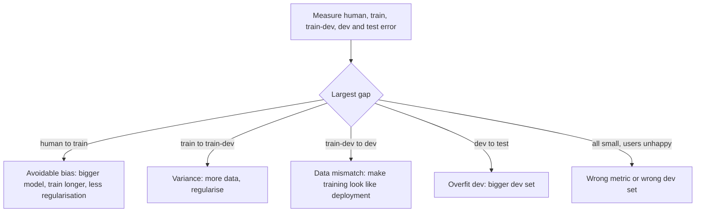

# Structuring ML projects

> A team can spend six months collecting data that was never the bottleneck. Course 3 of the Ng specialization has no code assignments because its subject is deciding what to do next: set one metric, measure the gaps between human, train and dev error, and let the largest gap choose the work. This chapter gives each of those decisions a measurement on the digits, including the case where the model is fine and the data it will meet is not.

**In plain words.** A team's bird-spotting camera is not good enough yet, and the next few months could go on collecting more photos, buying bigger machines or rebuilding the model. A good mechanic runs a few checks before ordering parts, and this chapter is those checks for a model: agree on one score, compare the model's mistakes with a person's, and read a sample of its errors by hand. They tell you which job will help before you spend the time on one that will not.

Your two quizzes are the case studies: a bird detector for the city of Peacetopia and an autonomous-driving perception system. The ideas extend [model evaluation](../../01-classical-ml/notes/04-model-evaluation.md) from choosing among classical models to running a deep-learning project.

## Orthogonalisation: one knob for one problem

Ng's organising idea is that each fix should affect one thing. Early stopping is a poor first knob by this standard, since it changes train and dev fit at once. Work down this chain and stop at the first link that fails:

| If this is bad | Turn this knob |
|---|---|
| Fit on the training set | Bigger network, better optimiser, longer training |
| Fit on the dev set | Regularisation, more training data |
| Fit on the test set | Bigger dev set: you overfit the dev set |
| Performance in the real world | Change the dev set or the metric: they aren't measuring what you care about |



## One number to optimise

You can't compare two models on two numbers. So set one **optimising** metric and make the others **satisficing**: thresholds that must be met and then don't matter further. In Peacetopia, accuracy is optimised, and running time and memory only have to clear a limit. Here it is with the same training helper on the digits. The setup is the same as in [the last chapter](02-optimisation-and-regularisation.md):

```python
import time
import numpy as np, torch, torch.nn as nn, torch.nn.functional as F
from sklearn.datasets import load_digits
from sklearn.model_selection import train_test_split
from torch.utils.data import DataLoader, TensorDataset

d = load_digits()
X_all, X_hold, y_all, y_hold = train_test_split(d.data / 16.0, d.target, test_size=0.3,
                                                random_state=0, stratify=d.target)
X_all = torch.tensor(X_all, dtype=torch.float32); y_all = torch.tensor(y_all)
X_hold = torch.tensor(X_hold, dtype=torch.float32); y_hold = torch.tensor(y_hold)

def run(model, X, y, epochs=30, lr=1e-3, seed=0, batch_size=32):
    torch.manual_seed(seed)
    opt = torch.optim.AdamW(model.parameters(), lr=lr)
    loader = DataLoader(TensorDataset(X, y), batch_size=batch_size, shuffle=True, drop_last=len(X) > batch_size)
    for _ in range(epochs):
        model.train()
        for xb, yb in loader:
            loss = F.cross_entropy(model(xb), yb)
            opt.zero_grad(); loss.backward(); opt.step()
    return model

def error(model, X, y):
    model.eval()
    with torch.no_grad():
        return 100 * (model(X).argmax(1) != y).float().mean().item()

def mlp(h=64): return nn.Sequential(nn.Linear(64, h), nn.ReLU(), nn.Linear(h, 10))

LIMIT_PARAMS = 5000                                     # satisficing: must fit on the device
for h in [8, 32, 64, 128, 512]:
    torch.manual_seed(0)
    m = run(mlp(h), X_all, y_all)
    n = sum(p.numel() for p in m.parameters())
    verdict = "ok" if n <= LIMIT_PARAMS else "over limit"
    print(f"h={h:<4} dev error {error(m, X_hold, y_hold):5.2f}%  params {n:>6}  {verdict}")
```

```text
h=8    dev error 12.78%  params    610  ok
h=32   dev error  3.89%  params   2410  ok
h=64   dev error  2.78%  params   4810  ok
h=128  dev error  2.41%  params   9610  over limit
h=512  dev error  2.04%  params  38410  over limit
```

Pick the lowest error among the rows that pass. If the widest model looks better but breaks the limit, it isn't a candidate, and you don't debate how to trade the two numbers.

Change the metric when it stops describing what you want. Your Peacetopia quiz has this twice. A competitor with a similar error rate but fewer false negatives, where a false negative lets a bird through, means you should rethink the metric. A new species your dev set doesn't contain means you need a new dev and test set and possibly a new metric. Weighing one kind of mistake against another in money is the subject of [imbalance, errors and drift](../../01-classical-ml/notes/10-imbalance-errors-and-drift.md#accuracy-lies-errors-cost).

## Train, dev and test sets

- **Dev and test come from the same distribution**, and it is the one you care about. Otherwise you are aiming at one target and being scored on another.
- **With big data, small percentages are enough.** Peacetopia splits 10M images as 9.5M, 250k and 250k. Dev has only to separate your candidates, and test has only to estimate the final number.
- **New data that differs goes into training, not test.** When Peacetopia's citizens donate 1M images unlike the ones you deploy on, they join the training set. Putting them into test would change the target, and the fact that a model that learns them gets better scores doesn't imply better performance on the real task.
- **Iteration speed is a real constraint.** Given 100M images and training that is too slow, the quiz's answer is to train on 10M so that you can try more ideas.

[Training and tuning](../../01-classical-ml/notes/09-training-and-tuning.md#split-baseline-fit) walks through splits and baselines on a real dataset, if these are new to you.

## Bias, variance and the human yardstick

[Classical ML's bias and variance](../../01-classical-ml/notes/01-statistical-foundations.md) assumed error could go to zero. In practice the floor is the **Bayes error**, and human-level error is the usable proxy. Take the best available human, so the best team of experts for Peacetopia's 0.3%, not the average one, because it is a bound. Add a **train-dev** set, which comes from the training distribution but isn't trained on, and each gap names one problem:

```python
def diagnose(human, train, train_dev=None, dev=None, test=None):
    points = [("human", human), ("train", train), ("train-dev", train_dev), ("dev", dev), ("test", test)]
    points = [(k, v) for k, v in points if v is not None]
    meaning = {("human", "train"): "avoidable bias", ("train", "train-dev"): "variance",
               ("train-dev", "dev"): "data mismatch", ("train", "dev"): "variance",
               ("dev", "test"): "overfit to dev"}
    gaps = [(round(b[1] - a[1], 2), meaning[(a[0], b[0])]) for a, b in zip(points, points[1:])]
    return max(gaps)[1], gaps

print("Peacetopia A:", diagnose(human=0.1, train=2.0, dev=2.1))
print("Peacetopia B:", diagnose(human=0.1, train=2.0, dev=2.1, test=7.0))
print("Hypothetical:", diagnose(human=0.5, train=1.0, train_dev=1.5, dev=8.0))
```

```text
Peacetopia A: ('avoidable bias', [(1.9, 'avoidable bias'), (0.1, 'variance')])
Peacetopia B: ('overfit to dev', [(1.9, 'avoidable bias'), (0.1, 'variance'), (4.9, 'overfit to dev')])
Hypothetical: ('data mismatch', [(0.5, 'avoidable bias'), (0.5, 'variance'), (6.5, 'data mismatch')])
```

So A needs a bigger model or less regularisation rather than more data, and B needs a bigger dev set. When a model beats human level, as in Peacetopia's 0.05%, the proxy has gone and gaps are harder to read, which is one reason progress slows after that point.

## Error analysis: count before you build

Before building a fix for a category of error, count how many mistakes it could cover. The autonomous-driving quiz does this with 500 misclassified images. The count gives a ceiling: fixing a category that is 5% of errors can improve total error by only 5% of itself. On digits:

```python
torch.manual_seed(0)
model = run(mlp(32), X_all, y_all, epochs=20)
model.eval()
with torch.no_grad():
    pred = model(X_hold).argmax(1)
wrong = (pred != y_hold).nonzero().flatten()
pairs = {}
for i in wrong.tolist():
    k = (y_hold[i].item(), pred[i].item())
    pairs[k] = pairs.get(k, 0) + 1
err = 100 * len(wrong) / len(y_hold)
print(f"dev error {err:.2f}%, {len(wrong)} mistakes")
for (true, guess), c in sorted(pairs.items(), key=lambda kv: -kv[1])[:5]:
    print(f"true {true} read as {guess}: {c:>2} mistakes, ceiling {err * c / len(wrong):.2f} points")
```

```text
dev error 4.44%, 24 mistakes
true 8 read as 1:  5 mistakes, ceiling 0.93 points
true 9 read as 3:  2 mistakes, ceiling 0.37 points
true 4 read as 8:  2 mistakes, ceiling 0.37 points
true 1 read as 5:  1 mistakes, ceiling 0.19 points
true 2 read as 1:  1 mistakes, ceiling 0.19 points
```

Your quiz adds one more condition. With fog at 8.0% of dev errors out of 14.3%, the largest category is still not automatically the priority, because that depends on how easy the data is to get and how much it will help. Raindrops at 2.2% give a ceiling of about 2.2 points for the windshield wiper.

The most useful detail is usually a spreadsheet column for each cause you see when you look at the images, including mislabelled data. Fix labels in dev and test together, or their distributions diverge. Random label noise in a large training set is usually tolerable, while a systematic error isn't. The quiz's first question makes the general point: spend a few days on a basic model, then let this analysis prioritise, rather than designing for weeks.

[Ng's *Machine Learning Yearning*](https://home-wordpress.deeplearning.ai/wp-content/uploads/2022/03/andrew-ng-machine-learning-yearning.pdf) sets out this method in chapters 14 to 16: the ceiling, the spreadsheet and the mislabelled column. Chapters 17 and 18 add what the quizzes don't: split a large dev set into an Eyeball set you read (about 100 mistakes give a very good sense of the main causes) and a Blackbox set you only score, because you overfit the examples you read faster. [Reading the errors](../../01-classical-ml/notes/12-reading-the-errors.md#the-procedure) runs the same method on a table of credit data, step by step.

## Data mismatch

Training on whatever data is plentiful and deploying on something else is the usual reason for a good dev score on the wrong thing. To simulate it, take clean digits for training and a corrupted version of the held-out digits as dev and test, the shape of a clean-scan model meeting phone photos:

```python
def corrupt(X, seed=0):
    g = torch.Generator().manual_seed(seed)
    imgs = X.reshape(-1, 8, 8)
    imgs = torch.roll(imgs, shifts=1, dims=2)                    # off-centre by a pixel
    imgs = (imgs + 0.25 * torch.randn(imgs.shape, generator=g)).clamp(0, 1)
    return imgs.reshape(-1, 64)

perm = torch.randperm(len(X_all), generator=torch.Generator().manual_seed(0))
X_train, y_train = X_all[perm[:1000]], y_all[perm[:1000]]
X_tdev, y_tdev = X_all[perm[1000:]], y_all[perm[1000:]]          # same distribution as train
X_dev, y_dev = corrupt(X_hold[:270]), y_hold[:270]               # what deployment looks like
X_test, y_test = corrupt(X_hold[270:], seed=1), y_hold[270:]

def report(name, m):
    print(f"{name:<24} train {error(m, X_train, y_train):5.2f}  train-dev {error(m, X_tdev, y_tdev):5.2f}  "
          f"dev {error(m, X_dev, y_dev):5.2f}  test {error(m, X_test, y_test):5.2f}")

torch.manual_seed(0)
report("clean training only", run(mlp(), X_train, y_train))

X_aug = torch.cat([X_train, corrupt(X_train, seed=2)])           # synthesise deployment-like training data
y_aug = torch.cat([y_train, y_train])
torch.manual_seed(0)
report("plus synthetic corruption", run(mlp(), X_aug, y_aug))
```

```text
clean training only      train  1.60  train-dev  4.67  dev 62.96  test 58.52
plus synthetic corruption train  3.70  train-dev  9.73  dev 14.07  test 17.04
```

In the first row, train and train-dev are close while dev is 58 points worse. Without the train-dev set you could call that variance and collect more of the wrong data. Synthesising deployment-like data closes most of the gap, at a price: train-dev gets worse, since the model now spends capacity on the harder mixture. The course's lecture caution on synthesis applies: a synthetic set can cover a tiny part of real variation, such as a few car models in simulated scenes, and the model can overfit to those. Keep dev as real data. The corrupted set here is standing in for it. When the gap opens after launch because the world has moved, the same symptom is called [drift](../../../data-engineering/06-ml-platform/notes/04-drift.md), and it needs watching rather than a one-off fix.

## Learning from another task

**Transfer learning** applies when task A has much more data than task B, they share an input type, and A's low-level features plausibly help B. Yosinski et al. measured how layer features go from general to specific and found that even transferred features from a distant task beat random initialisation, while fine-tuning them can further help generalisation ([arXiv:1411.1792](https://arxiv.org/abs/1411.1792) (Yosinski et al., NeurIPS 2014)). A small test: pretrain on digits 0 to 4, then learn 5 to 9 from 25 labelled rows.

```python
def subset(lo, hi, X, y):
    k = (y >= lo) & (y <= hi)
    return X[k], y[k] - lo

X_a, y_a = subset(0, 4, X_all, y_all)
X_b, y_b = subset(5, 9, X_all, y_all)
X_b_te, y_b_te = subset(5, 9, X_hold, y_hold)

def backbone(): return nn.Sequential(nn.Linear(64, 64), nn.ReLU(), nn.Linear(64, 64), nn.ReLU())

results = {"from scratch": [], "frozen backbone": [], "fine-tuned": []}
for s in range(5):
    keep = torch.randperm(len(X_b), generator=torch.Generator().manual_seed(s))[:25]    # 5 per class on average
    torch.manual_seed(s)
    bb = backbone(); pre = run(nn.Sequential(bb, nn.Linear(64, 5)), X_a, y_a, epochs=30, seed=s)

    torch.manual_seed(s)
    scratch = run(nn.Sequential(backbone(), nn.Linear(64, 5)), X_b[keep], y_b[keep], epochs=200, seed=s, batch_size=8)
    results["from scratch"].append(error(scratch, X_b_te, y_b_te))

    state = {k: v.clone() for k, v in bb.state_dict().items()}
    for p in bb.parameters(): p.requires_grad_(False)
    head = nn.Linear(64, 5)
    frozen = nn.Sequential(bb, head)
    torch.manual_seed(s); opt = torch.optim.AdamW(head.parameters(), lr=1e-2)
    loader = DataLoader(TensorDataset(X_b[keep], y_b[keep]), batch_size=8, shuffle=True)
    for _ in range(200):
        for xb, yb in loader:
            loss = F.cross_entropy(frozen(xb), yb); opt.zero_grad(); loss.backward(); opt.step()
    results["frozen backbone"].append(error(frozen, X_b_te, y_b_te))

    bb2 = backbone(); bb2.load_state_dict(state)
    fine = run(nn.Sequential(bb2, nn.Linear(64, 5)), X_b[keep], y_b[keep], epochs=200, lr=1e-3, seed=s, batch_size=8)
    results["fine-tuned"].append(error(fine, X_b_te, y_b_te))

for k, v in results.items():
    print(f"{k:<16} test error {np.mean(v):5.2f}% +- {np.std(v):.2f}, 5 seeds, 25 labelled rows")
```

```text
from scratch     test error 11.82% +- 3.14, 5 seeds, 25 labelled rows
frozen backbone  test error 39.48% +- 3.03, 5 seeds, 25 labelled rows
fine-tuned       test error 15.54% +- 5.62, 5 seeds, 25 labelled rows
```

Transfer made it worse, at every label count I tried from 10 to 100, and so it stays here as the warning. The conditions weren't met: task A had only about twice B's rows, and from-scratch training on B already works because digits are almost linearly separable. A plausible cause is that an MLP's first layer already looks at the entire image, so it has no general local features, such as edges, to carry over. Measure against a from-scratch baseline before you assume it helps.

**Multi-task learning** trains one network on several tasks at once, on the argument that a shared representation makes each generalise better ([doi:10.1023/A:1007379606734](https://doi.org/10.1023/A:1007379606734) (Caruana, Machine Learning 1997)). The driving quiz has an image containing several things at once, so use one sigmoid per label rather than a softmax. It also has partial labels: a row that says "stop sign yes, pedestrian unknown". You don't drop that row. You mask the unknown term out of the cost. Here are three labels derived from each digit, with half the labels hidden at random:

```python
def labels(y):
    return torch.stack([(y % 2 == 0), (y >= 5), torch.isin(y, torch.tensor([0, 6, 8, 9]))], dim=1).float()

Y_tr, Y_te = labels(y_all), labels(y_hold)
mask = torch.rand(Y_tr.shape, generator=torch.Generator().manual_seed(0)) > 0.5      # True = label known
complete = mask.all(1)
print("rows", len(Y_tr), "with all three labels known:", int(complete.sum()))

def fit_multi(X, Y, M, epochs=30, seed=0):
    torch.manual_seed(seed)
    m = nn.Sequential(nn.Linear(64, 64), nn.ReLU(), nn.Linear(64, 3))
    opt = torch.optim.AdamW(m.parameters(), lr=1e-3)
    loader = DataLoader(TensorDataset(X, Y, M), batch_size=32, shuffle=True)
    for _ in range(epochs):
        for xb, yb, mb in loader:
            per = F.binary_cross_entropy_with_logits(m(xb), yb, reduction="none")
            loss = (per * mb).sum() / mb.sum().clamp(min=1)      # unknown labels contribute nothing
            opt.zero_grad(); loss.backward(); opt.step()
    with torch.no_grad():
        return (100 * ((m(X_hold) > 0) != Y_te.bool()).float().mean(0)).numpy().round(2)

print("masked, all rows      error per label:", fit_multi(X_all, Y_tr, mask.float()))
print("complete rows only    error per label:", fit_multi(X_all[complete], Y_tr[complete], mask[complete].float()))
```

```text
rows 1257 with all three labels known: 157
masked, all rows      error per label: [7.96 5.56 4.81]
complete rows only    error per label: [13.33 14.81 14.63]
```

Masking uses the half of the labels that are known in every row, and it halves the error or better compared with keeping only the 157 complete rows.

**End-to-end** learning replaces a hand-built pipeline with one network from input to output. It lets the data speak, and it shuts out useful hand-designed components. The driving quiz compares mapping the image straight to the light's colour against detecting the light first and classifying it second, and its answer is that the direct route is the more promising one if you have a large training set.

## Reading

Course 3 has no programming assignments, and the two quizzes are your submissions:

| Set | Runs |
|---|---|
| [Week 1: Peacetopia](../practice/ng-deep-learning/Structuring%20Machine%20Learning%20Projects/Week%201%20Quiz%20-%20Bird%20recognition%20in%20the%20city%20of%20Peacetopia%20%28case%20study%29.md) | Read: a markdown quiz |
| [Week 2: Autonomous driving](../practice/ng-deep-learning/Structuring%20Machine%20Learning%20Projects/Week%202%20Quiz%20-%20Autonomous%20driving%20%28case%20study%29.md) | Read: a markdown quiz |

The numbers described as Peacetopia's come from the quiz, and every digits number came from running the code shown.

## Pitfalls

| Symptom | Cause | Fix |
|---|---|---|
| Dev score improves each week, users notice nothing | Dev set or metric doesn't represent deployment | Change the dev set or metric now |
| Test error much worse than dev | Overfit dev by trying many models against it | Bigger dev set; keep test for the end |
| Months spent on one error category, tiny gain | No ceiling estimated | Count the category in a sample of mistakes first |
| Dev error is high, and more data doesn't help | Data mismatch, read as variance | Add a train-dev set; make training look like deployment |
| Softmax used on images with several objects | Labels aren't exclusive | One sigmoid per label |
| Dropping every row with a missing label | Throwing away the known labels in that row | Mask the unknown terms out of the cost |
| Synthetic data scored well, then real data did not | Synthesis covers a small slice of real variety | Keep dev real; sample broadly when synthesising |

## Try it

1. Rerun the mismatch experiment with `corrupt` changed to noise only (no `torch.roll`), and then to the roll only. Which corruption did the clean model struggle with more?

   <details><summary>Answer</summary>

   Clean dev error 2.2%, noise only 11.5%, roll only 59.3%. A one-pixel shift hurts far more than quite heavy noise, because each MLP input weight is tied to one pixel position. The [next chapter](04-convolutional-networks.md) builds a model where that is not so.

   </details>

2. Human error is 0.5%, train 7%, train-dev 8%, dev 8.5%. What do you work on? Run `diagnose`, then say what you would do.

   <details><summary>Answer</summary>

   `diagnose` returns avoidable bias at 6.5, against variance 1.0 and mismatch 0.5. So first get the training fit down with a bigger model, longer training or a better optimiser. The other two gaps wait until this is fixed.

   </details>

3. Suppose you fixed the top two confusion pairs in the error analysis completely. What is the best achievable dev error, and what does that say about working only on those pairs?

   <details><summary>Answer</summary>

   The pairs account for 7 of 24 mistakes, so dev error can go from 4.44% to at most $(24-7)/540 = 3.15\%$. The other 17 mistakes are spread thinly, with no single fix, so more data or a better model is the better bet here than chasing pairs.

   </details>

## Interview checklist

| Question | Answer |
|---|---|
| What is orthogonalisation? | Controls that each affect one thing: fit train, then dev, then test, then the real world. |
| Optimising vs satisficing metric? | Optimise one, and require others only to clear a threshold, so models can be ranked. |
| Why must dev and test share a distribution? | So that a dev improvement is evidence of a test improvement, and both target what you care about. |
| Human-level error: what's it for? | A proxy for Bayes error. The train gap to it is avoidable bias, and the best human level gives the tightest bound. |
| What is a train-dev set? | Data from the training distribution left out of training. It separates variance from data mismatch. |
| How do you fix data mismatch? | Inspect how dev differs, then collect or synthesise more like it for training. Keep dev itself real. |
| What is error analysis for? | To get a ceiling on each candidate fix by counting its share of errors before building it. |
| When use transfer learning? | When the source task has far more data, shares an input type and its low-level features are relevant. |
| Softmax or sigmoids? | Softmax for one exclusive class, one sigmoid per label for several at once. Mask unknown labels in the cost. |

## Next

[Convolutional networks](04-convolutional-networks.md): a better model for the digits themselves, since an MLP throws away the fact that they are images.
