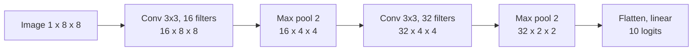

# Convolutional networks

> Shift a digit one pixel to the right and the MLP from the last two chapters falls from 97% to under 50%, because each of its weights is tied to one pixel position. A convolution uses the same small filter at every position, so what it learned in one place applies everywhere. Course 4 builds this from the NumPy arithmetic up to ResNets, object detection, face verification and style transfer. This chapter does the same on the digits, and at each stage shows why the design took that form.

**In plain words.** A convolutional network looks at a picture the way you scan a page for a word you know, sliding the same small check across every position, so it spots a cat wherever in the frame the cat happens to sit. Stack those checks and the early ones find edges while the later ones find eyes and wheels. At work this is the machinery behind finding objects in a photo and checking that two faces belong to one person, and this chapter builds up to both.

| Notebook | Builds | Key idea |
|---|---|---|
| Convolution model: Step by Step | `zero_pad`, `conv_single_step`, `conv_forward`, `pool_forward` and their backward passes in NumPy | Output size $\lfloor (n + 2p - f)/s \rfloor + 1$; parameter sharing; pooling has no parameters |
| Convolution model: Application | CONV2D → RELU → MAXPOOL ×2 → FLATTEN → FC on SIGNS, in TF | Shape bookkeeping in a framework |
| Residual Networks | ResNet-50 in Keras: identity block and convolutional block | Skip connection $a^{[l+2]} = g(z^{[l+2]} + a^{[l]})$ makes very deep nets trainable; learning the identity is easy |
| Car detection (YOLO) | YOLOv2 post-processing on a pretrained model: box scores, filtering, IoU, non-max suppression | One forward pass predicts a 19×19×5 grid of anchor boxes |
| Face Recognition | FaceNet-style encodings, triplet loss $\max(\lVert f(A)-f(P)\rVert^2 - \lVert f(A)-f(N)\rVert^2 + \alpha, 0)$, verification vs recognition | Learn an embedding where distance = identity ([NLP embeddings](../../03-nlp/notes/04-embeddings-and-similarity.md)) |
| Neural Style Transfer | Content cost on one VGG-19 layer, style cost via Gram matrices across layers, optimise the *image* | Gradient descent on inputs, not weights |



## The convolution, by hand

A filter slides over the image and takes a dot product at each position. That gives two properties an MLP lacks: **sharing**, since the same weights apply everywhere, and **sparse connections**, since each output sees only a small patch. With input size $n$, filter $f$, padding $p$ and stride $s$, the output size is $\lfloor (n + 2p - f)/s \rfloor + 1$. Here is the Step by Step notebook's core, on a real digit:

```python
import numpy as np, torch, torch.nn as nn, torch.nn.functional as F
from sklearn.datasets import load_digits
from sklearn.model_selection import train_test_split
from torch.utils.data import DataLoader, TensorDataset

digits = load_digits()

def conv_forward(image, kernel, stride=1, pad=0):
    f = kernel.shape[0]
    x = np.pad(image, pad)
    n = (x.shape[0] - f) // stride + 1
    out = np.zeros((n, n))
    for i in range(n):
        for j in range(n):
            out[i, j] = (x[i*stride:i*stride+f, j*stride:j*stride+f] * kernel).sum()
    return out

def pool_forward(image, f=2):
    n = image.shape[0] // f
    return np.array([[image[i*f:i*f+f, j*f:j*f+f].max() for j in range(n)] for i in range(n)])

vertical_edge = np.array([[1, 0, -1], [1, 0, -1], [1, 0, -1]], dtype=float)
img = digits.images[1] / 16.0                    # a handwritten 1
edges = conv_forward(img, vertical_edge)
print("input", img.shape, "conv, no padding", edges.shape, "pad 1", conv_forward(img, vertical_edge, pad=1).shape,
      "stride 2 pad 1", conv_forward(img, vertical_edge, stride=2, pad=1).shape, "pooled", pool_forward(img).shape)
print(np.round(edges, 1))

# the same numbers from PyTorch: conv2d is this loop, faster
t = F.conv2d(torch.tensor(img).view(1, 1, 8, 8), torch.tensor(vertical_edge).view(1, 1, 3, 3))
print("matches nn.functional.conv2d:", np.allclose(t.numpy()[0, 0], edges))
```

```text
input (8, 8) conv, no padding (6, 6) pad 1 (8, 8) stride 2 pad 1 (4, 4) pooled (4, 4)
[[-0.2 -2.4 -2.6  1.1  2.8  1.2]
 [-1.1 -2.2 -1.9  1.6  3.   1.1]
 [-1.2 -2.5 -1.8  2.2  3.   0.7]
 [-1.1 -2.6 -1.9  2.3  3.   0.7]
 [-0.2 -3.  -2.8  2.1  3.   0.9]
 [-0.1 -2.7 -2.9  1.3  3.   1.4]]
matches nn.functional.conv2d: True
```

The filter responds where brightness changes from left to right, so the 1's two sides show up with opposite signs. In a CNN those filter values are weights, learned by the same `backward()`.

## A CNN on the digits

The rest of the chapter uses this setup. PyTorch's image layout is `(batch, channels, height, width)`, where the course's TF code uses channels last.

```python
X_tr, X_te, y_tr, y_te = train_test_split(digits.data / 16.0, digits.target, test_size=0.3,
                                          random_state=0, stratify=digits.target)
X_tr = torch.tensor(X_tr, dtype=torch.float32).reshape(-1, 1, 8, 8)
X_te = torch.tensor(X_te, dtype=torch.float32).reshape(-1, 1, 8, 8)
y_tr, y_te = torch.tensor(y_tr), torch.tensor(y_te)

def accuracy(model, X, y):
    model.eval()
    with torch.no_grad():
        return (model(X).argmax(1) == y).float().mean().item()

def run(model, X=X_tr, y=y_tr, epochs=30, lr=1e-3, seed=0, batch_size=32):
    torch.manual_seed(seed)
    opt = torch.optim.AdamW(model.parameters(), lr=lr)
    loader = DataLoader(TensorDataset(X, y), batch_size=batch_size, shuffle=True, drop_last=len(X) > batch_size)
    for _ in range(epochs):
        model.train()
        for xb, yb in loader:
            loss = F.cross_entropy(model(xb), yb)
            opt.zero_grad(); loss.backward(); opt.step()
    return model

def mlp():
    return nn.Sequential(nn.Flatten(), nn.Linear(64, 64), nn.ReLU(), nn.Linear(64, 10))

def cnn():
    return nn.Sequential(nn.Conv2d(1, 16, 3, padding=1), nn.ReLU(), nn.MaxPool2d(2),
                         nn.Conv2d(16, 32, 3, padding=1), nn.ReLU(), nn.MaxPool2d(2),
                         nn.Flatten(), nn.Linear(32 * 2 * 2, 10))

for name, build in [("MLP", mlp), ("CNN", cnn)]:
    res = []
    for s in range(3):
        torch.manual_seed(s)
        m = run(build(), seed=s, lr=3e-3)
        res.append((accuracy(m, X_te, y_te), accuracy(m, torch.roll(X_te, 1, dims=3), y_te)))
    a, shifted = np.mean(res, axis=0)
    n = sum(p.numel() for p in build().parameters())
    print(f"{name}  params {n}  test {a:.3f}  test shifted one pixel {shifted:.3f}")
```

```text
MLP  params 4810  test 0.975  test shifted one pixel 0.473
CNN  params 6090  test 0.983  test shifted one pixel 0.656
```

With similar parameter counts, the CNN is a little better on digits as given and far better when they move by a pixel. It is not fully shift-invariant: the max pool and the final linear layer still care about position, so its accuracy falls too. Digits moved by a pixel are a small [covariate shift](../../01-classical-ml/notes/10-imbalance-errors-and-drift.md#drift-when-the-world-moves): P(x) moves, P(y | x) doesn't, and accuracy on the unshifted test set gave no warning. On 8×8 images the parameter counts are close, because the MLP is small. For a 64×64×3 image the first dense layer of 1,000 units would need about 12 million weights, against 448 for 16 filters of 3×3×3 with biases. That's the real argument for sharing. The **Application** notebook's TF graph translates line by line with [the translation table](01-neural-networks-fundamentals.md#translating-the-ng-notebooks-to-pytorch), and the same [`tf.contrib` status](01-neural-networks-fundamentals.md#tensorflow-1x-to-2x-status-and-migration-map) applies to it.

The convolutional design goes back to LeCun et al. ([doi:10.1109/5.726791](https://doi.org/10.1109/5.726791) (LeCun et al., Proc. IEEE 1998)). LeNet-5 combines three ideas: local receptive fields, shared weights and subsampling. Because of weight sharing, its 345,308 connections need only about 60,000 trainable parameters. The same paper introduced MNIST, with 60,000 training and 10,000 test digits drawn from two NIST sets. LeNet-5 reached 0.95% test error, or 0.8% with distorted copies of the training images added. For comparison, a linear classifier got 12%, a one-hidden-layer MLP 4.7%, and a regular SVM 1.4% at about 14M multiply-adds per digit. Schölkopf's virtual-support-vector SVM reached 1.0% at about twice that cost, and boosting three LeNet-4s gave the best result, 0.7%. Its later sections train a whole reading pipeline end to end through graphs of candidate segmentations, an ancestor of CTC, and a check reader built that way was in commercial use from 1996. It also describes a collapse problem. If the loss only pulls the correct output's learned target closer, the network can make all targets equal and ignore its input. The fix is a discriminative loss that also pushes wrong answers away, which is the job negatives do in the contrastive methods below.

## Residual networks

A deeper network can represent anything a shallower one can, because the extra layers could be the identity. He et al. observed that in practice deeper plain networks train worse, and so called it a degradation problem rather than overfitting. Their fix makes the identity the easy default: a block learns a residual $F(x)$ and outputs $F(x) + x$, so driving $F$ to zero recovers the identity ([arXiv:1512.03385](https://arxiv.org/abs/1512.03385) (He et al., CVPR 2016)). The paper trained up to 152 layers on ImageNet, with a 3.57% top-5 ensemble error, and your notebook assembles ResNet-50 in Keras. The experiment works on the digits as well, and it takes a couple of minutes on a CPU:

```python
class Block(nn.Module):
    def __init__(self, c, residual):
        super().__init__()
        self.residual = residual
        self.f = nn.Sequential(nn.Conv2d(c, c, 3, padding=1), nn.BatchNorm2d(c), nn.ReLU(),
                               nn.Conv2d(c, c, 3, padding=1), nn.BatchNorm2d(c))
    def forward(self, x):
        out = self.f(x)
        return F.relu(out + x if self.residual else out)     # the only difference

def deep(blocks, residual, c=16):
    return nn.Sequential(nn.Conv2d(1, c, 3, padding=1), *[Block(c, residual) for _ in range(blocks)],
                         nn.AdaptiveAvgPool2d(1), nn.Flatten(), nn.Linear(c, 10))

for blocks in [2, 10, 30]:
    for residual in [False, True]:
        torch.manual_seed(0)
        m = run(deep(blocks, residual), epochs=10)
        print(f"{2 * blocks + 2:>2} layers {'residual' if residual else 'plain   '}  "
              f"train {accuracy(m, X_tr, y_tr):.3f}  test {accuracy(m, X_te, y_te):.3f}")
```

```text
6 layers plain     train 0.986  test 0.969
 6 layers residual  train 0.984  test 0.965
22 layers plain     train 0.946  test 0.924
22 layers residual  train 0.982  test 0.978
62 layers plain     train 0.379  test 0.370
62 layers residual  train 0.983  test 0.965
```

The plain 62-layer network has low training accuracy as well as test accuracy, so the problem is optimisation rather than overfitting. That is the paper's finding, on a small scale. Skip connections carried straight into Transformers.

The skip connection also makes a block optional, which stochastic depth uses as a regulariser. For each mini-batch it drops whole residual blocks at random, keeping only the identity path, with the survival probability falling linearly from 1 at the input to 0.5 at the last block. At test time every block runs, scaled by its survival probability. On a 110-layer ResNet it cut CIFAR-10 error from 6.41% to 5.25% and CIFAR-100 error from 27.76% to 24.98%, and training took about 25% less time because the expected depth is about three quarters of the full one. A 1,202-layer network trained this way reached 4.91% on CIFAR-10, where the same depth trained normally scored 6.67%, worse than 110 layers. On ImageNet with a 152-layer ResNet it gave no gain (21.98% against 21.78% at 120 epochs), and no result reports seeds or variance ([arXiv:1603.09382](https://arxiv.org/abs/1603.09382) (Huang et al., ECCV 2016)).

ConvNets kept developing after ResNet, and they borrowed a pretraining method from vision transformers. BEiT made BERT's masked-word task work for vision transformers by predicting discrete codes instead of pixels. It hid about 40% of a ViT's patches in blocks and trained it to predict, for each hidden patch, which of 8,192 discrete codes a borrowed DALL-E tokenizer assigns there. A ViT-B pretrained this way on unlabelled ImageNet-1K for 800 epochs and then fine-tuned at 224 px reached 83.2% top-1, level with MoCo v3. In its 300-epoch ablation, regressing raw pixels instead of codes cut ImageNet from 82.86 to 81.04 and ADE20K segmentation from 44.65 to 41.38 mIoU, worse on ImageNet than a DeiT-B trained from scratch (81.8). Its frozen features were weak, though: a linear probe at the ViT-B's best middle layer scored 56.7% against 78.2% for DINO ([arXiv:2106.08254](https://arxiv.org/abs/2106.08254) (Bao et al., ICLR 2022)). That pixel baseline regressed raw pixels with the mask tokens inside the encoder. A masked autoencoder hides 75% of an image's patches, runs the encoder only on the visible quarter, and has a light decoder rebuild the missing pixels, normalised per patch. Leaving the masked patches out of the encoder cut pretraining compute 3.3× (2.8× in wall-clock time) and also raised accuracy. A ViT-H pretrained this way on ImageNet alone reached 87.8% top-1 after fine-tuning at 448 px, and on COCO detection with Mask R-CNN a ViT-L beat supervised pretraining by 4.0 box AP (53.3 against 49.3). Its features need fine-tuning, though: frozen, a ViT-L probed at 75.8% against 77.6% for MoCo v3, and the paper tests no ConvNets ([arXiv:2111.06377](https://arxiv.org/abs/2111.06377) (He et al., CVPR 2022)). ConvNeXt V2 updates the 2022 ConvNeXt. It pairs a fully convolutional masked autoencoder, which removes 60% of 32×32 patches and uses sparse convolutions so that masked regions don't leak through, with a new Global Response Normalization (GRN) layer. GRN is meant to counter feature collapse, where channels go dead, saturated or redundant, which the paper calls a potential issue and shows with visualisations and a cosine-distance analysis. On a ConvNeXt-Base on ImageNet-1K at 224 px, 800 epochs of the autoencoder plus fine-tuning only matched 300-epoch supervised training (83.7 against 83.8; 100-epoch supervised scored 82.7), and adding GRN gave 84.6, with no seeds or error bars reported. With ImageNet-1K alone at 224 px, top-1 runs from 76.7% with a 3.7M-parameter Atto to 86.3% with a 659M Huge, below the 86.9 of a ViT-H masked autoencoder at the same 1,600 pretraining epochs. The headline 88.9% needs ImageNet-22K labels and 512 px. The paper reports only fine-tuning accuracy, with no linear-probe or other frozen-feature score ([arXiv:2301.00808](https://arxiv.org/abs/2301.00808) (Woo et al., CVPR 2023)).

## Object detection

The **Car detection** notebook post-processes YOLOv2's output ([arXiv:1612.08242](https://arxiv.org/abs/1612.08242) (Redmon and Farhadi, CVPR 2017)). A single forward pass predicts, per grid cell, 5 anchor boxes and their class scores, in a 19×19×5 grid. That makes about 1,800 boxes per image, mostly useless, so two steps filter them: threshold on score, then **non-max suppression**, which keeps the best box and removes others overlapping it by a high IoU. Both are short:

```python
def iou(a, b):
    """Boxes are (x1, y1, x2, y2)."""
    w = max(0, min(a[2], b[2]) - max(a[0], b[0]))
    h = max(0, min(a[3], b[3]) - max(a[1], b[1]))
    inter = w * h
    area = lambda r: (r[2] - r[0]) * (r[3] - r[1])
    return inter / (area(a) + area(b) - inter)

def nms(boxes, scores, threshold=0.5):
    order = list(np.argsort(scores)[::-1])
    keep = []
    while order:
        best = order.pop(0)
        keep.append(int(best))
        order = [i for i in order if iou(boxes[best], boxes[i]) < threshold]
    return keep

boxes = [(10, 10, 50, 50), (12, 12, 52, 52), (100, 100, 140, 140), (11, 9, 49, 51), (105, 98, 138, 142)]
scores = np.array([0.9, 0.75, 0.8, 0.6, 0.7])
print("IoU of boxes 0 and 1:", round(iou(boxes[0], boxes[1]), 3))
print("kept:", nms(boxes, scores))
```

```text
IoU of boxes 0 and 1: 0.822
kept: [0, 2]
```

Two cars, five boxes, and two survive. `torchvision.ops.nms` does the same at speed. You would rarely train a detector yourself: [Vision in practice](04b-vision-in-practice.md#beyond-classification) points to torchvision's pretrained ones.

YOLOv2 took the idea of anchor boxes from Faster R-CNN's region proposal network (RPN), though it picks its 5 anchor shapes by k-means on training boxes rather than using the RPN's 9 hand-picked ones. The RPN slides a small network over the backbone's last feature map and, at each position, scores 9 anchors (3 sizes times 3 aspect ratios) as object or background and nudges each one's box. Because it reuses the detector's own convolutional features, proposals cost 10 ms per image on a K40 GPU, against about 2 s on a CPU for the hand-built Selective Search before it, and the whole VGG-16 system ran at 5 frames per second. With 300 proposals it matched or beat 2,000 from Selective Search, 69.9 against 66.9 mAP on VOC 2007 (66.9 as Fast R-CNN reported it, 68.1 when re-run). Removing the box adjustment at test time, so the proposals were the raw anchors, cut mAP from 56.8 to 52.1 in a smaller ZF-network ablation. The authors also built a one-stage version that classified dense windows directly, and it scored 4.8 points lower, 53.9 against 58.7 with ZF ([arXiv:1506.01497](https://arxiv.org/abs/1506.01497) (Ren et al., NIPS 2015)).

Most of YOLOv2's 1,800 boxes are background, and that is the real difficulty for a one-stage detector. It scores something like 100,000 anchor locations per image, almost all of them easy negatives, so their small losses add up and swamp the few objects. Two-stage detectors avoid this, because a proposal step cuts the set to 1,000–2,000 boxes and sampling then fixes the positive-to-negative ratio at 1:3. Focal loss changes the loss instead, multiplying cross-entropy by $(1-p_t)^\gamma$. With $\gamma=2$, an example the model already gets right with $p_t=0.9$ costs 100 times less than under plain cross-entropy. On COCO with a ResNet-50 RetinaNet at 600 px, raising $\gamma$ from 0 to 2, with α retuned at each (0.75 to 0.25), lifted AP from 31.1 (the best α-balanced cross-entropy) to 34.0, and $\gamma=5$ fell back to 32.2. Plain cross-entropy diverged until the final classifier's bias was set so every anchor starts at a 1% object probability, which is a change to the initialisation, not the loss. The full RetinaNet reached 39.1 AP on COCO test-dev, ahead of every two-stage model the authors compared, with longer training and scale jitter than the ablations used. All the results are COCO boxes, and the authors added after publication that a Faster R-CNN variant now gives faster and more accurate results ([arXiv:1708.02002](https://arxiv.org/abs/1708.02002) (Lin et al., ICCV 2017)).

## Embeddings: face verification

The **Face Recognition** notebook shows why a classifier can't solve this problem: you can't retrain for every new employee, and there is one photo per person. So learn a function $f$ that maps a face to a vector where distance means identity, trained with the triplet loss from FaceNet ([arXiv:1503.03832](https://arxiv.org/abs/1503.03832) (Schroff, Kobak and Philbin, CVPR 2015)). Verification thresholds one distance, and recognition finds the nearest stored person. On digits, "identity" is the digit, and 8 and 9 are withheld from training to play new people:

```python
class Embedder(nn.Module):
    def __init__(self, k=16):
        super().__init__()
        self.f = nn.Sequential(nn.Conv2d(1, 16, 3, padding=1), nn.ReLU(), nn.MaxPool2d(2),
                               nn.Conv2d(16, 32, 3, padding=1), nn.ReLU(),
                               nn.AdaptiveAvgPool2d(1), nn.Flatten(), nn.Linear(32, k))
    def forward(self, x):
        return F.normalize(self.f(x), dim=1)

def triplet_loss(a, p, n, margin=0.2):
    return F.relu((a - p).pow(2).sum(1) - (a - n).pow(2).sum(1) + margin).mean()

known = y_tr < 8
Xk, yk = X_tr[known], y_tr[known]
where = {c: (yk == c).nonzero().flatten() for c in range(8)}
g = torch.Generator().manual_seed(0)
def draw(c):
    return where[c][torch.randint(len(where[c]), (1,), generator=g)].item()

torch.manual_seed(0)
emb = Embedder()
opt = torch.optim.AdamW(emb.parameters(), lr=1e-3)
for epoch in range(30):
    perm = torch.randperm(len(Xk), generator=g)
    for i in range(0, len(perm) - 32, 32):
        batch = perm[i:i+32]
        pos = [draw(int(c)) for c in yk[batch]]
        neg = [draw((int(c) + int(torch.randint(1, 8, (1,), generator=g))) % 8) for c in yk[batch]]
        loss = triplet_loss(emb(Xk[batch]), emb(Xk[pos]), emb(Xk[neg]))
        opt.zero_grad(); loss.backward(); opt.step()

def gaps(X, y):
    emb.eval()
    with torch.no_grad():
        dist = torch.cdist(emb(X), emb(X))
    same = y[:, None] == y
    other = ~torch.eye(len(X)).bool()
    return dist[same & other].mean().item(), dist[~same].mean().item()

seen = y_te < 8
print("seen digits    same %.3f  different %.3f" % gaps(X_te[seen], y_te[seen]))
print("unseen 8 and 9 same %.3f  different %.3f" % gaps(X_te[~seen], y_te[~seen]))
```

```text
seen digits    same 0.331  different 0.935
unseen 8 and 9 same 0.449  different 0.503
```

Those are mean distances. Seen classes separate clearly (0.331 within a class against 0.935 across), and the 8s and 9s barely at all (0.449 against 0.503). Eight training "identities" aren't enough for the embedding to generalise to new ones, which is why face systems train on very many people. The same loss idea, with text in place of faces, trains the models in [NLP embeddings](../../03-nlp/notes/04-embeddings-and-similarity.md). [Learning a similarity function](../../05-time-series-and-recommenders/notes/05-learning-a-similarity-function.md) tunes one on a parts catalogue and measures what mining hard negatives changes.

Self-supervised vision took the contrastive loss further, with no labels at all. CPC v2 trained a ResNet to predict the representation of a patch from the patches around it (above, below, left and right; the first version used only the context above), scored against negatives drawn from other patches and images ([arXiv:1905.09272](https://arxiv.org/abs/1905.09272) (Hénaff et al., ICML 2020)). It reached 71.5% ImageNet linear-probe accuracy, up from 48.7% for the first version. With 1% of the labels it scored 78.3% top-5 against 44.1% for supervised training, though the two runs used different architectures (over 500M parameters against ResNet-200's 60M). MoCo and SimCLR changed the positive pair to two augmented views of the same image. MoCo keeps a queue of encoded keys from past batches, so the number of negatives no longer depends on batch size. Keys come from a slowly updated copy of the encoder, with momentum 0.999 ([arXiv:1911.05722](https://arxiv.org/abs/1911.05722) (He et al., CVPR 2020)). With no momentum training failed, and at 0.9 linear accuracy was 55.2% against 59.0%. Its own linear accuracy was only 60.6%, yet its features transferred better than supervised ImageNet pretraining on 7 detection and segmentation tasks, by up to 3.7 AP on VOC when pretrained on 1B Instagram images (2.4 from ImageNet). SimCLR dropped the queue. Its negatives are the other 2(N−1) augmented images in a large batch, scored by cosine similarity with a temperature (the NT-Xent loss) ([arXiv:2002.05709](https://arxiv.org/abs/2002.05709) (Chen et al., ICML 2020)). Random cropping combined with colour distortion was the augmentation pair that mattered. The representation taken before a small projection head was over 10 points better than the one after it. A 4×-wide ResNet-50 reached 76.5% linear-probe accuracy, matching a supervised ResNet-50. Large batches mattered most for short training. With the learning rate scaled linearly with batch size, at 100 epochs batch 256 gave 57.5% against 64.8% at 8,192 (square-root scaling narrowed that to 62.8%), and at 800 epochs the gap narrowed to 66.6% against 69.0%. BYOL dropped the negatives altogether. An online network, with an extra small predictor on top, learns to predict a target network's embedding of a second view of the same image. The target gets no gradient, and its weights are a moving average of the online weights (rate 0.996 rising to 1), the same kind of slow copy MoCo uses for its keys ([arXiv:2006.07733](https://arxiv.org/abs/2006.07733) (Grill et al., NeurIPS 2020)). With nothing pushing embeddings apart, outputting the same vector for every image would minimise the loss, and it did: with no moving average (rate 0), or with no predictor and no negatives, linear accuracy fell to 0.3% or below. With both in place a ResNet-50 reached 74.3% against SimCLR's 69.3%, and 78.6% against 76.5% at 4× width (1,000 epochs). In the authors' 300-epoch ablations it lost less to smaller batches than their SimCLR reproduction (72.5 to 71.8 from batch 4,096 to 256, against 67.9 to 64.3) and less without colour distortion (9.1 points against 22.2). The paper shows that collapse doesn't happen in practice, not why, and batch norm stays in the encoder and both heads throughout, so it was never tested without batch statistics. Speech took the CPC line and added BERT-style masking. wav2vec 2.0 encodes raw audio with a CNN into one frame per 20 ms, masks about half the frames, and has a transformer pick the true quantized frame at each masked position out of 100 distractors from the same utterance ([arXiv:2006.11477](https://arxiv.org/abs/2006.11477) (Baevski et al., NeurIPS 2020)). Only the targets are quantized. Quantizing the transformer's inputs as well raised dev WER from 7.97 to 12.18, and continuous targets made the task too easy (8.58). Pretrained on 53k hours of unlabelled LibriVox audio and fine-tuned with CTC on just 10 minutes of transcribed speech, the 317M model reached 4.8/8.2 WER on LibriSpeech test-clean/other, and with 1 hour it beat the previous best 100-hour system. Those numbers need a language model at decoding: without one, the 10-minute model scored 40.2/38.7. With all 960 labelled hours it tied supervised systems on the clean split (1.8 against 1.9) and led only on the noisy one (3.3 against 3.9). The same recipe of a contrastive loss with in-batch negatives trains the text embedding models in [NLP embeddings](../../03-nlp/notes/04-embeddings-and-similarity.md).

A small version of SimCLR's recipe on digits, with NT-Xent and a linear probe trained on a few labels, compared to supervised training from scratch on the same rows:

```python
def augment(x):
    shifts = torch.randint(-1, 2, (len(x), 2))
    out = torch.stack([torch.roll(i, tuple(s.tolist()), (1, 2)) for i, s in zip(x, shifts)])
    return (out + 0.2 * torch.randn_like(out)).clamp(0, 1)

def nt_xent(z1, z2, t=0.2):
    z = F.normalize(torch.cat([z1, z2]), dim=1)
    sim = z @ z.T / t
    sim.fill_diagonal_(-9e15)                         # an example isn't its own negative
    n = len(z1)
    return F.cross_entropy(sim, torch.cat([torch.arange(n, 2 * n), torch.arange(n)]))

def encoder():
    return nn.Sequential(nn.Conv2d(1, 16, 3, padding=1), nn.ReLU(), nn.MaxPool2d(2),
                         nn.Conv2d(16, 32, 3, padding=1), nn.ReLU(), nn.AdaptiveAvgPool2d(1), nn.Flatten())

torch.manual_seed(0)
enc, proj = encoder(), nn.Sequential(nn.Linear(32, 32), nn.ReLU(), nn.Linear(32, 16))
opt = torch.optim.AdamW([*enc.parameters(), *proj.parameters()], lr=1e-3)
for epoch in range(60):                               # no labels used here
    for (xb,) in DataLoader(TensorDataset(X_tr), batch_size=128, shuffle=True, drop_last=True):
        loss = nt_xent(proj(enc(augment(xb))), proj(enc(augment(xb))))
        opt.zero_grad(); loss.backward(); opt.step()

def probe(features, keep, seed):
    with torch.no_grad():
        f, ft = features(X_tr[keep]), features(X_te)
    torch.manual_seed(seed)
    head = nn.Linear(32, 10); o = torch.optim.AdamW(head.parameters(), lr=1e-2)
    for _ in range(300):
        l = F.cross_entropy(head(f), y_tr[keep]); o.zero_grad(); l.backward(); o.step()
    return (head(ft).argmax(1) == y_te).float().mean().item()

for n in [20, 50, 100]:
    a, b = [], []
    for s in range(5):
        keep = torch.randperm(len(X_tr), generator=torch.Generator().manual_seed(s))[:n]
        a.append(probe(enc, keep, s))
        torch.manual_seed(s)
        b.append(accuracy(run(cnn(), X_tr[keep], y_tr[keep], epochs=200, batch_size=8, seed=s), X_te, y_te))
    print(f"{n:>3} labels: contrastive + probe {np.mean(a):.3f}  supervised CNN {np.mean(b):.3f}")
```

```text
20 labels: contrastive + probe 0.404  supervised CNN 0.618
 50 labels: contrastive + probe 0.571  supervised CNN 0.842
100 labels: contrastive + probe 0.651  supervised CNN 0.900
```

Here the contrastive pretraining loses at every label count, which is worth seeing before quoting the papers. A small CNN learns digits from 20 labels quite well, there are only about 1,250 unlabelled rows, and a one-pixel roll with noise is a much weaker augmentation than the crops and colour changes in the papers. So the toy shows the mechanics of NT-Xent and a linear probe, and it does not reproduce the label-efficiency result, which CPC v2 and SimCLR report at ImageNet scale.

## Style transfer: optimising the input

**Neural Style Transfer** turns training around ([arXiv:1508.06576](https://arxiv.org/abs/1508.06576) (Gatys, Ecker and Bethge, 2015, preprint)). The network's weights stay frozen and gradient descent changes the pixels. Content is matched by activations at one layer, and style by the **Gram matrix**: correlations between channels, which record which features occur together and throw away where. A miniature, using the digit CNN's first layer in place of VGG-19:

```python
torch.manual_seed(0)
net = run(cnn(), lr=3e-3, epochs=10)
for p in net.parameters(): p.requires_grad_(False)
net.eval()
features = net[:2]                                    # conv + ReLU

def gram(a):
    c, h, w = a.shape[1:]
    v = a.view(c, h * w)
    return v @ v.T / (h * w)

content, style = X_te[y_te == 1][:1], X_te[y_te == 0][:1]
img = content.clone().requires_grad_(True)            # the pixels are the parameters
opt = torch.optim.Adam([img], lr=0.02)
def costs(x):
    a = features(x)
    return F.mse_loss(a, features(content)), F.mse_loss(gram(a), gram(features(style)))
c0, s0 = costs(img)
for step in range(300):
    c, s = costs(img)
    loss = c + 10 * s
    opt.zero_grad(); loss.backward(); opt.step()
print(f"content cost {c0.item():.4f} to {c.item():.4f}, style cost {s0.item():.4f} to {s.item():.4f}")
```

```text
content cost 0.0000 to 0.0051, style cost 0.0058 to 0.0007
```

The style cost falls as the content cost rises from zero: the image gives up some of its match to its content to match the other's channel correlations. The `step` is on `img`, and no weight moved.

## Reading

Buduma, *Fundamentals of Deep Learning* ([PDF](../../sources/buduma-fundamentals-of-deep-learning.pdf)), ch. 5 parallels this chapter, using TensorFlow, and ch. 6 covers embedding and representation learning.

| Set | Runs |
|---|---|
| [`Convolutional Neural Networks`](../practice/ng-deep-learning/Convolutional%20Neural%20Networks/) (6 notebooks across weeks 1 to 4) | Legacy, reading-only as stored: helper modules, `yad2k`, datasets and pretrained weights weren't copied. Per-notebook status is in [the migration table](01-neural-networks-fundamentals.md#tensorflow-1x-to-2x-status-and-migration-map) |

Every digits number here came from running the code shown. The numbers attributed to a paper are that paper's own.

## Pitfalls

| Symptom | Cause | Fix |
|---|---|---|
| `Expected 4D input` or a channel-count error when porting TF code | TF is channels-last, PyTorch channels-first | `x.permute(0, 3, 1, 2)`, and use `(B, C, H, W)` |
| `mat1 and mat2 shapes cannot be multiplied` at the first linear layer | The flatten size after pooling is wrong | Compute it with the output-size formula, or use `AdaptiveAvgPool2d(1)` or `nn.LazyLinear` |
| Deeper plain model has worse **training** accuracy | Degradation, not overfitting | Residual connections |
| A residual `out + x` raises a size error | Channels or stride changed in the block | Project `x` with a 1×1 convolution, as in the notebook's convolutional block |
| Detector outputs several boxes per object | No non-max suppression, or too high an IoU threshold | NMS with a threshold of about 0.5 |
| Triplet loss sits at the margin value | The embedding collapsed so all distances match | Normalise, use a batch with informative triplets, lower the rate |

## Try it

1. Compute by hand, then with PyTorch, the output shape for a 32×32×3 input through `Conv2d(3, 8, 5, stride=2, padding=2)`, then `MaxPool2d(2)`, and the number of parameters in the convolution.

   <details><summary>Answer</summary>

   The convolution gives $\lfloor (32 + 4 - 5)/2 \rfloor + 1 = 16$, so 16×16×8, and the pool gives 8×8×8. Parameters are $8 \times (5 \times 5 \times 3) + 8 = 608$ with biases.

   ```text
   torch.Size([1, 8, 16, 16]) torch.Size([1, 8, 8, 8]) 608
   ```

   </details>

2. Train the CNN on digits with shifted copies added: for each training image also add a version rolled by one pixel. What happens to the shifted test accuracy?

   <details><summary>Answer</summary>

   Add `torch.roll(X_tr, 1, dims=3)` with the same labels and rerun `run(cnn(), X=..., y=..., lr=3e-3)` for three seeds. Mean accuracy on the original test set is 0.988, on the test set rolled the way training was 0.989, and on the test set rolled the other way 0.890. So the network now handles the shift it was shown, and the unseen direction is also far above the 0.656 from before. Augmentation is a cheap way to buy invariance, but only roughly for what you didn't show it.

   </details>

3. Take `nms` and set `threshold=0.1`, then `0.95`, on the example boxes. Explain the two outcomes.

   <details><summary>Answer</summary>

   `threshold=0.1` returns `[0, 2]`, as all overlapping pairs exceed 0.1. `threshold=0.95` returns `[0, 2, 1, 4, 3]`, keeping all five, because the largest overlap here is 0.907, so nothing is suppressed. Too low a threshold would merge two nearby cars; too high leaves duplicates.

   </details>

## Interview checklist

| Question | Answer |
|---|---|
| Why convolutions for images? | Parameter sharing and sparse connections: far fewer weights, and a feature learned in one place applies anywhere. |
| What is the output-size formula? | $\lfloor (n + 2p - f)/s \rfloor + 1$. |
| What does pooling learn? | Nothing: it has no parameters. It reduces spatial size and adds some local invariance. |
| What does a 1×1 convolution do? | Changes the channel count, cheaply, and adds a non-linearity per position. |
| Why do skip connections help? | The identity becomes the easy default, so added depth doesn't degrade training, and gradients have a direct path. |
| What is NMS for? | Dropping overlapping boxes for one object: keep the best, remove those above an IoU threshold, repeat. |
| Verification vs recognition? | One-to-one against a claimed identity, versus one-to-many against a database. The second has many more chances to go wrong. |
| What does a triplet loss optimise? | Same-identity distance to be smaller than different-identity distance by a margin. |
| What is a Gram matrix? | Channel correlations of a feature map, used as a position-free style description. |
| How does SimCLR get a positive pair without labels? | Two augmentations of one image, with the other images in the batch as negatives. |

## Next

[Vision in practice](04b-vision-in-practice.md): images loaded from a folder, and when to borrow an ImageNet network rather than train your own.
