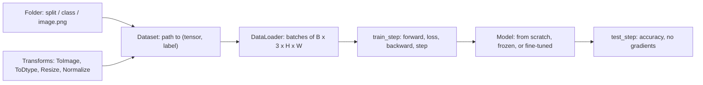
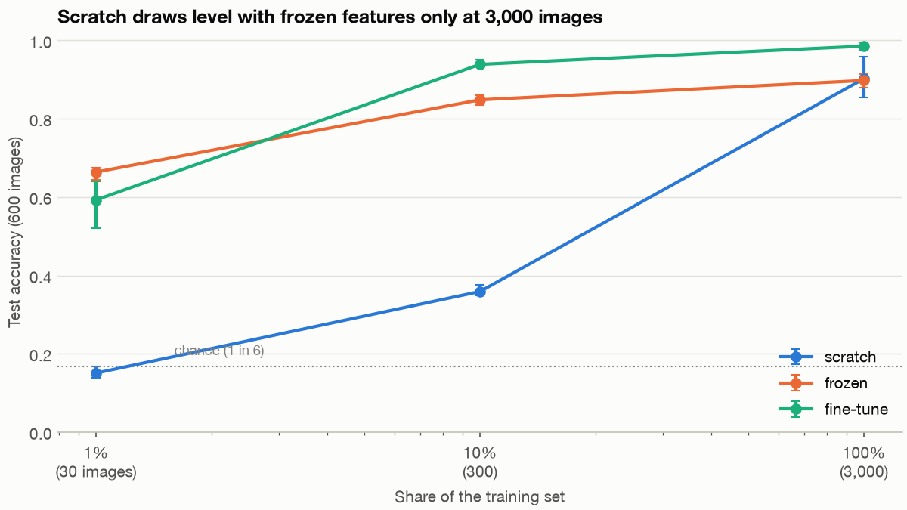
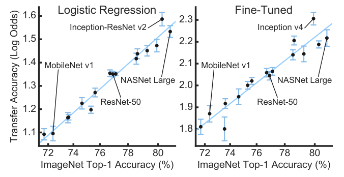
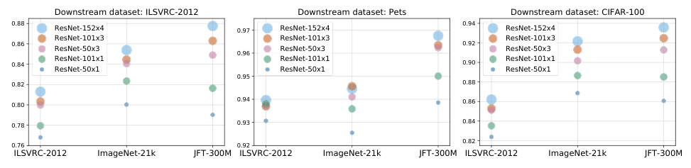
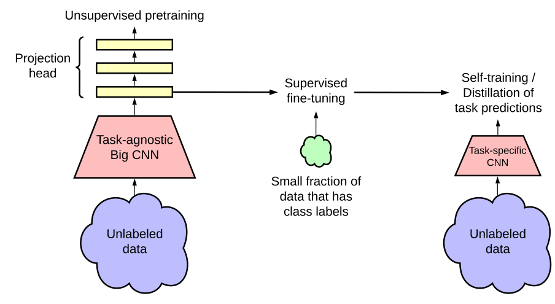
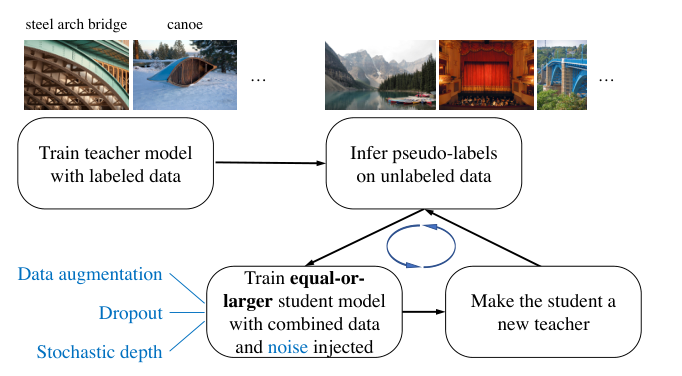
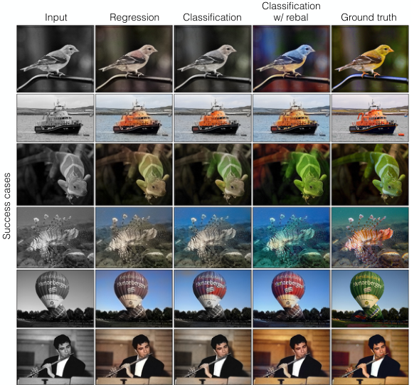
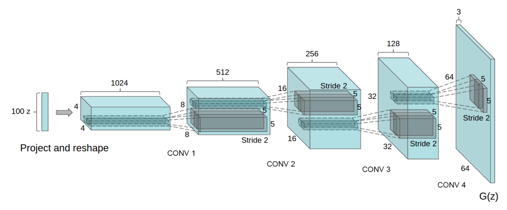
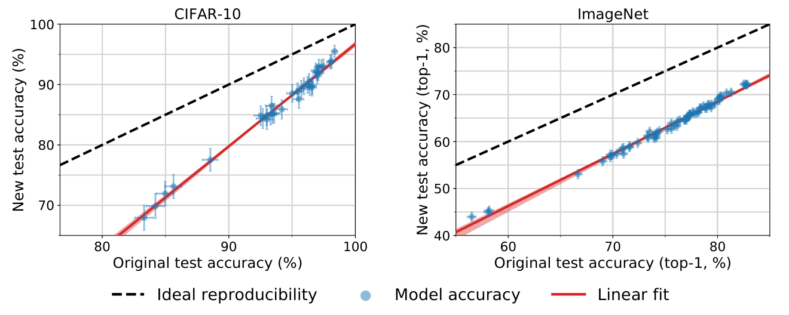
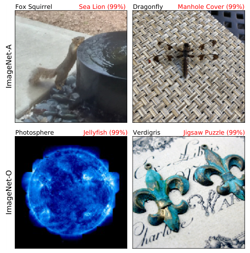

# Vision in practice

> Chapter 04 trained every network on 8×8 digits that arrive as one NumPy array. Real image work starts from a folder of JPEGs and a few hundred labels, and the first decision is whether to train a network at all or to borrow one trained on ImageNet. This chapter builds the pipeline from the folder up, then measures that decision. With 300 labelled images a frozen ResNet-18 scored 0.85 where a CNN trained from scratch scored 0.36, and with 3,000 the scratch model caught up with the frozen one but not with fine-tuning.

**In plain words.** A network trained on a million photos has already learned what edges, corners and textures look like. If your task is sorting a few hundred of your own pictures, you can keep that knowledge and teach only the last step, which picks between your labels. That is transfer learning, and with little data it beats starting from nothing by a wide margin. At work this is how most image classifiers get built: product photos, defect images, scanned documents. The skills that go with it are loading images from disk, preparing them the way the borrowed network expects, and reading the three errors everyone hits first.

Daniel Bourke's free course *Learn PyTorch for Deep Learning* (learnpytorch.io, code MIT-licensed) teaches this path in chapters 03 to 08, on a 3-class food dataset. This chapter follows its order and credits its examples, but swaps in a dataset that is generated on your machine and adds the pieces his chapters leave out: seeds, a full fine-tuning arm and a matched training budget.



The code lives in [`practice/vision_project/`](../practice/vision_project/), split the way Bourke's chapter 05 splits his: `data.py`, `model.py`, `engine.py`. Each block below runs from `practice/` with `torch`, `torchvision` and `pillow`. The first block that touches a pretrained network downloads its weights, about 45 MB for ResNet-18, into the torch cache. Timings are from one MacBook with an M4 Pro, using its GPU through PyTorch's `mps` device.

## From a folder of images to tensors

Most image datasets on disk use one layout: a folder per split, a folder per class inside it, and the images inside those. torchvision's `ImageFolder` reads exactly this, and Bourke's chapter 04 rebuilds it by hand as `ImageFolderCustom` so you see what it does. The data here is generated: 6 shapes (circle, cross, ring, square, star, triangle) drawn at random size, position, rotation and colour on a random background, with a few clutter lines and some blur, 500 training and 100 test images per class at 64×64. It is easy for a person and not trivial for a network, and it needs no download or licence.

```python
from pathlib import Path
from vision_project.data import make_shapes

root = make_shapes(Path("data/shapes"))       # writes data/shapes/{train,test}/<class>/0000.png once, about a second
print(sorted(p.name for p in (root / "train").iterdir()))
```

```text
['circle', 'cross', 'ring', 'square', 'star', 'triangle']
```

A `Dataset` needs two methods: `__len__`, and `__getitem__`, which turns an index into one example. Everything else is bookkeeping you'd want anyway, a sorted class list and the label of every file, so the class-to-index map is the same on every machine:

```python
class ShapesDataset(Dataset):
    """Reads root/split/<class>/*.png. Returns (image tensor, class index) after `transform`."""

    def __init__(self, root, split, transform=None):
        self.paths = sorted(Path(root, split).glob("*/*.png"))
        self.classes = sorted({p.parent.name for p in self.paths})
        self.class_to_idx = {c: i for i, c in enumerate(self.classes)}
        self.targets = [self.class_to_idx[p.parent.name] for p in self.paths]
        self.transform = transform

    def __len__(self):
        return len(self.paths)

    def __getitem__(self, i):
        img = Image.open(self.paths[i]).convert("RGB")
        return (self.transform(img) if self.transform else img), self.targets[i]
```

The image is read from disk only when it is asked for, so a dataset of a million files costs a million paths in memory, not a million images. `.convert("RGB")` is there because real folders mix greyscale, RGBA and palette PNGs, and a 4-channel image fed to a 3-channel network fails at the first convolution.

```python
import torch
from torchvision.transforms import v2
from vision_project.data import ShapesDataset

tf = v2.Compose([v2.ToImage(), v2.ToDtype(torch.float32, scale=True)])
train, test = ShapesDataset(root, "train", tf), ShapesDataset(root, "test", tf)
print(len(train), len(test), train.class_to_idx)
x, y = train[0]
print(x.shape, x.dtype, x.min().item(), x.max().item(), y)
```

```text
3000 600 {'circle': 0, 'cross': 1, 'ring': 2, 'square': 3, 'star': 4, 'triangle': 5}
torch.Size([3, 64, 64]) torch.float32 0.0 0.988235354423523 0
```

Channels come first, `(C, H, W)`, which is PyTorch's convention (chapter 04's pitfalls table has the TensorFlow difference). To measure what happens with less data, `fraction` keeps the same share of every class, so 1% is 30 images, 5 per class, rather than 30 images that might miss a class:

```python
from vision_project.data import fraction, loaders

small = fraction(train, 0.01, seed=0)
a, b = loaders(small, test)                      # shuffled training batches of 32, test batches of 256
xb, yb = next(iter(a))
print(len(small), xb.shape, yb.shape, yb.dtype)
```

```text
30 torch.Size([30, 3, 64, 64]) torch.Size([30]) torch.int64
```

A `DataLoader` wraps a `Dataset`: each epoch it shuffles the order, reads examples through `__getitem__` and stacks them into batches. The batch dimension is new, `(B, C, H, W)`, and the labels are `int64`, the type `cross_entropy` expects. With only 30 images the first batch holds all of them.

## Transforms: v2, and the preset that comes with the weights

A transform turns the PIL image into the tensor the model needs. torchvision now has two APIs, and its documentation says which to use: "We recommend using the torchvision.transforms.v2 transforms instead of those in torchvision.transforms. They're faster and they can do more things" ([torchvision 0.29 docs](https://docs.pytorch.org/vision/stable/transforms.html)). v2 arrived in torchvision 0.15 in March 2023, so Bourke's chapters, written before then, use v1's `transforms.ToTensor()`. In v2 that one call is two: `ToImage()` makes a `uint8` tensor, and `ToDtype(torch.float32, scale=True)` divides by 255. The import is the only other change.

A pretrained network expects its inputs prepared the way they were in training: the same size, the same colour scaling. The docs say plainly that getting this wrong "may lead to decreased accuracy or incorrect outputs", and torchvision ships the preprocessing with each set of weights ([models docs](https://docs.pytorch.org/vision/stable/models.html)):

```python
from torchvision.models import ResNet18_Weights

print(ResNet18_Weights.IMAGENET1K_V1.transforms())
```

```text
ImageClassification(
    crop_size=[224]
    resize_size=[256]
    mean=[0.485, 0.456, 0.406]
    std=[0.229, 0.224, 0.225]
    interpolation=InterpolationMode.BILINEAR
)
```

Resize to 256, crop the centre 224, scale to [0, 1], then subtract ImageNet's channel means and divide by its standard deviations. Bourke's chapter 06 prints the same thing for EfficientNet-B0, with bicubic interpolation, because each set of weights carries its own preset. The experiment below keeps the normalisation and changes the size: it resizes the 64-pixel shapes to 112 rather than 224, a quarter of the pixels, so that the grid's 33 training runs fit in about 13 minutes. That is a deliberate departure from the preset. In a one-seed probe on all 3,000 images at learning rate 3e-4, fine-tuning at 224 scored 0.995 after 100 steps, against 0.987 at 112 after 300 (fewer steps at 224, because each one carries four times the pixels), so the smaller size costs little here.

```python
IMAGENET = dict(mean=[0.485, 0.456, 0.406], std=[0.229, 0.224, 0.225])
pretrained = v2.Compose([v2.ToImage(), v2.Resize(112, antialias=True),
                         v2.ToDtype(torch.float32, scale=True), v2.Normalize(**IMAGENET)])
```

Augmentation is a transform too, applied to the training set only and drawn fresh each time an image is read. A shape keeps its label under any rotation or flip, so `RandomRotation(180)` and both flips are safe here. They wouldn't be for digits, where a 6 rotated half a turn is a 9. Bourke uses `TrivialAugmentWide` on his food images, and the measurement below tests whether augmentation rescues the small-data scratch model.

## The loop, cut into train_step and test_step

Chapter 01's training loop is one function. Bourke's chapter 04 cuts it into `train_step`, `test_step` and a `train` that calls them, and chapter 05 moves those into `engine.py` so every experiment imports the same code. That split is worth more than it looks: when three models must be compared, a bug fixed in one copy of the loop and not another becomes a result. Here is the version this chapter uses:

```python
def train_step(model, batch, loss_fn, optimiser, dev):
    model.train()
    x, y = (t.to(dev) for t in batch)
    loss = loss_fn(model(x), y)
    optimiser.zero_grad()
    loss.backward()
    optimiser.step()
    return loss.item()


@torch.no_grad()
def test_step(model, loader, dev):
    model.eval()
    correct = total = 0
    for x, y in loader:
        x, y = x.to(dev), y.to(dev)
        correct += (model(x).argmax(1) == y).sum().item()
        total += len(y)
    return correct / total


def fit(model, train_loader, test_loader, steps, lr, dev, weight_decay=0.0):
    """Train for a fixed number of optimiser steps, cycling the loader, so every data fraction gets the same budget."""
    model.to(dev)
    params = [p for p in model.parameters() if p.requires_grad]
    optimiser = torch.optim.AdamW(params, lr=lr, weight_decay=weight_decay)
    loss_fn = torch.nn.CrossEntropyLoss()
    batches = itertools.chain.from_iterable(itertools.repeat(train_loader))
    for _, batch in zip(range(steps), batches):
        train_step(model, batch, loss_fn, optimiser, dev)
    return test_step(model, test_loader, dev)
```

Three choices differ from Bourke's versions. Each step calls `model.train()` and each test calls `model.eval()`, so a test in the middle of training can't leave dropout or batch norm in the wrong mode. Training counts optimiser steps, not epochs: one epoch over 30 images is one step and over 3,000 is 94, so equal epochs would give the large-data run 94 times the updates. And the optimiser gets only the parameters with `requires_grad`, which is what makes freezing a network cheap.

`device()` in the same file picks `cuda`, then `mps` (Apple's GPU), then `cpu`. Bourke's chapter 05 also gives the split a `train.py` that runs from the command line, which is where it pays off: a script runs unattended, in a container, on a schedule, where a notebook won't.

## Train, borrow, or fine-tune

Three ways to get a shape classifier, each trained on 1%, 10% and 100% of the 3,000 training images and scored on all 600 test images:

- **From scratch.** `SmallCNN`: three blocks of two 3×3 convolutions with batch norm, each block followed by pooling, then global average pooling and a linear layer. 288,678 parameters, all trained.
- **Frozen.** ImageNet ResNet-18 ([04's residual networks](04-convolutional-networks.md#residual-networks)) with its 1,000-way `fc` layer replaced by a 6-way one. Only the new layer trains: 3,078 parameters. This is also called feature extraction, and it is what Bourke's chapter 06 does with EfficientNet-B0.
- **Fine-tuned.** The same network and head, with every layer training: 11,179,590 parameters.

```python
def pretrained_resnet18(n_classes, freeze, bn_eval=True):
    model = resnet18(weights=ResNet18_Weights.IMAGENET1K_V1)
    if freeze:
        for p in model.parameters():
            p.requires_grad = False
    model.fc = nn.Linear(model.fc.in_features, n_classes)  # new layer: requires_grad is True
    if freeze and bn_eval:
        return FrozenBackbone(model)    # keeps every layer but fc in eval mode; see the pitfall below
    return model
```

The budgets are matched on time, not steps. A learning-rate sweep came first: at 3e-3 the scratch CNN stayed at chance for 2,000 steps, at 1e-3 it learned, so 1e-3 it is. A learning curve then showed that 500 steps, plenty for the pretrained arms, left the scratch model at 0.26 even on the full training set, and it reached its best around 2,000. So scratch gets 2,000 steps and the ResNet arms 500, about half a minute per run each. Learning rates are 1e-3 for scratch and frozen, 3e-4 for fine-tuning, which moves weights that are already good. Each cell is 3 seeds, and the seed sets the subset, the shuffling and the new layer's initialisation. Run it with `uv run vision_transfer.py`:

```text
device mps, seeds 0..2
scratch                       1% steps=2000 n=   30 trainable=   288,678 acc mean 0.151 min 0.138 max 0.168 (98 s)
scratch                      10% steps=2000 n=  300 trainable=   288,678 acc mean 0.359 min 0.348 max 0.375 (98 s)
scratch                     100% steps=2000 n= 3000 trainable=   288,678 acc mean 0.902 min 0.855 max 0.958 (105 s)
frozen                        1% steps=500 n=   30 trainable=     3,078 acc mean 0.664 min 0.645 max 0.675 (34 s)
frozen                       10% steps=500 n=  300 trainable=     3,078 acc mean 0.848 min 0.835 max 0.860 (34 s)
frozen                      100% steps=500 n= 3000 trainable=     3,078 acc mean 0.898 min 0.880 max 0.913 (38 s)
fine-tune                     1% steps=500 n=   30 trainable=11,179,590 acc mean 0.593 min 0.520 max 0.640 (74 s)
fine-tune                    10% steps=500 n=  300 trainable=11,179,590 acc mean 0.939 min 0.933 max 0.950 (72 s)
fine-tune                   100% steps=500 n= 3000 trainable=11,179,590 acc mean 0.986 min 0.975 max 0.995 (76 s)
frozen, BN in train mode     10% steps=500 n=  300 trainable=     3,078 acc mean 0.777 min 0.762 max 0.795 (36 s)
scratch + augmentation       10% steps=2000 n=  300 trainable=   288,678 acc mean 0.299 min 0.237 max 0.347 (137 s)
saved dl-vision-transfer.png (70 KB)
```


*Mean of 3 seeds; bars span the lowest and highest seed. From [`practice/vision_transfer.py`](../practice/vision_transfer.py).*

Read it by data size. With 30 images, 5 per class, the scratch CNN is at chance and both pretrained arms are far above it. Frozen leads, 0.664 against 0.593, and fine-tuning has the widest spread of any cell, 0.520 to 0.640: my reading is that eleven million weights moving on 30 images drift from the ImageNet values that made them useful, while the frozen arm can't. With 300, fine-tuning leads at 0.939, frozen is at 0.848 and scratch at 0.359. With 3,000, scratch reaches 0.902, level with frozen at 0.898, but its seeds span 0.855 to 0.958, and fine-tuning is at 0.986. So the order depends on how much you have: frozen with a handful, fine-tuning from a few hundred, and scratch competes only when data is plentiful, and even then from behind. Per run, fine-tuning took about 25 seconds and scratch about 35 (the times printed are for 3 seeds).

The two extra rows each change one thing at 10%. **BatchNorm in train mode** cost 7 points, 0.777 against 0.848, with nothing else different and no error. `requires_grad=False` stops a layer's weights moving, but a BatchNorm layer in `train()` mode also normalises each batch by that batch's own statistics and updates its running averages, which are buffers rather than parameters, so freezing doesn't reach them. The head trains on features normalised one way and is tested on features normalised another. `FrozenBackbone`, in `vision_project/model.py`, overrides `.train()` so that everything but the head stays in `eval()`:

```python
class FrozenBackbone(nn.Module):
    def __init__(self, model, head="fc"):
        super().__init__()
        self.model = model
        self.head = head

    def train(self, mode=True):           # fit() calls model.train() before every step
        super().train(mode)
        self.model.eval()                 # every BatchNorm uses its stored ImageNet statistics
        getattr(self.model, self.head).train(mode)
        return self

    def forward(self, x):
        return self.model(x)
```

The "BN in train mode" row is the same network built with `pretrained_resnet18(6, freeze=True, bn_eval=False)`, which skips the wrapper. **Augmentation** did not rescue the scratch model: rotations and flips took it from 0.359 to 0.299, with seeds from 0.237 to 0.347. At this budget the augmented task is harder to fit and the model hasn't fitted it; a one-seed curve to 4,000 steps reached 0.35, still no better than without. In [04's second exercise](04-convolutional-networks.md#try-it) shifted copies did help, because they taught one specific invariance the test needed. My reading of the difference: the generated shapes already appear at every rotation in the training images, so rotating them adds little the model hasn't seen, and it makes each batch harder to fit in 2,000 steps.

Bourke's chapters show the same ladder on 225 training images of pizza, steak and sushi, one run each. His TinyVGG from scratch ended 5 epochs at 0.20 test accuracy, which he calls performing "pretty poorly", and 0.26 with `TrivialAugmentWide`; on a 3-class test set both are below the 0.33 that always guessing one class gets. A frozen EfficientNet-B0 at 224 pixels reached 0.856 after 5 epochs, and in chapter 07 the same set-up gave 0.774 in one run and 0.886 in another, so his single numbers carry a spread of about ten points. With 75 test images, one image is 1.3 points. He did not run full fine-tuning; it is an exercise in chapter 06.

Chapter 03 ran this comparison on digits and transfer lost: pretraining an MLP on digits 0 to 4 made learning 5 to 9 from 25 rows worse ([learning from another task](03-structuring-ml-projects.md#learning-from-another-task)). The conditions it listed are what changed. ImageNet has far more images than this task, the inputs are both images built from edges and corners, even though ImageNet is photos and these are drawn shapes, and a CNN's early layers learn local features such as edges that apply to any picture. So the rule from 03 stands: measure against a scratch baseline, as this grid does. [Chapter 06](06-neural-text-models.md#transfer-learning-with-sentence-encoders) finds the same crossover in text, where frozen sentence vectors led at 500 labels and fine-tuning led from 2,000.

How well the borrowed network does on your task tracks how well it did on ImageNet, with a condition. Kornblith et al. transferred 16 ImageNet CNNs to 12 datasets, one run each. Across the 16, ImageNet top-1 and transfer accuracy correlate at r = 0.99 with frozen features and logistic regression and r = 0.96 with fine-tuning, but only 0.55 when the same networks are trained from scratch on the target. The link breaks when the training recipe changes. Four Inception recipe choices (label smoothing, dropout, an auxiliary head and BatchNorm scale) together moved ImageNet top-1 by under 1%, yet the gap between default and best settings in frozen-feature transfer was about the gap between the worst and best of the 16 networks, and across 16 public checkpoints trained with varied recipes the correlation fell to r = 0.37 (p = 0.16). Fine-tuning beat scratch on 189 of the 192 model-dataset pairs, but on Stanford Cars it was barely ahead (93.3% against 92.7%) and so it was on FGVC Aircraft (89.0% against 88.8%), fine-grained datasets whose labels ImageNet barely covers. So a better backbone usually transfers better, which is why this chapter's grid starts from a standard one, but check the recipe, and measure against scratch ([arXiv:1805.08974](https://arxiv.org/abs/1805.08974) (Kornblith, Shlens and Le, CVPR 2019)).


*Image Source: Kornblith et al., [Do Better ImageNet Models Transfer Better?](https://arxiv.org/abs/1805.08974) (2019), Fig. 1*

Big Transfer (BiT) scales the pretraining instead. It pretrains ResNets of up to 152 layers and 4× width on ILSVRC-2012 (1.3M images), ImageNet-21k (14M) or JFT-300M, with GroupNorm and weight standardisation in place of BatchNorm, then fine-tunes with one fixed recipe. More pretraining data helps only a model big enough to use it. In the paper's Fig. 5, read off the plot, the small ResNet-50×1 gains nothing from JFT-300M over ImageNet-21k on ILSVRC-2012 (about 79 against 80), while ResNet-152×4 climbs from about 85 (ImageNet-21k) to 88 (JFT-300M). BiT-L reached 87.54% ImageNet top-1, 99.37% on CIFAR-10, 76.29% on the 19-task VTAB-1k (1,000 labelled examples per task) against 70.5% before it, and 72.0% on ILSVRC-2012 with only 5 labels per class. Pretraining on ImageNet-21k rather than ILSVRC-2012 added 4.09 points on ILSVRC-2012 at the same ResNet-152×4. JFT-300M is not public, and Noisy Student below scored higher on ImageNet ([arXiv:1912.11370](https://arxiv.org/abs/1912.11370) (Kolesnikov et al., ECCV 2020)).


*Image Source: Kolesnikov et al., [Big Transfer (BiT): General Visual Representation Learning](https://arxiv.org/abs/1912.11370) (2020), Fig. 5*

Self-supervised pretraining is the same move without labels, and it shows the same label-fraction pattern. SimCLR pretrains a ResNet-50 (4× width, 375M parameters, 1,000 epochs) on unlabelled ImageNet with a contrastive loss between two augmented views of each image ([arXiv:2002.05709](https://arxiv.org/abs/2002.05709) (Chen et al., ICML 2020), Tables 6 and 7). Two different tests produce the numbers that circulate, and they are easy to swap. A linear classifier on the frozen features, trained on all of ImageNet's labels, scores 76.5% top-1 and 93.2% top-5 (a 1× ResNet-50 scores 69.3% / 89.0%). Fine-tuning the whole network on a class-balanced 1% of the labels (about 13 images per class, 60 epochs) or 10% (about 128 per class, 30 epochs) scores 85.8% and 92.6% **top-5**, against 48.4% and 80.4% for a supervised ResNet-50 trained on the same subsets. The top-1 for those two runs is 63.0% and 74.4% against 25.4% and 56.4% (Table B.4). Akkus et al. report 85.8 and 92.6 in prose as if they were top-1 and top-5 of one run; they are the top-5 scores at 1% and 10% of labels (*Multimodal Deep Learning*, ch. 2, section 2.2.6.4). The book's table carries 76.5 / 93.2 correctly. The pattern matches the grid above: pretrained features help most when labels are scarce, and the gap closes as labelled data grows.

SimCLRv2 adds a third step for the case with few labels: pretrain a big network without labels, fine-tune it on the few labels, then distil its predictions on the unlabelled images into a smaller student. Fine-tuned on 1% of the labels, a ResNet-152 (3× width, selective kernels) scored 74.9% top-1 against 57.9% for a plain ResNet-50, so bigger networks are more label-efficient. Distilled into a ResNet-50 (through a self-distilled ResNet-152 teacher), it gave 73.9% at 1% of the labels and 77.5% at 10%, and the 10% result is above the 76.6% of a supervised ResNet-50 trained on all labels (the paper prints 76.5 in Fig. 2). In an ablation with a ResNet-50 student, distilling on all the images reached 68.9% and 74.3% at 1% and 10%, against 12.3% and 52.0% training on the labelled subset alone. Linear evaluation on the frozen ResNet-152 reaches 79.8%. These are ImageNet-only, one run each, with no seeds ([arXiv:2006.10029](https://arxiv.org/abs/2006.10029) (Chen et al., NeurIPS 2020)).


*Image Source: Chen et al., [Big Self-Supervised Models are Strong Semi-Supervised Learners](https://arxiv.org/abs/2006.10029) (2020), Fig. 3*

Noisy Student reaches the same goal by self-training on pseudo-labels, and it works because of the noise. A teacher labels 300M unlabelled JFT images, an equal-or-larger student trains on the labelled and pseudo-labelled images with RandAugment, dropout and stochastic depth switched on, and the student becomes the next teacher, for 3 rounds. EfficientNet-L2 reached 88.4% ImageNet top-1 against 86.4% for a ResNeXt-101 pretrained on 3.5B labelled Instagram images; of the 3.4 points over EfficientNet-B7's 85.0%, 0.5 came from the larger model and 2.9 from the method. Taking the noise out of a B5 student on 130M unlabelled images left 84.3% against 85.1% with it, barely above the 84.0% supervised baseline. On ImageNet-A it scored 83.7% against 61.0% before it, and mean corruption error on ImageNet-C fell from 45.7 to 28.3. It took about 6 days on a 2,048-core TPU pod, the runs are single, and JFT is not public ([arXiv:1911.04252](https://arxiv.org/abs/1911.04252) (Xie et al., CVPR 2020)).


*Image Source: Xie et al., [Self-Training With Noisy Student Improves ImageNet Classification](https://arxiv.org/abs/1911.04252) (2020), Fig. 1*

Two earlier routes to features from unlabelled images did worse. Colorization trains a network to predict a photo's colour from its grayscale as a classification over quantised colours, with rare colours reweighted. As a generator it fooled people in 32.3% of real-versus-fake trials on 10,000 ImageNet validation images, against 27.2% for the previous method (Amazon Mechanical Turk). As pretraining for an AlexNet, it gave 35.6 mIoU on VOC 2012 segmentation against 48.0 for ImageNet-supervised, and 46.9% mAP on VOC 2007 detection (Table 2; the paper's text gives 46.9 for grayscale input), below the 51.1% of another pretext task ([arXiv:1603.08511](https://arxiv.org/abs/1603.08511) (Zhang, Isola and Efros, ECCV 2016)). DCGAN trains a generator and a discriminator against each other, and the discriminator's features serve as the representation. A linear L2-SVM on them scored 82.8% on CIFAR-10, below the Exemplar CNN's 84.3%, and 22.48% test error on SVHN with 1,000 labels, against 28.87% validation error for a supervised CNN of the same architecture after 64 hyperparameter trials (a validation error, so not directly comparable). The paper is mostly qualitative samples, and training turned unstable on long runs ([arXiv:1511.06434](https://arxiv.org/abs/1511.06434) (Radford, Metz and Chintala, ICLR 2016)).


*Image Source: Zhang et al., [Colorful Image Colorization](https://arxiv.org/abs/1603.08511) (2016), Fig. 5 (success cases)*


*Image Source: Radford et al., [Unsupervised Representation Learning with Deep Convolutional Generative Adversarial Networks](https://arxiv.org/abs/1511.06434) (2016), Fig. 1*

Every score above is on ImageNet's own test images, and two papers measure how far such a number travels. Recht et al. rebuilt the ImageNet and CIFAR-10 test sets by the original collection procedure. Models lost 11 to 14 points top-1 on ImageNet (the best, PNASNet, went from 82.9% to 72.2%) and 3 to 15 on CIFAR-10 (the best from 98.4% to 95.5%), but the ranking was almost unchanged: new accuracy = 1.11 × old − 20.2 on ImageNet, with slope 1.69 on CIFAR-10. A model's rank carries over and its absolute number doesn't. The size of the drop depends on how the new set is sampled: three sampling strategies on the same Flickr pool changed average accuracy by −11.8, −3.2 and +2.1 points. The authors judge repeated tuning against the test set unlikely to explain the drop ([arXiv:1902.10811](https://arxiv.org/abs/1902.10811) (Recht et al., ICML 2019)). ImageNet-A goes the other way and collects 7,500 real images in 200 classes that fooled a ResNet-50. That ResNet-50 scores 2.17% on it, ImageNet-21k pretraining raises it to 11.41%, CutMix is the best augmentation at 7.3%, adversarial training lowers it to 1.68%, and DeiT-base reaches 28.2%. The set was filtered against one model, so a low score partly reflects that selection, and every score is a single run ([arXiv:1907.07174](https://arxiv.org/abs/1907.07174) (Hendrycks et al., CVPR 2021)).


*Image Source: Recht et al., [Do ImageNet Classifiers Generalize to ImageNet?](https://arxiv.org/abs/1902.10811) (2019), Fig. 1*


*Image Source: Hendrycks et al., [Natural Adversarial Examples](https://arxiv.org/abs/1907.07174) (2021), Fig. 1*

### What a transformer would need

A Vision Transformer cuts the image into patches and runs an encoder on them ([A token is a design choice](05b-transformer-encoders.md#a-token-is-a-design-choice)). It lacks a CNN's built-in assumptions of locality and translation equivariance, so it has to learn them from data; [05b, at your data size](05b-transformer-encoders.md#at-your-data-size) gives the paper's evidence. The paper pre-trained on random subsets of JFT, Google's internal set of 303 million images in 18,000 classes. ViT-B/32 is slightly faster than a ResNet50, and against it "performs much worse on the 9M subset, but better on 90M+ subsets" ([arXiv:2010.11929](https://arxiv.org/abs/2010.11929) (Dosovitskiy et al., ICLR 2021), §4.3). The score there is few-shot linear accuracy on ImageNet: a linear classifier fitted in closed form on the frozen features of a few labelled images per class. Nine million images is far beyond 3,000. Bourke's chapter 08 shows it at small scale: his ViT-B/16 built from the paper and trained from scratch on 225 food images ended 10 epochs at 0.26, and the ImageNet ViT-B/16 frozen with a new head reached 0.918. [`practice/vit_from_paper.py`](../practice/vit_from_paper.py) repeats this on the shapes:

```text
ViT-B/16 from the equations: 86,567,656 parameters; torchvision's: 86,567,656; equal: True
small ViT from scratch: 829,062 parameters, 3,000 images, 2,000 steps, test accuracy 0.352 (31 s)
ImageNet ViT-B/16, frozen, new head: 4,614 trainable parameters, 3,000 images, 500 steps, test accuracy 0.977 (170 s)
```

The first line is the check that the equations were read right: a ViT built from the paper's Eq. 1 to 4 (patch embedding with a class token and positions, attention, MLP, final layer norm; [the encoder block](05b-transformer-encoders.md#a-token-is-a-design-choice)) with Table 1's Base sizes (12 layers, width 768, 12 heads) has exactly torchvision's parameter count, so every layer is the right size, though not that it was trained the same way. The second line is the paper's warning at small scale. On all 3,000 images, with the same 2,000 steps that took the scratch CNN to 0.902, a small ViT with 829,062 parameters reached 0.352. Nothing in it says that neighbouring pixels belong together, and 3,000 images aren't enough to learn that. The third line is the same architecture with that learned from ImageNet: only the 4,614-parameter head trains ($768 \times 6 + 6$), and it reaches 0.977. This is one seed, at the weights' own 224-pixel preset rather than the grid's 112, so don't set it against the ResNet rows above; set the two ViT rows against each other, and against the scratch CNN. The full run took about 5 minutes, most of it the 330 MB download and the frozen ViT-B/16 at 224 pixels.

## Shape, device and dtype errors

Bourke has a page on the three errors that cause most PyTorch failures: shape errors, where "your data's shape is [1, 28, 28] but your first layer takes an input of [10]"; device errors, where "your model is on the GPU … and your data is on the CPU"; and datatype errors, where your data is one type "however the operation you're trying to perform requires another". His examples are FashionMNIST on CUDA. Here are all three on the shapes, on the MacBook's `mps` device, so the messages are the ones you'll see there:

```python
import numpy as np
from PIL import Image
from vision_project.model import SmallCNN
from vision_project.engine import device

torch.manual_seed(0)
model = SmallCNN(6).eval()
x, y = train[0]                                          # (3, 64, 64): no batch dimension

def attempt(name, f):
    try:
        print(f"{name}: ok", tuple(f().shape))
    except Exception as e:
        print(f"{name}: {type(e).__name__}: {str(e).splitlines()[0]}")

attempt("shape, no batch dim", lambda: nn.Linear(64 * 64 * 3, 6)(x.flatten(1)))
attempt("shape, fixed", lambda: model(x.unsqueeze(0)))
raw = torch.from_numpy(np.array(Image.open(train.paths[0]))).permute(2, 0, 1).unsqueeze(0)
attempt("dtype, raw uint8", lambda: model(raw))
attempt("dtype, fixed", lambda: model(raw.float() / 255))
model.to(device())
attempt("device, data on cpu", lambda: model(x.unsqueeze(0)))
attempt("device, fixed", lambda: model(x.unsqueeze(0).to(device())))
```

```text
shape, no batch dim: RuntimeError: addmm: mat1 and mat2 shapes cannot be multiplied (3x4096 and 12288x6)
shape, fixed: ok (1, 6)
dtype, raw uint8: RuntimeError: Input type (unsigned char) and bias type (float) should be the same
dtype, fixed: ok (1, 6)
device, data on cpu: RuntimeError: slow_conv2d_forward_mps: input(device='cpu') and weight(device=mps:0')  must be on the same device
device, fixed: ok (1, 6)
```

Read each message for the two things it compares. `(3x4096 and 12288x6)`: `flatten(1)` kept the first dimension, which without a batch is the 3 channels, so the layer got 3 rows of 4,096 when it wanted 1 row of 12,288. `unsqueeze(0)` adds the batch of one. `unsigned char` against `float`: a PNG decodes to `uint8`, 0 to 255, and the training transform turned that into `float32` from 0 to 1, so the fix is the same scaling, not only the type. A plain `.float()` would run and give the network values 255 times too large. `cpu` against `mps:0`: the model moved and the input didn't. On a CUDA machine the same error reads "Expected all tensors to be on the same device", as on Bourke's page.

Bourke's rule of thumb covers all three: "trained models like to predict on data in the same format and shape that they were trained on." The safest way to follow it is to predict through the same transform object you tested with. These three fail loudly. [05b's three silent shape bugs](05b-transformer-encoders.md#padding-masks-and-three-silent-shape-bugs) don't fail at all, which is worse; the BatchNorm row in the grid above is a silent one from vision.

## Beyond classification

Classification gives one label per image. Detection gives a box and a label for each object, and [04's object detection section](04-convolutional-networks.md#object-detection) builds the pieces: anchors, IoU and non-max suppression. You rarely train a detector from scratch either. `torchvision.models.detection` in torchvision 0.29 ships pretrained Faster R-CNN, RetinaNet, FCOS, SSD, Mask R-CNN and Keypoint R-CNN weights on COCO; `FasterRCNN_ResNet50_FPN_V2_Weights.COCO_V1`, for example, has 43,712,278 parameters and a box mAP of 46.7 on COCO val2017, as its own metadata reports. COCO is the standard detection benchmark of everyday photos, and box mAP (mean average precision) averages precision over recall levels, classes and IoU thresholds from 0.5 to 0.95, out of 100. Fine-tuning one follows this chapter's pattern: keep the backbone, replace the head with one for your classes, and expect the dataset class to do more work, because each item returns a dictionary of boxes and labels instead of one integer.

## Reading

Bourke, [*Learn PyTorch for Deep Learning*](https://www.learnpytorch.io/), chapters [03](https://www.learnpytorch.io/03_pytorch_computer_vision/) to [08](https://www.learnpytorch.io/08_pytorch_paper_replicating/) and [the three most common errors](https://www.learnpytorch.io/pytorch_most_common_errors/). The pages are undated; one prints torch 1.12 and another torch 2.0.1, so use the v2 transforms above in place of `ToTensor`. Code at [github.com/mrdbourke/pytorch-deep-learning](https://github.com/mrdbourke/pytorch-deep-learning), MIT licence.

| Lab | Runs |
|---|---|
| [`vision_transfer.py`](../practice/vision_transfer.py) | The grid, the two extra rows and the figure. About 13 minutes on an idle M4 Pro, `--seeds 1` for about 5; more if anything else is using the GPU |
| [`vit_from_paper.py`](../practice/vit_from_paper.py) | ViT from Eq. 1 to 4, checked against torchvision's parameter count, then from scratch against frozen pretrained. Downloads about 330 MB of weights |

Every shapes number here came from running the code shown. The numbers attributed to Bourke or a paper are theirs, with their set-up.

## Pitfalls

| Symptom | Cause | Fix |
|---|---|---|
| A frozen network scores several points below what it should, with no error | `requires_grad=False` stops the weights, but in `train()` mode BatchNorm still updates its running statistics | Keep the backbone in `eval()` while the head trains, as `FrozenBackbone` does |
| Pretrained model gives poor or random-looking predictions | Inputs not prepared the way the weights were trained: no normalisation, wrong size, or 0 to 255 values | Build the transform from `weights.transforms()`, or copy its mean and std |
| `mat1 and mat2 shapes cannot be multiplied` on a single image | No batch dimension, so `flatten(1)` flattened the wrong axes | `x.unsqueeze(0)` before the model |
| `Input type (unsigned char) and bias type (float) should be the same` | A raw decoded image is `uint8` | Run it through the training transform; `.float()` alone leaves values 255 times too large |
| `... must be on the same device` | Model moved to the GPU, input left on the CPU | Move every batch with `.to(dev)` inside the step functions |
| A greyscale or RGBA file crashes the first convolution | The folder mixes 1-, 3- and 4-channel images | `.convert("RGB")` in `__getitem__` |
| The run with more data looks better, but trained far longer | Equal epochs: 3,000 images give 94 steps an epoch, 30 images give 1 | Fix the number of optimiser steps, or the wall-clock time, per arm |
| Augmented model learns a wrong class | The augmentation changed the label: a 6 rotated half a turn is a 9 | Only use transforms the label survives |
| Two runs of one set-up disagree by ten points | One seed and a small test set: with 75 test images, one image is 1.3 points | Three seeds or more, and report the spread |
| No network access, so the weights won't download | Pretrained weights download on first use to the torch cache | Download once where there is access, and point `TORCH_HOME` at the cache |

## Try it

1. The grid prints 3,078 trainable parameters for the frozen arm and 11,179,590 for the fine-tuned one. Derive both from ResNet-18's 11,689,512 parameters and its 512-wide final layer.

   <details><summary>Answer</summary>

   The new head is a `Linear(512, 6)`: $512 \times 6 + 6 = 3{,}078$, and in the frozen arm nothing else trains. The original head was `Linear(512, 1000)`, $512 \times 1000 + 1000 = 513{,}000$. Fine-tuning trains the whole network with the new head in its place: $11{,}689{,}512 - 513{,}000 + 3{,}078 = 11{,}179{,}590$. So the frozen arm trains about 0.03% of what fine-tuning does.

   </details>

2. Every ResNet arm gets 500 optimiser steps at batch size 32. How many passes over the training data is that at 1%, 10% and 100%, and why does the grid fix steps instead of epochs?

   <details><summary>Answer</summary>

   The loader keeps the last, smaller batch, so an epoch is $\lceil n/32 \rceil$ steps. At 30 images that is 1 step, so 500 epochs; at 300 it is 10 steps, so 50 epochs; at 3,000 it is 94 steps, so about 5.3 epochs. With 5 epochs for every arm instead, the 30-image run would get 5 updates and the 3,000-image run 470, and the comparison would measure training time as much as data size.

   </details>

3. Remove `v2.Normalize(**IMAGENET)` from the `pretrained` transform and rerun the frozen arm at 10% for three seeds. Predict first: the ImageNet weights were trained on normalised inputs, so how much should it cost?

   <details><summary>Answer</summary>

   Very little here: 0.850, 0.843 and 0.843, a mean of 0.846 against 0.848 with normalisation. Without it the first layer sees inputs that are not centred and about four times narrower in spread than in training, and the first BatchNorm, in `eval()` mode with stored ImageNet statistics, doesn't correct that. My reading is that the features still separate these simple shapes, and the new head learns on whatever comes out. That is one task and one budget, not a licence to skip it: build the transform from `weights.transforms()`, because what a mismatch costs depends on the data.

   </details>

## Interview checklist

| Question | Answer |
|---|---|
| What does a `Dataset` need? | `__len__` and `__getitem__`. Read the file inside `__getitem__`, so only paths are kept in memory. |
| Feature extraction or fine-tuning? | Frozen features when labels are very few, fine-tuning from a few hundred. Here frozen led at 30 images and fine-tuning at 300 and 3,000. Measure on your data. |
| When does training from scratch make sense? | With plenty of data, or images unlike anything the pretrained network saw. Here it drew level with the frozen network only at 3,000 images and stayed below fine-tuning. |
| Why lower the learning rate for fine-tuning? | The weights start good, and smaller steps keep more of what ImageNet taught them: 3e-4 here against 1e-3 for the new head. This chapter didn't sweep the fine-tuning rate, so check it the way it checked the scratch rate. |
| What does `weights.transforms()` give you? | The resize, crop and normalisation the weights were trained with. Skipping it is a silent accuracy loss, not an error. |
| Freezing a network with batch norm: what's the catch? | `requires_grad=False` doesn't stop the running statistics updating in `train()` mode. Keep the frozen part in `eval()`. |
| Why count steps rather than epochs when comparing data sizes? | An epoch over 10 times the data is 10 times the updates, so equal epochs confound data with training length. |
| Name the three common PyTorch errors and their fixes. | Shape (add the batch dimension, check flatten), device (move inputs to the model's device), dtype (`uint8` to scaled `float32`, labels `int64`). |
| Why do ViTs need more data than CNNs? | They lack locality and translation equivariance, so they learn them from data; the paper's ViT-B/32 lost to a ResNet50 on 9M images and won from 90M. |
| Why split code into `data.py`, `model.py`, `engine.py`? | Every experiment shares one loop, so a fix reaches all arms, and a script runs where a notebook won't. |

## Next

[Sequence models](05-sequence-models.md): the same digits read one row at a time, and what a recurrent network has to remember.
