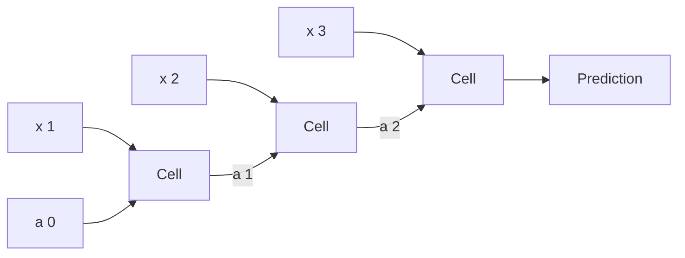

# Sequence models

> A review, a sentence or a clip of audio has an order and any length. A recurrent network reads it one step at a time and carries a memory, and everything hard about RNNs comes from that memory: it fades, and without some care it explodes. Course 5 builds the cells in NumPy, then uses them for names, music, word vectors and translation. This chapter runs those ideas in PyTorch, and ends on the mechanism that replaced them: attention.

**In plain words.** Some data only makes sense in order: "the dog bit the man" and "the man bit the dog" use the same words. A sequence model reads one step at a time and carries notes forward, like someone working through a long letter and trying to remember how it began, and in the simple version those notes fade. This chapter shows why they fade, how better versions choose what to keep, and how attention lets a model look back over the whole input, the way a translator rereads a sentence. At work these models handle text, audio and anything else that arrives as a sequence.

| Notebook | Builds | Key idea |
|---|---|---|
| Building an RNN: Step by Step | `rnn_cell_forward`, `lstm_cell_forward` and backward passes in NumPy | $a^{\langle t\rangle} = \tanh(W_{aa} a^{\langle t-1\rangle} + W_{ax} x^{\langle t\rangle} + b_a)$; LSTM gates (forget, update, output) protect the cell state from vanishing gradients |
| Dinosaurus Island | Character-level RNN language model on dinosaur names; gradient clipping; sampling | The same task as [makemore](../../../generative-ai/09-llms-from-scratch/notes/02-makemore.md), with an RNN instead of an MLP |
| Jazz improvisation with LSTM | Keras LSTM that generates music values; inference loop feeding samples back in | Training vs autoregressive sampling |
| Operations on word vectors | Cosine similarity, analogies with GloVe (`man : woman :: king : ?`), debiasing by neutralise/equalise | Embedding geometry; bias in embeddings ([NLP embeddings](../../03-nlp/notes/04-embeddings-and-similarity.md)) |
| Emojify | Average of GloVe vectors → softmax; then a 2-layer LSTM over the embeddings | Pretrained embeddings let 127 training sentences generalise |
| Neural machine translation with attention | Date normalisation ("3 May 1979" → "1979-05-03") with a Bi-LSTM encoder and attention | Attention weights $\alpha^{\langle t, t'\rangle} = \text{softmax}(e)$: the bridge to [nanoGPT](../../../generative-ai/09-llms-from-scratch/notes/03-nanogpt.md) |
| Trigger word detection | Synthesise audio training data, spectrogram → Conv1D → GRU → per-timestep sigmoid | Data synthesis; sequence labelling |



## The recurrent cell

The same cell, with the same weights, runs at every step. It takes the current input and the previous state. Training unrolls it and backpropagates through time, the same chain rule as [the first chapter](01-neural-networks-fundamentals.md#backpropagation), over one layer per step, an approach described in [doi:10.1038/323533a0](https://doi.org/10.1038/323533a0) (Rumelhart, Hinton and Williams, Nature 1986). Here are the Step by Step notebook's two cells, cut down:

```python
import numpy as np, torch, torch.nn as nn, torch.nn.functional as F
from sklearn.datasets import load_digits
from sklearn.model_selection import train_test_split

def sigmoid(z): return 1 / (1 + np.exp(-z))

def rnn_cell(x, a, p):
    return np.tanh(p["Waa"] @ a + p["Wax"] @ x + p["ba"])

def lstm_cell(x, a, c, p):
    z = np.concatenate([a, x])
    forget = sigmoid(p["Wf"] @ z + p["bf"])       # what to erase from memory
    update = sigmoid(p["Wu"] @ z + p["bu"])       # what to write
    candidate = np.tanh(p["Wc"] @ z + p["bc"])
    c = forget * c + update * candidate           # memory: additive, so gradients survive
    output = sigmoid(p["Wo"] @ z + p["bo"])
    return output * np.tanh(c), c

rng = np.random.default_rng(0)
n_x, n_a = 3, 5
p = {"Waa": rng.normal(size=(n_a, n_a)), "Wax": rng.normal(size=(n_a, n_x)), "ba": rng.normal(size=n_a)}
for g in "fuco":
    p[f"W{g}"], p[f"b{g}"] = rng.normal(size=(n_a, n_a + n_x)), rng.normal(size=n_a)

a = np.zeros(n_a)
c = np.zeros(n_a)
a_lstm = np.zeros(n_a)
for t in range(4):
    x = rng.normal(size=n_x)
    a = rnn_cell(x, a, p)
    a_lstm, c = lstm_cell(x, a_lstm, c, p)
print("RNN state", np.round(a, 2))
print("LSTM hidden", np.round(a_lstm, 2), "cell", np.round(c, 2))

params = lambda n_a, n_x: (n_a * n_a + n_a * n_x + n_a, 4 * (n_a * (n_a + n_x) + n_a))
print("parameters RNN, LSTM for n_a=64, n_x=8:", params(64, 8))
```

```text
RNN state [ 0.77  1.   -0.97  0.98 -0.96]
LSTM hidden [-0.   -0.01  0.21 -0.   -0.01] cell [-0.03 -0.45  0.38 -0.29 -1.05]
parameters RNN, LSTM for n_a=64, n_x=8: (4672, 18688)
```

The LSTM ([doi:10.1162/neco.1997.9.8.1735](https://doi.org/10.1162/neco.1997.9.8.1735) (Hochreiter and Schmidhuber, Neural Computation 1997)) adds a cell state updated by addition, with gates that decide what to erase and write. It has four times the RNN's parameters at the same size. The GRU merges the forget and update gates and drops the separate cell state, so it has three sets ([arXiv:1406.1078](https://arxiv.org/abs/1406.1078) (Cho et al., EMNLP 2014)).

## Digits, one row at a time

To thread the same data through, treat each 8×8 digit as a sequence of 8 rows of 8 pixels. It isn't a natural sequence task, but all the cells should manage it:

```python
d = load_digits()
Xa, Xb, ya, yb = train_test_split(d.data / 16.0, d.target, test_size=0.3, random_state=0, stratify=d.target)
X_tr = torch.tensor(Xa, dtype=torch.float32).reshape(-1, 8, 8)    # (batch, time, features)
X_te = torch.tensor(Xb, dtype=torch.float32).reshape(-1, 8, 8)
y_tr, y_te = torch.tensor(ya), torch.tensor(yb)

class Reader(nn.Module):
    def __init__(self, cell, inp=8, hidden=64, classes=10):
        super().__init__()
        self.rnn = {"rnn": nn.RNN, "gru": nn.GRU, "lstm": nn.LSTM}[cell](inp, hidden, batch_first=True)
        self.out = nn.Linear(hidden, classes)
    def forward(self, x):
        outputs, _ = self.rnn(x)           # outputs for every step; h_n is second, and for LSTM a tuple
        return self.out(outputs[:, -1])    # the last step's state

for cell in ["rnn", "gru", "lstm"]:
    res = []
    for s in range(3):
        torch.manual_seed(s)
        m = Reader(cell)
        opt = torch.optim.Adam(m.parameters(), lr=3e-3)
        for epoch in range(20):
            perm = torch.randperm(len(X_tr))
            for i in range(0, len(perm) - 32, 32):
                b = perm[i:i+32]
                loss = F.cross_entropy(m(X_tr[b]), y_tr[b])
                opt.zero_grad(); loss.backward(); opt.step()
        with torch.no_grad():
            res.append((m(X_te).argmax(1) == y_te).float().mean().item())
    n = sum(q.numel() for q in m.parameters())
    print(f"{cell:<5} params {n:>6}  test {np.mean(res):.3f} +- {np.std(res):.3f}")
```

```text
rnn   params   5386  test 0.957 +- 0.006
gru   params  14858  test 0.966 +- 0.005
lstm  params  19594  test 0.962 +- 0.006
```

Eight steps is short, so a plain RNN keeps up, at far fewer parameters, and all three stay behind the [CNN's 0.983](04-convolutional-networks.md#a-cnn-on-the-digits). The next experiment makes the sequence long.

## Vanishing gradients, and the forget-gate bias

Backpropagation through $T$ steps multiplies $T$ factors, and if they're below one the signal vanishes. The simplest test: the label is the sign of the first number, and all later numbers are noise. So the network must carry one bit through the whole sequence. PyTorch initialises an LSTM's biases like everything else, so its forget gate starts near 0.5 and halves the memory at every step. Setting the forget-gate bias to 1, an old recommendation supported by Jozefowicz et al.'s architecture search ([PMLR v37](https://proceedings.mlr.press/v37/jozefowicz15.html) (Jozefowicz, Zaremba and Sutskever, ICML 2015)), starts it near keep:

```python
def seqs(n, T, seed):
    g = torch.Generator().manual_seed(seed)
    x = (torch.randint(0, 2, (n, T, 1), generator=g) * 2 - 1).float()
    return x, (x[:, 0, 0] > 0).long()

def memory_net(cell, forget_bias=0.0, h=32):
    m = Reader(cell, inp=1, hidden=h, classes=2)
    if forget_bias:
        for name, q in m.rnn.named_parameters():
            if "bias" in name:
                nn.init.zeros_(q)
            if name == "bias_hh_l0":
                q.data[h:2 * h] = forget_bias     # chunks in order: input, forget, cell, output
    return m

variants = [("rnn", 0.0), ("lstm", 0.0), ("lstm", 1.0), ("lstm", 2.0)]
for cell, fb in variants:
    torch.manual_seed(0)
    m = memory_net(cell, fb)
    x = torch.randn(1, 50, 1, requires_grad=True)
    m(x)[0, 0].backward()
    g = x.grad.abs().flatten()
    print(f"{cell:<4} forget bias {fb}  |d output / d x_t|  t=49 {g[49]:.1e}  t=25 {g[25]:.1e}  t=0 {g[0]:.1e}")

for T in [20, 50]:
    for cell, fb in variants:
        res = []
        for s in range(3):
            torch.manual_seed(s)
            m = memory_net(cell, fb)
            opt = torch.optim.Adam(m.parameters(), lr=3e-3)
            X_val, y_val = seqs(500, T, 99)
            for step in range(500):
                x, y = seqs(64, T, step + 1000)
                loss = F.cross_entropy(m(x), y)
                opt.zero_grad(); loss.backward()
                nn.utils.clip_grad_norm_(m.parameters(), 1.0)
                opt.step()
            with torch.no_grad():
                res.append((m(X_val).argmax(1) == y_val).float().mean().item())
        print(f"T={T:<3} {cell:<4} forget bias {fb}  accuracy per seed {np.round(res, 3)}")
```

```text
rnn  forget bias 0.0  |d output / d x_t|  t=49 4.5e-02  t=25 5.0e-07  t=0 1.4e-12
lstm forget bias 0.0  |d output / d x_t|  t=49 1.7e-02  t=25 1.7e-07  t=0 1.2e-12
lstm forget bias 1.0  |d output / d x_t|  t=49 1.5e-02  t=25 1.8e-04  t=0 9.5e-06
lstm forget bias 2.0  |d output / d x_t|  t=49 1.4e-02  t=25 6.8e-03  t=0 2.0e-02
T=20  rnn  forget bias 0.0  accuracy per seed [0.53 0.53 0.53]
T=20  lstm forget bias 0.0  accuracy per seed [0.53 0.53 0.53]
T=20  lstm forget bias 1.0  accuracy per seed [1. 1. 1.]
T=20  lstm forget bias 2.0  accuracy per seed [1. 1. 1.]
T=50  rnn  forget bias 0.0  accuracy per seed [0.51  0.502 0.502]
T=50  lstm forget bias 0.0  accuracy per seed [0.502 0.502 0.502]
T=50  lstm forget bias 1.0  accuracy per seed [0.502 0.502 0.5  ]
T=50  lstm forget bias 2.0  accuracy per seed [0.502 0.892 1.   ]
```

Before training, an LSTM with PyTorch's defaults is no better than a plain RNN: the gradient from the first step is about $10^{-12}$ in both. A forget bias of 1 lifts it to about $10^{-5}$, and 2 to about 0.02, as large as the last step's. So the LSTM's advantage isn't automatic: without the bias, both cells stayed at chance even at $T=20$ in this budget. A bias of 1 solves $T=20$ on all seeds, and $T=50$ needs more (2 reached 0.892 and 1.0 on two of three seeds).

One trap, which cost a debugging round when this chapter was written. An `nn.LSTM` has two bias vectors, `bias_ih_l0` and `bias_hh_l0`, and each gate adds both. The widely copied snippet that writes 1 to the forget chunk of every parameter with "bias" in its name therefore sets a total of 2, and a check against a wrong name such as `"bias_hh"` silently does nothing. Measure the effect rather than trust the assignment.

The opposite failure is exploding gradients. The fix is to rescale the whole gradient when its norm goes over a threshold, which is what the `clip_grad_norm_` line does. The next section logs that norm.

## Character models and sampling

The **Dinosaurus Island** notebook trains on dinosaur names, one character per step, each predicting the next. The name list didn't get copied to this repo, so here is a stand-in built from syllables. [makemore](../../../generative-ai/09-llms-from-scratch/notes/02-makemore.md) trains the same kind of model on real names.

```python
import random

random.seed(0)
heads = ["tyranno", "stego", "veloci", "ptero", "brachio", "allo", "diplo", "tricera", "ankylo", "spino"]
tails = ["saurus", "don", "raptor", "ceratops", "mimus", "pteryx", "venator", "titan"]
names = sorted({random.choice(heads) + random.choice(["", "ma", "ri", "lo"]) + random.choice(tails) for _ in range(300)})
vocab = ["."] + sorted(set("".join(names)))
stoi = {c: i for i, c in enumerate(vocab)}
maxlen = max(map(len, names)) + 1
def encode(w): return [stoi[c] for c in w + "."] + [0] * (maxlen - len(w) - 1)
data = torch.tensor([encode(w) for w in names])
print(len(names), "names", "vocabulary", len(vocab), "examples", names[:3])

class CharRNN(nn.Module):
    def __init__(self, v, h=64):
        super().__init__()
        self.emb, self.gru, self.out = nn.Embedding(v, 16), nn.GRU(16, h, batch_first=True), nn.Linear(h, v)
    def forward(self, x, h=None):
        o, h = self.gru(self.emb(x), h)
        return self.out(o), h

torch.manual_seed(0)
model = CharRNN(len(vocab))
opt = torch.optim.Adam(model.parameters(), lr=5e-3)
inp = torch.cat([torch.zeros(len(data), 1, dtype=torch.long), data[:, :-1]], dim=1)   # "." starts each name
norms = []
for step in range(300):
    logits, _ = model(inp)
    loss = F.cross_entropy(logits.transpose(1, 2), data)
    opt.zero_grad(); loss.backward()
    norms.append(nn.utils.clip_grad_norm_(model.parameters(), 1.0).item())   # returns the norm before clipping
    opt.step()
print(f"loss {loss.item():.3f}; gradient norm before clipping: first {norms[0]:.2f}, largest {max(norms):.2f}, last {norms[-1]:.2f}")

@torch.no_grad()
def sample(temperature=1.0, seed=0):
    torch.manual_seed(seed)
    x, h, out = torch.zeros(1, 1, dtype=torch.long), None, ""
    for _ in range(maxlen):
        logits, h = model(x, h)
        ch = torch.multinomial((logits[0, -1] / temperature).softmax(0), 1).item()   # feed the sample back in
        if ch == 0: break
        out += vocab[ch]
        x = torch.tensor([[ch]])
    return out

print("t=1.0:", [sample(1.0, s) for s in range(4)])
print("t=0.1:", [sample(0.1, s) for s in range(4)])
print("t=3.0:", [sample(3.0, s) for s in range(4)])
```

```text
195 names vocabulary 22 examples ['alloceratops', 'allodon', 'allolodon']
loss 0.299; gradient norm before clipping: first 0.61, largest 0.83, last 0.00
t=1.0: ['tyrannosaurus', 'tricerariceratops', 'allolotitan', 'spinomaceratops']
t=0.1: ['triceraloceratops', 'tricerariceratops', 'ankylolopteryx', 'stegoriceratops']
t=3.0: ['typinn', 'pterodorociphte', 'aeluvenots', 'sluolocirapdontyxe']
```

Training feeds in the true previous character, and sampling feeds back its own output. The **Jazz** notebook has the same two modes for music. On this small task the norm never reached the threshold of 1.0 (the largest was 0.83), so clipping was only insurance. It costs one line and matters on the run where a gradient does spike. A low temperature concentrates on the likeliest next character, and a high one flattens the distribution until the structure goes: compare the `t=3.0` line with the others.

## Word vectors

A word is a one-hot vector until you embed it, and in one-hot form every pair of words is equally far apart. The **Operations on word vectors** notebook uses pretrained GloVe ([Pennington, Socher and Manning, EMNLP 2014](https://aclanthology.org/D14-1162/)). The arithmetic works on any vectors, so these are small ones constructed to carry the idea. Dimension 0 is gender and the others are "royalty", "age" and "occupation":

```python
vec = {"man": [ 1, 0, 0.3, 0], "woman": [-1, 0, 0.3, 0], "king": [ 1, 1, 0.5, 0], "queen": [-1, 1, 0.5, 0],
       "boy": [ 1, 0, -0.8, 0], "girl": [-1, 0, -0.8, 0], "doctor": [0.4, 0, 0.5, 1], "nurse": [-0.5, 0, 0.5, 1]}
vec = {k: np.array(v, dtype=float) for k, v in vec.items()}

def cosine(u, v): return u @ v / (np.linalg.norm(u) * np.linalg.norm(v))

def analogy(a, b, c):
    target = vec[b] - vec[a] + vec[c]                  # a : b :: c : ?
    return max((w for w in vec if w not in (a, b, c)), key=lambda w: cosine(target, vec[w]))

print("man : woman :: king :", analogy("man", "woman", "king"))
print("man : woman :: boy  :", analogy("man", "woman", "boy"))

g = vec["woman"] - vec["man"]                          # the bias direction
def neutralise(v): return v - (v @ g) / (g @ g) * g    # remove the component along g

print("doctor vs gender direction, before %.3f, after %.3f" % (cosine(vec["doctor"], g), cosine(neutralise(vec["doctor"]), g)))
print("nurse  vs gender direction, before %.3f, after %.3f" % (cosine(vec["nurse"], g), cosine(neutralise(vec["nurse"]), g)))
```

```text
man : woman :: king : queen
man : woman :: boy  : girl
doctor vs gender direction, before -0.337, after 0.000
nurse  vs gender direction, before 0.408, after 0.000
```

Neutralise and its companion equalise come from Bolukbasi et al. ([arXiv:1607.06520](https://arxiv.org/abs/1607.06520) (Bolukbasi et al., NeurIPS 2016)). Occupations lean along the gender direction here because these numbers were built to, and in real GloVe vectors they do so because the training text does, which your notebook prints. **Emojify** shows the other use of pretrained vectors: averaging GloVe vectors then a softmax generalises from 127 training sentences, and swapping in an LSTM over the same embeddings lets it handle word order, which an average can't. [NLP embeddings](../../03-nlp/notes/04-embeddings-and-similarity.md) continues from here.

## Seq2seq and attention

Sutskever et al. mapped a sequence to a sequence by encoding the input into one vector and decoding from it ([arXiv:1409.3215](https://arxiv.org/abs/1409.3215) (Sutskever, Vinyals and Le, NeurIPS 2014)). That single vector becomes the bottleneck. Bahdanau et al. let the decoder look back at all encoder states at each step, weighted by a learned score ([arXiv:1409.0473](https://arxiv.org/abs/1409.0473) (Bahdanau, Cho and Bengio, ICLR 2015)). Your **Neural machine translation** notebook applies this to dates. Here is the same task with synthetic dates, with and without attention. The model below runs in seconds:

```python
months = ["January", "February", "March", "April", "May", "June", "July", "August", "September", "October", "November", "December"]
rng = random.Random(0)
def date_pair():
    d, m, y = rng.randint(1, 28), rng.randint(1, 12), rng.randint(1950, 2030)
    form = rng.choice(["{d} {M} {y}", "{M} {d}, {y}", "{d}/{m}/{y}", "{d} {Ms} {y}"])
    return form.format(d=d, M=months[m-1], Ms=months[m-1][:3], m=m, y=y).lower(), f"{y}-{m:02d}-{d:02d}"

pairs = [date_pair() for _ in range(4000)]
itos = ["<pad>"] + sorted(set("".join(a for a, _ in pairs)))
in_stoi = {c: i for i, c in enumerate(itos)}
out_vocab = "0123456789-"
out_stoi = {c: i + 1 for i, c in enumerate(out_vocab)}          # 0 is the start symbol
L = max(len(a) for a, _ in pairs)
def enc(a): return [in_stoi[c] for c in a] + [0] * (L - len(a))
X = torch.tensor([enc(a) for a, _ in pairs])
Y = torch.tensor([[out_stoi[c] for c in b] for _, b in pairs])
X_a, Y_a, X_v, Y_v = X[:3500], Y[:3500], X[3500:], Y[3500:]

class DateModel(nn.Module):
    def __init__(self, attention, h=32):
        super().__init__()
        self.attention = attention
        self.emb = nn.Embedding(len(itos), 16, padding_idx=0)
        self.enc = nn.GRU(16, h, batch_first=True, bidirectional=True)
        self.dec = nn.GRUCell(12 + (2 * h if attention else 0), 2 * h)
        self.query, self.out = nn.Linear(2 * h, 2 * h), nn.Linear(2 * h, 12)
    def forward(self, x, y=None):
        H, last = self.enc(self.emb(x))
        s = torch.cat([last[0], last[1]], dim=1)                # the seq2seq bottleneck
        prev, outs, alphas = torch.zeros(len(x), 12), [], []
        for t in range(10):
            inp = prev
            if self.attention:
                e = (self.query(s)[:, None] * H).sum(2).masked_fill(x == 0, -1e9)
                alpha = e.softmax(1)                            # the notebook's alpha<t, t'>
                alphas.append(alpha)
                inp = torch.cat([prev, (alpha[:, :, None] * H).sum(1)], dim=1)
            s = self.dec(inp, s)
            logits = self.out(s)
            outs.append(logits)
            nxt = y[:, t] if y is not None else logits.argmax(1)  # teacher forcing in training
            prev = F.one_hot(nxt, 12).float()
        return torch.stack(outs, 1), alphas

trained = {}
for attention in [False, True]:
    torch.manual_seed(0)
    m = DateModel(attention)
    opt = torch.optim.Adam(m.parameters(), lr=3e-3)
    for epoch in range(6):
        perm = torch.randperm(len(X_a))
        for i in range(0, len(perm) - 64, 64):
            b = perm[i:i+64]
            logits, _ = m(X_a[b], Y_a[b])
            loss = F.cross_entropy(logits.transpose(1, 2), Y_a[b])
            opt.zero_grad(); loss.backward(); opt.step()
    with torch.no_grad():
        pred = m(X_v)[0].argmax(2)
    print(f"attention={attention!s:<5}  characters right {(pred == Y_v).float().mean():.3f}  whole date right {(pred == Y_v).all(1).float().mean():.3f}")
    trained[attention] = m

text = "3 may 1979"
x = torch.tensor([enc(text)])
with torch.no_grad():
    logits, alphas = trained[True](x)
out = "".join(out_vocab[i - 1] for i in logits[0].argmax(1).tolist())
print(text, "->", out)
for t, ch in enumerate(out):
    print(f"  output '{ch}' looks at '{text[alphas[t][0, :len(text)].argmax().item()]}' at position {alphas[t][0, :len(text)].argmax().item()}")
```

```text
attention=False  characters right 0.774  whole date right 0.032
attention=True   characters right 1.000  whole date right 1.000
3 may 1979 -> 1979-05-03
  output '1' looks at '9' at position 7
  output '9' looks at '9' at position 7
  output '7' looks at '7' at position 8
  output '9' looks at '9' at position 9
  output '-' looks at 'm' at position 2
  output '0' looks at 'm' at position 2
  output '5' looks at 'm' at position 2
  output '-' looks at '3' at position 0
  output '0' looks at ' ' at position 1
  output '3' looks at '3' at position 0
```

After six epochs on the same data, attention gets every held-out date right, while the bottleneck model gets 3% of whole dates. The printout shows what the weights read. The year digits look at the year (the century at its neighbour, since only 19 and 20 occur), the month digits look at the "m" of "may", and the day digits look at the "3" and the space beside it. Now take the last step seriously. Remove the recurrence and let every position query every other, and you have the Transformer's self-attention, which [nanoGPT](../../../generative-ai/09-llms-from-scratch/notes/03-nanogpt.md) builds. **Trigger word detection** is the remaining notebook: it synthesises audio by mixing clips into backgrounds, then runs spectrogram → Conv1D → GRU → a sigmoid at every step, so the sequence task can be labelling each step as well as classifying the whole.

## Autoencoders: the bottleneck on its own

The seq2seq model squeezed a sentence through one vector and suffered for it. An **autoencoder** makes that squeeze the whole point. An encoder maps the input to a small vector called the **code**, a decoder rebuilds the input from the code, and the loss is the difference between input and output, so no labels are needed. It can't copy the input through a narrow code, so it has to learn what's regular in the data. Hinton and Salakhutdinov set this out as a non-linear generalisation of PCA, and showed a deep network reaching a squared error of 3.00 on MNIST at a code of 30, against 13.87 for PCA ([*Reducing the Dimensionality of Data with Neural Networks*](https://doi.org/10.1126/science.1127647), *Science* 2006). Deep ones were hard to train then, which is why that paper needed layer-wise pretraining.

```python
# illustrative: from practice/autoencoder.py, on scikit-learn's digits (8 by 8 pixels, scaled 0 to 1)
def make_ae(code, hidden=128):
    return nn.Sequential(nn.Linear(64, hidden), nn.ReLU(), nn.Linear(hidden, code), nn.ReLU(),
                         nn.Linear(code, hidden), nn.ReLU(), nn.Linear(hidden, 64), nn.Sigmoid())
```

[`practice/autoencoder.py`](../practice/autoencoder.py) trains this on a small data set of 1,797 digit images, far smaller than the paper's MNIST, so don't compare the scale of these numbers with theirs.

```text
held-out squared error per image, mean (sd) over five splits; pixels scaled 0 to 1, 64 pixels
code 2   autoencoder 2.807 (0.513)   PCA 3.399 (0.029)
code 4   autoencoder 1.739 (0.393)   PCA 2.432 (0.018)
code 8   autoencoder 1.233 (0.112)   PCA 1.569 (0.025)
code 16  autoencoder 0.764 (0.198)   PCA 0.738 (0.008)
code 32  autoencoder 0.315 (0.067)   PCA 0.171 (0.004)
```

The non-linear model wins only where the code is tight. At 16 they're level, and at 32 PCA is ahead, with far less variation between runs and no training. So compute PCA first: it's your baseline, and it may be all you need.

**Denoising.** Vincent et al. asked what happens if you drop the bottleneck. Corrupt the input by setting a random share of it to zero, then ask for the clean version. Now copying fails even with a code wider than the input, so the corruption replaces the bottleneck as the constraint, and it applies only during training ([*Extracting and Composing Robust Features with Denoising Autoencoders*](https://www.cs.toronto.edu/~larocheh/publications/icml-2008-denoising-autoencoders.pdf), ICML 2008). Their model selection in fact chose very wide layers, 2,000 units for 784 pixels, and stacked denoising layers beat ordinary stacked autoencoders on most of their tasks, though not all. Here's the same effect on a wide network that could simply copy:

```text
wide network with 256 hidden units, test images with 30% of pixels zeroed; error measured against the clean image
doing nothing (the corrupted image as the answer): error 4.495
Plain, trained on clean input        clean input 0.077   corrupted input 3.771   distance from the corrupted input 0.216
Denoising, trained with 30% zeroed   clean input 0.545   corrupted input 0.927   distance from the corrupted input 3.756
```

The plain network does learn to copy, and its output stays only 0.216 from the corrupted input, holes and all. The denoising network repairs them, taking the error from 4.495 to 0.927. It pays with a worse reconstruction of clean images, 0.545 against 0.077, as it's learned a different job.

**Reconstruction error as an anomaly score.** Train on normal data only. The model rebuilds what resembles its training set and fails on what doesn't, so the error becomes a score. Neither paper above proposes this, as both are after representations, so what follows is the course's own test. We hide one digit from training and ask whether error picks it out of a test set, for each digit in turn.

```text
AUC for spotting a digit never seen in training, mean over all ten digits, five splits each
code 2   autoencoder 0.902 (sd over runs 0.097)   PCA 0.785 (sd 0.140)
code 4   autoencoder 0.954 (sd over runs 0.041)   PCA 0.798 (sd 0.107)
code 8   autoencoder 0.956 (sd over runs 0.043)   PCA 0.885 (sd 0.082)
code 16  autoencoder 0.954 (sd over runs 0.050)   PCA 0.839 (sd 0.109)
code 32  autoencoder 0.910 (sd over runs 0.078)   PCA 0.743 (sd 0.133)
by held-out digit at code 16, autoencoder: {0: 0.997, 1: 0.848, 2: 0.991, 3: 0.954, 4: 0.988, 5: 0.989, 6: 0.917, 7: 0.991, 8: 0.961, 9: 0.909}
```


Here's the catch, and the reason the two panels disagree. The best reconstruction isn't the best detector. Widen the code and PCA's error keeps falling, yet its AUC drops from 0.885 at 8 to 0.743 at 32, and the autoencoder's falls from 0.954 at 16 to 0.910 at 32. A code wide enough to rebuild everything rebuilds the anomalies too. So choose the code size on labelled anomalies if you have some, not on reconstruction error. Detection also depends on the anomaly: at 0.848, the digit 1 is the hardest, plausibly because its few strokes are easy to rebuild from the others.

For tabular anomalies, try [an isolation forest or a Gaussian](../../01-classical-ml/notes/05-unsupervised-learning.md#anomaly-detection-ng-ex8-part-1) first, and reach for this when the input is an image or other raw signal. To turn the code into a distribution you can sample from, see [the VAE](../../../data-analytics/04-bayesian-analysis/notes/06-bayesian-machine-learning.md#the-vae).

## Ordered events: make the sequence model earn its place

A GRU reads any ordered events, and a customer's card charges are a common case. Before you train one, ask what hand-built windows already capture. [`transaction_sequence_lab.py`](../practice/transaction_sequence_lab.py) generates charges with a planted fraud pattern: small online tests, then a large charge soon after, with decoys that hold the same charges in another order or further apart. We picked that pattern to favour order, so read this as a fact about this generator. The test days hold 130 frauds at a 0.27% base rate, on a time split, with the GRU reading the last 12 charges.

```text
boosting on totals, 30-day counts and sums       0.097  [0.083, 0.126]
boosting on velocity windows and last 3 events   0.855  [0.820, 0.899]
GRU over the last 12 event embeddings            0.791  [0.746, 0.847]
the velocity model again, untuned large trees    0.353  [0.275, 0.421]
GRU with each test window's order scrambled      0.149
```

These are PR-AUC with 90% bootstrap intervals. Order clearly matters: totals can't see it, and scrambling the windows breaks the GRU. But gaps and the last three events are order written by hand, and they beat the GRU by 0.061 (interval 0.025 to 0.098), and they lead on all three generated datasets, by 0.021 and 0.009 on the other two. The GRU got one architecture and no search, and the pattern fits in a short window, so this isn't a verdict on GRUs. The last row is the warning: our first boosting settings overfit the few positives and handed the GRU a win it hadn't earned. Compare models that have each had a fair chance.

PR-AUC, the cost rule and PSI are in [DS 01/10](../../01-classical-ml/notes/10-imbalance-errors-and-drift.md), and the lab applies them to events, with late chargebacks and a pattern that changes. There, every model fell below 0.01 while PSI stayed at 0.002 or less, as [concept shift is silent to PSI](../../01-classical-ml/notes/10-imbalance-errors-and-drift.md#drift-when-the-world-moves).

## Reading

Buduma, *Fundamentals of Deep Learning* ([PDF](../../sources/buduma-fundamentals-of-deep-learning.pdf)), ch. 7 (models for sequence analysis) parallels this chapter, using TensorFlow.

| Set | Runs |
|---|---|
| [`Sequence Models`](../practice/ng-deep-learning/Sequence%20Models/) (7 notebooks across weeks 1 to 3) | Legacy, reading-only as stored: `emo_utils`, GloVe vectors, the dinosaur name list and pretrained weights weren't copied. The Keras notebooks use standalone `keras` 2.x, and [the migration table](01-neural-networks-fundamentals.md#tensorflow-1x-to-2x-status-and-migration-map) has the status |

All the numbers on digits, memory, names and dates came from running the code shown. The name list and word vectors are constructed, as the text says.

## Pitfalls

| Symptom | Cause | Fix |
|---|---|---|
| Loss goes to `nan` during an RNN's training | Exploding gradients | `clip_grad_norm_` between `backward()` and `step()` |
| LSTM doesn't beat a plain RNN on long sequences | Forget gate starts near 0.5, as PyTorch sets no bias | Set the forget-gate bias to 1 or more on `bias_hh_l0`, and remember that `bias_ih_l0` adds to it |
| Dimension errors when porting Keras or NumPy code | PyTorch's RNNs default to `(time, batch, features)` | `batch_first=True` |
| `h_n` has the wrong shape for a classifier | It is `(layers * directions, batch, hidden)`, and a tuple for LSTM | Use `outputs[:, -1]`, or concatenate the last forward and backward states |
| Padded batches give worse results | The last "step" for short sequences is padding | `pack_padded_sequence`, or index the true last step |
| Good loss in training, bad text when sampling | Teacher forcing: the model never saw its own mistakes | Sample while training to check; lower the temperature |
| Decoder fine for short input, poor for long | Everything squeezed into one vector | Attention |
| A GRU beats boosting by a wide margin on events | Boosting overfit few positives: large trees scored 0.353 where validation-picked ones scored 0.855 | Tune both on later days before you compare them |
| An autoencoder with a low error misses anomalies | The code is wide enough to rebuild them too: PCA fell from 0.885 to 0.743 AUC between codes of 8 and 32 | Choose the code size on labelled anomalies, not on reconstruction error |

## Try it

1. In the memory task, replace the LSTM with `nn.GRU` for $T=20$, using PyTorch's defaults, for three seeds and 500 steps. Is the GRU in the same trouble as the unbiased LSTM?

   <details><summary>Answer</summary>

   The GRU is in the same trouble: `[0.53, 0.532, 0.532]` at $T=20$ with PyTorch's defaults. It has no forget-bias trick to reach for here, so the fix would be a different initialisation or a longer budget.

   </details>

2. Count by hand the parameters of an `nn.GRU(8, 64)`, then check with PyTorch. How does this compare with the printed `gru` count of the reader, which includes a linear layer?

   <details><summary>Answer</summary>

   Three gates at $(64 \times 8 + 64 \times 64 + 64)$ give 14,016 with one bias per gate, but PyTorch keeps two bias vectors, so it is $3 \times (512 + 4096 + 64 + 64) = 14{,}208$. Adding the `Linear(64, 10)`, 650 parameters, gives the printed 14,858.

   </details>

3. Train the date model with attention on only 500 pairs, and report the whole-date accuracy for both models after 6 epochs.

   <details><summary>Answer</summary>

   With attention: characters 0.498, whole dates 0.000. Without: characters 0.316, whole dates 0.000. Neither solves it, because 500 pairs at batch size 64 make only 42 updates. Attention still gets further per update, but it needs enough steps to learn the alignment.

   </details>

4. From the autoencoder tables, which code size would you ship for reconstruction, and which for spotting unseen digits? Why do they differ?

   <details><summary>Answer</summary>

   For reconstruction, PCA at 32, with an error of 0.171, and more components would do better still. For detection, the autoencoder at 4 to 16, with an AUC near 0.955. A wider code rebuilds unseen digits as well as seen ones, so the gap that the score relies on closes.

   </details>

5. Fraud changes pattern on day 300, and chargebacks take a median of 28 days. On day 360 you retrain, once on labels older than 75 days, the rule that kept training clean, and once on everything reported so far. Guess which recovers, then run `uv run transaction_sequence_lab.py` from `practice/` and read the end of section 6.

   <details><summary>Answer</summary>

   Only the second, and only for boosting: 0.528 PR-AUC on days 360 to 420, against 0.006 for the mature-labels rule and 0.030 for the GRU. Mature labels hold none of the new pattern, since it's younger than 75 days, while everything reported holds 61 such frauds. Waiting for mature labels stops unreported fraud counting as clean, and it blinds you to change. These numbers describe this generator and one run.

   </details>

## Interview checklist

| Question | Answer |
|---|---|
| Why not an MLP for sequences? | Inputs have variable length and an MLP doesn't share what it learns across positions. |
| Why do RNN gradients vanish or explode? | Backprop through time multiplies one factor per step, so it decays or grows exponentially. |
| What does an LSTM add? | A cell state updated additively, with forget, update and output gates. |
| LSTM or GRU? | The GRU has fewer parameters and often similar results, so try it first where size matters. |
| Why set the forget-gate bias to 1? | So that the gate starts near "keep" and gradients reach early steps at initialisation. |
| What is gradient clipping? | Rescaling the gradient when its global norm exceeds a threshold, between `backward` and `step`. |
| What is teacher forcing? | Feeding the true previous token in training instead of the model's own output. |
| What does temperature do at sampling time? | Divides logits before the softmax: lower is more conservative, higher is more random. |
| What problem did attention solve? | The fixed-size bottleneck: the decoder chooses which encoder states to read at each step. |
| What does an autoencoder's bottleneck do? | Forces it to keep what's regular, as copying won't fit. A linear one spans the same subspace as PCA, so use PCA as the baseline. |
| What does denoising change? | Corruption replaces the bottleneck as the constraint, so the code can be wide. Corrupt in training only. |
| Why is reconstruction error a risky anomaly score? | A code wide enough can rebuild the anomalies as well, so the best reconstruction isn't the best detector. |
| Aggregates or a sequence model on events? | Start with velocity windows and gaps, tuned on later days, and require the sequence model to beat them. Ours beat a GRU on generated card fraud, 0.855 against 0.791 PR-AUC. |
| What's a word-vector analogy test doing? | Checking that $\text{woman} - \text{man} + \text{king}$ is nearest to queen by cosine, excluding the inputs. |

## Next

[Transformer encoders](05b-transformer-encoders.md): attention without the recurrence, as a model you choose and train. Then [neural text models](06-neural-text-models.md): the same layers on real text.
