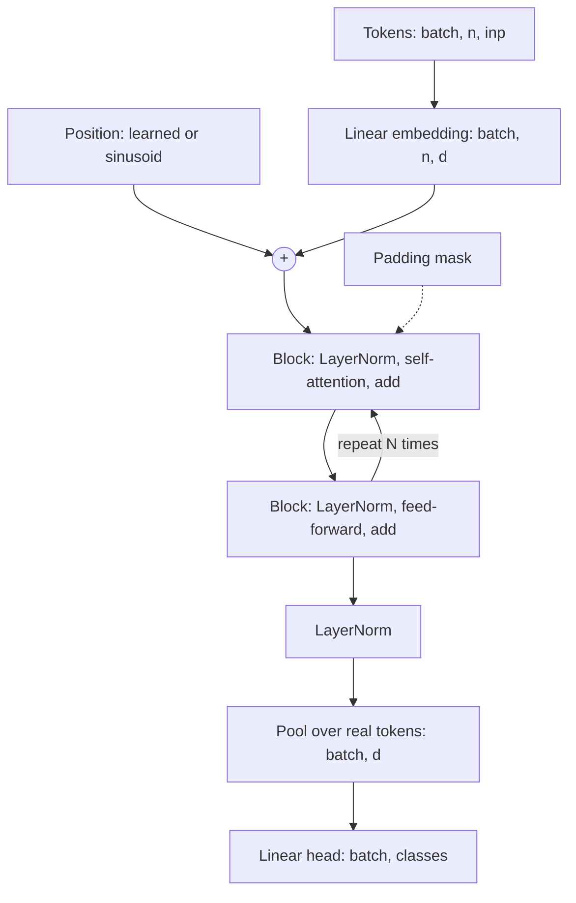

# Transformer encoders

> An encoder reads every token at once and pays for it three ways: it knows nothing about order until you tell it, its cost grows with the square of the length, and it assumes less about the data than a CNN or an LSTM, so it has to learn more from examples. This chapter builds one in PyTorch, shows the silent bugs a shape mistake causes, and runs it on the same split as the linear model, the CNN and the LSTM. On 1,257 digits it comes third, behind a CNN at 0.988 and level with an LSTM. On a memory task where an LSTM stays at chance for some seeds, it is right on every seed. Knowing which of those you have is the point of the chapter.

**In plain words.** An LSTM reads a report line by line and keeps notes. An encoder lays all the lines out on a table and lets each one look at every other. Nothing fades, because nothing has to be carried. But pages on a table have lost their page numbers, so you have to write the numbers on, and a thousand pages means a million comparisons. A CNN, which assumes local shapes matter, learns from fewer examples when that assumption holds. At work this decides whether a transformer is worth trying on your sensor readings, event logs or tables.



This chapter treats the encoder as a model you choose and train. [Attention and the transformer block](../../../generative-ai/01-llm-fundamentals/notes/02-attention-and-the-transformer-block.md) covers causal masks and why LLMs are built this way, and [nanoGPT](../../../generative-ai/09-llms-from-scratch/notes/03-nanogpt.md) builds a language model from nothing.

Each block below continues from the previous ones in one file. It needs `torch`, `scikit-learn` and `numpy`, and no GPU. On a laptop CPU the whole file took about 17 minutes, about 10 of them in the memory and pattern comparison, and timings printed below are from one such run.

## Self-attention, and the encoder around it

[Note 05](05-sequence-models.md#seq2seq-and-attention) had a decoder look back over encoder states with learned weights. Self-attention does this within one sequence and drops the recurrence: each token makes a **query**, compares it with a **key** from every token, and takes a weighted average of their **values**. All three are linear projections of the token, and they are the only part of the layer that learns.

Here is the layer by hand, with two checks: what shuffling the tokens does to the output, and why the scores are divided by $\sqrt{d_k}$, where $d_k$ is the width of a key:

```python
import math, time
import numpy as np
import torch
import torch.nn as nn
import torch.nn.functional as F

def attention(x, W_q, W_k, W_v):
    q, k, v = x @ W_q, x @ W_k, x @ W_v
    scores = q @ k.transpose(-2, -1) / math.sqrt(k.shape[-1])    # (batch, n, n)
    return F.softmax(scores, dim=-1) @ v                         # each token: a weighted average of all values

torch.manual_seed(0)
d = 16
W_q, W_k, W_v = (torch.randn(d, d) / math.sqrt(d) for _ in range(3))
x = torch.randn(1, 5, d)                                         # one sequence of 5 tokens
order = torch.tensor([3, 0, 4, 1, 2])
out = attention(x, W_q, W_k, W_v)
out_shuffled = attention(x[:, order], W_q, W_k, W_v)
print("each output moves with its input:", torch.allclose(out[:, order], out_shuffled))
print("mean over tokens unchanged:      ", torch.allclose(out.mean(1), out_shuffled.mean(1)))
print("last position's output unchanged:", torch.allclose(out[:, -1], out_shuffled[:, -1]))

for size in [4, 64, 1024]:
    a, b = torch.randn(10000, size), torch.randn(10000, size)
    dots = (a * b).sum(1)
    print(f"d_k {size:>4}  std of q.k {dots.std():6.2f}  after dividing by sqrt(d_k) {dots.std() / math.sqrt(size):.2f}")
```

```text
each output moves with its input: True
mean over tokens unchanged:       True
last position's output unchanged: False
d_k    4  std of q.k   2.00  after dividing by sqrt(d_k) 1.00
d_k   64  std of q.k   7.99  after dividing by sqrt(d_k) 1.00
d_k 1024  std of q.k  32.09  after dividing by sqrt(d_k) 1.00
```

Two things follow. The first is the scaling. Under the Transformer paper's assumption of independent unit-variance components, a dot product has variance $d_k$, and its authors "suspect" large values push the softmax into regions with very small gradients, so they divide by $\sqrt{d_k}$ ([arXiv:1706.03762](https://arxiv.org/abs/1706.03762), §3.2.1 (Vaswani et al., NeurIPS 2017)). The standard deviations above confirm the growth; the paper runs no scaled against unscaled experiment.

The second matters more. Shuffle the input tokens and each output moves with its input and nothing else changes, so this layer has no idea what order its tokens came in. The exact term is *equivariant*: the output permutes as the input does. A mean over tokens is then *invariant*: it does not change at all. So self-attention followed by a mean pool sees a set, not a sequence.

An **encoder block** wraps attention with three things: several **heads** (attention run in parallel on narrower projections, so the total width stays fixed), a small **feed-forward** network applied to each token separately, and a residual connection with LayerNorm around each. The paper's base model has $N = 6$ blocks, $d_{model} = 512$, $h = 8$ heads and a feed-forward width of 2,048, for 65M parameters on English to German translation (§3, Table 3). Ours is far smaller:

```python
from sklearn.datasets import load_digits
from sklearn.model_selection import train_test_split

def sinusoids(n, d_model):
    pos = torch.arange(n).float()[:, None]
    i = torch.arange(0, d_model, 2).float()
    pe = torch.zeros(n, d_model)
    pe[:, 0::2] = torch.sin(pos / 10000 ** (i / d_model))
    pe[:, 1::2] = torch.cos(pos / 10000 ** (i / d_model))
    return pe

class Encoder(nn.Module):
    def __init__(self, inp=8, n=8, d=32, heads=4, layers=2, ff=64, classes=10,
                 position="learned", dropout=0.1, norm_first=True):
        super().__init__()
        self.embed = nn.Linear(inp, d)
        self.position = position
        if position == "learned":
            self.pos = nn.Parameter(torch.randn(1, n, d) * 0.02)
        elif position == "sinusoid":
            self.register_buffer("pos", sinusoids(n, d)[None])
        layer = nn.TransformerEncoderLayer(d, heads, ff, dropout, activation="gelu",
                                           batch_first=True, norm_first=norm_first)
        self.blocks = nn.TransformerEncoder(layer, layers, enable_nested_tensor=False)
        self.norm = nn.LayerNorm(d)
        self.out = nn.Linear(d, classes)

    def forward(self, x, pad=None):                     # pad: (batch, n), True marks padding
        h = self.embed(x)
        if self.position != "none":
            h = h + self.pos[:, :x.shape[1]]
        h = self.norm(self.blocks(h, src_key_padding_mask=pad))
        if pad is None:
            return self.out(h.mean(1))
        keep = (~pad)[:, :, None].float()
        return self.out((h * keep).sum(1) / keep.sum(1))  # mean over real tokens only

def params(m):
    return sum(q.numel() for q in m.parameters() if q.requires_grad)

digits = load_digits()
Xa, Xb, ya, yb = train_test_split(digits.data / 16.0, digits.target, test_size=0.3, random_state=0, stratify=digits.target)
X_tr = torch.tensor(Xa, dtype=torch.float32).reshape(-1, 8, 8)     # (batch, rows, pixels): the split from note 05
X_te = torch.tensor(Xb, dtype=torch.float32).reshape(-1, 8, 8)
y_tr, y_te = torch.tensor(ya), torch.tensor(yb)

def fit(m, X, y, epochs=40, lr=1e-3, bs=32):
    opt = torch.optim.AdamW(m.parameters(), lr=lr)
    for _ in range(epochs):
        m.train()
        perm = torch.randperm(len(X))
        for i in range(0, len(perm), bs):
            b = perm[i:i + bs]
            loss = F.cross_entropy(m(X[b]), y[b])
            opt.zero_grad(); loss.backward()
            nn.utils.clip_grad_norm_(m.parameters(), 1.0)
            opt.step()
    return m

@torch.no_grad()
def score(m, X, y):
    m.eval()
    return (m(X).argmax(1) == y).float().mean().item()

m = Encoder()
for name, part in [("embed", m.embed), ("one block's attention", m.blocks.layers[0].self_attn),
                   ("one block's feed-forward", nn.ModuleList([m.blocks.layers[0].linear1, m.blocks.layers[0].linear2])),
                   ("whole model", m)]:
    print(f"{name:<26}{params(part):>7}")
```

```text
embed                         288
one block's attention        4224
one block's feed-forward     4192
whole model                 18026
```

Attention's 4,224 parameters are four linear layers of $32 \times 32 + 32$: query, key, value and an output projection. The head count isn't in that sum, because more heads means narrower heads over the same 32 dimensions, which is why `d` must divide by `heads`. Only `pos` is tied to sequence length: the other weights serve 8 tokens or 800.

## Position is an input you choose

We add a position vector to each token before the first block. It comes from a learned table, with one trainable vector per position, or from fixed sinusoids, sines and cosines computed from the position. The original paper uses sinusoids at a geometric range of wavelengths, "because we hypothesized" that they make relative positions easy to attend to and may extrapolate to longer sequences (§3.5). Neither reason is tested there, and a learned table scored about the same (25.7 against 25.8 dev BLEU, English to German, Table 3). BLEU scores machine translations by overlap with reference translations, and higher is better. Here are all three options on the digits, read as 8 rows of 8 pixels, the same split as note 05:

```python
for position in ["none", "sinusoid", "learned"]:
    res, flipped = [], []
    for s in range(3):
        torch.manual_seed(s)
        m = fit(Encoder(position=position), X_tr, y_tr)
        res.append(score(m, X_te, y_te))
        flipped.append(score(m, X_te.flip(1), y_te))     # same rows, upside down
    print(f"{position:<9} params {params(m):>6}  test {np.mean(res):.3f} +- {np.std(res):.3f}  rows upside down {np.mean(flipped):.3f}")
```

```text
none      params  17770  test 0.902 +- 0.018  rows upside down 0.902
sinusoid  params  17770  test 0.984 +- 0.002  rows upside down 0.395
learned   params  18026  test 0.975 +- 0.004  rows upside down 0.551
```

With no position, accuracy is 0.902: a bag of rows gets far on digits, and the upside-down score doesn't move at all. Add position and test accuracy rises to 0.984 for sinusoids and 0.975 for a learned table, and the upside-down score collapses, as it should, because the model is now reading the order. Under one point on three seeds separates sinusoids from the table, so call it a tie.

The learned table has a limit worth stating: `Encoder(n=8)` has no entry for a ninth token, so it raises an error on longer input. That failure is loud. Sinusoids will run on any length, whether or not they generalise there.

Other data shows how far the choice goes. ViT (Vision Transformer) is an encoder over image patches. On ImageNet 5-shot linear accuracy, a linear classifier on frozen features with 5 labelled images per class, its mid-sized ViT-B/16 scored 0.61382 with no position embedding, 0.64206 with learned 1-D and 0.64001 with 2-D-aware, so most of the benefit came from having any at all ([arXiv:2010.11929](https://arxiv.org/abs/2010.11929), Table 8 (Dosovitskiy et al., ICLR 2021)). FT-Transformer, an encoder for tables, adds none, which fits columns having no order: each feature gets its own weights and bias instead ([arXiv:2106.11959](https://arxiv.org/abs/2106.11959) (Gorishniy et al., NeurIPS 2021)).

## Padding, masks and three silent shape bugs

Real sequences have different lengths, so batches are padded. Attention would then happily attend to the padding, unless told not to. `src_key_padding_mask` tells it: **`True` means ignore**. The test is a property you can assert in a unit test, and it should hold exactly: padding a sequence must not change its output.

```python
torch.manual_seed(0)
m = Encoder(n=20).eval()
x = torch.randn(1, 6, 8)
pad_to = lambda x, n: torch.cat([x, torch.zeros(1, n - x.shape[1], 8)], 1)
mask = lambda k, n: torch.arange(n)[None] >= k           # True at the padding
with torch.no_grad():
    base = m(x)
    for n in [10, 20]:
        no_mask = (m(pad_to(x, n)) - base).abs().max()
        masked = (m(pad_to(x, n), mask(6, n)) - base).abs().max()
        print(f"padded to {n:>2}: logits move {no_mask:.4f} without the mask, {masked:.6f} with it")
```

```text
padded to 10: logits move 0.2876 without the mask, 0.000000 with it
padded to 20: logits move 0.4305 without the mask, 0.000000 with it
```

Without the mask, the same input gives different logits depending on its batch's longest member, so the score depends on how you batch. Masking attention isn't sufficient by itself: the pool has to skip the padding too, which is what the `keep` weights do. Pass the mask inverted (`~mask`, the convention in some other libraries) and nothing raises and no `nan` appears: in this test the real tokens' outputs moved by 1.37, because they were attending only to padding.

Next is the worst of the three, because the model still trains well. `nn.TransformerEncoderLayer` defaults to `batch_first=False`. Give it `(batch, n, d)` and it reads the batch as the sequence, so **each digit attends to the other digits in its batch**:

```python
class ForgotBatchFirst(Encoder):
    def __init__(self):
        super().__init__()
        layer = nn.TransformerEncoderLayer(32, 4, 64, 0.1, activation="gelu", norm_first=True)   # batch_first defaults to False
        self.blocks = nn.TransformerEncoder(layer, 2, enable_nested_tensor=False)

whole, single = [], []
for s in range(3):
    torch.manual_seed(s)
    m = fit(ForgotBatchFirst(), X_tr, y_tr)
    whole.append(score(m, X_te, y_te))
    single.append(np.mean([score(m, X_te[i:i + 1], y_te[i:i + 1]) for i in range(len(X_te))]))
print(f"test scored as one batch {np.mean(whole):.3f}, scored one digit at a time {np.mean(single):.3f}")
```

```text
test scored as one batch 0.966, scored one digit at a time 0.658
```

Training raises no error and the test score looks healthy at 0.966, because a large batch gives every example neighbours to borrow from. Then production sends one request at a time and accuracy is 0.658. To catch it, score the same examples at batch size 1 and at batch size 32, and check that the logits match. `Encoder` above sets `batch_first=True`, and `nn.MultiheadAttention` has the same default.

The third bug is the interview classic, "the model runs but doesn't learn". A regression head outputs `(batch, 1)`, and the target is `(batch)`. Subtracting them broadcasts to `(batch, batch)`, so every prediction is compared with every target, and the best constant is the mean:

```python
import warnings
target, target_te = X_tr.mean((1, 2)), X_te.mean((1, 2))      # regress each digit's mean brightness
for name, squeeze in [("output (batch, 1), target (batch)", False), ("output squeezed to (batch)", True)]:
    r2 = []
    for s in range(3):
        torch.manual_seed(s)
        m = Encoder(classes=1)
        opt = torch.optim.AdamW(m.parameters(), lr=1e-3)
        for _ in range(40):
            m.train()
            perm = torch.randperm(len(X_tr))
            for i in range(0, len(perm), 32):
                b = perm[i:i + 32]
                p = m(X_tr[b]).squeeze(-1) if squeeze else m(X_tr[b])
                with warnings.catch_warnings():
                    warnings.simplefilter("ignore")               # PyTorch warns here. Don't do this at work
                    loss = F.mse_loss(p, target[b])
                opt.zero_grad(); loss.backward(); opt.step()
        m.eval()
        with torch.no_grad():
            pred = m(X_te).squeeze(-1)
        r2.append((1 - (pred - target_te).pow(2).sum() / (target_te - target_te.mean()).pow(2).sum()).item())
    print(f"{name:<34} R2 per seed {np.round(r2, 3)}")
```

```text
output (batch, 1), target (batch)  R2 per seed [-0.084  0.089 -0.135]
output squeezed to (batch)         R2 per seed [0.897 0.966 0.946]
```

The buggy model's $R^2$ sits around zero, as predicting about the mean would, which is what the loss rewards. PyTorch does warn: `Using a target size that is different to the input size`. The block silences that warning to show the result. Yours shouldn't. Add `assert pred.shape == target.shape` before the loss.

## A token is a design choice

Text comes with tokens. Other data doesn't, and what you call a token sets the cost, what attention can compare, and how many examples you need. The next block keeps the model the same and cuts the same digits four ways:

```python
def tokens(X, size):
    """Cut (batch, 8, 8) into square patches of size by size, one flat token per patch."""
    return X[:, None].unfold(2, size, size).unfold(3, size, size).flatten(1, 3).flatten(2) if size < 8 else X.flatten(1)[:, None]

for name, size, make in [("64 tokens of 1 pixel", 1, lambda: Encoder(inp=1, n=64)),
                         ("16 tokens of 2x2", 2, lambda: Encoder(inp=4, n=16)),
                         ("8 tokens, one per row", None, lambda: Encoder(inp=8, n=8)),
                         ("4 tokens of 4x4", 4, lambda: Encoder(inp=16, n=4))]:
    A, B = (X_tr, X_te) if size is None else (tokens(X_tr, size), tokens(X_te, size))
    res, start = [], time.time()
    for s in range(3):
        torch.manual_seed(s)
        m = fit(make(), A, y_tr)
        res.append(score(m, B, y_te))
    print(f"{name:<23} params {params(m):>6}  test {np.mean(res):.3f} +- {np.std(res):.3f}  {(time.time() - start) / 3:5.1f} s a run")
```

```text
64 tokens of 1 pixel    params  19594  test 0.948 +- 0.012   18.1 s a run
16 tokens of 2x2        params  18154  test 0.951 +- 0.020    6.0 s a run
8 tokens, one per row   params  18026  test 0.975 +- 0.004    4.1 s a run
4 tokens of 4x4         params  18154  test 0.975 +- 0.002    3.5 s a run
```

Sixteen times the tokens buys nothing here: 64 single pixels give 0.948 at 18.1 s a run, while 4 patches of 4×4 give 0.975 at 3.5 s. A single pixel doesn't say much, and a patch already carries local shape. This is 3 seeds and 40 epochs on small digits, so more training might narrow the gap, but published work on larger problems makes the same choice:

- **Images.** ViT's paper title states the choice, *An Image is Worth 16x16 Words*: ViT-B/16 makes one token per patch of 16×16 pixels ([arXiv:2010.11929](https://arxiv.org/abs/2010.11929) (Dosovitskiy et al., ICLR 2021)).
- **Time series.** PatchTST, an encoder for forecasting, gives this reason for patches: "a single time step does not have semantic meaning like a word in a sentence". On Traffic at horizon 96 and look-back 336, MSE fell from 0.397 to 0.367 with patching (Table 7), and running time at look-back 336 fell from 10,040 s to 464 s (Table 1, [arXiv:2211.14730](https://arxiv.org/abs/2211.14730) (Nie et al., ICLR 2023)).
- **Tables.** FT-Transformer makes one token per feature, which is why it costs most on wide tables. Its training cost against a ResNet ran from 0.9x to 13.8x, the worst being Yahoo with 700 features ([arXiv:2106.11959](https://arxiv.org/abs/2106.11959), Table 10 (Gorishniy et al., NeurIPS 2021)). The authors name the cause as "the quadratic complexity of the vanilla MHSA with respect to the number of features".

## Choosing it over the other families

Three measurements decide most cases: score at your data size, fit to your problem's structure, and cost at your length.

### At your data size

The linear model, the CNN from [note 04](04-convolutional-networks.md#a-cnn-on-the-digits), the LSTM from note 05 and the encoder all get the same test set and the same number of training steps. Linear and encoder use a learning rate of 1e-3, and the CNN and LSTM use 3e-3, as in their chapters. "Down" and "right" score a test set moved by one pixel, with no such examples in training:

```python
class Reader(nn.Module):
    def __init__(self, inp=8, h=64, classes=10, forget_bias=0.0):
        super().__init__()
        self.rnn = nn.LSTM(inp, h, batch_first=True)
        self.out = nn.Linear(h, classes)
        if forget_bias:
            for name, q in self.rnn.named_parameters():
                if "bias" in name:
                    nn.init.zeros_(q)
                if name == "bias_hh_l0":
                    q.data[h:2 * h] = forget_bias
    def forward(self, x):
        return self.out(self.rnn(x)[0][:, -1])

class Grid(nn.Module):                                       # the CNN from note 04
    def __init__(self):
        super().__init__()
        self.f = nn.Sequential(nn.Conv2d(1, 16, 3, padding=1), nn.ReLU(), nn.MaxPool2d(2),
                               nn.Conv2d(16, 32, 3, padding=1), nn.ReLU(), nn.MaxPool2d(2),
                               nn.Flatten(), nn.Linear(32 * 2 * 2, 10))
    def forward(self, x):
        return self.f(x[:, None])

class Lin(nn.Module):
    def __init__(self):
        super().__init__()
        self.f = nn.Linear(64, 10)
    def forward(self, x):
        return self.f(x.flatten(1))

families = {"linear": (Lin, 1e-3), "cnn": (Grid, 3e-3), "lstm": (Reader, 3e-3), "encoder": (Encoder, 1e-3)}
steps_budget = 40 * len(X_tr) // 32                          # same number of steps at every size
for size in [100, 300, len(X_tr)]:
    idx = np.arange(len(X_tr)) if size == len(X_tr) else train_test_split(np.arange(len(X_tr)), train_size=size, random_state=0, stratify=ya)[0]
    for name, (make, lr) in families.items():
        res, down, right, start = [], [], [], time.time()
        for s in range(3):
            torch.manual_seed(s)
            m = fit(make(), X_tr[idx], y_tr[idx], epochs=steps_budget * 32 // size, lr=lr)
            res.append(score(m, X_te, y_te))
            down.append(score(m, torch.roll(X_te, 1, dims=1), y_te))
            right.append(score(m, torch.roll(X_te, 1, dims=2), y_te))
        print(f"train {size:>4}  {name:<8} params {params(m):>6}  test {np.mean(res):.3f} +- {np.std(res):.3f}"
              f"  down {np.mean(down):.3f}  right {np.mean(right):.3f}  {(time.time() - start) / 3:5.1f} s")
```

```text
train  100  linear   params    650  test 0.913 +- 0.003  down 0.541  right 0.356    0.4 s
train  100  cnn      params   6090  test 0.923 +- 0.008  down 0.615  right 0.523    5.9 s
train  100  lstm     params  19594  test 0.763 +- 0.020  down 0.551  right 0.249    1.9 s
train  100  encoder  params  18026  test 0.862 +- 0.028  down 0.680  right 0.241    4.8 s
train  300  linear   params    650  test 0.925 +- 0.001  down 0.570  right 0.360    0.4 s
train  300  cnn      params   6090  test 0.960 +- 0.002  down 0.657  right 0.570    5.7 s
train  300  lstm     params  19594  test 0.910 +- 0.009  down 0.637  right 0.344    1.9 s
train  300  encoder  params  18026  test 0.930 +- 0.012  down 0.715  right 0.327    4.3 s
train 1257  linear   params    650  test 0.936 +- 0.002  down 0.528  right 0.377    0.3 s
train 1257  cnn      params   6090  test 0.988 +- 0.004  down 0.652  right 0.673    5.7 s
train 1257  lstm     params  19594  test 0.975 +- 0.001  down 0.707  right 0.467    1.8 s
train 1257  encoder  params  18026  test 0.973 +- 0.002  down 0.683  right 0.448    4.6 s
```

The CNN wins at every size, and it's the result to expect: digits are small local shapes, and the CNN assumes exactly that. At 100 labels the encoder at 0.862 loses even to the linear model at 0.913, and it overtakes linear only by 300. With all 1,257 labels it reaches 0.973, level with the LSTM at 0.975 and behind the CNN's 0.988, at three times the CNN's parameters and about the same time per run. Moving digits sideways takes the encoder to 0.448, since each row's pixels feed one linear layer. That beats the linear model and loses to the CNN's 0.673. Moved down, where each row stays whole, the encoder beats the CNN at all three sizes, 0.680 against 0.615 at 100 labels, so its token choice is doing some of the work.

The published evidence has the same shape, at a much larger scale. ViT's authors say it has "much less image-specific inductive bias than CNNs": locality, 2-D neighbourhoods and translation equivariance are built into each CNN layer, and "all spatial relations between the patches have to be learned from scratch". Pre-trained on ImageNet (1.3M images), ViT-B/16 reached 77.91, on ImageNet-21k (14M) 83.97 and on JFT-300M 84.15, top-1 on ImageNet at resolution 384 ([arXiv:2010.11929](https://arxiv.org/abs/2010.11929), Table 5). The authors' summary is "large scale training trumps inductive bias", a finding about image classification.

The requirement also depends on the recipe. DeiT, a training recipe, took the same 86M-parameter architecture from 77.9 to 83.1 on ImageNet alone (resolution 384) with heavy augmentation. Removing Mixup and CutMix, which blend pairs of images and their labels, cost it 6 points at resolution 224, 81.8 to 75.8. The gap isn't gone: "transformers require a larger amount of data", and on CIFAR-10 from scratch DeiT-B scored 97.5 against 98.0 for a CNN, though a version distilled from a CNN reached 98.5 ([arXiv:2012.12877](https://arxiv.org/abs/2012.12877) (Touvron et al., ICML 2021)). No paper here gives a threshold in rows or images. Run the learning curve on your own data.

### When the structure doesn't match

The first task is from note 05: the label is the sign of the first number, and everything after is noise, so the only signal is far away. The second has the signal anywhere: an 8-step pattern is planted somewhere in 50 steps, or it isn't.

```python
class Conv1(nn.Module):
    def __init__(self, c=32):
        super().__init__()
        self.f = nn.Sequential(nn.Conv1d(1, c, 3, padding=1), nn.ReLU(), nn.Conv1d(c, c, 3, padding=1), nn.ReLU(),
                               nn.AdaptiveMaxPool1d(1), nn.Flatten(), nn.Linear(c, 2))
    def forward(self, x):
        return self.f(x.transpose(1, 2))

def first_sign(n, T, seed):                                  # note 05's task: the label is the first number's sign
    g = torch.Generator().manual_seed(seed)
    x = (torch.randint(0, 2, (n, T, 1), generator=g) * 2 - 1).float()
    return x, (x[:, 0, 0] > 0).long()

def motif(n, T, seed):                                       # the label: is this 8-step pattern planted anywhere?
    g = torch.Generator().manual_seed(seed)
    x = (torch.randint(0, 2, (n, T, 1), generator=g) * 2 - 1).float()
    pattern = torch.tensor([1., -1., -1., 1., 1., -1., 1., 1.])[:, None]
    y = torch.randint(0, 2, (n,), generator=g)
    where = torch.randint(0, T - 8, (n,), generator=g)
    for i in range(n):
        if y[i]:
            x[i, where[i]:where[i] + 8] = pattern
    return x, y

def build(name, T):
    return {"lstm bias 2": lambda: Reader(inp=1, h=32, classes=2, forget_bias=2.0),
            "cnn": Conv1,
            "encoder": lambda: Encoder(inp=1, n=T, classes=2),
            "no position": lambda: Encoder(inp=1, n=T, classes=2, position="none")}[name]()

def trial(gen, T, name, steps, n_train=None):
    res, start = [], time.time()
    for s in range(3):
        torch.manual_seed(s)
        m = build(name, T)
        opt = torch.optim.AdamW(m.parameters(), lr=3e-3 if name == "lstm bias 2" else 1e-3)
        X_val, y_val = gen(1000, T, 99)
        pool = gen(n_train, T, 7 + s) if n_train else None
        for step in range(steps):
            m.train()
            if pool:
                i = torch.randint(0, n_train, (64,))
                x, y = pool[0][i], pool[1][i]
            else:
                x, y = gen(64, T, step + 1000)
            loss = F.cross_entropy(m(x), y)
            opt.zero_grad(); loss.backward()
            nn.utils.clip_grad_norm_(m.parameters(), 1.0)
            opt.step()
        res.append(score(m, X_val, y_val))
    return np.round(res, 3), (time.time() - start) / 3

for T in [20, 50, 200]:
    for name in ["lstm bias 2", "cnn", "encoder", "no position"]:
        r, sec = trial(first_sign, T, name, 500)
        print(f"first sign T={T:<4}{name:<12} per seed {r}  {sec:5.1f} s a run")
for n_train in [200, 2000]:
    for name in ["lstm bias 2", "cnn", "encoder"]:
        r, sec = trial(motif, 50, name, 1000, n_train)
        print(f"motif, {n_train:>4} labels  {name:<12} per seed {r}  {sec:5.1f} s a run")
```

```text
first sign T=20  lstm bias 2  per seed [1. 1. 1.]    1.1 s a run
first sign T=20  cnn          per seed [1. 1. 1.]    4.5 s a run
first sign T=20  encoder      per seed [1. 1. 1.]    5.1 s a run
first sign T=20  no position  per seed [0.605 0.605 0.605]    4.8 s a run
first sign T=50  lstm bias 2  per seed [0.495 0.822 1.   ]    2.3 s a run
first sign T=50  cnn          per seed [1. 1. 1.]    6.3 s a run
first sign T=50  encoder      per seed [1. 1. 1.]   10.2 s a run
first sign T=50  no position  per seed [0.583 0.583 0.583]    8.4 s a run
first sign T=200 lstm bias 2  per seed [0.516 0.534 1.   ]    7.7 s a run
first sign T=200 cnn          per seed [1. 1. 1.]   10.2 s a run
first sign T=200 encoder      per seed [1. 1. 1.]   37.1 s a run
first sign T=200 no position  per seed [0.509 0.508 0.509]   41.8 s a run
motif,  200 labels  lstm bias 2  per seed [0.534 0.494 0.523]    4.3 s a run
motif,  200 labels  cnn          per seed [0.662 0.698 0.662]    8.9 s a run
motif,  200 labels  encoder      per seed [0.557 0.548 0.526]   14.8 s a run
motif, 2000 labels  lstm bias 2  per seed [0.922 0.585 0.895]    4.1 s a run
motif, 2000 labels  cnn          per seed [0.766 0.759 0.756]    8.9 s a run
motif, 2000 labels  encoder      per seed [0.577 0.534 0.559]   14.8 s a run
```

On the first task, the encoder with position is right on every seed at every length, since position 0 is one attention step from everything. The maximum path length, the steps information takes between two positions, is $O(1)$ in Table 1 of the Transformer paper ([arXiv:1706.03762](https://arxiv.org/abs/1706.03762)), against $O(n)$ for a recurrent layer, and the LSTM's trouble in this budget shows what $O(n)$ costs: even with its forget bias at 2, it failed on two seeds of three at $T = 200$. Remove position and the encoder drops to 0.509 at $T = 200$. Its higher scores at short lengths aren't order: the first number is also one of those counted, so the share of +1s leaks the label. A plain majority vote on the same test sets scores 0.605, 0.580 and 0.509. That's the order problem from the first section, now costing a whole task.

A result worth pausing on: the CNN solves the first task at every length, though its two layers see only five steps at a time. The reason is `padding=1`. The zeros added at each end mark the boundary, so a filter can recognise "the start" and max pooling then finds it anywhere. Exercise 1 tests this.

On the pattern task the encoder loses. At 2,000 labels and 1,000 steps it scores 0.534 to 0.577 where the CNN gets about 0.76 and the LSTM 0.585 to 0.922 depending on the seed. At 200 labels only the CNN is clear of chance, at 0.662 to 0.698. More data and training might help the encoder, but in this budget a model that must learn that a pattern means the same thing at step 3 and step 30 loses to one built to assume it.

### At your length

```python
torch.set_num_threads(1)
x_lengths = [8, 32, 128, 512, 2048]
print("  n  encoder ms  lstm ms   (batch 8, d 32, one thread, best of 5)")
for n in x_lengths:
    e, l = Encoder(n=n).eval(), nn.LSTM(8, 32, batch_first=True).eval()
    x = torch.randn(8, n, 8)
    row = []
    with torch.no_grad():
        for f in [lambda: e(x), lambda: l(x)]:
            ts = []
            for _ in range(5):
                t = time.perf_counter(); f(); ts.append(time.perf_counter() - t)
            row.append(min(ts) * 1000)
    print(f"{n:>4} {row[0]:>10.2f} {row[1]:>8.2f}")
torch.set_num_threads(torch.get_num_interop_threads())
```

```text
  n  encoder ms  lstm ms   (batch 8, d 32, one thread, best of 5)
   8       0.14     0.09
  32       0.27     0.27
 128       1.50     1.05
 512      22.18     4.28
2048     327.15    16.98
```

Table 1 of the Transformer paper gives per-layer complexity: $O(n^2 \cdot d)$ for self-attention, $O(n \cdot d^2)$ for a recurrent layer, and $O(k \cdot n \cdot d^2)$ for a convolution, so self-attention is cheaper than a recurrent layer when $n < d$ (§4, [arXiv:1706.03762](https://arxiv.org/abs/1706.03762)). The measured block (two blocks and a head, so not a pure layer comparison) shows the shape. From 512 to 2,048 tokens, four times the length, the encoder's time grows by about 15 times and the LSTM's by about 4 (my arithmetic: 327.15 / 22.18 and 16.98 / 4.28). One thread hides the other column of Table 1: self-attention needs $O(1)$ sequential operations and a recurrent layer $O(n)$, so parallel hardware helps the encoder far more. Memory also grows as $n^2$: PatchTST's variant without patching or channel independence (modelling each variable of a series separately) ran out of memory on some datasets on a 48 GB GPU at batch size 1, Traffic included ([arXiv:2211.14730](https://arxiv.org/abs/2211.14730), Table 7).

### What the evidence says by data type

| Data | Start with | Evidence, with its setup |
|---|---|---|
| Text, few labels | TF-IDF, then a frozen encoder | [Note 06](06-neural-text-models.md#transfer-learning-with-sentence-encoders), up to 5,000 reviews |
| Text, thousands of labels | Fine-tune a pre-trained encoder | Note 06: DistilBERT 0.905 at 5,000 reviews against 0.886 for TF-IDF |
| Images, few to mid-sized data | A CNN, or a pre-trained ViT | ViT and DeiT above |
| Long-horizon forecasting | A linear model first, then a patched encoder | Below |
| Ordinary tables, around 10K rows | Gradient boosting | Below |
| Large or many-class tables | Boosting and FT-Transformer, both | Below |

**Forecasting.** Zeng et al. found that one-layer linear models beat five earlier Transformer forecasters across 9 benchmarks. For example Electricity at horizon 96 had MSE 0.140 against FEDformer's 0.193. The linear models looked back 336 steps and the Transformers 96, since longer windows didn't help the Transformers, and the improvement ranged from 0.80% to 47.86% of the best Transformer's MSE ([arXiv:2205.13504](https://arxiv.org/abs/2205.13504), Table 2 (Zeng et al., AAAI 2023)). One of them, DLinear, is also much cheaper: 139.7K parameters and 0.4 ms inference against FEDformer's 20.68M and 40.5 ms (Electricity, look-back 96, horizon 720, Table 8). PatchTST replied with a plain encoder using patches and separate channels, which "can still outperform" DLinear "in general": at DLinear's look-back of 336, Traffic at horizon 96 was 0.367 against 0.410, but Electricity at horizon 720 only 0.202 against 0.203 ([arXiv:2211.14730](https://arxiv.org/abs/2211.14730), Table 3 (Nie et al., ICLR 2023)). Together they say the design choices mattered and the margin is often small, on the same benchmark sets. [Time-series ML](../../05-time-series-and-recommenders/notes/01-time-series-ml.md) has the baselines to run first.

Zeng et al. also call self-attention "permutation-invariant" and argue it loses temporal information even with positional encoding. Treat that as an argument: strictly the operation is equivariant (block 1), and position does carry order on the digits (block 3).

**Tables.** Across 11 datasets of 20,640 to 1,200,192 objects, tuned FT-Transformer ensembles were best on 7 and gradient boosting ensembles on 4, with tuned boosting absent on one dataset (my count of the bold entries in Table 4). The authors call boosting "unsuitable" for very many classes, and warn their benchmark is "slightly biased towards 'DL-friendly' problems", concluding there is "no universal solution" ([arXiv:2106.11959](https://arxiv.org/abs/2106.11959) (Gorishniy et al., NeurIPS 2021)). With training capped at 10,000 samples across 45 datasets, "tree-based models remain state-of-the-art" even with FT-Transformer as deep learning's "best case" ([NeurIPS 2022](https://proceedings.neurips.cc/paper_files/paper/2022/hash/0378c7692da36807bdec87ab043cdadc-Abstract-Datasets_and_Benchmarks.html) (Grinsztajn et al., Datasets and Benchmarks Track), [arXiv:2207.08815](https://arxiv.org/abs/2207.08815)). These are different regimes, not a contradiction. For a business table of ordinary size, [boosting](../../01-classical-ml/notes/07-boosting-in-practice.md) comes first.

## Training it: pre-norm, warm-up and regularisation

The original block is **post-norm**: $\text{LayerNorm}(x + \text{Sublayer}(x))$ (§3.1), trained with Adam and a learning rate that rises for 4,000 steps then decays (§5.3). `norm_first=True` gives **pre-norm**: normalise, apply the sub-layer, then add. Xiong et al. proved, in a simplified setting, that post-norm's gradients near the output are large at initialisation, and measured a last-layer gradient norm around 1.6 that holds from 6 to 14 layers on their translation models, while pre-norm's falls ([arXiv:2002.04745](https://arxiv.org/abs/2002.04745) (Xiong et al., ICML 2020)). It's quick to check:

```python
for first in [False, True]:
    for layers in [2, 6, 12]:
        g = []
        for s in range(5):
            torch.manual_seed(s)
            m = Encoder(layers=layers, norm_first=first, dropout=0.0)
            F.cross_entropy(m(X_tr[:64]), y_tr[:64]).backward()
            g.append(m.blocks.layers[-1].linear2.weight.grad.norm().item())
        print(f"{'pre-norm' if first else 'post-norm':<10} layers {layers:>2}  gradient norm at the last feed-forward {np.mean(g):.3f}")
```

```text
post-norm  layers  2  gradient norm at the last feed-forward 0.291
post-norm  layers  6  gradient norm at the last feed-forward 0.265
post-norm  layers 12  gradient norm at the last feed-forward 0.263
pre-norm   layers  2  gradient norm at the last feed-forward 0.323
pre-norm   layers  6  gradient norm at the last feed-forward 0.119
pre-norm   layers 12  gradient norm at the last feed-forward 0.058
```

The pattern matches at a much smaller scale: post-norm stays flat around 0.26 and pre-norm falls by more than five times from 2 to 12 layers. Their experiment: on IWSLT14 German to English with 6 layers, post-norm with Adam and no warm-up reached a BLEU of only 8.45, against about 34 with warm-up, and pre-norm reached about 34 with no warm-up at all. They offer the gradient scale as a hypothesis for the cause, and they report comparable final quality, faster training and easier tuning, not a more accurate model. Here is the same test on 6 layers:

```python
def run(first, warmup, lr, layers=6, epochs=20):
    finals, early = [], []
    for s in range(3):
        torch.manual_seed(s)
        m = Encoder(layers=layers, norm_first=first)
        opt = torch.optim.AdamW(m.parameters(), lr=lr)
        step = 0
        for epoch in range(epochs):
            m.train()
            perm = torch.randperm(len(X_tr))
            for i in range(0, len(perm), 32):
                b = perm[i:i + 32]
                step += 1
                for group in opt.param_groups:
                    group["lr"] = lr * min(1.0, step / warmup) if warmup else lr
                loss = F.cross_entropy(m(X_tr[b]), y_tr[b])
                opt.zero_grad(); loss.backward(); opt.step()
            if epoch == 4:
                early.append(score(m, X_te, y_te))
        finals.append(score(m, X_te, y_te))
    return np.mean(early), np.mean(finals), np.round(finals, 3)

for lr in [1e-3, 1e-2]:
    for first in [False, True]:
        for warmup in [0, 200]:
            e, f, per = run(first, warmup, lr)
            print(f"lr {lr:<6} {'pre-norm' if first else 'post-norm':<10} warmup {warmup:<4} epoch 5 {e:.3f}  final {f:.3f}  per seed {per}")
```

```text
lr 0.001  post-norm  warmup 0    epoch 5 0.838  final 0.973  per seed [0.97  0.972 0.976]
lr 0.001  post-norm  warmup 200  epoch 5 0.752  final 0.966  per seed [0.972 0.956 0.97 ]
lr 0.001  pre-norm   warmup 0    epoch 5 0.820  final 0.964  per seed [0.959 0.959 0.974]
lr 0.001  pre-norm   warmup 200  epoch 5 0.737  final 0.963  per seed [0.972 0.956 0.961]
lr 0.01   post-norm  warmup 0    epoch 5 0.100  final 0.101  per seed [0.1   0.102 0.102]
lr 0.01   post-norm  warmup 200  epoch 5 0.517  final 0.905  per seed [0.93  0.852 0.933]
lr 0.01   pre-norm   warmup 0    epoch 5 0.788  final 0.935  per seed [0.954 0.909 0.941]
lr 0.01   pre-norm   warmup 200  epoch 5 0.860  final 0.948  per seed [0.948 0.937 0.957]
```

At 1e-3 nothing here matters: all four land between 0.963 and 0.973, and warm-up slows the first epochs. At 1e-2 Xiong et al.'s result appears: post-norm without warm-up is stuck at chance on 0.101, warm-up recovers it to 0.905, and pre-norm gets 0.935 without warm-up. So the setting matters near the edge of the learning rate range, on this one small dataset and three seeds. Use pre-norm, and sweep the learning rate by factors of ten as [note 02](02-optimisation-and-regularisation.md) says.

Pre-norm doesn't retire warm-up in practice: ViT is pre-norm and still warms up for 10k steps. Regularisation can matter more than either. The ViT authors found "strong regularization to be key" when training from scratch on ImageNet, and DeiT's numbers above tell the same story.

## Pitfalls

| Symptom | Cause | Fix |
|---|---|---|
| Test accuracy falls from 0.966 to 0.658 when requests arrive one at a time | `batch_first=False`, the default: tokens attend across the batch | `batch_first=True`, then compare logits at two batch sizes |
| The same input gives different logits in different batches | Padding is attended to, or averaged into the pool | Pass `src_key_padding_mask` and pool over real tokens only. Assert padding doesn't change the output |
| No error and a poor score after a mask change | Mask is inverted: `True` means ignore in PyTorch | Check it with the padding test above |
| Regression $R^2$ near zero, with loss falling to the target's variance | `(batch, 1)` against `(batch)` broadcasts to `(batch, batch)` | Assert the shapes match. Don't silence the warning |
| Flipping the order of the input doesn't change the score | No position encoding, so the model sees a set | Add one, or keep it out on purpose if the data has no order |
| `RuntimeError` on a sequence longer than training's | A learned position table has one row per position | Truncate, interpolate or use sinusoids, and test on that length |
| Loss stuck at chance from the first epoch | Post-norm at a high learning rate with no warm-up (0.101 at 1e-2 here) | `norm_first=True`, a learning rate sweep, a short warm-up |

## Try it

1. The CNN solved the first-sign task at $T=200$, though it sees only five steps at a time. Change its two `Conv1d` layers to `padding_mode="circular"`, which wraps instead of adding zeros, and rerun $T=50$. What happens, and why?

   <details><summary>Answer</summary>

   It falls to `[0.548, 0.571, 0.543]` per seed. Circular padding removes the marker at the boundary, so a filter can't tell the first step from any other. The CNN's perfect score rested on the zero padding.

   </details>

2. Train `Encoder(heads=h)` for $h$ in 1, 2, 4 and 8 on the digits. Before running, predict the parameter count of attention at each. Then explain any trend in the score.

   <details><summary>Answer</summary>

   Attention has 4,224 parameters at every $h$, because the projections stay $32 \times 32$ and the heads split the width. Scores were 0.961, 0.974, 0.975 and 0.977 (3 seeds, standard deviations 0.001 to 0.007). One head is a little behind, and past 2 heads the differences are within the noise. The paper's translation result is similar, with 1 head 0.9 BLEU behind the best and 32 worse than 8 (§6.2): heads are worth having, at no parameter cost, but more doesn't keep helping.

   </details>

3. A colleague wants a transformer for 8,000 rows of customer data with 30 columns, because "it finds interactions automatically". What do you run, and what would change your mind?

   <details><summary>Answer</summary>

   Gradient boosting first, on a split that matches the deployment, with a small linear baseline. Grinsztajn et al.'s 10,000-sample benchmark is the closest setup in this chapter, and trees won there. Then try FT-Transformer only if its 30 tokens are affordable (they are) and you have time to tune it. What would change your mind: a learning curve on your own data showing it ahead by more than the difference between seeds, or very many classes, where Gorishniy et al. call boosting "unsuitable".

   </details>

## Interview checklist

| Question | Answer |
|---|---|
| Is self-attention order-aware? | No. It is permutation-equivariant: shuffle the tokens and the outputs shuffle with them. With a mean pool the result is invariant, so here it scored the same on upside-down digits (0.902) until position was added. |
| Sinusoids or learned position? | They scored about the same in the paper (25.8 and 25.7 dev BLEU) and here. Learned can't go past its table and fails loudly. Sinusoids run on any length, though the paper only hypothesises they extrapolate. |
| What does multi-head add, at what cost? | Parallel attention on narrower projections. No extra parameters at fixed width: 4,224 at any head count here. |
| What's the complexity of a self-attention layer against an LSTM? | $O(n^2 \cdot d)$ against $O(n \cdot d^2)$, with $O(1)$ against $O(n)$ sequential steps and path length. Measured: 4x length cost 15x time for the encoder and 4x for the LSTM. |
| When would you not use a transformer? | Ordinary tables around 10K rows (trees win), long-horizon forecasting where a linear model is close and must be beaten first, little data with strong local structure (CNN won at every size on digits), or very long raw sequences without patching. |
| Why do ViTs need more data than CNNs? | Locality and translation equivariance aren't built in, so they must be learned. But the recipe matters: DeiT took the same architecture from 77.9 to 83.1 on ImageNet alone with augmentation and regularisation. |
| Do Transformers work for forecasting? | Zeng et al. found linear models beat five earlier ones on 9 benchmarks. PatchTST, with patches and independent channels, then beat DLinear on most, often narrowly. Baseline with linear first. |
| Pre-norm or post-norm? | Pre-norm. Post-norm has large gradients near the output at initialisation and needs warm-up (8.45 against about 34 BLEU in Xiong et al.). Final quality was comparable, and the gain is in training speed and tuning. |
| Model runs but doesn't learn: what do you check for shapes? | Broadcasting in the loss: `(batch, 1)` against `(batch)` gives `(batch, batch)`, and $R^2$ fell from about 0.94 to about 0 here. |
| Accuracy drops when serving single requests. Why? | Suspect `batch_first=False`, where tokens attend across the batch: 0.966 fell to 0.658 here. Compare logits at two batch sizes. |
| How do you test a padding mask? | Pad a sequence, and assert that the output doesn't change. Here it moved by 0.43 without the mask and by nothing with it. |

## Next

[Neural text models](06-neural-text-models.md): the same encoders pre-trained on far more text than you have, and the test of whether they beat word counts on 5,000 reviews.
