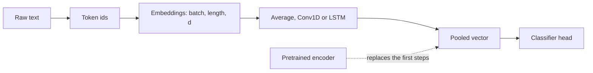

# Neural text models

> You have 5,000 labelled movie reviews. Should you learn embeddings and an LSTM, or fit a linear model on word counts? This chapter runs both on the same split, and the linear model wins. That result explains why text went the way it did: the neural models needed their representations pre-trained on far more text. So the chapter moves from bags of words to models that read in order, then to next-word generation, then to pre-trained sentence encoders, and finally to pre-trained transformers behind a one-line `pipeline()`. It is the last stop before building a language model from scratch in [micrograd](../../../generative-ai/09-llms-from-scratch/notes/01-micrograd.md) to [nanoGPT](../../../generative-ai/09-llms-from-scratch/notes/03-nanogpt.md).

**In plain words.** A shop has a modest pile of labelled customer reviews and wants new ones sorted automatically. Teaching a network language from that pile alone is like teaching a newborn to read from one shelf of books, and a plain count of words does better. Hiring someone who can already read and giving them a short induction on your reviews, which is what a pretrained model amounts to, is what finally beats the count, and only once you have enough labels. This chapter runs that contest and teaches the tools for each side of it.



## Tensors and the text pipeline

The intro-to-nlp TensorFlow track opened with tensors: rank (0 scalar, 1 vector, 2 matrix, 3+), `dtype`, `shape`, conversion with `.numpy()`, `tf.argmax`, `tf.reduce_max`, and the fact that `tf.constant` is immutable while `tf.Variable` can be assigned. PyTorch has the same ideas: `torch.tensor`, `.numpy()`, `torch.argmax`, `.max()`, and `requires_grad` on a tensor in place of `tf.Variable`. Everything below is a stack of such tensors with a batch axis first: text batches are `(batch, seq_len)` token ids, embedded to `(batch, seq_len, d)`.

The data is the IMDb reviews file from the intro-to-nlp practice folder, 50,000 labelled reviews from Maas et al. ([ACL 2011](https://aclanthology.org/P11-1015/)). The file is git-ignored, so download it first, using the [dataset table in the NLP README](../../03-nlp/README.md#intro-to-nlp-datasets). To keep CPU times short, this chapter takes 5,000 for training and another 5,000 for testing. The vocabulary comes from the training rows only:

```python
import re, time
from collections import Counter
import numpy as np, pandas as pd, torch, torch.nn as nn, torch.nn.functional as F

DATA = "../../03-nlp/practice/intro-to-nlp/data/"
df = pd.read_csv(DATA + "IMDB Dataset.csv").sample(frac=1, random_state=0).reset_index(drop=True)
train, test = df[:5000], df[5000:10000]
train_texts, test_texts = train.review.tolist(), test.review.tolist()
train_labels = (train.sentiment == "positive").to_numpy().astype(int)
test_labels = (test.sentiment == "positive").to_numpy().astype(int)

def tokenize(s):
    return re.findall(r"[a-z']+", s.lower().replace("<br />", " "))

vocab_size, max_length, embedding_dim = 10_000, 250, 16
counts = Counter(w for s in train_texts for w in tokenize(s))
vocab = ["<pad>", "<unk>"] + [w for w, _ in counts.most_common(vocab_size - 2)]
stoi = {w: i for i, w in enumerate(vocab)}

def encode(s):
    ids = [stoi.get(w, 1) for w in tokenize(s)][:max_length]     # truncate the end ("post")
    return ids + [0] * (max_length - len(ids))                   # pad the end

X_tr, X_te = (torch.tensor([encode(s) for s in t]) for t in (train_texts, test_texts))
y_tr, y_te = torch.tensor(train_labels), torch.tensor(test_labels)
lengths = [len(tokenize(s)) for s in train_texts]
print("reviews", df.shape[0], " train batch shape", tuple(X_tr.shape))
print("median length", int(np.median(lengths)), " 90th percentile", int(np.percentile(lengths, 90)))
print("share of positions that are <unk>: %.3f" % (X_tr == 1).float().mean())
```

```text
reviews 50000  train batch shape (5000, 250)
median length 174  90th percentile 454
share of positions that are <unk>: 0.037
```

Choices that matter:

| Setting | Effect | Typical |
|---|---|---|
| `vocab_size` | Rare words become `<unk>` | 10k–30k for reviews |
| `max_length`, truncation side | Long reviews lose their end (`post`) or beginning (`pre`); the verdict is often at the end | Cover the 90th percentile of lengths |
| `embedding_dim` | Capacity of each word vector | 16–300 |
| Padding mask | Recurrent layers skip padding: `mask_zero=True` in Keras, `pack_padded_sequence` in PyTorch | On for RNNs |
| Pre-trained embeddings | `nn.Embedding.from_pretrained(glove_matrix, freeze=True)` in PyTorch; `Embedding(..., embeddings_initializer=Constant(glove_matrix), trainable=False)` in Keras | Helps with small data ([NLP embeddings](../../03-nlp/notes/04-embeddings-and-similarity.md)) |

## Four models on the same reviews

An RNN reads one token at a time and carries a hidden state. The state is a running summary of everything read so far, and the last state (or a pooling of all states) feeds the classifier. Training unrolls the loop and backpropagates through time, so the gradient for an early word is a product of many Jacobians, which shrinks or explodes ([sequence models](05-sequence-models.md#vanishing-gradients-and-the-forget-gate-bias) measures that). The cells, in the same form as [the NumPy versions](05-sequence-models.md#the-recurrent-cell):

For scale, Buduma's ch. 7 LSTM (30,000-word vocabulary, length 500, learned 512-d embedding, one 512-unit LSTM, dropout keep 0.5) reaches about 86% on 50,000 IMDb reviews, then overfits. Its 3-gram feed-forward POS tagger on frozen 300-d Google News vectors (900 inputs) passes 96% on CoNLL-2000, though its listing builds the test set from the train file (*Fundamentals of Deep Learning*, ch. 7).

```text
RNN   h_t = tanh(W_x x_t + W_h h_{t-1} + b)        same weights at every step

LSTM  f_t = sigmoid(W_f [h_{t-1}, x_t] + b_f)      forget gate
      i_t = sigmoid(W_i [h_{t-1}, x_t] + b_i)      input gate
      g_t = tanh(W_g [h_{t-1}, x_t] + b_g)         candidate values
      c_t = f_t * c_{t-1} + i_t * g_t              additive update
      o_t = sigmoid(W_o [h_{t-1}, x_t] + b_o)
      h_t = o_t * tanh(c_t)
```

The **GRU** merges the forget and input gates into one update gate and drops the separate cell state, which gives fewer parameters and usually similar accuracy.

| Layer | Params for input d, units n | Notes |
|---|---|---|
| `SimpleRNN(n)` | n(d + n + 1) | Vanishing gradients; a teaching device. `nn.RNN` has one more bias vector |
| `LSTM(n)` | 4 n(d + n + 1) | The default recurrent layer through 2017. `nn.LSTM` has 4 n more for the second bias vector |
| `GRU(n)` | 3 n(d + n + 1) (+ bias detail) | Cheaper LSTM |
| `Bidirectional(LSTM(n))` | 2× | Reads both ways, output 2n; for classification, not generation |
| Stacked: `LSTM(n, return_sequences=True)` then `LSTM(n)` | n/a | Lower layer must return the full sequence. In PyTorch: `nn.LSTM(..., num_layers=2)` |

A 1-D convolution slides over windows of embeddings, so `Conv1d(16, 128, 5)` learns 128 filters over 5 tokens. Each filter becomes an n-gram detector, and global max pooling keeps the strongest match anywhere in the text, the design in Kim ([arXiv:1408.5882](https://arxiv.org/abs/1408.5882) (Kim, EMNLP 2014)). CNNs are fast because positions run in parallel, and they match LSTMs on classification where local phrases decide the label, but they have no long-range memory.

Here are all of them, plus the baseline from [NLP text classification](../../03-nlp/notes/02-text-classification.md):

```python
class Average(nn.Module):
    def __init__(self):
        super().__init__()
        self.emb = nn.Embedding(vocab_size, embedding_dim, padding_idx=0)
        self.out = nn.Linear(embedding_dim, 2)
    def forward(self, x):
        mask = (x != 0).float()[..., None]
        return self.out((self.emb(x) * mask).sum(1) / mask.sum(1).clamp(min=1))

class TextCNN(nn.Module):
    def __init__(self):
        super().__init__()
        self.emb = nn.Embedding(vocab_size, embedding_dim, padding_idx=0)
        self.conv = nn.Conv1d(embedding_dim, 128, 5)
        self.out = nn.Linear(128, 2)
    def forward(self, x):
        return self.out(F.relu(self.conv(self.emb(x).transpose(1, 2))).amax(2))   # channels second

class BiLSTM(nn.Module):
    def __init__(self, h=64):
        super().__init__()
        self.emb = nn.Embedding(vocab_size, embedding_dim, padding_idx=0)
        self.rnn = nn.LSTM(embedding_dim, h, batch_first=True, bidirectional=True)
        self.out = nn.Linear(2 * h, 2)
    def forward(self, x):
        n = (x != 0).sum(1).clamp(min=1).cpu()
        packed = nn.utils.rnn.pack_padded_sequence(self.emb(x), n, batch_first=True, enforce_sorted=False)
        _, (h, _) = self.rnn(packed)                          # skips the padding
        return self.out(torch.cat([h[0], h[1]], dim=1))

def accuracy(m, X, y, bs=500):
    m.eval()
    with torch.no_grad():
        return float(np.mean([(m(X[i:i+bs]).argmax(1) == y[i:i+bs]).float().mean().item() for i in range(0, len(X), bs)]))

def fit(m, epochs, lr):
    opt = torch.optim.Adam(m.parameters(), lr=lr)
    start = time.time()
    for _ in range(epochs):
        m.train()
        perm = torch.randperm(len(X_tr))
        for i in range(0, len(perm), 32):
            b = perm[i:i+32]
            loss = F.cross_entropy(m(X_tr[b]), y_tr[b])
            opt.zero_grad(); loss.backward(); opt.step()
    return m, time.time() - start

for build, epochs, lr in [(Average, 8, 3e-3), (TextCNN, 5, 3e-3), (BiLSTM, 4, 3e-3)]:
    torch.manual_seed(0)
    m, secs = fit(build(), epochs, lr)
    n = sum(p.numel() for p in m.parameters())
    print(f"{build.__name__:<8} params {n:>7}  train {accuracy(m, X_tr, y_tr):.3f}  test {accuracy(m, X_te, y_te):.3f}  {secs:>3.0f} s")

from sklearn.feature_extraction.text import TfidfVectorizer
from sklearn.linear_model import LogisticRegression
tfidf = TfidfVectorizer(ngram_range=(1, 2), min_df=2, sublinear_tf=True)
A, B = tfidf.fit_transform(train_texts), tfidf.transform(test_texts)
clf = LogisticRegression(max_iter=1000, C=10).fit(A, train_labels)
print(f"TF-IDF bigrams + logistic regression  train {clf.score(A, train_labels):.3f}  test {clf.score(B, test_labels):.3f}")
```

```text
Average  params  160034  train 0.969  test 0.847    4 s
TextCNN  params  170626  train 0.998  test 0.741   52 s
BiLSTM   params  202242  train 0.880  test 0.716  116 s
TF-IDF bigrams + logistic regression  train 1.000  test 0.886
```

Each model has more than 160,000 parameters for 5,000 examples, and the CNN memorises its training set while the BiLSTM is still learning after four epochs. Word order hasn't paid for itself yet. The notebooks saw a closer race with five times the data. The intro-to-nlp RNN classification notebook (`vocab_size=10000`, `embedding_dim=16`, `max_length=250`) trained on 25,000 reviews and had these typical outcomes:

| Model | Val accuracy | Training behaviour |
|---|---|---|
| Embedding + GlobalAveragePooling + Dense | ~0.87 | Seconds per epoch; overfits after epoch 2–3 |
| Embedding + Conv1D + GlobalMaxPooling | ~0.88 | Fast, overfits quickly |
| Embedding + Bidirectional LSTM(64) | ~0.87–0.89 | Slowest; validation loss rises while training accuracy hits 0.99 |
| TF-IDF bigrams + logistic regression ([NLP text classification](../../03-nlp/notes/02-text-classification.md)) | ~0.90 | No GPU, no tuning |

The lesson of both tables: a model that learns its embeddings from scratch has too many parameters for the data, and overfitting dominates. [Training and tuning](../../01-classical-ml/notes/09-training-and-tuning.md#reading-performance-during-training) shows how to see that on the curves. Pre-training is what changed that.

## The same pipeline in Keras

The intro-to-nlp notebooks and Sarkar's use Keras, so here is the same model there, which runs on TensorFlow 2.21 and Keras 3. Few epochs and rows, since it only needs to show the pipeline:

```python
import tensorflow as tf
import keras

vectorize = keras.layers.TextVectorization(max_tokens=vocab_size, output_sequence_length=max_length)
vectorize.adapt(train_texts[:2000])       # learns the vocabulary from TRAIN only; index 1 is [UNK] (the old oov_token)

model = keras.Sequential([
    keras.Input(shape=(1,), dtype=tf.string),
    vectorize,                                                    # raw strings in: no separate preprocessing path
    keras.layers.Embedding(vocab_size, embedding_dim, mask_zero=True),
    keras.layers.Bidirectional(keras.layers.LSTM(64)),
    keras.layers.Dense(64, activation="relu"),
    keras.layers.Dense(1, activation="sigmoid"),
])
model.compile(loss="binary_crossentropy", optimizer="adam", metrics=["accuracy"])
def dataset(texts, labels):
    return tf.data.Dataset.from_tensor_slices((texts, labels)).batch(32)     # strings go in through tf.data

history = model.fit(dataset(train_texts[:2000], train_labels[:2000]).shuffle(100), epochs=2, verbose=0,
                    validation_data=dataset(test_texts[:500], test_labels[:500]),
                    callbacks=[keras.callbacks.EarlyStopping(patience=2, restore_best_weights=True)])
print("Keras", keras.__version__, "val accuracy per epoch", np.round(history.history["val_accuracy"], 3))
```

```text
Keras 3.15.1 val accuracy per epoch [0.6  0.69]
```

Two epochs on 2,000 reviews is a check that the API runs, not a score to compare with the table above.

| Keras, as in the notebooks | PyTorch, as in this chapter |
|---|---|
| `Tokenizer(num_words=10000, oov_token="<OOV>")` + `texts_to_sequences` (or `TextVectorization`) | `Counter`, a `stoi` dict and `encode`, or a Hugging Face tokenizer |
| `pad_sequences(maxlen=250, padding="post", truncating="post")` | `ids[:max_length] + [0] * ...`, or `nn.utils.rnn.pad_sequence` |
| `Embedding(vocab, d, mask_zero=True)` | `nn.Embedding(vocab, d, padding_idx=0)` with `pack_padded_sequence` |
| `Bidirectional(LSTM(64))` | `nn.LSTM(d, 64, bidirectional=True, batch_first=True)`, concatenate `h[0]` and `h[1]` |
| `Conv1D(128, 5)` on `(batch, time, d)` | `nn.Conv1d(d, 128, 5)` on `(batch, d, time)` |
| `GlobalMaxPooling1D()` | `.amax(2)` |
| `Dense(1, activation="sigmoid")`, `binary_crossentropy` | `nn.Linear(h, 2)`, `F.cross_entropy` on logits |
| `Dense(total_words, activation="softmax")`, `sparse_categorical_crossentropy` | `nn.Linear(h, total_words)`, `F.cross_entropy` |
| `model.fit(..., callbacks=[EarlyStopping(patience=2, restore_best_weights=True)])` | The loop, and [early stopping by hand](02-optimisation-and-regularisation.md#regularisation) |

The notebooks used the older `Tokenizer`, `texts_to_sequences` and `pad_sequences`. Those live in `tf.keras.preprocessing`, which is deprecated and absent from Keras 3, and [NLP text representation](../../03-nlp/notes/01-text-representation.md) has the mapping.

## Text generation with an LSTM

The same layers, trained to predict the next word, become a language model. The intro-to-nlp notebook trained on a file of Irish song lyrics, with every prefix of every line as a training example, pre-padded so that the target is always the last column. The notebook's seed line was "I too am a human being and I". Here it is in PyTorch, without the notebook's `Bidirectional`, which the table below explains:

```python
corpus = open(DATA + "irish-lyrics.txt").read().lower().split("\n")
words = sorted({w for line in corpus for w in tokenize(line)})
w2i = {w: i + 1 for i, w in enumerate(words)}
i2w = {i: w for w, i in w2i.items()}
total_words = len(words) + 1

# every prefix of every line: [w1] -> w2, [w1 w2] -> w3, ...
pairs = [ids[:i + 1] for line in corpus for ids in [[w2i[w] for w in tokenize(line)]] for i in range(1, len(ids))]
max_len = max(map(len, pairs))
seqs = torch.tensor([[0] * (max_len - len(p)) + p for p in pairs])     # pre-padding
X, y = seqs[:, :-1], seqs[:, -1]
print(len(corpus), "lines,", total_words, "words,", len(pairs), "examples, longest", max_len)

class NextWord(nn.Module):
    def __init__(self):
        super().__init__()
        self.emb = nn.Embedding(total_words, 64, padding_idx=0)
        self.rnn = nn.LSTM(64, 128, batch_first=True)
        self.out = nn.Linear(128, total_words)
    def forward(self, x):
        o, _ = self.rnn(self.emb(x))
        return self.out(o[:, -1])                                      # a distribution over the next word

torch.manual_seed(0)
gen = NextWord()
opt = torch.optim.Adam(gen.parameters(), lr=3e-3)
start = time.time()
for epoch in range(25):
    perm = torch.randperm(len(X))
    total = 0.0
    for i in range(0, len(perm), 128):
        b = perm[i:i+128]
        loss = F.cross_entropy(gen(X[b]), y[b])
        opt.zero_grad(); loss.backward(); opt.step()
        total += loss.item() * len(b)
print(f"final loss {total / len(X):.2f}, against ln(vocabulary) {np.log(total_words):.2f} for a uniform guess; {time.time() - start:.0f} s")

@torch.no_grad()
def generate(seed, n=20, temperature=None):
    out = tokenize(seed)
    for _ in range(n):
        ids = [w2i.get(w, 0) for w in out][-(max_len - 1):]
        logits = gen(torch.tensor([[0] * (max_len - 1 - len(ids)) + ids]))[0]
        logits[0] = -1e9                                               # never emit padding
        nxt = logits.argmax().item() if temperature is None else torch.multinomial((logits / temperature).softmax(0), 1).item()
        out.append(i2w[nxt])
    return " ".join(out)

seed = "I too am a human being and I"
torch.manual_seed(0)
print("greedy:", generate(seed))
print("t=0.7: ", generate(seed, temperature=0.7))
print("t=1.5: ", generate(seed, temperature=1.5))
```

```text
1693 lines, 2693 words, 12048 examples, longest 16
final loss 0.59, against ln(vocabulary) 7.90 for a uniform guess; 21 s
greedy: i too am a human being and i followed than my light was standing there ever still i cant serve you as my love prove false to me
t=0.7:  i too am a human being and i followed my kellswater so fair love ill take sit awhile in the merry month and that eer i have been
t=1.5:  i too am a human being and i heard khaki sleep it them deep over parted with whirring runaway still at there is neer horses rode pure children
```

A loss of 0.59 on 1,693 lines means the model has largely memorised them, and "kellswater" comes straight from the training text. Temperature sets the trade: 0.7 stays close to the phrases it knows, and 1.5 reaches for rarer words and loses the grammar.

What goes wrong, and why it matters for what follows:

| Symptom | Cause | Fix (and where it reappears) |
|---|---|---|
| Output loops ("the the the", repeated lines) | Greedy `argmax` | Sample from the softmax with a temperature; top-k / top-p ([nanoGPT](../../../generative-ai/09-llms-from-scratch/notes/03-nanogpt.md)) |
| Grammatical for a few words, then drifts | Small corpus; context is one line | More data, longer context |
| Huge output layer | Word-level vocabulary | Character or subword tokens ([makemore](../../../generative-ai/09-llms-from-scratch/notes/02-makemore.md), BPE in [nanoGPT](../../../generative-ai/09-llms-from-scratch/notes/03-nanogpt.md)) |
| Bidirectional generator | Uses the future at training time but not at sampling | Causal (left-to-right) models only |

This is the same task, next-token prediction trained with [cross-entropy](../../../generative-ai/01-llm-fundamentals/notes/06-pretraining-data-and-objectives.md#entropy-cross-entropy-kl-and-perplexity), that makemore and nanoGPT solve with better architectures. The notebook's own settings were `Embedding(total_words, 100)`, `Bidirectional(LSTM(150))`, `to_categorical` and 10 epochs, and the translation table above covers those layers.

## LSTMs beyond text: sequence regression

The own notebook `deep-learning-starter-simple-lstm` is a Kaggle starter for the [Ventilator Pressure Prediction](https://www.kaggle.com/competitions/ventilator-pressure-prediction) competition: predict airway pressure at each of 80 time steps of a simulated breath from the control inputs (`u_in`, `u_out`) and lung attributes (`R`, `C`). It isn't NLP, but it is the cleanest PyTorch LSTM in the folder. The model and the loss below are the notebook's, with smaller default sizes and the shape fixed for the `(batch, 80, 1)` output. The competition data isn't in the repo, so this generates breaths from a simple lung equation: pressure rises with inflow over compliance and with resistance, and it decays while `u_out` is open.

```python
class RNNModel(nn.Module):
    def __init__(self, input_dim=4, dense_dim=32, lstm_dim=32, logit_dim=32, num_classes=1):
        super().__init__()
        self.mlp = nn.Sequential(nn.Linear(input_dim, dense_dim // 2), nn.ReLU(),
                                 nn.Linear(dense_dim // 2, dense_dim), nn.ReLU())
        self.lstm = nn.LSTM(dense_dim, lstm_dim, batch_first=True, bidirectional=True)
        self.logits = nn.Sequential(nn.Linear(lstm_dim * 2, logit_dim), nn.ReLU(),
                                    nn.Linear(logit_dim, num_classes))
    def forward(self, x):                      # x: (batch, 80, input_dim)
        h, _ = self.lstm(self.mlp(x))          # (batch, 80, 2*lstm_dim): an output for EVERY step
        return self.logits(h).squeeze(-1)      # (batch, 80)

class VentilatorLoss(nn.Module):
    """Optimise the competition metric directly: MAE on the inspiratory phase only."""
    def forward(self, preds, y, u_out):
        w = 1 - u_out                          # u_out == 0 during inspiration
        return ((w * (y - preds).abs()).sum(-1) / w.sum(-1)).mean()

def breaths(n, seed):
    g = np.random.default_rng(seed)
    X, Y = np.zeros((n, 80, 4), dtype=np.float32), np.zeros((n, 80), dtype=np.float32)
    for k in range(n):
        R, C = g.choice([0.5, 2.0, 5.0]), g.choice([1.0, 2.0, 5.0])
        amp, f, p = g.uniform(0.5, 1.5), g.uniform(0.05, 0.3), 0.0
        for t in range(80):
            u_out = float(t >= 30)
            u_in = 0.0 if u_out else amp * (1 + np.sin(f * t))
            p += (u_in / C - 2.0 * u_out * p) * 0.2                 # volume in, or release
            X[k, t] = u_in, u_out, R / 5, C / 5
            Y[k, t] = p + R * u_in * (1 - u_out)                    # resistive term while inflow runs
    return torch.tensor(X), torch.tensor(Y)

Xb, Yb = breaths(800, 0)
Xv, Yv = breaths(200, 1)
insp = lambda p: VentilatorLoss()(p, Yv, Xv[:, :, 1]).item()
for name, criterion in [("MAE on all steps", lambda p, y, x: (p - y).abs().mean()),
                        ("masked as the metric", lambda p, y, x: VentilatorLoss()(p, y, x[:, :, 1]))]:
    torch.manual_seed(0)
    m = RNNModel()
    opt = torch.optim.Adam(m.parameters(), lr=3e-3)
    for epoch in range(12):
        perm = torch.randperm(len(Xb))
        for i in range(0, len(perm), 32):
            b = perm[i:i+32]
            loss = criterion(m(Xb[b]), Yb[b], Xb[b])
            opt.zero_grad(); loss.backward(); opt.step()
    with torch.no_grad():
        pred = m(Xv)
    print(f"{name:<21}  inspiratory MAE {insp(pred):.3f}  all-steps MAE {(pred - Yv).abs().mean():.3f}")
```

```text
MAE on all steps       inspiratory MAE 0.274  all-steps MAE 0.117
masked as the metric   inspiratory MAE 0.248  all-steps MAE 7.212
```

Matching the loss to the metric lowers the error that counts from 0.274 to 0.248. It does so by ignoring the other steps entirely, where the error grows to 7.212, which is fine here only because nobody scores them.

Worth copying from the notebook: a per-step MLP before the LSTM, a masked loss that matches the metric, `GroupKFold` by `breath_id` so that no breath is in both train and validation ([model evaluation](../../01-classical-ml/notes/04-model-evaluation.md)), `seed_everything` plus deterministic cuDNN, and a linear warm-up scheduler. `Bidirectional` is legitimate here because the whole breath is known at prediction time.

## Transfer learning with sentence encoders

Instead of learning embeddings from 5,000 or 25,000 reviews, start from an encoder pre-trained on far more text and train only a small head. Sarkar (ch. 10a) compares encoders from TensorFlow Hub on IMDb with the same `DNNClassifier(hidden_units=[512, 128])` head, including the Universal Sentence Encoder ([arXiv:1803.11175](https://arxiv.org/abs/1803.11175) (Cer et al., 2018, preprint)):

| Encoder | Output | Frozen vs fine-tuned |
|---|---|---|
| NNLM (`nnlm-en-dim128`) | 128-d, a feed-forward language model's embedding | Fine-tuning adds a few points |
| Universal Sentence Encoder (`universal-sentence-encoder/2`) | 512-d, transformer/DAN trained on many tasks | Best: ~0.86 frozen, ~0.90 fine-tuned |


*Image source: Sarkar, Text Analytics with Python (2nd ed.), ch. 10, from the companion notebooks*

The modern equivalent needs no TF 1.x estimator: encode, then fit a linear head. It uses encoders from `sentence-transformers`, the library released with Sentence-BERT ([arXiv:1908.10084](https://arxiv.org/abs/1908.10084) (Reimers and Gurevych, EMNLP 2019)); the two models here are newer than the paper. That paper finds frozen vectors with a logistic-regression head competitive across seven tasks (average SentEval accuracy, 10-fold cross-validation: 87.69 for its large NLI model, 84.94 for averaged BERT), but its authors say transfer is not the purpose of these embeddings and prefer full fine-tuning for a new task, which the next block tries. This block runs a small encoder and a larger one against the TF-IDF baseline as the labels grow. It takes a few minutes on a laptop GPU and longer on CPU:

```python
from sentence_transformers import SentenceTransformer

device = "mps" if torch.backends.mps.is_available() else "cuda" if torch.cuda.is_available() else "cpu"
sizes = [100, 500, 2000, 5000]
print("TF-IDF + LR       ", [round(LogisticRegression(max_iter=1000, C=10).fit(A[:n], train_labels[:n]).score(B, test_labels), 3) for n in sizes])
for name in ["all-MiniLM-L6-v2", "all-mpnet-base-v2"]:      # 384-d and 768-d
    start = time.time()
    enc = SentenceTransformer(name, device=device)
    E_train = enc.encode(train_texts, batch_size=32, show_progress_bar=False)
    E_test = enc.encode(test_texts, batch_size=32, show_progress_bar=False)
    scores = [round(LogisticRegression(max_iter=1000).fit(E_train[:n], train_labels[:n]).score(E_test, test_labels), 3) for n in sizes]
    print(f"{name:<18}", scores, f"{time.time() - start:.0f} s")
```

```text
TF-IDF + LR        [0.719, 0.8, 0.862, 0.886]
all-MiniLM-L6-v2   [0.669, 0.754, 0.786, 0.806] 18 s
all-mpnet-base-v2  [0.769, 0.841, 0.871, 0.882] 152 s
```

The columns are 100, 500, 2,000 and 5,000 labels. "Pre-trained encoder" isn't one result. The small MiniLM model, which reads at most 256 word pieces, loses to TF-IDF at every size. The larger mpnet model, which reads 384, wins clearly on few labels (0.769 against 0.719 at 100, 0.841 against 0.800 at 500), and its lead has gone by 5,000 (0.882 against 0.886). So a frozen encoder earns its place when labels are few, as long as you measure the encoder on your own task and keep TF-IDF as the bar.

The other option is to train through the encoder, which is the model from [note 05b](05b-transformer-encoders.md). Fine-tuning a pre-trained DistilBERT ([arXiv:1910.01108](https://arxiv.org/abs/1910.01108) (Sanh et al., 2019, preprint)) uses the same loop as the rest of this pillar, with a small learning rate and two epochs:

```python
from transformers import AutoTokenizer, AutoModelForSequenceClassification

name = "distilbert-base-uncased"
tok = AutoTokenizer.from_pretrained(name)

def tokens(texts):
    return tok(texts, truncation=True, max_length=256, padding="max_length", return_tensors="pt")

T_te = tokens(test_texts)
for n in [500, 2000, 5000]:
    torch.manual_seed(0)
    start = time.time()
    bert = AutoModelForSequenceClassification.from_pretrained(name, num_labels=2).to(device)
    T_tr = tokens(train_texts[:n])
    opt = torch.optim.AdamW(bert.parameters(), lr=2e-5, weight_decay=0.01)
    bert.train()
    for epoch in range(2):
        perm = torch.randperm(n)
        for i in range(0, n, 16):
            b = perm[i:i+16]
            loss = bert(input_ids=T_tr.input_ids[b].to(device), attention_mask=T_tr.attention_mask[b].to(device),
                        labels=y_tr[b].to(device)).loss
            opt.zero_grad(); loss.backward(); opt.step()
    bert.eval()
    hits = 0
    with torch.no_grad():
        for i in range(0, len(test_texts), 64):
            out = bert(input_ids=T_te.input_ids[i:i+64].to(device), attention_mask=T_te.attention_mask[i:i+64].to(device))
            hits += (out.logits.argmax(1).cpu() == y_te[i:i+64]).sum().item()
    print(f"{n:>5} labels: fine-tuned DistilBERT {hits / len(test_texts):.3f}  {time.time() - start:.0f} s")
```

```text
  500 labels: fine-tuned DistilBERT 0.825  57 s
 2000 labels: fine-tuned DistilBERT 0.883  109 s
 5000 labels: fine-tuned DistilBERT 0.905  239 s
```

Fine-tuning needs enough labels. At 500 it trails the frozen mpnet model (0.825 against 0.841), at 2,000 it leads (0.883 against 0.871), and at 5,000 its 0.905 is the first score in this chapter to clearly beat word counts, by about two points. This is one split and one seed, so differences under a point are ties. The neural models trained from scratch never got close, and the difference is that DistilBERT arrives having already read far more text than these 5,000 reviews. The same sentence vectors power semantic search ([NLP embeddings](../../03-nlp/notes/04-embeddings-and-similarity.md), [RAG and retrieval](../../../generative-ai/02-rag-retrieval/README.md)).

## Transformers pipelines

The intro-to-nlp transformers notebook, from the [Hugging Face LLM Course](https://huggingface.co/learn/llm-course), ran its tasks with default models. Defaults change between library versions, so these pin a `model=`, smaller where a smaller one exists. Most tasks are one line, and three now take a few more:

```python
from transformers import pipeline, AutoModelForQuestionAnswering, AutoModelForSeq2SeqLM

words = "My name is Sylvain and I work at Hugging Face in Brooklyn."
sentiment = pipeline("sentiment-analysis", model="distilbert-base-uncased-finetuned-sst-2-english")
print(sentiment("I've been waiting for a HuggingFace course my whole life."))
ner = pipeline("ner", model="dslim/bert-base-NER", aggregation_strategy="first")
print([(e["word"], e["entity_group"]) for e in ner(words)])
fill = pipeline("fill-mask", model="distilroberta-base")
print([(r["token_str"], round(r["score"], 3)) for r in fill("This course will teach you all about <mask> models.", top_k=2)])
zero = pipeline("zero-shot-classification", model="typeform/distilbert-base-uncased-mnli")
r = zero("This is a course about the Transformers library", candidate_labels=["education", "politics", "business"])
print([(label, round(s, 3)) for label, s in zip(r["labels"], r["scores"])])
gen = pipeline("text-generation", model="gpt2")
print(gen("In this course, we will teach you how to", max_new_tokens=15, do_sample=False)[0]["generated_text"])
features = pipeline("feature-extraction", model="distilbert-base-uncased")
print("features", np.array(features("How old are you?")).shape)

name = "distilbert-base-cased-distilled-squad"        # no pipeline task since transformers 5: open it up
tok = AutoTokenizer.from_pretrained(name)
qa = AutoModelForQuestionAnswering.from_pretrained(name)
inputs = tok("Where do I work?", words, return_tensors="pt")
with torch.no_grad():
    out = qa(**inputs)
print("answer:", tok.decode(inputs.input_ids[0, out.start_logits.argmax():out.end_logits.argmax() + 1]))

def seq2seq(name, text, **kw):
    tok = AutoTokenizer.from_pretrained(name)
    m = AutoModelForSeq2SeqLM.from_pretrained(name)
    ids = m.generate(**tok(text, return_tensors="pt", truncation=True), **kw)
    return tok.decode(ids[0], skip_special_tokens=True)

passage = ("Attention lets a decoder read every encoder state at each step. Before it, an encoder squeezed a whole "
           "sentence into one vector, and long sentences suffered. The Transformer then removed recurrence altogether, "
           "so that training could run in parallel across positions. Most language models today descend from that design.")
print("summary:", seq2seq("sshleifer/distilbart-cnn-12-6", passage, min_length=10, max_new_tokens=40))
print("french:", seq2seq("Helsinki-NLP/opus-mt-en-fr", "How old are you?"))
```

```text
[{'label': 'POSITIVE', 'score': 0.9598047137260437}]
[('Sylvain', 'PER'), ('Hugging Face', 'ORG'), ('Brooklyn', 'LOC')]
[(' mathematical', 0.196), (' computational', 0.041)]
[('education', 0.433), ('politics', 0.351), ('business', 0.216)]
In this course, we will teach you how to use the Java Virtual Machine (JVM) to create and manage virtual machines
features (1, 7, 768)
answer: Hugging Face
summary:  Before it, an encoder squeezed a whole sentence into one vector, and long sentences suffered . The Transformer then removed recurrence altogether, so that training could run in parallel across positions .
french: Quel âge avez-vous ?
```

| Task | Default model family in the notebook | Architecture | Related chapter |
|---|---|---|---|
| sentiment-analysis | DistilBERT fine-tuned on SST-2 | Encoder | [NLP sentiment analysis](../../03-nlp/notes/06-sentiment-analysis.md) |
| ner | BERT fine-tuned on CoNLL-03 | Encoder | [NLP semantic analysis and NER](../../03-nlp/notes/05-semantic-analysis-and-ner.md) |
| question-answering | DistilBERT on SQuAD (extractive span) | Encoder | n/a |
| fill-mask | DistilRoBERTa | Encoder (masked LM) | n/a |
| summarization, translation | BART / T5 | Encoder–decoder | [NLP topic models](../../03-nlp/notes/03-topic-models-and-summarization.md) |
| text-generation | GPT-2 | Decoder (causal LM) | [nanoGPT](../../../generative-ai/09-llms-from-scratch/notes/03-nanogpt.md) |
| zero-shot-classification | BART-large-MNLI | Encoder–decoder, NLI trick | [NLP text classification](../../03-nlp/notes/02-text-classification.md) |

The encoders descend from BERT ([arXiv:1810.04805](https://arxiv.org/abs/1810.04805) (Devlin et al., NAACL 2019)), and DistilBERT is a smaller distilled version ([arXiv:1910.01108](https://arxiv.org/abs/1910.01108) (Sanh et al., 2019, preprint)). A pipeline is tokenizer → model → post-processing, so open it up with `AutoTokenizer` and `AutoModelForSequenceClassification` when you need batching control or fine-tuning (`Trainer`). This ran on transformers 5.22.1, which removed the `question-answering`, `summarization` and `translation` pipeline tasks that the notebook used. Asking for them raises a `KeyError` that points to `text-generation` with a chat model, while the same models still run through the `Auto` classes above. Three more things show in the output. `aggregation_strategy="first"` matters, because `"simple"` split Sylvain into S, ##yl and ##va. The "summary" is two sentences copied from the passage. GPT-2 continues text about a course with the JVM, since a base model completes text and has no instruction to follow.

## TensorFlow status of the text notebooks

| Notebook | API era | Status |
|---|---|---|
| Sarkar `Ch10a` (universal embeddings) | `tf.estimator`, `hub.text_embedding_column`, `tf.estimator.inputs.numpy_input_fn` | Partly migrated: the confusion-matrix cell uses `tf.math.confusion_matrix(...).numpy()`, but the estimator API was removed in TF 2.16 and the TF-Hub v1 modules need `tensorflow_hub` with TF ≤ 2.15. Read for the idea; use `sentence-transformers` to run it |
| Sarkar `Ch04b`, `Ch09b`, `Ch09c` | Standalone `keras` 2.x, `keras.layers.normalization`, `predict_classes` | Legacy; port to `tensorflow.keras` / Keras 3 |
| Kaggle NLP notebook | `keras.layers.recurrent`, standalone keras | Legacy ([NLP text classification](../../03-nlp/notes/02-text-classification.md)) |
| intro-to-nlp (practice) | `tf.keras` 2.x with `preprocessing.text.Tokenizer` | The Keras section above uses `TextVectorization` |
| Ng Sequence Models | standalone `keras` 2.x, TF 1.x backend | Legacy, reading-only ([migration map](01-neural-networks-fundamentals.md#tensorflow-1x-to-2x-status-and-migration-map)) |
| own `deep-learning-starter-simple-lstm` | PyTorch + `transformers` scheduler | Current |

## What attention fixed

An encoder RNN squeezes a whole sentence into one final state, and its steps cannot run in parallel. [The date model](05-sequence-models.md#seq2seq-and-attention) showed the first problem directly. Attention lets every position look directly at every other position with learned weights, and the Transformer drops recurrence entirely ([arXiv:1706.03762](https://arxiv.org/abs/1706.03762) (Vaswani et al., NeurIPS 2017)), as [transformer encoders](05b-transformer-encoders.md) showed. Building that from scratch, one piece at a time, is the job of the next three notes: autograd ([micrograd](../../../generative-ai/09-llms-from-scratch/notes/01-micrograd.md)), language-model training ([makemore](../../../generative-ai/09-llms-from-scratch/notes/02-makemore.md)), and the Transformer itself ([nanoGPT](../../../generative-ai/09-llms-from-scratch/notes/03-nanogpt.md)). The LLM-level view continues in [LLM fundamentals](../../../generative-ai/01-llm-fundamentals/README.md).

## Reading

*Building AI Agents with LLMs, RAG, and Knowledge Graphs*, ch. 1 ([PDF](../../sources/building-ai-agents-llms-rag-kgs/ch01-analyzing-text-data-deep-learning.pdf)) walks the same arc, from one-hot and TF-IDF through word2vec to RNN, LSTM, GRU and CNN text classifiers. Buduma, *Fundamentals of Deep Learning* ([PDF](../../sources/buduma-fundamentals-of-deep-learning.pdf)), covers the recurrent and embedding chapters in more depth.

| Notebook | Covers | Runs |
|---|---|---|
| [`Ch10a - Text Classification with Universal Embeddings`](../../03-nlp/practice/text-analytics-with-python/Ch10%20-%20The%20Promise%20of%20Deep%20Learning/Ch10a%20-%20Deep%20Transfer%20Learning%20for%20NLP%20-%20Text%20Classification%20with%20Universal%20Embeddings.ipynb) | TF-Hub NNLM and USE encoders, frozen vs fine-tuned | Legacy: needs TF ≤ 2.15 + `tensorflow_hub`, internet for the modules, GPU recommended, IMDb `movie_reviews.csv` (not in this snapshot) |
| [`deep-learning-starter-simple-lstm`](../practice/deep-learning-starter-simple-lstm.ipynb) | PyTorch BiLSTM sequence regression, masked loss, GroupKFold | Needs data: Kaggle `ventilator-pressure-prediction`; GPU (5 folds × 200 epochs); `transformers` for the scheduler |

The intro-to-nlp TensorFlow notebooks are in [`practice/intro-to-nlp/tensorFlow/`](../../03-nlp/practice/intro-to-nlp/tensorFlow) and the transformers notebook in [`practice/intro-to-nlp/transformers/`](../../03-nlp/practice/intro-to-nlp/transformers). They use the older `Tokenizer` API. All the numbers in this chapter's output blocks came from running the code shown, with `uv run --with torch --with scikit-learn --with pandas --with tensorflow --with sentence-transformers --with transformers`, on CPU. The IMDb file needs to be in the `data` folder.

## Pitfalls

| Symptom | Cause | Fix |
|---|---|---|
| Neural model scores below TF-IDF | Too little data to learn embeddings | Pre-trained encoder, or keep the linear baseline |
| Train accuracy 0.99, validation falling | Overfitting; embeddings memorise | Early stopping, dropout, smaller `embedding_dim` |
| Good accuracy that collapses on real text | Vocabulary or scaler fitted on all the data, or `<unk>` handled differently at serving | Fit on train only; ship the vectoriser with the model (a `TextVectorization` layer does this) |
| Verdict at end of review is ignored | `truncating="post"` cut it off | Check the length percentiles; truncate from the start or use longer windows |
| Padding changes the prediction | No mask, so the last "step" is padding | `pack_padded_sequence` or `mask_zero=True` |
| Generation repeats itself | Greedy decoding | Sample with temperature |
| `Conv1d` dimension error | Keras has channels last, PyTorch channels second | `.transpose(1, 2)` |
| Pipeline results change after an upgrade | Default model changed | Pin `model=` |
| A frozen encoder loses to TF-IDF | A small encoder that truncates long text | Measure more than one encoder and keep the baseline: MiniLM lost and mpnet won at 100 labels |
| A model scores well on a loss nobody measures | Loss differs from metric | Mask it to the metric, as `VentilatorLoss` does |

## Try it

1. Change the truncation in `encode` to keep the last 250 tokens, and retrain `Average`. Does the end of a review carry more signal?

   <details><summary>Answer</summary>

   Train 0.970 and test 0.857, against 0.969 and 0.847 for the first 250 tokens. On this split and seed the ending is worth about a point, in line with verdicts often coming at the end. Only reviews over 250 tokens change, a minority given the median of 174.

   </details>

2. Replace `Average`'s learned embeddings with a smaller `embedding_dim=4`. Does it overfit less?

   <details><summary>Answer</summary>

   Train 0.915 and test 0.827, against 0.969 and 0.847 with 16 dimensions. The gap shrinks from 0.122 to 0.088, so it overfits less, but the test score falls because it has lost capacity. Less overfitting isn't the goal in itself.

   </details>

3. Pass `max_length=50` to the data encoding and retrain `Average` and `TF-IDF` on the same first 50 tokens. Which suffers more?

   <details><summary>Answer</summary>

   `Average` falls to test 0.727 from 0.847, and TF-IDF to 0.752 from 0.886. TF-IDF loses slightly more, 0.134 against 0.120, but still leads. Both suffer far more from losing the text than from the choice of model.

   </details>

## Interview checklist

| Question | Answer |
|---|---|
| Why would TF-IDF beat an LSTM? | With little labelled data, a linear model has few effective parameters and an LSTM must learn its embeddings as well. |
| What does an embedding layer do? | It looks up a trainable vector per token id, so that it's a linear layer on a one-hot input, stored efficiently. |
| Why mask padding? | So the padding isn't read as tokens and the last real step supplies the summary. |
| Why pre-pad for next-word training? | So the target is always the last column and the last state is always next to it. |
| Why can't a bidirectional LSTM generate text? | It uses future tokens in training that don't exist while sampling. |
| What's the point of `Conv1D` on text? | Filters are n-gram detectors, and global max pooling finds them anywhere, quickly. |
| What does a frozen sentence encoder give you? | A baseline with a linear head and no training cost, worth having on few labels if you measure the encoder. On 100 reviews mpnet beat TF-IDF and MiniLM lost to it. |
| When does fine-tuning pay? | Once there are enough labels: at 5,000 reviews DistilBERT reached 0.905, against 0.886 for TF-IDF, but at 500 it trailed a frozen encoder. |
| Greedy vs temperature sampling? | Greedy picks the top token and loops; temperature rescales logits and samples. |
| What's inside a Hugging Face pipeline? | Tokenizer, model, post-processing. |
| Why did attention replace RNNs? | No bottleneck, and positions run in parallel. |

## Next

[micrograd](../../../generative-ai/09-llms-from-scratch/notes/01-micrograd.md): a scalar autograd engine in about 100 lines, the machinery under every model above. On the text side, [NLP embeddings](../../03-nlp/notes/04-embeddings-and-similarity.md) goes deeper.
